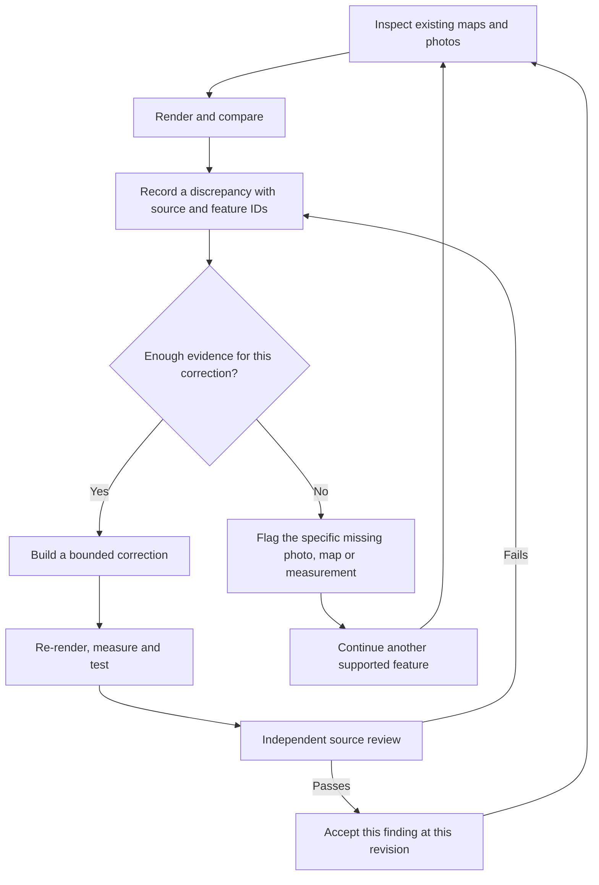

# Continuous evidence-backed development

Run from the repository root:

```bash
python3 scripts/photo_loop.py --area north-pool
```

This regenerates the graph and publishes actionable findings in `refs/LOOP.md`
and `public/photo-loop.json`. The Inspect scorecard lists missing map evidence
alongside the existing photo spots, with a link to the full work list. It works
for every registered area; the first seeded findings are for the north pool.



## Agent recipe: repeat until accepted or evidence-blocked

1. Refresh the loop. Read AGENTS.md, the area brief, reference pack and actual
   full-size sources. Respect tasks owned by other agents. Take a ready queue
   task, one branch and PR per task. A ready finding means ready to compare;
   it is not a pre-approved geometry edit.
2. Reuse existing evidence first. An unsolved camera needs processing, not
   another photograph. An inaccessible private source needs access to the
   existing source. Consult maps/aerials and the laser survey where relevant.
3. Capture before evidence through solved cameras (the command starts its own server):

   ```bash
   python3 scripts/photo_loop.py --area north-pool --render --task loop-discrepancies --as before
   ```

   This also makes overlays. Overlay rendering uses Pillow, NumPy and SciPy, as
   the existing `photo_pose.py` workflow does. Inspect every relevant source and record each
   difference in `data/discrepancies.json`: stable ID, area, kind, description,
   source IDs, affected feature IDs, follow-up task, status and request IDs.
   Split broad inventory findings into individual corrections. Keep original
   sources and feature scope. Existing placement reports remain authoritative.
4. Correct supported features, update confidence and evidence, render `--as after`,
   compare and measure. Record photo checks and placement packets under the
   existing policies. The renderer command produces artifacts, never an
   automatic match or approval. Choose task/feature-specific checks as well.
5. If evidence is insufficient, add a targeted `data/evidence_requests.json`
   entry (`photo`, `map`, or `measurement`), with `ask`, `why`, area and the
   precise feature/discrepancy scope. For a photograph also use the existing
   photo request system to record where to stand and what to point at; link its
   ID as `photoRequest`. Use `tasks` only when the *entire task* is blocked.
   Keep building unaffected features. After two unsuccessful correction/review
   attempts, diagnose camera/source conflicts and record the blocker before
   trying again; do not relax the standard to get a pass.
6. Mark a correction `fixed` when it is ready for review. Obtain a second
   agent/session's actual source review. The review object has `author`,
   `reviewer`, `date`, `decision: accepted`, `notes`, `sourcesInspected`,
   `snapshot`, `packetDigest`, and hashed `render`, `comparison`, `overlay` artifacts. Each
   artifact is `{path, sha256}` relative to the public repo. Keep private pixels
   private; link the inspected private comparison from the public-safe report.
   Appearance/completeness reviews also have a `checklist` keyed by the standard.
   Height reviews have `measurement: {rmsM, uncertaintyM, toleranceM, basis, heldOut}`.
   The snapshot template is generated without granting approval:

   ```bash
   python3 scripts/photo_loop.py --snapshot north-deck-shape
   python3 scripts/photo_loop.py --review-digest /path/to/review.json
   ```

   The independent reviewer records the printed digest as `packetDigest` after
   inspecting that exact review packet and its artifacts. Mark `closed` only with a current passing packet. The graph rejects unsupported
   closure, self-review, changed evidence and stale artifacts. Keep prior review
   objects in `reviewHistory` when re-reviewing. Placement requires the existing
   independent measured packets as well; an appearance packet cannot replace them.
7. Run `python3 scripts/photo_loop.py --area north-pool --validate`, plus the
   task's applicable HANDOVER checks. Merge/push according to AGENTS.md. Repeat
   on another ready task. Stop the area run when only evidence-blocked work
   remains, listing exactly what would unblock it. Do not mark the area verified
   just because no tasks are ready.

## Evidence arrival and automation

New photos still use the existing Drive intake workflow. It imports pins, not
image meaning. Tag and inspect new sources, solve their cameras where possible,
and rerun the command. Linked photo requests progress from open to received to
answered through their existing review process. Map/measurement requests use
`sources`, `reviewer` and `note` before `status: answered`.

The PR/push/daily/manual **Continuous evidence loop** Action builds the current app,
checks the graph and Inspect, and uploads the current work list with outstanding
requests. Missing evidence is reported rather than treated as a failed build.
The UI integration checks use `VILLACANA_TEST_DEVICE_SCALE=0.5` in CI and through
`--validate` to reduce software WebGL raster cost while retaining the same CSS
viewports, pointer coordinates and actual renderer. Direct test runs default to 1.
It does not run a model-editing agent or invent visual judgments. Continuous
geometry improvements are performed by the agent recipe above; unattended
model-editing requires an agent runner beyond deterministic CI.

The original five PHOTO_LOOP_PRD tasks stay open until their complete definitions
are met. This delivery establishes persistent orchestration and acceptance;
it does not claim automatic camera correspondence, image recognition, or that
the north pool has already reached acceptance.
