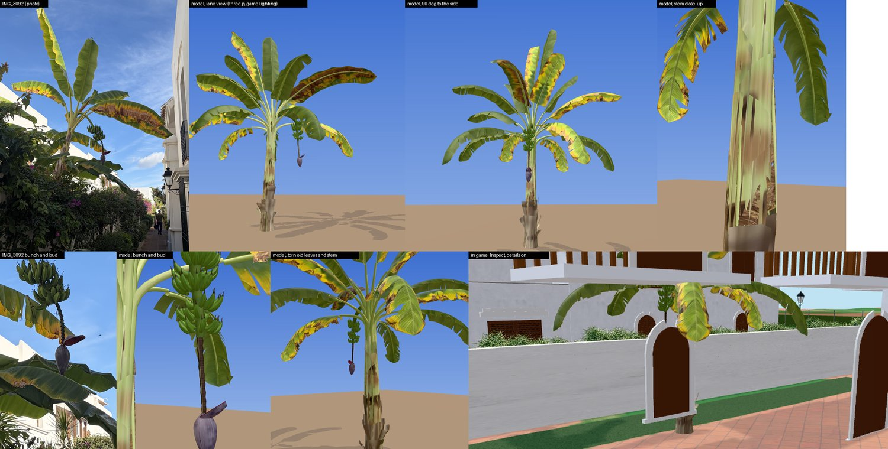

# Banana plant asset (`public/models/plants/banana.glb`)

The banana (Musa) behind the white garden wall on Calle de Miguel, placed in the game as
`miguel-banana-1` (kind `banana`). It has fruited: a bunch of green bananas and a grey-purple male
bud. The model is built procedurally in Blender (bpy 5.2.3) by `scripts/build_banana.py`. The leaf
colour is photographic: it was cut from Dave's own photo IMG_3092. It is not a scan and not a
downloaded model.

This is the second version. Dave judged the first, painted version insufficient: its crown was thin
from the side, its leaves looked like flat panels, the stem was a plain tube, the bunch was a cone
and the colour read olive.

Build:

```
python3 scripts/build_banana.py             # writes public/models/plants/banana.glb
python3 scripts/build_banana.py --extract   # only to re-cut scripts/assets/banana/*.jpg (needs the private original)
```

The build is seeded. Three consecutive builds gave the same sha256, `54a4a9e1…6cfc6e6733`.



The comparison shows IMG_3092 next to the model from a similar lane view, the photographed
bunch next to the model's bunch, and the model in the game's Inspect view.

## Sources and licences

All texture sources are Dave's photos of this plant. No external images were used.

| Use | Source | Licence |
|---|---|---|
| Green leaf (atlas column 1) | IMG_3092: the upright leaf in the centre, seen from below against the sky. It was unrolled between its midrib and both margins. | Dave's own photo, already published in this repo as `public/photos-ref/IMG_3092.jpg` |
| Yellowed leaf (column 2) | IMG_3092: the leaf reaching out to the left. One half was unrolled from midrib to margin and is used mirrored for the other half. | as above |
| Scorched leaf (column 3) | IMG_3092: the big arching leaf to the right with the brown band. It was unrolled across its visible width. | as above |
| Dead leaf (column 4) | The brown band of the scorched leaf, spread across, made paler and greyer | as above |

How the leaf textures were made:
- `--extract` reads the private full-size original (`IMG_3092.HEIC`, 4284 × 5712; it is never
  committed). It walks out from a hand-placed guide line until it reaches the sky to find each
  leaf's edges, then resamples the leaf into flat strips.
- The strips are stored, small and without photo metadata, in `scripts/assets/banana/`:
  `leaf-green.jpg` 256 × 1024, `leaf-yellow.jpg` 128 × 1024 and `leaf-scorch.jpg` 256 × 1024,
  about 150 kB in all.
- The traces are `TRACES` in the build script.
- The build evens out most of the photo's broad light and shadow.
- It also adds a ragged cut-out margin (more ragged where the photo shows dried tissue), fine splits
  along the veins, a vein normal map (from the photo's own vein detail) and a glow map.
- The stem texture is generated from numbers.
- **The bunch is the photo** (third pass, 19 November 2026, after Dave asked for the hanging bunch
  from the photo). `--extract` cuts the stalk, both clusters, the rachis, the bud and the lifted
  bract out of the sky in the full-size IMG_3092 (`BUNCH_CROP`, zones `BUNCH_POLY`). It refills the
  background from the nearest bunch pixel, blended toward each part's typical colour, and saves
  `scripts/assets/banana/bunch-photo.jpg`. The bunch geometry is laid out from the same photo, and
  the photo is projected onto it from the lane-side view (`bunch_uv`). Every part of the bunch takes
  its colour from the picture, and the backs of the fingers take the colour of the fronts.

## Size estimate

None of these sizes is measured. They come from proportions in the photos, with the garden wall
(about 1.8-2.0 m) and the pseudostem (about 0.25-0.3 m across) as rough scales. IMG_3092 was
taken from about 6-8 m away at about eye height: the bud sits close to the photo's horizon.

- **Pseudostem:** 0.33 m across at the foot, tapering to about 0.17 m at the crown (2.95 m). The
  leaf stalks leave it between 2.28 m (the dead leaves) and 2.90 m.
- **Top leaf tip:** 5.97 m above the origin.
- **Blades:** 1.1-2.55 m long, 0.28-0.66 m wide.
- **Bunch:** measured in IMG_3092 at 1.5 mm per pixel, scaled from the bud (195 x 87 px, taken as
  0.29 x 0.13 m). The stalk rises about 0.4 m out of the crown, arches over and hangs. The two
  clusters are each about 0.36 m across, from about 2.97 m down to 2.55 m. The bare rachis runs to
  2.25 m, and the bud from there down to about 1.96 m. The bunch hangs about 0.87 m out from the
  stem, as in the photo.

Bounding box in glTF coordinates (y up, metres):
- x: -2.11 to 2.87
- y: 0 to 5.97
- z: -2.30 to 2.08

The largest horizontal radius from the origin is 2.94 m. The first version reached 2.57 m.
`SPRITE_SIZE.banana` in `src/sprites.ts` (w 4.4) is unchanged, so the route-clearance guard still
checks a 2.2 m radius. The extra reach is drooping leaf tips, which the photos show reaching over
the wall toward the lane (IMG_3093).

## Budget

| | |
|---|---|
| File | 1,698,408 bytes (1.62 MB). Standard glTF 2.0 with no extensions; textures are embedded. |
| Triangles | 36,946 |
| Materials | 4 |
| Textures | leaf atlas 1024² PNG (255 dithered colours plus one transparent index for the cut-outs), leaf normal 512² JPEG, leaf glow 512² JPEG, stem 512 × 1024 JPEG, bunch photo 513 × 1056 JPEG |

The four materials:
- **`banana-leaf`:** alphaMode MASK, double-sided, normal map. Its emissive map is the glow map at
  strength 0.35.
- **`banana-stem`:** double-sided. The pseudostem, sheaths, dried sheaths, leaf stalks, midribs,
  the bunch stalk and the rachis share one atlas.
- **`banana-bunch`:** the photo, projected onto the stalk, fingers, rachis, bud and bract.
  Double-sided, roughness 0.6. Its emissive map is the photo itself at strength 0.65, because the
  photo already carries the sunlight and would otherwise be shaded twice and go near black.

`public/models/plants/banana-bunch.glb` is the same bunch on its own, for reuse elsewhere. Its origin
is the top of the stalk, where it leaves the crown.

**Why the leaves glow.** The photographed leaves glow yellow-green because the sun shines through
them, and a standard glTF material has no transmission. So the leaves carry an emissive map. The
map is their own colour where the tissue is living green or yellow, and black where it is dried
brown.

## What is modelled

**Leaves.** There are 19 leaves in a full spiral, so the crown is full from every side:
- **Upright:** the youngest four are nearly upright. The tall left one has its halves folded
  together, as photographed.
- **Arching:** six middle leaves arch out and down. The leaves seen from the lane are placed to
  match IMG_3092: the tall upright leaf leaning left, the green upright leaf, the left leaf, the
  upper-right leaf and the big scorched leaf. The others fill the spiral round the back.
- **Old:** six old leaves droop on longer stalks.
- **Dead:** three dead brown leaves hang folded against the stem.

There is no rolled 'cigar' leaf. A banana makes no new leaves once its bunch has emerged, and the
photo shows none.

**Blades.** Each blade is a curved surface:
- the two halves fold down from the midrib and sag toward the margin;
- the margin waves, and the blade bends and twists along its length;
- a pale midrib ridge runs underneath.

**Tears.** Each blade is torn along the lateral veins (about 70° to the midrib). Upright leaves
have 0-1 tears per half, middle leaves 2-6 and old leaves 10-14, the old ones nearly to the
midrib. The strips between tears are separate geometry. Each strip hangs from where it is still
attached, splays apart from its neighbours and twists by its own amount. Finer splits and the
ragged, dried margins are in the alpha.

**Pseudostem.** It tapers and leans slightly:
- nine overlapping leaf sheaths wrap it, their edges spiralling up;
- it is pale cream-green with dark brown-black blotches;
- the three outer sheaths are dried grey-brown and split into papery strips that peel away at the
  top.

**Bunch.** The photographed bunch, with its layout measured and its colour taken from IMG_3092. The
stalk arches out of the crown and hangs. Six hands form two dense clusters. The fingers are plump,
blunt and six-sided: they grow out from the stalk, then curve up.

**Rachis and bud.** A long, thin, knobbly dark rachis leads down to the grey-violet teardrop bud.
The bud is made of overlapping bracts. Its top bract is lifted out to the right, maroon, as
photographed.

## Checks

**Standalone renders.** These were in headless Chromium with three.js 0.170 and the game's lighting
(neutral tone mapping, the same sky HDR, the game's sun and hemisphere light). There were five
rounds of fixes. The views were:
- the lane view matched to IMG_3092;
- eye height from four sides;
- an oblique high view;
- close-ups of torn old leaves, the stem, and the bunch and bud.

**In-game Inspect.** A render at map (-175.3, 65.6) is the last panel of the comparison.

## Known differences from the photo

- **Leaf directions:**
  - Only the lane-facing leaves are placed from the photo. The directions of the leaves pointing
    toward or away from the camera, and of everything round the back, are typical of the plant,
    not seen.
  - The leaf count (19 including the dead ones) is estimated. The lower half of the crown is hidden
    by the wall and bougainvillea in every photo.
- **Tearing:** the photographed leaves are torn less than this brief asked for. The upright and
  middle leaves are nearly whole, and the lower leaves have a few wide tears. The model follows the
  photo for the visible leaves and shreds only the old, low leaves heavily.
- **Glow is faked:** emission lifts the leaves in shade as well as in sun. A leaf seen from above in
  full sun is a little brighter than a real one.
- **Texture reuse:**
  - Three photographed leaves supply the colour of all 16 live leaves, so the same yellowing
    pattern repeats on several leaves. The mirrored half of the yellowed leaf repeats its margin
    pattern, offset along the leaf.
  - Some broad light and shadow from the photo remains in the strips: a darker diagonal on the
    yellowed leaf, where another leaf shaded it.
- **Pseudostem:** its colour and the peeling dried sheaths are typical of the plant. Its lower part
  is hidden in every photo. The stem texture is soft in close-ups.
- **Bud height:** resolved. Measured from the photo, the bunch hangs higher, and the bud's foot is
  now at about 1.96 m, just above the garden wall, as photographed.
- **Bunch:** the colour is the photo, projected from the lane side. The backs of the fingers repeat
  the fronts, and fingers that reach a little past the photographed outline take each part's
  typical colour. The hands are a little more regular in size and spacing than the real ones.
  The photo's own light is used as emission, so the bunch does not darken in shade.
