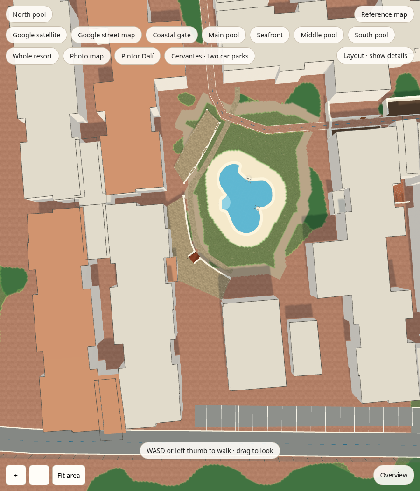
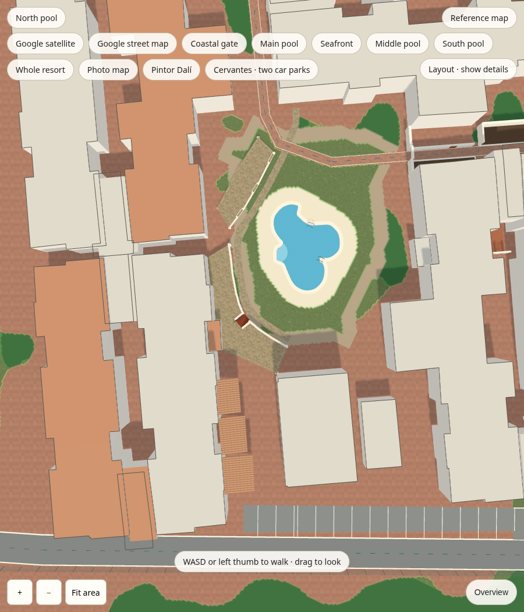
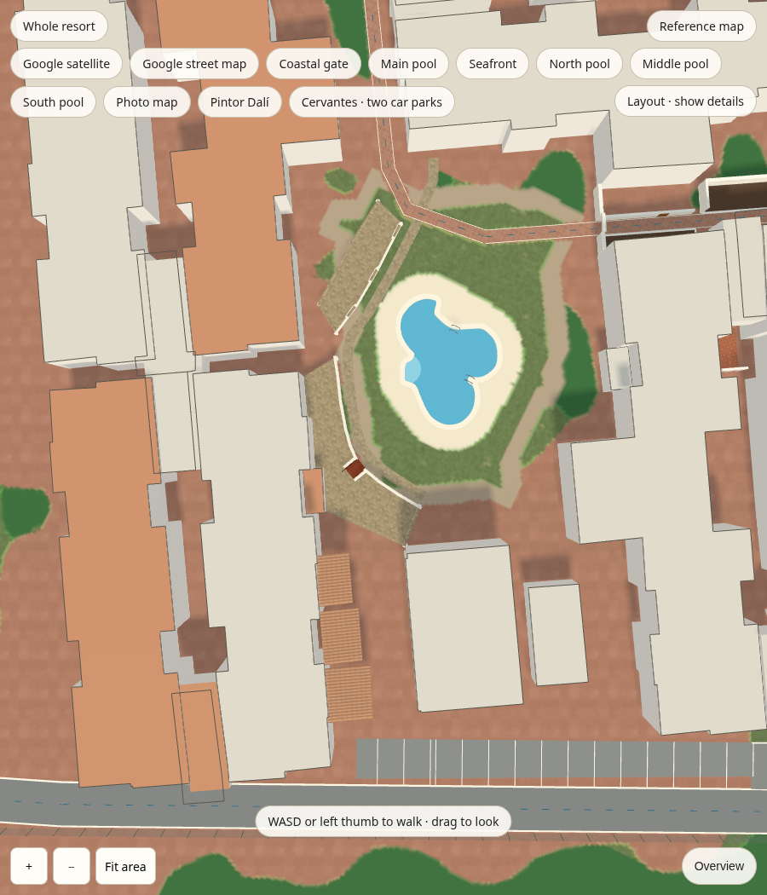
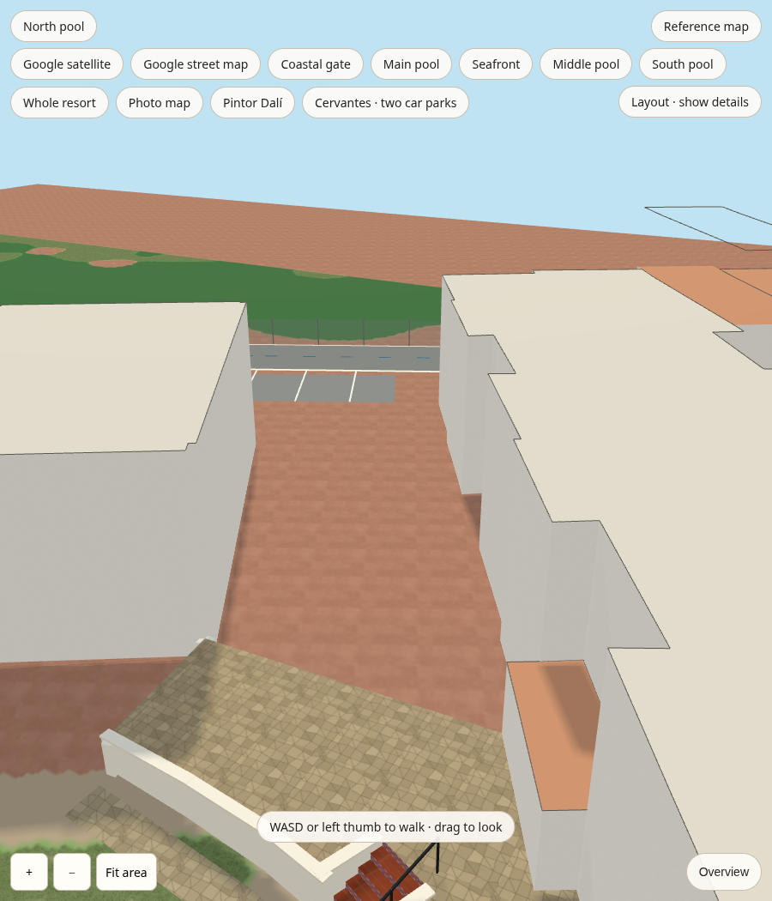
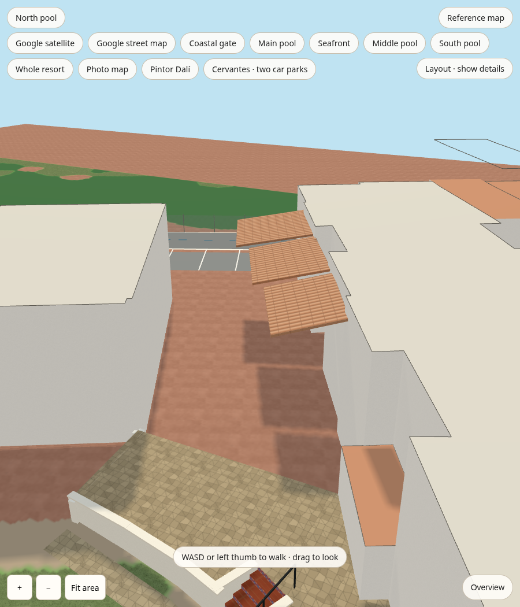

# Marked north-pool west gap: roof correction

The three individually observed upper balcony canopies are traced from the
georeferenced aerial and private Apple Maps north-pool views 02/08/09. Private
source imagery remains outside this repository. Heights, pitch and exact plan
edges are estimates; no concealed ground enclosure or balcony division is added.

| View | Before | After |
| --- | --- | --- |
| North pool |  |  |
| Whole resort |  |  |
| Western frontage, oblique |  |  |

`scripts/review_north_courtyard.cjs` uses identical estimated cameras for each
pair, at 900 × 1050 pixels. Top views: eye `[-187,82,19]`, target `[-187,0,19]`,
up `[.899,0,-.438]`, matching the marked area's orientation. Oblique: eye
`[-180,15,12]`, target `[-203,3.3,24]`, up `[0,1,0]`. These are feature diagnostics,
not calibrated photographic viewpoints. Baseline is main `36f905b`.

Independent source/map/photo and final pixel review accepted the three roof
patches and their upper-floor attachment. Registry buildings, pool, ground and
the existing northwest stair/terrace remain unchanged. The photographed brown
garden doors are outside the marked gap and were not used to fill it.

Lawn and pale pool decking are visible in both baseline views. Their absence
in the supplied mobile screenshot was not reproduced, so it remains a separate
observation; no ground-rendering fix is claimed here.

Validation: 17 source checks, 11 photo-assignment/citation tests, 172 references
with zero problems, TypeScript/build, layout browser (20 routes, both directions,
404 segments), overview controls and photo-map browser tests pass. All six
comparison renders reported zero page errors.
