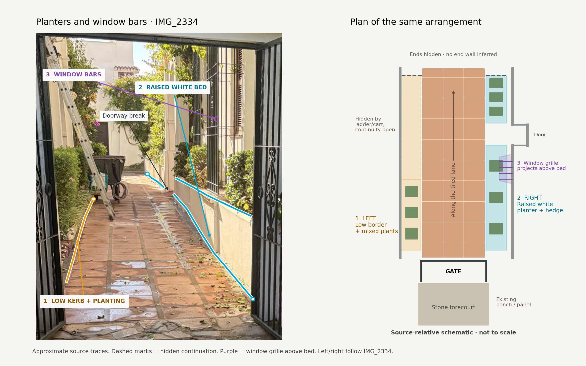

# Planted frontage borders beyond the gate

Dave identified the hedge/planter runs along both sides of the tiled street in
IMG_2334. The earlier draft concentrated on the courtyard stone/bench side of the
gate. This mapping records the separate lane-side features that were missed.

**Orange — left in the photograph:** a narrow planting strip against the house
front, with a low pale kerb and mixed plants/hedge. Much of its edge is obscured
by the open gate leaf, grasses, ladder and cart. A tall continuous white retaining
wall is not established on this side. The visible margin stops where obscured.

**Blue — right in the photograph:** a raised white rendered planter beneath the
barred openings, with shrubs and taller foliage. The front/coping steps with the
facade. A recessed doorway interrupts it; a farther bed section is separately
visible past that opening. The schematic preserves that opening.

**Purple — window bars:** the photo-right opening has a black metal grille in
front of its brown shutter, directly above the planted bed. It projects out from
the facade; upright bars are tied by horizontal rails. This is a window grille,
separate from the open entrance leaf in front of it. IMG_2189 gives clearer
examples of projecting/bowed window grilles on both sides of its lane, above
their planted borders. Those are style/arrangement references; their gate identity
does not establish a reverse view of IMG_2334. No exact bar count, spacing,
projection, window dimensions or unseen left-side grille is inferred in IMG_2334.

The lane-side runs extend away from the camera beyond the threshold. They are
distinct from the foreground courtyard hedge and the recessed bench/tile panel
shown close up in IMG_2335. They must not be replaced by two mirrored copies of
the same planter or inferred across doorways.

[observations.json](observations.json) stores visible source-pixel polylines on
the unchanged 1200 × 1600 source photograph, top-left origin. Picks are approximate
(about ±5–15 pixels); occluded endpoints have no bounded uncertainty. These are
not world metre coordinates. Rebuild the diagram with
`python3 docs/reviews/middle-pool-south-forecourt/lane-planters/build_diagram.py`
(Pillow and Matplotlib). The SVG preserves the same comparison as a vector figure.

The plan is source-relative and not to scale. It records which side each border
occupies and the visible doorway break; lengths, widths, heights, full frontage
extents and exact building alignment are not measured. Existing resort geometry
and collision are unchanged by this annotation work. The future build is task
`middle-pool-south-lane-planters`, pending the entrance placement work.

## Location correspondence still open

Full-size IMG_2189 also shows planted frontages, but its distant flat-headed
gateway, notice pair and pool planting resemble IMG_2340/2244. That does not
securely establish a reverse view of the curved double gate in IMG_2334. Earlier
street labels, pins and look-at assignments are retained as history, with a new
source-review note. No global trace is transferred from those coordinates.
The aerial also conceals these narrow beds beneath foliage and roof projection.

Independent source review, including approximate polylines, is recorded in
[the parent report](../independent-source-review.md). Mapping the visible
arrangement is complete; an exact resort-map placement and 3D build still need
those world anchors. This follows [AGENTS.md](../../../../AGENTS.md):
“Distinguish photo-supported wall/opening arrangements from estimated extents,
untraced enclosure boundaries and likely passages.”

22 October correction: the earlier bowed-grille interpretation is withdrawn after owner review and independent full-photo inspection. The fixed grille cages are rectangular, with straight front bars and square side returns. The lane shows four terracotta courses across. See [corrective review](../../middle-pool-south-lane-planters/corrective-review.md). Existing pixel traces are retained; they do not establish a curved cage profile.
