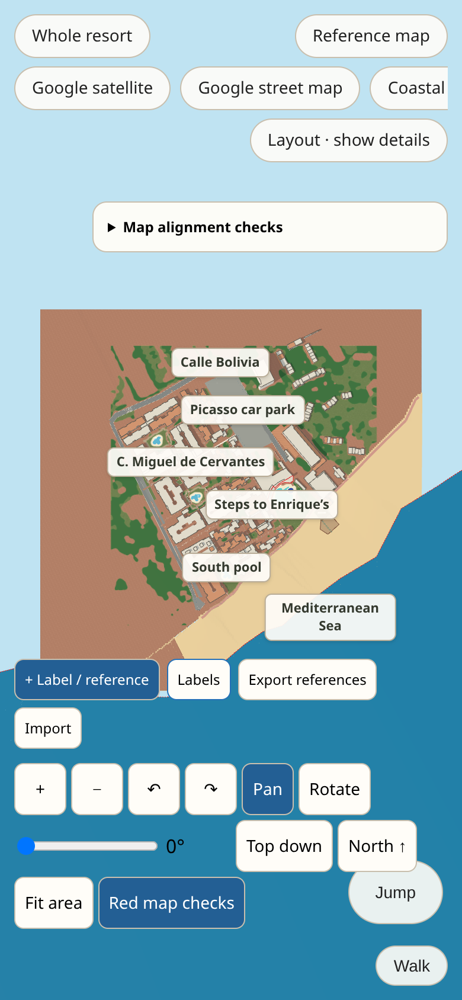
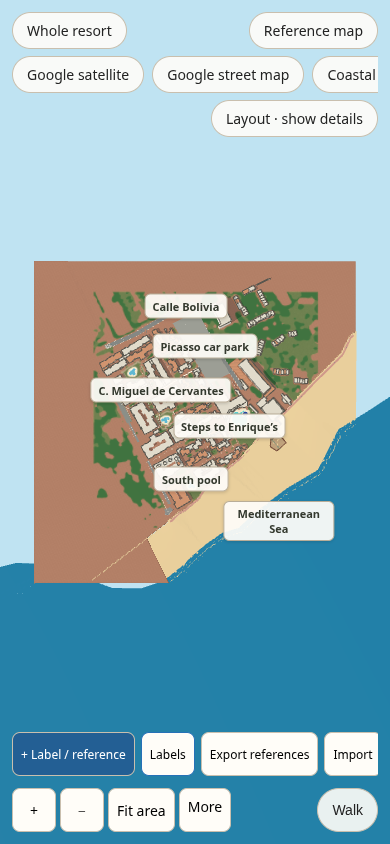

# Mobile map controls and grass detail

The 2D reference map and 3D pool/resort views now expose zoom and fit controls
without scrolling through unrelated tools. A second touch on either side of the
3D canvas promotes walking input to a pinch and stops the joystick. Zoom out can
reach three times the fitted distance; Fit area recentres, faces north and looks
down. Walk restores the walking camera. Primary camera controls remain on one
row, and More contains rotation and alignment tools. Reference tools and area
links scroll on phones and short landscape screens.

Grass uses an original 256-pixel repeating blade swatch at a fixed 1.6 m scale.
The existing ground classification masks its application; the same material is
shared by flat, raised and lower-deck ground. It is present in Layout and Details.
Existing paving, lawn outlines, pool cutouts, heights and structural collision
are preserved. The private reference repository was inspected for material
context and does not require changes for this input/rendering work.

## Results

- `npm run build`: PASS (including photo-association generation and typecheck).
- `python3 scripts/test_photo_assignment.py`: 10 tests PASS.
- `python3 scripts/build_references.py --check`: 172 reviewed references, 0 problems.
- All 12 standard source checks from `docs/HANDOVER.md`: PASS (map, street layout,
  boundary reference, terrain, Dalí threshold, Cervantes patio walls, Elena north,
  middle pool, paseo wall, seafront, pool levels, levels).
- `scripts/test_layout_browser.cjs`: PASS, 20 protected routes in both directions,
  343 checked segments, closed/open gate behavior and building material groups;
  no runtime errors.
- `scripts/test_overview_browser.cjs`: PASS, desktop zoom/rotation/north/fit,
  alignment controls, walking visibility and mobile toolbar.
- `scripts/test_mobile_browser.cjs`: PASS, real browser touch events for a pinch
  spanning the walking/look halves, cancellation, overview pan, zoom beyond fit,
  reset, rotation and switching back to walking. Camera targets are at least
  44×44 CSS pixels and do not overlap Walk at 390×844, 320×568 or 844×390.
- The mobile test renders the production grass shader and an independent standard
  material control. Grass changes over 5,000 sampled pixels with a 51/255 red
  channel range; paving outside the lawn mask has zero changed pixels. All
  sampled ground pixels are opaque. Mobile and desktop render identical pixels
  at the fixed render-target resolution; no shader or runtime errors occur.

Browser checks use Chromium with touch emulation and software WebGL. They do not
replace checking a physical iPhone/Android device. Tiny blades blend at resort
scale through mipmapping. These checks verify input, materials and compatibility;
they do not establish surveyed accuracy or photographic fidelity of the resort.

## Screenshots

Before and after use the same 390×844 CSS viewport, with different capture pixel
ratios; material parity is tested separately at a fixed render-target resolution.

| Before | After |
| --- | --- |
|  |  |

[Narrow phone](narrow-phone.png) · [Landscape](landscape.png) · [2D map](map.png)

Requirements: [MOBILE_MAP_PRD.md](../../MOBILE_MAP_PRD.md). The requested PRD skill
was unavailable; requirements and acceptance criteria were documented directly.
