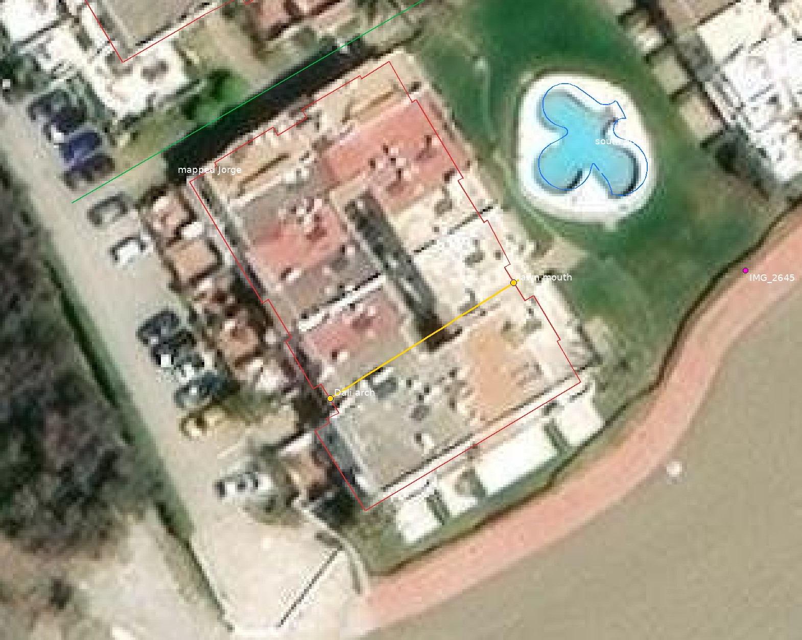

# South pool: the passage into Pintor Dalí

Evaluated 8 November 2026 from the full photos, the placed Dalí arch, the registry footprint and the Esri aerial (`public/map/ground.jpg`, zoom 19). The void is now in the model (`data/south_pool_passage.json`, `src/south-pool-passage.ts`): 20.4 m along this axis, 2.1 m clear, flat ceilings, an open middle bay, the iron gate and the plaque. It is not measured placement approval: the lawn mouth is good to about 2 m, and the cameras are not solved.

Map metres: +x east, +z south. Heading 0 points north (−z).

Yellow is the passage axis. Red is registry building `6263501UF1366S_part1`. Blue is the south pool. Green is the mapped Calle Jorge centreline, which does not follow this passage. Imagery is the existing Esri World Imagery already in the repo.

## What the photos are

Two sets that the catalogue kept apart are the two ends of one passage.

**Pintor Dalí end.** IMG_2283, IMG_2294 and IMG_2295 stand in the car park and look through a white arch. A flagstone ramp between flared white kerbs rises to the arch. Above it is a barrel-tile canopy with dark louvred shutters centred on the opening, a pair of black lanterns on the piers, and climbers to either side. Inside, the floor is terracotta with small blue-and-white inserts. A second arch and a bright lawn are visible at the far end. The index note on IMG_2283 already records a gate beyond.

The ramp is built (`door_sills.json:dali-south-arch-approach`). The arch is placed at **(−114.15, 212.45)**, square to the recess in `6263501UF1366S_part1`, within 0.8 m of the IMG_2283 camera. Its heading, 58°, matches the photo headings (55–60°). The passage behind the arch is still a solid two-storey extrusion.

**Lawn end.** IMG_2639, IMG_2640 and IMG_2641 are inside the arcade, looking toward an arched iron gate and the south-pool lawn. IMG_2642 is in the gateway, looking out across crazy paving, a candelabra cactus, the lawn and the sea, with the pool to the left. The floor, the inserts, the arches and the lawn at the end are the same passage seen from the street.

The plaque on the right wall of the lawn portal reads **67 39 / CALLE DE JORGE**. That is the passage’s own name and house range, in the same form as the Silvia plaques (22 44, 2 20). It is not a GPS fix. The pins on IMG_2639–2641 are ±16–29 m and sit on the block only by luck. They were not used to place the mouth.

**The two ends meet.** The inward axis from the placed arch, heading 58°, runs 20.4 m through the building and leaves the east face at **(−96.9, 201.6)**. IMG_2645, the one lawn photo with a usable pin (±2.0 m at −75.1, 200.4, heading 266°), looks west at an arched iron gate in this same front. Its ray meets the wall at (−96.7, 201.9), 0.4 m from the axis. The pool centre (−89.7, 188.1) is 34.5 m from the arch on heading 45°, so the passage crosses the lawn south of the water rather than aiming at it. That matches IMG_2642, where the pool is to the left and the sea is ahead.

The street recess is visible on the aerial as the dark notch at the placed arch. A full-length open slot through the roof is not resolved at this scale, which fits a passage that is roofed for most of its length.

## What to build

Cut one passage through `6263501UF1366S_part1` from the existing arch to the east face at the axis exit. Keep the registry outline and the pool ring. Grade the passage **estimated**: both mouths are photographed and the axis meets the gate photo, but the cut is not surveyed to 0.3 m.

Walk it in this order. The order is photographed. The metre stations along the 20.4 m are not, so space the bays evenly and say so in `trust`.

| Id | Where | What the photos show |
| --- | --- | --- |
| J01 | Outside, Dalí | Already built. Grooved concrete strip, flagstones, white kerbs, right kerb flared. Rise 0.25 m over 5 m, kerbs 0.18 m, width 2.1 m (`halfWidth` 1.05). All of those figures are by eye. |
| J02 | Street portal | Semicircular arch under the first floor. Tile canopy and centred dark shutters above. One black lantern on each pier. Climbers both sides. |
| J03 | First covered bay | Flat white ceiling. Terracotta with small blue-and-white inserts. One pebble-mosaic panel. Brown panelled double door on the right. One hanging black lantern. Low white planters both sides. A small wall niche on the right. |
| J04 | Open court | Open to the sky (IMG_2640 shows the upper floor, a balcony rail and the bougainvillea against the sky). Bougainvillea on the left. Another pebble panel in the floor. A further door on the right. |
| J05 | Second covered bay | Second arch, another dark floor panel, planters both sides, flat ceiling. |
| J06 | Lawn portal | Arched iron gate, leaves open, vertical bars. Plaque **67 39 / CALLE DE JORGE** on the right wall, black tiles with white letters. Planters both sides. |
| J07 | Lawn apron | Crazy paving between white kerbs and clipped hedges, flush with the lawn (IMG_2642). The existing south-pool path is a separate guessed line; this apron is the photographed few metres outside the gate. |

Width: carry the built 2.1 m through the interior. It looks the same order in the photos. Allow about half a metre.

Ceiling: flat in the covered bays. The arches are openings, and the middle bay is open to the sky. A barrel vault would add a roof the photos do not show.

Floor: no step is visible from the arch threshold to the crazy paving. Keep the built ramp outside the arch. If the lawn at the mouth and the arch threshold differ, take that difference as a gentle slope along the passage and record both heights. The south lawn is about +0.1 m at the pool and rises toward Dalí to about +0.6 m; the mouth is on that lawn, south of the pool.

Floor material: the insert tiles are the same family as other covered floors. Reuse that material. Leave the Silvia tunnel’s plan, doors and pebble layout where they are. The doors here are the photographed brown double leaves.

The small jag in the registry outline at the east face is consistent with a recess. It is not a measured opening width. Cut the mouth on the axis, at the approach width.

Confidence reason, for `data/confidence.json` when it is built: both mouths are photographed and the axis meets IMG_2645’s gate to about 0.4 m at the wall; IMG_2645’s pin is ±2 m and no camera is solved, so the cut is estimated to about 2 m.

## Leave alone

- The glass pool fence. It is in IMG_2188, IMG_2642 and IMG_2645. Dave’s decision is to skip it.
- The mapped Calle Jorge centreline. Its closest point to the arch is (−128.2, 188.1), 28 m away, and the line crosses the lawn north of this passage. The plaque names the passage; it does not move the street. A later measured task can reconsider the centreline.
- IMG_2650 and IMG_2576. A shorter gate: plain square terracotta, a shallow arch, an open iron gate, and the sea with a life ring beyond. Pins about (−100, 152), ±2.6 m, north of the pool. A different opening.
- IMG_2586. An open court with the same insert tiles, a palm and a house number 12. Pin (−69.9, 167.3), ±2.7 m, east of the pool. A different court.
- IMG_2548 and IMG_2557. Eva and the unread “CALLE MART…” sign. They stay on `jorge-south-arcade-identity`.
- The Silvia tunnel, its single-door rule, and the Jorge radial fanlight. They are other passages.
- The pool outline, the deck, the ladders, the date palm, the west hedge and the sandstone seaward wall. Those are already built.

## Other details in the same photos

These are real and missing, and they are separate from the cut. Build them on their own evidence, graded estimated.

| What | Photos | Where it sits | Limit |
| --- | --- | --- | --- |
| East front of this block | IMG_2645 (±2 m) | The white front the gate is set in: brown shutters, iron balconies, a chimney, a curved white wall with a yellow flower bed beside the path | The facade kit here is still the generated one. Trace this front only. |
| Candelabra cactus | IMG_2641, IMG_2642, IMG_2643 (±4.7 m), IMG_2644 (±2.1 m) | One plant on the east lawn, by the rounded bay, in view through the gate | One plant. The trunk is not fixed to 0.3 m. |
| Yuccas | IMG_2643, IMG_2644 | A group on the seaward hedge, with the mesh fence and the sea behind | The group the frames show. |
| Rounded bay | IMG_2643, IMG_2644 | Curved white bay, tile roof, brown shutters, on the east house | A facade on the existing east block. |
| Rules board | IMG_2645 | One board beside the gate path | One board. |
| Short green bollards | IMG_2643, IMG_2644, IMG_2645 | On the lawn by the hedges | No kind exists for them yet (`docs/SOUTH_POOL.md`). Leave them out until a kind is added. |

## Checks when it is built

- Cite IMG_2283, IMG_2294, IMG_2295, IMG_2639, IMG_2640, IMG_2641, IMG_2642 and IMG_2645 on the passage.
- Render each of those cameras before and after. The indoor frames will differ until a camera is solved; record that, with this spec as the open limit, rather than claiming a match.
- The axis, the 20.4 m depth and the 2.1 m width go in the feature’s `trust`, with the 2 m uncertainty.
- `gap:south-block-arcade` closes when the void is in the model. Until then the gap marker sits on the lawn mouth.
