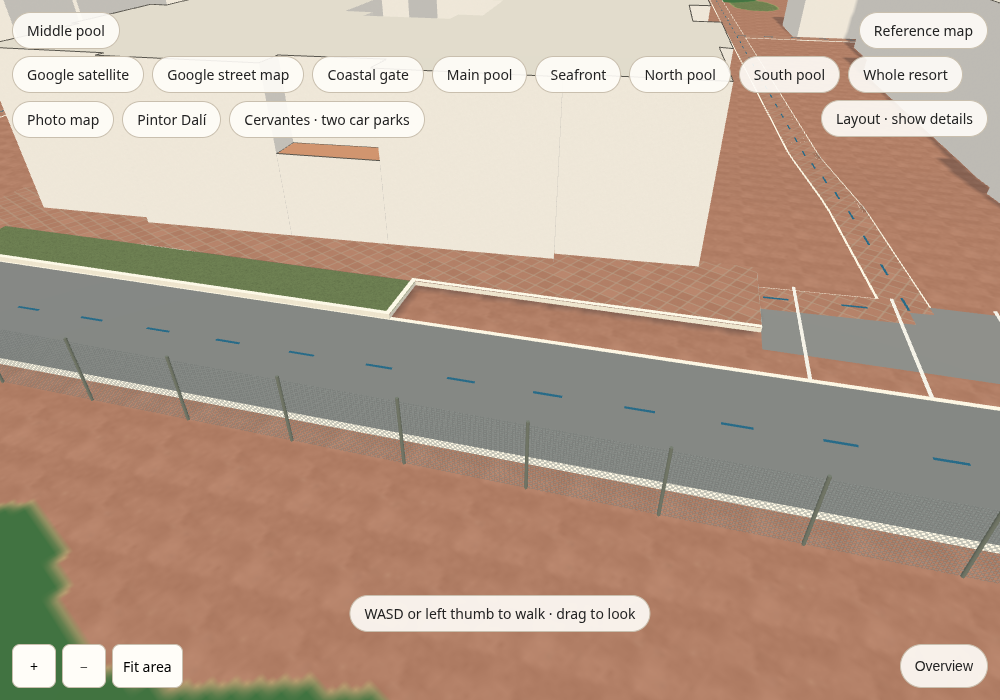
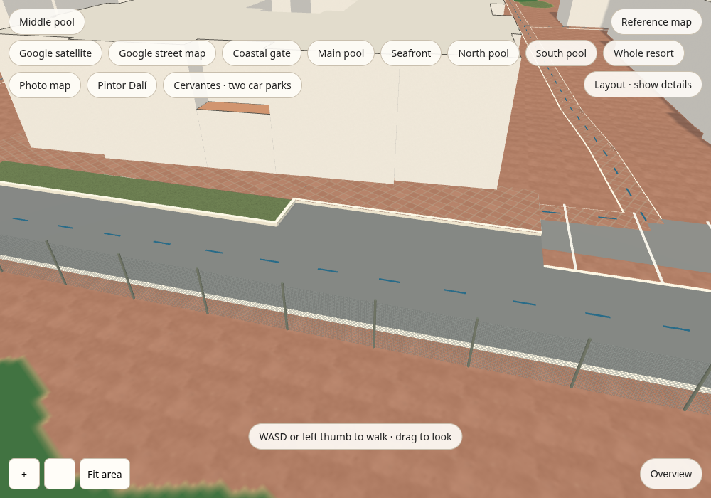

# Threshold ground and asphalt contact

This follow-up preserves the geometry merged in #93: two red Elena sills on the
west side of the lawns, the 25.95 m Dalí frontage with its lawn-end kerb turn,
and the southern approach aligned to the registry recess. Independent review
checked the original IMG_2260/2261/2330, roof IMG_2358/2367,
IMG_2291/2292/2293 and IMG_2283/2294/2295 against the georeferenced aerial,
existing lawn paths, registry fronts and road geometry. This comparison rejected
the earlier alternative sill positions on the lane-facing side of the lawns.
Positions, heights and hidden limits remain estimates.

Independent source/map review of the correction reconstructed the actual road
ribbon edge at seven frontage stations. The new asphalt overlaps that edge by
0.139–0.160 m and meets the unchanged kerb outline on both sides of its turn.
Registry footprints, sill anchors, road axes and approach geometry are unchanged.

The change aligns player ground with visible feature tops and fills the asphalt
gap at the existing parking kerb. The narrow movement blend around the features
is an approximation; it does not establish surveyed terrain or resolve inherited
datum differences elsewhere. The source photos and private maps remain outside
this public review directory.

| Before: merged #93 with pool changes | After: ground/contact correction |
| --- | --- |
|  |  |

The pair uses `scripts/review_threshold_contact.cjs` with the same fixed,
estimated camera: eye `[-170, 10, 157]`, target `[-160, 0.7, 148]`,
1000 × 700 viewport, Layout mode. It is an elevated feature diagnostic,
not a photo-calibrated viewpoint. Simplified house facades and the untraced
solid arch passage remain unchanged. Earlier photo-camera comparisons for the
retained geometry are in [the issue-57 review](../issue-57/).

The absolute physics regressions raycast the visible surfaces and compare them
with settled player shoe soles, including lawn, tiles, kerb tops, asphalt,
approach toe and landing. They also check old-road/apron contact and the reachable
landing at the unchanged solid facade. Passing these checks establishes local
physical consistency, not surveyed photographic accuracy.

Validation completed on the final runtime: all 16 source checks, 10 photo
assignment tests, 172 references with zero problems, TypeScript, production
build, layout browser (20 routes, both directions, 404 segments), overview
controls and photo-map browser checks pass. Both diagnostic renders report
zero page errors.
