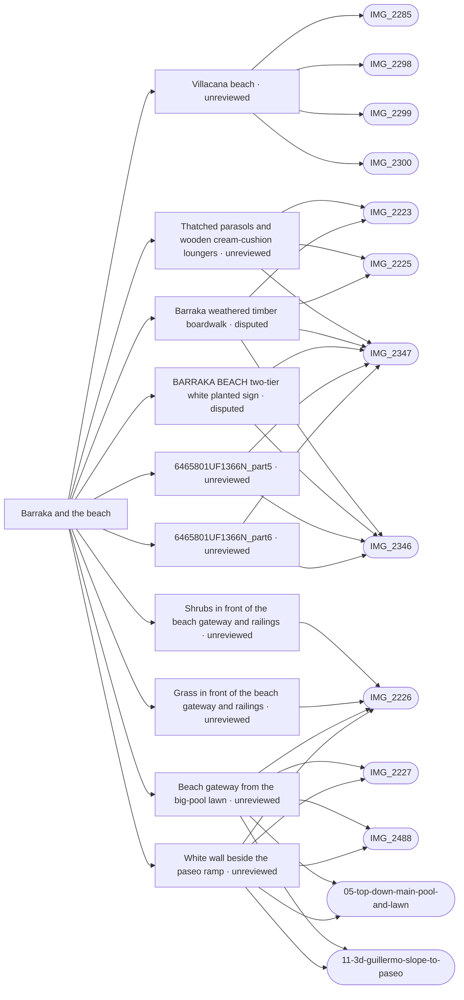

# Barraka and the beach

_Generated by `scripts/build_references.py`. Do not edit: change `data/areas.json` or `data/reference_tags.json` and rebuild._

The beach in front of Villacana, the Barraka beach restaurant and the sea.

## Known facts and open questions

- The beach is mixed sand, stones and rounded pebbles, not uniform pale sand (IMG_2300).
- IMG_2346, IMG_2347: BARRAKA BEACH painted planter, thatched parasols and a timber boardwalk across the sand.
- IMG_2346/2347 show narrow weathered green timber access, a white two-tier planted BARRAKA BEACH sign on its left looking seaward, and straw parasols. Added as ground-following planks plus guarded Details furniture; dimensions and seasonal furniture positions are estimates. IMG_2225 wooden cream-cushion beds differ from the blue/white plastic loungers west of the aisle in IMG_2223; those are not asserted as one type. No coast, paseo or registry footprint changes.
- Issue #32: the existing georeferenced Esri aerial independently places the wet shoreline band seaward of the old OSM coast by up to about 30 m near Barraka. data/shoreline_trace.json records pixel control points; the local beach/sea edge now shares that trace. IMG_2285 is about 16.5 m inland of it, without changing its GPS. Estimated 3–5 m trace/registration precision; acquisition date, tide and seasonal changes remain unknown.
- 2026-10-19 owner clarification and independent original-photo/map review: green aisle is immediately left/northeast of actual Barraka restaurant 6364501UF1366S_part8 looking towards the sea. The planter, separate log-filled cooking boat and thatched cooking shelter are all left of this aisle; boat beyond planter. The old southwest run [30,121] to [42,135] used the wrong flank. Proposed corrected axis [31,101] to [43,115] and planter [36,102] remain estimates, not <=2m approved measurements; precise hut/boat footprints remain unresolved. See docs/reviews/barraka-planter-placement.
- The old 25m GPS conflict was computed against the wrong southwest aisle and is retracted as evidence of a camera error. Raw pins remain unchanged; IMG_2347 lies roughly 6.5m from the tentative NE-axis landward end. Registry parts6465801UF1366N_part5/part6 remain non-standing dashed outlines; their photo citations legitimately support absence of a building, not cooking-hut identity.
- 27 Oct: grass and shrubs on the beach side of the paseo in front of the gateway and railings up to Barraka (Dave: Barraka used to sit inside Villacana and the grass went further out). Rough outline from the aerial and IMG_2226 in data/beach_verge.json; close photos wanted for edges and shrub sizes.

## Read first

- docs: `docs/SEAFRONT.md`, `docs/LEVELS.md`
- data: `data/levels_survey.json`
- src: `src/seafront.ts`, `src/seaside.ts`
- contact sheet: `villacana-reference/contact-sheets/barraka-beach.jpg` (thumbnails of everything below, numbered in this order)

## Coverage

Layout: 6, Levels and slopes: 3, Facades and roofs: 5, Materials: 13, Planting: 2, Signs: 2, Views: 12
18 reviewed, 0 suggested only by camera position.

## Levels

Ground and floor levels read from the photos, from `data/levels_survey.json` (see `docs/LEVELS.md`).

- `beach-fall` (slope): 1-2 m above the waterline, low confidence. Model: **built**. The paseo's timber edge is about 0.1 m above the sand; the beach falls to the water over 30-50 m. (IMG_2351.jpg)

## Open build tasks

From `data/build_queue.json`; issue bodies in `refs/issues/`.

| Priority | Task | What | Status | Photos |
| --- | --- | --- | --- | --- |
| P1 | `barraka-planter-placement` [#102](https://github.com/daveyboyc/villacana-venture/issues/102) | Correct reported Barraka planter placement against registered source evidence (after placement-verification-gate) | in-progress · Codex · placement: not-verified | [IMG_2346](../../public/photos-ref/IMG_2346.jpg), [IMG_2347](../../public/photos-ref/IMG_2347.jpg) |
| P1 | `path-network-inventory-barraka-beach` [#136](https://github.com/daveyboyc/villacana-venture/issues/136) | Barraka and the beach: full-source path, tunnel and boundary inventory (after path-network-baseline) | open · placement: not-applicable |  |
| P2 | `barraka-barbecue-boat` | Barraka sand-filled barbecue boat: establish placement and add shared geometry (after unified-reference-map, barraka-planter-placement) | open · placement: not-verified | [IMG_2223](../../public/photos-ref/IMG_2223.jpg), [IMG_2346](../../public/photos-ref/IMG_2346.jpg), [IMG_2347](../../public/photos-ref/IMG_2347.jpg) |

## Built from these photos

Model features that cite photos of this area, from `public/photos-ref/evidence-graph.json`, with their photo-check state. A citation records what a feature was traced from; only a check in `data/photo_checks.json` says someone rendered it from the photo's camera and compared.

## Placement evidence

`verification` is placement status, separate from photographic diagnostics. Earlier manual reviews may exist. Only a fresh measured packet and independent approval can grant `verified`.

| Feature | Placement | Photo diagnostics | Blockers |
| --- | --- | --- | --- |
| `area:beach` | unreviewed | unchecked | No measured placement packet and independent approval recorded; earlier manual reviews may exist. |
| `barraka_boardwalk.json:barraka-beach-seating` | unreviewed | unchecked | No measured placement packet and independent approval recorded; earlier manual reviews may exist. |
| `barraka_boardwalk.json:barraka-boardwalk` | disputed | unchecked | open discrepancy barraka-boardwalk-flank |
| `barraka_boardwalk.json:barraka-sign-planter` | disputed | not-comparable | open discrepancy barraka-planter-position |
| `beach_verge.json:barraka-front-shrubs` | unreviewed | unchecked | No measured placement packet and independent approval recorded; earlier manual reviews may exist. |
| `beach_verge.json:barraka-front-verge` | unreviewed | not-comparable | No measured placement packet and independent approval recorded; earlier manual reviews may exist. |
| `building:6465801UF1366N_part5` | unreviewed | unchecked | No measured placement packet and independent approval recorded; earlier manual reviews may exist. |
| `building:6465801UF1366N_part6` | unreviewed | unchecked | No measured placement packet and independent approval recorded; earlier manual reviews may exist. |
| `seafront_fence.json:guillermo-beach-gate` | unreviewed | incomplete | No measured placement packet and independent approval recorded; earlier manual reviews may exist. |
| `seafront_fence.json:guillermo-ramp-wall` | unreviewed | unchecked | No measured placement packet and independent approval recorded; earlier manual reviews may exist. |

## Photo checks

Renders from each photo's camera compared with the photo (`data/photo_checks.json`).

| Task | Photo | Result | Render | Notes |
| --- | --- | --- | --- | --- |
| `barraka-planter-placement` | [IMG_2346](../../public/photos-ref/IMG_2346.jpg) | **not-comparable** | [after](../../docs/reviews/barraka-planter-placement/IMG_2346-after.png) · [before](../../docs/reviews/barraka-planter-placement/IMG_2346-before.png) | Full Drive original inspected. Owner and independent source review confirm NE restaurant flank, planter/cooking boat/hut left of green aisle and boat beyond planter. Draft moves wrong-flank aisle/planter and turns lettering inland. Before/after use identical stored camera and illustrative look-at [38,106], Details enabled; third-person offset, roof/foreground occlusion, unknown calibrated pose and estimated metre coordinates prevent a photographic match. Boat/hut remain unmodelled. No <=2m approval; discrepancy stays open. |
| `barraka-planter-placement` | [IMG_2347](../../public/photos-ref/IMG_2347.jpg) | **not-comparable** | [after](../../docs/reviews/barraka-planter-placement/IMG_2347-after.png) · [before](../../docs/reviews/barraka-planter-placement/IMG_2347-before.png) | Full Drive original inspected. Owner and independent source review confirm NE restaurant flank, planter/cooking boat/hut left of green aisle and boat beyond planter. Draft moves wrong-flank aisle/planter and turns lettering inland. Before/after use identical stored camera and illustrative look-at [38,106], Details enabled; third-person offset, roof/foreground occlusion, unknown calibrated pose and estimated metre coordinates prevent a photographic match. Boat/hut remain unmodelled. No <=2m approval; discrepancy stays open. |

**Built without complete newer photo-check records:** `barraka-boardwalk`, `shoreline-check`. Earlier manual reviews may exist; this record does not establish photographic fidelity. See the verification backlog in `refs/QUEUE.md`.

## Reviewed references

| Reference | Viewpoint | Use for | What it shows |
| --- | --- | --- | --- |
| [IMG_2347.jpg](../../public/photos-ref/IMG_2347.jpg) | ground | signage, materials, layout | Barraka barbecue boat, planted sign and boardwalk towards the sea **Looks at:** Sand-filled barbecue boat beside the Barraka boardwalk. **Note:** Owner clarification and full originals IMG_2346/2347 confirm the planter, log-filled cooking boat and thatched cooking shelter on the LEFT of the green wooden aisle looking towards the sea; the boat is beyond the planter. The aisle belongs on the northeast flank of actual restaurant 6364501UF1366S_part8, not the old southwest run. Boat and cooking hut are distinct from the planted sign and remain unmodelled; their exact footprint/scale is unresolved. See docs/reviews/barraka-planter-placement. _Used by: building:6465801UF1366N_part5, building:6465801UF1366N_part6, barraka_boardwalk.json:barraka-boardwalk, barraka_boardwalk.json:barraka-sign-planter, barraka_boardwalk.json:barraka-beach-seating._ |
| [IMG_2226.jpg](../../public/photos-ref/IMG_2226.jpg) | ground | view, facades, layout, levels | From the beach looking back at the resort frontage **Looks at:** big-pool lawn frontage: white railings, Guillermo gateway at left. **Note:** Read 2026-10-21 at full size. West to east (left to right): corner houses with a white wall and tiled panel, a white round-arched gateway at paseo level (the foot of Calle Guillermo), a short white wall, then white railings along the big-pool lawn up to Barraka's raised deck at right; the restaurant's blue awnings behind. The lawn and the gateway's foot are about level with the paseo. Built as data/seafront_fence.json. _Used by: beach_verge.json:barraka-front-verge, beach_verge.json:barraka-front-shrubs, seafront_fence.json:guillermo-beach-gate, seafront_fence.json:guillermo-ramp-wall._ |
| [IMG_2346.jpg](../../public/photos-ref/IMG_2346.jpg) | ground | signage, materials | BARRAKA BEACH sign, barbecue boat and boardwalk **Looks at:** Sand-filled barbecue boat beside the Barraka boardwalk. **Note:** Owner clarification and full originals IMG_2346/2347 confirm the planter, log-filled cooking boat and thatched cooking shelter on the LEFT of the green wooden aisle looking towards the sea; the boat is beyond the planter. The aisle belongs on the northeast flank of actual restaurant 6364501UF1366S_part8, not the old southwest run. Boat and cooking hut are distinct from the planted sign and remain unmodelled; their exact footprint/scale is unresolved. See docs/reviews/barraka-planter-placement. **Compass:** the subject is 59° from the phone heading; trust looksAt, not the heading. _Used by: building:6465801UF1366N_part5, building:6465801UF1366N_part6, barraka_boardwalk.json:barraka-boardwalk, barraka_boardwalk.json:barraka-sign-planter._ |
| [IMG_2227.jpg](../../public/photos-ref/IMG_2227.jpg) | ground | view, facades, levels | From the beach looking west along the white seafront houses **Looks at:** east end of the sandstone wall and the corner house by Calle Guillermo. **Note:** Read 2026-10-21 at full size. The sandstone wall with mesh fence is low (under 1 m above the sand) all the way to its east end, where a white wall with a tiled panel takes over; the corner house there stands about 1 m above the beach, not 3 m. _Used by: paseo_wall.json:paseo-retaining-wall, seafront_fence.json:guillermo-beach-gate, seafront_fence.json:guillermo-ramp-wall._ |
| [IMG_2298.jpg](../../public/photos-ref/IMG_2298.jpg) | ground | facades, view, materials | Beach: white seaward houses and palm _Used by: area:beach, paseo_wall.json:paseo-retaining-wall._ |
| [IMG_2299.jpg](../../public/photos-ref/IMG_2299.jpg) | ground | facades, view, materials | Beach: houses along the shore _Used by: area:beach, paseo_wall.json:paseo-retaining-wall._ |
| [IMG_2223.jpg](../../public/photos-ref/IMG_2223.jpg) | ground | materials | Barraka Beach barbecue boat beside the timber boardwalk **Looks at:** Sand-filled barbecue boat beside the Barraka boardwalk. **Note:** Owner clarification and full originals IMG_2346/2347 confirm the planter, log-filled cooking boat and thatched cooking shelter on the LEFT of the green wooden aisle looking towards the sea; the boat is beyond the planter. The aisle belongs on the northeast flank of actual restaurant 6364501UF1366S_part8, not the old southwest run. Boat and cooking hut are distinct from the planted sign and remain unmodelled; their exact footprint/scale is unresolved. See docs/reviews/barraka-planter-placement. **Compass:** the subject is 89° from the phone heading; trust looksAt, not the heading. _Used by: barraka_boardwalk.json:barraka-boardwalk, barraka_boardwalk.json:barraka-beach-seating._ |
| [IMG_2225.jpg](../../public/photos-ref/IMG_2225.jpg) | ground | materials | Thatched parasols and wooden loungers on the beach _Used by: barraka_boardwalk.json:barraka-boardwalk, barraka_boardwalk.json:barraka-beach-seating._ |
| [IMG_2285.jpg](../../public/photos-ref/IMG_2285.jpg) | ground | facades, materials, view | Beach: resort and restaurant frontage _Used by: area:beach._ |
| [IMG_2300.jpg](../../public/photos-ref/IMG_2300.jpg) | ground | materials, view | Beach: pebbles, sand and distant coastline _Used by: area:beach._ |
| [IMG_2224.jpg](../../public/photos-ref/IMG_2224.jpg) | ground | materials, view | Open sand looking north-east along the coast to the mountains |
| [6E090F77-BFAF-46F8-A753-0388F6BD1DB5.jpg](../../public/photos-ref/6E090F77-BFAF-46F8-A753-0388F6BD1DB5.jpg) | ground | materials | Beach: pebbles on sand at the water line **Note:** No GPS in the file: exact stretch of beach not confirmed. |
| [IMG_2350.jpg](../../public/photos-ref/IMG_2350.jpg) | ground | layout, levels, materials, view | Paseo looking north-east: stamped walk, sandstone retaining wall **Note:** The sandstone retaining wall shows the resort ground standing about 1.2 m above the paseo here. _Used by: area:paseo, paseo_wall.json:paseo-retaining-wall, paseo_wall.json:paseo-timber-edge, paseo_details.json:paseo-pool-hedge, paseo_details.json:paseo-east-windbreak, paseo_details.json:paseo-white-lamp-3, paseo_details.json:paseo-white-lamp-4._ |
| [IMG_2351.jpg](../../public/photos-ref/IMG_2351.jpg) | ground | materials, view | Paseo looking south: stamped walk, timber edge, beach and sea _Used by: area:paseo, paseo_wall.json:paseo-timber-edge._ |
| `villacana-reference/apple-maps/05-top-down-main-pool-and-lawn.png` | aerial | layout | Apple Maps top-down: main pool, toddler pool, deck, lawn, Barraka beach _Used by: seafront_fence.json:guillermo-beach-gate, seafront_fence.json:guillermo-ramp-wall._ |
| [IMG_2481.jpg](../../public/photos-ref/IMG_2481.jpg) | ground | layout, materials, view | Paseo looking north-east towards Barraka: curving pink walk, sandstone wall, dry verge **Looks at:** Paseo curve and verge towards Barraka. _Used by: area:paseo._ |
| [IMG_2482.jpg](../../public/photos-ref/IMG_2482.jpg) | ground | layout, planting, view | Paseo looking north-east: agave verge and Barraka restaurant **Looks at:** Barraka beach restaurant at the end of the paseo. _Used by: area:paseo._ |
| [IMG_2483.jpg](../../public/photos-ref/IMG_2483.jpg) | ground | planting, view | Paseo looking north-east, second shot: agave verge to Barraka **Looks at:** Barraka beach restaurant at the end of the paseo. _Used by: area:paseo._ |
