# Barraka and the beach

_Generated by `scripts/build_references.py`. Do not edit: change `data/areas.json` or `data/reference_tags.json` and rebuild._

The beach in front of Villacana, the Barraka beach restaurant and the sea.

## Known facts and open questions

- The beach is mixed sand, stones and rounded pebbles, not uniform pale sand (IMG_2300).
- IMG_2346, IMG_2347: BARRAKA BEACH painted planter, thatched parasols and a timber boardwalk across the sand.
- IMG_2346/2347 show narrow weathered green timber access, a white two-tier planted BARRAKA BEACH sign on its left looking seaward, and straw parasols. Added as ground-following planks plus guarded Details furniture; dimensions and seasonal furniture positions are estimates. IMG_2225 wooden cream-cushion beds differ from the blue/white plastic loungers west of the aisle in IMG_2223; those are not asserted as one type. No coast, paseo or registry footprint changes.
- Issue #32: the existing georeferenced Esri aerial independently places the wet shoreline band seaward of the old OSM coast by up to about 30 m near Barraka. data/shoreline_trace.json records pixel control points; the local beach/sea edge now shares that trace. IMG_2285 is about 16.5 m inland of it, without changing its GPS. Estimated 3–5 m trace/registration precision; acquisition date, tide and seasonal changes remain unknown.
- 2026-10-19 owner clarification and independent original-photo/map review: green aisle is immediately left/northeast of actual Barraka restaurant 6364501UF1366S_part8 looking towards the sea. The planter, separate log-filled cooking boat and thatched cooking shelter are all left of this aisle; boat beyond planter. The old southwest run [30,121] to [42,135] used the wrong flank. Proposed corrected axis [31,101] to [43,115] and planter [36,102] remain estimates, not <=2m approved measurements; precise hut/boat footprints remain unresolved. See docs/reviews/barraka-planter-placement.
- The old 25m GPS conflict was computed against the wrong southwest aisle and is retracted as evidence of a camera error. Raw pins remain unchanged; IMG_2347 lies roughly 6.5m from the tentative NE-axis landward end. Registry parts6465801UF1366N_part5/part6 remain non-standing dashed outlines; their photo citations legitimately support absence of a building, not cooking-hut identity.
- 27 Oct: grass and shrubs on the beach side of the paseo in front of the gateway and railings up to Barraka (Dave: Barraka used to sit inside Villacana and the grass went further out). Rough outline from the aerial and IMG_2226 in data/beach_verge.json; close photos wanted for edges and shrub sizes.
- 4 Nov (barraka-frontage-paseo-furniture): IMG_2604 (pin +-2.1 m), IMG_2609, IMG_2631, IMG_2607/2608 show Barraka's roped lounge on the grass beside the paseo: timber posts with white rope swags along the paving edge from the restaurant's west corner, two cream-cushioned wicker sofas with dark woven pod armchairs facing the restaurant around a low table and a closed cream parasol, a black wrought-iron menu stand, an easel sign and terracotta pots. Built as Details furniture (data/barraka_frontage.json): arrangement as photographed, position estimated to about 3 m from the bearings of IMG_2604 and IMG_2631; IMG_2607/2608/2609 were taken from under the terrace awning, so their pins (+-12-19 m) are not used. The same photos show the big-pool lawn railing is dark green bars on a sandstone plinth, not white: only its finish changed (data/seafront_fence.json).
- 13 Nov: the floor was also being dropped by the survey height (about 2.1 m) on top of the beach height, so the walls sat in the sand and the white storey almost touched the ground. The floor is the beach height under the building, about 0.16 m below the paseo here, and is not draped again.
- 12 Nov follow-up: the white mass starts at the awning line (2.58 m). Below that, the south-west and north-west fronts are glass, so the lower restaurant is a storey rather than a solid wall, and white tables and chairs stand outside those awnings and on the beach terrace (IMG_2604, IMG_2606). The chair count and the terrace rail are estimates. The roped lounge further along the paseo is unchanged.
- 13 Nov, more of the same front: IMG_2482 shows the agaves as a loose row along the grass beside the paving, and several palms on the sand in front of Barraka. The row and four more palms are added on that verge, still by eye.
- 13 Nov: the beach verge plants are the ones in the close photos. IMG_2631 and IMG_2226 show round leafy bushes on the grass, not plain balls; IMG_2481 and IMG_2631 show young agaves on that grass; IMG_2226 and IMG_2481 show palms just seaward of it. The pots by the rope (IMG_2609, IMG_2631) have leaves, one of them upright. Positions of the added plants are by eye, about 3 m. The thatched cooking shelter, kayaks and slot drains stay unbuilt.
- 12 Nov (barraka-facade): the parapet is 4.8 m. IMG_2618's black door, taken as 2.05 m, is about 2.4 times shorter than the wall, so the wall reads about 4.9 m; the model uses 4.8 m. The 2014-15 laser survey still records this roof at a median of 2.89 m and a high point of 3.67 m, below that parapet, and is kept as the roof deck or an older roof rather than a reason to put the windows inside the registry's 3 m storey. The registry ring is unchanged. The north-east wall has two groups of three brown-framed windows (IMG_2618 square-on; the task brief's 3+3+3 over-counted the same photo, and IMG_2615 is that wall seen obliquely), a timber band, a black door under the landward group, a louvred vent between the groups and a small slot vent below the band. The south-west front (IMG_2604) has eight clerestory windows, two red scalloped awnings, glazing with frosted BARRAKA BEACH lettering, a thatched eaves and a rooftop tank. The north-west corner (IMG_2630, IMG_2611) is glazed under one awning for about 5.5 m, then plain with one small window. Stations along the walls are estimates of about a metre from unsolved cameras. Still unbuilt: the thatched cooking shelter, net-covered mound and kayaks (IMG_2619) and the slot drains (IMG_2610, 2630, 2631). The sandbags are temporary and left out.

## Read first

- docs: `docs/SEAFRONT.md`, `docs/LEVELS.md`
- data: `data/levels_survey.json`, `data/barraka_frontage.json`, `data/barraka_facade.json`
- src: `src/seafront.ts`, `src/seaside.ts`, `src/barraka-frontage.ts`, `src/barraka-facade.ts`
- contact sheet: `villacana-reference/contact-sheets/barraka-beach.jpg` (thumbnails of everything below, numbered in this order)

## Coverage

Layout: 39, Levels and slopes: 6, Facades and roofs: 20, Materials: 40, Planting: 14, Signs: 7, Views: 40
58 reviewed, 0 suggested only by camera position.

## Levels

Ground and floor levels read from the photos, from `data/levels_survey.json` (see `docs/LEVELS.md`).

- `beach-fall` (slope): 1-2 m above the waterline, low confidence. Model: **built**. The paseo's timber edge is about 0.1 m above the sand; the beach falls to the water over 30-50 m. (IMG_2351.jpg)

## Open build tasks

From `data/build_queue.json`; issue bodies in `refs/issues/`.

| Priority | Task | What | Status | Photos |
| --- | --- | --- | --- | --- |
| P1 | `barraka-planter-placement` [#102](https://github.com/daveyboyc/villacana-venture/issues/102) | Correct reported Barraka planter placement against registered source evidence (after placement-verification-gate) | in-progress · Codex · placement: not-verified | [IMG_2346](../../public/photos-ref/IMG_2346.jpg), [IMG_2347](../../public/photos-ref/IMG_2347.jpg) |
| P2 | `barraka-barbecue-boat` | Barraka sand-filled barbecue boat: establish placement and add shared geometry (after unified-reference-map, barraka-planter-placement) | open · placement: not-verified | [IMG_2223](../../public/photos-ref/IMG_2223.jpg), [IMG_2346](../../public/photos-ref/IMG_2346.jpg), [IMG_2347](../../public/photos-ref/IMG_2347.jpg) |
| P2 | `barraka-facade` | Barraka building: two-level height, north-east window rows with timber band, glazed north-west and south-west frontage, thatched edge | in-progress · Cursor · placement: not-verified | [IMG_2615](../../public/photos-ref/IMG_2615.jpg), [IMG_2618](../../public/photos-ref/IMG_2618.jpg), [IMG_2619](../../public/photos-ref/IMG_2619.jpg), [IMG_2630](../../public/photos-ref/IMG_2630.jpg), [IMG_2604](../../public/photos-ref/IMG_2604.jpg), [IMG_2611](../../public/photos-ref/IMG_2611.jpg) |
| P2 | `barraka-frontage-paseo-furniture` | Barraka frontage and paseo furniture: roped lounge garden, green bar railing on sandstone, solar-head lamps, painted crossing | in-progress · Claude (builder agent, session_01XeootebX786RyDVHciy2sJ) · placement: not-verified | [IMG_2604](../../public/photos-ref/IMG_2604.jpg), [IMG_2609](../../public/photos-ref/IMG_2609.jpg), [IMG_2631](../../public/photos-ref/IMG_2631.jpg), [IMG_2607](../../public/photos-ref/IMG_2607.jpg), [IMG_2608](../../public/photos-ref/IMG_2608.jpg), [IMG_2610](../../public/photos-ref/IMG_2610.jpg), [IMG_2630](../../public/photos-ref/IMG_2630.jpg), [IMG_2618](../../public/photos-ref/IMG_2618.jpg), [IMG_2480](../../public/photos-ref/IMG_2480.jpg), [IMG_2484](../../public/photos-ref/IMG_2484.jpg), [IMG_2637](../../public/photos-ref/IMG_2637.jpg) |
| P2 | `path-network-inventory-barraka-beach` [#136](https://github.com/daveyboyc/villacana-venture/issues/136) | Barraka and the beach: full-source path, tunnel and boundary inventory (after path-network-baseline) | open · placement: not-applicable |  |

## Built from these photos

Model features that cite photos of this area, from `public/photos-ref/evidence-graph.json`, with their photo-check state. A citation records what a feature was traced from; only a check in `data/photo_checks.json` says someone rendered it from the photo's camera and compared.

```mermaid
graph LR
  A["Barraka and the beach"]
  A --> F0["Villacana beach · unreviewed"]
  F0 --> PIMG_2285_jpg(["IMG_2285"])
  F0 --> PIMG_2298_jpg(["IMG_2298"])
  F0 --> PIMG_2299_jpg(["IMG_2299"])
  F0 --> PIMG_2300_jpg(["IMG_2300"])
  A --> F1["Thatched parasols and wooden cream-cushion loungers · unreviewed"]
  F1 --> PIMG_2223_jpg(["IMG_2223"])
  F1 --> PIMG_2225_jpg(["IMG_2225"])
  F1 --> PIMG_2347_jpg(["IMG_2347"])
  A --> F2["Barraka weathered timber boardwalk · disputed"]
  F2 --> PIMG_2223_jpg(["IMG_2223"])
  F2 --> PIMG_2225_jpg(["IMG_2225"])
  F2 --> PIMG_2346_jpg(["IMG_2346"])
  F2 --> PIMG_2347_jpg(["IMG_2347"])
  A --> F3["BARRAKA BEACH two-tier white planted sign · disputed"]
  F3 --> PIMG_2346_jpg(["IMG_2346"])
  F3 --> PIMG_2347_jpg(["IMG_2347"])
  A --> F4["Barraka restaurant: parapet, clerestory windows, door, glazed awnings and thatched edge · unreviewed"]
  F4 --> PIMG_2604_jpg(["IMG_2604"])
  F4 --> PIMG_2611_jpg(["IMG_2611"])
  F4 --> PIMG_2615_jpg(["IMG_2615"])
  F4 --> PIMG_2618_jpg(["IMG_2618"])
  F4 --> PIMG_2619_jpg(["IMG_2619"])
  F4 --> PIMG_2630_jpg(["IMG_2630"])
  A --> F5["Shrubs in front of the beach gateway and railings · unreviewed"]
  F5 --> PIMG_2226_jpg(["IMG_2226"])
  F5 --> PIMG_2481_jpg(["IMG_2481"])
  F5 --> PIMG_2482_jpg(["IMG_2482"])
  F5 --> PIMG_2609_jpg(["IMG_2609"])
  F5 --> PIMG_2631_jpg(["IMG_2631"])
  A --> F6["Grass in front of the beach gateway and railings · unreviewed"]
  F6 --> PIMG_2226_jpg(["IMG_2226"])
  F6 --> PIMG_2481_jpg(["IMG_2481"])
  F6 --> PIMG_2482_jpg(["IMG_2482"])
  F6 --> PIMG_2609_jpg(["IMG_2609"])
  F6 --> PIMG_2631_jpg(["IMG_2631"])
  A --> F7["6465801UF1366N_part5 · unreviewed"]
  F7 --> PIMG_2346_jpg(["IMG_2346"])
  F7 --> PIMG_2347_jpg(["IMG_2347"])
  A --> F8["6465801UF1366N_part6 · unreviewed"]
  F8 --> PIMG_2346_jpg(["IMG_2346"])
  F8 --> PIMG_2347_jpg(["IMG_2347"])
  A --> F9["Beach gateway from the big-pool lawn · disputed"]
  F9 --> PIMG_2226_jpg(["IMG_2226"])
  F9 --> PIMG_2227_jpg(["IMG_2227"])
  F9 --> PIMG_2484_jpg(["IMG_2484"])
  F9 --> PIMG_2485_jpg(["IMG_2485"])
  F9 --> PIMG_2488_jpg(["IMG_2488"])
  F9 --> PIMG_2600_jpg(["IMG_2600"])
  F9 --> PIMG_2601_jpg(["IMG_2601"])
  F9 --> PIMG_2602_jpg(["IMG_2602"])
  F9 --> PIMG_2604_jpg(["IMG_2604"])
  F9 --> PIMG_2609_jpg(["IMG_2609"])
  F9 --> PIMG_2610_jpg(["IMG_2610"])
  F9 --> PIMG_2630_jpg(["IMG_2630"])
  F9 --> PIMG_2631_jpg(["IMG_2631"])
  F9 --> PIMG_2759_jpg(["IMG_2759"])
  F9 --> PIMG_2760_jpg(["IMG_2760"])
  F9 --> PIMG_2766_jpg(["IMG_2766"])
  F9 --> PIMG_2767_jpg(["IMG_2767"])
  F9 --> Pref_apple_maps_05_top_down_main_pool_and_lawn_png(["05-top-down-main-pool-and-lawn"])
  F9 --> Pref_apple_maps_11_3d_guillermo_slope_to_paseo_png(["11-3d-guillermo-slope-to-paseo"])
  A --> F10["White wall beside the paseo ramp · unreviewed"]
  F10 --> PIMG_2226_jpg(["IMG_2226"])
  F10 --> PIMG_2227_jpg(["IMG_2227"])
  F10 --> PIMG_2484_jpg(["IMG_2484"])
  F10 --> PIMG_2485_jpg(["IMG_2485"])
  F10 --> PIMG_2488_jpg(["IMG_2488"])
  F10 --> PIMG_2600_jpg(["IMG_2600"])
  F10 --> PIMG_2601_jpg(["IMG_2601"])
  F10 --> PIMG_2602_jpg(["IMG_2602"])
  F10 --> PIMG_2604_jpg(["IMG_2604"])
  F10 --> PIMG_2609_jpg(["IMG_2609"])
  F10 --> PIMG_2610_jpg(["IMG_2610"])
  F10 --> PIMG_2630_jpg(["IMG_2630"])
  F10 --> PIMG_2631_jpg(["IMG_2631"])
  F10 --> PIMG_2759_jpg(["IMG_2759"])
  F10 --> PIMG_2760_jpg(["IMG_2760"])
  F10 --> PIMG_2766_jpg(["IMG_2766"])
  F10 --> PIMG_2767_jpg(["IMG_2767"])
  F10 --> Pref_apple_maps_05_top_down_main_pool_and_lawn_png(["05-top-down-main-pool-and-lawn"])
  F10 --> Pref_apple_maps_11_3d_guillermo_slope_to_paseo_png(["11-3d-guillermo-slope-to-paseo"])
  A --> F11["Green bar railing on a sandstone plinth along the big-pool lawn · unreviewed"]
  F11 --> PIMG_2226_jpg(["IMG_2226"])
  F11 --> PIMG_2227_jpg(["IMG_2227"])
  F11 --> PIMG_2484_jpg(["IMG_2484"])
  F11 --> PIMG_2485_jpg(["IMG_2485"])
  F11 --> PIMG_2488_jpg(["IMG_2488"])
  F11 --> PIMG_2600_jpg(["IMG_2600"])
  F11 --> PIMG_2601_jpg(["IMG_2601"])
  F11 --> PIMG_2602_jpg(["IMG_2602"])
  F11 --> PIMG_2604_jpg(["IMG_2604"])
  F11 --> PIMG_2609_jpg(["IMG_2609"])
  F11 --> PIMG_2610_jpg(["IMG_2610"])
  F11 --> PIMG_2630_jpg(["IMG_2630"])
  F11 --> PIMG_2631_jpg(["IMG_2631"])
  F11 --> PIMG_2759_jpg(["IMG_2759"])
  F11 --> PIMG_2760_jpg(["IMG_2760"])
  F11 --> PIMG_2766_jpg(["IMG_2766"])
  F11 --> PIMG_2767_jpg(["IMG_2767"])
  F11 --> Pref_apple_maps_05_top_down_main_pool_and_lawn_png(["05-top-down-main-pool-and-lawn"])
  F11 --> Pref_apple_maps_11_3d_guillermo_slope_to_paseo_png(["11-3d-guillermo-slope-to-paseo"])
```

## Placement evidence

`verification` is placement status, separate from photographic diagnostics. Earlier manual reviews may exist. Only a fresh measured packet and independent approval can grant `verified`.

| Feature | Placement | Photo diagnostics | Blockers |
| --- | --- | --- | --- |
| `area:beach` | unreviewed | unchecked | No measured placement packet and independent approval recorded; earlier manual reviews may exist. |
| `barraka_boardwalk.json:barraka-beach-seating` | unreviewed | unchecked | No measured placement packet and independent approval recorded; earlier manual reviews may exist. |
| `barraka_boardwalk.json:barraka-boardwalk` | disputed | unchecked | open discrepancy barraka-boardwalk-flank |
| `barraka_boardwalk.json:barraka-sign-planter` | disputed | not-comparable | open discrepancy barraka-planter-position |
| `barraka_facade.json:barraka-facade` | unreviewed | not-comparable | No measured placement packet and independent approval recorded; earlier manual reviews may exist. |
| `beach_verge.json:barraka-front-shrubs` | unreviewed | unchecked | No measured placement packet and independent approval recorded; earlier manual reviews may exist. |
| `beach_verge.json:barraka-front-verge` | unreviewed | incomplete | No measured placement packet and independent approval recorded; earlier manual reviews may exist. |
| `building:6465801UF1366N_part5` | unreviewed | unchecked | No measured placement packet and independent approval recorded; earlier manual reviews may exist. |
| `building:6465801UF1366N_part6` | unreviewed | unchecked | No measured placement packet and independent approval recorded; earlier manual reviews may exist. |
| `seafront_fence.json:guillermo-beach-gate` | disputed | differs | open discrepancy photo-discrepancy:58170dc8a5dd3aaa; open discrepancy photo-discrepancy:4d29ca0cdc7d5d41 |
| `seafront_fence.json:guillermo-ramp-wall` | unreviewed | unchecked | No measured placement packet and independent approval recorded; earlier manual reviews may exist. |
| `seafront_fence.json:main-pool-lawn-railing` | unreviewed | incomplete | No measured placement packet and independent approval recorded; earlier manual reviews may exist. |

## Photo checks

Renders from each photo's camera compared with the photo (`data/photo_checks.json`).

| Task | Photo | Result | Render | Notes |
| --- | --- | --- | --- | --- |
| `barraka-planter-placement` | [IMG_2346](../../public/photos-ref/IMG_2346.jpg) | **not-comparable** | [after](../../docs/reviews/barraka-planter-placement/IMG_2346-after.png) · [before](../../docs/reviews/barraka-planter-placement/IMG_2346-before.png) | Full Drive original inspected. Owner and independent source review confirm NE restaurant flank, planter/cooking boat/hut left of green aisle and boat beyond planter. Draft moves wrong-flank aisle/planter and turns lettering inland. Before/after use identical stored camera and illustrative look-at [38,106], Details enabled; third-person offset, roof/foreground occlusion, unknown calibrated pose and estimated metre coordinates prevent a photographic match. Boat/hut remain unmodelled. No <=2m approval; discrepancy stays open. |
| `barraka-planter-placement` | [IMG_2347](../../public/photos-ref/IMG_2347.jpg) | **not-comparable** | [after](../../docs/reviews/barraka-planter-placement/IMG_2347-after.png) · [before](../../docs/reviews/barraka-planter-placement/IMG_2347-before.png) | Full Drive original inspected. Owner and independent source review confirm NE restaurant flank, planter/cooking boat/hut left of green aisle and boat beyond planter. Draft moves wrong-flank aisle/planter and turns lettering inland. Before/after use identical stored camera and illustrative look-at [38,106], Details enabled; third-person offset, roof/foreground occlusion, unknown calibrated pose and estimated metre coordinates prevent a photographic match. Boat/hut remain unmodelled. No <=2m approval; discrepancy stays open. |
| `barraka-frontage-paseo-furniture` | [IMG_2604](../../public/photos-ref/IMG_2604.jpg) | **not-comparable** | [after](../../docs/reviews/barraka-frontage-paseo-furniture/IMG_2604-after.png) · [before](../../docs/reviews/barraka-frontage-paseo-furniture/IMG_2604-before.png) | Looking along the paseo at Barraka. Before, the verge was bare grass beside the paving and the lawn railing was white; after, a rope-and-post line stands along the paving edge towards the restaurant with two sofas, four pods, a parasol, easel, menu stand and pots in front of it, and the railing at left is dark green as in the photo. Order and side match the photo (rope beside the paving, seating behind it in front of the restaurant). Not matched: the restaurant itself is still a low registry slab (no windows, awnings or thatch edge: task barraka-facade) and the photo's nearest lamp post at left is not modelled (no lamp station there). Before = origin/main, after = this branch, both through the same starting camera (pin or the shared terrace spot, phone heading, 1.6 m eye height, 26 mm EXIF lens; data/photo_poses.json, unsolved), Details on. The camera is not solved, so this is a diagnostic of what changed, not a calibrated or placement match; no placement approval claimed. |
| `barraka-frontage-paseo-furniture` | [IMG_2609](../../public/photos-ref/IMG_2609.jpg) | **not-comparable** | [after](../../docs/reviews/barraka-frontage-paseo-furniture/IMG_2609-after.png) · [before](../../docs/reviews/barraka-frontage-paseo-furniture/IMG_2609-before.png) | Taken from under Barraka's awning (pin +-12 m), so the camera is placed at the IMG_2631 terrace spot. After shows the rope line along the paving edge, the sofa/pod groups beyond it, the closed parasol, easel, menu stand and pots on the grass, and green bars on the lawn railing on the right, as in the photo. The photo's sandstone plinth is taller than the modelled 0.3 m, the wicker, cushions and rope swags are simplified. Position is an estimate (about 3 m); this pin alone placed nothing. Before = origin/main, after = this branch, both through the same starting camera (pin or the shared terrace spot, phone heading, 1.6 m eye height, 26 mm EXIF lens; data/photo_poses.json, unsolved), Details on. The camera is not solved, so this is a diagnostic of what changed, not a calibrated or placement match; no placement approval claimed. |
| `barraka-frontage-paseo-furniture` | [IMG_2631](../../public/photos-ref/IMG_2631.jpg) | **not-comparable** | [after](../../docs/reviews/barraka-frontage-paseo-furniture/IMG_2631-after.png) · [before](../../docs/reviews/barraka-frontage-paseo-furniture/IMG_2631-before.png) | Best view of the arrangement (pin +-4 m, heading 206 gives a lounge at the photographed place within about 100 px). Posts, rope, two sofas with two pods each, closed parasol, easel, menu stand and pots appear in the photo's order from the awning; the painted crossing shows at the far bend and the railing at the right is green. Differences: the real paving widens into a terrace here (the model keeps the 3 m ribbon), the slot drain and the terrace chair/pots in the foreground are not modelled, and the paseo curves more than the model. Before = origin/main, after = this branch, both through the same starting camera (pin or the shared terrace spot, phone heading, 1.6 m eye height, 26 mm EXIF lens; data/photo_poses.json, unsolved), Details on. The camera is not solved, so this is a diagnostic of what changed, not a calibrated or placement match; no placement approval claimed. |
| `barraka-frontage-paseo-furniture` | [IMG_2607](../../public/photos-ref/IMG_2607.jpg) | **not-comparable** | [after](../../docs/reviews/barraka-frontage-paseo-furniture/IMG_2607-after.png) · [before](../../docs/reviews/barraka-frontage-paseo-furniture/IMG_2607-before.png) | Under the awning (pin +-19 m), camera set to the terrace spot of IMG_2631, heading 199. The lounge, easel and rope are in the same arrangement as the photo but the exact framing cannot be recovered without a solved camera; recorded as not comparable. Not used to place anything. Before = origin/main, after = this branch, both through the same starting camera (pin or the shared terrace spot, phone heading, 1.6 m eye height, 26 mm EXIF lens; data/photo_poses.json, unsolved), Details on. The camera is not solved, so this is a diagnostic of what changed, not a calibrated or placement match; no placement approval claimed. |
| `barraka-frontage-paseo-furniture` | [IMG_2608](../../public/photos-ref/IMG_2608.jpg) | **not-comparable** | [after](../../docs/reviews/barraka-frontage-paseo-furniture/IMG_2608-after.png) · [before](../../docs/reviews/barraka-frontage-paseo-furniture/IMG_2608-before.png) | Under the awning (pin +-13 m), camera set to the terrace spot of IMG_2631, heading 223. Looking along the paseo to the white houses: the green bar railing on the sandstone plinth now matches the photo (it was white); the render shows the lounge at left whereas the photo's framing does not (the compass heading and shared terrace spot are only approximate). Not comparable pixel for pixel; not used to place anything. Before = origin/main, after = this branch, both through the same starting camera (pin or the shared terrace spot, phone heading, 1.6 m eye height, 26 mm EXIF lens; data/photo_poses.json, unsolved), Details on. The camera is not solved, so this is a diagnostic of what changed, not a calibrated or placement match; no placement approval claimed. |
| `barraka-frontage-paseo-furniture` | [IMG_2484](../../public/photos-ref/IMG_2484.jpg) | **not-comparable** | [after](../../docs/reviews/barraka-frontage-paseo-furniture/IMG_2484-after.png) · [before](../../docs/reviews/barraka-frontage-paseo-furniture/IMG_2484-before.png) | Looking along the paseo from near the foot of Calle Guillermo. After, eight alternating white and red bars lie across the paving beside the gate pier, about 10 m ahead, as in the photo, and the railing beyond is green bars. Differences: the model has the white arched gate and white wall where the photo shows a welded mesh panel and a plain white pier, the photo's green shade-cloth/bush stretch is not drawn, and the lamp post in the photo (right of the crossing) is not modelled. Crossing position is estimated to about 2 m. Before = origin/main, after = this branch, both through the same starting camera (pin or the shared terrace spot, phone heading, 1.6 m eye height, 26 mm EXIF lens; data/photo_poses.json, unsolved), Details on. The camera is not solved, so this is a diagnostic of what changed, not a calibrated or placement match; no placement approval claimed. |
| `barraka-frontage-paseo-furniture` | [IMG_2480](../../public/photos-ref/IMG_2480.jpg) | **not-comparable** | [after](../../docs/reviews/barraka-frontage-paseo-furniture/IMG_2480-after.png) · [before](../../docs/reviews/barraka-frontage-paseo-furniture/IMG_2480-before.png) | West paseo looking north-east. The four modelled lamps now have a slim round tube, base plate and a thin solar head at about 4 m, but none is within about 8 m of this camera in the render, whereas the photo's nearest lamp (head clearly visible) stands about 6 m ahead at the wall foot: lamp stations (estimated from IMG_2350/2352/2354) and this +-3.6 m pin do not agree, and the head shape cannot be compared at that distance. No lamp was moved or added. Before = origin/main, after = this branch, both through the same starting camera (pin or the shared terrace spot, phone heading, 1.6 m eye height, 26 mm EXIF lens; data/photo_poses.json, unsolved), Details on. The camera is not solved, so this is a diagnostic of what changed, not a calibrated or placement match; no placement approval claimed. |
| `barraka-frontage-paseo-furniture` | [IMG_2618](../../public/photos-ref/IMG_2618.jpg) | **not-comparable** | [after](../../docs/reviews/barraka-frontage-paseo-furniture/IMG_2618-after.png) · [before](../../docs/reviews/barraka-frontage-paseo-furniture/IMG_2618-before.png) | Barraka's north-east wall from the beach side (pin +-2.4 m). Cited for the lamp head design only (the pole with a solar head at the right edge). The render shows the building as the registry slab with no door, window rows or timber band, no lamp at this end of the wall, and the sign planter well left of where the photo has the pots and white planter rack, so nothing here is comparable beyond the green railing and lounge seen far off; the facade is the open task barraka-facade. Before = origin/main, after = this branch, both through the same starting camera (pin or the shared terrace spot, phone heading, 1.6 m eye height, 26 mm EXIF lens; data/photo_poses.json, unsolved), Details on. The camera is not solved, so this is a diagnostic of what changed, not a calibrated or placement match; no placement approval claimed. |
| `barraka-frontage-paseo-furniture` | [IMG_2610](../../public/photos-ref/IMG_2610.jpg) | **not-comparable** | [after](../../docs/reviews/barraka-frontage-paseo-furniture/IMG_2610-after.png) · [before](../../docs/reviews/barraka-frontage-paseo-furniture/IMG_2610-before.png) | Terrace paving, curved sandstone wall and green bar railing seen from Barraka (pin +-4.2 m, heading 326). The green bars and sandstone plinth now match the photo's colours along the lawn edge; the curved sandstone wall is the existing straight-line paseo wall, the slot drain and terrace paving are not modelled, and the viewpoint cannot be reproduced from the pin. Not comparable pixel for pixel. Before = origin/main, after = this branch, both through the same starting camera (pin or the shared terrace spot, phone heading, 1.6 m eye height, 26 mm EXIF lens; data/photo_poses.json, unsolved), Details on. The camera is not solved, so this is a diagnostic of what changed, not a calibrated or placement match; no placement approval claimed. |
| `barraka-frontage-paseo-furniture` | [IMG_2630](../../public/photos-ref/IMG_2630.jpg) | **not-comparable** | [after](../../docs/reviews/barraka-frontage-paseo-furniture/IMG_2630-after.png) · [before](../../docs/reviews/barraka-frontage-paseo-furniture/IMG_2630-before.png) | Glazed north-west frontage and the green railing over the curved wall (pin +-6.8 m at the building corner). The railing colour and plinth now match; the glazed frontage, awning, lettering, slot drain and the curved wall are not modelled (barraka-facade), and the pin view looks across the model's slab roof instead. Not comparable. Before = origin/main, after = this branch, both through the same starting camera (pin or the shared terrace spot, phone heading, 1.6 m eye height, 26 mm EXIF lens; data/photo_poses.json, unsolved), Details on. The camera is not solved, so this is a diagnostic of what changed, not a calibrated or placement match; no placement approval claimed. |
| `barraka-frontage-paseo-furniture` | [IMG_2637](../../public/photos-ref/IMG_2637.jpg) | **not-comparable** | [after](../../docs/reviews/barraka-frontage-paseo-furniture/IMG_2637-after.png) · [before](../../docs/reviews/barraka-frontage-paseo-furniture/IMG_2637-before.png) | Dali end of the paseo: stone wall end, bar and mesh fence, a lamp with a long solar panel beyond. Cited for the lamp head design only. The stepped wall end, service cover, paving light and apron are not built here and the lamp station beyond the wall end is not modelled; recorded as not comparable. Before = origin/main, after = this branch, both through the same starting camera (pin or the shared terrace spot, phone heading, 1.6 m eye height, 26 mm EXIF lens; data/photo_poses.json, unsolved), Details on. The camera is not solved, so this is a diagnostic of what changed, not a calibrated or placement match; no placement approval claimed. |
| `barraka-facade` | [IMG_2615](../../public/photos-ref/IMG_2615.jpg) | **not-comparable** | [after](../../docs/reviews/barraka-facade/IMG_2615-after.png) · [before](../../docs/reviews/barraka-facade/IMG_2615-before.png) | Oblique view of the north-east wall. The after render is the Inspect overview from the unsolved pin (same at/look as the before), so it is not a ground-level match to the photo. From a closer Inspect orbit the wall reads as a white parapet with two window groups, a timber band, a louvred vent and the black door toward the landward end, which is the arrangement in this photo. The door recess, floodlight and cable are not modelled. Camera not solved; no placement approval. |
| `barraka-facade` | [IMG_2618](../../public/photos-ref/IMG_2618.jpg) | **not-comparable** | [after](../../docs/reviews/barraka-facade/IMG_2618-after.png) · [before](../../docs/reviews/barraka-facade/IMG_2618-before.png) | Square-on north-east wall. Before was the low registry slab under a pyramidal thatch and a floating Barraka Beach label. After, in a closer Inspect view of the same build, that wall has two groups of three brown-framed windows (the brief's 3+3+3 is not what this photo shows), the timber band, the louvre between the groups, the slot vent and the door at the landward end, with the red awning around the corner by the paseo. The committed after file is the unsolved pin's Inspect overview, not a solved camera, so it is not a pixel match. Planter rack, loungers and the cooking shelter are still absent. |
| `barraka-facade` | [IMG_2619](../../public/photos-ref/IMG_2619.jpg) | **not-comparable** | [after](../../docs/reviews/barraka-facade/IMG_2619-after.png) · [before](../../docs/reviews/barraka-facade/IMG_2619-before.png) | The cooking shelter, net-covered mound and kayaks are still unbuilt (gap:barraka-cooking-shelter). The after overview shows the taller white restaurant where the before had the pyramid. The shelter position is not measured. Not a solved camera. |
| `barraka-facade` | [IMG_2630](../../public/photos-ref/IMG_2630.jpg) | **not-comparable** | [after](../../docs/reviews/barraka-facade/IMG_2630-after.png) · [before](../../docs/reviews/barraka-facade/IMG_2630-before.png) | The glazed front and red scalloped awning are on the west corner in Inspect, with BARRAKA BEACH lettering on the glass. This render is the unsolved pin in the Inspect overview, which does not frame the wall the way the photo does. Sandbags and the slot drain are not built; the sandbags are temporary. |
| `barraka-facade` | [IMG_2604](../../public/photos-ref/IMG_2604.jpg) | **not-comparable** | [after](../../docs/reviews/barraka-facade/IMG_2604-after.png) · [before](../../docs/reviews/barraka-facade/IMG_2604-before.png) | From the paseo the south-west front now has the clerestory, two red awnings and the rooftop tank instead of the blank slab and pyramid. Inspect shows the awning on the path side and the tank on the roof. The committed pair is the unsolved overview camera, so the row of eight windows and the lettering are not compared pixel for pixel. The lounge furniture was already in Details. |
| `barraka-facade` | [IMG_2611](../../public/photos-ref/IMG_2611.jpg) | **not-comparable** | [after](../../docs/reviews/barraka-facade/IMG_2611-after.png) · [before](../../docs/reviews/barraka-facade/IMG_2611-before.png) | Looking along the north-west wall. Inspect shows the glazed awning bay at the west corner and the plain wall beyond it. looksAt is the point 6 m along the phone heading, now reviewed, and both renders used that aim. The slot drain and the sandbags are not built. Not a solved camera. |

**Built without complete newer photo-check records:** `barraka-boardwalk`, `shoreline-check`. Earlier manual reviews may exist; this record does not establish photographic fidelity. See the verification backlog in `refs/QUEUE.md`.

## Reviewed references

| Reference | Viewpoint | Use for | What it shows |
| --- | --- | --- | --- |
| [IMG_2609.jpg](../../public/photos-ref/IMG_2609.jpg) | ground | layout, planting, materials, view | Barraka beach-side lounge garden looking south-west along the paseo **Looks at:** Roped rattan lounge set on the beach-side verge. **Note:** GPS +-12 m puts the pin on the lawn corner; the awnings and deck show the camera stood on Barraka's own terrace near its west corner. looksAt is read by eye from this photo and IMG_2631 (two bearings meet near [12,120]), not measured. _Used by: paseo_details.json:paseo-white-lamp-1, paseo_details.json:paseo-white-lamp-2, paseo_details.json:paseo-white-lamp-3, paseo_details.json:paseo-white-lamp-4, beach_verge.json:barraka-front-verge, beach_verge.json:barraka-front-shrubs, barraka_frontage.json:barraka-lounge-garden, barraka_frontage.json:paseo-painted-crossing, seafront_fence.json:guillermo-beach-gate, seafront_fence.json:guillermo-ramp-wall, seafront_fence.json:main-pool-lawn-railing._ |
| [IMG_2631.jpg](../../public/photos-ref/IMG_2631.jpg) | ground | layout, planting, materials, view | Looking south-south-west from Barraka's awning across the roped lounge garden and paseo **Looks at:** Roped rattan lounge set on the beach-side verge. **Note:** looksAt is by eye (meets the IMG_2609 bearing near [12,120]); not measured. _Used by: beach_verge.json:barraka-front-verge, beach_verge.json:barraka-front-shrubs, barraka_frontage.json:barraka-lounge-garden, barraka_frontage.json:paseo-painted-crossing, seafront_fence.json:guillermo-beach-gate, seafront_fence.json:guillermo-ramp-wall, seafront_fence.json:main-pool-lawn-railing._ |
| [IMG_2226.jpg](../../public/photos-ref/IMG_2226.jpg) | ground | view, facades, layout, levels | From the beach looking back at the resort frontage **Looks at:** big-pool lawn frontage: white railings, Guillermo gateway at left. **Note:** Read 2026-10-21 at full size. West to east (left to right): corner houses with a white wall and tiled panel, a white round-arched gateway at paseo level (the foot of Calle Guillermo), a short white wall, then white railings along the big-pool lawn up to Barraka's raised deck at right; the restaurant's blue awnings behind. The lawn and the gateway's foot are about level with the paseo. Built as data/seafront_fence.json. _Used by: beach_verge.json:barraka-front-verge, beach_verge.json:barraka-front-shrubs, seafront_fence.json:guillermo-beach-gate, seafront_fence.json:guillermo-ramp-wall, seafront_fence.json:main-pool-lawn-railing._ |
| [IMG_2618.jpg](../../public/photos-ref/IMG_2618.jpg) | ground | facades, layout, signage, materials | Barraka's north-east facade seen from the beach side of the paseo **Looks at:** Barraka restaurant, north-east and north-west faces. **Note:** looksAt is the building centre taken from the aerial outline (consistent with IMG_2482 looksAt [28.8,110.5]). _Used by: paseo_details.json:paseo-white-lamp-1, paseo_details.json:paseo-white-lamp-2, paseo_details.json:paseo-white-lamp-3, paseo_details.json:paseo-white-lamp-4, barraka_facade.json:barraka-facade._ |
| [IMG_2347.jpg](../../public/photos-ref/IMG_2347.jpg) | ground | signage, materials, layout | Barraka barbecue boat, planted sign and boardwalk towards the sea **Looks at:** Sand-filled barbecue boat beside the Barraka boardwalk. **Note:** Owner clarification and full originals IMG_2346/2347 confirm the planter, log-filled cooking boat and thatched cooking shelter on the LEFT of the green wooden aisle looking towards the sea; the boat is beyond the planter. The aisle belongs on the northeast flank of actual restaurant 6364501UF1366S_part8, not the old southwest run. Boat and cooking hut are distinct from the planted sign and remain unmodelled; their exact footprint/scale is unresolved. See docs/reviews/barraka-planter-placement. _Used by: building:6465801UF1366N_part5, building:6465801UF1366N_part6, barraka_boardwalk.json:barraka-boardwalk, barraka_boardwalk.json:barraka-sign-planter, barraka_boardwalk.json:barraka-beach-seating._ |
| [IMG_2630.jpg](../../public/photos-ref/IMG_2630.jpg) | ground | facades, signage, materials, layout | Barraka's glazed north-west frontage with sandbags along the slot drain **Looks at:** Barraka north-west glazed frontage. **Note:** Pin +-6.8 m is at the building corner; looksAt by eye. Sandbags are temporary. _Used by: barraka_facade.json:barraka-facade, seafront_fence.json:guillermo-beach-gate, seafront_fence.json:guillermo-ramp-wall, seafront_fence.json:main-pool-lawn-railing._ |
| [IMG_2227.jpg](../../public/photos-ref/IMG_2227.jpg) | ground | view, facades, levels | From the beach looking west along the white seafront houses **Looks at:** east end of the sandstone wall and the corner house by Calle Guillermo. **Note:** Read 2026-10-21 at full size. The sandstone wall with mesh fence is low (under 1 m above the sand) all the way to its east end, where a white wall with a tiled panel takes over; the corner house there stands about 1 m above the beach, not 3 m. _Used by: paseo_wall.json:paseo-retaining-wall, seafront_fence.json:guillermo-beach-gate, seafront_fence.json:guillermo-ramp-wall, seafront_fence.json:main-pool-lawn-railing._ |
| [IMG_2346.jpg](../../public/photos-ref/IMG_2346.jpg) | ground | signage, materials | BARRAKA BEACH sign, barbecue boat and boardwalk **Looks at:** Sand-filled barbecue boat beside the Barraka boardwalk. **Note:** Owner clarification and full originals IMG_2346/2347 confirm the planter, log-filled cooking boat and thatched cooking shelter on the LEFT of the green wooden aisle looking towards the sea; the boat is beyond the planter. The aisle belongs on the northeast flank of actual restaurant 6364501UF1366S_part8, not the old southwest run. Boat and cooking hut are distinct from the planted sign and remain unmodelled; their exact footprint/scale is unresolved. See docs/reviews/barraka-planter-placement. **Compass:** the subject is 59° from the phone heading; trust looksAt, not the heading. _Used by: building:6465801UF1366N_part5, building:6465801UF1366N_part6, barraka_boardwalk.json:barraka-boardwalk, barraka_boardwalk.json:barraka-sign-planter._ |
| [IMG_2610.jpg](../../public/photos-ref/IMG_2610.jpg) | ground | materials, layout, levels | Barraka terrace paving, slot drain and curved sandstone wall under green railings **Looks at:** Curved sandstone wall and green railing at Barraka's west corner. **Note:** Pin +-4 m sits at Barraka's west corner; looksAt is a by-eye estimate of the curved wall about 8 m away. _Used by: seafront_fence.json:guillermo-beach-gate, seafront_fence.json:guillermo-ramp-wall, seafront_fence.json:main-pool-lawn-railing._ |
| [IMG_2298.jpg](../../public/photos-ref/IMG_2298.jpg) | ground | facades, view, materials | Beach: white seaward houses and palm _Used by: area:beach, paseo_wall.json:paseo-retaining-wall._ |
| [IMG_2299.jpg](../../public/photos-ref/IMG_2299.jpg) | ground | facades, view, materials | Beach: houses along the shore _Used by: area:beach, paseo_wall.json:paseo-retaining-wall._ |
| [IMG_2223.jpg](../../public/photos-ref/IMG_2223.jpg) | ground | materials | Barraka Beach barbecue boat beside the timber boardwalk **Looks at:** Sand-filled barbecue boat beside the Barraka boardwalk. **Note:** Owner clarification and full originals IMG_2346/2347 confirm the planter, log-filled cooking boat and thatched cooking shelter on the LEFT of the green wooden aisle looking towards the sea; the boat is beyond the planter. The aisle belongs on the northeast flank of actual restaurant 6364501UF1366S_part8, not the old southwest run. Boat and cooking hut are distinct from the planted sign and remain unmodelled; their exact footprint/scale is unresolved. See docs/reviews/barraka-planter-placement. **Compass:** the subject is 89° from the phone heading; trust looksAt, not the heading. _Used by: barraka_boardwalk.json:barraka-boardwalk, barraka_boardwalk.json:barraka-beach-seating._ |
| [IMG_2225.jpg](../../public/photos-ref/IMG_2225.jpg) | ground | materials | Thatched parasols and wooden loungers on the beach _Used by: barraka_boardwalk.json:barraka-boardwalk, barraka_boardwalk.json:barraka-beach-seating._ |
| [IMG_2285.jpg](../../public/photos-ref/IMG_2285.jpg) | ground | facades, materials, view | Beach: resort and restaurant frontage _Used by: area:beach._ |
| [IMG_2619.jpg](../../public/photos-ref/IMG_2619.jpg) | ground | layout, materials, facades | Barraka thatched cooking shelter, net-covered mound and kayaks on the sand **Looks at:** Thatched cooking shelter and net-covered mound. **Note:** looksAt is a by-eye estimate about 15 m along the heading from a +-2 m pin; shelter position is not measured. _Used by: barraka_facade.json:barraka-facade._ |
| [IMG_2300.jpg](../../public/photos-ref/IMG_2300.jpg) | ground | materials, view | Beach: pebbles, sand and distant coastline _Used by: area:beach._ |
| [IMG_2615.jpg](../../public/photos-ref/IMG_2615.jpg) | ground | facades, materials | Barraka north-east elevation with brown-framed windows, timber band and black door **Looks at:** Barraka north-east wall. **Note:** Pin +-4.7 m; looksAt by eye along the wall. _Used by: barraka_facade.json:barraka-facade._ |
| [IMG_2605.jpg](../../public/photos-ref/IMG_2605.jpg) | ground | view, materials, planting | View through the Barraka terrace rail to beach parasols and palms **Note:** Pin is on the beach side of the restaurant building footprint. |
| [IMG_2614.jpg](../../public/photos-ref/IMG_2614.jpg) | ground | layout, planting, materials | Seaward aisle beside Barraka's north-east wall with strelitzia pots and stacked sunloungers **Looks at:** Seaward aisle and pots beside Barraka. **Note:** looksAt is a by-eye estimate about 10 m along the heading; the aisle matches the Barraka boardwalk of IMG_2346/2347. |
| [IMG_2616.jpg](../../public/photos-ref/IMG_2616.jpg) | ground | layout, materials, planting | Barraka boardwalk and BARRAKA BEACH sign planter |
| [IMG_2620.jpg](../../public/photos-ref/IMG_2620.jpg) | ground | view, layout, materials | Beach in front of Barraka with parasol rows and kayaks **Note:** Parasol rows are seasonal furniture; positions not measured. |
| [IMG_2623.jpg](../../public/photos-ref/IMG_2623.jpg) | ground | facades, layout, view | Closed building with canopy roof and empty forecourt behind chain-link fence **Note:** Neighbouring disused-looking building north-east of Barraka, outside the catalogued Villacana areas; exact identity not known. |
| [IMG_2624.jpg](../../public/photos-ref/IMG_2624.jpg) | ground | facades, layout, view | Disused glazed building with deep canopy and curved planter **Note:** Neighbouring property outside the catalogued Villacana areas; not identified. |
| [IMG_2627.jpg](../../public/photos-ref/IMG_2627.jpg) | ground | facades, planting, view | White single-storey cottage with green plinth and flagstone path behind chain link **Note:** Neighbouring property outside the catalogued Villacana areas; not identified. |
| [253A75E4-A471-4502-9F5D-C9BAF074D664.jpg](../../public/photos-ref/253A75E4-A471-4502-9F5D-C9BAF074D664.jpg) | ground | materials, view | Beach loungers and closed parasols on dark sand with timber boardwalk strips **Note:** No GPS in the file: exact stretch of beach not confirmed. |
| [IMG_2224.jpg](../../public/photos-ref/IMG_2224.jpg) | ground | materials, view | Open sand looking north-east along the coast to the mountains |
| [IMG_2606.jpg](../../public/photos-ref/IMG_2606.jpg) | ground | view, materials | Barraka terrace looking ESE over the beach, parasols and boardwalk |
| [IMG_2617.jpg](../../public/photos-ref/IMG_2617.jpg) | ground | materials, view | Beach east of Barraka with parasols and sunloungers **Note:** No fixed structure visible; general beach condition. |
| [IMG_2626.jpg](../../public/photos-ref/IMG_2626.jpg) | ground | facades, view | Side of disused glazed building and forecourt with a three-storey hotel behind **Note:** Neighbouring property outside the catalogued Villacana areas; not identified. |
| [IMG_2629.jpg](../../public/photos-ref/IMG_2629.jpg) | ground | layout, view | Beach east of Barraka from the paseo edge |
| [6E090F77-BFAF-46F8-A753-0388F6BD1DB5.jpg](../../public/photos-ref/6E090F77-BFAF-46F8-A753-0388F6BD1DB5.jpg) | ground | materials | Beach: pebbles on sand at the water line **Note:** No GPS in the file: exact stretch of beach not confirmed. |
| [IMG_2604.jpg](../../public/photos-ref/IMG_2604.jpg) | ground | layout, view, facades, materials | Paseo past the Barraka restaurant with lamp post and lounge seating **Looks at:** Barraka beach restaurant. _Used by: paseo_details.json:paseo-white-lamp-1, paseo_details.json:paseo-white-lamp-2, paseo_details.json:paseo-white-lamp-3, paseo_details.json:paseo-white-lamp-4, barraka_frontage.json:barraka-lounge-garden, barraka_facade.json:barraka-facade, seafront_fence.json:guillermo-beach-gate, seafront_fence.json:guillermo-ramp-wall, seafront_fence.json:main-pool-lawn-railing._ |
| [IMG_2350.jpg](../../public/photos-ref/IMG_2350.jpg) | ground | layout, levels, materials, view | Paseo looking north-east: stamped walk, sandstone retaining wall **Note:** The sandstone retaining wall shows the resort ground standing about 1.2 m above the paseo here. _Used by: area:paseo, paseo_wall.json:paseo-retaining-wall, paseo_wall.json:paseo-timber-edge, paseo_details.json:paseo-pool-hedge, paseo_details.json:paseo-east-windbreak, paseo_details.json:paseo-white-lamp-3, paseo_details.json:paseo-white-lamp-4._ |
| [IMG_2602.jpg](../../public/photos-ref/IMG_2602.jpg) | ground | layout, facades, signage, materials | Arched white gate pillar with iron gate, signs and bollard light at the lawn corner **Looks at:** coastal lawn gate pier and iron gate. **Note:** 13 Nov: looksAt moved onto the gateway as now modelled (it was a rough 5 m inland estimate). looksAt is a rough estimate of the gate position from the aerial (not measured). _Used by: seafront_fence.json:guillermo-beach-gate, seafront_fence.json:guillermo-ramp-wall, seafront_fence.json:main-pool-lawn-railing, ground_plan_main_pool.json:lawn-inner-path, ground_plan_main_pool.json:lawn-flagstone-apron._ |
| [IMG_2601.jpg](../../public/photos-ref/IMG_2601.jpg) | ground | layout, materials, view, planting | Tiled landing at the foot of the lane with hedge and green fence to the beach **Looks at:** the inner tiled path ending at a lawn strip, the hedge and the mesh fence. **Note:** Foot of Calle Guillermo. Tile joints change to a fan pattern at the far left. _Used by: seafront_fence.json:guillermo-beach-gate, seafront_fence.json:guillermo-ramp-wall, seafront_fence.json:main-pool-lawn-railing, ground_plan_main_pool.json:lawn-inner-path._ |
| [IMG_2480.jpg](../../public/photos-ref/IMG_2480.jpg) | ground | materials, layout, view | Paseo looking east with solar lamp and sandstone wall **Looks at:** Solar-head lamp post at the wall foot beside the paseo. **Note:** looksAt is the nearest lamp, about 6 m ahead along the heading, by eye from the pin (+-3.6 m). _Used by: paseo_details.json:paseo-white-lamp-1, paseo_details.json:paseo-white-lamp-2, paseo_details.json:paseo-white-lamp-3, paseo_details.json:paseo-white-lamp-4._ |
| [IMG_2600.jpg](../../public/photos-ref/IMG_2600.jpg) | ground | layout, levels, materials | From the foot of Calle Guillermo: tiled path down past the white wall towards the beach **Looks at:** The lawn corner and fence at the foot of the path. **Compass:** the subject is 47° from the phone heading; trust looksAt, not the heading. _Used by: seafront_fence.json:guillermo-beach-gate, seafront_fence.json:guillermo-ramp-wall, seafront_fence.json:main-pool-lawn-railing, ground_plan_main_pool.json:lawn-inner-path._ |
| [IMG_2481.jpg](../../public/photos-ref/IMG_2481.jpg) | ground | layout, materials, view | Paseo looking north-east towards Barraka: curving pink walk, sandstone wall, dry verge **Looks at:** Paseo curve and verge towards Barraka. _Used by: area:paseo, beach_verge.json:barraka-front-verge, beach_verge.json:barraka-front-shrubs._ |
| [IMG_2482.jpg](../../public/photos-ref/IMG_2482.jpg) | ground | layout, planting, view | Paseo looking north-east: agave verge and Barraka restaurant **Looks at:** Barraka beach restaurant at the end of the paseo. _Used by: area:paseo, beach_verge.json:barraka-front-verge, beach_verge.json:barraka-front-shrubs._ |
| [IMG_2760.jpg](../../public/photos-ref/IMG_2760.jpg) | ground | layout, view | Large lawn towards the Barraka building **Note:** Pin is vague (+/-10.8 m); the lawn and the Barraka building beyond place it on the main pool lawn. _Used by: seafront_fence.json:guillermo-beach-gate, seafront_fence.json:guillermo-ramp-wall, seafront_fence.json:main-pool-lawn-railing._ |
| `villacana-reference/apple-maps/05-top-down-main-pool-and-lawn.png` | aerial | layout | Apple Maps top-down: main pool, toddler pool, deck, lawn, Barraka beach _Used by: seafront_fence.json:guillermo-beach-gate, seafront_fence.json:guillermo-ramp-wall, seafront_fence.json:main-pool-lawn-railing._ |
| [IMG_2351.jpg](../../public/photos-ref/IMG_2351.jpg) | ground | materials, view | Paseo looking south: stamped walk, timber edge, beach and sea _Used by: area:paseo, paseo_wall.json:paseo-timber-edge._ |
| [IMG_2608.jpg](../../public/photos-ref/IMG_2608.jpg) | ground | view, facades, layout, materials | From the Barraka terrace looking SW along the paseo to the white houses **Looks at:** Paseo and lawn railing towards the white houses. **Note:** Pin (+/-12.6 m) on the lawn; camera is really on the restaurant terrace. looksAt is 25 m along the phone heading from the terrace spot of IMG_2631 (21.1, 108.5), by eye; the +-12.6 m pin is not used. _Used by: barraka_frontage.json:barraka-lounge-garden._ |
| [IMG_2611.jpg](../../public/photos-ref/IMG_2611.jpg) | ground | layout, materials, facades, signage | Paseo lane beside Barraka's north-west wall looking north-east **Looks at:** Barraka north-west wall. **Note:** Sandbags on black sheeting along the drain look temporary (flood protection), not a permanent feature. looksAt is the point 6 m along the phone heading from the pin at the west corner, beside the north-west wall; the same point the unsolved render already aimed at. Not a solved camera. _Used by: barraka_facade.json:barraka-facade._ |
| [IMG_2607.jpg](../../public/photos-ref/IMG_2607.jpg) | ground | view, layout, planting | From the Barraka terrace over rattan lounge seating and the paseo **Looks at:** Roped rattan lounge set on the beach-side verge. **Note:** Pin (+/-18.8 m) is on the lawn but the photo is taken from under the Barraka terrace awning; the pin looks displaced several metres from the real camera. looksAt is the seating centre of data/barraka_frontage.json (bearings of IMG_2604 and IMG_2631), by eye; the pin is not used. **Compass:** the subject is 52° from the phone heading; trust looksAt, not the heading. _Used by: barraka_frontage.json:barraka-lounge-garden._ |
| [IMG_2483.jpg](../../public/photos-ref/IMG_2483.jpg) | ground | planting, view | Paseo looking north-east, second shot: agave verge to Barraka **Looks at:** Barraka beach restaurant at the end of the paseo. _Used by: area:paseo._ |
| [IMG_2599.jpg](../../public/photos-ref/IMG_2599.jpg) | ground | layout, levels, materials, view | Curved white-walled tiled descent at the foot of the lane to the beach fence **Note:** Foot of Calle Guillermo area, close to IMG_2600/2601. |
| [IMG_2643.jpg](../../public/photos-ref/IMG_2643.jpg) | ground | planting, view, facades, layout | South lawn towards the east houses: candelabra cactus, palms and paseo fence **Note:** Camera is on the lawn east of the pool; the lawn edge and mesh fence at the right are the seaward edge above the paseo. |
| [IMG_2644.jpg](../../public/photos-ref/IMG_2644.jpg) | ground | planting, layout, view, facades | South lawn seaward edge: hedges, palms and mesh fence above the paseo **Note:** Good GPS (+-2 m) at the seaward corner of the south lawn. |
| [IMG_2598.jpg](../../public/photos-ref/IMG_2598.jpg) | ground | view, planting, layout | Lawn and flowering lantana border looking east to the Barraka restaurant **Looks at:** Barraka beach restaurant. **Note:** Building identified as Barraka from the matching view in IMG_2604; looksAt reused from IMG_2482. |
| [IMG_2612.jpg](../../public/photos-ref/IMG_2612.jpg) | ground | layout, signage, materials | Junction at Barraka's north corner: stone planter bed, bollard and Lisa's Shop sign **Note:** The brick building, sign and planter lie outside the catalogued Villacana areas (neighbouring property); black sheeting and stone blocks at left are temporary. |
| [IMG_2621.jpg](../../public/photos-ref/IMG_2621.jpg) | ground | layout, materials, view | Paseo looking north-east past the sandstone wall and beach edge **Note:** The fenced garden at left is outside the catalogued Villacana areas (neighbouring property). |
| [IMG_2622.jpg](../../public/photos-ref/IMG_2622.jpg) | ground | layout, view, facades | Paseo north-east of Barraka with white cottage behind chain-link fence **Note:** Cottage lies outside the catalogued Villacana areas. |
| [IMG_2625.jpg](../../public/photos-ref/IMG_2625.jpg) | ground | layout, materials, view | Paseo looking south-west beside the sandstone wall and glazed building **Note:** Pin is on the paseo; the building is a neighbouring property outside the catalogued Villacana areas. |
| [IMG_2633.jpg](../../public/photos-ref/IMG_2633.jpg) | ground | layout, planting, materials | West paseo bend with agave verge and timber edge |
| [IMG_2769.jpg](../../public/photos-ref/IMG_2769.jpg) | ground | layout, materials, view | Paseo towards Barraka beside the railing |
| [IMG_2628.jpg](../../public/photos-ref/IMG_2628.jpg) | ground | layout, view | Paseo far north-east of Barraka towards lamp posts and palms |
| [IMG_2770.jpg](../../public/photos-ref/IMG_2770.jpg) | ground | layout, view | Paseo edge and grass verge towards Barraka |
