# Calle Miguel de Cervantes

_Generated by `scripts/build_references.py`. Do not edit: change `data/areas.json` or `data/reference_tags.json` and rebuild._

Cervantes, the straight tiled lane across the block from Pintor Dalí to the Picasso car-park access, its ramp, patio walls and covered passages.

## Known facts and open questions

- Straight narrow lane, square terracotta tiles, window grilles, lantern brackets; a drain and sloping exit onto Dalí (IMG_2273–2275).
- At Elena the lane is split: smooth ramp on the south half, three steps on the north half, built 2026-10-14 (docs/ELENA_NORTH.md). The rise there is 0.5 m over about 3 m.
- IMG_2288 shows CALLE MIGUEL inside a passage; reading it as Miguel de Cervantes is interpretation.
- IMG_2327: two red-tread steps up to a door just west of the Elena junction. IMG_2356: plumbago hedge and white kerb wall on Cervantes east of Elena.
- IMG_2368/2369/2359: three partial transverse patio partitions north of Cervantes traced with Details-only climbers/shrubs (docs/CERVANTES_NORTH_PATIOS.md). Concealed joins and complete enclosure boundaries remain unasserted; plan endpoints estimated to about 1–2 m.
- IMG_2356 north-side white plumbago kerb built as a bounded 8 m test east of Elena (issue #43). Wall/hedge relationship photo-supported; exact extent, height and alignment estimated. IMG_2360 gives roof context, not a measured boundary. Further eastern frontage remains unasserted.
- Issue #33 review (2026-10-15): IMG_2327/2328 show two door steps immediately downhill of the ramp drain, distinct from the three ramp steps. Historical blocker (resolved by the later garden-wall survey): the nearest modeled north solid facade is 6.17 m from the drain and the roof/aerial views do not uniquely locate this doorway. The assumed house-facade requirement was incorrect; see docs/CERVANTES_DOOR_STEPS_REVIEW.md.
- Issue #33 implementation after the levels survey: the brown door is in a garden wall at the lane edge, not the house facade, resolving the historical 6.17 m blocker. A closed door with curved coping, two .225 m red-tread steps, bounded private patio at +.45 m and west bed at +.425 m are modeled; full patio extent and position remain estimated. Browser/camera acceptance pending.
- 2026-10-15 (#45): IMG_2329/2342 show the same near-corner pollarded lawn tree; IMG_2358/2367 and IMG_2260 show three clipped trees in sequence beside the lane, two in the nearer lawn and one beyond the door approach. Details positions/heights estimated; the existing lawn/white-kerb rings remain approximate because the oblique roof views do not calibrate their metric extents.
- Issue #56 (2026-10-16): IMG_2286/2355/2328 count each Elena step tread as one 0.4 m tile plus a grey stone nosing; risers moved to 0.4, 0.92 and 1.45 m from the drain, 3 m ramp run kept, every tread above the ramp beside it.
- Issue #89 (2026-10-17): roof IMG_2366/2360 and ground IMG_2197 support the white lane-side south patio wall east of Elena, closed curved-coping brown door and cane-roofed timber pergola against 6265601UF1366N_part1. One bounded 18.2 m frontage, door and pergola built; no internal partitions or concealed enclosure returns asserted. Aerial/registry context checked; endpoints and dimensions remain estimated at roughly 1–2 m. Roof-camera diagnostic uses estimated 7.2 m local eye elevation and within-uncertainty roof-edge camera correction, not a calibrated match.
- Laser survey ground 2026-10-24: Cervantes now falls with the survey (+1.46 to +0.27 m). The Elena steps and ramp keep the photo-read 0.5 m; the survey measures 0.21-0.22 m there, still open (docs/LEVELS.md).
- 2026-10-26 available-source inventory: 51 distinct full sources inspected, 30 component observations, schematic plan/sections and pinned uncalibrated game comparisons. Three shared-route treads remain distinct from two private-door treads plus raised sill; IMG_2288 CALLE MIGUEL has a flat ceiling/far arch and remains a separate unlocated source group. World edge registration, hidden joins, eastern terminal and measured levels remain open; this inventory grants no placement approval.
- 27 October garden-door detail (task cervantes-door-steps-detail): full IMG_2196/2287/2327 show three white risers, not two (lane, two red treads of two small quarry-tile rows, threshold tread at the door). Built as three .15 m risers to the unchanged .45 m rise; bottom step 1.2 m with rounded ends, flush with the west bed front, which now runs to the flight; new low east planter beside the upper treads; .72 m door recessed in a pilaster frame under a 1.1 m coping. Wall origin/line and patio unchanged. Open: the .65 m lane-edge wall east of the planter stands .32 m further out than the planter front in the photos. See docs/reviews/cervantes-door-steps-detail.
- 16 November 2026 (task cervantes-lane-edges): the laser survey along the centreline is level at +1.15-1.2 m from the Dalí exit to Elena, drops 0.6 m at the Elena steps (riser faces measured against the 0.4 m tiles in IMG_2286 agree: about 0.2 m each; the old 0.21 m survey figure came from comparison points that did not span the drop), level at +0.53-0.57 m to Calle Alberto, drops 0.27 m at two steps beside a ramp just west of the Alberto crossing (IMG_2448/2449, now built), then level at +0.2-0.25 m to the Picasso end. Open: the survey puts the Elena drop about 2 m west of the photo-placed flight (discrepancy cervantes-elena-steps-position). Built along the lane: a 1.7 m north garden wall with a planted bed in front from the Dalí exit to the Elena garden door, a 2.1 m south wall with two doors and a jade bed at its foot from the Elena patios to the Alberto corner (93 m), kerbed beds at the north house fronts and the Alberto corner, and white hedge planters and beds from 110 m to the Picasso end (docs/CERVANTES_LANE_EDGES.md); the north lane kerb west of Elena lowered to 0.15 m. Not built: the seat pillar and the two brick flights at about 114 and 119 m, the lawn kerb by the end house, a second door at 72.5 m in the existing south wall.
- 17 November 2026: the Cervantes ramp and three steps at the Elena junction, with their foot drain, moved 2.0 m west and the Elena 24 garden door with its steps 1.0 m west (Dave: they were not in the right place). IMG_2262 shows the drain at the near lawn's north-east kerb corner; the 2020-21 laser survey and IMG_2196 agree. Not yet measured through a solved ground camera (docs/reviews/cervantes-elena-steps-position). The 0.65 m wall between the ramp and the lawn is a low kerb in the photos (open: cervantes-kerb-walls-height).
- 17 November 2026: the patio wall with a brown door on Cervantes south between the house and the CALLE ELENA corner is built (2.2 m, from the Elena 24 roof photo, IMG_2467, IMG_2264), the wall between the ramp and the near lawn is a 0.15 m kerb, and the junction lawns sit 0.1 m above the lane behind 0.14 m kerbs as photographed. Cervantes patio walls had been drawn 0.21 m too tall (fixed).
- 19 November 2026: IMG_3091 reads CALLE DE MIGUEL in black-and-white tiles on the wall at the lane's west end, so the lane's own sign says Calle de Miguel (IMG_2288's CALLE MIGUEL agrees). IMG_3090/3092: a banana plant with a fruit bunch and purple bud grows in a garden north of the lane (data/objects.json miguel-banana-1, ±3 m). IMG_3094-3096: an arched porch on the south side with a potted kentia palm, terracotta floor with blue-and-white inset tiles, a pebble mat and a schefflera.

## Read first

- docs: `docs/DALI_CERVANTES.md`, `docs/STREET_LAYOUT.md`, `docs/FRONTAGE_DIVISIONS.md`, `docs/ELENA_NORTH.md`, `docs/CERVANTES_NORTH_PATIOS.md`, `docs/LEVELS.md`, `docs/CERVANTES_DOOR_STEPS_REVIEW.md`, `docs/CERVANTES_EAST_SOUTH_PATIOS.md`, `docs/reviews/path-network-inventory-cervantes/README.md`, `docs/CERVANTES_LANE_EDGES.md`
- data: `data/dali_cervantes.json`, `data/dali_cervantes_threshold.json`, `data/cervantes_patio_walls.json`, `data/passages.json`, `data/frontage_divisions.json`, `data/cervantes_elena_steps.json`, `data/levels_survey.json`, `data/cervantes_garden_door.json`, `data/cervantes_north_patios.json`, `data/junction_lawns.json`, `data/cervantes_east_south_patios.json`, `data/cervantes_lane_edges.json`, `data/cervantes_alberto_steps.json`, `data/lane_walls.json`
- src: `src/cervantes-walls.ts`, `src/dali-threshold.ts`, `src/frontages.ts`, `src/ramp-steps.ts`, `src/cervantes-garden-door.ts`, `src/cervantes-north-patios.ts`, `src/elena-junction-details.ts`, `src/cervantes-east-south-patios.ts`, `src/cervantes-lane-edges.ts`, `src/lane-walls.ts`
- contact sheet: `reference/contact-sheets/cervantes.jpg` (thumbnails of everything below, numbered in this order)

## Coverage

Layout: 76, Levels and slopes: 24, Facades and roofs: 38, Materials: 30, Planting: 54, Signs: 18, Views: 5
86 reviewed, 0 suggested only by camera position.

## Levels

Ground and floor levels read from the photos, from `data/levels_survey.json` (see `docs/LEVELS.md`).

- `cervantes-elena-ramp` (ramp): 0.55-0.65 m above the drain at the junction, medium confidence at (-155.417, 58.825) ±1.5 m. Model: **built**. South half of the lane, the lawn kerb on its south edge. The white side face of the steps tapers out 8-9 tile rows above the drain. 16 November 2026: rise re-read as 0.55-0.65 m with the steps beside it (riser faces against the tiles, and the laser survey's 0.6 m drop). (IMG_2286.jpg, IMG_2262.jpg, IMG_2328.jpg, IMG_2252.jpg, IMG_2265.jpg)
- `cervantes-elena-steps` (steps): 0.55-0.65 m above the drain at the junction, high confidence at (-155.417, 58.425) ±1.5 m. Model: **built**, task `cervantes-steps-treads`. North half of the lane. Bottom riser one tile row up from the drain; each tread one tile plus a grey stone nosing, 0.45-0.55 m. Risers at about 0.4, 0.92 and 1.45 m from the drain. 16 November 2026 recheck: measured against the 0.4 m tread tiles in full-size IMG_2286 the three riser faces read about 0.2 m each (0.55-0.65 m together), not the 0.4-0.5 m first judged by eye; the laser survey has the lane at +0.53 m below the flight and +1.13-1.17 m above it, a 0.6 m drop. The earlier survey figure of 0.21 m came from comparison points 3 m apart that did not span the drop; the pair now straddles it (49.6 m and 42 m along the lane). Built: data/cervantes_elena_steps.json has risers at 0.4, 0.92 and 1.45 m; the ramp beside them keeps its 3 m local run (data/terrain.json) and stays below every tread. Open: the survey's drop is centred about 2 m further west than the photo-placed flight (discrepancy cervantes-elena-steps-position). (IMG_2286.jpg, IMG_2355.jpg, IMG_2328.jpg, IMG_2262.jpg)
- `cervantes-junction-door-steps` (raised-threshold): 0.3-0.55 m above the lower junction paving, medium confidence at (-153.359, 56.013) ±1.5 m. Model: **built**, task `cervantes-door-steps`. Brown garden door in a wall with a curved coping on the north edge of the lane, just east of the drain line, facing south. Three white risers (27 October recheck of IMG_2196/2287/2327; earlier read as two): lane, two red treads of two small quarry-tile rows each, then a threshold tread at the door. Risers read about .18, .14 and .15 m in IMG_2196. It sits at the foot of the 0.5 m drop, so it climbs back to the upper Cervantes level. (IMG_2287.jpg, IMG_2196.jpg, IMG_2327.jpg, IMG_2328.jpg)
- `cervantes-junction-north-patio` (raised-patio): 0.4-0.5 m above the lower junction paving, low confidence at (-154.359, 54.013) ±3 m. Model: **built**, task `cervantes-door-steps`. Inferred: the roof shots show a decorative-tiled patio behind the same curved-coping door, its floor level with the door sill. Its face to the lane is the wall and steps of the door. (IMG_2358.jpg, IMG_2367.jpg, IMG_2359.jpg, IMG_2369.jpg)
- `cervantes-junction-north-bed` (raised-bed): 0.3-0.5 m above the lower junction paving, medium confidence at (-155.288, 56.969) ±2 m. Model: **built**, task `cervantes-door-steps`. White-walled hedge bed on the north side running 2-3 m west from the door corner along the steps; top about level with the second door step. (IMG_2286.jpg, IMG_2328.jpg, IMG_2355.jpg, IMG_2327.jpg, IMG_2196.jpg)
- `cervantes-east-north-bed` (raised-bed): 0.3-0.45 m above Cervantes east of Elena, medium confidence. Model: **built**, task `cervantes-east-hedge`. White retaining wall with a plumbago hedge on top, north side east of Elena, at least 8 m, ending in a small rounded post. Water standing at its foot suggests a very flat lane. Built as the bounded 8 m white kerb with plumbago in PR #68 (data/cervantes_east_hedge.json). (IMG_2356.jpg, IMG_2265.jpg)
- `cervantes-upper-lane` (level): 0-0.15 m, medium confidence. Model: **built**. From the top of the ramp to the Dalí apron the lane recedes straight with no break, step or drain: level, or a grade under about 2%. South-side house sills at lane level or one sill above. (IMG_2264.jpg, IMG_2273.jpg, IMG_2274.jpg)
- `cervantes-alberto-steps` (steps): 0.22-0.32 m above the Calle Alberto crossing, high confidence at (-115.08, 34.81) ±1 m. Model: **built**, task `cervantes-lane-edges`. Two white-faced risers with aggregate nosings on the north half of the lane just west of the Alberto crossing, a smooth tiled ramp on the south half; the lane climbs towards Dalí. The laser survey has +0.54 m west of 91 m along the lane and +0.27 m east of 93.6 m: 0.27 m. Built from data/cervantes_alberto_steps.json and the terrain flight of the same name. (IMG_2448.jpg, IMG_2449.jpg)

## Open build tasks

From `data/build_queue.json`; issue bodies in `refs/issues/`.

| Priority | Task | What | Status | Photos |
| --- | --- | --- | --- | --- |
| P1 | `cervantes-bounded-structure` [#158](https://github.com/daveyboyc/villacana-venture/issues/158) | Cervantes: correct supported boundary and passage omissions after registration (after path-network-inventory-cervantes, cervantes-register-edges, 3d-browser-regression-reliability) | open · placement: not-verified |  |
| P1 | `cervantes-identify-miguel-passage` [#157](https://github.com/daveyboyc/villacana-venture/issues/157) | Cervantes/Miguel: identify signed passage and both world portals (after path-network-inventory-cervantes) | open · placement: not-applicable |  |
| P1 | `cervantes-register-edges` [#156](https://github.com/daveyboyc/villacana-venture/issues/156) | Cervantes: register finite path sides, wall ends and eastern terminal (after path-network-inventory-cervantes) | open · placement: not-applicable |  |
| P2 | `cervantes-door-steps-detail` | Cervantes/Elena garden door (Elena 24 patio): three-riser flight, framing beds and door frame (after cervantes-door-steps) | in-progress · claude · placement: not-verified | [IMG_2196](../../public/photos-ref/IMG_2196.jpg), [IMG_2287](../../public/photos-ref/IMG_2287.jpg), [IMG_2327](../../public/photos-ref/IMG_2327.jpg), [IMG_2328](../../public/photos-ref/IMG_2328.jpg) |
| P2 | `cervantes-lane-edges` | Calle Cervantes, Dalí to the Picasso end: levels, steps and the walls, beds and planters along the lane | in-progress · Claude · placement: not-verified | [IMG_2286](../../public/photos-ref/IMG_2286.jpg), [IMG_2448](../../public/photos-ref/IMG_2448.jpg), [IMG_2449](../../public/photos-ref/IMG_2449.jpg), [IMG_2274](../../public/photos-ref/IMG_2274.jpg), [IMG_2468](../../public/photos-ref/IMG_2468.jpg), [IMG_2795](../../public/photos-ref/IMG_2795.jpg), [IMG_2450](../../public/photos-ref/IMG_2450.jpg), [IMG_2794](../../public/photos-ref/IMG_2794.jpg), [IMG_2796](../../public/photos-ref/IMG_2796.jpg), [IMG_2453](../../public/photos-ref/IMG_2453.jpg), [IMG_2443](../../public/photos-ref/IMG_2443.jpg), [IMG_2442](../../public/photos-ref/IMG_2442.jpg), [IMG_2444](../../public/photos-ref/IMG_2444.jpg) |
| P2 | `ground-plan-cervantes` | Calle Miguel de Cervantes: smooth paths, patios and green spaces with their edges and boundaries (after ground-plan-framework) | open · placement: not-verified |  |

## Built from these photos

Model features that cite photos of this area, from `public/photos-ref/evidence-graph.json`, with their photo-check state. A citation records what a feature was traced from; only a check in `data/photo_checks.json` says someone rendered it from the photo's camera and compared.

```mermaid
graph LR
  A["Calle Miguel de Cervantes"]
  A --> F0["Cervantes east · white plumbago kerb · unreviewed"]
  F0 --> PIMG_2356_jpg(["IMG_2356"])
  F0 --> PIMG_2360_jpg(["IMG_2360"])
  A --> F1["Cervantes east south · closed brown curved-coping garden door · unreviewed"]
  F1 --> PIMG_2360_jpg(["IMG_2360"])
  F1 --> PIMG_2366_jpg(["IMG_2366"])
  A --> F2["Cervantes east south · timber and cane pergola · unreviewed"]
  F2 --> PIMG_2360_jpg(["IMG_2360"])
  F2 --> PIMG_2366_jpg(["IMG_2366"])
  A --> F3["Cervantes junction · raised garden door and private patio · unreviewed"]
  F3 --> PIMG_2196_jpg(["IMG_2196"])
  F3 --> PIMG_2287_jpg(["IMG_2287"])
  F3 --> PIMG_2327_jpg(["IMG_2327"])
  F3 --> PIMG_2328_jpg(["IMG_2328"])
  A --> F4["cervantes-junction-north-bed · unreviewed"]
  F4 --> PIMG_2196_jpg(["IMG_2196"])
  F4 --> PIMG_2287_jpg(["IMG_2287"])
  F4 --> PIMG_2327_jpg(["IMG_2327"])
  F4 --> PIMG_2328_jpg(["IMG_2328"])
  F4 --> PIMG_2355_jpg(["IMG_2355"])
  A --> F5["cervantes-junction-north-patio · unreviewed"]
  F5 --> PIMG_2358_jpg(["IMG_2358"])
  F5 --> PIMG_2359_jpg(["IMG_2359"])
  F5 --> PIMG_2367_jpg(["IMG_2367"])
  F5 --> PIMG_2369_jpg(["IMG_2369"])
  A --> F6["Cervantes at Alberto · lantana and clipped hedge bed on the north corner · unreviewed"]
  F6 --> PIMG_2448_jpg(["IMG_2448"])
  F6 --> PIMG_2794_jpg(["IMG_2794"])
  A --> F7["Cervantes east · low brick-coped planter wall by the seat pillar · unreviewed"]
  F7 --> PIMG_2442_jpg(["IMG_2442"])
  F7 --> PIMG_2443_jpg(["IMG_2443"])
  A --> F8["Cervantes east · raised hedge planter on the north side · unreviewed"]
  F8 --> PIMG_2442_jpg(["IMG_2442"])
  F8 --> PIMG_2443_jpg(["IMG_2443"])
  A --> F9["Cervantes east · shrub bed between the north steps and the seat · unreviewed"]
  F9 --> PIMG_2443_jpg(["IMG_2443"])
  A --> F10["Cervantes east end · white planter wall with a thuja hedge · unreviewed"]
  F10 --> PIMG_2443_jpg(["IMG_2443"])
  F10 --> PIMG_2444_jpg(["IMG_2444"])
  A --> F11["Cervantes east · raised hedge planter on the south side · unreviewed"]
  F11 --> PIMG_2442_jpg(["IMG_2442"])
  F11 --> PIMG_2443_jpg(["IMG_2443"])
  A --> F12["Cervantes at the Elena north mouth · raised hedge and plumbago bed along the corner patio wall · disputed"]
  F12 --> PIMG_2455_jpg(["IMG_2455"])
  F12 --> PIMG_2463_jpg(["IMG_2463"])
  F12 --> PIMG_2514_jpg(["IMG_2514"])
  F12 --> PIMG_2686_jpg(["IMG_2686"])
  F12 --> PIMG_2799_jpg(["IMG_2799"])
  F12 --> PIMG_2800_jpg(["IMG_2800"])
  F12 --> PIMG_2965_jpg(["IMG_2965"])
  F12 --> PIMG_2966_jpg(["IMG_2966"])
  F12 --> PIMG_2967_jpg(["IMG_2967"])
  A --> F13["Cervantes east of Elena · lantana bed at the house front · unreviewed"]
  F13 --> PIMG_2453_jpg(["IMG_2453"])
  F13 --> PIMG_2796_jpg(["IMG_2796"])
  F13 --> PIMG_2797_jpg(["IMG_2797"])
  A --> F14["Cervantes east of the porch · bed at the house front · unreviewed"]
  F14 --> PIMG_2450_jpg(["IMG_2450"])
  F14 --> PIMG_2794_jpg(["IMG_2794"])
  A --> F15["Cervantes before Alberto · bed at the house front · unreviewed"]
  F15 --> PIMG_2449_jpg(["IMG_2449"])
  F15 --> PIMG_2794_jpg(["IMG_2794"])
  A --> F16["Cervantes west · planted bed between the lane kerb and the north garden wall · unreviewed"]
  F16 --> PIMG_2264_jpg(["IMG_2264"])
  F16 --> PIMG_2274_jpg(["IMG_2274"])
  F16 --> PIMG_2467_jpg(["IMG_2467"])
  F16 --> PIMG_2468_jpg(["IMG_2468"])
  A --> F17["Cervantes to Alberto · narrow bed at the foot of the south wall · unreviewed"]
  F17 --> PIMG_2449_jpg(["IMG_2449"])
  F17 --> PIMG_2450_jpg(["IMG_2450"])
  F17 --> PIMG_2794_jpg(["IMG_2794"])
  A --> F18["Cervantes to Alberto · narrow bed at the foot of the south wall · unreviewed"]
  F18 --> PIMG_2449_jpg(["IMG_2449"])
  F18 --> PIMG_2450_jpg(["IMG_2450"])
  F18 --> PIMG_2794_jpg(["IMG_2794"])
  A --> F19["Cervantes to Alberto · narrow bed at the foot of the south wall · unreviewed"]
  F19 --> PIMG_2449_jpg(["IMG_2449"])
  F19 --> PIMG_2450_jpg(["IMG_2450"])
  F19 --> PIMG_2794_jpg(["IMG_2794"])
  A --> F20["Cervantes north · east visible patio partition · unreviewed"]
  F20 --> PIMG_2359_jpg(["IMG_2359"])
  F20 --> PIMG_2368_jpg(["IMG_2368"])
  F20 --> PIMG_2369_jpg(["IMG_2369"])
  A --> F21["Cervantes north · middle visible patio partition · unreviewed"]
  F21 --> PIMG_2359_jpg(["IMG_2359"])
  F21 --> PIMG_2368_jpg(["IMG_2368"])
  F21 --> PIMG_2369_jpg(["IMG_2369"])
  A --> F22["Cervantes north · west visible patio partition · unreviewed"]
  F22 --> PIMG_2359_jpg(["IMG_2359"])
  F22 --> PIMG_2368_jpg(["IMG_2368"])
  F22 --> PIMG_2369_jpg(["IMG_2369"])
  A --> F23["Cervantes · north patio wall 1 · unreviewed"]
  F23 --> PIMG_2263_jpg(["IMG_2263"])
  F23 --> PIMG_2264_jpg(["IMG_2264"])
  F23 --> PIMG_2265_jpg(["IMG_2265"])
  F23 --> PIMG_2273_jpg(["IMG_2273"])
  F23 --> PIMG_2274_jpg(["IMG_2274"])
  F23 --> PIMG_2275_jpg(["IMG_2275"])
  A --> F24["Cervantes · north patio wall east of garden door · unreviewed"]
  F24 --> PIMG_2263_jpg(["IMG_2263"])
  F24 --> PIMG_2264_jpg(["IMG_2264"])
  F24 --> PIMG_2265_jpg(["IMG_2265"])
  F24 --> PIMG_2273_jpg(["IMG_2273"])
  F24 --> PIMG_2274_jpg(["IMG_2274"])
  F24 --> PIMG_2275_jpg(["IMG_2275"])
  A --> F25["Cervantes · south patio wall 1 · unreviewed"]
  F25 --> PIMG_2263_jpg(["IMG_2263"])
  F25 --> PIMG_2264_jpg(["IMG_2264"])
  F25 --> PIMG_2265_jpg(["IMG_2265"])
  F25 --> PIMG_2273_jpg(["IMG_2273"])
  F25 --> PIMG_2274_jpg(["IMG_2274"])
  F25 --> PIMG_2275_jpg(["IMG_2275"])
  A --> F26["Cervantes · low kerb along the near Elena lawn · disputed"]
  F26 --> PIMG_2262_jpg(["IMG_2262"])
  F26 --> PIMG_2263_jpg(["IMG_2263"])
  F26 --> PIMG_2264_jpg(["IMG_2264"])
  F26 --> PIMG_2265_jpg(["IMG_2265"])
  F26 --> PIMG_2273_jpg(["IMG_2273"])
  F26 --> PIMG_2274_jpg(["IMG_2274"])
  F26 --> PIMG_2275_jpg(["IMG_2275"])
  F26 --> PIMG_2286_jpg(["IMG_2286"])
  F26 --> PIMG_2328_jpg(["IMG_2328"])
  A --> F27["Cervantes · south patio wall 2, west of the Elena lawn wall · unreviewed"]
  F27 --> PIMG_2263_jpg(["IMG_2263"])
  F27 --> PIMG_2264_jpg(["IMG_2264"])
  F27 --> PIMG_2265_jpg(["IMG_2265"])
  F27 --> PIMG_2273_jpg(["IMG_2273"])
  F27 --> PIMG_2274_jpg(["IMG_2274"])
  F27 --> PIMG_2275_jpg(["IMG_2275"])
  A --> F28["Cervantes · south patio wall 3 · unreviewed"]
  F28 --> PIMG_2263_jpg(["IMG_2263"])
  F28 --> PIMG_2264_jpg(["IMG_2264"])
  F28 --> PIMG_2265_jpg(["IMG_2265"])
  F28 --> PIMG_2273_jpg(["IMG_2273"])
  F28 --> PIMG_2274_jpg(["IMG_2274"])
  F28 --> PIMG_2275_jpg(["IMG_2275"])
  A --> F29["Elena south · sill at the second door, north along the same wall · unreviewed"]
  F29 --> PIMG_2261_jpg(["IMG_2261"])
  F29 --> PIMG_2330_jpg(["IMG_2330"])
  A --> F30["Elena south · sill at the door at the end of the lawn path · unreviewed"]
  F30 --> PIMG_2260_jpg(["IMG_2260"])
  F30 --> PIMG_2261_jpg(["IMG_2261"])
  F30 --> PIMG_2330_jpg(["IMG_2330"])
  A --> F31["Elena east patios · white wall behind the plumbago bed on Cervantes · unreviewed"]
  F31 --> PIMG_2197_jpg(["IMG_2197"])
  F31 --> PIMG_2356_jpg(["IMG_2356"])
  A --> F32["Elena north mouth · raised fan-palm bed under the CALLE DE ELENA wall · disputed"]
  F32 --> PIMG_2455_jpg(["IMG_2455"])
  F32 --> PIMG_2514_jpg(["IMG_2514"])
  F32 --> PIMG_2686_jpg(["IMG_2686"])
  F32 --> PIMG_2799_jpg(["IMG_2799"])
  F32 --> PIMG_2800_jpg(["IMG_2800"])
  F32 --> PIMG_2965_jpg(["IMG_2965"])
  F32 --> PIMG_2966_jpg(["IMG_2966"])
  F32 --> PIMG_2967_jpg(["IMG_2967"])
  A --> F33["Elena north corner · bougainvillea over the patio wall · unreviewed"]
  F33 --> PIMG_2455_jpg(["IMG_2455"])
  F33 --> PIMG_2463_jpg(["IMG_2463"])
  F33 --> PIMG_2799_jpg(["IMG_2799"])
  F33 --> PIMG_2800_jpg(["IMG_2800"])
  F33 --> PIMG_2965_jpg(["IMG_2965"])
  F33 --> PIMG_2966_jpg(["IMG_2966"])
  F33 --> PIMG_2967_jpg(["IMG_2967"])
  A --> F34["Elena north corner · lantern on its bracket · unreviewed"]
  F34 --> PIMG_2455_jpg(["IMG_2455"])
  F34 --> PIMG_2463_jpg(["IMG_2463"])
  F34 --> PIMG_2799_jpg(["IMG_2799"])
  F34 --> PIMG_2800_jpg(["IMG_2800"])
  F34 --> PIMG_2965_jpg(["IMG_2965"])
  F34 --> PIMG_2966_jpg(["IMG_2966"])
  F34 --> PIMG_2967_jpg(["IMG_2967"])
  A --> F35["Elena north corner · CALLE DE ELENA tiles · unreviewed"]
  F35 --> PIMG_2455_jpg(["IMG_2455"])
  F35 --> PIMG_2463_jpg(["IMG_2463"])
  F35 --> PIMG_2799_jpg(["IMG_2799"])
  F35 --> PIMG_2800_jpg(["IMG_2800"])
  F35 --> PIMG_2965_jpg(["IMG_2965"])
  F35 --> PIMG_2966_jpg(["IMG_2966"])
  F35 --> PIMG_2967_jpg(["IMG_2967"])
  A --> F36["Cervantes / Elena · front lawn 1 · disputed"]
  F36 --> PELENA_ROOF_2026_11_17_jpg(["ELENA-ROOF-2026-11-17"])
  F36 --> PIMG_2260_jpg(["IMG_2260"])
  F36 --> PIMG_2261_jpg(["IMG_2261"])
  F36 --> PIMG_2263_jpg(["IMG_2263"])
  F36 --> PIMG_2329_jpg(["IMG_2329"])
  F36 --> PIMG_2342_jpg(["IMG_2342"])
  F36 --> PIMG_2358_jpg(["IMG_2358"])
  F36 --> PIMG_2367_jpg(["IMG_2367"])
  A --> F37["Cervantes / Elena · front lawn 2 · disputed"]
  F37 --> PELENA_ROOF_2026_11_17_jpg(["ELENA-ROOF-2026-11-17"])
  F37 --> PIMG_2260_jpg(["IMG_2260"])
  F37 --> PIMG_2261_jpg(["IMG_2261"])
  F37 --> PIMG_2329_jpg(["IMG_2329"])
  F37 --> PIMG_2342_jpg(["IMG_2342"])
  F37 --> PIMG_2358_jpg(["IMG_2358"])
  F37 --> PIMG_2367_jpg(["IMG_2367"])
  A --> F38["Cervantes / Elena · paved front enclosure · unreviewed"]
  F38 --> PIMG_2260_jpg(["IMG_2260"])
  F38 --> PIMG_2261_jpg(["IMG_2261"])
  A --> F39["Front-door approach between lawns · disputed"]
  F39 --> PELENA_ROOF_2026_11_17_jpg(["ELENA-ROOF-2026-11-17"])
  F39 --> PIMG_2260_jpg(["IMG_2260"])
  F39 --> PIMG_2261_jpg(["IMG_2261"])
  F39 --> PIMG_2330_jpg(["IMG_2330"])
  A --> F40["Cervantes · planting along low wall · unreviewed"]
  F40 --> PIMG_2273_jpg(["IMG_2273"])
  F40 --> PIMG_2274_jpg(["IMG_2274"])
  A --> F41["Cervantes / Elena · clipped standard 1 · disputed"]
  F41 --> PELENA_ROOF_2026_11_17_jpg(["ELENA-ROOF-2026-11-17"])
  F41 --> PIMG_2262_jpg(["IMG_2262"])
  F41 --> PIMG_2329_jpg(["IMG_2329"])
  F41 --> PIMG_2342_jpg(["IMG_2342"])
  F41 --> PIMG_2358_jpg(["IMG_2358"])
  F41 --> PIMG_2367_jpg(["IMG_2367"])
  A --> F42["Cervantes south · patio wall with a brown door between the house and the Elena lawns' west wall · disputed"]
  F42 --> PELENA_ROOF_2026_11_17_jpg(["ELENA-ROOF-2026-11-17"])
  F42 --> PIMG_2262_jpg(["IMG_2262"])
  F42 --> PIMG_2264_jpg(["IMG_2264"])
  F42 --> PIMG_2467_jpg(["IMG_2467"])
  A --> F43["Cervantes west · white garden wall on the north side, Dalí exit to the Elena garden door · unreviewed"]
  F43 --> PIMG_2264_jpg(["IMG_2264"])
  F43 --> PIMG_2274_jpg(["IMG_2274"])
  F43 --> PIMG_2275_jpg(["IMG_2275"])
  F43 --> PIMG_2468_jpg(["IMG_2468"])
  A --> F44["Cervantes · tall white wall on the south side, east of the Elena patios to Calle Alberto · unreviewed"]
  F44 --> PIMG_2448_jpg(["IMG_2448"])
  F44 --> PIMG_2449_jpg(["IMG_2449"])
  F44 --> PIMG_2450_jpg(["IMG_2450"])
  F44 --> PIMG_2794_jpg(["IMG_2794"])
  F44 --> PIMG_2795_jpg(["IMG_2795"])
  A --> F45["Elena north mouth · white patio wall with the CALLE DE ELENA plaque and a brown double door, round the west corner onto Cervantes · disputed"]
  F45 --> PIMG_2455_jpg(["IMG_2455"])
  F45 --> PIMG_2514_jpg(["IMG_2514"])
  F45 --> PIMG_2686_jpg(["IMG_2686"])
  F45 --> PIMG_2799_jpg(["IMG_2799"])
  F45 --> PIMG_2800_jpg(["IMG_2800"])
  F45 --> PIMG_2965_jpg(["IMG_2965"])
  F45 --> PIMG_2966_jpg(["IMG_2966"])
  F45 --> PIMG_2967_jpg(["IMG_2967"])
  F45 --> PIMG_2969_jpg(["IMG_2969"])
  A --> F46["Cervantes / Elena ramp · unreviewed"]
  F46 --> PIMG_2262_jpg(["IMG_2262"])
  F46 --> PIMG_2265_jpg(["IMG_2265"])
  F46 --> PIMG_2286_jpg(["IMG_2286"])
  A --> F47["Cervantes / Alberto · two steps beside the ramp · unreviewed"]
  F47 --> PIMG_2448_jpg(["IMG_2448"])
  F47 --> PIMG_2449_jpg(["IMG_2449"])
  A --> F48["Cervantes / Elena · steps beside the ramp · unreviewed"]
  F48 --> PIMG_2262_jpg(["IMG_2262"])
  F48 --> PIMG_2286_jpg(["IMG_2286"])
  F48 --> PIMG_2328_jpg(["IMG_2328"])
  F48 --> PIMG_2355_jpg(["IMG_2355"])
```

## Placement evidence

`verification` is placement status, separate from photographic diagnostics. Earlier manual reviews may exist. Only a fresh measured packet and independent approval can grant `verified`.

| Feature | Placement | Photo diagnostics | Blockers |
| --- | --- | --- | --- |
| `cervantes_east_hedge.json:cervantes-east-plumbago-kerb` | unreviewed | unchecked | No measured placement packet and independent approval recorded; earlier manual reviews may exist. |
| `cervantes_east_south_patios.json:cervantes-east-south-door` | unreviewed | unchecked | No measured placement packet and independent approval recorded; earlier manual reviews may exist. |
| `cervantes_east_south_patios.json:cervantes-east-south-pergola` | unreviewed | unchecked | No measured placement packet and independent approval recorded; earlier manual reviews may exist. |
| `cervantes_garden_door.json:cervantes-garden-door` | unreviewed | not-comparable | No measured placement packet and independent approval recorded; earlier manual reviews may exist. |
| `cervantes_garden_door.json:cervantes-junction-north-bed` | unreviewed | unchecked | No measured placement packet and independent approval recorded; earlier manual reviews may exist. |
| `cervantes_garden_door.json:cervantes-junction-north-patio` | unreviewed | unchecked | No measured placement packet and independent approval recorded; earlier manual reviews may exist. |
| `cervantes_lane_edges.json:cervantes-alberto-corner-bed` | unreviewed | unchecked | No measured placement packet and independent approval recorded; earlier manual reviews may exist. |
| `cervantes_lane_edges.json:cervantes-east-north-brick-planter` | unreviewed | unchecked | No measured placement packet and independent approval recorded; earlier manual reviews may exist. |
| `cervantes_lane_edges.json:cervantes-east-north-planter` | unreviewed | unchecked | No measured placement packet and independent approval recorded; earlier manual reviews may exist. |
| `cervantes_lane_edges.json:cervantes-east-north-shrub-bed` | unreviewed | unchecked | No measured placement packet and independent approval recorded; earlier manual reviews may exist. |
| `cervantes_lane_edges.json:cervantes-east-north-thuja-planter` | unreviewed | unchecked | No measured placement packet and independent approval recorded; earlier manual reviews may exist. |
| `cervantes_lane_edges.json:cervantes-east-south-planter` | unreviewed | unchecked | No measured placement packet and independent approval recorded; earlier manual reviews may exist. |
| `cervantes_lane_edges.json:cervantes-elena-corner-bed` | disputed | unchecked | No measured placement packet and independent approval recorded; earlier manual reviews may exist.; open model-loop discrepancy elena-north-corner-offset |
| `cervantes_lane_edges.json:cervantes-north-bed-house-1` | unreviewed | unchecked | No measured placement packet and independent approval recorded; earlier manual reviews may exist. |
| `cervantes_lane_edges.json:cervantes-north-bed-house-2` | unreviewed | unchecked | No measured placement packet and independent approval recorded; earlier manual reviews may exist. |
| `cervantes_lane_edges.json:cervantes-north-bed-house-3` | unreviewed | unchecked | No measured placement packet and independent approval recorded; earlier manual reviews may exist. |
| `cervantes_lane_edges.json:cervantes-north-bed-west` | unreviewed | unchecked | No measured placement packet and independent approval recorded; earlier manual reviews may exist. |
| `cervantes_lane_edges.json:cervantes-south-wall-foot-bed-1` | unreviewed | unchecked | No measured placement packet and independent approval recorded; earlier manual reviews may exist. |
| `cervantes_lane_edges.json:cervantes-south-wall-foot-bed-2` | unreviewed | unchecked | No measured placement packet and independent approval recorded; earlier manual reviews may exist. |
| `cervantes_lane_edges.json:cervantes-south-wall-foot-bed-3` | unreviewed | unchecked | No measured placement packet and independent approval recorded; earlier manual reviews may exist. |
| `cervantes_north_patios.json:cervantes-north-partition-east` | unreviewed | unchecked | No measured placement packet and independent approval recorded; earlier manual reviews may exist. |
| `cervantes_north_patios.json:cervantes-north-partition-middle` | unreviewed | unchecked | No measured placement packet and independent approval recorded; earlier manual reviews may exist. |
| `cervantes_north_patios.json:cervantes-north-partition-west` | unreviewed | unchecked | No measured placement packet and independent approval recorded; earlier manual reviews may exist. |
| `cervantes_patio_walls.json:cervantes-patio-north-1` | unreviewed | unchecked | No measured placement packet and independent approval recorded; earlier manual reviews may exist. |
| `cervantes_patio_walls.json:cervantes-patio-north-east` | unreviewed | unchecked | No measured placement packet and independent approval recorded; earlier manual reviews may exist. |
| `cervantes_patio_walls.json:cervantes-patio-south-1` | unreviewed | unchecked | No measured placement packet and independent approval recorded; earlier manual reviews may exist. |
| `cervantes_patio_walls.json:cervantes-patio-south-2` | disputed | unchecked | No measured placement packet and independent approval recorded; earlier manual reviews may exist.; open model-loop discrepancy elena-lawn-north-edge |
| `cervantes_patio_walls.json:cervantes-patio-south-2-west` | unreviewed | unchecked | No measured placement packet and independent approval recorded; earlier manual reviews may exist. |
| `cervantes_patio_walls.json:cervantes-patio-south-3` | unreviewed | unchecked | No measured placement packet and independent approval recorded; earlier manual reviews may exist. |
| `door_sills.json:elena-bed-door-sill` | unreviewed | unchecked | No measured placement packet and independent approval recorded; earlier manual reviews may exist. |
| `door_sills.json:elena-lawn-door-sill` | unreviewed | unchecked | No measured placement packet and independent approval recorded; earlier manual reviews may exist. |
| `elena_east_patios.json:elena-east-patios-cervantes-wall` | unreviewed | incomplete | No measured placement packet and independent approval recorded; earlier manual reviews may exist. |
| `elena_north_corner.json:elena-north-corner-bed` | disputed | unchecked | No measured placement packet and independent approval recorded; earlier manual reviews may exist.; open model-loop discrepancy elena-north-corner-offset |
| `elena_north_corner_details.json:climbers` | unreviewed | unchecked | No measured placement packet and independent approval recorded; earlier manual reviews may exist. |
| `elena_north_corner_details.json:lamp` | unreviewed | unchecked | No measured placement packet and independent approval recorded; earlier manual reviews may exist. |
| `elena_north_corner_details.json:sign` | unreviewed | unchecked | No measured placement packet and independent approval recorded; earlier manual reviews may exist. |
| `frontage_divisions.json:cervantes-elena-lawn-1` | disputed | differs | open discrepancy photo-discrepancy:e633823b86a8e2cd; open model-loop discrepancy elena-junction-west-wall-position; open model-loop discrepancy elena-lawn-north-edge |
| `frontage_divisions.json:cervantes-elena-lawn-2` | disputed | unchecked | No measured placement packet and independent approval recorded; earlier manual reviews may exist.; open model-loop discrepancy elena-junction-west-wall-position; open model-loop discrepancy elena-junction-far-end |
| `frontage_divisions.json:cervantes-front-patio` | unreviewed | unchecked | No measured placement packet and independent approval recorded; earlier manual reviews may exist. |
| `frontage_divisions.json:cervantes-lawn-door-path` | disputed | incomplete | No measured placement packet and independent approval recorded; earlier manual reviews may exist.; open model-loop discrepancy elena-junction-west-wall-position |
| `frontage_divisions.json:cervantes-west-planting` | unreviewed | unchecked | No measured placement packet and independent approval recorded; earlier manual reviews may exist. |
| `junction_lawns.json:junction-pollarded-1` | disputed | unchecked | No measured placement packet and independent approval recorded; earlier manual reviews may exist.; open model-loop discrepancy elena-lawn-north-edge |
| `lane_walls.json:cervantes-elena-patio-front-wall` | disputed | differs | open discrepancy photo-discrepancy:d084b560e83bbc06 |
| `lane_walls.json:cervantes-north-garden-wall-west` | unreviewed | unchecked | No measured placement packet and independent approval recorded; earlier manual reviews may exist. |
| `lane_walls.json:cervantes-south-garden-wall-alberto` | unreviewed | unchecked | No measured placement packet and independent approval recorded; earlier manual reviews may exist. |
| `lane_walls.json:elena-north-corner-patio-wall` | disputed | unchecked | No measured placement packet and independent approval recorded; earlier manual reviews may exist.; open model-loop discrepancy elena-north-corner-offset; open model-loop discrepancy elena-north-corner-door-sill |
| `ramp:cervantes-elena-ramp` | unreviewed | unchecked | No measured placement packet and independent approval recorded; earlier manual reviews may exist. |
| `steps:cervantes-alberto-steps` | unreviewed | unchecked | No measured placement packet and independent approval recorded; earlier manual reviews may exist. |
| `steps:cervantes-elena-steps` | unreviewed | unchecked | No measured placement packet and independent approval recorded; earlier manual reviews may exist. |

## Photo checks

Renders from each photo's camera compared with the photo (`data/photo_checks.json`).

| Task | Photo | Result | Render | Notes |
| --- | --- | --- | --- | --- |
| `cervantes-door-steps-detail` | [IMG_2196](../../public/photos-ref/IMG_2196.jpg) | **not-comparable** | [after](../../docs/reviews/cervantes-door-steps-detail/IMG_2196-pose-after.jpg) · [before](../../docs/reviews/cervantes-door-steps-detail/IMG_2196-pose-before.jpg) | Side by side in IMG_2196-compare.jpg. After: three equal white risers with red quarry-tile treads, bottom step wider with rounded ends and flush with the west bed front, upper flight framed by the bed and the new east planter, narrower door in a pilaster frame under a narrower curved coping, as photographed. Before had two tall risers, a 0.9 m door and a flight recessed behind the bed. Remaining: plain 2.5 m wall slab either side; the photo's wall carries bougainvillea and is partly hidden by planting (Details only). Camera is an unsolved hand-set starting pose (pin, looksAt, vanishing-point yaw/pitch), so this is an arrangement comparison, not a calibrated match; wall origin/line and dimensions remain photo-read estimates. |
| `cervantes-door-steps-detail` | [IMG_2327](../../public/photos-ref/IMG_2327.jpg) | **not-comparable** | [after](../../docs/reviews/cervantes-door-steps-detail/IMG_2327-pose-after.jpg) · [before](../../docs/reviews/cervantes-door-steps-detail/IMG_2327-pose-before.jpg) | Side by side in IMG_2327-compare.jpg. After: two tile-row treads plus the threshold tread, rounded bottom step wrapping the west bed's corner, east planter beside the upper treads, matching the photo's order. The bed's thickened rounded end is drawn as a square notch. Camera is an unsolved hand-set starting pose (pin, looksAt, vanishing-point yaw/pitch), so this is an arrangement comparison, not a calibrated match; wall origin/line and dimensions remain photo-read estimates. |
| `cervantes-door-steps-detail` | [IMG_2287](../../public/photos-ref/IMG_2287.jpg) | **not-comparable** | [after](../../docs/reviews/cervantes-door-steps-detail/IMG_2287-after.png) · [before](../../docs/reviews/cervantes-door-steps-detail/IMG_2287-before.png) | Third-person view from the pin: three-riser flight, beds either side and pilaster frame visible at small scale; the player figure covers part of the flight. See IMG_2196 pose comparison (same station) for detail. Camera is an unsolved hand-set starting pose (pin, looksAt, vanishing-point yaw/pitch), so this is an arrangement comparison, not a calibrated match; wall origin/line and dimensions remain photo-read estimates. |
| `cervantes-door-steps-detail` | [IMG_2328](../../public/photos-ref/IMG_2328.jpg) | **not-comparable** | [after](../../docs/reviews/cervantes-door-steps-detail/IMG_2328-after.png) · [before](../../docs/reviews/cervantes-door-steps-detail/IMG_2328-before.png) | Third-person view from the pin: the door flight sits at the far right of the photo; render shows the new bottom step flush with the bed front beside the ramp steps, unchanged ramp/steps/drain. Camera is an unsolved hand-set starting pose (pin, looksAt, vanishing-point yaw/pitch), so this is an arrangement comparison, not a calibrated match; wall origin/line and dimensions remain photo-read estimates. |

**Built without complete newer photo-check records:** `cervantes-east-south-patios`, `cervantes-door-steps`, `junction-lawns`, `cervantes-east-hedge`, `cervantes-north-patios`, `cervantes-steps-treads`, `path-network-inventory-cervantes`. Earlier manual reviews may exist; this record does not establish photographic fidelity. See the verification backlog in `refs/QUEUE.md`.

## Reviewed references

| Reference | Viewpoint | Use for | What it shows |
| --- | --- | --- | --- |
| [IMG_2261.jpg](../../public/photos-ref/IMG_2261.jpg) | ground | layout, planting, facades, materials | Cervantes junction: another view of the same terraces **Looks at:** Two brown garden doors in the white wall and the tiled approach between Elena south lawns. **Note:** 26 October patio/path recheck: the door approach between the two lawns uses plain square tiles aligned to the lane axes. Exact joint phase is partly obscured; sharing the model lane phase is a consistency assumption, not a measured source origin. looksAt is approximate existing-model subject context only; raw camera/GPS and physical subject registration are unchanged. _Used by: frontage_divisions.json:cervantes-elena-lawn-1, frontage_divisions.json:cervantes-elena-lawn-2, frontage_divisions.json:cervantes-front-patio, frontage_divisions.json:cervantes-lawn-door-path, lane_walls.json:elena-south-lawn-west-wall, lane_walls.json:elena-south-cypress-wall, elena_junction_details.json:cypresses, elena_junction_details.json:climbers, elena_junction_details.json:lamp, elena_junction_details.json:sign, elena_junction_details.json:shrubs, elena_junction_details.json:facade, elena_junction_details.json:windows, door_sills.json:elena-lawn-door-sill, door_sills.json:elena-bed-door-sill, plain_fronts.json:elena-south-far-blank-face._ |
| [IMG_2262.jpg](../../public/photos-ref/IMG_2262.jpg) | ground | levels, layout | Cervantes junction: terracotta path, white curbs and drainage grate **Looks at:** The steps beside the Cervantes ramp. **Note:** Shows steps beside a sloping strip, with a drain at the foot. _Used by: cervantes_patio_walls.json:cervantes-patio-south-2, junction_lawns.json:junction-pollarded-1, junction_lawns.json:junction-pollarded-2, junction_lawns.json:junction-pollarded-3, lane_walls.json:cervantes-elena-patio-front-wall, elena_junction_details.json:cypresses, elena_junction_details.json:climbers, elena_junction_details.json:lamp, elena_junction_details.json:sign, elena_junction_details.json:shrubs, elena_junction_details.json:facade, elena_junction_details.json:windows, steps:cervantes-elena-steps, ramp:cervantes-elena-ramp._ |
| [IMG_2275.jpg](../../public/photos-ref/IMG_2275.jpg) | ground | levels, layout | Cervantes exit onto Pintor Dalí: slope and drain _Used by: cervantes_patio_walls.json:cervantes-patio-north-1, cervantes_patio_walls.json:cervantes-patio-north-east, cervantes_patio_walls.json:cervantes-patio-south-1, cervantes_patio_walls.json:cervantes-patio-south-2, cervantes_patio_walls.json:cervantes-patio-south-2-west, cervantes_patio_walls.json:cervantes-patio-south-3, dali_cervantes_threshold.json:dali-bays-1, dali_cervantes_threshold.json:dali-bays-2, dali_cervantes_threshold.json:dali-lawn-strip-1, dali_cervantes_threshold.json:dali-lawn-strip-2, dali_cervantes_threshold.json:dali-house-footpath-1, dali_cervantes_threshold.json:dali-house-footpath-2, dali_cervantes_threshold.json:cervantes-parking-crossing, lane_walls.json:cervantes-north-garden-wall-west._ |
| [IMG_2274.jpg](../../public/photos-ref/IMG_2274.jpg) | ground | planting, materials | Cervantes: planting and paving detail _Used by: frontage_divisions.json:cervantes-west-planting, cervantes_patio_walls.json:cervantes-patio-north-1, cervantes_patio_walls.json:cervantes-patio-north-east, cervantes_patio_walls.json:cervantes-patio-south-1, cervantes_patio_walls.json:cervantes-patio-south-2, cervantes_patio_walls.json:cervantes-patio-south-2-west, cervantes_patio_walls.json:cervantes-patio-south-3, lane_walls.json:cervantes-north-garden-wall-west, cervantes_lane_edges.json:cervantes-north-bed-west._ |
| [IMG_2264.jpg](../../public/photos-ref/IMG_2264.jpg) | ground | layout | Cervantes: lane facing toward Pintor Dalí _Used by: cervantes_patio_walls.json:cervantes-patio-north-1, cervantes_patio_walls.json:cervantes-patio-north-east, cervantes_patio_walls.json:cervantes-patio-south-1, cervantes_patio_walls.json:cervantes-patio-south-2, cervantes_patio_walls.json:cervantes-patio-south-2-west, cervantes_patio_walls.json:cervantes-patio-south-3, lane_walls.json:cervantes-north-garden-wall-west, lane_walls.json:cervantes-elena-patio-front-wall, cervantes_lane_edges.json:cervantes-north-bed-west._ |
| [IMG_2260.jpg](../../public/photos-ref/IMG_2260.jpg) | ground | layout, planting | Cervantes junction: white terraces and small lawns _Used by: frontage_divisions.json:cervantes-elena-lawn-1, frontage_divisions.json:cervantes-elena-lawn-2, frontage_divisions.json:cervantes-front-patio, frontage_divisions.json:cervantes-lawn-door-path, junction_lawns.json:junction-pollarded-2, junction_lawns.json:junction-pollarded-3, lane_walls.json:elena-south-lawn-west-wall, door_sills.json:elena-lawn-door-sill._ |
| [IMG_2794.jpg](../../public/photos-ref/IMG_2794.jpg) | ground | layout, planting, facades | Lane with bougainvillea and grille windows, looking south-west _Used by: lane_walls.json:cervantes-south-garden-wall-alberto, cervantes_lane_edges.json:cervantes-north-bed-house-2, cervantes_lane_edges.json:cervantes-north-bed-house-3, cervantes_lane_edges.json:cervantes-alberto-corner-bed, cervantes_lane_edges.json:cervantes-south-wall-foot-bed-1, cervantes_lane_edges.json:cervantes-south-wall-foot-bed-2, cervantes_lane_edges.json:cervantes-south-wall-foot-bed-3._ |
| [IMG_2265.jpg](../../public/photos-ref/IMG_2265.jpg) | ground | layout, levels | Cervantes: lane facing into the resort _Used by: cervantes_patio_walls.json:cervantes-patio-north-1, cervantes_patio_walls.json:cervantes-patio-north-east, cervantes_patio_walls.json:cervantes-patio-south-1, cervantes_patio_walls.json:cervantes-patio-south-2, cervantes_patio_walls.json:cervantes-patio-south-2-west, cervantes_patio_walls.json:cervantes-patio-south-3, ramp:cervantes-elena-ramp._ |
| [IMG_2273.jpg](../../public/photos-ref/IMG_2273.jpg) | ground | facades, layout | Cervantes: straight lane and barred windows _Used by: frontage_divisions.json:cervantes-west-planting, cervantes_patio_walls.json:cervantes-patio-north-1, cervantes_patio_walls.json:cervantes-patio-north-east, cervantes_patio_walls.json:cervantes-patio-south-1, cervantes_patio_walls.json:cervantes-patio-south-2, cervantes_patio_walls.json:cervantes-patio-south-2-west, cervantes_patio_walls.json:cervantes-patio-south-3._ |
| [IMG_2263.jpg](../../public/photos-ref/IMG_2263.jpg) | ground | layout | Cervantes: lane and clipped planting toward the junction _Used by: frontage_divisions.json:cervantes-elena-lawn-1, cervantes_patio_walls.json:cervantes-patio-north-1, cervantes_patio_walls.json:cervantes-patio-north-east, cervantes_patio_walls.json:cervantes-patio-south-1, cervantes_patio_walls.json:cervantes-patio-south-2, cervantes_patio_walls.json:cervantes-patio-south-2-west, cervantes_patio_walls.json:cervantes-patio-south-3._ |
| [IMG_2449.jpg](../../public/photos-ref/IMG_2449.jpg) | ground | signage, layout, planting, levels | Cervantes lane west of Alberto: 'CALLE DE MIGUEL' wall plaque and receding tiled lane **Looks at:** Lane west of the Alberto crossing with the Calle de Miguel plaque. **Note:** The plaque spells the lane 'Calle de Miguel', which supports the Cervantes lane being signed Miguel (see IMG_2288 and the Miguel passage task). The exact text of the wall plaque should be checked at full size. looksAt estimated along heading 233. _Used by: lane_walls.json:cervantes-south-garden-wall-alberto, cervantes_lane_edges.json:cervantes-north-bed-house-3, cervantes_lane_edges.json:cervantes-south-wall-foot-bed-1, cervantes_lane_edges.json:cervantes-south-wall-foot-bed-2, cervantes_lane_edges.json:cervantes-south-wall-foot-bed-3, steps:cervantes-alberto-steps._ |
| [IMG_2455.jpg](../../public/photos-ref/IMG_2455.jpg) | ground | signage, planting, layout, levels | Cervantes at Elena: raised white bed with palms, 'CALLE DE ELENA' sign and brown door **Looks at:** North-side white bed, garden door and Calle de Elena plaque at the junction. **Note:** The raised white fan-palm bed, CALLE DE ELENA plaque, lamp and brown double door are on the corner wall west of the Elena north mouth (IMG_2514, IMG_2800, IMG_2966, IMG_2967), not the Elena 24 garden door and its bed (IMG_2196/2287), which come after it further west with the hedge and plumbago (IMG_2463). Corrected 18 November 2026; the earlier note matched it to the garden door. Magnolia over the wall; lantana bed in the foreground. _Used by: lane_walls.json:elena-north-corner-patio-wall, elena_north_corner_details.json:climbers, elena_north_corner_details.json:lamp, elena_north_corner_details.json:sign, cervantes_lane_edges.json:cervantes-elena-corner-bed, elena_north_corner.json:elena-north-corner-bed._ |
| [IMG_2965.jpg](../../public/photos-ref/IMG_2965.jpg) | ground | layout, planting, facades, signage | Cervantes east of Elena looking west-south-west toward the Elena junction **Looks at:** Calle Miguel de Cervantes east of Elena looking west-south-west toward the Calle Elena junction. _Used by: lane_walls.json:elena-north-corner-patio-wall, elena_north_corner_details.json:climbers, elena_north_corner_details.json:lamp, elena_north_corner_details.json:sign, cervantes_lane_edges.json:cervantes-elena-corner-bed, elena_north_corner.json:elena-north-corner-bed._ |
| [IMG_2966.jpg](../../public/photos-ref/IMG_2966.jpg) | ground | signage, planting, facades, layout | CALLE DE ELENA corner plaque, fan-palm planter and garden doorway on Cervantes **Looks at:** CALLE DE ELENA plaque, fan-palm corner planter and opposite garden doorway at the Cervantes/Elena junction. **Note:** The north-west corner of the Elena north mouth on Cervantes (Elena north meets Cervantes at about x -145; this corner is west of it, east of the Elena 24 garden door). Looking west along Cervantes. The brown doorway on the left is on the south side. _Used by: lane_walls.json:elena-north-corner-patio-wall, elena_north_corner_details.json:climbers, elena_north_corner_details.json:lamp, elena_north_corner_details.json:sign, cervantes_lane_edges.json:cervantes-elena-corner-bed, elena_north_corner.json:elena-north-corner-bed._ |
| [IMG_2967.jpg](../../public/photos-ref/IMG_2967.jpg) | ground | planting, materials, signage, layout | Fan-palm corner planter under the CALLE DE ELENA plaque, terracotta path running west **Looks at:** Same corner planter as IMG_2966, seen from its east end. **Note:** The north-west corner of the Elena north mouth on Cervantes (Elena north meets Cervantes at about x -145; this corner is west of it, east of the Elena 24 garden door). The red drain grating runs across the Elena north mouth at the bed's east end. _Used by: lane_walls.json:elena-north-corner-patio-wall, elena_north_corner_details.json:climbers, elena_north_corner_details.json:lamp, elena_north_corner_details.json:sign, cervantes_lane_edges.json:cervantes-elena-corner-bed, elena_north_corner.json:elena-north-corner-bed._ |
| [IMG_2799.jpg](../../public/photos-ref/IMG_2799.jpg) | ground | layout, planting, signage | Lane with a kerbed bed and a CALLE plaque ahead _Used by: lane_walls.json:elena-north-corner-patio-wall, elena_north_corner_details.json:climbers, elena_north_corner_details.json:lamp, elena_north_corner_details.json:sign, cervantes_lane_edges.json:cervantes-elena-corner-bed, elena_north_corner.json:elena-north-corner-bed._ |
| [IMG_2800.jpg](../../public/photos-ref/IMG_2800.jpg) | ground | layout, planting, signage | Fan palm bed and street plaque at a lane corner **Looks at:** Fan-palm raised bed, CALLE DE ELENA plaque, wall lamp and bougainvillea on the corner wall west of the Elena north mouth. **Note:** The north-west corner of the Elena north mouth on Cervantes (Elena north meets Cervantes at about x -145; this corner is west of it, east of the Elena 24 garden door). Camera on Cervantes looking west; the drain across the Elena north mouth is in the foreground, the Elena 24 garden-door hedge and the Cervantes steps beyond. _Used by: lane_walls.json:elena-north-corner-patio-wall, elena_north_corner_details.json:climbers, elena_north_corner_details.json:lamp, elena_north_corner_details.json:sign, cervantes_lane_edges.json:cervantes-elena-corner-bed, elena_north_corner.json:elena-north-corner-bed._ |
| [IMG_2360.jpg](../../public/photos-ref/IMG_2360.jpg) | roof | layout, facades, planting, view | Roof by Elena: looking east-north-east along Cervantes **Looks at:** Cervantes east of Elena, seen along its line. **Note:** Roof shot. The camera pin is inside a building; the subject is the Cervantes side, up to 50+ m away. _Used by: cervantes_east_hedge.json:cervantes-east-plumbago-kerb, cervantes_east_south_patios.json:cervantes-east-south-wall, cervantes_east_south_patios.json:cervantes-east-south-door, cervantes_east_south_patios.json:cervantes-east-south-pergola, cervantes_east_south_patios.json:cervantes-east-south-climber._ |
| [IMG_2443.jpg](../../public/photos-ref/IMG_2443.jpg) | ground | layout, planting, materials, levels | Cervantes east end: same view, a few metres on **Looks at:** Cervantes lane east end, white seat pillar and brick-edged steps. **Note:** Pin -89.8, 17.3 +-5.7 m is on the lane edge. Use with IMG_2442 for the brick-edged step and kerb geometry (rise and nosing are visible). _Used by: cervantes_lane_edges.json:cervantes-east-north-planter, cervantes_lane_edges.json:cervantes-east-north-shrub-bed, cervantes_lane_edges.json:cervantes-east-north-brick-planter, cervantes_lane_edges.json:cervantes-east-north-thuja-planter, cervantes_lane_edges.json:cervantes-east-south-planter._ |
| [IMG_2450.jpg](../../public/photos-ref/IMG_2450.jpg) | ground | layout, facades, planting, materials | Cervantes lane: arched covered porch on the north side, bougainvillea wall opposite **Looks at:** Arched porch opening on the north side of the lane. **Note:** Camera on the lane at (-121.9, 39.0); the arch is the mouth of the covered passage seen in IMG_2451/2452 about 6 m ahead on the right (north side). Alignment between the two photos is by eye only. _Used by: lane_walls.json:cervantes-south-garden-wall-alberto, cervantes_lane_edges.json:cervantes-north-bed-house-2, cervantes_lane_edges.json:cervantes-south-wall-foot-bed-1, cervantes_lane_edges.json:cervantes-south-wall-foot-bed-2, cervantes_lane_edges.json:cervantes-south-wall-foot-bed-3._ |
| [IMG_2463.jpg](../../public/photos-ref/IMG_2463.jpg) | ground | levels, layout, planting, facades | Cervantes at Elena from the east: garden door, hedge bed and the three steps **Looks at:** Garden door, hedge bed and steps at the Elena junction. **Note:** Same junction as IMG_2196/2287/2327/2464; a view from the east useful for the bed length and wall coping. looksAt taken from the existing door tags; camera pin is +-3.4 m. _Used by: elena_north_corner_details.json:climbers, elena_north_corner_details.json:lamp, elena_north_corner_details.json:sign, cervantes_lane_edges.json:cervantes-elena-corner-bed._ |
| [IMG_2369.jpg](../../public/photos-ref/IMG_2369.jpg) | roof | layout, facades, view | Roof by Elena: patios and terraces south-west (second shot) **Looks at:** The walled patios north of Cervantes. **Note:** Roof shot: the pin is the roof. _Used by: cervantes_north_patios.json:cervantes-north-partition-east, cervantes_north_patios.json:cervantes-north-partition-middle, cervantes_north_patios.json:cervantes-north-partition-west, cervantes_garden_door.json:cervantes-junction-north-patio._ |
| [IMG_2328.jpg](../../public/photos-ref/IMG_2328.jpg) | ground | levels, layout | Cervantes at Elena: ramp and steps side by side, drain at the foot **Looks at:** The ramp and steps side by side. _Used by: cervantes_patio_walls.json:cervantes-patio-south-2, cervantes_garden_door.json:cervantes-garden-door, cervantes_garden_door.json:cervantes-junction-north-bed, steps:cervantes-elena-steps._ |
| [IMG_2359.jpg](../../public/photos-ref/IMG_2359.jpg) | roof | layout, facades | Roof by Elena: over barrel tiles to the Cervantes patios **Looks at:** The walled patios along Cervantes. **Note:** Roof shot: the pin is the roof. _Used by: cervantes_north_patios.json:cervantes-north-partition-east, cervantes_north_patios.json:cervantes-north-partition-middle, cervantes_north_patios.json:cervantes-north-partition-west, cervantes_garden_door.json:cervantes-junction-north-patio._ |
| [IMG_2442.jpg](../../public/photos-ref/IMG_2442.jpg) | ground | layout, planting, materials, levels | Cervantes east end: lane with candelabra cacti, white seat pillar and brick-edged steps **Looks at:** Cervantes lane east end, white seat pillar and brick-edged steps. **Note:** Pin is +-13 m and sits in the lawn north of the lane; the camera was most likely on the lane itself. Heading 251 follows the lane axis. looksAt is an estimate 20 m along the view. _Used by: cervantes_lane_edges.json:cervantes-east-north-planter, cervantes_lane_edges.json:cervantes-east-north-brick-planter, cervantes_lane_edges.json:cervantes-east-south-planter._ |
| [IMG_2448.jpg](../../public/photos-ref/IMG_2448.jpg) | ground | signage, layout, materials, levels | Cervantes/Alberto junction: signed wall and paving change, path with three white steps ahead **Looks at:** Lane beyond the Alberto crossing with three white steps. **Note:** Pin is on the blue street line at the Alberto label, but the photo shows the Alberto sign on the wall; the street ID depends on which map street is right, so treat the area as cervantes plus north-lanes. looksAt is estimated 20 m along heading 243. _Used by: lane_walls.json:cervantes-south-garden-wall-alberto, cervantes_lane_edges.json:cervantes-alberto-corner-bed, steps:cervantes-alberto-steps._ |
| [IMG_2327.jpg](../../public/photos-ref/IMG_2327.jpg) | ground | levels, layout, facades | Cervantes at Elena: steps up to a door beside the lane **Looks at:** The garden-door steps: two red treads and the threshold, the west bed's rounded end and the east planter. **Note:** Door-steps detail recheck 27 October: each red tread is two rows of small square quarry tiles; a third white riser climbs from the second tread to the threshold tiles in front of the door. The bottom step's rounded west end wraps in front of the bed's thickened rounded end. _Used by: cervantes_garden_door.json:cervantes-garden-door, cervantes_garden_door.json:cervantes-junction-north-bed, cervantes_garden_door.json:cervantes-junction-east-planter._ |
| [IMG_2368.jpg](../../public/photos-ref/IMG_2368.jpg) | roof | layout, facades, view | Roof by Elena: patios and terraces south-west, along Cervantes **Looks at:** The walled patios north of Cervantes. **Note:** Roof shot: the pin is the roof. _Used by: cervantes_north_patios.json:cervantes-north-partition-east, cervantes_north_patios.json:cervantes-north-partition-middle, cervantes_north_patios.json:cervantes-north-partition-west._ |
| [IMG_2329.jpg](../../public/photos-ref/IMG_2329.jpg) | ground | layout, planting | Cervantes/Elena junction: lawn with a pollarded tree and white kerb _Used by: frontage_divisions.json:cervantes-elena-lawn-1, frontage_divisions.json:cervantes-elena-lawn-2, junction_lawns.json:junction-pollarded-1._ |
| [IMG_2342.jpg](../../public/photos-ref/IMG_2342.jpg) | ground | layout, planting | Cervantes/Elena junction: lawn corner with pollarded tree and drain **Note:** GPS ±14 m. _Used by: frontage_divisions.json:cervantes-elena-lawn-1, frontage_divisions.json:cervantes-elena-lawn-2, junction_lawns.json:junction-pollarded-1._ |
| [IMG_2467.jpg](../../public/photos-ref/IMG_2467.jpg) | ground | layout, facades, planting | Cervantes west of Elena: lane with brown door, grilles and oleander hedge **Looks at:** Cervantes lane west of Elena. **Note:** Pin (-154.2, 59.1) +-4.5 m; looksAt estimated 22 m along heading 238. _Used by: lane_walls.json:cervantes-elena-patio-front-wall, cervantes_lane_edges.json:cervantes-north-bed-west._ |
| [IMG_2468.jpg](../../public/photos-ref/IMG_2468.jpg) | ground | layout, facades, planting | Cervantes west end: arcaded porch on the left, dracaena and shrub bed on the right **Looks at:** West end of the lane towards Dali. **Note:** Pin (-167.1, 65.2) +-2.3 m. The arch is the mouth of the south-side covered passage seen in IMG_2288/2469. looksAt estimated 20 m along heading 242. _Used by: lane_walls.json:cervantes-north-garden-wall-west, cervantes_lane_edges.json:cervantes-north-bed-west._ |
| [IMG_2356.jpg](../../public/photos-ref/IMG_2356.jpg) | ground | layout, planting | Cervantes east of Elena: lane beside a plumbago hedge **Looks at:** Plumbago bed edge and screened patio boundary on Cervantes east of Elena. **Note:** 26 October recheck: low rendered plumbago-bed edge is distinct from taller screened enclosure behind it. The source supports a local frontage, not all hidden wall heights. looksAt is approximate existing-model context only, not registered subject placement. _Used by: cervantes_east_hedge.json:cervantes-east-plumbago-kerb, elena_east_patios.json:elena-east-patios-cervantes-wall._ |
| [IMG_2355.jpg](../../public/photos-ref/IMG_2355.jpg) | ground | levels | Cervantes/Elena steps from the junction **Looks at:** The steps beside the Cervantes ramp. **Compass:** the subject is 93° from the phone heading; trust looksAt, not the heading. _Used by: cervantes_garden_door.json:cervantes-junction-north-bed, steps:cervantes-elena-steps._ |
| [IMG_2453.jpg](../../public/photos-ref/IMG_2453.jpg) | ground | facades, planting, layout, levels | Cervantes west of the passage: lane with barred shuttered window and lantana beds **Looks at:** Steps at the Elena junction at the end of the lane (probable). **Note:** The distant steps are probably the Elena junction steps about 25 m away, but that is read by eye from a very small area of the photo. looksAt estimated 25 m along heading 254. _Used by: cervantes_lane_edges.json:cervantes-north-bed-house-1._ |
| [IMG_2444.jpg](../../public/photos-ref/IMG_2444.jpg) | ground | layout, facades, view | Cervantes east end: looking back east along the lane to the car park side **Looks at:** Lane end opening towards the car park. **Note:** Cars at the far end are probably the Picasso car park but that is not certain from the photo; the lane end is about 15 m away. looksAt is estimated along heading 65. _Used by: cervantes_lane_edges.json:cervantes-east-north-thuja-planter._ |
| [IMG_2796.jpg](../../public/photos-ref/IMG_2796.jpg) | ground | layout, planting, facades | Lane beside a brown door and flowering beds _Used by: cervantes_lane_edges.json:cervantes-north-bed-house-1._ |
| [IMG_2795.jpg](../../public/photos-ref/IMG_2795.jpg) | ground | layout, planting | Lane between a white wall and flowering shrubs _Used by: lane_walls.json:cervantes-south-garden-wall-alberto._ |
| [IMG_2797.jpg](../../public/photos-ref/IMG_2797.jpg) | ground | layout, planting | Lane through flowering beds towards a white wall _Used by: cervantes_lane_edges.json:cervantes-north-bed-house-1._ |
| [IMG_2451.jpg](../../public/photos-ref/IMG_2451.jpg) | ground | layout, facades, materials, signage | Cervantes north side: covered 'Calle Miguel' passage with azulejo-inset floor and far arch **Looks at:** Interior of the covered Calle Miguel passage, far arch. **Note:** Pin -126.6, 41.1 +-2.5 m is at the lane edge, so the camera stands at the passage mouth. Probably the Miguel passage of task cervantes-identify-miguel-passage (flat ceiling, far arch, door sets on both sides) but it is a different place from IMG_2288/2469, whose pin is at the south-west end near Dali. Two Calle Miguel plaques exist, so identity of the model portal is still open. looksAt estimated 8 m along heading 342. |
| [IMG_2452.jpg](../../public/photos-ref/IMG_2452.jpg) | ground | layout, facades, materials, signage | Cervantes north side: covered Calle Miguel passage, second view **Looks at:** Interior of the covered Calle Miguel passage, far arch. **Note:** Pin -126.3, 41.7 +-2.5 m. Shows the recessed door and wall more clearly than IMG_2451; the left side is hidden by plants. |
| [IMG_2464.jpg](../../public/photos-ref/IMG_2464.jpg) | ground | levels, layout, signage, planting | Elena junction on Cervantes: three steps beside the ramp, drain and 'ELENA' plaque **Looks at:** Elena steps and ramp at the junction. **Note:** Pin (-147.2, 54.4) +-3.7 m is about 7 m east of the steps and the bearing (239 against about 245 expected) agrees. Good source for the cervantes-elena-steps tread and ramp check. |
| [IMG_2469.jpg](../../public/photos-ref/IMG_2469.jpg) | ground | signage, layout, facades, materials | Cervantes west end: inside the arch, 'CALLE MIGUEL 1 19' plaque, azulejo floor and planters **Looks at:** South-side covered passage at the lane's west end, 'Calle Miguel 1-19' plaque. **Note:** Pin (-169.1, 67.1) +-2.3 m is within a few metres of IMG_2288 (-172.6, 65.9), which shows the same passage, so this is the Miguel passage on the south side near Dali. Odd numbers 1-19 here and '10...' on the north-side passage (IMG_2451) suggest a numbered Calle Miguel with even/odd sides, an interpretation not confirmed. |
| [IMG_2512.jpg](../../public/photos-ref/IMG_2512.jpg) | ground | layout, materials, planting, view | Cervantes lane looking east: lantana hedge and white boundary wall **Note:** Heading 69 is along Cervantes toward the north-east; long view down the lane. |
| [IMG_2513.jpg](../../public/photos-ref/IMG_2513.jpg) | ground | layout, facades, materials, planting | Cervantes lane: long white wall with timber door and domed coping **Looks at:** White boundary wall with arched timber door beside Cervantes lane. **Note:** Phone altitude 10.9 m reads above-ground but the picture is plainly eye-level in the lane (path at feet); treat altitude as GPS noise. build_references --check may flag the mismatch. |
| [IMG_2540.jpg](../../public/photos-ref/IMG_2540.jpg) | ground | levels, layout, signage, materials | Cervantes/Elena junction: steps beside the ramp, kerbs and drain **Looks at:** The steps beside the Cervantes ramp. **Note:** Pin GPS +/-14 m; heading 245 matches the direction of the steps in data/cervantes_elena_steps.json. |
| [IMG_2541.jpg](../../public/photos-ref/IMG_2541.jpg) | ground | layout, signage, materials, facades | Cervantes inner walk-through: arch signed CALLE MIGUEL, benches, pebble mat **Looks at:** Cervantes-side entrance of the inner walk-through. **Note:** Pin +/-4.7 m on the Cervantes street line; bearing from this pin to IMG_2547 (about 150 degrees) agrees with the photo headings, so this is the north end of the same inner passage. Reading the sign as Miguel de Cervantes is interpretation, as for IMG_2288. |
| [IMG_2543.jpg](../../public/photos-ref/IMG_2543.jpg) | ground | layout, facades, planting, materials | Inner walk-through looking south-east through a round arch **Note:** Pin +/-6.2 m is inside the block south of Cervantes; same inner passage as IMG_2541, just beyond its covered entrance. |
| [IMG_2544.jpg](../../public/photos-ref/IMG_2544.jpg) | ground | layout, facades, planting, materials | Inner walk-through lane: white houses, bougainvillea and a far arch **Note:** Pin +/-6.2 m. |
| [IMG_2545.jpg](../../public/photos-ref/IMG_2545.jpg) | ground | layout, facades, planting, materials | Inner walk-through bend: white walls, planter box, drain grating and manhole **Note:** Heading 124 differs from the 147-150 of the other passage photos, so this is probably a bend or branch in the inner walk-through; pin +/-4.5 m. |
| [IMG_2446.jpg](../../public/photos-ref/IMG_2446.jpg) | ground | layout, facades, planting | Cervantes north lawn with white two-storey house, balcony and arched garden gate **Looks at:** North-side lawn, house and arched garden door west of the Alberto crossing. **Note:** Pin -103.2, 27.2 is on the lane; the lawn and house are about 20 m to the west-north-west. looksAt is estimated along heading 272 and not registered. Which house/frontage this is has not been matched to the registry footprint. |
| [IMG_2447.jpg](../../public/photos-ref/IMG_2447.jpg) | ground | planting, layout, facades | Private patio behind the Cervantes lawn: banana plants and citrus tree **Looks at:** Private patio and house rear north of the lane. **Note:** Heading 327 from pin (-104.7, 27.5); looksAt is 15 m along the view and unregistered. Private garden, so layout here is context only. |
| [IMG_2454.jpg](../../public/photos-ref/IMG_2454.jpg) | ground | layout, planting, materials | Cervantes east of Elena: tiled lane with white-kerbed hedge bed on the north side **Looks at:** White-kerbed hedge bed on the north side east of Elena. **Note:** The kerb with hedge matches the cervantes-east-north-bed description (IMG_2356) but extends at least 15 m east of Elena here, longer than the 8 m bed modelled. Pin is +-2.8 m; looksAt copied from the IMG_2356 convention, approximate. |
| [IMG_2465.jpg](../../public/photos-ref/IMG_2465.jpg) | ground | layout, planting, facades | Junction lawn corner: white kerb, pollarded tree, manhole and house with balcony **Looks at:** Junction lawn corner kerb and pollarded tree. **Note:** Matches the near-corner pollarded tree seen in IMG_2329/2342. looksAt is approximate (about 3 m along heading 195); pin +-4 m. |
| [IMG_2470.jpg](../../public/photos-ref/IMG_2470.jpg) | ground | layout, facades, materials | Covered tiled portal with arch to a planted lane **Note:** Pin sits at the west (Dalí) end of Calle Miguel de Cervantes and the view runs SE into the block; the covered portal is assumed to be the Cervantes entry but is not matched to a specific registry opening. |
| [IMG_2471.jpg](../../public/photos-ref/IMG_2471.jpg) | ground | layout, levels, materials | Dalí footpath ramp with white mailbox pillar |
| [IMG_2542.jpg](../../public/photos-ref/IMG_2542.jpg) | ground | materials, layout, facades | Cervantes inner walk-through: pebble mosaic and blue-and-white inset tiles **Looks at:** Pebble mosaic panel in the walk-through entrance. |
| [IMG_3087.jpg](../../public/photos-ref/IMG_3087.jpg) | ground | layout, planting, materials | Raised white planter on the north side of the Cervantes apron, with fan palms **Looks at:** raised planter at the Cervantes apron. |
| [IMG_3090.jpg](../../public/photos-ref/IMG_3090.jpg) | ground | layout, planting, facades | Calle de Miguel from its west end: narrow tiled lane, banana plant over the north gardens **Looks at:** Calle de Miguel lane and banana plant. |
| [IMG_3093.jpg](../../public/photos-ref/IMG_3093.jpg) | ground | layout, facades, planting | Calle de Miguel looking east: wall lanterns, grilled windows, shrub border **Looks at:** Calle de Miguel east of the sign. |
| [IMG_3094.jpg](../../public/photos-ref/IMG_3094.jpg) | ground | facades, materials, layout | Arched porch on the south side of Calle de Miguel with a potted kentia palm **Looks at:** arched porch off Calle de Miguel. |
| [IMG_2252.jpg](../../public/photos-ref/IMG_2252.jpg) | ground | levels, layout | Cervantes near Elena: tiled lane with a central sloping strip **Note:** Shows a ramp strip in the lane. |
| [IMG_2288.jpg](../../public/photos-ref/IMG_2288.jpg) | ground | signage, layout | Cervantes area: passage signed Calle Miguel |
| [IMG_2289.jpg](../../public/photos-ref/IMG_2289.jpg) | ground | layout, levels | Cervantes exit: white-edged tiled approach |
| [IMG_2798.jpg](../../public/photos-ref/IMG_2798.jpg) | ground | layout, planting | Lane between flowering hedges, looking south-west |
| [IMG_3088.jpg](../../public/photos-ref/IMG_3088.jpg) | ground | planting, layout | Cervantes apron looking west onto Pintor Dalí: fan palms in the raised planter, ivy hedge **Looks at:** fan palm clump in the apron planter. |
| [IMG_3091.jpg](../../public/photos-ref/IMG_3091.jpg) | ground | signage, facades | CALLE DE MIGUEL street sign on the white wall at the lane's west end **Looks at:** Calle de Miguel name sign. **Note:** Ground shot despite the 9.4 m phone altitude: the sign is at eye level and the neighbouring shots from the same spot (IMG_3088-3090) read 7.7-7.9 m. |
| [IMG_3096.jpg](../../public/photos-ref/IMG_3096.jpg) | ground | materials, planting | Inside the arched porch: terracotta tiles with blue-and-white insets, pebble mat, schefflera **Looks at:** porch floor off Calle de Miguel. **Compass:** the subject is 118° from the phone heading; trust looksAt, not the heading. |
| [IMG_2266.jpg](../../public/photos-ref/IMG_2266.jpg) | ground | layout | Calle Cervantes exit onto Pintor Dalí: planter and opposite hedge |
| [IMG_2445.jpg](../../public/photos-ref/IMG_2445.jpg) | ground | materials | Octagonal terracotta paving close-up on Cervantes **Note:** Camera looks down at the floor so only the pattern is usable; heading 240 (along the lane) comes from the pin metadata. Octagon pattern here (about 0.4 m octagons) differs from the square tiles used west of Elena. |
| [IMG_2462.jpg](../../public/photos-ref/IMG_2462.jpg) | ground | planting | Bougainvillea over a white wall above a plumbago and clipped hedge, Elena junction **Note:** Close planting shot at the junction; heading 289 points at the white garden wall near the brown door (IMG_2196), but the location within the junction is not established. |
| [IMG_3092.jpg](../../public/photos-ref/IMG_3092.jpg) | ground | planting | Banana plant with a fruit bunch and purple bud over the Calle de Miguel gardens **Looks at:** banana plant north of Calle de Miguel. |
| [IMG_3095.jpg](../../public/photos-ref/IMG_3095.jpg) | ground | facades | Arched porch and eaves on Calle de Miguel, looking up **Looks at:** arched porch facade. |
| [ELENA-ROOF-2026-11-17.jpg](../../public/photos-ref/ELENA-ROOF-2026-11-17.jpg) | roof | layout, planting, facades, materials | Roof by Elena: morning view down Elena south and the junction lawns to the middle pool **Looks at:** The two junction lawns, the Elena south lane and the west patio walls, down to the middle pool gate. **Note:** Roof shot from the south parapet of Elena 24, the same spot as IMG_2358/IMG_2367 (solved camera within 0.5 m of IMG_2358's). Sent in chat on 17 November 2026 without location data. The far end (cypress wall, gate to the middle pool) is 22-40 m out, where one camera does not fix depth. _Used by: frontage_divisions.json:cervantes-elena-lawn-1, frontage_divisions.json:cervantes-elena-lawn-2, frontage_divisions.json:cervantes-lawn-door-path, junction_lawns.json:junction-pollarded-1, junction_lawns.json:junction-pollarded-2, junction_lawns.json:junction-pollarded-3, lane_walls.json:elena-south-lawn-west-wall, lane_walls.json:cervantes-elena-patio-front-wall, lane_walls.json:elena-south-cypress-wall, elena_junction_details.json:cypresses, elena_junction_details.json:climbers, elena_junction_details.json:lamp, elena_junction_details.json:sign, elena_junction_details.json:shrubs, elena_junction_details.json:facade, elena_junction_details.json:windows, elena_south_beds.json:elena-south-east-bed-mouth, elena_south_beds.json:elena-south-east-bed-house, plain_fronts.json:elena-24-south-patio, plain_fronts.json:elena-south-east-corner-house, plain_fronts.json:elena-south-far-blank-face._ |
| [IMG_2358.jpg](../../public/photos-ref/IMG_2358.jpg) | roof | layout, planting | Roof by Elena: looking down on Elena south and the junction lawns **Looks at:** The junction lawns south of Cervantes. **Note:** Roof shot: the pin is the roof. _Used by: frontage_divisions.json:cervantes-elena-lawn-1, frontage_divisions.json:cervantes-elena-lawn-2, junction_lawns.json:junction-pollarded-1, junction_lawns.json:junction-pollarded-2, junction_lawns.json:junction-pollarded-3, lane_walls.json:elena-south-lawn-west-wall, lane_walls.json:elena-south-mouth-patio-wall, lane_walls.json:elena-south-cypress-wall, elena_junction_details.json:cypresses, elena_junction_details.json:climbers, elena_junction_details.json:lamp, elena_junction_details.json:sign, elena_junction_details.json:shrubs, elena_junction_details.json:facade, elena_junction_details.json:windows, elena_south_beds.json:elena-south-east-bed-mouth, elena_south_beds.json:elena-south-east-bed-house, cervantes_garden_door.json:cervantes-junction-north-patio, plain_fronts.json:elena-24-south-patio, plain_fronts.json:elena-south-east-corner-house, plain_fronts.json:elena-south-far-blank-face._ |
| [IMG_2367.jpg](../../public/photos-ref/IMG_2367.jpg) | roof | layout, planting | Roof by Elena: looking south over the Cervantes/Elena junction **Looks at:** The Cervantes/Elena junction. **Note:** Roof shot: the pin is the roof. _Used by: frontage_divisions.json:cervantes-elena-lawn-1, frontage_divisions.json:cervantes-elena-lawn-2, junction_lawns.json:junction-pollarded-1, junction_lawns.json:junction-pollarded-2, junction_lawns.json:junction-pollarded-3, lane_walls.json:elena-south-cypress-wall, elena_junction_details.json:cypresses, elena_junction_details.json:climbers, elena_junction_details.json:lamp, elena_junction_details.json:sign, elena_junction_details.json:shrubs, elena_junction_details.json:facade, elena_junction_details.json:windows, elena_south_beds.json:elena-south-east-bed-mouth, elena_south_beds.json:elena-south-east-bed-house, cervantes_garden_door.json:cervantes-junction-north-patio, plain_fronts.json:elena-24-south-patio, plain_fronts.json:elena-south-east-corner-house, plain_fronts.json:elena-south-far-blank-face._ |
| [IMG_2514.jpg](../../public/photos-ref/IMG_2514.jpg) | ground | layout, materials, planting, levels | Elena north lane foot: hedged planting bed, red drain grating and aggregate margin **Looks at:** First hedged bed and drain grating at the foot of Elena north. _Used by: lane_walls.json:elena-north-corner-patio-wall, cervantes_lane_edges.json:cervantes-elena-corner-bed, elena_north_corner.json:elena-north-corner-bed._ |
| [IMG_2196.jpg](../../public/photos-ref/IMG_2196.jpg) | ground | facades, planting, levels | Elena junction: private brown door up tiled steps, bougainvillea **Looks at:** The brown garden door, its pilaster frame and curved coping, and the three-riser flight up to it. **Note:** Door-steps detail recheck 27 October: three white risers (lane, two red treads of two small quarry-tile rows each, then a threshold tread at the door), the bottom step wider with rounded ends, the upper flight between the west hedge bed's rounded end and a low east planter set back from the bottom step. _Used by: cervantes_garden_door.json:cervantes-garden-door, cervantes_garden_door.json:cervantes-junction-north-bed, cervantes_garden_door.json:cervantes-junction-east-planter._ |
| [IMG_2286.jpg](../../public/photos-ref/IMG_2286.jpg) | ground | levels, layout, signage | Elena junction: side-by-side ramp and steps **Looks at:** The steps beside the Cervantes ramp. _Used by: cervantes_patio_walls.json:cervantes-patio-south-2, steps:cervantes-elena-steps, ramp:cervantes-elena-ramp._ |
| [IMG_2287.jpg](../../public/photos-ref/IMG_2287.jpg) | ground | facades, planting, levels | Elena junction: private doorway and planting **Looks at:** The brown garden door and its three-riser flight between the west hedge bed and the east planter. **Note:** Door-steps detail recheck 27 October: three white risers; the bottom step is wider than the flight with rounded ends, and the east planter's front stands about 0.2-0.3 m behind it (base lines compared with the west bed's). _Used by: cervantes_garden_door.json:cervantes-garden-door, cervantes_garden_door.json:cervantes-junction-north-bed, cervantes_garden_door.json:cervantes-junction-east-planter._ |
| [IMG_2511.jpg](../../public/photos-ref/IMG_2511.jpg) | ground | levels, layout, signage, materials | Elena/Cervantes junction: steps beside the ramp, lawn with manhole cover **Looks at:** Steps and ramp at the Elena/Cervantes junction. |
| [IMG_2466.jpg](../../public/photos-ref/IMG_2466.jpg) | ground | layout, planting, materials | Elena south footpath beside the junction lawn: kerb, lawn and three clipped trees **Looks at:** Elena south footpath and lawn trees beyond the junction. **Note:** Heading 173 from (-151.5, 56.9). The three clipped trees correspond to the sequence described for IMG_2358/2367. looksAt estimated 7 m along the view. |
| [IMG_2539.jpg](../../public/photos-ref/IMG_2539.jpg) | ground | layout, levels, planting | Elena north by the Cervantes junction: steps and tiled lane between planted beds |
| [IMG_3086.jpg](../../public/photos-ref/IMG_3086.jpg) | ground | layout, planting, materials | From the Cervantes apron looking north along the Dalí footpath: planter wall, cycad and climbers **Looks at:** Dalí footpath north of the apron. |
| [IMG_2801.jpg](../../public/photos-ref/IMG_2801.jpg) | ground | layout, planting | Lane between a raised planter and a rose bed |
| [IMG_3084.jpg](../../public/photos-ref/IMG_3084.jpg) | ground | planting, layout | Pintor Dalí footpath looking north-west to the Cervantes apron: bird-of-paradise clumps on the lawn **Looks at:** Strelitzia clumps on the lawn strip south of the apron. |
