# Calle Miguel de Cervantes

_Generated by `scripts/build_references.py`. Do not edit: change `data/areas.json` or `data/reference_tags.json` and rebuild._

Cervantes, the straight tiled lane across the block from Pintor Dalí to the Picasso car-park access, its ramp, patio walls and covered passages.

## Known facts and open questions

- Straight narrow lane, square terracotta tiles, window grilles, lantern brackets; a drain and sloping exit onto Dalí (IMG_2273–2275).
- At Elena the lane is split: smooth ramp on the south half, three steps on the north half, built 2026-10-14 (docs/ELENA_NORTH.md). The rise there is 0.5 m over about 3 m.
- IMG_2288 shows CALLE MIGUEL inside a passage; reading it as Miguel de Cervantes is interpretation.
- IMG_2327: two red-tread steps up to a door just west of the Elena junction. IMG_2356: plumbago hedge and white kerb wall on Cervantes east of Elena.
- IMG_2368/2369/2359: three partial transverse patio partitions north of Cervantes traced with Details-only climbers/shrubs (docs/CERVANTES_NORTH_PATIOS.md). Concealed joins and complete enclosure boundaries remain unasserted; plan endpoints estimated to about 1–2 m.
- IMG_2356 north-side white plumbago kerb built as a bounded 8 m test east of Elena (issue #43). Wall/hedge relationship photo-supported; exact extent, height and alignment estimated. IMG_2360 gives roof context, not a measured boundary. Further eastern frontage remains unasserted.
- Issue #33 review (2026-10-15): IMG_2327/2328 show two door steps immediately downhill of the ramp drain, distinct from the three ramp steps. Historical blocker (resolved by the later garden-wall survey): the nearest modeled north solid facade is 6.17 m from the drain and the roof/aerial views do not uniquely locate this doorway. The assumed house-facade requirement was incorrect; see docs/CERVANTES_DOOR_STEPS_REVIEW.md.
- Issue #33 implementation after the levels survey: the brown door is in a garden wall at the lane edge, not the house facade, resolving the historical 6.17 m blocker. A closed door with curved coping, two .225 m red-tread steps, bounded private patio at +.45 m and west bed at +.425 m are modeled; full patio extent and position remain estimated. Browser/camera acceptance pending.
- 2026-10-15 (#45): IMG_2329/2342 show the same near-corner pollarded lawn tree; IMG_2358/2367 and IMG_2260 show three clipped trees in sequence beside the lane, two in the nearer lawn and one beyond the door approach. Details positions/heights estimated; the existing lawn/white-kerb rings remain approximate because the oblique roof views do not calibrate their metric extents.
- Issue #56 (2026-10-16): IMG_2286/2355/2328 count each Elena step tread as one 0.4 m tile plus a grey stone nosing; risers moved to 0.4, 0.92 and 1.45 m from the drain, 3 m ramp run kept, every tread above the ramp beside it.
- Issue #89 (2026-10-17): roof IMG_2366/2360 and ground IMG_2197 support the white lane-side south patio wall east of Elena, closed curved-coping brown door and cane-roofed timber pergola against 6265601UF1366N_part1. One bounded 18.2 m frontage, door and pergola built; no internal partitions or concealed enclosure returns asserted. Aerial/registry context checked; endpoints and dimensions remain estimated at roughly 1–2 m. Roof-camera diagnostic uses estimated 7.2 m local eye elevation and within-uncertainty roof-edge camera correction, not a calibrated match.
- Laser survey ground 2026-10-24: Cervantes now falls with the survey (+1.46 to +0.27 m). The Elena steps and ramp keep the photo-read 0.5 m; the survey measures 0.21-0.22 m there, still open (docs/LEVELS.md).
- 2026-10-26 available-source inventory: 51 distinct full sources inspected, 30 component observations, schematic plan/sections and pinned uncalibrated game comparisons. Three shared-route treads remain distinct from two private-door treads plus raised sill; IMG_2288 CALLE MIGUEL has a flat ceiling/far arch and remains a separate unlocated source group. World edge registration, hidden joins, eastern terminal and measured levels remain open; this inventory grants no placement approval.
- 27 October garden-door detail (task cervantes-door-steps-detail): full IMG_2196/2287/2327 show three white risers, not two (lane, two red treads of two small quarry-tile rows, threshold tread at the door). Built as three .15 m risers to the unchanged .45 m rise; bottom step 1.2 m with rounded ends, flush with the west bed front, which now runs to the flight; new low east planter beside the upper treads; .72 m door recessed in a pilaster frame under a 1.1 m coping. Wall origin/line and patio unchanged. Open: the .65 m lane-edge wall east of the planter stands .32 m further out than the planter front in the photos. See docs/reviews/cervantes-door-steps-detail.
- 27 Oct batch (docs/PHOTOS_2026-10-27b.md): IMG_2541 shows a CALLE MIGUEL plaque in a covered walkway with a lantern, a bench and an arch at the far end. IMG_2442/2443 near the east end show octagonal tiles (GPS ±13 m; which lane it is stays open). IMG_2513 shows the curved-coping garden door at the Elena junction from the lane.

## Read first

- docs: `docs/DALI_CERVANTES.md`, `docs/STREET_LAYOUT.md`, `docs/FRONTAGE_DIVISIONS.md`, `docs/ELENA_NORTH.md`, `docs/CERVANTES_NORTH_PATIOS.md`, `docs/LEVELS.md`, `docs/CERVANTES_DOOR_STEPS_REVIEW.md`, `docs/CERVANTES_EAST_SOUTH_PATIOS.md`, `docs/reviews/path-network-inventory-cervantes/README.md`
- data: `data/dali_cervantes.json`, `data/dali_cervantes_threshold.json`, `data/cervantes_patio_walls.json`, `data/passages.json`, `data/frontage_divisions.json`, `data/cervantes_elena_steps.json`, `data/levels_survey.json`, `data/cervantes_garden_door.json`, `data/cervantes_north_patios.json`, `data/junction_lawns.json`, `data/cervantes_east_south_patios.json`
- src: `src/cervantes-walls.ts`, `src/dali-threshold.ts`, `src/frontages.ts`, `src/ramp-steps.ts`, `src/cervantes-garden-door.ts`, `src/cervantes-north-patios.ts`, `src/junction-lawns.ts`, `src/cervantes-east-south-patios.ts`
- contact sheet: `villacana-reference/contact-sheets/cervantes.jpg` (thumbnails of everything below, numbered in this order)

## Coverage

Layout: 52, Levels and slopes: 15, Facades and roofs: 13, Materials: 14, Planting: 27, Signs: 7, Views: 3
60 reviewed, 0 suggested only by camera position.

## Levels

Ground and floor levels read from the photos, from `data/levels_survey.json` (see `docs/LEVELS.md`).

- `cervantes-elena-ramp` (ramp): 0.4-0.5 m above the drain at the junction, medium confidence at (-153.7, 57.8) ±1.5 m. Model: **built**. South half of the lane, the lawn kerb on its south edge. The white side face of the steps tapers out 8-9 tile rows above the drain. (IMG_2286.jpg, IMG_2262.jpg, IMG_2328.jpg, IMG_2252.jpg, IMG_2265.jpg)
- `cervantes-elena-steps` (steps): 0.4-0.5 m above the drain at the junction, high confidence at (-153.7, 57.4) ±1.5 m. Model: **built**, task `cervantes-steps-treads`. North half of the lane. Bottom riser one tile row up from the drain; each tread one tile plus a grey stone nosing, 0.45-0.55 m. Risers at about 0.4, 0.92 and 1.45 m from the drain. Built: data/cervantes_elena_steps.json has risers at 0.4, 0.92 and 1.45 m; the ramp beside them keeps its 3 m local run (data/terrain.json) and stays below every tread. (IMG_2286.jpg, IMG_2355.jpg, IMG_2328.jpg, IMG_2262.jpg)
- `cervantes-junction-door-steps` (raised-threshold): 0.3-0.55 m above the lower junction paving, medium confidence at (-152.5, 55.5) ±1.5 m. Model: **built**, task `cervantes-door-steps`. Brown garden door in a wall with a curved coping on the north edge of the lane, just east of the drain line, facing south. Three white risers (27 October recheck of IMG_2196/2287/2327; earlier read as two): lane, two red treads of two small quarry-tile rows each, then a threshold tread at the door. Risers read about .18, .14 and .15 m in IMG_2196. It sits at the foot of the 0.5 m drop, so it climbs back to the upper Cervantes level. (IMG_2287.jpg, IMG_2196.jpg, IMG_2327.jpg, IMG_2328.jpg)
- `cervantes-junction-north-patio` (raised-patio): 0.4-0.5 m above the lower junction paving, low confidence at (-153.5, 53.5) ±3 m. Model: **built**, task `cervantes-door-steps`. Inferred: the roof shots show a decorative-tiled patio behind the same curved-coping door, its floor level with the door sill. Its face to the lane is the wall and steps of the door. (IMG_2358.jpg, IMG_2367.jpg, IMG_2359.jpg, IMG_2369.jpg)
- `cervantes-junction-north-bed` (raised-bed): 0.3-0.5 m above the lower junction paving, medium confidence at (-154, 56.2) ±2 m. Model: **built**, task `cervantes-door-steps`. White-walled hedge bed on the north side running 2-3 m west from the door corner along the steps; top about level with the second door step. (IMG_2286.jpg, IMG_2328.jpg, IMG_2355.jpg, IMG_2327.jpg, IMG_2196.jpg)
- `cervantes-east-north-bed` (raised-bed): 0.3-0.45 m above Cervantes east of Elena, medium confidence. Model: **built**, task `cervantes-east-hedge`. White retaining wall with a plumbago hedge on top, north side east of Elena, at least 8 m, ending in a small rounded post. Water standing at its foot suggests a very flat lane. Built as the bounded 8 m white kerb with plumbago in PR #68 (data/cervantes_east_hedge.json). (IMG_2356.jpg, IMG_2265.jpg)
- `cervantes-upper-lane` (level): 0-0.15 m, medium confidence. Model: **built**. From the top of the ramp to the Dalí apron the lane recedes straight with no break, step or drain: level, or a grade under about 2%. South-side house sills at lane level or one sill above. (IMG_2264.jpg, IMG_2273.jpg, IMG_2274.jpg)

## Open build tasks

From `data/build_queue.json`; issue bodies in `refs/issues/`.

| Priority | Task | What | Status | Photos |
| --- | --- | --- | --- | --- |
| P1 | `cervantes-bounded-structure` [#158](https://github.com/daveyboyc/villacana-venture/issues/158) | Cervantes: correct supported boundary and passage omissions after registration (after path-network-inventory-cervantes, cervantes-register-edges, 3d-browser-regression-reliability) | open · placement: not-verified |  |
| P1 | `cervantes-identify-miguel-passage` [#157](https://github.com/daveyboyc/villacana-venture/issues/157) | Cervantes/Miguel: identify signed passage and both world portals (after path-network-inventory-cervantes) | open · placement: not-applicable |  |
| P1 | `cervantes-register-edges` [#156](https://github.com/daveyboyc/villacana-venture/issues/156) | Cervantes: register finite path sides, wall ends and eastern terminal (after path-network-inventory-cervantes) | open · placement: not-applicable |  |
| P2 | `cervantes-door-steps-detail` | Cervantes/Elena garden door (Elena 24 patio): three-riser flight, framing beds and door frame (after cervantes-door-steps) | in-progress · claude · placement: not-verified | [IMG_2196](../../public/photos-ref/IMG_2196.jpg), [IMG_2287](../../public/photos-ref/IMG_2287.jpg), [IMG_2327](../../public/photos-ref/IMG_2327.jpg), [IMG_2328](../../public/photos-ref/IMG_2328.jpg) |

## Built from these photos

Model features that cite photos of this area, from `public/photos-ref/evidence-graph.json`, with their photo-check state. A citation records what a feature was traced from; only a check in `data/photo_checks.json` says someone rendered it from the photo's camera and compared.

```mermaid
graph LR
  A["Calle Miguel de Cervantes"]
  A --> F0["Cervantes east · white plumbago kerb · unreviewed"]
  F0 --> PIMG_2356_jpg(["IMG_2356"])
  F0 --> PIMG_2360_jpg(["IMG_2360"])
  A --> F1["Cervantes east south · closed brown curved-coping garden door · unreviewed"]
  F1 --> PIMG_2360_jpg(["IMG_2360"])
  F1 --> PIMG_2366_jpg(["IMG_2366"])
  A --> F2["Cervantes east south · timber and cane pergola · unreviewed"]
  F2 --> PIMG_2360_jpg(["IMG_2360"])
  F2 --> PIMG_2366_jpg(["IMG_2366"])
  A --> F3["Cervantes junction · raised garden door and private patio · unreviewed"]
  F3 --> PIMG_2196_jpg(["IMG_2196"])
  F3 --> PIMG_2287_jpg(["IMG_2287"])
  F3 --> PIMG_2327_jpg(["IMG_2327"])
  F3 --> PIMG_2328_jpg(["IMG_2328"])
  A --> F4["cervantes-junction-north-bed · unreviewed"]
  F4 --> PIMG_2196_jpg(["IMG_2196"])
  F4 --> PIMG_2287_jpg(["IMG_2287"])
  F4 --> PIMG_2327_jpg(["IMG_2327"])
  F4 --> PIMG_2328_jpg(["IMG_2328"])
  F4 --> PIMG_2355_jpg(["IMG_2355"])
  A --> F5["cervantes-junction-north-patio · unreviewed"]
  F5 --> PIMG_2358_jpg(["IMG_2358"])
  F5 --> PIMG_2359_jpg(["IMG_2359"])
  F5 --> PIMG_2367_jpg(["IMG_2367"])
  F5 --> PIMG_2369_jpg(["IMG_2369"])
  A --> F6["Cervantes north · east visible patio partition · unreviewed"]
  F6 --> PIMG_2359_jpg(["IMG_2359"])
  F6 --> PIMG_2368_jpg(["IMG_2368"])
  F6 --> PIMG_2369_jpg(["IMG_2369"])
  A --> F7["Cervantes north · middle visible patio partition · unreviewed"]
  F7 --> PIMG_2359_jpg(["IMG_2359"])
  F7 --> PIMG_2368_jpg(["IMG_2368"])
  F7 --> PIMG_2369_jpg(["IMG_2369"])
  A --> F8["Cervantes north · west visible patio partition · unreviewed"]
  F8 --> PIMG_2359_jpg(["IMG_2359"])
  F8 --> PIMG_2368_jpg(["IMG_2368"])
  F8 --> PIMG_2369_jpg(["IMG_2369"])
  A --> F9["Cervantes · north patio wall 1 · unreviewed"]
  F9 --> PIMG_2263_jpg(["IMG_2263"])
  F9 --> PIMG_2264_jpg(["IMG_2264"])
  F9 --> PIMG_2265_jpg(["IMG_2265"])
  F9 --> PIMG_2273_jpg(["IMG_2273"])
  F9 --> PIMG_2274_jpg(["IMG_2274"])
  F9 --> PIMG_2275_jpg(["IMG_2275"])
  A --> F10["Cervantes · north patio wall east of garden door · unreviewed"]
  F10 --> PIMG_2263_jpg(["IMG_2263"])
  F10 --> PIMG_2264_jpg(["IMG_2264"])
  F10 --> PIMG_2265_jpg(["IMG_2265"])
  F10 --> PIMG_2273_jpg(["IMG_2273"])
  F10 --> PIMG_2274_jpg(["IMG_2274"])
  F10 --> PIMG_2275_jpg(["IMG_2275"])
  A --> F11["Cervantes · south patio wall 1 · unreviewed"]
  F11 --> PIMG_2263_jpg(["IMG_2263"])
  F11 --> PIMG_2264_jpg(["IMG_2264"])
  F11 --> PIMG_2265_jpg(["IMG_2265"])
  F11 --> PIMG_2273_jpg(["IMG_2273"])
  F11 --> PIMG_2274_jpg(["IMG_2274"])
  F11 --> PIMG_2275_jpg(["IMG_2275"])
  A --> F12["Cervantes · south patio wall 2 · unreviewed"]
  F12 --> PIMG_2263_jpg(["IMG_2263"])
  F12 --> PIMG_2264_jpg(["IMG_2264"])
  F12 --> PIMG_2265_jpg(["IMG_2265"])
  F12 --> PIMG_2273_jpg(["IMG_2273"])
  F12 --> PIMG_2274_jpg(["IMG_2274"])
  F12 --> PIMG_2275_jpg(["IMG_2275"])
  A --> F13["Cervantes · south patio wall 3 · unreviewed"]
  F13 --> PIMG_2263_jpg(["IMG_2263"])
  F13 --> PIMG_2264_jpg(["IMG_2264"])
  F13 --> PIMG_2265_jpg(["IMG_2265"])
  F13 --> PIMG_2273_jpg(["IMG_2273"])
  F13 --> PIMG_2274_jpg(["IMG_2274"])
  F13 --> PIMG_2275_jpg(["IMG_2275"])
  A --> F14["Elena south · sill at the second door, north along the same wall · unreviewed"]
  F14 --> PIMG_2261_jpg(["IMG_2261"])
  F14 --> PIMG_2330_jpg(["IMG_2330"])
  A --> F15["Elena south · sill at the door at the end of the lawn path · unreviewed"]
  F15 --> PIMG_2260_jpg(["IMG_2260"])
  F15 --> PIMG_2261_jpg(["IMG_2261"])
  F15 --> PIMG_2330_jpg(["IMG_2330"])
  A --> F16["Elena east patios · white wall behind the plumbago bed on Cervantes · unreviewed"]
  F16 --> PIMG_2197_jpg(["IMG_2197"])
  F16 --> PIMG_2356_jpg(["IMG_2356"])
  A --> F17["Cervantes / Elena · front lawn 1 · unreviewed"]
  F17 --> PIMG_2260_jpg(["IMG_2260"])
  F17 --> PIMG_2261_jpg(["IMG_2261"])
  F17 --> PIMG_2263_jpg(["IMG_2263"])
  F17 --> PIMG_2329_jpg(["IMG_2329"])
  F17 --> PIMG_2342_jpg(["IMG_2342"])
  F17 --> PIMG_2358_jpg(["IMG_2358"])
  F17 --> PIMG_2367_jpg(["IMG_2367"])
  A --> F18["Cervantes / Elena · front lawn 2 · unreviewed"]
  F18 --> PIMG_2260_jpg(["IMG_2260"])
  F18 --> PIMG_2261_jpg(["IMG_2261"])
  F18 --> PIMG_2329_jpg(["IMG_2329"])
  F18 --> PIMG_2342_jpg(["IMG_2342"])
  F18 --> PIMG_2358_jpg(["IMG_2358"])
  F18 --> PIMG_2367_jpg(["IMG_2367"])
  A --> F19["Cervantes / Elena · paved front enclosure · unreviewed"]
  F19 --> PIMG_2260_jpg(["IMG_2260"])
  F19 --> PIMG_2261_jpg(["IMG_2261"])
  A --> F20["Front-door approach between lawns · unreviewed"]
  F20 --> PIMG_2260_jpg(["IMG_2260"])
  F20 --> PIMG_2261_jpg(["IMG_2261"])
  F20 --> PIMG_2330_jpg(["IMG_2330"])
  A --> F21["Cervantes · planting along low wall · unreviewed"]
  F21 --> PIMG_2273_jpg(["IMG_2273"])
  F21 --> PIMG_2274_jpg(["IMG_2274"])
  A --> F22["Cervantes / Elena · clipped lawn tree 1 · unreviewed"]
  F22 --> PIMG_2329_jpg(["IMG_2329"])
  F22 --> PIMG_2342_jpg(["IMG_2342"])
  F22 --> PIMG_2358_jpg(["IMG_2358"])
  F22 --> PIMG_2367_jpg(["IMG_2367"])
  A --> F23["Cervantes / Elena ramp · unreviewed"]
  F23 --> PIMG_2262_jpg(["IMG_2262"])
  F23 --> PIMG_2265_jpg(["IMG_2265"])
  F23 --> PIMG_2286_jpg(["IMG_2286"])
  A --> F24["Cervantes / Elena · steps beside the ramp · unreviewed"]
  F24 --> PIMG_2262_jpg(["IMG_2262"])
  F24 --> PIMG_2286_jpg(["IMG_2286"])
  F24 --> PIMG_2328_jpg(["IMG_2328"])
  F24 --> PIMG_2355_jpg(["IMG_2355"])
```

## Placement evidence

`verification` is placement status, separate from photographic diagnostics. Earlier manual reviews may exist. Only a fresh measured packet and independent approval can grant `verified`.

| Feature | Placement | Photo diagnostics | Blockers |
| --- | --- | --- | --- |
| `cervantes_east_hedge.json:cervantes-east-plumbago-kerb` | unreviewed | unchecked | No measured placement packet and independent approval recorded; earlier manual reviews may exist. |
| `cervantes_east_south_patios.json:cervantes-east-south-door` | unreviewed | unchecked | No measured placement packet and independent approval recorded; earlier manual reviews may exist. |
| `cervantes_east_south_patios.json:cervantes-east-south-pergola` | unreviewed | unchecked | No measured placement packet and independent approval recorded; earlier manual reviews may exist. |
| `cervantes_garden_door.json:cervantes-garden-door` | unreviewed | not-comparable | No measured placement packet and independent approval recorded; earlier manual reviews may exist. |
| `cervantes_garden_door.json:cervantes-junction-north-bed` | unreviewed | unchecked | No measured placement packet and independent approval recorded; earlier manual reviews may exist. |
| `cervantes_garden_door.json:cervantes-junction-north-patio` | unreviewed | unchecked | No measured placement packet and independent approval recorded; earlier manual reviews may exist. |
| `cervantes_north_patios.json:cervantes-north-partition-east` | unreviewed | unchecked | No measured placement packet and independent approval recorded; earlier manual reviews may exist. |
| `cervantes_north_patios.json:cervantes-north-partition-middle` | unreviewed | unchecked | No measured placement packet and independent approval recorded; earlier manual reviews may exist. |
| `cervantes_north_patios.json:cervantes-north-partition-west` | unreviewed | unchecked | No measured placement packet and independent approval recorded; earlier manual reviews may exist. |
| `cervantes_patio_walls.json:cervantes-patio-north-1` | unreviewed | unchecked | No measured placement packet and independent approval recorded; earlier manual reviews may exist. |
| `cervantes_patio_walls.json:cervantes-patio-north-east` | unreviewed | unchecked | No measured placement packet and independent approval recorded; earlier manual reviews may exist. |
| `cervantes_patio_walls.json:cervantes-patio-south-1` | unreviewed | unchecked | No measured placement packet and independent approval recorded; earlier manual reviews may exist. |
| `cervantes_patio_walls.json:cervantes-patio-south-2` | unreviewed | unchecked | No measured placement packet and independent approval recorded; earlier manual reviews may exist. |
| `cervantes_patio_walls.json:cervantes-patio-south-3` | unreviewed | unchecked | No measured placement packet and independent approval recorded; earlier manual reviews may exist. |
| `door_sills.json:elena-bed-door-sill` | unreviewed | unchecked | No measured placement packet and independent approval recorded; earlier manual reviews may exist. |
| `door_sills.json:elena-lawn-door-sill` | unreviewed | unchecked | No measured placement packet and independent approval recorded; earlier manual reviews may exist. |
| `elena_east_patios.json:elena-east-patios-cervantes-wall` | unreviewed | incomplete | No measured placement packet and independent approval recorded; earlier manual reviews may exist. |
| `frontage_divisions.json:cervantes-elena-lawn-1` | unreviewed | unchecked | No measured placement packet and independent approval recorded; earlier manual reviews may exist. |
| `frontage_divisions.json:cervantes-elena-lawn-2` | unreviewed | unchecked | No measured placement packet and independent approval recorded; earlier manual reviews may exist. |
| `frontage_divisions.json:cervantes-front-patio` | unreviewed | unchecked | No measured placement packet and independent approval recorded; earlier manual reviews may exist. |
| `frontage_divisions.json:cervantes-lawn-door-path` | unreviewed | incomplete | No measured placement packet and independent approval recorded; earlier manual reviews may exist. |
| `frontage_divisions.json:cervantes-west-planting` | unreviewed | unchecked | No measured placement packet and independent approval recorded; earlier manual reviews may exist. |
| `junction_lawns.json:junction-pollarded-1` | unreviewed | unchecked | No measured placement packet and independent approval recorded; earlier manual reviews may exist. |
| `ramp:cervantes-elena-ramp` | unreviewed | unchecked | No measured placement packet and independent approval recorded; earlier manual reviews may exist. |
| `steps:cervantes-elena-steps` | unreviewed | unchecked | No measured placement packet and independent approval recorded; earlier manual reviews may exist. |

## Photo checks

Renders from each photo's camera compared with the photo (`data/photo_checks.json`).

| Task | Photo | Result | Render | Notes |
| --- | --- | --- | --- | --- |
| `cervantes-door-steps-detail` | [IMG_2196](../../public/photos-ref/IMG_2196.jpg) | **not-comparable** | [after](../../docs/reviews/cervantes-door-steps-detail/IMG_2196-pose-after.jpg) · [before](../../docs/reviews/cervantes-door-steps-detail/IMG_2196-pose-before.jpg) | Side by side in IMG_2196-compare.jpg. After: three equal white risers with red quarry-tile treads, bottom step wider with rounded ends and flush with the west bed front, upper flight framed by the bed and the new east planter, narrower door in a pilaster frame under a narrower curved coping, as photographed. Before had two tall risers, a 0.9 m door and a flight recessed behind the bed. Remaining: plain 2.5 m wall slab either side; the photo's wall carries bougainvillea and is partly hidden by planting (Details only). Camera is an unsolved hand-set starting pose (pin, looksAt, vanishing-point yaw/pitch), so this is an arrangement comparison, not a calibrated match; wall origin/line and dimensions remain photo-read estimates. |
| `cervantes-door-steps-detail` | [IMG_2327](../../public/photos-ref/IMG_2327.jpg) | **not-comparable** | [after](../../docs/reviews/cervantes-door-steps-detail/IMG_2327-pose-after.jpg) · [before](../../docs/reviews/cervantes-door-steps-detail/IMG_2327-pose-before.jpg) | Side by side in IMG_2327-compare.jpg. After: two tile-row treads plus the threshold tread, rounded bottom step wrapping the west bed's corner, east planter beside the upper treads, matching the photo's order. The bed's thickened rounded end is drawn as a square notch. Camera is an unsolved hand-set starting pose (pin, looksAt, vanishing-point yaw/pitch), so this is an arrangement comparison, not a calibrated match; wall origin/line and dimensions remain photo-read estimates. |
| `cervantes-door-steps-detail` | [IMG_2287](../../public/photos-ref/IMG_2287.jpg) | **not-comparable** | [after](../../docs/reviews/cervantes-door-steps-detail/IMG_2287-after.png) · [before](../../docs/reviews/cervantes-door-steps-detail/IMG_2287-before.png) | Third-person view from the pin: three-riser flight, beds either side and pilaster frame visible at small scale; the player figure covers part of the flight. See IMG_2196 pose comparison (same station) for detail. Camera is an unsolved hand-set starting pose (pin, looksAt, vanishing-point yaw/pitch), so this is an arrangement comparison, not a calibrated match; wall origin/line and dimensions remain photo-read estimates. |
| `cervantes-door-steps-detail` | [IMG_2328](../../public/photos-ref/IMG_2328.jpg) | **not-comparable** | [after](../../docs/reviews/cervantes-door-steps-detail/IMG_2328-after.png) · [before](../../docs/reviews/cervantes-door-steps-detail/IMG_2328-before.png) | Third-person view from the pin: the door flight sits at the far right of the photo; render shows the new bottom step flush with the bed front beside the ramp steps, unchanged ramp/steps/drain. Camera is an unsolved hand-set starting pose (pin, looksAt, vanishing-point yaw/pitch), so this is an arrangement comparison, not a calibrated match; wall origin/line and dimensions remain photo-read estimates. |

**Built without complete newer photo-check records:** `cervantes-east-south-patios`, `cervantes-door-steps`, `junction-lawns`, `cervantes-east-hedge`, `cervantes-north-patios`, `cervantes-steps-treads`, `path-network-inventory-cervantes`. Earlier manual reviews may exist; this record does not establish photographic fidelity. See the verification backlog in `refs/QUEUE.md`.

## Reviewed references

| Reference | Viewpoint | Use for | What it shows |
| --- | --- | --- | --- |
| [IMG_2275.jpg](../../public/photos-ref/IMG_2275.jpg) | ground | levels, layout | Cervantes exit onto Pintor Dalí: slope and drain _Used by: cervantes_patio_walls.json:cervantes-patio-north-1, cervantes_patio_walls.json:cervantes-patio-north-east, cervantes_patio_walls.json:cervantes-patio-south-1, cervantes_patio_walls.json:cervantes-patio-south-2, cervantes_patio_walls.json:cervantes-patio-south-3, dali_cervantes_threshold.json:dali-bays-1, dali_cervantes_threshold.json:dali-bays-2, dali_cervantes_threshold.json:dali-lawn-strip-1, dali_cervantes_threshold.json:dali-lawn-strip-2, dali_cervantes_threshold.json:dali-house-footpath-1, dali_cervantes_threshold.json:dali-house-footpath-2, dali_cervantes_threshold.json:cervantes-parking-crossing._ |
| [IMG_2260.jpg](../../public/photos-ref/IMG_2260.jpg) | ground | layout, planting | Cervantes junction: white terraces and small lawns _Used by: frontage_divisions.json:cervantes-elena-lawn-1, frontage_divisions.json:cervantes-elena-lawn-2, frontage_divisions.json:cervantes-front-patio, frontage_divisions.json:cervantes-lawn-door-path, junction_lawns.json:junction-pollarded-2, junction_lawns.json:junction-pollarded-3, door_sills.json:elena-lawn-door-sill._ |
| [IMG_2261.jpg](../../public/photos-ref/IMG_2261.jpg) | ground | layout, planting, facades, materials | Cervantes junction: another view of the same terraces **Looks at:** Two brown garden doors in the white wall and the tiled approach between Elena south lawns. **Note:** 26 October patio/path recheck: the door approach between the two lawns uses plain square tiles aligned to the lane axes. Exact joint phase is partly obscured; sharing the model lane phase is a consistency assumption, not a measured source origin. looksAt is approximate existing-model subject context only; raw camera/GPS and physical subject registration are unchanged. _Used by: frontage_divisions.json:cervantes-elena-lawn-1, frontage_divisions.json:cervantes-elena-lawn-2, frontage_divisions.json:cervantes-front-patio, frontage_divisions.json:cervantes-lawn-door-path, door_sills.json:elena-lawn-door-sill, door_sills.json:elena-bed-door-sill._ |
| [IMG_2265.jpg](../../public/photos-ref/IMG_2265.jpg) | ground | layout, levels | Cervantes: lane facing into the resort _Used by: cervantes_patio_walls.json:cervantes-patio-north-1, cervantes_patio_walls.json:cervantes-patio-north-east, cervantes_patio_walls.json:cervantes-patio-south-1, cervantes_patio_walls.json:cervantes-patio-south-2, cervantes_patio_walls.json:cervantes-patio-south-3, ramp:cervantes-elena-ramp._ |
| [IMG_2273.jpg](../../public/photos-ref/IMG_2273.jpg) | ground | facades, layout | Cervantes: straight lane and barred windows _Used by: frontage_divisions.json:cervantes-west-planting, cervantes_patio_walls.json:cervantes-patio-north-1, cervantes_patio_walls.json:cervantes-patio-north-east, cervantes_patio_walls.json:cervantes-patio-south-1, cervantes_patio_walls.json:cervantes-patio-south-2, cervantes_patio_walls.json:cervantes-patio-south-3._ |
| [IMG_2274.jpg](../../public/photos-ref/IMG_2274.jpg) | ground | planting, materials | Cervantes: planting and paving detail _Used by: frontage_divisions.json:cervantes-west-planting, cervantes_patio_walls.json:cervantes-patio-north-1, cervantes_patio_walls.json:cervantes-patio-north-east, cervantes_patio_walls.json:cervantes-patio-south-1, cervantes_patio_walls.json:cervantes-patio-south-2, cervantes_patio_walls.json:cervantes-patio-south-3._ |
| [IMG_2263.jpg](../../public/photos-ref/IMG_2263.jpg) | ground | layout | Cervantes: lane and clipped planting toward the junction _Used by: frontage_divisions.json:cervantes-elena-lawn-1, cervantes_patio_walls.json:cervantes-patio-north-1, cervantes_patio_walls.json:cervantes-patio-north-east, cervantes_patio_walls.json:cervantes-patio-south-1, cervantes_patio_walls.json:cervantes-patio-south-2, cervantes_patio_walls.json:cervantes-patio-south-3._ |
| [IMG_2360.jpg](../../public/photos-ref/IMG_2360.jpg) | roof | layout, facades, planting, view | Roof by Elena: looking east-north-east along Cervantes **Looks at:** Cervantes east of Elena, seen along its line. **Note:** Roof shot. The camera pin is inside a building; the subject is the Cervantes side, up to 50+ m away. _Used by: cervantes_east_hedge.json:cervantes-east-plumbago-kerb, cervantes_east_south_patios.json:cervantes-east-south-wall, cervantes_east_south_patios.json:cervantes-east-south-door, cervantes_east_south_patios.json:cervantes-east-south-pergola, cervantes_east_south_patios.json:cervantes-east-south-climber._ |
| [IMG_2264.jpg](../../public/photos-ref/IMG_2264.jpg) | ground | layout | Cervantes: lane facing toward Pintor Dalí _Used by: cervantes_patio_walls.json:cervantes-patio-north-1, cervantes_patio_walls.json:cervantes-patio-north-east, cervantes_patio_walls.json:cervantes-patio-south-1, cervantes_patio_walls.json:cervantes-patio-south-2, cervantes_patio_walls.json:cervantes-patio-south-3._ |
| [IMG_2369.jpg](../../public/photos-ref/IMG_2369.jpg) | roof | layout, facades, view | Roof by Elena: patios and terraces south-west (second shot) **Looks at:** The walled patios north of Cervantes. **Note:** Roof shot: the pin is the roof. _Used by: cervantes_north_patios.json:cervantes-north-partition-east, cervantes_north_patios.json:cervantes-north-partition-middle, cervantes_north_patios.json:cervantes-north-partition-west, cervantes_garden_door.json:cervantes-junction-north-patio._ |
| [IMG_2359.jpg](../../public/photos-ref/IMG_2359.jpg) | roof | layout, facades | Roof by Elena: over barrel tiles to the Cervantes patios **Looks at:** The walled patios along Cervantes. **Note:** Roof shot: the pin is the roof. _Used by: cervantes_north_patios.json:cervantes-north-partition-east, cervantes_north_patios.json:cervantes-north-partition-middle, cervantes_north_patios.json:cervantes-north-partition-west, cervantes_garden_door.json:cervantes-junction-north-patio._ |
| [IMG_2327.jpg](../../public/photos-ref/IMG_2327.jpg) | ground | levels, layout, facades | Cervantes at Elena: steps up to a door beside the lane **Looks at:** The garden-door steps: two red treads and the threshold, the west bed's rounded end and the east planter. **Note:** Door-steps detail recheck 27 October: each red tread is two rows of small square quarry tiles; a third white riser climbs from the second tread to the threshold tiles in front of the door. The bottom step's rounded west end wraps in front of the bed's thickened rounded end. _Used by: cervantes_garden_door.json:cervantes-garden-door, cervantes_garden_door.json:cervantes-junction-north-bed, cervantes_garden_door.json:cervantes-junction-east-planter._ |
| [IMG_2368.jpg](../../public/photos-ref/IMG_2368.jpg) | roof | layout, facades, view | Roof by Elena: patios and terraces south-west, along Cervantes **Looks at:** The walled patios north of Cervantes. **Note:** Roof shot: the pin is the roof. _Used by: cervantes_north_patios.json:cervantes-north-partition-east, cervantes_north_patios.json:cervantes-north-partition-middle, cervantes_north_patios.json:cervantes-north-partition-west._ |
| [IMG_2328.jpg](../../public/photos-ref/IMG_2328.jpg) | ground | levels, layout | Cervantes at Elena: ramp and steps side by side, drain at the foot **Looks at:** The ramp and steps side by side. _Used by: cervantes_garden_door.json:cervantes-garden-door, cervantes_garden_door.json:cervantes-junction-north-bed, steps:cervantes-elena-steps._ |
| [IMG_2329.jpg](../../public/photos-ref/IMG_2329.jpg) | ground | layout, planting | Cervantes/Elena junction: lawn with a pollarded tree and white kerb _Used by: frontage_divisions.json:cervantes-elena-lawn-1, frontage_divisions.json:cervantes-elena-lawn-2, junction_lawns.json:junction-pollarded-1._ |
| [IMG_2342.jpg](../../public/photos-ref/IMG_2342.jpg) | ground | layout, planting | Cervantes/Elena junction: lawn corner with pollarded tree and drain **Note:** GPS ±14 m. _Used by: frontage_divisions.json:cervantes-elena-lawn-1, frontage_divisions.json:cervantes-elena-lawn-2, junction_lawns.json:junction-pollarded-1._ |
| [IMG_2262.jpg](../../public/photos-ref/IMG_2262.jpg) | ground | levels, layout | Cervantes junction: terracotta path, white curbs and drainage grate **Looks at:** The steps beside the Cervantes ramp. **Note:** Shows steps beside a sloping strip, with a drain at the foot. _Used by: steps:cervantes-elena-steps, ramp:cervantes-elena-ramp._ |
| [IMG_2356.jpg](../../public/photos-ref/IMG_2356.jpg) | ground | layout, planting | Cervantes east of Elena: lane beside a plumbago hedge **Looks at:** Plumbago bed edge and screened patio boundary on Cervantes east of Elena. **Note:** 26 October recheck: low rendered plumbago-bed edge is distinct from taller screened enclosure behind it. The source supports a local frontage, not all hidden wall heights. looksAt is approximate existing-model context only, not registered subject placement. _Used by: cervantes_east_hedge.json:cervantes-east-plumbago-kerb, elena_east_patios.json:elena-east-patios-cervantes-wall._ |
| [IMG_2355.jpg](../../public/photos-ref/IMG_2355.jpg) | ground | levels | Cervantes/Elena steps from the junction **Looks at:** The steps beside the Cervantes ramp. **Compass:** the subject is 93° from the phone heading; trust looksAt, not the heading. _Used by: cervantes_garden_door.json:cervantes-junction-north-bed, steps:cervantes-elena-steps._ |
| [IMG_2540.jpg](../../public/photos-ref/IMG_2540.jpg) | ground | layout, levels, materials, planting | Terracotta path with two steps up, slot drain and manhole covers, between a lawn and hedges, bougainvillea above |
| [IMG_2442.jpg](../../public/photos-ref/IMG_2442.jpg) | ground | layout, materials, planting | Lane of octagonal terracotta tiles past candelabra cacti, a white post box and steps up to a patio |
| [IMG_2443.jpg](../../public/photos-ref/IMG_2443.jpg) | ground | layout, materials, planting | Same lane as IMG_2442: octagonal tiles, candelabra cacti, steps up on the right |
| [IMG_2451.jpg](../../public/photos-ref/IMG_2451.jpg) | ground | layout, signage, materials | Covered passage with plaque CALLE MIGUEL, patterned floor, pot plants and an arch at the far end |
| [IMG_2452.jpg](../../public/photos-ref/IMG_2452.jpg) | ground | layout, signage, materials | Second shot of the CALLE MIGUEL covered passage |
| [IMG_2541.jpg](../../public/photos-ref/IMG_2541.jpg) | ground | layout, signage, materials | Covered walkway with CALLE MIGUEL plaque, lantern, bench and arch at the far end |
| [IMG_2544.jpg](../../public/photos-ref/IMG_2544.jpg) | ground | layout, planting, facades | Tiled lane between white houses with balconies and climbers, a covered passage at the end |
| [IMG_2252.jpg](../../public/photos-ref/IMG_2252.jpg) | ground | levels, layout | Cervantes near Elena: tiled lane with a central sloping strip **Note:** Shows a ramp strip in the lane. |
| [IMG_2288.jpg](../../public/photos-ref/IMG_2288.jpg) | ground | signage, layout | Cervantes area: passage signed Calle Miguel |
| [IMG_2289.jpg](../../public/photos-ref/IMG_2289.jpg) | ground | layout, levels | Cervantes exit: white-edged tiled approach |
| [IMG_2444.jpg](../../public/photos-ref/IMG_2444.jpg) | ground | layout, materials | Octagonal-tiled lane along a white house wall and hedge towards the car park |
| [IMG_2446.jpg](../../public/photos-ref/IMG_2446.jpg) | ground | layout, planting | Junction lawn with a lamp post, octagonal-tiled path and white houses with balconies |
| [IMG_2447.jpg](../../public/photos-ref/IMG_2447.jpg) | ground | planting, layout | Lawn and garden with banana plant and a fruit tree in front of a patio |
| [IMG_2449.jpg](../../public/photos-ref/IMG_2449.jpg) | ground | signage, layout | Sign CALLE DE MIGUEL on a white wall above a square-tiled lane |
| [IMG_2450.jpg](../../public/photos-ref/IMG_2450.jpg) | ground | layout, facades | Square-tiled lane beside an arched porch with bougainvillea |
| [IMG_2453.jpg](../../public/photos-ref/IMG_2453.jpg) | ground | facades, planting | Square-tiled lane past a barred window and a lantana bed |
| [IMG_2454.jpg](../../public/photos-ref/IMG_2454.jpg) | ground | layout, materials | Square-tiled lane with grey margins between hedges |
| [IMG_2455.jpg](../../public/photos-ref/IMG_2455.jpg) | ground | planting, layout | Lane past a raised bed with bougainvillea and palms |
| [IMG_2463.jpg](../../public/photos-ref/IMG_2463.jpg) | ground | layout, levels | Lane with steps up to patios between clipped hedges |
| [IMG_2464.jpg](../../public/photos-ref/IMG_2464.jpg) | ground | layout, levels | Lane with short flights of steps up to patios, lantern post, lawn |
| [IMG_2465.jpg](../../public/photos-ref/IMG_2465.jpg) | ground | planting, layout | Lawn with a round topiary tree and kerbed tiled path, houses behind |
| [IMG_2466.jpg](../../public/photos-ref/IMG_2466.jpg) | ground | layout, planting | Tiled path along a lawn with topiary trees towards a palm |
| [IMG_2467.jpg](../../public/photos-ref/IMG_2467.jpg) | ground | layout, planting | Lane between a white house and an oleander hedge |
| [IMG_2468.jpg](../../public/photos-ref/IMG_2468.jpg) | ground | layout, facades | Lane past arched porches with planting |
| [IMG_2469.jpg](../../public/photos-ref/IMG_2469.jpg) | ground | signage, layout | Covered passage plaque CALLE MIGUEL 1 19 with potted plants |
| [IMG_2470.jpg](../../public/photos-ref/IMG_2470.jpg) | ground | layout, materials | Covered passage looking through to an arch, patterned floor, doors both sides |
| [IMG_2514.jpg](../../public/photos-ref/IMG_2514.jpg) | ground | planting, materials | Planted bed with a tree and a slot drain |
| [IMG_2542.jpg](../../public/photos-ref/IMG_2542.jpg) | ground | layout, materials | Tiled lane with a pebble mat, bench and hedged planters |
| [IMG_2543.jpg](../../public/photos-ref/IMG_2543.jpg) | ground | layout, planting | View through an arch down a tiled lane between white houses with climbers |
| [IMG_2545.jpg](../../public/photos-ref/IMG_2545.jpg) | ground | layout, planting | Tiled lane with a raised white planter and a banana plant |
| [IMG_2266.jpg](../../public/photos-ref/IMG_2266.jpg) | ground | layout | Calle Cervantes exit onto Pintor Dalí: planter and opposite hedge |
| [IMG_2445.jpg](../../public/photos-ref/IMG_2445.jpg) | ground | materials | Close-up of octagonal terracotta tiles with small square insets and the grey margin |
| [IMG_2462.jpg](../../public/photos-ref/IMG_2462.jpg) | ground | planting | Bougainvillea over a white wall above a clipped hedge and plumbago |
| [IMG_2512.jpg](../../public/photos-ref/IMG_2512.jpg) | ground | layout | Cervantes lane between houses |
| [IMG_2513.jpg](../../public/photos-ref/IMG_2513.jpg) | ground | layout | Cervantes lane (phone altitude high, likely on steps) |
| [IMG_2358.jpg](../../public/photos-ref/IMG_2358.jpg) | roof | layout, planting | Roof by Elena: looking down on Elena south and the junction lawns **Looks at:** The junction lawns south of Cervantes. **Note:** Roof shot: the pin is the roof. _Used by: frontage_divisions.json:cervantes-elena-lawn-1, frontage_divisions.json:cervantes-elena-lawn-2, junction_lawns.json:junction-pollarded-1, junction_lawns.json:junction-pollarded-2, junction_lawns.json:junction-pollarded-3, cervantes_garden_door.json:cervantes-junction-north-patio._ |
| [IMG_2367.jpg](../../public/photos-ref/IMG_2367.jpg) | roof | layout, planting | Roof by Elena: looking south over the Cervantes/Elena junction **Looks at:** The Cervantes/Elena junction. **Note:** Roof shot: the pin is the roof. _Used by: frontage_divisions.json:cervantes-elena-lawn-1, frontage_divisions.json:cervantes-elena-lawn-2, junction_lawns.json:junction-pollarded-1, junction_lawns.json:junction-pollarded-2, junction_lawns.json:junction-pollarded-3, cervantes_garden_door.json:cervantes-junction-north-patio._ |
| [IMG_2196.jpg](../../public/photos-ref/IMG_2196.jpg) | ground | facades, planting, levels | Elena junction: private brown door up tiled steps, bougainvillea **Looks at:** The brown garden door, its pilaster frame and curved coping, and the three-riser flight up to it. **Note:** Door-steps detail recheck 27 October: three white risers (lane, two red treads of two small quarry-tile rows each, then a threshold tread at the door), the bottom step wider with rounded ends, the upper flight between the west hedge bed's rounded end and a low east planter set back from the bottom step. _Used by: cervantes_garden_door.json:cervantes-garden-door, cervantes_garden_door.json:cervantes-junction-north-bed, cervantes_garden_door.json:cervantes-junction-east-planter._ |
| [IMG_2287.jpg](../../public/photos-ref/IMG_2287.jpg) | ground | facades, planting, levels | Elena junction: private doorway and planting **Looks at:** The brown garden door and its three-riser flight between the west hedge bed and the east planter. **Note:** Door-steps detail recheck 27 October: three white risers; the bottom step is wider than the flight with rounded ends, and the east planter's front stands about 0.2-0.3 m behind it (base lines compared with the west bed's). _Used by: cervantes_garden_door.json:cervantes-garden-door, cervantes_garden_door.json:cervantes-junction-north-bed, cervantes_garden_door.json:cervantes-junction-east-planter._ |
| [IMG_2286.jpg](../../public/photos-ref/IMG_2286.jpg) | ground | levels, layout, signage | Elena junction: side-by-side ramp and steps **Looks at:** The steps beside the Cervantes ramp. _Used by: steps:cervantes-elena-steps, ramp:cervantes-elena-ramp._ |
| [IMG_2539.jpg](../../public/photos-ref/IMG_2539.jpg) | ground | layout, levels, planting | Elena north by the Cervantes junction: steps and tiled lane between planted beds |
