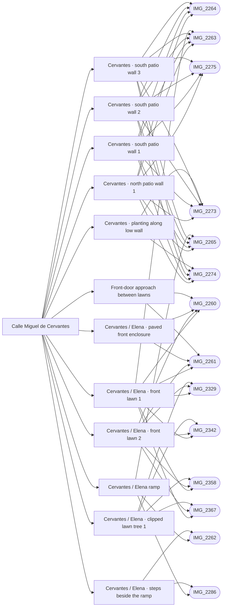

# Calle Miguel de Cervantes

_Generated by `scripts/build_references.py`. Do not edit: change `data/areas.json` or `data/reference_tags.json` and rebuild._

Cervantes, the straight tiled lane across the block from Pintor Dalí to the Picasso car-park access, its ramp, patio walls and covered passages.

## Known facts and open questions

- Straight narrow lane, square terracotta tiles, window grilles, lantern brackets; a drain and sloping exit onto Dalí (IMG_2273–2275).
- At Elena the lane is split: smooth ramp on the south half, three steps on the north half, built 2026-10-14 (docs/ELENA_NORTH.md). The rise there is 0.5 m over about 3 m.
- IMG_2288 shows CALLE MIGUEL inside a passage; reading it as Miguel de Cervantes is interpretation.
- IMG_2327: two red-tread steps up to a door just west of the Elena junction. IMG_2356: plumbago hedge and white kerb wall on Cervantes east of Elena.
- 2026-10-15 (#45): IMG_2329/2342 show the same near-corner pollarded lawn tree; IMG_2358/2367 and IMG_2260 show three clipped trees in sequence beside the lane, two in the nearer lawn and one beyond the door approach. Details positions/heights estimated; the existing lawn/white-kerb rings remain approximate because the oblique roof views do not calibrate their metric extents.
- Issue #33 review (2026-10-15): IMG_2327/2328 show two door steps immediately downhill of the ramp drain, distinct from the three ramp steps. Door placement remains blocked: the nearest modeled north solid facade is 6.17 m from the drain and the roof/aerial views do not uniquely locate this doorway. Identify the house/corner before changing geometry; see docs/CERVANTES_DOOR_STEPS_REVIEW.md.

## Read first

- docs: `docs/DALI_CERVANTES.md`, `docs/STREET_LAYOUT.md`, `docs/FRONTAGE_DIVISIONS.md`, `docs/ELENA_NORTH.md`, `docs/LEVELS.md`, `docs/CERVANTES_DOOR_STEPS_REVIEW.md`
- data: `data/dali_cervantes.json`, `data/dali_cervantes_threshold.json`, `data/cervantes_patio_walls.json`, `data/passages.json`, `data/frontage_divisions.json`, `data/cervantes_elena_steps.json`, `data/junction_lawns.json`, `data/levels_survey.json`
- src: `src/cervantes-walls.ts`, `src/dali-threshold.ts`, `src/frontages.ts`, `src/ramp-steps.ts`, `src/junction-lawns.ts`
- contact sheet: `villacana-reference/contact-sheets/cervantes.jpg` (thumbnails of everything below, numbered in this order)

## Coverage

Layout: 24, Levels and slopes: 9, Facades and roofs: 7, Materials: 1, Planting: 9, Signs: 2, Views: 3
26 reviewed, 0 suggested only by camera position.

## Levels

Ground and floor levels read from the photos, from `data/levels_survey.json` (see `docs/LEVELS.md`).

- `cervantes-elena-ramp` (ramp): 0.4-0.5 m above the drain at the junction, medium confidence at (-153.7, 57.8) ±1.5 m. Model: **built**. South half of the lane, the lawn kerb on its south edge. The white side face of the steps tapers out 8-9 tile rows above the drain. (IMG_2286.jpg, IMG_2262.jpg, IMG_2328.jpg, IMG_2252.jpg, IMG_2265.jpg)
- `cervantes-elena-steps` (steps): 0.4-0.5 m above the drain at the junction, high confidence at (-153.7, 57.4) ±1.5 m. Model: **differs**, task `cervantes-steps-treads`. North half of the lane. Bottom riser one tile row up from the drain; each tread one tile plus a grey stone nosing, 0.45-0.55 m. Risers at about 0.4, 0.92 and 1.45 m from the drain; the model has 0.4, 1.0 and 1.6 (data/cervantes_elena_steps.json). (IMG_2286.jpg, IMG_2355.jpg, IMG_2328.jpg, IMG_2262.jpg)
- `cervantes-junction-door-steps` (raised-threshold): 0.3-0.55 m above the lower junction paving, medium confidence at (-152.5, 55.5) ±1.5 m. Model: **missing**, task `cervantes-door-steps`. Brown garden door in a wall with a curved coping on the north edge of the lane, just east of the drain line, facing south. Two red-tread steps with white risers. It sits at the foot of the 0.5 m drop, so it climbs back to the upper Cervantes level. (IMG_2287.jpg, IMG_2196.jpg, IMG_2327.jpg, IMG_2328.jpg)
- `cervantes-junction-north-patio` (raised-patio): 0.4-0.5 m above the lower junction paving, low confidence at (-153.5, 53.5) ±3 m. Model: **missing**, task `cervantes-door-steps`. Inferred: the roof shots show a decorative-tiled patio behind the same curved-coping door, its floor level with the door sill. Its face to the lane is the wall and steps of the door. (IMG_2358.jpg, IMG_2367.jpg, IMG_2359.jpg, IMG_2369.jpg)
- `cervantes-junction-north-bed` (raised-bed): 0.3-0.5 m above the lower junction paving, medium confidence at (-154, 56.2) ±2 m. Model: **missing**, task `cervantes-door-steps`. White-walled hedge bed on the north side running 2-3 m west from the door corner along the steps; top about level with the second door step. (IMG_2286.jpg, IMG_2328.jpg, IMG_2355.jpg, IMG_2327.jpg, IMG_2196.jpg)
- `cervantes-east-north-bed` (raised-bed): 0.3-0.45 m above Cervantes east of Elena, medium confidence. Model: **missing**, task `cervantes-east-hedge`. White retaining wall with a plumbago hedge on top, north side east of Elena, at least 8 m, ending in a small rounded post. Water standing at its foot suggests a very flat lane. (IMG_2356.jpg, IMG_2265.jpg)
- `cervantes-upper-lane` (level): 0-0.15 m, medium confidence. Model: **built**. From the top of the ramp to the Dalí apron the lane recedes straight with no break, step or drain: level, or a grade under about 2%. South-side house sills at lane level or one sill above. (IMG_2264.jpg, IMG_2273.jpg, IMG_2274.jpg)

## Open build tasks

From `data/build_queue.json`; issue bodies in `refs/issues/`.

| Priority | Task | What | Status | Photos |
| --- | --- | --- | --- | --- |
| P2 | `cervantes-door-steps` [#33](https://github.com/daveyboyc/villacana-venture/issues/33) | Cervantes: two steps up to a front door west of the Elena junction | in-progress · issue_33 | [IMG_2327](../../public/photos-ref/IMG_2327.jpg), [IMG_2328](../../public/photos-ref/IMG_2328.jpg), [IMG_2287](../../public/photos-ref/IMG_2287.jpg), [IMG_2196](../../public/photos-ref/IMG_2196.jpg), [IMG_2358](../../public/photos-ref/IMG_2358.jpg), [IMG_2367](../../public/photos-ref/IMG_2367.jpg) |
| P3 | `cervantes-east-hedge` [#43](https://github.com/daveyboyc/villacana-venture/issues/43) | Cervantes east of Elena: white kerb wall and plumbago hedge | open | [IMG_2356](../../public/photos-ref/IMG_2356.jpg), [IMG_2360](../../public/photos-ref/IMG_2360.jpg) |
| P3 | `cervantes-north-patios` [#44](https://github.com/daveyboyc/villacana-venture/issues/44) | Walled patios along Cervantes from the roof views | open | [IMG_2368](../../public/photos-ref/IMG_2368.jpg), [IMG_2369](../../public/photos-ref/IMG_2369.jpg), [IMG_2359](../../public/photos-ref/IMG_2359.jpg) |
| P3 | `cervantes-steps-treads` [#56](https://github.com/daveyboyc/villacana-venture/issues/56) | Cervantes/Elena steps: tighten the treads to the photographed spacing | open | [IMG_2286](../../public/photos-ref/IMG_2286.jpg), [IMG_2355](../../public/photos-ref/IMG_2355.jpg), [IMG_2328](../../public/photos-ref/IMG_2328.jpg) |
| P3 | `junction-lawns` [#45](https://github.com/daveyboyc/villacana-venture/issues/45) | Cervantes/Elena junction lawns: pollarded trees and kerbs from the new photos | in-progress · issue_45 | [IMG_2329](../../public/photos-ref/IMG_2329.jpg), [IMG_2342](../../public/photos-ref/IMG_2342.jpg), [IMG_2358](../../public/photos-ref/IMG_2358.jpg), [IMG_2367](../../public/photos-ref/IMG_2367.jpg), [IMG_2260](../../public/photos-ref/IMG_2260.jpg) |

## Built from these photos

Model features that cite photos of this area, from `public/photos-ref/evidence-graph.json`. A citation records what a feature was traced from; it does not prove the feature matches.

## Reviewed references

| Reference | Viewpoint | Use for | What it shows |
| --- | --- | --- | --- |
| [IMG_2275.jpg](../../public/photos-ref/IMG_2275.jpg) | ground | levels, layout | Cervantes exit onto Pintor Dalí: slope and drain _Used by: cervantes_patio_walls.json:cervantes-patio-north-1, cervantes_patio_walls.json:cervantes-patio-south-1, cervantes_patio_walls.json:cervantes-patio-south-2, cervantes_patio_walls.json:cervantes-patio-south-3, dali_cervantes_threshold.json:dali-bays-1, dali_cervantes_threshold.json:dali-bays-2, dali_cervantes_threshold.json:dali-lawn-strip-1, dali_cervantes_threshold.json:dali-lawn-strip-2, dali_cervantes_threshold.json:dali-house-footpath-1, dali_cervantes_threshold.json:dali-house-footpath-2, dali_cervantes_threshold.json:cervantes-parking-crossing._ |
| [IMG_2260.jpg](../../public/photos-ref/IMG_2260.jpg) | ground | layout, planting | Cervantes junction: white terraces and small lawns _Used by: frontage_divisions.json:cervantes-elena-lawn-1, frontage_divisions.json:cervantes-elena-lawn-2, frontage_divisions.json:cervantes-front-patio, frontage_divisions.json:cervantes-lawn-door-path, junction_lawns.json:junction-pollarded-2, junction_lawns.json:junction-pollarded-3._ |
| [IMG_2265.jpg](../../public/photos-ref/IMG_2265.jpg) | ground | layout, levels | Cervantes: lane facing into the resort _Used by: cervantes_patio_walls.json:cervantes-patio-north-1, cervantes_patio_walls.json:cervantes-patio-south-1, cervantes_patio_walls.json:cervantes-patio-south-2, cervantes_patio_walls.json:cervantes-patio-south-3, ramp:cervantes-elena-ramp._ |
| [IMG_2273.jpg](../../public/photos-ref/IMG_2273.jpg) | ground | facades, layout | Cervantes: straight lane and barred windows _Used by: frontage_divisions.json:cervantes-west-planting, cervantes_patio_walls.json:cervantes-patio-north-1, cervantes_patio_walls.json:cervantes-patio-south-1, cervantes_patio_walls.json:cervantes-patio-south-2, cervantes_patio_walls.json:cervantes-patio-south-3._ |
| [IMG_2274.jpg](../../public/photos-ref/IMG_2274.jpg) | ground | planting, materials | Cervantes: planting and paving detail _Used by: frontage_divisions.json:cervantes-west-planting, cervantes_patio_walls.json:cervantes-patio-north-1, cervantes_patio_walls.json:cervantes-patio-south-1, cervantes_patio_walls.json:cervantes-patio-south-2, cervantes_patio_walls.json:cervantes-patio-south-3._ |
| [IMG_2263.jpg](../../public/photos-ref/IMG_2263.jpg) | ground | layout | Cervantes: lane and clipped planting toward the junction _Used by: frontage_divisions.json:cervantes-elena-lawn-1, cervantes_patio_walls.json:cervantes-patio-north-1, cervantes_patio_walls.json:cervantes-patio-south-1, cervantes_patio_walls.json:cervantes-patio-south-2, cervantes_patio_walls.json:cervantes-patio-south-3._ |
| [IMG_2261.jpg](../../public/photos-ref/IMG_2261.jpg) | ground | layout, planting, facades | Cervantes junction: another view of the same terraces _Used by: frontage_divisions.json:cervantes-elena-lawn-1, frontage_divisions.json:cervantes-elena-lawn-2, frontage_divisions.json:cervantes-front-patio, frontage_divisions.json:cervantes-lawn-door-path._ |
| [IMG_2264.jpg](../../public/photos-ref/IMG_2264.jpg) | ground | layout | Cervantes: lane facing toward Pintor Dalí _Used by: cervantes_patio_walls.json:cervantes-patio-north-1, cervantes_patio_walls.json:cervantes-patio-south-1, cervantes_patio_walls.json:cervantes-patio-south-2, cervantes_patio_walls.json:cervantes-patio-south-3._ |
| [IMG_2329.jpg](../../public/photos-ref/IMG_2329.jpg) | ground | layout, planting | Cervantes/Elena junction: lawn with a pollarded tree and white kerb _Used by: frontage_divisions.json:cervantes-elena-lawn-1, frontage_divisions.json:cervantes-elena-lawn-2, junction_lawns.json:junction-pollarded-1._ |
| [IMG_2342.jpg](../../public/photos-ref/IMG_2342.jpg) | ground | layout, planting | Cervantes/Elena junction: lawn corner with pollarded tree and drain **Note:** GPS ±14 m. _Used by: frontage_divisions.json:cervantes-elena-lawn-1, frontage_divisions.json:cervantes-elena-lawn-2, junction_lawns.json:junction-pollarded-1._ |
| [IMG_2262.jpg](../../public/photos-ref/IMG_2262.jpg) | ground | levels, layout | Cervantes junction: terracotta path, white curbs and drainage grate **Looks at:** The steps beside the Cervantes ramp. **Note:** Shows steps beside a sloping strip, with a drain at the foot. _Used by: steps:cervantes-elena-steps, ramp:cervantes-elena-ramp._ |
| [IMG_2360.jpg](../../public/photos-ref/IMG_2360.jpg) | roof | layout, facades, planting, view | Roof by Elena: looking east-north-east along Cervantes **Looks at:** Cervantes east of Elena, seen along its line. **Note:** Roof shot. The camera pin is inside a building; the subject is the Cervantes side, up to 50+ m away. |
| [IMG_2327.jpg](../../public/photos-ref/IMG_2327.jpg) | ground | levels, layout, facades | Cervantes at Elena: steps up to a door beside the lane |
| [IMG_2368.jpg](../../public/photos-ref/IMG_2368.jpg) | roof | layout, facades, view | Roof by Elena: patios and terraces south-west, along Cervantes **Looks at:** The walled patios north of Cervantes. **Note:** Roof shot: the pin is the roof. |
| [IMG_2369.jpg](../../public/photos-ref/IMG_2369.jpg) | roof | layout, facades, view | Roof by Elena: patios and terraces south-west (second shot) **Looks at:** The walled patios north of Cervantes. **Note:** Roof shot: the pin is the roof. |
| [IMG_2252.jpg](../../public/photos-ref/IMG_2252.jpg) | ground | levels, layout | Cervantes near Elena: tiled lane with a central sloping strip **Note:** Shows a ramp strip in the lane. |
| [IMG_2288.jpg](../../public/photos-ref/IMG_2288.jpg) | ground | signage, layout | Cervantes area: passage signed Calle Miguel |
| [IMG_2289.jpg](../../public/photos-ref/IMG_2289.jpg) | ground | layout, levels | Cervantes exit: white-edged tiled approach |
| [IMG_2328.jpg](../../public/photos-ref/IMG_2328.jpg) | ground | levels, layout | Cervantes at Elena: ramp and steps side by side, drain at the foot **Looks at:** The ramp and steps side by side. |
| [IMG_2356.jpg](../../public/photos-ref/IMG_2356.jpg) | ground | layout, planting | Cervantes east of Elena: lane beside a plumbago hedge |
| [IMG_2359.jpg](../../public/photos-ref/IMG_2359.jpg) | roof | layout, facades | Roof by Elena: over barrel tiles to the Cervantes patios **Looks at:** The walled patios along Cervantes. **Note:** Roof shot: the pin is the roof. |
| [IMG_2266.jpg](../../public/photos-ref/IMG_2266.jpg) | ground | layout | Calle Cervantes exit onto Pintor Dalí: planter and opposite hedge |
| [IMG_2355.jpg](../../public/photos-ref/IMG_2355.jpg) | ground | levels | Cervantes/Elena steps from the junction **Looks at:** The steps beside the Cervantes ramp. |
| [IMG_2358.jpg](../../public/photos-ref/IMG_2358.jpg) | roof | layout, planting | Roof by Elena: looking down on Elena south and the junction lawns **Looks at:** The junction lawns south of Cervantes. **Note:** Roof shot: the pin is the roof. _Used by: frontage_divisions.json:cervantes-elena-lawn-1, frontage_divisions.json:cervantes-elena-lawn-2, junction_lawns.json:junction-pollarded-1, junction_lawns.json:junction-pollarded-2, junction_lawns.json:junction-pollarded-3._ |
| [IMG_2367.jpg](../../public/photos-ref/IMG_2367.jpg) | roof | layout, planting | Roof by Elena: looking south over the Cervantes/Elena junction **Looks at:** The Cervantes/Elena junction. **Note:** Roof shot: the pin is the roof. _Used by: frontage_divisions.json:cervantes-elena-lawn-1, frontage_divisions.json:cervantes-elena-lawn-2, junction_lawns.json:junction-pollarded-1, junction_lawns.json:junction-pollarded-2, junction_lawns.json:junction-pollarded-3._ |
| [IMG_2286.jpg](../../public/photos-ref/IMG_2286.jpg) | ground | levels, layout, signage | Elena junction: side-by-side ramp and steps **Looks at:** The steps beside the Cervantes ramp. _Used by: steps:cervantes-elena-steps, ramp:cervantes-elena-ramp._ |
