# Calle Pintor Dalí

_Generated by `scripts/build_references.py`. Do not edit: change `data/areas.json` or `data/reference_tags.json` and rebuild._

Pintor Dalí, its car park and bays, the outer chain-link fence, the seaward turning area and the coastal gate to the paseo.

## Known facts and open questions

- The seaward boundary has a narrow pedestrian gate (IMG_2284, 2296, 2297): never close it off with a continuous fence.
- The aisle fence is a white curb, a concrete plinth and rusty chain-link, with a clipped hedge outside it (IMG_2269, 2270, 2277, 2278). Black house-side lanterns repeat along the parking (IMG_2269, 2270, 2276, 2278, 2279, 2280); their stations are estimated. Still open: each house's arches, grilles and balconies, the palms and bougainvillea, and the modern lamp at the seaward turning area.
- IMG_2280 is a flagstone pedestrian entrance, distinct from Cervantes' square tiles; no readable street sign.
- Issue #57 (data/door_sills.json): the house-side footpath and grass strip between Eva and Patricia stand a 0.12 m white kerb above the asphalt (IMG_2291-2293), with a slot drain at the arched porch; the lawn strip ends about 17 m along and cars nose up to the path beyond it. The south flagstone approach rises 0.25 m over 5 m to the arch in 6263501UF1366S_part1 between flared kerbs (IMG_2283/2294/2295); the passage behind the arch is the Calle de Jorge 39-67 arcade onto the south pool lawn and is not opened (docs/reviews/south-pool-dali-passage/). Open: the map puts Calle Patricia about 3.7 m south of the photographed apron kerb.

## Read first

- docs: `docs/DALI_CERVANTES.md`, `docs/LAYOUT_ACCURACY.md`, `docs/LEVELS.md`
- data: `data/dali_cervantes.json`, `data/dali_photo_reference.json`, `data/coastal_gate.json`, `data/levels_survey.json`, `data/door_sills.json`, `data/dali_street.json`
- src: `src/coastal-gate.ts`, `src/dali-threshold.ts`, `src/door-sills.ts`, `src/dali-street.ts`
- contact sheet: `villacana-reference/contact-sheets/dali.jpg` (thumbnails of everything below, numbered in this order)

## Coverage

Layout: 50, Levels and slopes: 8, Facades and roofs: 12, Materials: 30, Planting: 25, Signs: 1, Views: 6
53 reviewed, 0 suggested only by camera position.

## Levels

Ground and floor levels read from the photos, from `data/levels_survey.json` (see `docs/LEVELS.md`).

- `dali-cervantes-apron` (level): 0-0.15 m, high confidence at (-184.5, 75.5) ±4 m. Model: **built**. No step or riser: the pale tiled apron meets the Dalí asphalt flush, with a slot drain 2.5-3.2 m in from the road. A raised white planter of 0.4-0.6 m on the north side of the exit. (IMG_2275.jpg, IMG_2289.jpg, IMG_2266.jpg)
- `dali-south-approach` (slope): 0.15-0.35 m above the Dalí footpath, low confidence. Model: **built**, task `door-sills`. Flagstone approach between flared white kerbs of 0.15-0.25 m with a grooved concrete strip at its foot, rising gently towards the arch. No flight of steps. (IMG_2283.jpg)
- `dali-footpath-kerb` (raised-threshold): 0.1-0.15 m above the parking asphalt, medium confidence. Model: **built**, task `door-sills`. The house-side footpath stands a kerb above the asphalt; passage floors under the arches are flush with it, with a slot drain at the threshold. (IMG_2291.jpg, IMG_2293.jpg)

## Open build tasks

From `data/build_queue.json`; issue bodies in `refs/issues/`.

| Priority | Task | What | Status | Photos |
| --- | --- | --- | --- | --- |
| P1 | `dali-street-scene` | Pintor Dalí: curb, fence plinth, outer hedge and house-side lanterns | in-progress · Cursor · placement: not-verified | [IMG_2269](../../public/photos-ref/IMG_2269.jpg), [IMG_2270](../../public/photos-ref/IMG_2270.jpg), [IMG_2276](../../public/photos-ref/IMG_2276.jpg), [IMG_2277](../../public/photos-ref/IMG_2277.jpg), [IMG_2278](../../public/photos-ref/IMG_2278.jpg), [IMG_2279](../../public/photos-ref/IMG_2279.jpg), [IMG_2280](../../public/photos-ref/IMG_2280.jpg) |
| P2 | `dali-house-fronts` | Pintor Dalí: trace the house arches, palms and the seaward lamp (after dali-street-scene) | open · placement: not-verified | [IMG_2279](../../public/photos-ref/IMG_2279.jpg), [IMG_2280](../../public/photos-ref/IMG_2280.jpg), [IMG_2281](../../public/photos-ref/IMG_2281.jpg), [IMG_2291](../../public/photos-ref/IMG_2291.jpg) |
| P2 | `path-network-inventory-dali` [#131](https://github.com/daveyboyc/villacana-venture/issues/131) | Calle Pintor Dalí: full-source path, tunnel and boundary inventory (after path-network-baseline) | open · placement: not-applicable |  |

## Built from these photos

Model features that cite photos of this area, from `public/photos-ref/evidence-graph.json`, with their photo-check state. A citation records what a feature was traced from; only a check in `data/photo_checks.json` says someone rendered it from the photo's camera and compared.

```mermaid
graph LR
  A["Calle Pintor Dalí"]
  A --> F0["Dalí · gate pier · unreviewed"]
  F0 --> PIMG_2284_jpg(["IMG_2284"])
  F0 --> PIMG_2296_jpg(["IMG_2296"])
  F0 --> PIMG_2297_jpg(["IMG_2297"])
  A --> F1["Dalí · white plinth and rigid metal mesh · unreviewed"]
  F1 --> PIMG_2284_jpg(["IMG_2284"])
  F1 --> PIMG_2296_jpg(["IMG_2296"])
  F1 --> PIMG_2297_jpg(["IMG_2297"])
  A --> F2["Dalí · tall white coastal wall · unreviewed"]
  F2 --> PIMG_2284_jpg(["IMG_2284"])
  F2 --> PIMG_2296_jpg(["IMG_2296"])
  F2 --> PIMG_2297_jpg(["IMG_2297"])
  A --> F3["Cervantes · tiled parking crossing · unreviewed"]
  F3 --> PIMG_2267_jpg(["IMG_2267"])
  F3 --> PIMG_2268_jpg(["IMG_2268"])
  F3 --> PIMG_2275_jpg(["IMG_2275"])
  A --> F4["Dalí · parking bays · unreviewed"]
  F4 --> PIMG_2267_jpg(["IMG_2267"])
  F4 --> PIMG_2268_jpg(["IMG_2268"])
  F4 --> PIMG_2275_jpg(["IMG_2275"])
  A --> F5["Dalí · parking bays · unreviewed"]
  F5 --> PIMG_2267_jpg(["IMG_2267"])
  F5 --> PIMG_2268_jpg(["IMG_2268"])
  F5 --> PIMG_2275_jpg(["IMG_2275"])
  A --> F6["Dalí · house-side footpath · unreviewed"]
  F6 --> PIMG_2267_jpg(["IMG_2267"])
  F6 --> PIMG_2268_jpg(["IMG_2268"])
  F6 --> PIMG_2275_jpg(["IMG_2275"])
  A --> F7["Dalí · house-side footpath · unreviewed"]
  F7 --> PIMG_2267_jpg(["IMG_2267"])
  F7 --> PIMG_2268_jpg(["IMG_2268"])
  F7 --> PIMG_2275_jpg(["IMG_2275"])
  A --> F8["Dalí · grass strip · unreviewed"]
  F8 --> PIMG_2267_jpg(["IMG_2267"])
  F8 --> PIMG_2268_jpg(["IMG_2268"])
  F8 --> PIMG_2275_jpg(["IMG_2275"])
  A --> F9["Dalí · grass strip · unreviewed"]
  F9 --> PIMG_2267_jpg(["IMG_2267"])
  F9 --> PIMG_2268_jpg(["IMG_2268"])
  F9 --> PIMG_2275_jpg(["IMG_2275"])
  A --> F10["Pintor Dalí · white plinth, rusty chain-link and road curb · disputed"]
  F10 --> PIMG_2269_jpg(["IMG_2269"])
  F10 --> PIMG_2270_jpg(["IMG_2270"])
  F10 --> PIMG_2277_jpg(["IMG_2277"])
  F10 --> PIMG_2278_jpg(["IMG_2278"])
  A --> F11["Pintor Dalí · black house-side lanterns · disputed"]
  F11 --> PIMG_2269_jpg(["IMG_2269"])
  F11 --> PIMG_2270_jpg(["IMG_2270"])
  F11 --> PIMG_2276_jpg(["IMG_2276"])
  F11 --> PIMG_2278_jpg(["IMG_2278"])
  F11 --> PIMG_2279_jpg(["IMG_2279"])
  F11 --> PIMG_2280_jpg(["IMG_2280"])
  A --> F12["Pintor Dalí · clipped hedge outside the chain-link fence · unreviewed"]
  F12 --> PIMG_2269_jpg(["IMG_2269"])
  F12 --> PIMG_2270_jpg(["IMG_2270"])
  F12 --> PIMG_2278_jpg(["IMG_2278"])
  A --> F13["Pintor Dalí · kerbed lawn strip and footpath between Eva and Patricia · unreviewed"]
  F13 --> PIMG_2291_jpg(["IMG_2291"])
  F13 --> PIMG_2292_jpg(["IMG_2292"])
  F13 --> PIMG_2293_jpg(["IMG_2293"])
  A --> F14["Pintor Dalí south · flagstone approach to the arch · unreviewed"]
  F14 --> PIMG_2283_jpg(["IMG_2283"])
  F14 --> PIMG_2294_jpg(["IMG_2294"])
  F14 --> PIMG_2295_jpg(["IMG_2295"])
  A --> F15["Dalí · coastal pedestrian gate · unreviewed"]
  F15 --> PIMG_2284_jpg(["IMG_2284"])
  F15 --> PIMG_2296_jpg(["IMG_2296"])
  F15 --> PIMG_2297_jpg(["IMG_2297"])
```

## Placement evidence

`verification` is placement status, separate from photographic diagnostics. Earlier manual reviews may exist. Only a fresh measured packet and independent approval can grant `verified`.

| Feature | Placement | Photo diagnostics | Blockers |
| --- | --- | --- | --- |
| `coastal_gate.json:dali-coastal-gate-pier` | unreviewed | unchecked | No measured placement packet and independent approval recorded; earlier manual reviews may exist. |
| `coastal_gate.json:dali-coastal-mesh-base` | unreviewed | unchecked | No measured placement packet and independent approval recorded; earlier manual reviews may exist. |
| `coastal_gate.json:dali-coastal-solid-wall` | unreviewed | unchecked | No measured placement packet and independent approval recorded; earlier manual reviews may exist. |
| `dali_cervantes_threshold.json:cervantes-parking-crossing` | unreviewed | unchecked | No measured placement packet and independent approval recorded; earlier manual reviews may exist. |
| `dali_cervantes_threshold.json:dali-bays-1` | unreviewed | unchecked | No measured placement packet and independent approval recorded; earlier manual reviews may exist. |
| `dali_cervantes_threshold.json:dali-bays-2` | unreviewed | unchecked | No measured placement packet and independent approval recorded; earlier manual reviews may exist. |
| `dali_cervantes_threshold.json:dali-house-footpath-1` | unreviewed | unchecked | No measured placement packet and independent approval recorded; earlier manual reviews may exist. |
| `dali_cervantes_threshold.json:dali-house-footpath-2` | unreviewed | unchecked | No measured placement packet and independent approval recorded; earlier manual reviews may exist. |
| `dali_cervantes_threshold.json:dali-lawn-strip-1` | unreviewed | unchecked | No measured placement packet and independent approval recorded; earlier manual reviews may exist. |
| `dali_cervantes_threshold.json:dali-lawn-strip-2` | unreviewed | unchecked | No measured placement packet and independent approval recorded; earlier manual reviews may exist. |
| `dali_street.json:dali-fence-plinth` | disputed | differs | open discrepancy photo-discrepancy:02ab68010769bf56; open discrepancy photo-discrepancy:d3303554ff40df42; open discrepancy photo-discrepancy:a66a147d34e0a3dc; open discrepancy photo-discrepancy:bac737153ce65728 |
| `dali_street.json:dali-house-lanterns` | disputed | differs | open discrepancy photo-discrepancy:bf4f431120b5347e; open discrepancy photo-discrepancy:52e4bd8a1c7d7182; open discrepancy photo-discrepancy:8bc5795c6b9563c7 |
| `dali_street.json:dali-west-hedge` | unreviewed | unchecked | No measured placement packet and independent approval recorded; earlier manual reviews may exist. |
| `door_sills.json:dali-footpath-kerb` | unreviewed | unchecked | No measured placement packet and independent approval recorded; earlier manual reviews may exist. |
| `door_sills.json:dali-south-arch-approach` | unreviewed | unchecked | No measured placement packet and independent approval recorded; earlier manual reviews may exist. |
| `gate:dali-coastal-gate` | unreviewed | unchecked | No measured placement packet and independent approval recorded; earlier manual reviews may exist. |

## Photo checks

Renders from each photo's camera compared with the photo (`data/photo_checks.json`).

| Task | Photo | Result | Render | Notes |
| --- | --- | --- | --- | --- |
| `dali-street-scene` | [IMG_2269](../../public/photos-ref/IMG_2269.jpg) | **differs** → `dali-house-fronts` | [after](../../docs/reviews/dali-street-scene/IMG_2269-after.png) · [before](../../docs/reviews/dali-street-scene/IMG_2269-before.png) | The outer side has a white curb, chain-link and hedge, and a black lantern stands on the house side. The lane and parking bays are one asphalt surface; an earlier render let the terracotta ground show between them. The phone pin is in the bays, so the frame does not line up with the photo. The tree screen, house arches, palms and bougainvillea are still untraced. |
| `dali-street-scene` | [IMG_2270](../../public/photos-ref/IMG_2270.jpg) | **differs** → `dali-house-fronts` | [after](../../docs/reviews/dali-street-scene/IMG_2270-after.png) | Looking north, the render shows the white curb, rusty chain-link and the hedge outside it, with a black lantern on the house side. The photo also shows tall trees over the hedge and white houses with arches; those fronts and the trees are not traced, and the GPS frame does not match the photo. |
| `dali-street-scene` | [IMG_2276](../../public/photos-ref/IMG_2276.jpg) | **differs** → `dali-house-fronts` | [after](../../docs/reviews/dali-street-scene/IMG_2276-after.png) | A black lantern is in the house-side row the photo shows, on an estimated station. The photo's parking junction, palms and the sea at the end of the aisle are not matched from this unsolved pin. |
| `dali-street-scene` | [IMG_2277](../../public/photos-ref/IMG_2277.jpg) | **differs** → `dali-house-fronts` | [after](../../docs/reviews/dali-street-scene/IMG_2277-after.png) | The white curb and chain-link are on the outer side of the aisle, as in the photo. The low concrete plinth is mostly hidden by the hedge volume. Tree trunks behind the mesh, and the exact curb line, are not surveyed. |
| `dali-street-scene` | [IMG_2278](../../public/photos-ref/IMG_2278.jpg) | **differs** → `dali-house-fronts` | [after](../../docs/reviews/dali-street-scene/IMG_2278-after.png) · [before](../../docs/reviews/dali-street-scene/IMG_2278-before.png) | The lane and the parking bays are now one asphalt surface. The earlier render left a gap between them and the terracotta ground showed through it. A white curb, chain-link and hedge are on the outer side. The phone pin is not a solved camera, so the frame does not line up with the photo. The tree screen, parked cars and house arches are still not in the model. |
| `dali-street-scene` | [IMG_2279](../../public/photos-ref/IMG_2279.jpg) | **differs** → `dali-house-fronts` | [after](../../docs/reviews/dali-street-scene/IMG_2279-after.png) | Black lanterns stand along the house side of the bays. The photo's lantern is a glazed head among shrubs in front of a white arched house; the model head is a simple glass box on an estimated station, and the arches, palms and bougainvillea are not traced. |
| `dali-street-scene` | [IMG_2280](../../public/photos-ref/IMG_2280.jpg) | **differs** → `dali-house-fronts` | [after](../../docs/reviews/dali-street-scene/IMG_2280-after.png) | A black lantern is near the house side of this pin. The photo is the flagstone pedestrian entrance between white houses, with shutters and flowering climbers; that entrance paving and those fronts are not built here. |

## Reviewed references

| Reference | Viewpoint | Use for | What it shows |
| --- | --- | --- | --- |
| [IMG_2268.jpg](../../public/photos-ref/IMG_2268.jpg) | ground | layout, planting | Pintor Dalí: house-side footpath and parking looking south _Used by: dali_cervantes_threshold.json:dali-bays-1, dali_cervantes_threshold.json:dali-bays-2, dali_cervantes_threshold.json:dali-lawn-strip-1, dali_cervantes_threshold.json:dali-lawn-strip-2, dali_cervantes_threshold.json:dali-house-footpath-1, dali_cervantes_threshold.json:dali-house-footpath-2, dali_cervantes_threshold.json:cervantes-parking-crossing._ |
| [IMG_2267.jpg](../../public/photos-ref/IMG_2267.jpg) | ground | layout | Pintor Dalí: house-side footpath and parking looking north _Used by: dali_cervantes_threshold.json:dali-bays-1, dali_cervantes_threshold.json:dali-bays-2, dali_cervantes_threshold.json:dali-lawn-strip-1, dali_cervantes_threshold.json:dali-lawn-strip-2, dali_cervantes_threshold.json:dali-house-footpath-1, dali_cervantes_threshold.json:dali-house-footpath-2, dali_cervantes_threshold.json:cervantes-parking-crossing._ |
| [IMG_2284.jpg](../../public/photos-ref/IMG_2284.jpg) | ground | layout | Pintor Dalí: pedestrian gate to the paseo _Used by: coastal_gate.json:dali-coastal-mesh-base, coastal_gate.json:dali-coastal-gate-pier, coastal_gate.json:dali-coastal-solid-wall, gate:dali-coastal-gate._ |
| [IMG_2296.jpg](../../public/photos-ref/IMG_2296.jpg) | ground | layout | Dalí seaward end: parking turn and coast boundary _Used by: coastal_gate.json:dali-coastal-mesh-base, coastal_gate.json:dali-coastal-gate-pier, coastal_gate.json:dali-coastal-solid-wall, gate:dali-coastal-gate._ |
| [IMG_2297.jpg](../../public/photos-ref/IMG_2297.jpg) | ground | layout | Dalí seaward end: narrow pedestrian gate _Used by: coastal_gate.json:dali-coastal-mesh-base, coastal_gate.json:dali-coastal-gate-pier, coastal_gate.json:dali-coastal-solid-wall, gate:dali-coastal-gate._ |
| [IMG_2269.jpg](../../public/photos-ref/IMG_2269.jpg) | ground | layout, materials, planting | Pintor Dalí: parking and chain-link fence looking south **Looks at:** The white curb, rusty chain-link and house-side black lanterns, looking south along Pintor Dalí. _Used by: dali_street.json:dali-fence-plinth, dali_street.json:dali-west-hedge, dali_street.json:dali-house-lanterns._ |
| [IMG_2270.jpg](../../public/photos-ref/IMG_2270.jpg) | ground | layout, materials, planting | Pintor Dalí: parking and fence looking north **Looks at:** The same curb, hedge and a house-side lantern, looking north along Pintor Dalí. _Used by: dali_street.json:dali-fence-plinth, dali_street.json:dali-west-hedge, dali_street.json:dali-house-lanterns._ |
| [IMG_2278.jpg](../../public/photos-ref/IMG_2278.jpg) | ground | layout, materials, planting | Pintor Dalí: seaward parking row and chain-link fence **Looks at:** Brown chain-link on a concrete plinth, the white curb, and the hedge behind. _Used by: dali_street.json:dali-fence-plinth, dali_street.json:dali-west-hedge, dali_street.json:dali-house-lanterns._ |
| [IMG_2279.jpg](../../public/photos-ref/IMG_2279.jpg) | ground | facades, planting, materials | Pintor Dalí: houses, lamps and parking bays **Looks at:** A black lantern and the white house frontage beside the parking bays. _Used by: dali_street.json:dali-house-lanterns._ |
| [IMG_2283.jpg](../../public/photos-ref/IMG_2283.jpg) | ground | levels, layout, facades | Pintor Dalí: raised stone approach and archway _Used by: door_sills.json:dali-south-arch-approach._ |
| [IMG_2276.jpg](../../public/photos-ref/IMG_2276.jpg) | ground | layout, materials | Pintor Dalí: parking junction toward the sea **Looks at:** Parking bays, black lanterns and the outer fence toward the sea. _Used by: dali_street.json:dali-house-lanterns._ |
| [IMG_2277.jpg](../../public/photos-ref/IMG_2277.jpg) | ground | layout, materials | Pintor Dalí: aisle, outer fence and white curb **Looks at:** The aisle, white curb and chain-link fence toward the sea. _Used by: dali_street.json:dali-fence-plinth._ |
| [IMG_2280.jpg](../../public/photos-ref/IMG_2280.jpg) | ground | layout, materials | Pintor Dalí: flagstone pedestrian entrance **Looks at:** The flagstone pedestrian entrance, with a black lantern and white curbs. _Used by: dali_street.json:dali-house-lanterns._ |
| [IMG_2291.jpg](../../public/photos-ref/IMG_2291.jpg) | ground | facades, layout | Pintor Dalí: arched entrance and white facade _Used by: door_sills.json:dali-footpath-kerb._ |
| [IMG_2292.jpg](../../public/photos-ref/IMG_2292.jpg) | ground | layout, materials | Pintor Dalí: continuous tiled footpath and lawns _Used by: door_sills.json:dali-footpath-kerb._ |
| [IMG_2293.jpg](../../public/photos-ref/IMG_2293.jpg) | ground | levels, layout | Pintor Dalí: lane entrance, ramp and drain _Used by: door_sills.json:dali-footpath-kerb._ |
| [IMG_2294.jpg](../../public/photos-ref/IMG_2294.jpg) | ground | levels, layout | Dalí seaward end: flagstone approach to arch _Used by: door_sills.json:dali-south-arch-approach._ |
| [IMG_2295.jpg](../../public/photos-ref/IMG_2295.jpg) | ground | layout, facades | Dalí seaward end: covered access and shutters _Used by: door_sills.json:dali-south-arch-approach._ |
| [IMG_2525.jpg](../../public/photos-ref/IMG_2525.jpg) | ground | layout, facades, planting, materials | Dali car park bays and the white houses along its east side |
| [IMG_2556.jpg](../../public/photos-ref/IMG_2556.jpg) | ground | layout, facades, planting, materials | Footpath along the west side of the block, house with grilled windows **Note:** Pin is on the Dali road edge; the footpath is the Calle Eva west-side footpath. |
| [IMG_2472.jpg](../../public/photos-ref/IMG_2472.jpg) | ground | layout, materials, planting | Tiled footpath beside Dalí car park lawn |
| [IMG_2473.jpg](../../public/photos-ref/IMG_2473.jpg) | ground | layout, planting, materials | Dalí footpath, strelitzia lawn strip and parked cars |
| [IMG_2474.jpg](../../public/photos-ref/IMG_2474.jpg) | ground | layout, materials, planting | Dalí car park and clipped hedge **Note:** Looks south-southwest across the road; the villa beyond the hedge is outside the resort boundary (not identified). |
| [IMG_2475.jpg](../../public/photos-ref/IMG_2475.jpg) | ground | layout, planting, view | Calle Pintor Dalí looking south |
| [IMG_2477.jpg](../../public/photos-ref/IMG_2477.jpg) | ground | facades, planting, materials | House frontage on Dalí with arched entry and bougainvillea **Looks at:** white house frontage with arched entry on the east side of Dalí. **Note:** Subject point is an approximate 8 m offset along the phone heading, not surveyed. |
| [IMG_2478.jpg](../../public/photos-ref/IMG_2478.jpg) | ground | facades, layout, materials | White arched gateway with lanterns into a planted passage **Looks at:** arched white gateway from Dalí footpath. **Note:** Which registry opening this is is unidentified; GPS puts the camera on the Dalí road edge heading ENE. Subject point is a rough ~5 m offset. |
| [IMG_2524.jpg](../../public/photos-ref/IMG_2524.jpg) | ground | layout, view, materials | Dali car park looking south: white kerb, chain-link fence, houses at far end **Note:** Pin lies on the west edge of the car park (GPS ±3.7 m); the west boundary fence runs along the right of frame. |
| [IMG_2526.jpg](../../public/photos-ref/IMG_2526.jpg) | ground | layout, materials, view | Dali car park looking north: hedge-covered fence, white kerb and parked cars |
| [IMG_2554.jpg](../../public/photos-ref/IMG_2554.jpg) | ground | layout, planting, view | Dali car park looking north with CCTV lamp post and parked cars **Note:** Pin is at the Dali/Eva corner. |
| [IMG_2555.jpg](../../public/photos-ref/IMG_2555.jpg) | ground | facades, planting, layout | Dali car park edge with lawn islands and white house with brown gate |
| [IMG_2558.jpg](../../public/photos-ref/IMG_2558.jpg) | ground | layout, materials, planting | Terracotta footpath with kerbed planters leading to a brown gate **Note:** Pin altitude 9.3 m reads 'above ground', but the picture is at ground level (GPS height noise). |
| [IMG_2696.jpg](../../public/photos-ref/IMG_2696.jpg) | ground | layout, materials, planting | Crazy-paving path from the Dali parking into a garden lane |
| [IMG_2697.jpg](../../public/photos-ref/IMG_2697.jpg) | ground | layout, materials, planting | Crazy-paving path from the Dali parking, wider view |
| [IMG_2698.jpg](../../public/photos-ref/IMG_2698.jpg) | ground | layout, materials, planting | Crazy-paving path and lantern beyond parked cars |
| [IMG_2699.jpg](../../public/photos-ref/IMG_2699.jpg) | ground | layout, materials, view | Dali car park aisle with marked bays, looking north |
| [IMG_2701.jpg](../../public/photos-ref/IMG_2701.jpg) | ground | layout, materials, planting | Small tiled forecourt at the Dali kerb with a lantern **Note:** Altitude reads above 9 m, but the picture is at eye level on the lane (GPS height noise). |
| [IMG_2476.jpg](../../public/photos-ref/IMG_2476.jpg) | ground | layout, facades | Calle Pintor Dalí looking north |
| [IMG_2700.jpg](../../public/photos-ref/IMG_2700.jpg) | ground | layout, planting | Dali car park aisle with white kerbs and frontage planters |
| [IMG_2281.jpg](../../public/photos-ref/IMG_2281.jpg) | ground | layout | Pintor Dalí seaward end: turning area and fence |
| [IMG_2282.jpg](../../public/photos-ref/IMG_2282.jpg) | ground | layout | Pintor Dalí seaward end: wall and paseo boundary |
| [IMG_2290.jpg](../../public/photos-ref/IMG_2290.jpg) | ground | layout | Pintor Dalí: grass between bays and shared footpath |
| [IMG_2275.jpg](../../public/photos-ref/IMG_2275.jpg) | ground | levels, layout | Cervantes exit onto Pintor Dalí: slope and drain _Used by: cervantes_patio_walls.json:cervantes-patio-north-1, cervantes_patio_walls.json:cervantes-patio-north-east, cervantes_patio_walls.json:cervantes-patio-south-1, cervantes_patio_walls.json:cervantes-patio-south-2, cervantes_patio_walls.json:cervantes-patio-south-3, dali_cervantes_threshold.json:dali-bays-1, dali_cervantes_threshold.json:dali-bays-2, dali_cervantes_threshold.json:dali-lawn-strip-1, dali_cervantes_threshold.json:dali-lawn-strip-2, dali_cervantes_threshold.json:dali-house-footpath-1, dali_cervantes_threshold.json:dali-house-footpath-2, dali_cervantes_threshold.json:cervantes-parking-crossing._ |
| [IMG_2637.jpg](../../public/photos-ref/IMG_2637.jpg) | ground | layout, materials, planting | Paseo end by the Calle Pintor Dali car park with hedge behind mesh fence **Looks at:** Dali end of the paseo: wall end, mesh fence and lamp. **Note:** looksAt is the wall end about 6 m ahead along the heading, by eye from the pin (+-4.7 m). _Used by: paseo_details.json:paseo-white-lamp-1, paseo_details.json:paseo-white-lamp-2, paseo_details.json:paseo-white-lamp-3, paseo_details.json:paseo-white-lamp-4._ |
| [IMG_2551.jpg](../../public/photos-ref/IMG_2551.jpg) | ground | layout, materials, signage, planting | Calle Eva west footpath at the Dali end, terracotta path beside a lawn island **Looks at:** Eva west stretch looking south-west to the Dali car park: kerbed bed left, kerbed lawn island and lantern right. **Note:** Pin is at the Eva/Dali junction. _Used by: eva_lane.json:eva-lane-west, eva_lane.json:eva-lane-west-edges._ |
| [IMG_2552.jpg](../../public/photos-ref/IMG_2552.jpg) | ground | layout, materials, levels | Curved kerbed footpath meeting the Dali car park aisle **Looks at:** Eva west end: the tiled path curving onto the Dali footpath between white kerbs, slot drain, lawn and lantern. _Used by: eva_lane.json:eva-lane-west, eva_lane.json:eva-lane-west-edges._ |
| [IMG_2468.jpg](../../public/photos-ref/IMG_2468.jpg) | ground | layout, facades, planting | Cervantes west end: arcaded porch on the left, dracaena and shrub bed on the right **Looks at:** West end of the lane towards Dali. **Note:** Pin (-167.1, 65.2) +-2.3 m. The arch is the mouth of the south-side covered passage seen in IMG_2288/2469. looksAt estimated 20 m along heading 242. |
| [IMG_2471.jpg](../../public/photos-ref/IMG_2471.jpg) | ground | layout, levels, materials | Dalí footpath ramp with white mailbox pillar |
| [IMG_2638.jpg](../../public/photos-ref/IMG_2638.jpg) | ground | layout, levels, materials | Paseo wall end and kerbed junction near Dali car park |
| [IMG_2703.jpg](../../public/photos-ref/IMG_2703.jpg) | ground | layout, materials, planting | Eva west footpath beside the Dali road, looking north **Note:** Altitude reads above 9 m, but the picture is at eye level on the lane (GPS height noise). |
| [IMG_2704.jpg](../../public/photos-ref/IMG_2704.jpg) | ground | layout, materials, planting | Eva west footpath with kerbed grass strip, looking north **Note:** Altitude reads above 9 m, but the picture is at eye level on the lane (GPS height noise). |
| [IMG_2218.jpg](../../public/photos-ref/IMG_2218.jpg) | roof | facades, view | Roof terrace looking south-west: roofs and tall pines along Pintor Dalí |
| [IMG_2289.jpg](../../public/photos-ref/IMG_2289.jpg) | ground | layout, levels | Cervantes exit: white-edged tiled approach |
| [IMG_2266.jpg](../../public/photos-ref/IMG_2266.jpg) | ground | layout | Calle Cervantes exit onto Pintor Dalí: planter and opposite hedge |
