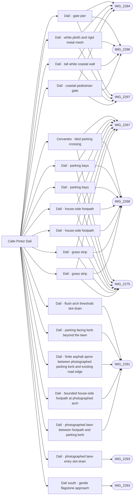

# Calle Pintor Dalí

_Generated by `scripts/build_references.py`. Do not edit: change `data/areas.json` or `data/reference_tags.json` and rebuild._

Pintor Dalí, its car park and bays, the outer chain-link fence, the seaward turning area and the coastal gate to the paseo.

## Known facts and open questions

- The seaward boundary has a narrow pedestrian gate (IMG_2284, 2296, 2297): never close it off with a continuous fence.
- IMG_2280 is a flagstone pedestrian entrance, distinct from Cervantes' square tiles; no readable street sign.
- Issue #57 (docs/DOOR_SILLS.md): finite photo-backed footpath/lawn/outer parking kerb (IMG_2291), a bounded asphalt apron joining that kerb to the unchanged Dalí road ribbon edge (closing the inherited .92-1.32 m brown strip), two flush drains (2291/2293), and a continuous .25 m / 5.61 m south approach with flared .20 m kerbs and grooved toe (2283). A .3 m exterior landing covers reachable space before the unchanged solid registry facade. The passage itself is untraced; no new walk-through is claimed. Only local movement datums are reconciled with the visible surfaces; the outer 2 m blend remains an approximation to inherited road/player mismatch.

## Read first

- docs: `docs/DALI_CERVANTES.md`, `docs/LAYOUT_ACCURACY.md`, `docs/LEVELS.md`, `docs/DOOR_SILLS.md`
- data: `data/dali_cervantes.json`, `data/dali_photo_reference.json`, `data/coastal_gate.json`, `data/levels_survey.json`, `data/door_sills.json`
- src: `src/coastal-gate.ts`, `src/dali-threshold.ts`, `src/door-sills.ts`
- contact sheet: `villacana-reference/contact-sheets/dali.jpg` (thumbnails of everything below, numbered in this order)

## Coverage

Layout: 23, Levels and slopes: 5, Facades and roofs: 5, Materials: 4, Planting: 2, Views: 1
25 reviewed, 0 suggested only by camera position.

## Levels

Ground and floor levels read from the photos, from `data/levels_survey.json` (see `docs/LEVELS.md`).

- `dali-cervantes-apron` (level): 0-0.15 m, high confidence at (-184.5, 75.5) ±4 m. Model: **built**. No step or riser: the pale tiled apron meets the Dalí asphalt flush, with a slot drain 2.5-3.2 m in from the road. A raised white planter of 0.4-0.6 m on the north side of the exit. (IMG_2275.jpg, IMG_2289.jpg, IMG_2266.jpg)
- `dali-south-approach` (slope): 0.15-0.35 m above the Dalí footpath, low confidence. Model: **built**, task `door-sills`. Flagstone approach between flared white kerbs of 0.15-0.25 m with a grooved concrete strip at its foot, rising gently towards the arch. No flight of steps. Built #57: bounded external .25 m rise over 5.61 m and .3 m top landing, with .20 m flared kerbs; registry passage behind remains solid/untraced. (IMG_2283.jpg)
- `dali-footpath-kerb` (raised-threshold): 0.1-0.15 m above the parking asphalt, medium confidence. Model: **built**, task `door-sills`. The house-side footpath stands a kerb above the asphalt; passage floors under the arches are flush with it, with a slot drain at the threshold. Built #57: one finite 9 m photographed house-side footpath, lawn and parking-facing .12 m kerb; two flush slot drains. Other Dalí frontages and passages are not extrapolated. (IMG_2291.jpg, IMG_2293.jpg)

## Built from these photos

Model features that cite photos of this area, from `public/photos-ref/evidence-graph.json`. A citation records what a feature was traced from; it does not prove the feature matches.

## Reviewed references

| Reference | Viewpoint | Use for | What it shows |
| --- | --- | --- | --- |
| [IMG_2268.jpg](../../public/photos-ref/IMG_2268.jpg) | ground | layout, planting | Pintor Dalí: house-side footpath and parking looking south _Used by: dali_cervantes_threshold.json:dali-bays-1, dali_cervantes_threshold.json:dali-bays-2, dali_cervantes_threshold.json:dali-lawn-strip-1, dali_cervantes_threshold.json:dali-lawn-strip-2, dali_cervantes_threshold.json:dali-house-footpath-1, dali_cervantes_threshold.json:dali-house-footpath-2, dali_cervantes_threshold.json:cervantes-parking-crossing._ |
| [IMG_2267.jpg](../../public/photos-ref/IMG_2267.jpg) | ground | layout | Pintor Dalí: house-side footpath and parking looking north _Used by: dali_cervantes_threshold.json:dali-bays-1, dali_cervantes_threshold.json:dali-bays-2, dali_cervantes_threshold.json:dali-lawn-strip-1, dali_cervantes_threshold.json:dali-lawn-strip-2, dali_cervantes_threshold.json:dali-house-footpath-1, dali_cervantes_threshold.json:dali-house-footpath-2, dali_cervantes_threshold.json:cervantes-parking-crossing._ |
| [IMG_2291.jpg](../../public/photos-ref/IMG_2291.jpg) | ground | facades, layout | Pintor Dalí: arched entrance and white facade _Used by: door_sills.json:dali-eva-photo-footpath, door_sills.json:dali-eva-photo-lawn, door_sills.json:dali-eva-photo-asphalt-apron, door_sills.json:dali-eva-parking-kerb, door_sills.json:dali-eva-arch-slot._ |
| [IMG_2284.jpg](../../public/photos-ref/IMG_2284.jpg) | ground | layout | Pintor Dalí: pedestrian gate to the paseo _Used by: coastal_gate.json:dali-coastal-mesh-base, coastal_gate.json:dali-coastal-gate-pier, coastal_gate.json:dali-coastal-solid-wall, gate:dali-coastal-gate._ |
| [IMG_2296.jpg](../../public/photos-ref/IMG_2296.jpg) | ground | layout | Dalí seaward end: parking turn and coast boundary _Used by: coastal_gate.json:dali-coastal-mesh-base, coastal_gate.json:dali-coastal-gate-pier, coastal_gate.json:dali-coastal-solid-wall, gate:dali-coastal-gate._ |
| [IMG_2297.jpg](../../public/photos-ref/IMG_2297.jpg) | ground | layout | Dalí seaward end: narrow pedestrian gate _Used by: coastal_gate.json:dali-coastal-mesh-base, coastal_gate.json:dali-coastal-gate-pier, coastal_gate.json:dali-coastal-solid-wall, gate:dali-coastal-gate._ |
| [IMG_2283.jpg](../../public/photos-ref/IMG_2283.jpg) | ground | levels, layout, facades | Pintor Dalí: raised stone approach and archway _Used by: terrain.json:dali-south-approach._ |
| [IMG_2293.jpg](../../public/photos-ref/IMG_2293.jpg) | ground | levels, layout | Pintor Dalí: lane entrance, ramp and drain _Used by: door_sills.json:dali-patricia-slot._ |
| [IMG_2277.jpg](../../public/photos-ref/IMG_2277.jpg) | ground | layout, materials | Pintor Dalí: aisle, outer fence and white curb |
| [IMG_2278.jpg](../../public/photos-ref/IMG_2278.jpg) | ground | layout, materials | Pintor Dalí: seaward parking row and chain-link fence |
| [IMG_2279.jpg](../../public/photos-ref/IMG_2279.jpg) | ground | facades, planting | Pintor Dalí: houses, lamps and parking bays |
| [IMG_2280.jpg](../../public/photos-ref/IMG_2280.jpg) | ground | layout, materials | Pintor Dalí: flagstone pedestrian entrance |
| [IMG_2292.jpg](../../public/photos-ref/IMG_2292.jpg) | ground | layout, materials | Pintor Dalí: continuous tiled footpath and lawns |
| [IMG_2294.jpg](../../public/photos-ref/IMG_2294.jpg) | ground | levels, layout | Dalí seaward end: flagstone approach to arch |
| [IMG_2295.jpg](../../public/photos-ref/IMG_2295.jpg) | ground | layout, facades | Dalí seaward end: covered access and shutters |
| [IMG_2269.jpg](../../public/photos-ref/IMG_2269.jpg) | ground | layout | Pintor Dalí: parking and chain-link fence looking south |
| [IMG_2270.jpg](../../public/photos-ref/IMG_2270.jpg) | ground | layout | Pintor Dalí: parking and fence looking north |
| [IMG_2276.jpg](../../public/photos-ref/IMG_2276.jpg) | ground | layout | Pintor Dalí: parking junction toward the sea |
| [IMG_2281.jpg](../../public/photos-ref/IMG_2281.jpg) | ground | layout | Pintor Dalí seaward end: turning area and fence |
| [IMG_2282.jpg](../../public/photos-ref/IMG_2282.jpg) | ground | layout | Pintor Dalí seaward end: wall and paseo boundary |
| [IMG_2290.jpg](../../public/photos-ref/IMG_2290.jpg) | ground | layout | Pintor Dalí: grass between bays and shared footpath |
| [IMG_2275.jpg](../../public/photos-ref/IMG_2275.jpg) | ground | levels, layout | Cervantes exit onto Pintor Dalí: slope and drain _Used by: cervantes_patio_walls.json:cervantes-patio-north-1, cervantes_patio_walls.json:cervantes-patio-north-east, cervantes_patio_walls.json:cervantes-patio-south-1, cervantes_patio_walls.json:cervantes-patio-south-2, cervantes_patio_walls.json:cervantes-patio-south-3, dali_cervantes_threshold.json:dali-bays-1, dali_cervantes_threshold.json:dali-bays-2, dali_cervantes_threshold.json:dali-lawn-strip-1, dali_cervantes_threshold.json:dali-lawn-strip-2, dali_cervantes_threshold.json:dali-house-footpath-1, dali_cervantes_threshold.json:dali-house-footpath-2, dali_cervantes_threshold.json:cervantes-parking-crossing._ |
| [IMG_2218.jpg](../../public/photos-ref/IMG_2218.jpg) | roof | facades, view | Roof terrace looking south-west: roofs and tall pines along Pintor Dalí |
| [IMG_2289.jpg](../../public/photos-ref/IMG_2289.jpg) | ground | layout, levels | Cervantes exit: white-edged tiled approach |
| [IMG_2266.jpg](../../public/photos-ref/IMG_2266.jpg) | ground | layout | Calle Cervantes exit onto Pintor Dalí: planter and opposite hedge |
