# Calle Elena

_Generated by `scripts/build_references.py`. Do not edit: change `data/areas.json` or `data/reference_tags.json` and rebuild._

Calle Elena, north and south sections, from the north pool to the middle pool, including the ramp and steps at its junction with Cervantes.

## Known facts and open questions

- IMG_2254 shows the sign CALLE ELENA 18-30.
- Built 2026-10-14 (docs/ELENA_NORTH.md): arched gateway to the north pool lawn, east patio wall, west planting strip, magnolia bed, two hedged beds with pollarded trees, two planter boxes, and the three steps beside the Cervantes ramp.
- The Cervantes/Elena rise is 0.5 m over about 3 m (steps beside a ramp, IMG_2286), not 7 m.
- Not modelled yet: the east-side patios beyond the beds.
- IMG_2286 GPS is ±14 m: do not place geometry from its pin alone.
- IMG_2355 and IMG_2328 (14 Oct) confirm the three steps beside the Cervantes ramp and the drain across the whole lane. Roof shots IMG_2358, 2366, 2367 look down on the junction lawns and the east-side patios.
- Issue #34: the short paved spur between the two hedged beds now reaches a closed timber door in a finite white garden wall; the barred window is in a short transverse return at the north end of the planted bed (IMG_2199-2201). Extents against existing bed backs and heights are estimated; no unseen patio enclosure or level change is inferred.
- Not modelled yet: the garden door between the hedged beds, the east-side patios beyond the beds.
- Issue #46: the first paired iron gateway and short patterned tiled entry west of covered walkway 6265201UF1366N_part5 are modelled from IMG_2361/2202; IMG_2203 faces the opposite open end. Gates enclose a private side entry beyond the passage, leaving the complete covered walkway open. Gateway dimensions and placement remain estimates; further gates/enclosures in the roof view are untraced.
- Issue #38 (docs/ELENA_EAST_PATIOS.md): the roof shots IMG_2366/IMG_2360 look along Cervantes east of the junction (the trained-trunk wall, curved-coping door and cane-roofed pergola are on the Cervantes south side, cf. IMG_2197; new task cervantes-east-south-patios). The patios behind the Elena garden wall are hidden under the magnolia canopy from every roof camera, so their partitions, floors and levels stay unmodelled. Built from ground photos: the garden wall continued behind the second hedged bed (IMG_2197, IMG_2199), a solid white wall behind the plumbago bed closing the patios off from Cervantes (IMG_2356), and a timber pergola behind the garden door (IMG_2199, IMG_2200); extents and heights estimated.
- Issue #57 (data/door_sills.json): red-tread sills, 0.12 m, at the two brown doors in the white wall west of the junction lawns (IMG_2260/2261/2330). Not modelled yet: that wall and its doors. The door on the east side at the junction (IMG_2253) has no visible sill and was left out. Open: the terrain rule's guessed west rise puts these lawns 0.2-0.3 m above the lane, while the photos show them level with it behind a 0.1 m kerb.
- 25 October source inventory #129: 60 distinct sources independently inspected and 17 storage mirrors deduplicated; 29 feature observations, source-pixel traces/locators and plan/sections linked in path-network inspector. Covered passage, private 36/34 spur and shallow lawn gateway are separate. Smaller farther shuttered openings are not extra doors. Private 09/12 support an iron-gate candidate with a separate pool-glass barrier beyond, not registered reverse connectivity. Both world portals, physical path-edge registration, concealed boundaries and levels/clearance remain unresolved; five evidence requests and issues #143–148 precede further structure/surfaces. No runtime geometry or placement approval changed.
- Owner correction 25 October (#151): north/south outdoor lanes use three straight square-tile columns with separate grey aggregate margins. Existing road widths/points/heights and garden-spur ring are unchanged; the spur shares north-lane grid phase. Tile pitch is fitted to model width, not measured from counts. New current comparison records are additive; previous registration, structural and level/clearance discrepancies remain open.
- Owner patio correction 26 October (#153): full-height north privacy wall/door, source-visible gateway→house return and one divider; existing garden/Cervantes wall pieces share vertex ground, with shaped door coping. First visible north-patio floor uses plain square tiles with independent phase; lane/spur keep their three-column grid. Hidden 0.95 m frontage join and all heights/plan anchors remain estimates. Low kerbs stay low; IMG_2358 private decorated patio patterns stay distinct. Concealed partitions and south wall/door registration remain open; see docs/reviews/elena-patio-wall-correction. Final material check also aligned the existing south cross-lawn approach to its adjoining lane axes/pitch/model phase; exact source phase is partly hidden and remains a consistency assumption.
- 27 October batch (docs/PHOTOS_2026-10-27.md): the walkway plaque reads CALLE ELENA 18 36 (IMG_2518; IMG_2254 had it cropped, earlier read as 18-30). The walkway floor is two risers (about 0.3 m) above the lane at its east portal, with a red ribbed ramp beside the steps (IMG_2518/2519, level item elena-walkway-east-steps, not modelled). IMG_2519 looks the whole walkway to the west arch and the 36/34 gates, the both-end view #145 asked for together with IMG_2203.
- 27 October batch: a second covered passage, signed CALLE ELENA 25, opens off Elena south through a moulded street arch into block 6265601UF1366N_part1 (IMG_2507/2508): doors both sides, flush floor of terracotta with blue inset tiles, far arch to a red-tiled path and an iron garden gate. The registry and the game draw the block solid; the aerial shows a courtyard inside. Task elena-25-passage.
- 4 Nov 2026 (task elena-walkway-details, docs/ELENA_WALKWAY.md): the covered walkway under part5 now has its east-portal steps (three white risers, not two) and red studded ramp, a 0.40 m raised patterned floor with the pebble mat, CALLE ELENA 18 36 / CASA WILKES tile signs, AGUA POTABLE hatch, two brown double doors, round end arches and a lantern, from IMG_2456/2459/2518-2520/2689-2691. Positions along the walls and all dimensions are estimates; the single arched door with grille (IMG_2692/2813) is not placed. The Elena/Cervantes junction details of IMG_2540/2511 (grey stone inset slabs, the CALLE ELENA tile sign on the lawn kerb wall) and IMG_2541-2547 (Cervantes to Eva inner walk-through) are not built.

## Read first

- docs: `docs/ELENA_NORTH.md`, `docs/ELENA_EAST_PATIOS.md`, `docs/STREET_LAYOUT.md`, `docs/TERRAIN.md`, `docs/LEVELS.md`, `docs/reviews/path-network-inventory-elena/README.md`, `docs/reviews/elena-patio-wall-correction/README.md`, `docs/ELENA_WALKWAY.md`
- data: `data/elena_north.json`, `data/elena_east_patios.json`, `data/cervantes_elena_steps.json`, `data/street_layout.json`, `proposals/calle-elena.json`, `data/terrain.json`, `data/levels_survey.json`, `data/door_sills.json`, `data/elena_walkway.json`
- src: `src/elena-north.ts`, `src/elena-east-patios.ts`, `src/ramp-steps.ts`, `src/terrain.ts`, `src/layout-routes.ts`, `src/door-sills.ts`, `src/elena-walkway.ts`
- contact sheet: `villacana-reference/contact-sheets/elena.jpg` (thumbnails of everything below, numbered in this order)

## Coverage

Layout: 77, Levels and slopes: 27, Facades and roofs: 46, Materials: 54, Planting: 49, Signs: 20, Views: 5
96 reviewed, 0 suggested only by camera position.

## Levels

Ground and floor levels read from the photos, from `data/levels_survey.json` (see `docs/LEVELS.md`).

- `elena-south-sills` (raised-threshold): 0.1-0.15 m above Calle Elena south, medium confidence. Model: **built**, task `door-sills`. Single red-tread or white sills at the house doors. Elena south is level to the middle pool gate; lawns kerbed at about 0.1 m. (IMG_2260.jpg, IMG_2261.jpg, IMG_2330.jpg, IMG_2253.jpg)
- `elena-walkway-east-steps` (steps): 0.3-0.4 m above the Calle Elena lane outside the covered walkway's east portal, medium confidence at (-154.5, 38.5) ±2.5 m. Model: **built**, task `elena-walkway-details`. Three white-nosed risers (about 0.13 m each, treads about 0.5 m deep) up from the lane into the walkway (6265201UF1366N_part5), a red studded rubber ramp about 1.65 m long beside them on the north side; the floor then runs level to the west arch. Floor inside is terracotta with blue-and-white inset tiles. The first reading (two risers, 0.25-0.36 m) is replaced: IMG_2459, IMG_2518 and IMG_2689 show three risers. Built in data/elena_walkway.json at 0.40 m; under a roof, so the laser survey cannot check it. (IMG_2254.jpg, IMG_2459.jpg, IMG_2518.jpg, IMG_2519.jpg, IMG_2689.jpg)

## Open build tasks

From `data/build_queue.json`; issue bodies in `refs/issues/`.

| Priority | Task | What | Status | Photos |
| --- | --- | --- | --- | --- |
| P1 | `elena-level-clearance-survey` [#148](https://github.com/daveyboyc/villacana-venture/issues/148) | Elena: resolve path/threshold levels and usable clearance uncertainty (after path-network-inventory-elena) | open · placement: not-applicable | [IMG_2518](../../public/photos-ref/IMG_2518.jpg), [IMG_2519](../../public/photos-ref/IMG_2519.jpg) |
| P1 | `elena-path-tiles` [#151](https://github.com/daveyboyc/villacana-venture/issues/151) | Elena: three straight tile columns and separate grey path margins (after path-network-inventory-elena) | in-progress · Codex · placement: not-verified | [IMG_2201](../../public/photos-ref/IMG_2201.jpg), [IMG_2253](../../public/photos-ref/IMG_2253.jpg), [IMG_2330](../../public/photos-ref/IMG_2330.jpg) |
| P1 | `elena-patio-wall-correction` [#153](https://github.com/daveyboyc/villacana-venture/issues/153) | Elena: correct front-patio wall heights, joins and paving consistency (after path-network-inventory-elena) | in-progress · Codex · placement: not-verified | [IMG_2363](../../public/photos-ref/IMG_2363.jpg), [IMG_2199](../../public/photos-ref/IMG_2199.jpg), [IMG_2200](../../public/photos-ref/IMG_2200.jpg), [IMG_2201](../../public/photos-ref/IMG_2201.jpg), [IMG_2197](../../public/photos-ref/IMG_2197.jpg), [IMG_2356](../../public/photos-ref/IMG_2356.jpg), [IMG_2261](../../public/photos-ref/IMG_2261.jpg), [IMG_2330](../../public/photos-ref/IMG_2330.jpg) |
| P1 | `elena-register-path-edges` [#144](https://github.com/daveyboyc/villacana-venture/issues/144) | Elena: register both physical path edges and finite ground boundaries (after path-network-inventory-elena) | open · placement: not-applicable |  |
| P1 | `elena-register-tunnel-portals` [#145](https://github.com/daveyboyc/villacana-venture/issues/145) | Elena: register both portals and reconcile second tunnel candidate (after path-network-inventory-elena) | open · placement: not-applicable | [IMG_2518](../../public/photos-ref/IMG_2518.jpg), [IMG_2519](../../public/photos-ref/IMG_2519.jpg), [IMG_2203](../../public/photos-ref/IMG_2203.jpg), [IMG_2202](../../public/photos-ref/IMG_2202.jpg) |
| P1 | `elena-south-terminal-identify` [#147](https://github.com/daveyboyc/villacana-venture/issues/147) | Elena south: identify terminal frame and adjoining wall/door connections (after path-network-inventory-elena) | open · placement: not-applicable |  |
| P1 | `elena-tunnel-structure-correction` [#146](https://github.com/daveyboyc/villacana-venture/issues/146) | Elena: correct covered passage structural omissions after registration (after path-network-inventory-elena, elena-register-tunnel-portals, 3d-browser-regression-reliability) | open · placement: not-verified | [IMG_2202](../../public/photos-ref/IMG_2202.jpg), [IMG_2203](../../public/photos-ref/IMG_2203.jpg), [IMG_2255](../../public/photos-ref/IMG_2255.jpg) |
| P2 | `elena-25-passage` | Elena south: register the CALLE ELENA 25 covered passage and where it leads | open · placement: not-applicable | [IMG_2507](../../public/photos-ref/IMG_2507.jpg), [IMG_2508](../../public/photos-ref/IMG_2508.jpg) |
| P2 | `elena-walkway-details` | Elena covered walkway: portal steps and ramp, patterned floor, tile signs, doors | in-progress · Claude · placement: not-verified | [IMG_2459](../../public/photos-ref/IMG_2459.jpg), [IMG_2518](../../public/photos-ref/IMG_2518.jpg), [IMG_2519](../../public/photos-ref/IMG_2519.jpg), [IMG_2520](../../public/photos-ref/IMG_2520.jpg), [IMG_2689](../../public/photos-ref/IMG_2689.jpg), [IMG_2690](../../public/photos-ref/IMG_2690.jpg), [IMG_2456](../../public/photos-ref/IMG_2456.jpg) |
| P2 | `facade-kit-elena` | Elena roof station: make the camera solvable, then trace its facades | in-progress · Claude · placement: not-applicable |  |

## Built from these photos

Model features that cite photos of this area, from `public/photos-ref/evidence-graph.json`, with their photo-check state. A citation records what a feature was traced from; only a check in `data/photo_checks.json` says someone rendered it from the photo's camera and compared.

```mermaid
graph LR
  A["Calle Elena"]
  A --> F0["Calle Elena covered walkway · unreviewed"]
  F0 --> PIMG_2202_jpg(["IMG_2202"])
  F0 --> PIMG_2203_jpg(["IMG_2203"])
  F0 --> PIMG_2254_jpg(["IMG_2254"])
  F0 --> PIMG_2255_jpg(["IMG_2255"])
  A --> F1["Cervantes east south · trained bougainvillea · unreviewed"]
  F1 --> PIMG_2197_jpg(["IMG_2197"])
  F1 --> PIMG_2360_jpg(["IMG_2360"])
  F1 --> PIMG_2366_jpg(["IMG_2366"])
  A --> F2["Cervantes east south · closed brown curved-coping garden door · unreviewed"]
  F2 --> PIMG_2360_jpg(["IMG_2360"])
  F2 --> PIMG_2366_jpg(["IMG_2366"])
  A --> F3["Cervantes east south · timber and cane pergola · unreviewed"]
  F3 --> PIMG_2360_jpg(["IMG_2360"])
  F3 --> PIMG_2366_jpg(["IMG_2366"])
  A --> F4["Cervantes east south · near clipped shrub · unreviewed"]
  F4 --> PIMG_2366_jpg(["IMG_2366"])
  A --> F5["Cervantes east south · second clipped shrub · unreviewed"]
  F5 --> PIMG_2366_jpg(["IMG_2366"])
  A --> F6["Cervantes east south · bounded white patio frontage · unreviewed"]
  F6 --> PIMG_2197_jpg(["IMG_2197"])
  F6 --> PIMG_2360_jpg(["IMG_2360"])
  F6 --> PIMG_2366_jpg(["IMG_2366"])
  A --> F7["Cervantes junction · raised garden door and private patio · unreviewed"]
  F7 --> PIMG_2196_jpg(["IMG_2196"])
  F7 --> PIMG_2287_jpg(["IMG_2287"])
  F7 --> PIMG_2327_jpg(["IMG_2327"])
  F7 --> PIMG_2328_jpg(["IMG_2328"])
  A --> F8["cervantes-junction-east-planter · unreviewed"]
  F8 --> PIMG_2196_jpg(["IMG_2196"])
  F8 --> PIMG_2287_jpg(["IMG_2287"])
  F8 --> PIMG_2327_jpg(["IMG_2327"])
  A --> F9["cervantes-junction-north-patio · unreviewed"]
  F9 --> PIMG_2358_jpg(["IMG_2358"])
  F9 --> PIMG_2359_jpg(["IMG_2359"])
  F9 --> PIMG_2367_jpg(["IMG_2367"])
  F9 --> PIMG_2369_jpg(["IMG_2369"])
  A --> F10["Elena south · sill at the second door, north along the same wall · unreviewed"]
  F10 --> PIMG_2261_jpg(["IMG_2261"])
  F10 --> PIMG_2330_jpg(["IMG_2330"])
  A --> F11["Elena east patios · white wall behind the plumbago bed on Cervantes · unreviewed"]
  F11 --> PIMG_2197_jpg(["IMG_2197"])
  F11 --> PIMG_2356_jpg(["IMG_2356"])
  A --> F12["Elena east patios · timber pergola behind the garden door · unreviewed"]
  F12 --> PIMG_2199_jpg(["IMG_2199"])
  F12 --> PIMG_2200_jpg(["IMG_2200"])
  A --> F13["Elena east patios · garden wall behind the second hedged bed · unreviewed"]
  F13 --> PIMG_2197_jpg(["IMG_2197"])
  F13 --> PIMG_2199_jpg(["IMG_2199"])
  A --> F14["Elena · private tiled entry west of covered walkway · unreviewed"]
  F14 --> PIMG_2202_jpg(["IMG_2202"])
  F14 --> PIMG_2203_jpg(["IMG_2203"])
  F14 --> PIMG_2361_jpg(["IMG_2361"])
  A --> F15["Elena north · three straight tile columns and grey margins · unreviewed"]
  F15 --> PIMG_2201_jpg(["IMG_2201"])
  A --> F16["Elena south · three straight tile columns and grey margins · unreviewed"]
  F16 --> PIMG_2253_jpg(["IMG_2253"])
  F16 --> PIMG_2330_jpg(["IMG_2330"])
  A --> F17["Elena north · paved approach between the hedged beds · unreviewed"]
  F17 --> PIMG_2199_jpg(["IMG_2199"])
  F17 --> PIMG_2200_jpg(["IMG_2200"])
  F17 --> PIMG_2201_jpg(["IMG_2201"])
  A --> F18["Elena north · garden wall and closed timber door · unreviewed"]
  F18 --> PIMG_2199_jpg(["IMG_2199"])
  F18 --> PIMG_2200_jpg(["IMG_2200"])
  F18 --> PIMG_2201_jpg(["IMG_2201"])
  A --> F19["Elena north · arched gateway to the north pool lawn · unreviewed"]
  F19 --> PIMG_2363_jpg(["IMG_2363"])
  A --> F20["Elena north · magnolia bed · unreviewed"]
  F20 --> PIMG_2362_jpg(["IMG_2362"])
  F20 --> PIMG_2364_jpg(["IMG_2364"])
  F20 --> PIMG_2365_jpg(["IMG_2365"])
  A --> F21["Elena north · visible front-patio divider to house · unreviewed"]
  F21 --> PIMG_2363_jpg(["IMG_2363"])
  A --> F22["Elena north · patio wall, east side · unreviewed"]
  F22 --> PIMG_2363_jpg(["IMG_2363"])
  A --> F23["Elena north · white planter box · unreviewed"]
  F23 --> PIMG_2198_jpg(["IMG_2198"])
  F23 --> PIMG_2201_jpg(["IMG_2201"])
  A --> F24["Elena north · white planter box · unreviewed"]
  F24 --> PIMG_2198_jpg(["IMG_2198"])
  F24 --> PIMG_2201_jpg(["IMG_2201"])
  A --> F25["Elena north · planting strip, west side · unreviewed"]
  F25 --> PIMG_2363_jpg(["IMG_2363"])
  A --> F26["Elena north · hedged bed with pollarded tree · unreviewed"]
  F26 --> PIMG_2199_jpg(["IMG_2199"])
  F26 --> PIMG_2200_jpg(["IMG_2200"])
  F26 --> PIMG_2201_jpg(["IMG_2201"])
  F26 --> PIMG_2365_jpg(["IMG_2365"])
  A --> F27["Elena north · second hedged bed · unreviewed"]
  F27 --> PIMG_2197_jpg(["IMG_2197"])
  F27 --> PIMG_2198_jpg(["IMG_2198"])
  F27 --> PIMG_2200_jpg(["IMG_2200"])
  A --> F28["Elena north · bounded visible first-patio plain square tiles · unreviewed"]
  F28 --> PIMG_2363_jpg(["IMG_2363"])
  A --> F29["Elena north · barred window wall at the north end of the bed · unreviewed"]
  F29 --> PIMG_2200_jpg(["IMG_2200"])
  F29 --> PIMG_2201_jpg(["IMG_2201"])
  A --> F30["Calle Elena covered walkway · patterned floor and pebble mat · disputed"]
  F30 --> PIMG_2456_jpg(["IMG_2456"])
  F30 --> PIMG_2457_jpg(["IMG_2457"])
  F30 --> PIMG_2459_jpg(["IMG_2459"])
  F30 --> PIMG_2518_jpg(["IMG_2518"])
  F30 --> PIMG_2519_jpg(["IMG_2519"])
  F30 --> PIMG_2520_jpg(["IMG_2520"])
  F30 --> PIMG_2689_jpg(["IMG_2689"])
  F30 --> PIMG_2690_jpg(["IMG_2690"])
  F30 --> PIMG_2691_jpg(["IMG_2691"])
  A --> F31["Calle Elena covered walkway · portal steps and red studded ramp · disputed"]
  F31 --> PIMG_2456_jpg(["IMG_2456"])
  F31 --> PIMG_2457_jpg(["IMG_2457"])
  F31 --> PIMG_2459_jpg(["IMG_2459"])
  F31 --> PIMG_2518_jpg(["IMG_2518"])
  F31 --> PIMG_2519_jpg(["IMG_2519"])
  F31 --> PIMG_2520_jpg(["IMG_2520"])
  F31 --> PIMG_2689_jpg(["IMG_2689"])
  F31 --> PIMG_2690_jpg(["IMG_2690"])
  F31 --> PIMG_2691_jpg(["IMG_2691"])
  A --> F32["Calle Elena covered walkway · tile signs, doors, hatch and lantern · unreviewed"]
  F32 --> PIMG_2456_jpg(["IMG_2456"])
  F32 --> PIMG_2457_jpg(["IMG_2457"])
  F32 --> PIMG_2459_jpg(["IMG_2459"])
  F32 --> PIMG_2518_jpg(["IMG_2518"])
  F32 --> PIMG_2519_jpg(["IMG_2519"])
  F32 --> PIMG_2520_jpg(["IMG_2520"])
  F32 --> PIMG_2689_jpg(["IMG_2689"])
  F32 --> PIMG_2690_jpg(["IMG_2690"])
  F32 --> PIMG_2691_jpg(["IMG_2691"])
  A --> F33["Cervantes / Elena · clipped lawn tree 1 · unreviewed"]
  F33 --> PIMG_2329_jpg(["IMG_2329"])
  F33 --> PIMG_2342_jpg(["IMG_2342"])
  F33 --> PIMG_2358_jpg(["IMG_2358"])
  F33 --> PIMG_2367_jpg(["IMG_2367"])
  A --> F34["Cervantes / Elena · clipped lawn tree 2 · unreviewed"]
  F34 --> PIMG_2260_jpg(["IMG_2260"])
  F34 --> PIMG_2358_jpg(["IMG_2358"])
  F34 --> PIMG_2367_jpg(["IMG_2367"])
  A --> F35["Cervantes / Elena · clipped lawn tree 3 · unreviewed"]
  F35 --> PIMG_2260_jpg(["IMG_2260"])
  F35 --> PIMG_2358_jpg(["IMG_2358"])
  F35 --> PIMG_2367_jpg(["IMG_2367"])
```

## Placement evidence

`verification` is placement status, separate from photographic diagnostics. Earlier manual reviews may exist. Only a fresh measured packet and independent approval can grant `verified`.

| Feature | Placement | Photo diagnostics | Blockers |
| --- | --- | --- | --- |
| `building:6265201UF1366N_part5` | unreviewed | incomplete | No measured placement packet and independent approval recorded; earlier manual reviews may exist. |
| `cervantes_east_south_patios.json:cervantes-east-south-climber` | unreviewed | unchecked | No measured placement packet and independent approval recorded; earlier manual reviews may exist. |
| `cervantes_east_south_patios.json:cervantes-east-south-door` | unreviewed | unchecked | No measured placement packet and independent approval recorded; earlier manual reviews may exist. |
| `cervantes_east_south_patios.json:cervantes-east-south-pergola` | unreviewed | unchecked | No measured placement packet and independent approval recorded; earlier manual reviews may exist. |
| `cervantes_east_south_patios.json:cervantes-east-south-shrub-1` | unreviewed | unchecked | No measured placement packet and independent approval recorded; earlier manual reviews may exist. |
| `cervantes_east_south_patios.json:cervantes-east-south-shrub-2` | unreviewed | unchecked | No measured placement packet and independent approval recorded; earlier manual reviews may exist. |
| `cervantes_east_south_patios.json:cervantes-east-south-wall` | unreviewed | unchecked | No measured placement packet and independent approval recorded; earlier manual reviews may exist. |
| `cervantes_garden_door.json:cervantes-garden-door` | unreviewed | not-comparable | No measured placement packet and independent approval recorded; earlier manual reviews may exist. |
| `cervantes_garden_door.json:cervantes-junction-east-planter` | unreviewed | unchecked | No measured placement packet and independent approval recorded; earlier manual reviews may exist. |
| `cervantes_garden_door.json:cervantes-junction-north-patio` | unreviewed | unchecked | No measured placement packet and independent approval recorded; earlier manual reviews may exist. |
| `door_sills.json:elena-bed-door-sill` | unreviewed | unchecked | No measured placement packet and independent approval recorded; earlier manual reviews may exist. |
| `elena_east_patios.json:elena-east-patios-cervantes-wall` | unreviewed | incomplete | No measured placement packet and independent approval recorded; earlier manual reviews may exist. |
| `elena_east_patios.json:elena-east-patios-pergola` | unreviewed | unchecked | No measured placement packet and independent approval recorded; earlier manual reviews may exist. |
| `elena_east_patios.json:elena-east-patios-west-wall` | unreviewed | incomplete | No measured placement packet and independent approval recorded; earlier manual reviews may exist. |
| `elena_gated_entry.json:elena-gated-entry` | unreviewed | unchecked | No measured placement packet and independent approval recorded; earlier manual reviews may exist. |
| `elena_lane_paving.json:elena-north-three-column` | unreviewed | not-comparable | No measured placement packet and independent approval recorded; earlier manual reviews may exist. |
| `elena_lane_paving.json:elena-south-three-column` | unreviewed | not-comparable | No measured placement packet and independent approval recorded; earlier manual reviews may exist. |
| `elena_north.json:elena-north-garden-door-path` | unreviewed | incomplete | No measured placement packet and independent approval recorded; earlier manual reviews may exist. |
| `elena_north.json:elena-north-garden-wall` | unreviewed | incomplete | No measured placement packet and independent approval recorded; earlier manual reviews may exist. |
| `elena_north.json:elena-north-gateway` | unreviewed | not-comparable | No measured placement packet and independent approval recorded; earlier manual reviews may exist. |
| `elena_north.json:elena-north-magnolia-bed` | unreviewed | unchecked | No measured placement packet and independent approval recorded; earlier manual reviews may exist. |
| `elena_north.json:elena-north-patio-divider` | unreviewed | unchecked | No measured placement packet and independent approval recorded; earlier manual reviews may exist. |
| `elena_north.json:elena-north-patio-east` | unreviewed | not-comparable | No measured placement packet and independent approval recorded; earlier manual reviews may exist. |
| `elena_north.json:elena-north-planter-box-1` | unreviewed | unchecked | No measured placement packet and independent approval recorded; earlier manual reviews may exist. |
| `elena_north.json:elena-north-planter-box-2` | unreviewed | unchecked | No measured placement packet and independent approval recorded; earlier manual reviews may exist. |
| `elena_north.json:elena-north-planter-west` | unreviewed | unchecked | No measured placement packet and independent approval recorded; earlier manual reviews may exist. |
| `elena_north.json:elena-north-tree-bed-1` | unreviewed | unchecked | No measured placement packet and independent approval recorded; earlier manual reviews may exist. |
| `elena_north.json:elena-north-tree-bed-2` | unreviewed | unchecked | No measured placement packet and independent approval recorded; earlier manual reviews may exist. |
| `elena_north.json:elena-north-visible-patio-floor` | unreviewed | unchecked | No measured placement packet and independent approval recorded; earlier manual reviews may exist. |
| `elena_north.json:elena-north-window-return` | unreviewed | incomplete | No measured placement packet and independent approval recorded; earlier manual reviews may exist. |
| `elena_walkway.json:elena-walkway-floor` | disputed | differs | open discrepancy photo-discrepancy:9e5aa174efadfeb8 |
| `elena_walkway.json:elena-walkway-steps-ramp` | disputed | differs | open discrepancy photo-discrepancy:f079867db62cff7d |
| `elena_walkway.json:elena-walkway-wall-details` | unreviewed | incomplete | No measured placement packet and independent approval recorded; earlier manual reviews may exist. |
| `junction_lawns.json:junction-pollarded-1` | unreviewed | unchecked | No measured placement packet and independent approval recorded; earlier manual reviews may exist. |
| `junction_lawns.json:junction-pollarded-2` | unreviewed | unchecked | No measured placement packet and independent approval recorded; earlier manual reviews may exist. |
| `junction_lawns.json:junction-pollarded-3` | unreviewed | unchecked | No measured placement packet and independent approval recorded; earlier manual reviews may exist. |

## Photo checks

Renders from each photo's camera compared with the photo (`data/photo_checks.json`).

| Task | Photo | Result | Render | Notes |
| --- | --- | --- | --- | --- |
| `elena-path-tiles` | [IMG_2201](../../public/photos-ref/IMG_2201.jpg) | **not-comparable** → `elena-register-path-edges` | [after](../../docs/reviews/elena-path-tiles/north-lane-context-after.png) · [before](../../docs/reviews/elena-path-tiles/north-lane-context-before.png) | Owner-confirmed three straight columns and grey margins are represented in the current model-context render; the previous diagonal grid is removed. This is an uncalibrated model-context camera, not a registered photo-camera comparison; path width, ground-wall placement, hidden extents and existing floor/player-height differences remain unresolved. No whole-photo match or placement approval is asserted. |
| `elena-path-tiles` | [IMG_2253](../../public/photos-ref/IMG_2253.jpg) | **not-comparable** → `elena-register-path-edges` | [after](../../docs/reviews/elena-path-tiles/south-lane-context-after.png) · [before](../../docs/reviews/elena-path-tiles/south-lane-context-before.png) | Owner-confirmed three straight columns and grey margins are represented in the current model-context render; the previous diagonal grid is removed. This is an uncalibrated model-context camera, not a registered photo-camera comparison; path width, ground-wall placement, hidden extents and existing floor/player-height differences remain unresolved. No whole-photo match or placement approval is asserted. |
| `elena-path-tiles` | [IMG_2330](../../public/photos-ref/IMG_2330.jpg) | **not-comparable** → `elena-register-path-edges` | [after](../../docs/reviews/elena-path-tiles/south-lane-context-after.png) · [before](../../docs/reviews/elena-path-tiles/south-lane-context-before.png) | Owner-confirmed three straight columns and grey margins are represented in the current model-context render; the previous diagonal grid is removed. This is an uncalibrated model-context camera, not a registered photo-camera comparison; path width, ground-wall placement, hidden extents and existing floor/player-height differences remain unresolved. No whole-photo match or placement approval is asserted. |
| `elena-patio-wall-correction` | [IMG_2363](../../public/photos-ref/IMG_2363.jpg) | **not-comparable** → `elena-register-path-edges` | [after](../../docs/reviews/elena-patio-wall-correction/elevated-patios-after.png) · [before](../../docs/reviews/elena-patio-wall-correction/elevated-patios-before.png) | Elevated model-context view shows corrected full-height lane wall, gateway return, one divider and finite plain-tile first patio. No calibrated photo camera; plan anchors/height and hidden join remain estimated. |
| `elena-patio-wall-correction` | [IMG_2199](../../public/photos-ref/IMG_2199.jpg) | **not-comparable** → `elena-register-path-edges` | [after](../../docs/reviews/elena-patio-wall-correction/garden-door-after.png) · [before](../../docs/reviews/elena-patio-wall-correction/garden-door-before.png) | Shaped curved door coping is represented and wall/door base joins checked. Model-context camera does not establish full-photo match or measured heights. |
| `elena-patio-wall-correction` | [IMG_2200](../../public/photos-ref/IMG_2200.jpg) | **not-comparable** → `elena-register-path-edges` | [after](../../docs/reviews/elena-patio-wall-correction/north-join-after.png) · [before](../../docs/reviews/elena-patio-wall-correction/north-join-before.png) | Near-wall context is occluded and cannot compare full photographic form. Source-visible garden/window connection is documented separately; actual mesh/ground tests verify joins only. |
| `elena-patio-wall-correction` | [IMG_2201](../../public/photos-ref/IMG_2201.jpg) | **not-comparable** → `elena-register-path-edges` | [after](../../docs/reviews/elena-patio-wall-correction/garden-door-after.png) · [before](../../docs/reviews/elena-patio-wall-correction/garden-door-before.png) | Garden spur retains plain square grid aligned/phase-shared with public lane; source camera remains uncalibrated. |
| `elena-patio-wall-correction` | [IMG_2197](../../public/photos-ref/IMG_2197.jpg) | **not-comparable** → `elena-register-path-edges` | [after](../../docs/reviews/elena-patio-wall-correction/cervantes-corner-after.png) · [before](../../docs/reviews/elena-patio-wall-correction/cervantes-corner-before.png) | Corner model-context frame is occluded; no photograph match. Full source distinguishes low kerb from privacy wall; shared-ground mesh continuity checked separately. |
| `elena-patio-wall-correction` | [IMG_2356](../../public/photos-ref/IMG_2356.jpg) | **not-comparable** → `elena-register-path-edges` | [after](../../docs/reviews/elena-patio-wall-correction/cervantes-corner-after.png) · [before](../../docs/reviews/elena-patio-wall-correction/cervantes-corner-before.png) | Corner frame cannot compare this photo. No inferred height change from hedge top. Existing estimated boundary uses consistent vertex ground; source registration remains open. |
| `elena-patio-wall-correction` | [IMG_2261](../../public/photos-ref/IMG_2261.jpg) | **not-comparable** → `elena-register-path-edges` | [after](../../docs/reviews/elena-patio-wall-correction/south-crosspath-after.png) · [before](../../docs/reviews/elena-patio-wall-correction/south-crosspath-before.png) | Full sources show plain square cross-lawn tiles aligned to Elena lane axes. The existing model approach now shares south-lane UV axes/pitch/phase, without moving the ring/height. Exact junction phase is a consistency choice; uncalibrated elevated model-context view cannot establish physical boundaries, wall/door positions or complete photographic match. Existing south garden-wall/door modelling and registration gaps remain open. |
| `elena-patio-wall-correction` | [IMG_2330](../../public/photos-ref/IMG_2330.jpg) | **not-comparable** → `elena-register-path-edges` | [after](../../docs/reviews/elena-patio-wall-correction/south-crosspath-after.png) · [before](../../docs/reviews/elena-patio-wall-correction/south-crosspath-before.png) | Full sources show plain square cross-lawn tiles aligned to Elena lane axes. The existing model approach now shares south-lane UV axes/pitch/phase, without moving the ring/height. Exact junction phase is a consistency choice; uncalibrated elevated model-context view cannot establish physical boundaries, wall/door positions or complete photographic match. Existing south garden-wall/door modelling and registration gaps remain open. |
| `elena-walkway-details` | [IMG_2459](../../public/photos-ref/IMG_2459.jpg) | **matches** | [after](../../docs/reviews/elena-walkway-details/IMG_2459-after.png) · [before](../../docs/reviews/elena-walkway-details/IMG_2459-before.png) | From the lane at the east portal: before, a plain three-column-tile lane ran into the walkway with no level change; after, three white-nosed risers with plain terracotta treads climb on the left, the red studded ramp fills the right, the offset terracotta floor with blue-and-white inserts, the pebble mat, the round west arch, the two brown double doors and the white wall kerbs all appear in the photo order (steps, ramp, floor, mat, doors, arch). Tread depth, rise and mat position are estimates; the photo shows more stepped impost at the arch and a darker, glossier floor. Camera hand-set in the walkway frame (unsolved starting pose), so composition is comparable but not pixel-aligned. |
| `elena-walkway-details` | [IMG_2518](../../public/photos-ref/IMG_2518.jpg) | **matches** | [after](../../docs/reviews/elena-walkway-details/IMG_2518-after.png) · [before](../../docs/reviews/elena-walkway-details/IMG_2518-before.png) | Looking WNW into the portal: steps left, ramp right against the north wall, CALLE ELENA 18 36 sign at the portal pier, AGUA POTABLE hatch low on the wall, brown double door beyond with CASA WILKES beside it. Before, none of these existed. Sign wording and tile colours follow the photo; the sign height and the door position along the wall are estimates, and the photo door sits in a recess that is not modelled. Camera hand-set in the walkway frame (unsolved starting pose), so composition is comparable but not pixel-aligned. |
| `elena-walkway-details` | [IMG_2689](../../public/photos-ref/IMG_2689.jpg) | **differs** → `elena-walkway-details` | [after](../../docs/reviews/elena-walkway-details/IMG_2689-after.png) · [before](../../docs/reviews/elena-walkway-details/IMG_2689-before.png) | Close view of the steps and ramp: arrangement (three white risers left, studded ramp right, sign above, hatch at the wall foot) agrees, but the model ramp wedge lacks the white sloping side wall and tiled ledge along the north wall, the treads are brighter than the photographed brick red and the sign is out of this frame at the hand-set camera. Camera hand-set in the walkway frame (unsolved starting pose), so composition is comparable but not pixel-aligned. |
| `elena-walkway-details` | [IMG_2519](../../public/photos-ref/IMG_2519.jpg) | **matches** | [after](../../docs/reviews/elena-walkway-details/IMG_2519-after.png) · [before](../../docs/reviews/elena-walkway-details/IMG_2519-before.png) | Looking west along the walkway from the lane: after, the first riser, floor pattern, pebble mat between the doors, brown double door with CASA WILKES on the right, lantern, planters and the west arch with the 36/34 gates follow the photo; before, the same view showed a plain tiled lane with big generic shutters. The south door, window niches and arch piers differ from the photo and the mat position is estimated. Camera hand-set in the walkway frame (unsolved starting pose), so composition is comparable but not pixel-aligned. |
| `elena-walkway-details` | [IMG_2690](../../public/photos-ref/IMG_2690.jpg) | **matches** | [after](../../docs/reviews/elena-walkway-details/IMG_2690-after.png) · [before](../../docs/reviews/elena-walkway-details/IMG_2690-before.png) | Inside the walkway looking WSW: floor pattern, pebble mat, white wall kerb, west arch and gates agree with the photo; the generic window shutters that sat on both walls before are gone. The photographed door, lantern and recessed bays are at the frame edge in the render and the blue-and-white insert motifs are simplified. Camera hand-set in the walkway frame (unsolved starting pose), so composition is comparable but not pixel-aligned. |
| `elena-walkway-details` | [IMG_2456](../../public/photos-ref/IMG_2456.jpg) | **differs** → `elena-walkway-details` | [after](../../docs/reviews/elena-walkway-details/IMG_2456-after.png) · [before](../../docs/reviews/elena-walkway-details/IMG_2456-before.png) | Looking east out of the walkway: the round arch, CALLE ELENA 18 36 sign, AGUA POTABLE hatch, ramp and lane step are in the photographed arrangement, but the planting outside (orange trees in the render, a magnolia and trained bougainvillea with a clipped hedge in the photo) and the stepped pier at the arch are not matched; they belong to the existing north lawn and are outside this task. Camera hand-set in the walkway frame (unsolved starting pose), so composition is comparable but not pixel-aligned. |

**Built without complete newer photo-check records:** `elena-garden-door`, `elena-east-patios`, `elena-gated-entry`, `path-network-inventory-elena`. Earlier manual reviews may exist; this record does not establish photographic fidelity. See the verification backlog in `refs/QUEUE.md`.

## Reviewed references

| Reference | Viewpoint | Use for | What it shows |
| --- | --- | --- | --- |
| [IMG_2201.jpg](../../public/photos-ref/IMG_2201.jpg) | ground | layout, materials | Calle Elena north: lane with window grilles and beds **Looks at:** The first hedged bed and the lane north. **Note:** 26 October recheck: three straight columns of plain square tiles; matching grid alignment into the existing garden-door spur. Barred-window return is solid. **Compass:** the subject is 93° from the phone heading; trust looksAt, not the heading. _Used by: elena_lane_paving.json:elena-north-three-column, elena_north.json:elena-north-garden-wall, elena_north.json:elena-north-window-return, elena_north.json:elena-north-tree-bed-1, elena_north.json:elena-north-planter-box-1, elena_north.json:elena-north-planter-box-2, elena_north.json:elena-north-garden-door-path._ |
| [IMG_2200.jpg](../../public/photos-ref/IMG_2200.jpg) | ground | layout, planting, materials | Calle Elena north: lane beside hedged beds and pollarded trees **Looks at:** The first hedged bed. **Note:** 26 October recheck: garden wall meets barred-window return; plain square lane/spur tiles and separate grey aggregate margins. _Used by: elena_north.json:elena-north-garden-wall, elena_north.json:elena-north-window-return, elena_north.json:elena-north-tree-bed-1, elena_north.json:elena-north-tree-bed-2, elena_north.json:elena-north-garden-door-path, elena_east_patios.json:elena-east-patios-pergola._ |
| [IMG_2358.jpg](../../public/photos-ref/IMG_2358.jpg) | roof | layout, planting | Roof by Elena: looking down on Elena south and the junction lawns **Looks at:** The junction lawns south of Cervantes. **Note:** Roof shot: the pin is the roof. _Used by: frontage_divisions.json:cervantes-elena-lawn-1, frontage_divisions.json:cervantes-elena-lawn-2, junction_lawns.json:junction-pollarded-1, junction_lawns.json:junction-pollarded-2, junction_lawns.json:junction-pollarded-3, cervantes_garden_door.json:cervantes-junction-north-patio._ |
| [IMG_2366.jpg](../../public/photos-ref/IMG_2366.jpg) | roof | layout, planting | Roof by Elena: patios east of the Elena beds **Looks at:** The private patios east of the Elena beds. **Note:** Roof shot: the pin is the roof. _Used by: cervantes_east_south_patios.json:cervantes-east-south-wall, cervantes_east_south_patios.json:cervantes-east-south-door, cervantes_east_south_patios.json:cervantes-east-south-pergola, cervantes_east_south_patios.json:cervantes-east-south-climber, cervantes_east_south_patios.json:cervantes-east-south-shrub-1, cervantes_east_south_patios.json:cervantes-east-south-shrub-2._ |
| [IMG_2367.jpg](../../public/photos-ref/IMG_2367.jpg) | roof | layout, planting | Roof by Elena: looking south over the Cervantes/Elena junction **Looks at:** The Cervantes/Elena junction. **Note:** Roof shot: the pin is the roof. _Used by: frontage_divisions.json:cervantes-elena-lawn-1, frontage_divisions.json:cervantes-elena-lawn-2, junction_lawns.json:junction-pollarded-1, junction_lawns.json:junction-pollarded-2, junction_lawns.json:junction-pollarded-3, cervantes_garden_door.json:cervantes-junction-north-patio._ |
| [IMG_2199.jpg](../../public/photos-ref/IMG_2199.jpg) | ground | planting, layout, materials | Calle Elena north: planting bed with pollarded tree and a garden door **Looks at:** The first hedged bed. **Note:** 26 October recheck: ordinary garden wall has a raised curved coping above the full-height timber door; no visible hidden private floor bounds. _Used by: elena_north.json:elena-north-garden-wall, elena_north.json:elena-north-tree-bed-1, elena_north.json:elena-north-garden-door-path, elena_east_patios.json:elena-east-patios-west-wall, elena_east_patios.json:elena-east-patios-pergola._ |
| [IMG_2363.jpg](../../public/photos-ref/IMG_2363.jpg) | roof | layout, planting, materials | Roof by Elena: looking down the lane to the north pool lawn gate **Looks at:** The arched gateway at the north end of Elena. **Note:** Overhead view of where the Elena north lane meets the north pool lawn gate. Audit 2026-10-18: shallow garden arch directly onto crazy paving/lawn, with timber patio door beside it. Different from the covered-building arch and private 36/34 entry in IMG_2202/2361. 26 October patio recheck: full-height lane privacy wall and timber door, gateway return meeting house, one visible cross-patio divider, and plain square first-patio tiles. Circular decorated object is a table, not a floor inset. Coordinates/heights remain model estimates; hidden joins and other partitions unresolved. _Used by: elena_north.json:elena-north-gateway, elena_north.json:elena-north-patio-east, elena_north.json:elena-north-patio-divider, elena_north.json:elena-north-planter-west, elena_north.json:elena-north-visible-patio-floor._ |
| [IMG_2197.jpg](../../public/photos-ref/IMG_2197.jpg) | ground | layout, materials | Calle Elena north: tiled lane between planted beds **Looks at:** The second hedged bed and the lane. **Note:** 26 October recheck: distinguish low planted-bed kerb from taller privacy enclosure; hedge tops cannot set wall heights. _Used by: elena_north.json:elena-north-tree-bed-2, elena_east_patios.json:elena-east-patios-west-wall, elena_east_patios.json:elena-east-patios-cervantes-wall, cervantes_east_south_patios.json:cervantes-east-south-wall, cervantes_east_south_patios.json:cervantes-east-south-climber._ |
| [IMG_2330.jpg](../../public/photos-ref/IMG_2330.jpg) | ground | layout, materials | Calle Elena south from the junction, towards the middle pool **Looks at:** Calle Elena south outdoor path: three straight square-tile columns, beside lawns and planted frontage. **Note:** Tile correction review: lane identity and three-column layout inspected from the full photo; looksAt is approximate existing-model route context, not a registered subject position. Original camera/GPS unchanged. 26 October patio/path recheck: the door approach between the two lawns uses plain square tiles aligned to the lane axes. Exact joint phase is partly obscured; sharing the model lane phase is a consistency assumption, not a measured source origin. _Used by: elena_lane_paving.json:elena-south-three-column, frontage_divisions.json:cervantes-lawn-door-path, door_sills.json:elena-lawn-door-sill, door_sills.json:elena-bed-door-sill._ |
| [IMG_2689.jpg](../../public/photos-ref/IMG_2689.jpg) | ground | levels, signage, materials, layout, facades | Calle Elena covered passage: steps and studded ramp under the sign Calle Elena 18-36 **Looks at:** Three steps, red studded ramp and the CALLE ELENA 18 36 tile sign at the east mouth of the covered Elena walkway. **Note:** Position matches the covered walkway part5 area (see IMG_2203/2361). Camera hand-set inside the walkway frame of data/elena_walkway.json (about 1 m east of the portal, looking along it and down). Pin is the same +/-6 m phone pin as IMG_2459. _Used by: elena_walkway.json:elena-walkway-floor, elena_walkway.json:elena-walkway-steps-ramp, elena_walkway.json:elena-walkway-wall-details._ |
| [IMG_2456.jpg](../../public/photos-ref/IMG_2456.jpg) | ground | layout, facades, materials, signage | Calle Elena covered walkway: looking out through an arch to a courtyard with magnolia **Looks at:** The east arch of the covered Elena walkway looking out to the lane, the hedged bed and the magnolia. **Note:** Pin is only +-19.8 m (identical pin shared with IMG_2457/2458), so the camera position is unreliable. Context and plaque place it in the covered Elena walkway (object calle-elena-1 at about (-158.8, 41.2), see IMG_2255), looking out of an arch. Looks EAST/north-east out of the walkway: the ramp and steps lie between the camera and the arch; not a view of the west courtyard. Camera hand-set about 4.5 m inside the east portal. **Compass:** the subject is 49° from the phone heading; trust looksAt, not the heading. _Used by: elena_walkway.json:elena-walkway-floor, elena_walkway.json:elena-walkway-steps-ramp, elena_walkway.json:elena-walkway-wall-details._ |
| [IMG_2459.jpg](../../public/photos-ref/IMG_2459.jpg) | ground | levels, layout, materials, facades | Elena covered walkway: three white steps beside a red studded ramp, azulejo floor, far arch **Looks at:** Steps and ramp at the east mouth of the covered Elena walkway. **Note:** Pin (-154.2, 38.7) +-6 m agrees with the walkway axis (WSW-ENE, calle-elena-1) and IMG_2255. The three steps and ramp are inside the walkway mouth, not the Elena junction steps on Cervantes. _Used by: elena_walkway.json:elena-walkway-floor, elena_walkway.json:elena-walkway-steps-ramp, elena_walkway.json:elena-walkway-wall-details._ |
| [IMG_2518.jpg](../../public/photos-ref/IMG_2518.jpg) | ground | signage, levels, materials, layout | Elena covered walkway east portal: CALLE ELENA 18 36 plaque, two steps and ramp **Looks at:** East portal steps and ramp of the Calle Elena covered walkway. **Note:** Plaque reads CALLE ELENA 18 36, not 18-30. Two risers up into the walkway from the lane: level item elena-walkway-east-steps. **Compass:** the subject is 67° from the phone heading; trust looksAt, not the heading. _Used by: elena_walkway.json:elena-walkway-floor, elena_walkway.json:elena-walkway-steps-ramp, elena_walkway.json:elena-walkway-wall-details._ |
| [IMG_2196.jpg](../../public/photos-ref/IMG_2196.jpg) | ground | facades, planting, levels | Elena junction: private brown door up tiled steps, bougainvillea **Looks at:** The brown garden door, its pilaster frame and curved coping, and the three-riser flight up to it. **Note:** Door-steps detail recheck 27 October: three white risers (lane, two red treads of two small quarry-tile rows each, then a threshold tread at the door), the bottom step wider with rounded ends, the upper flight between the west hedge bed's rounded end and a low east planter set back from the bottom step. _Used by: cervantes_garden_door.json:cervantes-garden-door, cervantes_garden_door.json:cervantes-junction-north-bed, cervantes_garden_door.json:cervantes-junction-east-planter._ |
| [IMG_2287.jpg](../../public/photos-ref/IMG_2287.jpg) | ground | facades, planting, levels | Elena junction: private doorway and planting **Looks at:** The brown garden door and its three-riser flight between the west hedge bed and the east planter. **Note:** Door-steps detail recheck 27 October: three white risers; the bottom step is wider than the flight with rounded ends, and the east planter's front stands about 0.2-0.3 m behind it (base lines compared with the west bed's). _Used by: cervantes_garden_door.json:cervantes-garden-door, cervantes_garden_door.json:cervantes-junction-north-bed, cervantes_garden_door.json:cervantes-junction-east-planter._ |
| [IMG_2519.jpg](../../public/photos-ref/IMG_2519.jpg) | ground | layout, levels, materials | Elena covered walkway looking west to the arch and the 36/34 gates **Looks at:** Calle Elena covered walkway towards its west arch. **Note:** Both-end evidence for the walkway with IMG_2203 (opposite direction) and IMG_2202. _Used by: elena_walkway.json:elena-walkway-floor, elena_walkway.json:elena-walkway-steps-ramp, elena_walkway.json:elena-walkway-wall-details._ |
| [IMG_2520.jpg](../../public/photos-ref/IMG_2520.jpg) | ground | layout, materials, facades | Elena covered walkway: patterned tile floor with pebble mosaic panel **Looks at:** Covered walkway towards its west arch. _Used by: elena_walkway.json:elena-walkway-floor, elena_walkway.json:elena-walkway-steps-ramp, elena_walkway.json:elena-walkway-wall-details._ |
| [IMG_2690.jpg](../../public/photos-ref/IMG_2690.jpg) | ground | layout, materials, facades | Elena covered walkway looking WSW to the paired iron gates **Looks at:** The covered Elena walkway looking west: floor pattern, pebble mat, doors, lantern and the west arch. **Note:** Likely the covered walkway and paired iron gateway west of Elena (issue #46); the numbered side doors suggest private entries. Camera hand-set on the walkway floor near its east end; this photo is taken from inside the walkway, above the top step. _Used by: elena_walkway.json:elena-walkway-floor, elena_walkway.json:elena-walkway-steps-ramp, elena_walkway.json:elena-walkway-wall-details._ |
| [IMG_2691.jpg](../../public/photos-ref/IMG_2691.jpg) | ground | facades, materials, signage | Brown double door with warning sign in the Elena covered walkway _Used by: elena_walkway.json:elena-walkway-floor, elena_walkway.json:elena-walkway-steps-ramp, elena_walkway.json:elena-walkway-wall-details._ |
| [IMG_2198.jpg](../../public/photos-ref/IMG_2198.jpg) | ground | layout, planting | Calle Elena north: lane with low white bed walls and pollarded trees **Looks at:** The second hedged bed. _Used by: elena_north.json:elena-north-tree-bed-2, elena_north.json:elena-north-planter-box-1, elena_north.json:elena-north-planter-box-2._ |
| [IMG_2457.jpg](../../public/photos-ref/IMG_2457.jpg) | ground | materials | Pebble mosaic panel in the terracotta floor of the Elena walkway **Note:** Pin is the same unreliable +-19.8 m pin as IMG_2456. The pebble mosaic in the covered Elena walkway is already noted in objects.json (calle-elena-1); IMG_2288 also mentions a pebble inset in the Miguel passage, so which passage this is cannot be told from the photo alone. _Used by: elena_walkway.json:elena-walkway-floor, elena_walkway.json:elena-walkway-steps-ramp, elena_walkway.json:elena-walkway-wall-details._ |
| [IMG_2286.jpg](../../public/photos-ref/IMG_2286.jpg) | ground | levels, layout, signage | Elena junction: side-by-side ramp and steps **Looks at:** The steps beside the Cervantes ramp. _Used by: steps:cervantes-elena-steps, ramp:cervantes-elena-ramp._ |
| [IMG_2365.jpg](../../public/photos-ref/IMG_2365.jpg) | roof | layout, planting, materials | Roof by Elena: looking down on the Elena north lane and its planted bed **Looks at:** The magnolia bed beside the Elena north lane. **Note:** Overhead view of the Elena north lane: width, edging kerb and the planted bed beside it. _Used by: elena_north.json:elena-north-magnolia-bed, elena_north.json:elena-north-tree-bed-1._ |
| [IMG_2202.jpg](../../public/photos-ref/IMG_2202.jpg) | ground | layout, materials | Elena covered passage looking toward the private iron gates numbered 36/34 **Looks at:** Private paired gates 36/34 west of the covered walkway. **Note:** Inspected 2026-10-18 with IMG_2361 and opposite-facing IMG_2203: patterned tiled private spur beyond covered-building arch. Distinct from the lawn gateway in IMG_2363. looksAt aims at the existing estimated gate location; it does not calibrate the camera or move the phone pin. _Used by: building:6265201UF1366N_part5, elena_gated_entry.json:elena-gated-entry._ |
| [IMG_2203.jpg](../../public/photos-ref/IMG_2203.jpg) | ground | layout, materials | Covered passage looking out onto Calle Elena and its planted bed **Looks at:** Opposite exit of the covered passage onto Calle Elena. **Note:** Inspected 2026-10-18: CALLE ELENA plaque visible; opposite direction to IMG_2202. The plain-grid-tiled lane outside leads separately toward the lawn gateway shown in IMG_2363. Approximate diagnostic aim, not camera calibration. **Compass:** the subject is 101° from the phone heading; trust looksAt, not the heading. _Used by: building:6265201UF1366N_part5, elena_gated_entry.json:elena-gated-entry._ |
| [IMG_2361.jpg](../../public/photos-ref/IMG_2361.jpg) | roof | layout, materials, facades | Roof by Elena: looking down into a gated tiled entry **Looks at:** The gated tiled entry west of the covered walkway. **Note:** Roof view of the paired private 36/34 gates seen in IMG_2202, with patterned paving and shaped lintel. The pin is the camera on the roof, not the entry. Audit aim is existing estimated gate position, not a calibrated pose. _Used by: elena_gated_entry.json:elena-gated-entry._ |
| [IMG_2362.jpg](../../public/photos-ref/IMG_2362.jpg) | roof | facades, view, materials | Roof by Elena: looking east-south-east over the terraces to the sea **Looks at:** The terraces east of Elena north. _Used by: elena_north.json:elena-north-magnolia-bed._ |
| [IMG_2364.jpg](../../public/photos-ref/IMG_2364.jpg) | roof | facades, materials, planting | Roof by Elena: barrel-tile lean-to over a magnolia bed **Looks at:** The magnolia bed and the lean-to roof beside it. _Used by: elena_north.json:elena-north-magnolia-bed._ |
| [IMG_2255.jpg](../../public/photos-ref/IMG_2255.jpg) | ground | layout, materials | Covered arched passage on Elena north, patterned tiles _Used by: building:6265201UF1366N_part5._ |
| [IMG_2253.jpg](../../public/photos-ref/IMG_2253.jpg) | ground | layout | Calle Elena south: tiled lane beside a lawn **Looks at:** Calle Elena south outdoor path: three straight square-tile columns, beside lawns and planted frontage. **Note:** Tile correction review: lane identity and three-column layout inspected from the full photo; looksAt is approximate existing-model route context, not a registered subject position. Original camera/GPS unchanged. _Used by: elena_lane_paving.json:elena-south-three-column._ |
| [IMG_2254.jpg](../../public/photos-ref/IMG_2254.jpg) | ground | signage | Plaque reading CALLE ELENA 18-30 **Looks at:** The CALLE ELENA plaque in the covered walkway. _Used by: building:6265201UF1366N_part5._ |
| [IMG_2682.jpg](../../public/photos-ref/IMG_2682.jpg) | ground | layout, materials, facades, planting, levels | Calle Elena south lane looking NNW with door steps and barred gate **Note:** Pin on the lane just west of the pool gate; view runs toward the Cervantes junction. |
| [IMG_2685.jpg](../../public/photos-ref/IMG_2685.jpg) | ground | layout, facades, planting, materials, signage | Calle Elena looking north: barred wall frontage and lawn bed |
| [IMG_2458.jpg](../../public/photos-ref/IMG_2458.jpg) | ground | planting, facades, layout, levels | Courtyard garden bed with magnolia and arched brown door beside the Elena walkway **Note:** Pin shared with IMG_2456/2457 (+-14 m), unreliable. By content it resembles the north patio garden door/bed beside the covered Elena walkway, but not matched to a modelled feature. |
| [IMG_2506.jpg](../../public/photos-ref/IMG_2506.jpg) | ground | layout, levels, materials, planting | Elena south lane: terracotta tiles past doors with red-tread steps **Looks at:** Elena south lane frontage doors with red-tread steps. |
| [IMG_2510.jpg](../../public/photos-ref/IMG_2510.jpg) | ground | layout, facades, materials, planting | Elena lane: green iron-barred wall and gate beside a hedged garden **Note:** Iron-barred wall and white coping at right are part of the Elena frontage west of the lane; not matched to a single modelled feature. |
| [IMG_2511.jpg](../../public/photos-ref/IMG_2511.jpg) | ground | levels, layout, signage, materials | Elena/Cervantes junction: steps beside the ramp, lawn with manhole cover **Looks at:** Steps and ramp at the Elena/Cervantes junction. |
| [IMG_2514.jpg](../../public/photos-ref/IMG_2514.jpg) | ground | layout, materials, planting, levels | Elena north lane foot: hedged planting bed, red drain grating and aggregate margin **Looks at:** First hedged bed and drain grating at the foot of Elena north. |
| [IMG_2515.jpg](../../public/photos-ref/IMG_2515.jpg) | ground | layout, planting, facades, materials | Elena north lane: tiled path between hedged beds towards the arched gateway **Looks at:** Arched gateway at the north end of Elena. |
| [IMG_2516.jpg](../../public/photos-ref/IMG_2516.jpg) | ground | layout, planting, facades, materials | Elena north lane closer to the gateway: hedged beds, bars and lantern **Looks at:** Arched gateway at the north end of Elena. |
| [IMG_2517.jpg](../../public/photos-ref/IMG_2517.jpg) | ground | signage, levels, layout, materials | Elena covered walkway east portal: plaque, steps and red ribbed ramp **Looks at:** East portal steps, ramp and plaque of the Elena covered walkway. **Note:** Same subject as IMG_2518 from a slightly different angle. |
| [IMG_2521.jpg](../../public/photos-ref/IMG_2521.jpg) | ground | layout, materials, facades, signage | Elena covered walkway: round arch to the 36/34 gates, potted shrubs **Looks at:** Paired private gates 36/34 beyond the walkway arch. |
| [IMG_2538.jpg](../../public/photos-ref/IMG_2538.jpg) | ground | layout, levels, signage, materials | Elena covered walkway looking out of its east portal to the lane, plaque CALLE ELENA 18 36 **Looks at:** East portal of the Elena covered walkway looking out to the lane. **Note:** GPS only +/-16.7 m and phone altitude 10.5 m, but the floor is at the camera's feet so ground. Pin is unreliable; the position inside the walkway is read from the picture (plaque, steps, ramp), as in IMG_2203. **Compass:** the subject is 49° from the phone heading; trust looksAt, not the heading. |
| [IMG_2683.jpg](../../public/photos-ref/IMG_2683.jpg) | ground | layout, facades, planting, materials | Calle Elena south: lawn with clipped trees beside the lane, bougainvillea houses **Note:** Looks WNW across the lawn bed on the west side of the lane. |
| [IMG_2684.jpg](../../public/photos-ref/IMG_2684.jpg) | ground | layout, facades, planting, materials | Calle Elena south: lane between clipped-tree lawns toward balconied houses |
| [IMG_2686.jpg](../../public/photos-ref/IMG_2686.jpg) | ground | layout, planting, facades, materials | Calle Elena north from the Cervantes junction: hedged beds and white walls **Note:** Matches the existing Elena north bed and spur description (hedged beds, white wall with window/door). |
| [IMG_2688.jpg](../../public/photos-ref/IMG_2688.jpg) | ground | layout, facades, materials, signage | Calle Elena north: arched recessed entrance and lantern, lane to the north pool gateway **Note:** Distant arch is probably the Elena gateway to the north pool lawn; the pin has +/-2.5 m and sits at the covered-walkway mouth. |
| [IMG_2219.jpg](../../public/photos-ref/IMG_2219.jpg) | roof | facades, materials, view | Tiled roof terrace looking north, mountains behind |
| [IMG_2460.jpg](../../public/photos-ref/IMG_2460.jpg) | ground | layout, planting, facades | Elena north garden path: tiled path, hedge bed and magnolia, two-storey white house beyond **Note:** Pin (-152.2, 41.7) lies in the block west of the Elena walkway; the path and house have not been matched to a modelled footprint. Heading 139 is SE. |
| [IMG_2466.jpg](../../public/photos-ref/IMG_2466.jpg) | ground | layout, planting, materials | Elena south footpath beside the junction lawn: kerb, lawn and three clipped trees **Looks at:** Elena south footpath and lawn trees beyond the junction. **Note:** Heading 173 from (-151.5, 56.9). The three clipped trees correspond to the sequence described for IMG_2358/2367. looksAt estimated 7 m along the view. |
| [IMG_2507.jpg](../../public/photos-ref/IMG_2507.jpg) | ground | layout, materials, planting | Elena 25 passage: street arch with potted schefflera **Looks at:** Street arch of the CALLE ELENA 25 passage. **Note:** Second covered passage on Elena, distinct from the 18-36 walkway (6265201UF1366N_part5). Floor flush with the lane. |
| [IMG_2508.jpg](../../public/photos-ref/IMG_2508.jpg) | ground | layout, signage, materials | Covered passage signed CALLE ELENA 25, looking through to a garden gate **Looks at:** CALLE ELENA 25 covered passage into block 6265601UF1366N_part1. **Note:** Not in data/passages.json; the registry draws this block as one solid 2-storey part. Compass heading inside a covered passage may be off; direction into the block is from the pin against the Elena south lane, the far end is unregistered. |
| [IMG_2509.jpg](../../public/photos-ref/IMG_2509.jpg) | ground | layout, materials, planting | Elena south lane: tiled path beside curved white kerb and lawn **Looks at:** Elena lane towards the Cervantes junction. |
| [IMG_2537.jpg](../../public/photos-ref/IMG_2537.jpg) | ground | facades, materials, signage | House entrance porch with arched door numbered 22 and patterned tile floor **Note:** GPS is only +/-19 m and altitude 10.5 m, but the picture is eye-level in a porch (floor at feet): treat as ground. Same lion-tile mat as IMG_2523, so likely the Elena covered walkway/north-end entrances; exact door not identified. |
| [IMG_2539.jpg](../../public/photos-ref/IMG_2539.jpg) | ground | layout, levels, planting | Elena north by the Cervantes junction: steps and tiled lane between planted beds |
| [IMG_2687.jpg](../../public/photos-ref/IMG_2687.jpg) | ground | facades, layout, planting | Elena north: lane beside a house with window grilles, towards the lawns |
| [IMG_2802.jpg](../../public/photos-ref/IMG_2802.jpg) | ground | layout, planting, facades | Calle Elena north: lane past hedged beds and trees |
| [IMG_2804.jpg](../../public/photos-ref/IMG_2804.jpg) | ground | layout, planting, facades | Calle Elena north: lane with spider-plant beds |
| [IMG_2806.jpg](../../public/photos-ref/IMG_2806.jpg) | ground | signage, facades, levels | CALLE ELENA 18 36 plaque at the covered walkway mouth |
| [IMG_2810.jpg](../../public/photos-ref/IMG_2810.jpg) | ground | materials, facades, layout | Inside the Elena covered walkway: pebble mosaic and inserts **Note:** Altitude reads above 9 m, but the picture is at eye level on the lane (GPS height noise). |
| [IMG_2220.jpg](../../public/photos-ref/IMG_2220.jpg) | roof | layout, planting | From a roof looking down into the lane and lawns of Calle Elena south **Looks at:** The Elena south lane and lawns below the roof. **Note:** Overhead view of the lane layout. The pin is the roof, not the lane. |
| [IMG_2256.jpg](../../public/photos-ref/IMG_2256.jpg) | ground | layout, materials | Covered passage opening through an arch to a garden gate |
| [IMG_2461.jpg](../../public/photos-ref/IMG_2461.jpg) | ground | facades, planting | Window grille detail: twisted iron bars and louvre shutters with red tile sill **Note:** Which window is not identified; pin (-150.0, 44.5) is next to the Elena walkway but heading 210 (SSW) is speculative for a close-up. |
| [IMG_2522.jpg](../../public/photos-ref/IMG_2522.jpg) | ground | facades, materials | Brown timber house door with green iron grille **Note:** Which door is not identified; likely one of the doors off the Elena covered walkway (pin is at its west end), but the door position is not established. |
| [IMG_2692.jpg](../../public/photos-ref/IMG_2692.jpg) | ground | facades, materials | Arched brown entrance door with iron grille and doormat **Note:** Apartment entrance off the Elena covered walkway; the identity of the particular door is not shown. |
| [IMG_2801.jpg](../../public/photos-ref/IMG_2801.jpg) | ground | layout, planting | Lane between a raised planter and a rose bed |
| [IMG_2803.jpg](../../public/photos-ref/IMG_2803.jpg) | ground | layout, planting | Calle Elena north: lane with low hedge beds |
| [IMG_2805.jpg](../../public/photos-ref/IMG_2805.jpg) | ground | layout, facades | Calle Elena north: arched porch beside the lane |
| [IMG_2813.jpg](../../public/photos-ref/IMG_2813.jpg) | ground | facades, materials | Brown door with iron grille and doormat, close view **Note:** Probably the same door as IMG_2692 photographed again. |
| [IMG_2523.jpg](../../public/photos-ref/IMG_2523.jpg) | ground | materials | Doormat with blue-and-white lion tile border on terracotta threshold **Note:** Pointed at the floor; door identity not established, probably off the Elena covered walkway. |
| [IMG_2260.jpg](../../public/photos-ref/IMG_2260.jpg) | ground | layout, planting | Cervantes junction: white terraces and small lawns _Used by: frontage_divisions.json:cervantes-elena-lawn-1, frontage_divisions.json:cervantes-elena-lawn-2, frontage_divisions.json:cervantes-front-patio, frontage_divisions.json:cervantes-lawn-door-path, junction_lawns.json:junction-pollarded-2, junction_lawns.json:junction-pollarded-3, door_sills.json:elena-lawn-door-sill._ |
| [IMG_2261.jpg](../../public/photos-ref/IMG_2261.jpg) | ground | layout, planting, facades, materials | Cervantes junction: another view of the same terraces **Looks at:** Two brown garden doors in the white wall and the tiled approach between Elena south lawns. **Note:** 26 October patio/path recheck: the door approach between the two lawns uses plain square tiles aligned to the lane axes. Exact joint phase is partly obscured; sharing the model lane phase is a consistency assumption, not a measured source origin. looksAt is approximate existing-model subject context only; raw camera/GPS and physical subject registration are unchanged. _Used by: frontage_divisions.json:cervantes-elena-lawn-1, frontage_divisions.json:cervantes-elena-lawn-2, frontage_divisions.json:cervantes-front-patio, frontage_divisions.json:cervantes-lawn-door-path, door_sills.json:elena-lawn-door-sill, door_sills.json:elena-bed-door-sill._ |
| [IMG_2265.jpg](../../public/photos-ref/IMG_2265.jpg) | ground | layout, levels | Cervantes: lane facing into the resort _Used by: cervantes_patio_walls.json:cervantes-patio-north-1, cervantes_patio_walls.json:cervantes-patio-north-east, cervantes_patio_walls.json:cervantes-patio-south-1, cervantes_patio_walls.json:cervantes-patio-south-2, cervantes_patio_walls.json:cervantes-patio-south-3, ramp:cervantes-elena-ramp._ |
| [IMG_2263.jpg](../../public/photos-ref/IMG_2263.jpg) | ground | layout | Cervantes: lane and clipped planting toward the junction _Used by: frontage_divisions.json:cervantes-elena-lawn-1, cervantes_patio_walls.json:cervantes-patio-north-1, cervantes_patio_walls.json:cervantes-patio-north-east, cervantes_patio_walls.json:cervantes-patio-south-1, cervantes_patio_walls.json:cervantes-patio-south-2, cervantes_patio_walls.json:cervantes-patio-south-3._ |
| [IMG_2360.jpg](../../public/photos-ref/IMG_2360.jpg) | roof | layout, facades, planting, view | Roof by Elena: looking east-north-east along Cervantes **Looks at:** Cervantes east of Elena, seen along its line. **Note:** Roof shot. The camera pin is inside a building; the subject is the Cervantes side, up to 50+ m away. _Used by: cervantes_east_hedge.json:cervantes-east-plumbago-kerb, cervantes_east_south_patios.json:cervantes-east-south-wall, cervantes_east_south_patios.json:cervantes-east-south-door, cervantes_east_south_patios.json:cervantes-east-south-pergola, cervantes_east_south_patios.json:cervantes-east-south-climber._ |
| [IMG_2327.jpg](../../public/photos-ref/IMG_2327.jpg) | ground | levels, layout, facades | Cervantes at Elena: steps up to a door beside the lane **Looks at:** The garden-door steps: two red treads and the threshold, the west bed's rounded end and the east planter. **Note:** Door-steps detail recheck 27 October: each red tread is two rows of small square quarry tiles; a third white riser climbs from the second tread to the threshold tiles in front of the door. The bottom step's rounded west end wraps in front of the bed's thickened rounded end. _Used by: cervantes_garden_door.json:cervantes-garden-door, cervantes_garden_door.json:cervantes-junction-north-bed, cervantes_garden_door.json:cervantes-junction-east-planter._ |
| [IMG_2328.jpg](../../public/photos-ref/IMG_2328.jpg) | ground | levels, layout | Cervantes at Elena: ramp and steps side by side, drain at the foot **Looks at:** The ramp and steps side by side. _Used by: cervantes_garden_door.json:cervantes-garden-door, cervantes_garden_door.json:cervantes-junction-north-bed, steps:cervantes-elena-steps._ |
| [IMG_2329.jpg](../../public/photos-ref/IMG_2329.jpg) | ground | layout, planting | Cervantes/Elena junction: lawn with a pollarded tree and white kerb _Used by: frontage_divisions.json:cervantes-elena-lawn-1, frontage_divisions.json:cervantes-elena-lawn-2, junction_lawns.json:junction-pollarded-1._ |
| [IMG_2342.jpg](../../public/photos-ref/IMG_2342.jpg) | ground | layout, planting | Cervantes/Elena junction: lawn corner with pollarded tree and drain **Note:** GPS ±14 m. _Used by: frontage_divisions.json:cervantes-elena-lawn-1, frontage_divisions.json:cervantes-elena-lawn-2, junction_lawns.json:junction-pollarded-1._ |
| [IMG_2262.jpg](../../public/photos-ref/IMG_2262.jpg) | ground | levels, layout | Cervantes junction: terracotta path, white curbs and drainage grate **Looks at:** The steps beside the Cervantes ramp. **Note:** Shows steps beside a sloping strip, with a drain at the foot. _Used by: steps:cervantes-elena-steps, ramp:cervantes-elena-ramp._ |
| [IMG_2355.jpg](../../public/photos-ref/IMG_2355.jpg) | ground | levels | Cervantes/Elena steps from the junction **Looks at:** The steps beside the Cervantes ramp. **Compass:** the subject is 93° from the phone heading; trust looksAt, not the heading. _Used by: cervantes_garden_door.json:cervantes-junction-north-bed, steps:cervantes-elena-steps._ |
| [IMG_2453.jpg](../../public/photos-ref/IMG_2453.jpg) | ground | facades, planting, layout, levels | Cervantes west of the passage: lane with barred shuttered window and lantana beds **Looks at:** Steps at the Elena junction at the end of the lane (probable). **Note:** The distant steps are probably the Elena junction steps about 25 m away, but that is read by eye from a very small area of the photo. looksAt estimated 25 m along heading 254. |
| [IMG_2455.jpg](../../public/photos-ref/IMG_2455.jpg) | ground | signage, planting, layout, levels | Cervantes at Elena: raised white bed with palms, 'CALLE DE ELENA' sign and brown door **Looks at:** North-side white bed, garden door and Calle de Elena plaque at the junction. **Note:** Matches the cervantes-junction-north-bed and garden door (IMG_2196/2287). The plaque reads 'CALLE DE ELENA'. looksAt estimated from the existing door position. |
| [IMG_2463.jpg](../../public/photos-ref/IMG_2463.jpg) | ground | levels, layout, planting, facades | Cervantes at Elena from the east: garden door, hedge bed and the three steps **Looks at:** Garden door, hedge bed and steps at the Elena junction. **Note:** Same junction as IMG_2196/2287/2327/2464; a view from the east useful for the bed length and wall coping. looksAt taken from the existing door tags; camera pin is +-3.4 m. |
| [IMG_2464.jpg](../../public/photos-ref/IMG_2464.jpg) | ground | levels, layout, signage, planting | Elena junction on Cervantes: three steps beside the ramp, drain and 'ELENA' plaque **Looks at:** Elena steps and ramp at the junction. **Note:** Pin (-147.2, 54.4) +-3.7 m is about 7 m east of the steps and the bearing (239 against about 245 expected) agrees. Good source for the cervantes-elena-steps tread and ramp check. |
| [IMG_2540.jpg](../../public/photos-ref/IMG_2540.jpg) | ground | levels, layout, signage, materials | Cervantes/Elena junction: steps beside the ramp, kerbs and drain **Looks at:** The steps beside the Cervantes ramp. **Note:** Pin GPS +/-14 m; heading 245 matches the direction of the steps in data/cervantes_elena_steps.json. |
| [IMG_2680.jpg](../../public/photos-ref/IMG_2680.jpg) | ground | layout, facades, planting, materials | Middle pool west lawn: crazy-paving path, white curved wall and house frontage **Note:** Looks west from the NE side of the pool lawn toward the Elena side houses. |
| [IMG_2681.jpg](../../public/photos-ref/IMG_2681.jpg) | ground | layout, facades, planting, materials | West gate between Calle Elena and the middle pool lawn **Looks at:** west iron gate in the white wall between the Elena lane and the pool lawn. **Note:** Gate position is estimated from the camera heading and pin; IMG_2682 stands just beyond it on the Elena lane. |
| [IMG_2465.jpg](../../public/photos-ref/IMG_2465.jpg) | ground | layout, planting, facades | Junction lawn corner: white kerb, pollarded tree, manhole and house with balcony **Looks at:** Junction lawn corner kerb and pollarded tree. **Note:** Matches the near-corner pollarded tree seen in IMG_2329/2342. looksAt is approximate (about 3 m along heading 195); pin +-4 m. |
| [IMG_2715.jpg](../../public/photos-ref/IMG_2715.jpg) | ground | layout, materials, facades | Crazy-paving path to an arched gateway, hedged lawn |
| [IMG_2799.jpg](../../public/photos-ref/IMG_2799.jpg) | ground | layout, planting, signage | Lane with a kerbed bed and a CALLE plaque ahead |
| [IMG_2800.jpg](../../public/photos-ref/IMG_2800.jpg) | ground | layout, planting, signage | Fan palm bed and street plaque at a lane corner |
| [IMG_2214.jpg](../../public/photos-ref/IMG_2214.jpg) | roof | facades, view | Roof terrace: flat roofs, solar panels, water tanks, mountains north **Note:** On a roof by Calle Elena. The pin is inside a building. |
| [IMG_2215.jpg](../../public/photos-ref/IMG_2215.jpg) | roof | facades, view | Roof terrace looking north-east: roofs, a tall tower block beyond |
| [IMG_2252.jpg](../../public/photos-ref/IMG_2252.jpg) | ground | levels, layout | Cervantes near Elena: tiled lane with a central sloping strip **Note:** Shows a ramp strip in the lane. |
| [IMG_2462.jpg](../../public/photos-ref/IMG_2462.jpg) | ground | planting | Bougainvillea over a white wall above a plumbago and clipped hedge, Elena junction **Note:** Close planting shot at the junction; heading 289 points at the white garden wall near the brown door (IMG_2196), but the location within the junction is not established. |
