# Calle Elena

_Generated by `scripts/build_references.py`. Do not edit: change `data/areas.json` or `data/reference_tags.json` and rebuild._

Calle Elena, north and south sections, from the north pool to the middle pool, including the ramp and steps at its junction with Cervantes.

## Known facts and open questions

- IMG_2254 shows the sign CALLE ELENA 18-30.
- Built 2026-10-14 (docs/ELENA_NORTH.md): arched gateway to the north pool lawn, east patio wall, west planting strip, magnolia bed, two hedged beds with pollarded trees, two planter boxes, and the three steps beside the Cervantes ramp.
- The Cervantes/Elena rise is 0.5 m over about 3 m (steps beside a ramp, IMG_2286), not 7 m.
- Not modelled yet: the east-side patios beyond the beds.
- IMG_2286 GPS is ±14 m: do not place geometry from its pin alone.
- IMG_2355 and IMG_2328 (14 Oct) confirm the three steps beside the Cervantes ramp and the drain across the whole lane. Roof shots IMG_2358, 2366, 2367 look down on the junction lawns and the east-side patios.
- Issue #34: the short paved spur between the two hedged beds now reaches a closed timber door in a finite white garden wall; the barred window is in a short transverse return at the north end of the planted bed (IMG_2199-2201). Extents against existing bed backs and heights are estimated; no unseen patio enclosure or level change is inferred.
- Not modelled yet: the garden door between the hedged beds, the east-side patios beyond the beds.
- Issue #46: the first paired iron gateway and short patterned tiled entry west of covered walkway 6265201UF1366N_part5 are modelled from IMG_2361/2202; IMG_2203 faces the opposite open end. Gates enclose a private side entry beyond the passage, leaving the complete covered walkway open. Gateway dimensions and placement remain estimates; further gates/enclosures in the roof view are untraced.
- Issue #38 (docs/ELENA_EAST_PATIOS.md): the roof shots IMG_2366/IMG_2360 look along Cervantes east of the junction (the trained-trunk wall, curved-coping door and cane-roofed pergola are on the Cervantes south side, cf. IMG_2197; new task cervantes-east-south-patios). The patios behind the Elena garden wall are hidden under the magnolia canopy from every roof camera, so their partitions, floors and levels stay unmodelled. Built from ground photos: the garden wall continued behind the second hedged bed (IMG_2197, IMG_2199), a solid white wall behind the plumbago bed closing the patios off from Cervantes (IMG_2356), and a timber pergola behind the garden door (IMG_2199, IMG_2200); extents and heights estimated.
- Issue #57 (data/door_sills.json): red-tread sills, 0.12 m, at the two brown doors in the white wall west of the junction lawns (IMG_2260/2261/2330). Not modelled yet: that wall and its doors. The door on the east side at the junction (IMG_2253) has no visible sill and was left out. Open: the terrain rule's guessed west rise puts these lawns 0.2-0.3 m above the lane, while the photos show them level with it behind a 0.1 m kerb.
- 25 October source inventory #129: 60 distinct sources independently inspected and 17 storage mirrors deduplicated; 29 feature observations, source-pixel traces/locators and plan/sections linked in path-network inspector. Covered passage, private 36/34 spur and shallow lawn gateway are separate. Smaller farther shuttered openings are not extra doors. Private 09/12 support an iron-gate candidate with a separate pool-glass barrier beyond, not registered reverse connectivity. Both world portals, physical path-edge registration, concealed boundaries and levels/clearance remain unresolved; five evidence requests and issues #143–148 precede further structure/surfaces. No runtime geometry or placement approval changed.

## Read first

- docs: `docs/ELENA_NORTH.md`, `docs/ELENA_EAST_PATIOS.md`, `docs/STREET_LAYOUT.md`, `docs/TERRAIN.md`, `docs/LEVELS.md`, `docs/reviews/path-network-inventory-elena/README.md`
- data: `data/elena_north.json`, `data/elena_east_patios.json`, `data/cervantes_elena_steps.json`, `data/street_layout.json`, `proposals/calle-elena.json`, `data/terrain.json`, `data/levels_survey.json`, `data/door_sills.json`
- src: `src/elena-north.ts`, `src/elena-east-patios.ts`, `src/ramp-steps.ts`, `src/terrain.ts`, `src/layout-routes.ts`, `src/door-sills.ts`
- contact sheet: `villacana-reference/contact-sheets/elena.jpg` (thumbnails of everything below, numbered in this order)

## Coverage

Layout: 30, Levels and slopes: 7, Facades and roofs: 11, Materials: 11, Planting: 17, Signs: 2, Views: 5
39 reviewed, 0 suggested only by camera position.

## Levels

Ground and floor levels read from the photos, from `data/levels_survey.json` (see `docs/LEVELS.md`).

- `elena-south-sills` (raised-threshold): 0.1-0.15 m above Calle Elena south, medium confidence. Model: **built**, task `door-sills`. Single red-tread or white sills at the house doors. Elena south is level to the middle pool gate; lawns kerbed at about 0.1 m. (IMG_2260.jpg, IMG_2261.jpg, IMG_2330.jpg, IMG_2253.jpg)

## Open build tasks

From `data/build_queue.json`; issue bodies in `refs/issues/`.

| Priority | Task | What | Status | Photos |
| --- | --- | --- | --- | --- |
| P1 | `elena-level-clearance-survey` [#148](https://github.com/daveyboyc/villacana-venture/issues/148) | Elena: resolve path/threshold levels and usable clearance uncertainty (after path-network-inventory-elena) | open · placement: not-applicable |  |
| P1 | `elena-register-path-edges` [#144](https://github.com/daveyboyc/villacana-venture/issues/144) | Elena: register both physical path edges and finite ground boundaries (after path-network-inventory-elena) | open · placement: not-applicable |  |
| P1 | `elena-register-tunnel-portals` [#145](https://github.com/daveyboyc/villacana-venture/issues/145) | Elena: register both portals and reconcile second tunnel candidate (after path-network-inventory-elena) | open · placement: not-applicable |  |
| P1 | `elena-south-terminal-identify` [#147](https://github.com/daveyboyc/villacana-venture/issues/147) | Elena south: identify terminal frame and adjoining wall/door connections (after path-network-inventory-elena) | open · placement: not-applicable |  |
| P1 | `elena-tunnel-structure-correction` [#146](https://github.com/daveyboyc/villacana-venture/issues/146) | Elena: correct covered passage structural omissions after registration (after path-network-inventory-elena, elena-register-tunnel-portals, 3d-browser-regression-reliability) | open · placement: not-verified | [IMG_2202](../../public/photos-ref/IMG_2202.jpg), [IMG_2203](../../public/photos-ref/IMG_2203.jpg), [IMG_2255](../../public/photos-ref/IMG_2255.jpg) |
| P2 | `facade-kit-elena` | Elena roof station: make the camera solvable, then trace its facades | in-progress · Claude · placement: not-applicable |  |

## Built from these photos

Model features that cite photos of this area, from `public/photos-ref/evidence-graph.json`, with their photo-check state. A citation records what a feature was traced from; only a check in `data/photo_checks.json` says someone rendered it from the photo's camera and compared.

```mermaid
graph LR
  A["Calle Elena"]
  A --> F0["Calle Elena covered walkway · unreviewed"]
  F0 --> PIMG_2202_jpg(["IMG_2202"])
  F0 --> PIMG_2203_jpg(["IMG_2203"])
  F0 --> PIMG_2254_jpg(["IMG_2254"])
  F0 --> PIMG_2255_jpg(["IMG_2255"])
  A --> F1["Cervantes east south · trained bougainvillea · unreviewed"]
  F1 --> PIMG_2197_jpg(["IMG_2197"])
  F1 --> PIMG_2360_jpg(["IMG_2360"])
  F1 --> PIMG_2366_jpg(["IMG_2366"])
  A --> F2["Cervantes east south · closed brown curved-coping garden door · unreviewed"]
  F2 --> PIMG_2360_jpg(["IMG_2360"])
  F2 --> PIMG_2366_jpg(["IMG_2366"])
  A --> F3["Cervantes east south · timber and cane pergola · unreviewed"]
  F3 --> PIMG_2360_jpg(["IMG_2360"])
  F3 --> PIMG_2366_jpg(["IMG_2366"])
  A --> F4["Cervantes east south · near clipped shrub · unreviewed"]
  F4 --> PIMG_2366_jpg(["IMG_2366"])
  A --> F5["Cervantes east south · second clipped shrub · unreviewed"]
  F5 --> PIMG_2366_jpg(["IMG_2366"])
  A --> F6["Cervantes east south · bounded white patio frontage · unreviewed"]
  F6 --> PIMG_2197_jpg(["IMG_2197"])
  F6 --> PIMG_2360_jpg(["IMG_2360"])
  F6 --> PIMG_2366_jpg(["IMG_2366"])
  A --> F7["Cervantes junction · raised garden door and private patio · unreviewed"]
  F7 --> PIMG_2196_jpg(["IMG_2196"])
  F7 --> PIMG_2287_jpg(["IMG_2287"])
  F7 --> PIMG_2327_jpg(["IMG_2327"])
  F7 --> PIMG_2328_jpg(["IMG_2328"])
  A --> F8["cervantes-junction-north-patio · unreviewed"]
  F8 --> PIMG_2358_jpg(["IMG_2358"])
  F8 --> PIMG_2359_jpg(["IMG_2359"])
  F8 --> PIMG_2367_jpg(["IMG_2367"])
  F8 --> PIMG_2369_jpg(["IMG_2369"])
  A --> F9["Elena south · sill at the second door, north along the same wall · unreviewed"]
  F9 --> PIMG_2261_jpg(["IMG_2261"])
  F9 --> PIMG_2330_jpg(["IMG_2330"])
  A --> F10["Elena east patios · white wall behind the plumbago bed on Cervantes · unreviewed"]
  F10 --> PIMG_2197_jpg(["IMG_2197"])
  F10 --> PIMG_2356_jpg(["IMG_2356"])
  A --> F11["Elena east patios · timber pergola behind the garden door · unreviewed"]
  F11 --> PIMG_2199_jpg(["IMG_2199"])
  F11 --> PIMG_2200_jpg(["IMG_2200"])
  A --> F12["Elena east patios · garden wall behind the second hedged bed · unreviewed"]
  F12 --> PIMG_2197_jpg(["IMG_2197"])
  F12 --> PIMG_2199_jpg(["IMG_2199"])
  A --> F13["Elena · private tiled entry west of covered walkway · unreviewed"]
  F13 --> PIMG_2202_jpg(["IMG_2202"])
  F13 --> PIMG_2203_jpg(["IMG_2203"])
  F13 --> PIMG_2361_jpg(["IMG_2361"])
  A --> F14["Elena north · paved approach between the hedged beds · unreviewed"]
  F14 --> PIMG_2199_jpg(["IMG_2199"])
  F14 --> PIMG_2200_jpg(["IMG_2200"])
  F14 --> PIMG_2201_jpg(["IMG_2201"])
  A --> F15["Elena north · garden wall and closed timber door · unreviewed"]
  F15 --> PIMG_2199_jpg(["IMG_2199"])
  F15 --> PIMG_2200_jpg(["IMG_2200"])
  F15 --> PIMG_2201_jpg(["IMG_2201"])
  A --> F16["Elena north · arched gateway to the north pool lawn · unreviewed"]
  F16 --> PIMG_2363_jpg(["IMG_2363"])
  A --> F17["Elena north · magnolia bed · unreviewed"]
  F17 --> PIMG_2362_jpg(["IMG_2362"])
  F17 --> PIMG_2364_jpg(["IMG_2364"])
  F17 --> PIMG_2365_jpg(["IMG_2365"])
  A --> F18["Elena north · patio wall, east side · unreviewed"]
  F18 --> PIMG_2363_jpg(["IMG_2363"])
  A --> F19["Elena north · white planter box · unreviewed"]
  F19 --> PIMG_2198_jpg(["IMG_2198"])
  F19 --> PIMG_2201_jpg(["IMG_2201"])
  A --> F20["Elena north · white planter box · unreviewed"]
  F20 --> PIMG_2198_jpg(["IMG_2198"])
  F20 --> PIMG_2201_jpg(["IMG_2201"])
  A --> F21["Elena north · planting strip, west side · unreviewed"]
  F21 --> PIMG_2363_jpg(["IMG_2363"])
  A --> F22["Elena north · hedged bed with pollarded tree · unreviewed"]
  F22 --> PIMG_2199_jpg(["IMG_2199"])
  F22 --> PIMG_2200_jpg(["IMG_2200"])
  F22 --> PIMG_2201_jpg(["IMG_2201"])
  F22 --> PIMG_2365_jpg(["IMG_2365"])
  A --> F23["Elena north · second hedged bed · unreviewed"]
  F23 --> PIMG_2197_jpg(["IMG_2197"])
  F23 --> PIMG_2198_jpg(["IMG_2198"])
  F23 --> PIMG_2200_jpg(["IMG_2200"])
  A --> F24["Elena north · barred window wall at the north end of the bed · unreviewed"]
  F24 --> PIMG_2200_jpg(["IMG_2200"])
  F24 --> PIMG_2201_jpg(["IMG_2201"])
  A --> F25["Cervantes / Elena · clipped lawn tree 1 · unreviewed"]
  F25 --> PIMG_2329_jpg(["IMG_2329"])
  F25 --> PIMG_2342_jpg(["IMG_2342"])
  F25 --> PIMG_2358_jpg(["IMG_2358"])
  F25 --> PIMG_2367_jpg(["IMG_2367"])
  A --> F26["Cervantes / Elena · clipped lawn tree 2 · unreviewed"]
  F26 --> PIMG_2260_jpg(["IMG_2260"])
  F26 --> PIMG_2358_jpg(["IMG_2358"])
  F26 --> PIMG_2367_jpg(["IMG_2367"])
  A --> F27["Cervantes / Elena · clipped lawn tree 3 · unreviewed"]
  F27 --> PIMG_2260_jpg(["IMG_2260"])
  F27 --> PIMG_2358_jpg(["IMG_2358"])
  F27 --> PIMG_2367_jpg(["IMG_2367"])
```

## Placement evidence

`verification` is placement status, separate from photographic diagnostics. Earlier manual reviews may exist. Only a fresh measured packet and independent approval can grant `verified`.

| Feature | Placement | Photo diagnostics | Blockers |
| --- | --- | --- | --- |
| `building:6265201UF1366N_part5` | unreviewed | incomplete | No measured placement packet and independent approval recorded; earlier manual reviews may exist. |
| `cervantes_east_south_patios.json:cervantes-east-south-climber` | unreviewed | unchecked | No measured placement packet and independent approval recorded; earlier manual reviews may exist. |
| `cervantes_east_south_patios.json:cervantes-east-south-door` | unreviewed | unchecked | No measured placement packet and independent approval recorded; earlier manual reviews may exist. |
| `cervantes_east_south_patios.json:cervantes-east-south-pergola` | unreviewed | unchecked | No measured placement packet and independent approval recorded; earlier manual reviews may exist. |
| `cervantes_east_south_patios.json:cervantes-east-south-shrub-1` | unreviewed | unchecked | No measured placement packet and independent approval recorded; earlier manual reviews may exist. |
| `cervantes_east_south_patios.json:cervantes-east-south-shrub-2` | unreviewed | unchecked | No measured placement packet and independent approval recorded; earlier manual reviews may exist. |
| `cervantes_east_south_patios.json:cervantes-east-south-wall` | unreviewed | unchecked | No measured placement packet and independent approval recorded; earlier manual reviews may exist. |
| `cervantes_garden_door.json:cervantes-garden-door` | unreviewed | unchecked | No measured placement packet and independent approval recorded; earlier manual reviews may exist. |
| `cervantes_garden_door.json:cervantes-junction-north-patio` | unreviewed | unchecked | No measured placement packet and independent approval recorded; earlier manual reviews may exist. |
| `door_sills.json:elena-bed-door-sill` | unreviewed | unchecked | No measured placement packet and independent approval recorded; earlier manual reviews may exist. |
| `elena_east_patios.json:elena-east-patios-cervantes-wall` | unreviewed | unchecked | No measured placement packet and independent approval recorded; earlier manual reviews may exist. |
| `elena_east_patios.json:elena-east-patios-pergola` | unreviewed | unchecked | No measured placement packet and independent approval recorded; earlier manual reviews may exist. |
| `elena_east_patios.json:elena-east-patios-west-wall` | unreviewed | unchecked | No measured placement packet and independent approval recorded; earlier manual reviews may exist. |
| `elena_gated_entry.json:elena-gated-entry` | unreviewed | unchecked | No measured placement packet and independent approval recorded; earlier manual reviews may exist. |
| `elena_north.json:elena-north-garden-door-path` | unreviewed | unchecked | No measured placement packet and independent approval recorded; earlier manual reviews may exist. |
| `elena_north.json:elena-north-garden-wall` | unreviewed | unchecked | No measured placement packet and independent approval recorded; earlier manual reviews may exist. |
| `elena_north.json:elena-north-gateway` | unreviewed | not-comparable | No measured placement packet and independent approval recorded; earlier manual reviews may exist. |
| `elena_north.json:elena-north-magnolia-bed` | unreviewed | unchecked | No measured placement packet and independent approval recorded; earlier manual reviews may exist. |
| `elena_north.json:elena-north-patio-east` | unreviewed | unchecked | No measured placement packet and independent approval recorded; earlier manual reviews may exist. |
| `elena_north.json:elena-north-planter-box-1` | unreviewed | unchecked | No measured placement packet and independent approval recorded; earlier manual reviews may exist. |
| `elena_north.json:elena-north-planter-box-2` | unreviewed | unchecked | No measured placement packet and independent approval recorded; earlier manual reviews may exist. |
| `elena_north.json:elena-north-planter-west` | unreviewed | unchecked | No measured placement packet and independent approval recorded; earlier manual reviews may exist. |
| `elena_north.json:elena-north-tree-bed-1` | unreviewed | unchecked | No measured placement packet and independent approval recorded; earlier manual reviews may exist. |
| `elena_north.json:elena-north-tree-bed-2` | unreviewed | unchecked | No measured placement packet and independent approval recorded; earlier manual reviews may exist. |
| `elena_north.json:elena-north-window-return` | unreviewed | unchecked | No measured placement packet and independent approval recorded; earlier manual reviews may exist. |
| `junction_lawns.json:junction-pollarded-1` | unreviewed | unchecked | No measured placement packet and independent approval recorded; earlier manual reviews may exist. |
| `junction_lawns.json:junction-pollarded-2` | unreviewed | unchecked | No measured placement packet and independent approval recorded; earlier manual reviews may exist. |
| `junction_lawns.json:junction-pollarded-3` | unreviewed | unchecked | No measured placement packet and independent approval recorded; earlier manual reviews may exist. |

**Built without complete newer photo-check records:** `elena-garden-door`, `elena-east-patios`, `elena-gated-entry`, `path-network-inventory-elena`. Earlier manual reviews may exist; this record does not establish photographic fidelity. See the verification backlog in `refs/QUEUE.md`.

## Reviewed references

| Reference | Viewpoint | Use for | What it shows |
| --- | --- | --- | --- |
| [IMG_2200.jpg](../../public/photos-ref/IMG_2200.jpg) | ground | layout, planting | Calle Elena north: lane beside hedged beds and pollarded trees **Looks at:** The first hedged bed. _Used by: elena_north.json:elena-north-garden-wall, elena_north.json:elena-north-window-return, elena_north.json:elena-north-tree-bed-1, elena_north.json:elena-north-tree-bed-2, elena_north.json:elena-north-garden-door-path, elena_east_patios.json:elena-east-patios-pergola._ |
| [IMG_2201.jpg](../../public/photos-ref/IMG_2201.jpg) | ground | layout, materials | Calle Elena north: lane with window grilles and beds **Looks at:** The first hedged bed and the lane north. **Compass:** the subject is 93° from the phone heading; trust looksAt, not the heading. _Used by: elena_north.json:elena-north-garden-wall, elena_north.json:elena-north-window-return, elena_north.json:elena-north-tree-bed-1, elena_north.json:elena-north-planter-box-1, elena_north.json:elena-north-planter-box-2, elena_north.json:elena-north-garden-door-path._ |
| [IMG_2358.jpg](../../public/photos-ref/IMG_2358.jpg) | roof | layout, planting | Roof by Elena: looking down on Elena south and the junction lawns **Looks at:** The junction lawns south of Cervantes. **Note:** Roof shot: the pin is the roof. _Used by: frontage_divisions.json:cervantes-elena-lawn-1, frontage_divisions.json:cervantes-elena-lawn-2, junction_lawns.json:junction-pollarded-1, junction_lawns.json:junction-pollarded-2, junction_lawns.json:junction-pollarded-3, cervantes_garden_door.json:cervantes-junction-north-patio._ |
| [IMG_2366.jpg](../../public/photos-ref/IMG_2366.jpg) | roof | layout, planting | Roof by Elena: patios east of the Elena beds **Looks at:** The private patios east of the Elena beds. **Note:** Roof shot: the pin is the roof. _Used by: cervantes_east_south_patios.json:cervantes-east-south-wall, cervantes_east_south_patios.json:cervantes-east-south-door, cervantes_east_south_patios.json:cervantes-east-south-pergola, cervantes_east_south_patios.json:cervantes-east-south-climber, cervantes_east_south_patios.json:cervantes-east-south-shrub-1, cervantes_east_south_patios.json:cervantes-east-south-shrub-2._ |
| [IMG_2367.jpg](../../public/photos-ref/IMG_2367.jpg) | roof | layout, planting | Roof by Elena: looking south over the Cervantes/Elena junction **Looks at:** The Cervantes/Elena junction. **Note:** Roof shot: the pin is the roof. _Used by: frontage_divisions.json:cervantes-elena-lawn-1, frontage_divisions.json:cervantes-elena-lawn-2, junction_lawns.json:junction-pollarded-1, junction_lawns.json:junction-pollarded-2, junction_lawns.json:junction-pollarded-3, cervantes_garden_door.json:cervantes-junction-north-patio._ |
| [IMG_2197.jpg](../../public/photos-ref/IMG_2197.jpg) | ground | layout, materials | Calle Elena north: tiled lane between planted beds **Looks at:** The second hedged bed and the lane. _Used by: elena_north.json:elena-north-tree-bed-2, elena_east_patios.json:elena-east-patios-west-wall, elena_east_patios.json:elena-east-patios-cervantes-wall, cervantes_east_south_patios.json:cervantes-east-south-wall, cervantes_east_south_patios.json:cervantes-east-south-climber._ |
| [IMG_2199.jpg](../../public/photos-ref/IMG_2199.jpg) | ground | planting, layout | Calle Elena north: planting bed with pollarded tree and a garden door **Looks at:** The first hedged bed. _Used by: elena_north.json:elena-north-garden-wall, elena_north.json:elena-north-tree-bed-1, elena_north.json:elena-north-garden-door-path, elena_east_patios.json:elena-east-patios-west-wall, elena_east_patios.json:elena-east-patios-pergola._ |
| [IMG_2198.jpg](../../public/photos-ref/IMG_2198.jpg) | ground | layout, planting | Calle Elena north: lane with low white bed walls and pollarded trees **Looks at:** The second hedged bed. _Used by: elena_north.json:elena-north-tree-bed-2, elena_north.json:elena-north-planter-box-1, elena_north.json:elena-north-planter-box-2._ |
| [IMG_2363.jpg](../../public/photos-ref/IMG_2363.jpg) | roof | layout, planting | Roof by Elena: looking down the lane to the north pool lawn gate **Looks at:** The arched gateway at the north end of Elena. **Note:** Overhead view of where the Elena north lane meets the north pool lawn gate. Audit 2026-10-18: shallow garden arch directly onto crazy paving/lawn, with timber patio door beside it. Different from the covered-building arch and private 36/34 entry in IMG_2202/2361. _Used by: elena_north.json:elena-north-gateway, elena_north.json:elena-north-patio-east, elena_north.json:elena-north-planter-west._ |
| [IMG_2286.jpg](../../public/photos-ref/IMG_2286.jpg) | ground | levels, layout, signage | Elena junction: side-by-side ramp and steps **Looks at:** The steps beside the Cervantes ramp. _Used by: steps:cervantes-elena-steps, ramp:cervantes-elena-ramp._ |
| [IMG_2365.jpg](../../public/photos-ref/IMG_2365.jpg) | roof | layout, planting, materials | Roof by Elena: looking down on the Elena north lane and its planted bed **Looks at:** The magnolia bed beside the Elena north lane. **Note:** Overhead view of the Elena north lane: width, edging kerb and the planted bed beside it. _Used by: elena_north.json:elena-north-magnolia-bed, elena_north.json:elena-north-tree-bed-1._ |
| [IMG_2196.jpg](../../public/photos-ref/IMG_2196.jpg) | ground | facades, planting | Elena junction: private brown door up tiled steps, bougainvillea _Used by: cervantes_garden_door.json:cervantes-garden-door, cervantes_garden_door.json:cervantes-junction-north-bed._ |
| [IMG_2202.jpg](../../public/photos-ref/IMG_2202.jpg) | ground | layout, materials | Elena covered passage looking toward the private iron gates numbered 36/34 **Looks at:** Private paired gates 36/34 west of the covered walkway. **Note:** Inspected 2026-10-18 with IMG_2361 and opposite-facing IMG_2203: patterned tiled private spur beyond covered-building arch. Distinct from the lawn gateway in IMG_2363. looksAt aims at the existing estimated gate location; it does not calibrate the camera or move the phone pin. _Used by: building:6265201UF1366N_part5, elena_gated_entry.json:elena-gated-entry._ |
| [IMG_2203.jpg](../../public/photos-ref/IMG_2203.jpg) | ground | layout, materials | Covered passage looking out onto Calle Elena and its planted bed **Looks at:** Opposite exit of the covered passage onto Calle Elena. **Note:** Inspected 2026-10-18: CALLE ELENA plaque visible; opposite direction to IMG_2202. The plain-grid-tiled lane outside leads separately toward the lawn gateway shown in IMG_2363. Approximate diagnostic aim, not camera calibration. **Compass:** the subject is 101° from the phone heading; trust looksAt, not the heading. _Used by: building:6265201UF1366N_part5, elena_gated_entry.json:elena-gated-entry._ |
| [IMG_2330.jpg](../../public/photos-ref/IMG_2330.jpg) | ground | layout | Calle Elena south from the junction, towards the middle pool _Used by: door_sills.json:elena-lawn-door-sill, door_sills.json:elena-bed-door-sill._ |
| [IMG_2361.jpg](../../public/photos-ref/IMG_2361.jpg) | roof | layout, materials, facades | Roof by Elena: looking down into a gated tiled entry **Looks at:** The gated tiled entry west of the covered walkway. **Note:** Roof view of the paired private 36/34 gates seen in IMG_2202, with patterned paving and shaped lintel. The pin is the camera on the roof, not the entry. Audit aim is existing estimated gate position, not a calibrated pose. _Used by: elena_gated_entry.json:elena-gated-entry._ |
| [IMG_2362.jpg](../../public/photos-ref/IMG_2362.jpg) | roof | facades, view, materials | Roof by Elena: looking east-south-east over the terraces to the sea **Looks at:** The terraces east of Elena north. _Used by: elena_north.json:elena-north-magnolia-bed._ |
| [IMG_2364.jpg](../../public/photos-ref/IMG_2364.jpg) | roof | facades, materials, planting | Roof by Elena: barrel-tile lean-to over a magnolia bed **Looks at:** The magnolia bed and the lean-to roof beside it. _Used by: elena_north.json:elena-north-magnolia-bed._ |
| [IMG_2255.jpg](../../public/photos-ref/IMG_2255.jpg) | ground | layout, materials | Covered arched passage on Elena north, patterned tiles _Used by: building:6265201UF1366N_part5._ |
| [IMG_2287.jpg](../../public/photos-ref/IMG_2287.jpg) | ground | facades, planting | Elena junction: private doorway and planting _Used by: cervantes_garden_door.json:cervantes-garden-door._ |
| [IMG_2254.jpg](../../public/photos-ref/IMG_2254.jpg) | ground | signage | Plaque reading CALLE ELENA 18-30 **Looks at:** The CALLE ELENA plaque in the covered walkway. _Used by: building:6265201UF1366N_part5._ |
| [IMG_2219.jpg](../../public/photos-ref/IMG_2219.jpg) | roof | facades, materials, view | Tiled roof terrace looking north, mountains behind |
| [IMG_2220.jpg](../../public/photos-ref/IMG_2220.jpg) | roof | layout, planting | From a roof looking down into the lane and lawns of Calle Elena south **Looks at:** The Elena south lane and lawns below the roof. **Note:** Overhead view of the lane layout. The pin is the roof, not the lane. |
| [IMG_2256.jpg](../../public/photos-ref/IMG_2256.jpg) | ground | layout, materials | Covered passage opening through an arch to a garden gate |
| [IMG_2253.jpg](../../public/photos-ref/IMG_2253.jpg) | ground | layout | Calle Elena south: tiled lane beside a lawn |
| [IMG_2260.jpg](../../public/photos-ref/IMG_2260.jpg) | ground | layout, planting | Cervantes junction: white terraces and small lawns _Used by: frontage_divisions.json:cervantes-elena-lawn-1, frontage_divisions.json:cervantes-elena-lawn-2, frontage_divisions.json:cervantes-front-patio, frontage_divisions.json:cervantes-lawn-door-path, junction_lawns.json:junction-pollarded-2, junction_lawns.json:junction-pollarded-3, door_sills.json:elena-lawn-door-sill._ |
| [IMG_2261.jpg](../../public/photos-ref/IMG_2261.jpg) | ground | layout, planting, facades | Cervantes junction: another view of the same terraces _Used by: frontage_divisions.json:cervantes-elena-lawn-1, frontage_divisions.json:cervantes-elena-lawn-2, frontage_divisions.json:cervantes-front-patio, frontage_divisions.json:cervantes-lawn-door-path, door_sills.json:elena-lawn-door-sill, door_sills.json:elena-bed-door-sill._ |
| [IMG_2265.jpg](../../public/photos-ref/IMG_2265.jpg) | ground | layout, levels | Cervantes: lane facing into the resort _Used by: cervantes_patio_walls.json:cervantes-patio-north-1, cervantes_patio_walls.json:cervantes-patio-north-east, cervantes_patio_walls.json:cervantes-patio-south-1, cervantes_patio_walls.json:cervantes-patio-south-2, cervantes_patio_walls.json:cervantes-patio-south-3, ramp:cervantes-elena-ramp._ |
| [IMG_2263.jpg](../../public/photos-ref/IMG_2263.jpg) | ground | layout | Cervantes: lane and clipped planting toward the junction _Used by: frontage_divisions.json:cervantes-elena-lawn-1, cervantes_patio_walls.json:cervantes-patio-north-1, cervantes_patio_walls.json:cervantes-patio-north-east, cervantes_patio_walls.json:cervantes-patio-south-1, cervantes_patio_walls.json:cervantes-patio-south-2, cervantes_patio_walls.json:cervantes-patio-south-3._ |
| [IMG_2360.jpg](../../public/photos-ref/IMG_2360.jpg) | roof | layout, facades, planting, view | Roof by Elena: looking east-north-east along Cervantes **Looks at:** Cervantes east of Elena, seen along its line. **Note:** Roof shot. The camera pin is inside a building; the subject is the Cervantes side, up to 50+ m away. _Used by: cervantes_east_hedge.json:cervantes-east-plumbago-kerb, cervantes_east_south_patios.json:cervantes-east-south-wall, cervantes_east_south_patios.json:cervantes-east-south-door, cervantes_east_south_patios.json:cervantes-east-south-pergola, cervantes_east_south_patios.json:cervantes-east-south-climber._ |
| [IMG_2328.jpg](../../public/photos-ref/IMG_2328.jpg) | ground | levels, layout | Cervantes at Elena: ramp and steps side by side, drain at the foot **Looks at:** The ramp and steps side by side. _Used by: cervantes_garden_door.json:cervantes-garden-door, cervantes_garden_door.json:cervantes-junction-north-bed, steps:cervantes-elena-steps._ |
| [IMG_2329.jpg](../../public/photos-ref/IMG_2329.jpg) | ground | layout, planting | Cervantes/Elena junction: lawn with a pollarded tree and white kerb _Used by: frontage_divisions.json:cervantes-elena-lawn-1, frontage_divisions.json:cervantes-elena-lawn-2, junction_lawns.json:junction-pollarded-1._ |
| [IMG_2342.jpg](../../public/photos-ref/IMG_2342.jpg) | ground | layout, planting | Cervantes/Elena junction: lawn corner with pollarded tree and drain **Note:** GPS ±14 m. _Used by: frontage_divisions.json:cervantes-elena-lawn-1, frontage_divisions.json:cervantes-elena-lawn-2, junction_lawns.json:junction-pollarded-1._ |
| [IMG_2327.jpg](../../public/photos-ref/IMG_2327.jpg) | ground | levels, layout, facades | Cervantes at Elena: steps up to a door beside the lane _Used by: cervantes_garden_door.json:cervantes-garden-door, cervantes_garden_door.json:cervantes-junction-north-bed._ |
| [IMG_2262.jpg](../../public/photos-ref/IMG_2262.jpg) | ground | levels, layout | Cervantes junction: terracotta path, white curbs and drainage grate **Looks at:** The steps beside the Cervantes ramp. **Note:** Shows steps beside a sloping strip, with a drain at the foot. _Used by: steps:cervantes-elena-steps, ramp:cervantes-elena-ramp._ |
| [IMG_2355.jpg](../../public/photos-ref/IMG_2355.jpg) | ground | levels | Cervantes/Elena steps from the junction **Looks at:** The steps beside the Cervantes ramp. **Compass:** the subject is 93° from the phone heading; trust looksAt, not the heading. _Used by: cervantes_garden_door.json:cervantes-junction-north-bed, steps:cervantes-elena-steps._ |
| [IMG_2214.jpg](../../public/photos-ref/IMG_2214.jpg) | roof | facades, view | Roof terrace: flat roofs, solar panels, water tanks, mountains north **Note:** On a roof by Calle Elena. The pin is inside a building. |
| [IMG_2215.jpg](../../public/photos-ref/IMG_2215.jpg) | roof | facades, view | Roof terrace looking north-east: roofs, a tall tower block beyond |
| [IMG_2252.jpg](../../public/photos-ref/IMG_2252.jpg) | ground | levels, layout | Cervantes near Elena: tiled lane with a central sloping strip **Note:** Shows a ramp strip in the lane. |
