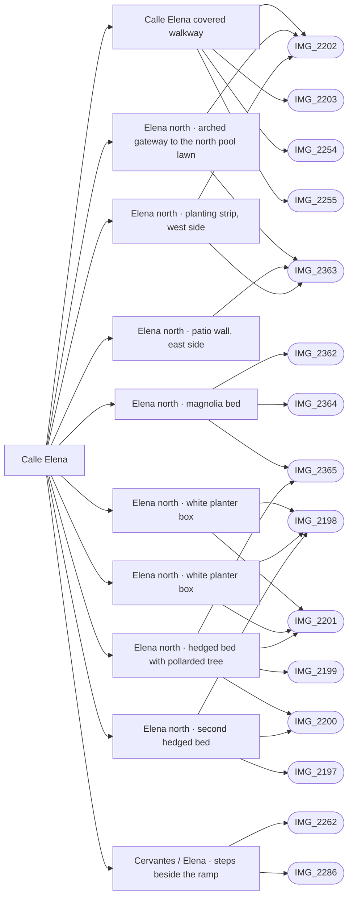

# Calle Elena

_Generated by `scripts/build_references.py`. Do not edit: change `data/areas.json` or `data/reference_tags.json` and rebuild._

Calle Elena, north and south sections, from the north pool to the middle pool, including the ramp and steps at its junction with Cervantes.

## Known facts and open questions

- IMG_2254 shows the sign CALLE ELENA 18-30.
- Built 2026-10-14 (docs/ELENA_NORTH.md): arched gateway to the north pool lawn, east patio wall, west planting strip, magnolia bed, two hedged beds with pollarded trees, two planter boxes, and the three steps beside the Cervantes ramp.
- The Cervantes/Elena rise is 0.5 m over about 3 m (steps beside a ramp, IMG_2286), not 7 m.
- Not modelled yet: the garden door between the hedged beds, the east-side patios beyond the beds, the gated entry west of the covered walkway (IMG_2361).
- IMG_2286 GPS is ±14 m: do not place geometry from its pin alone.
- IMG_2355 and IMG_2328 (14 Oct) confirm the three steps beside the Cervantes ramp and the drain across the whole lane. Roof shots IMG_2358, 2366, 2367 look down on the junction lawns and the east-side patios.

## Read first

- docs: `docs/ELENA_NORTH.md`, `docs/STREET_LAYOUT.md`, `docs/TERRAIN.md`, `docs/LEVELS.md`
- data: `data/elena_north.json`, `data/cervantes_elena_steps.json`, `data/street_layout.json`, `proposals/calle-elena.json`, `data/terrain.json`, `data/levels_survey.json`
- src: `src/elena-north.ts`, `src/ramp-steps.ts`, `src/terrain.ts`, `src/layout-routes.ts`
- contact sheet: `villacana-reference/contact-sheets/elena.jpg` (thumbnails of everything below, numbered in this order)

## Coverage

Layout: 30, Levels and slopes: 7, Facades and roofs: 11, Materials: 11, Planting: 17, Signs: 2, Views: 5
39 reviewed, 0 suggested only by camera position.

## Levels

Ground and floor levels read from the photos, from `data/levels_survey.json` (see `docs/LEVELS.md`).

- `elena-south-sills` (raised-threshold): 0.1-0.15 m above Calle Elena south, medium confidence. Model: **missing**, task `door-sills`. Single red-tread or white sills at the house doors. Elena south is level to the middle pool gate; lawns kerbed at about 0.1 m. (IMG_2260.jpg, IMG_2261.jpg, IMG_2330.jpg, IMG_2253.jpg)

## Open build tasks

From `data/build_queue.json`; issue bodies in `refs/issues/`.

| Priority | Task | What | Status | Photos |
| --- | --- | --- | --- | --- |
| P2 | `elena-east-patios` [#38](https://github.com/daveyboyc/villacana-venture/issues/38) | Elena north: private patios east of the beds (after elena-garden-door) | open | [IMG_2366](../../public/photos-ref/IMG_2366.jpg), [IMG_2362](../../public/photos-ref/IMG_2362.jpg), [IMG_2360](../../public/photos-ref/IMG_2360.jpg) |
| P2 | `elena-garden-door` [#34](https://github.com/daveyboyc/villacana-venture/issues/34) | Elena north: path and garden door between the two hedged beds | open | [IMG_2199](../../public/photos-ref/IMG_2199.jpg), [IMG_2201](../../public/photos-ref/IMG_2201.jpg), [IMG_2200](../../public/photos-ref/IMG_2200.jpg) |
| P3 | `elena-gated-entry` [#46](https://github.com/daveyboyc/villacana-venture/issues/46) | Elena: gated tiled entry west of the covered walkway | open | [IMG_2361](../../public/photos-ref/IMG_2361.jpg), [IMG_2202](../../public/photos-ref/IMG_2202.jpg), [IMG_2203](../../public/photos-ref/IMG_2203.jpg) |

## Built from these photos

Model features that cite photos of this area, from `public/photos-ref/evidence-graph.json`. A citation records what a feature was traced from; it does not prove the feature matches.

## Reviewed references

| Reference | Viewpoint | Use for | What it shows |
| --- | --- | --- | --- |
| [IMG_2198.jpg](../../public/photos-ref/IMG_2198.jpg) | ground | layout, planting | Calle Elena north: lane with low white bed walls and pollarded trees **Looks at:** The second hedged bed. _Used by: elena_north.json:elena-north-tree-bed-2, elena_north.json:elena-north-planter-box-1, elena_north.json:elena-north-planter-box-2._ |
| [IMG_2201.jpg](../../public/photos-ref/IMG_2201.jpg) | ground | layout, materials | Calle Elena north: lane with window grilles and beds **Looks at:** The first hedged bed and the lane north. _Used by: elena_north.json:elena-north-tree-bed-1, elena_north.json:elena-north-planter-box-1, elena_north.json:elena-north-planter-box-2._ |
| [IMG_2202.jpg](../../public/photos-ref/IMG_2202.jpg) | ground | layout, materials | Covered arched passage at the north end of Elena, gate beyond _Used by: building:6265201UF1366N_part5, elena_north.json:elena-north-gateway, elena_north.json:elena-north-planter-west._ |
| [IMG_2363.jpg](../../public/photos-ref/IMG_2363.jpg) | roof | layout, planting | Roof by Elena: looking down the lane to the north pool lawn gate **Looks at:** The arched gateway at the north end of Elena. **Note:** Overhead view of where the Elena north lane meets the north pool lawn gate. _Used by: elena_north.json:elena-north-gateway, elena_north.json:elena-north-patio-east, elena_north.json:elena-north-planter-west._ |
| [IMG_2286.jpg](../../public/photos-ref/IMG_2286.jpg) | ground | levels, layout, signage | Elena junction: side-by-side ramp and steps **Looks at:** The steps beside the Cervantes ramp. _Used by: steps:cervantes-elena-steps, ramp:cervantes-elena-ramp._ |
| [IMG_2365.jpg](../../public/photos-ref/IMG_2365.jpg) | roof | layout, planting, materials | Roof by Elena: looking down on the Elena north lane and its planted bed **Looks at:** The magnolia bed beside the Elena north lane. **Note:** Overhead view of the Elena north lane: width, edging kerb and the planted bed beside it. _Used by: elena_north.json:elena-north-magnolia-bed, elena_north.json:elena-north-tree-bed-1._ |
| [IMG_2200.jpg](../../public/photos-ref/IMG_2200.jpg) | ground | layout, planting | Calle Elena north: lane beside hedged beds and pollarded trees **Looks at:** The first hedged bed. _Used by: elena_north.json:elena-north-tree-bed-1, elena_north.json:elena-north-tree-bed-2._ |
| [IMG_2362.jpg](../../public/photos-ref/IMG_2362.jpg) | roof | facades, view, materials | Roof by Elena: looking east-south-east over the terraces to the sea **Looks at:** The terraces east of Elena north. _Used by: elena_north.json:elena-north-magnolia-bed._ |
| [IMG_2364.jpg](../../public/photos-ref/IMG_2364.jpg) | roof | facades, materials, planting | Roof by Elena: barrel-tile lean-to over a magnolia bed **Looks at:** The magnolia bed and the lean-to roof beside it. _Used by: elena_north.json:elena-north-magnolia-bed._ |
| [IMG_2197.jpg](../../public/photos-ref/IMG_2197.jpg) | ground | layout, materials | Calle Elena north: tiled lane between planted beds **Looks at:** The second hedged bed and the lane. _Used by: elena_north.json:elena-north-tree-bed-2._ |
| [IMG_2199.jpg](../../public/photos-ref/IMG_2199.jpg) | ground | planting, layout | Calle Elena north: planting bed with pollarded tree and a garden door **Looks at:** The first hedged bed. _Used by: elena_north.json:elena-north-tree-bed-1._ |
| [IMG_2203.jpg](../../public/photos-ref/IMG_2203.jpg) | ground | layout, materials | Covered passage with a doorway, arched opening to a garden _Used by: building:6265201UF1366N_part5._ |
| [IMG_2255.jpg](../../public/photos-ref/IMG_2255.jpg) | ground | layout, materials | Covered arched passage on Elena north, patterned tiles _Used by: building:6265201UF1366N_part5._ |
| [IMG_2254.jpg](../../public/photos-ref/IMG_2254.jpg) | ground | signage | Plaque reading CALLE ELENA 18-30 **Looks at:** The CALLE ELENA plaque in the covered walkway. _Used by: building:6265201UF1366N_part5._ |
| [IMG_2219.jpg](../../public/photos-ref/IMG_2219.jpg) | roof | facades, materials, view | Tiled roof terrace looking north, mountains behind |
| [IMG_2361.jpg](../../public/photos-ref/IMG_2361.jpg) | roof | layout, materials, facades | Roof by Elena: looking down into a gated tiled entry **Looks at:** The gated tiled entry west of the covered walkway. **Note:** Roof shot looking down. The pin is the roof, not the entry. |
| [IMG_2196.jpg](../../public/photos-ref/IMG_2196.jpg) | ground | facades, planting | Elena junction: private brown door up tiled steps, bougainvillea |
| [IMG_2220.jpg](../../public/photos-ref/IMG_2220.jpg) | roof | layout, planting | From a roof looking down into the lane and lawns of Calle Elena south **Looks at:** The Elena south lane and lawns below the roof. **Note:** Overhead view of the lane layout. The pin is the roof, not the lane. |
| [IMG_2256.jpg](../../public/photos-ref/IMG_2256.jpg) | ground | layout, materials | Covered passage opening through an arch to a garden gate |
| [IMG_2287.jpg](../../public/photos-ref/IMG_2287.jpg) | ground | facades, planting | Elena junction: private doorway and planting |
| [IMG_2358.jpg](../../public/photos-ref/IMG_2358.jpg) | roof | layout, planting | Roof by Elena: looking down on Elena south and the junction lawns **Looks at:** The junction lawns south of Cervantes. **Note:** Roof shot: the pin is the roof. |
| [IMG_2366.jpg](../../public/photos-ref/IMG_2366.jpg) | roof | layout, planting | Roof by Elena: patios east of the Elena beds **Looks at:** The private patios east of the Elena beds. **Note:** Roof shot: the pin is the roof. |
| [IMG_2367.jpg](../../public/photos-ref/IMG_2367.jpg) | roof | layout, planting | Roof by Elena: looking south over the Cervantes/Elena junction **Looks at:** The Cervantes/Elena junction. **Note:** Roof shot: the pin is the roof. |
| [IMG_2253.jpg](../../public/photos-ref/IMG_2253.jpg) | ground | layout | Calle Elena south: tiled lane beside a lawn |
| [IMG_2330.jpg](../../public/photos-ref/IMG_2330.jpg) | ground | layout | Calle Elena south from the junction, towards the middle pool |
| [IMG_2265.jpg](../../public/photos-ref/IMG_2265.jpg) | ground | layout, levels | Cervantes: lane facing into the resort _Used by: cervantes_patio_walls.json:cervantes-patio-north-1, cervantes_patio_walls.json:cervantes-patio-south-1, cervantes_patio_walls.json:cervantes-patio-south-2, cervantes_patio_walls.json:cervantes-patio-south-3, ramp:cervantes-elena-ramp._ |
| [IMG_2263.jpg](../../public/photos-ref/IMG_2263.jpg) | ground | layout | Cervantes: lane and clipped planting toward the junction _Used by: frontage_divisions.json:cervantes-elena-lawn-1, cervantes_patio_walls.json:cervantes-patio-north-1, cervantes_patio_walls.json:cervantes-patio-south-1, cervantes_patio_walls.json:cervantes-patio-south-2, cervantes_patio_walls.json:cervantes-patio-south-3._ |
| [IMG_2261.jpg](../../public/photos-ref/IMG_2261.jpg) | ground | layout, planting, facades | Cervantes junction: another view of the same terraces _Used by: frontage_divisions.json:cervantes-elena-lawn-1, frontage_divisions.json:cervantes-elena-lawn-2, frontage_divisions.json:cervantes-front-patio, frontage_divisions.json:cervantes-lawn-door-path._ |
| [IMG_2260.jpg](../../public/photos-ref/IMG_2260.jpg) | ground | layout, planting | Cervantes junction: white terraces and small lawns _Used by: frontage_divisions.json:cervantes-elena-lawn-1, frontage_divisions.json:cervantes-elena-lawn-2, frontage_divisions.json:cervantes-front-patio, frontage_divisions.json:cervantes-lawn-door-path._ |
| [IMG_2262.jpg](../../public/photos-ref/IMG_2262.jpg) | ground | levels, layout | Cervantes junction: terracotta path, white curbs and drainage grate **Looks at:** The steps beside the Cervantes ramp. **Note:** Shows steps beside a sloping strip, with a drain at the foot. _Used by: steps:cervantes-elena-steps, ramp:cervantes-elena-ramp._ |
| [IMG_2360.jpg](../../public/photos-ref/IMG_2360.jpg) | roof | layout, facades, planting, view | Roof by Elena: looking east-north-east along Cervantes **Looks at:** Cervantes east of Elena, seen along its line. **Note:** Roof shot. The camera pin is inside a building; the subject is the Cervantes side, up to 50+ m away. _Used by: cervantes_east_hedge.json:cervantes-east-plumbago-kerb._ |
| [IMG_2327.jpg](../../public/photos-ref/IMG_2327.jpg) | ground | levels, layout, facades | Cervantes at Elena: steps up to a door beside the lane |
| [IMG_2214.jpg](../../public/photos-ref/IMG_2214.jpg) | roof | facades, view | Roof terrace: flat roofs, solar panels, water tanks, mountains north **Note:** On a roof by Calle Elena. The pin is inside a building. |
| [IMG_2215.jpg](../../public/photos-ref/IMG_2215.jpg) | roof | facades, view | Roof terrace looking north-east: roofs, a tall tower block beyond |
| [IMG_2252.jpg](../../public/photos-ref/IMG_2252.jpg) | ground | levels, layout | Cervantes near Elena: tiled lane with a central sloping strip **Note:** Shows a ramp strip in the lane. |
| [IMG_2328.jpg](../../public/photos-ref/IMG_2328.jpg) | ground | levels, layout | Cervantes at Elena: ramp and steps side by side, drain at the foot **Looks at:** The ramp and steps side by side. |
| [IMG_2329.jpg](../../public/photos-ref/IMG_2329.jpg) | ground | layout, planting | Cervantes/Elena junction: lawn with a pollarded tree and white kerb |
| [IMG_2342.jpg](../../public/photos-ref/IMG_2342.jpg) | ground | layout, planting | Cervantes/Elena junction: lawn corner with pollarded tree and drain **Note:** GPS ±14 m. |
| [IMG_2355.jpg](../../public/photos-ref/IMG_2355.jpg) | ground | levels | Cervantes/Elena steps from the junction **Looks at:** The steps beside the Cervantes ramp. |
