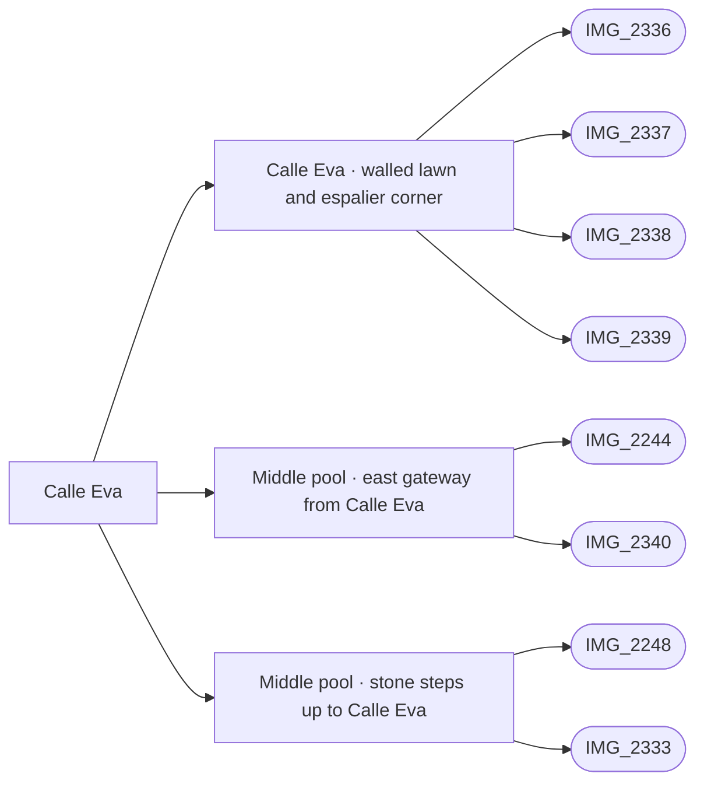

# Calle Eva

_Generated by `scripts/build_references.py`. Do not edit: change `data/areas.json` or `data/reference_tags.json` and rebuild._

Calle Eva round the middle pool, and its west-side footpath to Patricia.

## Known facts and open questions

- IMG_2339: walled lawn corners with bougainvillea trained flat along the walls and green bollard lights.
- Calle Eva ends at the middle pool east gateway (built 2026-10-14, docs/MIDDLE_POOL.md), level with the corner of the house on its south-east side; the lawn wall north-west of it steps down to about 1.45 m.
- IMG_2339 corner reuses the unchanged middle gateway NW wing and adds only a 4.2 m return, with a bounded lawn. Two wall-aligned single planes replace the crossed bougainvillea there; bollard, clipped hedge, nearby rounded tree and lantern are Details-only and route guarded. Lengths, heights and adjacent lawn extent remain estimates; no surveyed enclosure closure or new level change is asserted.

## Read first

- docs: `docs/STREET_LAYOUT.md`, `docs/MIDDLE_POOL.md`, `docs/EVA_WALLED_LAWN.md`
- data: `data/street_layout.json`, `data/middle_pool.json`, `data/eva_walled_lawn.json`
- src: `src/middle-pool.ts`, `src/eva-walled-lawn.ts`
- contact sheet: `villacana-reference/contact-sheets/eva.jpg` (thumbnails of everything below, numbered in this order)

## Coverage

Layout: 9, Facades and roofs: 3, Materials: 3, Planting: 5, Signs: 1
11 reviewed, 0 suggested only by camera position.

## Built from these photos

Model features that cite photos of this area, from `public/photos-ref/evidence-graph.json`. A citation records what a feature was traced from; it does not prove the feature matches.

## Reviewed references

| Reference | Viewpoint | Use for | What it shows |
| --- | --- | --- | --- |
| [IMG_2340.jpg](../../public/photos-ref/IMG_2340.jpg) | ground | layout, facades, signage | Calle Eva: east gateway into the middle pool courtyard **Note:** The middle pool east gate from Calle Eva; IMG_2244 shows it from inside. _Used by: middle_pool.json:middle-pool-east-gateway._ |
| [IMG_2248.jpg](../../public/photos-ref/IMG_2248.jpg) | ground | layout, planting | Narrow lane with bougainvillea off Calle Eva _Used by: steps:middle-pool-sw-steps._ |
| [IMG_2336.jpg](../../public/photos-ref/IMG_2336.jpg) | ground | layout, planting | Calle Eva east of the middle pool: tiled path between lawns **Looks at:** Eva tiled lane beside lawns, clipped trees and dark lantern posts. **Note:** Subject coordinate is an approximate photo-content interpretation, not a surveyed location. _Used by: eva_walled_lawn.json:eva-walled-lawn._ |
| [IMG_2337.jpg](../../public/photos-ref/IMG_2337.jpg) | ground | layout, planting | Calle Eva east of the middle pool: lawn, round trees, lamp **Looks at:** Eva lawn beside clipped round tree and lantern post. **Note:** Subject coordinate is an approximate photo-content interpretation, not a surveyed location. _Used by: eva_walled_lawn.json:eva-walled-lawn._ |
| [IMG_2338.jpg](../../public/photos-ref/IMG_2338.jpg) | ground | planting, facades | Calle Eva: brown door, yellow-flowered shrub, lawn **Looks at:** Brown Eva frontage door with yellow-flowered shrub beside lawn. **Note:** Subject coordinate is an approximate photo-content interpretation, not a surveyed location. _Used by: eva_walled_lawn.json:eva-walled-lawn._ |
| [IMG_2339.jpg](../../public/photos-ref/IMG_2339.jpg) | ground | planting, materials | Calle Eva: walled lawn corner with espaliered bougainvillea **Looks at:** White-walled lawn corner northwest of middle pool east gateway; trained bougainvillea and green bollard. **Note:** Subject coordinate is an approximate photo-content interpretation, not a surveyed location. _Used by: eva_walled_lawn.json:eva-walled-lawn._ |
| [IMG_2249.jpg](../../public/photos-ref/IMG_2249.jpg) | ground | layout, materials | Covered passage with patterned tiles off Calle Eva |
| [IMG_2250.jpg](../../public/photos-ref/IMG_2250.jpg) | ground | layout, materials | Covered arched passage, lantern, patterned tiles |
| [IMG_2243.jpg](../../public/photos-ref/IMG_2243.jpg) | ground | layout | Tiled lane beside a lawn to an arched gateway |
| [IMG_2251.jpg](../../public/photos-ref/IMG_2251.jpg) | ground | layout | Narrow lane through an arch, planting both sides |
| [IMG_2291.jpg](../../public/photos-ref/IMG_2291.jpg) | ground | facades, layout | Pintor Dalí: arched entrance and white facade |
