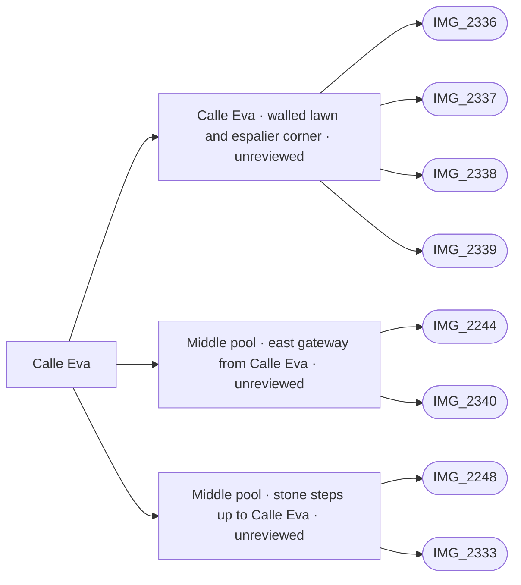

# Calle Eva

_Generated by `scripts/build_references.py`. Do not edit: change `data/areas.json` or `data/reference_tags.json` and rebuild._

Calle Eva round the middle pool, and its west-side footpath to Patricia.

## Known facts and open questions

- IMG_2339: walled lawn corners with bougainvillea trained flat along the walls and green bollard lights.
- Calle Eva ends at the middle pool east gateway (built 2026-10-14, docs/MIDDLE_POOL.md), level with the corner of the house on its south-east side; the lawn wall north-west of it steps down to about 1.45 m.
- IMG_2339 corner reuses the unchanged middle gateway NW wing and adds only a 4.2 m return, with a bounded lawn. Two wall-aligned single planes replace the crossed bougainvillea there; bollard, clipped hedge, nearby rounded tree and lantern are Details-only and route guarded. Lengths, heights and adjacent lawn extent remain estimates; no surveyed enclosure closure or new level change is asserted.

## Read first

- docs: `docs/STREET_LAYOUT.md`, `docs/MIDDLE_POOL.md`, `docs/EVA_WALLED_LAWN.md`
- data: `data/street_layout.json`, `data/middle_pool.json`, `data/eva_walled_lawn.json`
- src: `src/middle-pool.ts`, `src/eva-walled-lawn.ts`
- contact sheet: `villacana-reference/contact-sheets/eva.jpg` (thumbnails of everything below, numbered in this order)

## Coverage

Layout: 27, Levels and slopes: 1, Facades and roofs: 16, Materials: 21, Planting: 21, Signs: 4, Views: 2
31 reviewed, 0 suggested only by camera position.

## Open build tasks

From `data/build_queue.json`; issue bodies in `refs/issues/`.

| Priority | Task | What | Status | Photos |
| --- | --- | --- | --- | --- |
| P2 | `path-network-inventory-eva` [#134](https://github.com/daveyboyc/villacana-venture/issues/134) | Calle Eva: full-source path, tunnel and boundary inventory (after path-network-baseline) | open · placement: not-applicable |  |

## Built from these photos

Model features that cite photos of this area, from `public/photos-ref/evidence-graph.json`, with their photo-check state. A citation records what a feature was traced from; only a check in `data/photo_checks.json` says someone rendered it from the photo's camera and compared.

## Placement evidence

`verification` is placement status, separate from photographic diagnostics. Earlier manual reviews may exist. Only a fresh measured packet and independent approval can grant `verified`.

| Feature | Placement | Photo diagnostics | Blockers |
| --- | --- | --- | --- |
| `eva_walled_lawn.json:eva-walled-lawn` | unreviewed | unchecked | No measured placement packet and independent approval recorded; earlier manual reviews may exist. |
| `middle_pool.json:middle-pool-east-gateway` | unreviewed | unchecked | No measured placement packet and independent approval recorded; earlier manual reviews may exist. |
| `steps:middle-pool-sw-steps` | unreviewed | unchecked | No measured placement packet and independent approval recorded; earlier manual reviews may exist. |

**Built without complete newer photo-check records:** `eva-walled-lawn`. Earlier manual reviews may exist; this record does not establish photographic fidelity. See the verification backlog in `refs/QUEUE.md`.

## Reviewed references

| Reference | Viewpoint | Use for | What it shows |
| --- | --- | --- | --- |
| [IMG_2340.jpg](../../public/photos-ref/IMG_2340.jpg) | ground | layout, facades, signage | Calle Eva: east gateway into the middle pool courtyard **Note:** The middle pool east gate from Calle Eva; IMG_2244 shows it from inside. _Used by: middle_pool.json:middle-pool-east-gateway._ |
| [IMG_2248.jpg](../../public/photos-ref/IMG_2248.jpg) | ground | layout, planting | Narrow lane with bougainvillea off Calle Eva _Used by: steps:middle-pool-sw-steps._ |
| [IMG_2336.jpg](../../public/photos-ref/IMG_2336.jpg) | ground | layout, planting | Calle Eva east of the middle pool: tiled path between lawns **Looks at:** Eva tiled lane beside lawns, clipped trees and dark lantern posts. **Note:** Subject coordinate is an approximate photo-content interpretation, not a surveyed location. _Used by: eva_walled_lawn.json:eva-walled-lawn._ |
| [IMG_2337.jpg](../../public/photos-ref/IMG_2337.jpg) | ground | layout, planting | Calle Eva east of the middle pool: lawn, round trees, lamp **Looks at:** Eva lawn beside clipped round tree and lantern post. **Note:** Subject coordinate is an approximate photo-content interpretation, not a surveyed location. _Used by: eva_walled_lawn.json:eva-walled-lawn._ |
| [IMG_2338.jpg](../../public/photos-ref/IMG_2338.jpg) | ground | planting, facades | Calle Eva: brown door, yellow-flowered shrub, lawn **Looks at:** Brown Eva frontage door with yellow-flowered shrub beside lawn. **Note:** Subject coordinate is an approximate photo-content interpretation, not a surveyed location. _Used by: eva_walled_lawn.json:eva-walled-lawn._ |
| [IMG_2339.jpg](../../public/photos-ref/IMG_2339.jpg) | ground | planting, materials | Calle Eva: walled lawn corner with espaliered bougainvillea **Looks at:** White-walled lawn corner northwest of middle pool east gateway; trained bougainvillea and green bollard. **Note:** Subject coordinate is an approximate photo-content interpretation, not a surveyed location. _Used by: eva_walled_lawn.json:eva-walled-lawn._ |
| [IMG_2677.jpg](../../public/photos-ref/IMG_2677.jpg) | ground | layout, facades, planting, signage, materials | Calle Eva path to the middle pool east gateway with bougainvillea and house beyond **Looks at:** middle pool east gateway at the end of Calle Eva. **Note:** Same gateway as IMG_2340/2244 and the standing point of IMG_2678. |
| [IMG_2546.jpg](../../public/photos-ref/IMG_2546.jpg) | ground | layout, facades, planting, materials | Inner walk-through south end: lantern arch, monstera planting and inset tiles **Note:** Pin is +/-4.6 m in the block between Dali and the middle pool; area attribution (eva/south end) is inferred from the continuing bearing toward the Eva corner. |
| [IMG_2551.jpg](../../public/photos-ref/IMG_2551.jpg) | ground | layout, materials, signage, planting | Calle Eva west footpath at the Dali end, terracotta path beside a lawn island **Note:** Pin is at the Eva/Dali junction. |
| [IMG_2553.jpg](../../public/photos-ref/IMG_2553.jpg) | ground | layout, planting, facades, materials | Calle Eva west footpath looking east between white houses and a planted bed |
| [IMG_2557.jpg](../../public/photos-ref/IMG_2557.jpg) | ground | layout, materials, signage, facades | Arched covered passage with blue-and-white tiled floor and a 'CALLE MART...' sign **Note:** Street name is cut off, so which lane this is cannot be established. Pin altitude 9.3 m reads 'above ground', but the picture is clearly at floor level (GPS height noise). |
| [IMG_2503.jpg](../../public/photos-ref/IMG_2503.jpg) | ground | layout, planting, materials | Eva tiled footpath beside lawn with magnolia and lamp post |
| [IMG_2504.jpg](../../public/photos-ref/IMG_2504.jpg) | ground | layout, materials, planting | Long tiled path to an arched iron gate **Note:** Pin at the Teodoro Rojo/Eva edge; heading 241 looks SW toward a white gateway (possibly the middle pool east gateway, not confirmed). |
| [IMG_2547.jpg](../../public/photos-ref/IMG_2547.jpg) | ground | layout, facades, materials | Inner walk-through covered section: double doors, pebble mat and tile inset floor **Note:** Pin +/-4.5 m in the block between Dali and the middle pool; exit toward Eva is inferred from the bearing, not seen. |
| [IMG_2548.jpg](../../public/photos-ref/IMG_2548.jpg) | ground | layout, materials, facades | Covered tiled passage off Calle Eva with brown double door and potted trees **Note:** Looks like the same type of passage as IMG_2249/2250 (also off Calle Eva). Pin is inside the block, so which passage it is cannot be confirmed from the picture; heading 147 runs towards Calle Eva. |
| [IMG_2549.jpg](../../public/photos-ref/IMG_2549.jpg) | ground | layout, materials, planting | Calle Eva: lane between a white wall and planted beds, towards the middle pool |
| [IMG_2550.jpg](../../public/photos-ref/IMG_2550.jpg) | ground | facades, materials, planting | Arched timber double gate in a white wall, Calle Eva/Dali corner **Looks at:** Arched brown timber double gate in white wall. **Note:** Which house this gate belongs to is not established; looksAt is about 4 m along the heading from the pin and is approximate. |
| [IMG_2552.jpg](../../public/photos-ref/IMG_2552.jpg) | ground | layout, materials, levels | Curved kerbed footpath meeting the Dali car park aisle |
| [IMG_2676.jpg](../../public/photos-ref/IMG_2676.jpg) | ground | layout, materials, planting | Terracotta path between hedge and lawn at the Teodoro Rojo end of Calle Eva **Note:** Pin is at the NE corner by Teodoro Rojo; view runs SW along the path past the lawn toward the middle pool entrance gateway. |
| [IMG_2249.jpg](../../public/photos-ref/IMG_2249.jpg) | ground | layout, materials | Covered passage with patterned tiles off Calle Eva |
| [IMG_2250.jpg](../../public/photos-ref/IMG_2250.jpg) | ground | layout, materials | Covered arched passage, lantern, patterned tiles |
| [IMG_2502.jpg](../../public/photos-ref/IMG_2502.jpg) | ground | planting, facades | Magnolia and clipped hedge in front of a white house **Note:** Pin on Calle Teodoro Rojo near its junction with Eva; the house is across the lawn to the north. |
| [IMG_2243.jpg](../../public/photos-ref/IMG_2243.jpg) | ground | layout | Tiled lane beside a lawn to an arched gateway |
| [IMG_2251.jpg](../../public/photos-ref/IMG_2251.jpg) | ground | layout | Narrow lane through an arch, planting both sides |
| [IMG_2291.jpg](../../public/photos-ref/IMG_2291.jpg) | ground | facades, layout | Pintor Dalí: arched entrance and white facade _Used by: door_sills.json:dali-footpath-kerb._ |
| [IMG_2678.jpg](../../public/photos-ref/IMG_2678.jpg) | ground | layout, facades, materials, planting, view | Looking through the middle pool east gateway at the pool and houses beyond **Note:** Looks SW across the clover-shaped pool; the pool shown is the middle pool by position, and glass fence matches the existing note that the fence is skipped in the model. |
| [IMG_2679.jpg](../../public/photos-ref/IMG_2679.jpg) | ground | layout, planting, facades, materials, view | Middle pool lawn with crazy-paving path and glass-fenced pool, looking west **Note:** Pin on the lawn NE of the pool; shows the west houses on the far side of the pool. |
| [IMG_2501.jpg](../../public/photos-ref/IMG_2501.jpg) | ground | layout, facades, materials, planting | Open tiled court at the Teodoro Rojo and Eva junction |
| [IMG_2556.jpg](../../public/photos-ref/IMG_2556.jpg) | ground | layout, facades, planting, materials | Footpath along the west side of the block, house with grilled windows **Note:** Pin is on the Dali road edge; the footpath is the Calle Eva west-side footpath. |
| [IMG_2555.jpg](../../public/photos-ref/IMG_2555.jpg) | ground | facades, planting, layout | Dali car park edge with lawn islands and white house with brown gate |
| [IMG_2558.jpg](../../public/photos-ref/IMG_2558.jpg) | ground | layout, materials, planting | Terracotta footpath with kerbed planters leading to a brown gate **Note:** Pin altitude 9.3 m reads 'above ground', but the picture is at ground level (GPS height noise). |
