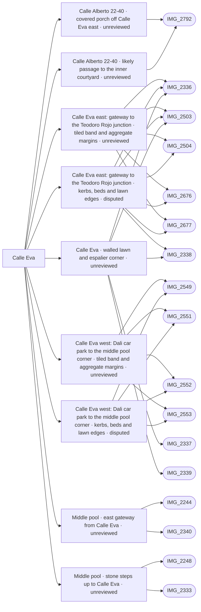

# Calle Eva

_Generated by `scripts/build_references.py`. Do not edit: change `data/areas.json` or `data/reference_tags.json` and rebuild._

Calle Eva round the middle pool, and its west-side footpath to Patricia.

## Known facts and open questions

- IMG_2339: walled lawn corners with bougainvillea trained flat along the walls and green bollard lights.
- Calle Eva ends at the middle pool east gateway (built 2026-10-14, docs/MIDDLE_POOL.md), level with the corner of the house on its south-east side; the lawn wall north-west of it steps down to about 1.45 m.
- IMG_2339 corner reuses the unchanged middle gateway NW wing and adds only a 4.2 m return, with a bounded lawn. Two wall-aligned single planes replace the crossed bougainvillea there; bollard, clipped hedge, nearby rounded tree and lantern are Details-only and route guarded. Lengths, heights and adjacent lawn extent remain estimates; no surveyed enclosure closure or new level change is asserted.
- Eva lane as photographed (2026-11-06, docs/EVA_LANE.md): four big square terracotta tiles across with pale grey joints (about 1.72 m), a grey exposed-aggregate margin each side, white rounded kerbs where a bed or lawn is kerbed, flush lawn where it is not. The middle pool east gateway opening is centred on the mapped Eva line, and the photos show the path centred on the opening, so the east stretch keeps the mapped line.
- Eva west: the registry house north-west of the lane stands only 0.6 m from the mapped centreline (0.9 m further on), with a raised planter in front of it in IMG_2549, so the photographed tile band is drawn 0.9 m south-east of the mapped line. The walking route still follows the mapped line along the planter face; moving it is walking work and is left open.
- IMG_2336 and IMG_2503 put the one lantern and the round clipped tree on the north-west lawn at its north-east end, in a kerbed bed beside the Teodoro Rojo junction; the eva-walled-lawn lamp and tree were moved there. Open: where the tiled door spur north-west of the lane ends, and what paves the open court at the Teodoro Rojo junction (IMG_2501).
- Eva planting (eva-planting-shapes, 2026-11-06): leafy procedural plants replace the box hedges and sphere tree: clipped hedge in the east house bed, low box edging with pink-flowering roses behind it in the west beds (IMG_2553), a clipped narrow-leaved oleander at the north-east end (IMG_2503), the round clipped tree on a 2 m pale trunk, and jasmine and shrubs up the east house wall with white flowers (IMG_2504). Shapes and leaf counts are illustrative; the west wall climbers are still missing.
- 8 Nov photos (IMG_2727-2732, IMG_2785-2790): Eva east of the Teodoro Rojo junction is paved in octagonal terracotta with small square inserts (like the seaward lanes), not the big square tiles of the west part; it has white rendered benches with azulejo panels, hedged white planters, lanterns on lawns and strelitzia clumps, and a walled side garden with brick-nosed steps (IMG_2728/2729). Square tiles with aggregate margins resume further west (IMG_2788-2790). Not built yet (task eva-east-lane).
- 8 Nov photos IMG_2705-2712 walk Eva west from the Dali car park to the middle pool south-west gateway (IMG_2710) and on into the garden (IMG_2711, IMG_2712): the square-tiled band with aggregate margins carries through the gate and meets the crazy paving at the lawn.
- IMG_2792 (8 Nov): a covered porch with the plaque CALLE ALBERTO 22 40 opens off the path north of Calle Eva east, in the only recess of registry block 6265601UF1366N_part1 (3.1 m wide, 1 m deep). Built as photographed (alberto_passage.json). The block has an inner courtyard about 7 m behind the porch; the passage to it is drawn on the map as inferred but not cut in 3D. Open: which way it turns and where it comes out.

## Read first

- docs: `docs/STREET_LAYOUT.md`, `docs/MIDDLE_POOL.md`, `docs/EVA_WALLED_LAWN.md`, `docs/EVA_LANE.md`, `docs/ALBERTO_PASSAGE.md`
- data: `data/street_layout.json`, `data/middle_pool.json`, `data/eva_walled_lawn.json`, `data/eva_lane.json`, `data/alberto_passage.json`
- src: `src/middle-pool.ts`, `src/eva-walled-lawn.ts`, `src/eva-lane.ts`, `src/clipped-plants.ts`, `src/alberto-passage.ts`
- contact sheet: `villacana-reference/contact-sheets/eva.jpg` (thumbnails of everything below, numbered in this order)

## Coverage

Layout: 48, Levels and slopes: 4, Facades and roofs: 21, Materials: 43, Planting: 35, Signs: 8, Views: 2
54 reviewed, 0 suggested only by camera position.

## Open build tasks

From `data/build_queue.json`; issue bodies in `refs/issues/`.

| Priority | Task | What | Status | Photos |
| --- | --- | --- | --- | --- |
| P2 | `alberto-passage-porch` | Calle Alberto 22-40: the covered porch off Calle Eva east, and its likely passage | in-progress · Claude · placement: not-verified | [IMG_2792](../../public/photos-ref/IMG_2792.jpg) |
| P2 | `eva-east-lane` | Calle Eva east: octagonal paving, azulejo benches, hedged planters and lanterns (after eva-lane-details) | open · placement: not-verified | [IMG_2727](../../public/photos-ref/IMG_2727.jpg), [IMG_2732](../../public/photos-ref/IMG_2732.jpg), [IMG_2730](../../public/photos-ref/IMG_2730.jpg), [IMG_2785](../../public/photos-ref/IMG_2785.jpg), [IMG_2786](../../public/photos-ref/IMG_2786.jpg), [IMG_2787](../../public/photos-ref/IMG_2787.jpg), [IMG_2788](../../public/photos-ref/IMG_2788.jpg), [IMG_2728](../../public/photos-ref/IMG_2728.jpg), [IMG_2729](../../public/photos-ref/IMG_2729.jpg) |
| P2 | `eva-lane-details` | Calle Eva: the tiled lane with aggregate margins, white kerbs, lawns, beds and lanterns | in-progress · Claude · placement: not-verified | [IMG_2336](../../public/photos-ref/IMG_2336.jpg), [IMG_2504](../../public/photos-ref/IMG_2504.jpg), [IMG_2677](../../public/photos-ref/IMG_2677.jpg), [IMG_2676](../../public/photos-ref/IMG_2676.jpg), [IMG_2553](../../public/photos-ref/IMG_2553.jpg), [IMG_2551](../../public/photos-ref/IMG_2551.jpg), [IMG_2552](../../public/photos-ref/IMG_2552.jpg), [IMG_2549](../../public/photos-ref/IMG_2549.jpg), [IMG_2503](../../public/photos-ref/IMG_2503.jpg) |
| P2 | `path-network-inventory-eva` [#134](https://github.com/daveyboyc/villacana-venture/issues/134) | Calle Eva: full-source path, tunnel and boundary inventory (after path-network-baseline) | open · placement: not-applicable |  |
| P3 | `eva-planting-shapes` | Calle Eva: clipped shrub and tree shapes, climbers on the house walls (after eva-lane-details) | in-progress · Claude · placement: not-verified | [IMG_2503](../../public/photos-ref/IMG_2503.jpg), [IMG_2504](../../public/photos-ref/IMG_2504.jpg), [IMG_2677](../../public/photos-ref/IMG_2677.jpg), [IMG_2549](../../public/photos-ref/IMG_2549.jpg), [IMG_2553](../../public/photos-ref/IMG_2553.jpg) |
| P3 | `eva-west-planting` | Calle Eva west: climbers on the house walls and the raised planter's plants (after eva-planting-shapes) | open · placement: not-verified | [IMG_2549](../../public/photos-ref/IMG_2549.jpg), [IMG_2553](../../public/photos-ref/IMG_2553.jpg), [IMG_2551](../../public/photos-ref/IMG_2551.jpg) |

## Built from these photos

Model features that cite photos of this area, from `public/photos-ref/evidence-graph.json`, with their photo-check state. A citation records what a feature was traced from; only a check in `data/photo_checks.json` says someone rendered it from the photo's camera and compared.

## Placement evidence

`verification` is placement status, separate from photographic diagnostics. Earlier manual reviews may exist. Only a fresh measured packet and independent approval can grant `verified`.

| Feature | Placement | Photo diagnostics | Blockers |
| --- | --- | --- | --- |
| `alberto_passage.json:calle-alberto-22-40-porch` | unreviewed | matches | No measured placement packet and independent approval recorded; earlier manual reviews may exist. |
| `alberto_passage.json:calle-alberto-22-40-route` | unreviewed | unchecked | No measured placement packet and independent approval recorded; earlier manual reviews may exist. |
| `eva_lane.json:eva-lane-east` | unreviewed | incomplete | No measured placement packet and independent approval recorded; earlier manual reviews may exist. |
| `eva_lane.json:eva-lane-east-edges` | disputed | differs | open discrepancy photo-discrepancy:ce33b7d08fa2ed9c |
| `eva_lane.json:eva-lane-west` | unreviewed | matches | No measured placement packet and independent approval recorded; earlier manual reviews may exist. |
| `eva_lane.json:eva-lane-west-edges` | disputed | differs | open discrepancy photo-discrepancy:144ccc942e819053 |
| `eva_walled_lawn.json:eva-walled-lawn` | unreviewed | unchecked | No measured placement packet and independent approval recorded; earlier manual reviews may exist. |
| `middle_pool.json:middle-pool-east-gateway` | unreviewed | unchecked | No measured placement packet and independent approval recorded; earlier manual reviews may exist. |
| `steps:middle-pool-sw-steps` | unreviewed | unchecked | No measured placement packet and independent approval recorded; earlier manual reviews may exist. |

## Photo checks

Renders from each photo's camera compared with the photo (`data/photo_checks.json`).

| Task | Photo | Result | Render | Notes |
| --- | --- | --- | --- | --- |
| `eva-lane-details` | [IMG_2504](../../public/photos-ref/IMG_2504.jpg) | **matches** | [after](../../docs/reviews/eva-lane-details/IMG_2504-after.png) · [before](../../docs/reviews/eva-lane-details/IMG_2504-before.png) | Looking south-west to the east gateway: after, the four-tile band with grey joints, grey aggregate margins, the white kerb and hedge against the house on the left, the flush lawn on the right and the gateway centred on the path follow the photo; before, a 1.2 m ribbon with white edges ran over generic tiles to the house wall. The hedge is a uniform box where the photo has looser shrubs, and the jasmine on the wall is not modelled (follow-up eva-planting-shapes). Camera: hand-set starting pose on the path at the pin's distance (data/photo_poses.json initialBasis), not solved; a photographic diagnostic, not placement approval. |
| `eva-lane-details` | [IMG_2677](../../public/photos-ref/IMG_2677.jpg) | **matches** | [after](../../docs/reviews/eva-lane-details/IMG_2677-after.png) · [before](../../docs/reviews/eva-lane-details/IMG_2677-before.png) | Close to the gateway: band, margins, kerbed bed with hedge, flush lawn and the two-tile door spur in front of the clipped hedge box agree with the photo; the espaliered bougainvillea wall and gateway were already there. Tile tone is close; climbers on the left wall are missing. Camera: hand-set starting pose on the path at the pin's distance (data/photo_poses.json initialBasis), not solved; a photographic diagnostic, not placement approval. |
| `eva-lane-details` | [IMG_2676](../../public/photos-ref/IMG_2676.jpg) | **matches** | [after](../../docs/reviews/eva-lane-details/IMG_2676-after.png) · [before](../../docs/reviews/eva-lane-details/IMG_2676-before.png) | Looking south-west from the junction end: tile columns, the aggregate strip and white kerb on the left and flush lawn on the right agree. The curved kerb of the north-east bed that the photo shows close on the right sits just outside the render, so the camera is probably half a metre further north-east than its starting pose. Camera: hand-set starting pose on the path at the pin's distance (data/photo_poses.json initialBasis), not solved; a photographic diagnostic, not placement approval. |
| `eva-lane-details` | [IMG_2336](../../public/photos-ref/IMG_2336.jpg) | **matches** | [after](../../docs/reviews/eva-lane-details/IMG_2336-after.png) · [before](../../docs/reviews/eva-lane-details/IMG_2336-before.png) | Looking north-east: lawn left, kerbed hedge right and the band agree; the lantern and the round clipped tree now stand at the far end of the lawn as in the photo (before, they stood about 6 m closer). Distant trees and houses beyond the junction are the existing generic model. Camera: hand-set starting pose on the path at the pin's distance (data/photo_poses.json initialBasis), not solved; a photographic diagnostic, not placement approval. |
| `eva-lane-details` | [IMG_2503](../../public/photos-ref/IMG_2503.jpg) | **differs** → `eva-planting-shapes` | [after](../../docs/reviews/eva-lane-details/IMG_2503-after.png) · [before](../../docs/reviews/eva-lane-details/IMG_2503-before.png) | The kerbed bed at the north-east end of the lawn, its lantern and the round tree behind it are in the photographed arrangement, but the oleander is a hard 1.3 m cube and the tree a perfect sphere where the photo shows a loose clipped shrub and a domed crown. Camera: hand-set starting pose on the path at the pin's distance (data/photo_poses.json initialBasis), not solved; a photographic diagnostic, not placement approval. |
| `eva-lane-details` | [IMG_2553](../../public/photos-ref/IMG_2553.jpg) | **matches** | [after](../../docs/reviews/eva-lane-details/IMG_2553-after.png) · [before](../../docs/reviews/eva-lane-details/IMG_2553-before.png) | From the Dali end looking north-east: kerbed lawn island with a strelitzia on the left, band with margins, kerb and low hedge edging on the right, agree with the photo; before, a wide generic tiled area with a white line. The deep soil bed beyond the hedge edging and its roses are not visible in the render. Camera: hand-set starting pose on the path at the pin's distance (data/photo_poses.json initialBasis), not solved; a photographic diagnostic, not placement approval. |
| `eva-lane-details` | [IMG_2551](../../public/photos-ref/IMG_2551.jpg) | **matches** | [after](../../docs/reviews/eva-lane-details/IMG_2551-after.png) · [before](../../docs/reviews/eva-lane-details/IMG_2551-before.png) | Looking south-west to the Dali car park: kerbed bed with hedge edging on the left, the band curving left ahead, and the kerbed lawn island with the lantern on the right agree; the yellow-capped bollard and the house-corner apron where the cart stands are not modelled. Camera: hand-set starting pose on the path at the pin's distance (data/photo_poses.json initialBasis), not solved; a photographic diagnostic, not placement approval. |
| `eva-lane-details` | [IMG_2552](../../public/photos-ref/IMG_2552.jpg) | **matches** | [after](../../docs/reviews/eva-lane-details/IMG_2552-after.png) · [before](../../docs/reviews/eva-lane-details/IMG_2552-before.png) | The path curves left onto the car park between white kerbs, with the hedged bed on the left and the lawn and lantern on the right, as in the photo. The rust-red slot drain is at the band's end and barely visible. Beyond the car park the existing model shows a dark overhead band that the photo does not; that is outside this task. Camera: hand-set starting pose on the path at the pin's distance (data/photo_poses.json initialBasis), not solved; a photographic diagnostic, not placement approval. |
| `eva-lane-details` | [IMG_2549](../../public/photos-ref/IMG_2549.jpg) | **matches** | [after](../../docs/reviews/eva-lane-details/IMG_2549-after.png) · [before](../../docs/reviews/eva-lane-details/IMG_2549-before.png) | Looking south-west between the houses: the south-east house wall beside the camera, the raised white planter against the north-west house and the hedged bed opening up ahead on the left agree with the photo. The planter's flowers are left out because they sit inside the protected route (gap:eva-west-planter-plants). Camera: hand-set starting pose on the path at the pin's distance (data/photo_poses.json initialBasis), not solved; a photographic diagnostic, not placement approval. |
| `eva-planting-shapes` | [IMG_2503](../../public/photos-ref/IMG_2503.jpg) | **matches** | [after](../../docs/reviews/eva-planting-shapes/IMG_2503-after.png) · [before](../../docs/reviews/eva-planting-shapes/IMG_2503-before.png) | The north-east bed now holds a leafy clipped block of narrow oleander leaves instead of a cube, and the round clipped tree stands on about 2 m of pale trunk with a domed crown of small leaves, as in the photo. The real crown spreads wider and less evenly than the model's. Camera: hand-set starting pose (data/photo_poses.json), not solved; a photographic diagnostic, not placement approval. |
| `eva-planting-shapes` | [IMG_2504](../../public/photos-ref/IMG_2504.jpg) | **matches** | [after](../../docs/reviews/eva-planting-shapes/IMG_2504-after.png) · [before](../../docs/reviews/eva-planting-shapes/IMG_2504-before.png) | The east bed hedge is now leafy and slightly irregular, and the jasmine and shrub mass with white flowers grows up the house wall behind it, as in the photo; before, a smooth green box and a bare wall. The real wall planting is taller and looser near the camera. Camera: hand-set starting pose (data/photo_poses.json), not solved; a photographic diagnostic, not placement approval. |
| `eva-planting-shapes` | [IMG_2677](../../public/photos-ref/IMG_2677.jpg) | **matches** | [after](../../docs/reviews/eva-planting-shapes/IMG_2677-after.png) · [before](../../docs/reviews/eva-planting-shapes/IMG_2677-before.png) | Leafy hedge and wall planting on the left, and the clipped box hedge in front of the espaliered wall, follow the photo; before, boxes and a bare wall. Camera: hand-set starting pose (data/photo_poses.json), not solved; a photographic diagnostic, not placement approval. |
| `eva-planting-shapes` | [IMG_2553](../../public/photos-ref/IMG_2553.jpg) | **matches** | [after](../../docs/reviews/eva-planting-shapes/IMG_2553-after.png) · [before](../../docs/reviews/eva-planting-shapes/IMG_2553-before.png) | The west bed now has low leafy box edging behind the kerb and pink-flowering shrubs standing in the soil behind it, as in the photo; the climbers on the far house walls are still missing (eva-west-planting). Camera: hand-set starting pose (data/photo_poses.json), not solved; a photographic diagnostic, not placement approval. |
| `eva-planting-shapes` | [IMG_2549](../../public/photos-ref/IMG_2549.jpg) | **differs** → `eva-west-planting` | [after](../../docs/reviews/eva-planting-shapes/IMG_2549-after.png) · [before](../../docs/reviews/eva-planting-shapes/IMG_2549-before.png) | The low edging in the bed ahead is now leafy, but the photo's lush raised-planter planting (shrubs, lilies, pink periwinkle) and the climbers on the right-hand wall are still absent: the planter plants sit inside the protected walking route, and the west wall climbers are not built. Camera: hand-set starting pose (data/photo_poses.json), not solved; a photographic diagnostic, not placement approval. |
| `alberto-passage-porch` | [IMG_2792](../../public/photos-ref/IMG_2792.jpg) | **matches** | [after](../../docs/reviews/alberto-passage-porch/IMG_2792-after.png) · [before](../../docs/reviews/alberto-passage-porch/IMG_2792-before.png) | Looking into the porch: the square pier on the right, the red studded ramp beside it running in to the back wall, the tiled step platform with the potted jade on the left, the CALLE ALBERTO 22 40 letter tiles and the AGUA POTABLE hatch on the plain back wall all follow the photo; before, the recess was an open notch in the house with a generic window shutter on its back wall. The photographed porch is a little deeper (about 2 m against the registry's 1 m), the arch is out of frame at this pitch, and the big-leaved plant is simplified. Camera: hand-set starting pose from photo content (data/photo_poses.json), not solved; the phone compass disagrees by about 50 degrees. A photographic diagnostic, not placement approval. |

**Built without complete newer photo-check records:** `eva-walled-lawn`. Earlier manual reviews may exist; this record does not establish photographic fidelity. See the verification backlog in `refs/QUEUE.md`.

## Reviewed references

| Reference | Viewpoint | Use for | What it shows |
| --- | --- | --- | --- |
| [IMG_2503.jpg](../../public/photos-ref/IMG_2503.jpg) | ground | layout, planting, materials | Eva tiled footpath beside lawn with magnolia and lamp post **Looks at:** North-east end of the Eva lawn: the kerbed bed with a clipped oleander, the lantern and the round clipped tree, looking west across the lawn to the walled corner. _Used by: eva_walled_lawn.json:eva-walled-lawn, eva_lane.json:eva-lane-east, eva_lane.json:eva-lane-east-edges._ |
| [IMG_2336.jpg](../../public/photos-ref/IMG_2336.jpg) | ground | layout, planting | Calle Eva east of the middle pool: tiled path between lawns **Looks at:** Eva tiled lane beside lawns, clipped trees and dark lantern posts. **Note:** Subject coordinate is an approximate photo-content interpretation, not a surveyed location. _Used by: eva_walled_lawn.json:eva-walled-lawn, eva_lane.json:eva-lane-east, eva_lane.json:eva-lane-east-edges._ |
| [IMG_2677.jpg](../../public/photos-ref/IMG_2677.jpg) | ground | layout, facades, planting, signage, materials | Calle Eva path to the middle pool east gateway with bougainvillea and house beyond **Looks at:** Eva tiled lane at the middle pool east gateway: kerbed bed on the left, lawn with a tiled spur and clipped hedge on the right. **Note:** Same gateway as IMG_2340/2244 and the standing point of IMG_2678. _Used by: eva_lane.json:eva-lane-east, eva_lane.json:eva-lane-east-edges._ |
| [IMG_2792.jpg](../../public/photos-ref/IMG_2792.jpg) | ground | facades, layout, levels, materials, signage | Passage mouth with a CALLE ALBERTO 22-40 sign **Looks at:** The CALLE ALBERTO 22 40 covered porch: arch, red studded ramp, tiled step, plaque and AGUA POTABLE hatch on the back wall. **Note:** Pin (+/-4.7 m) is just east of registry block 6265601UF1366N_part1, facing the only recess in its facade (3.1 m wide, 1 m deep); the porch is built there. The plaque names houses 22-40 of Calle Alberto, reached through this porch off Calle Eva east, so the map's Calle Alberto label in the north lanes covers at most part of the street. _Used by: alberto_passage.json:calle-alberto-22-40-porch, alberto_passage.json:calle-alberto-22-40-route._ |
| [IMG_2551.jpg](../../public/photos-ref/IMG_2551.jpg) | ground | layout, materials, signage, planting | Calle Eva west footpath at the Dali end, terracotta path beside a lawn island **Looks at:** Eva west stretch looking south-west to the Dali car park: kerbed bed left, kerbed lawn island and lantern right. **Note:** Pin is at the Eva/Dali junction. _Used by: eva_lane.json:eva-lane-west, eva_lane.json:eva-lane-west-edges._ |
| [IMG_2553.jpg](../../public/photos-ref/IMG_2553.jpg) | ground | layout, planting, facades, materials | Calle Eva west footpath looking east between white houses and a planted bed **Looks at:** Eva west stretch looking north-east from the Dali end: kerbed lawn left, kerbed planted bed right. _Used by: eva_lane.json:eva-lane-west, eva_lane.json:eva-lane-west-edges._ |
| [IMG_2504.jpg](../../public/photos-ref/IMG_2504.jpg) | ground | layout, materials, planting | Long tiled path to an arched iron gate **Looks at:** Eva tiled lane looking south-west to the middle pool east gateway: white rounded kerb and hedge on the left, lawn on the right. **Note:** Pin at the Teodoro Rojo/Eva edge; heading 241 looks SW along Eva to the middle pool east gateway (same gateway, notice boards and espaliered bougainvillea wall as IMG_2677 and IMG_2340). _Used by: eva_lane.json:eva-lane-east, eva_lane.json:eva-lane-east-edges._ |
| [IMG_2549.jpg](../../public/photos-ref/IMG_2549.jpg) | ground | layout, materials, planting | Calle Eva: lane between a white wall and planted beds, towards the middle pool **Looks at:** Eva west stretch looking south-west between a white wall and a raised planted bed. _Used by: eva_lane.json:eva-lane-west, eva_lane.json:eva-lane-west-edges._ |
| [IMG_2552.jpg](../../public/photos-ref/IMG_2552.jpg) | ground | layout, materials, levels | Curved kerbed footpath meeting the Dali car park aisle **Looks at:** Eva west end: the tiled path curving onto the Dali footpath between white kerbs, slot drain, lawn and lantern. _Used by: eva_lane.json:eva-lane-west, eva_lane.json:eva-lane-west-edges._ |
| [IMG_2676.jpg](../../public/photos-ref/IMG_2676.jpg) | ground | layout, materials, planting | Terracotta path between hedge and lawn at the Teodoro Rojo end of Calle Eva **Looks at:** Eva tiled lane looking south-west: grey aggregate margins, white raised kerb and hedge on the left, lawn on the right. **Note:** Pin is at the NE corner by Teodoro Rojo; view runs SW along the path past the lawn toward the middle pool entrance gateway. _Used by: eva_lane.json:eva-lane-east, eva_lane.json:eva-lane-east-edges._ |
| [IMG_2338.jpg](../../public/photos-ref/IMG_2338.jpg) | ground | planting, facades | Calle Eva: brown door, yellow-flowered shrub, lawn **Looks at:** Brown Eva frontage door with yellow-flowered shrub beside lawn. **Note:** Subject coordinate is an approximate photo-content interpretation, not a surveyed location. _Used by: eva_walled_lawn.json:eva-walled-lawn, eva_lane.json:eva-lane-east-edges._ |
| [IMG_2340.jpg](../../public/photos-ref/IMG_2340.jpg) | ground | layout, facades, signage | Calle Eva: east gateway into the middle pool courtyard **Note:** The middle pool east gate from Calle Eva; IMG_2244 shows it from inside. _Used by: middle_pool.json:middle-pool-east-gateway._ |
| [IMG_2248.jpg](../../public/photos-ref/IMG_2248.jpg) | ground | layout, planting | Narrow lane with bougainvillea off Calle Eva _Used by: steps:middle-pool-sw-steps._ |
| [IMG_2337.jpg](../../public/photos-ref/IMG_2337.jpg) | ground | layout, planting | Calle Eva east of the middle pool: lawn, round trees, lamp **Looks at:** Eva lawn beside clipped round tree and lantern post. **Note:** Subject coordinate is an approximate photo-content interpretation, not a surveyed location. _Used by: eva_walled_lawn.json:eva-walled-lawn._ |
| [IMG_2339.jpg](../../public/photos-ref/IMG_2339.jpg) | ground | planting, materials | Calle Eva: walled lawn corner with espaliered bougainvillea **Looks at:** White-walled lawn corner northwest of middle pool east gateway; trained bougainvillea and green bollard. **Note:** Subject coordinate is an approximate photo-content interpretation, not a surveyed location. _Used by: eva_walled_lawn.json:eva-walled-lawn._ |
| [IMG_2546.jpg](../../public/photos-ref/IMG_2546.jpg) | ground | layout, facades, planting, materials | Inner walk-through south end: lantern arch, monstera planting and inset tiles **Note:** Pin is +/-4.6 m in the block between Dali and the middle pool; area attribution (eva/south end) is inferred from the continuing bearing toward the Eva corner. |
| [IMG_2557.jpg](../../public/photos-ref/IMG_2557.jpg) | ground | layout, materials, signage, facades | Arched covered passage with blue-and-white tiled floor and a 'CALLE MART...' sign **Note:** Street name is cut off, so which lane this is cannot be established. Pin altitude 9.3 m reads 'above ground', but the picture is clearly at floor level (GPS height noise). |
| [IMG_2710.jpg](../../public/photos-ref/IMG_2710.jpg) | ground | layout, facades, signage, planting | Middle pool south-west gate at the end of Calle Eva west **Note:** Same middle pool south-west gateway as IMG_2333; seen here from Calle Eva west. |
| [IMG_2547.jpg](../../public/photos-ref/IMG_2547.jpg) | ground | layout, facades, materials | Inner walk-through covered section: double doors, pebble mat and tile inset floor **Note:** Pin +/-4.5 m in the block between Dali and the middle pool; exit toward Eva is inferred from the bearing, not seen. |
| [IMG_2548.jpg](../../public/photos-ref/IMG_2548.jpg) | ground | layout, materials, facades | Covered tiled passage off Calle Eva with brown double door and potted trees **Note:** Looks like the same type of passage as IMG_2249/2250 (also off Calle Eva). Pin is inside the block, so which passage it is cannot be confirmed from the picture; heading 147 runs towards Calle Eva. |
| [IMG_2550.jpg](../../public/photos-ref/IMG_2550.jpg) | ground | facades, materials, planting | Arched timber double gate in a white wall, Calle Eva/Dali corner **Looks at:** Arched brown timber double gate in white wall. **Note:** Which house this gate belongs to is not established; looksAt is about 4 m along the heading from the pin and is approximate. |
| [IMG_2702.jpg](../../public/photos-ref/IMG_2702.jpg) | ground | layout, materials, signage | Narrow lane between walls with a street plaque and slot drain **Note:** Altitude reads above 9 m, but the picture is at eye level on the lane (GPS height noise). |
| [IMG_2703.jpg](../../public/photos-ref/IMG_2703.jpg) | ground | layout, materials, planting | Eva west footpath beside the Dali road, looking north **Note:** Altitude reads above 9 m, but the picture is at eye level on the lane (GPS height noise). |
| [IMG_2704.jpg](../../public/photos-ref/IMG_2704.jpg) | ground | layout, materials, planting | Eva west footpath with kerbed grass strip, looking north **Note:** Altitude reads above 9 m, but the picture is at eye level on the lane (GPS height noise). |
| [IMG_2705.jpg](../../public/photos-ref/IMG_2705.jpg) | ground | layout, materials, planting | Eva west end: lawn island with strelitzia and the curving path **Note:** Altitude reads above 9 m, but the picture is at eye level on the lane (GPS height noise). |
| [IMG_2706.jpg](../../public/photos-ref/IMG_2706.jpg) | ground | layout, materials, planting | Eva west stretch from the Dali end, looking north-east **Note:** Altitude reads above 9 m, but the picture is at eye level on the lane (GPS height noise). |
| [IMG_2707.jpg](../../public/photos-ref/IMG_2707.jpg) | ground | layout, materials, planting | Eva west stretch: kerbed rose bed and house fronts |
| [IMG_2708.jpg](../../public/photos-ref/IMG_2708.jpg) | ground | layout, materials, signage | Eva west stretch towards the middle pool gate, slot drain **Note:** The plaque reads ...NA 23 (as in IMG_2549); the same stretch of Eva west. |
| [IMG_2727.jpg](../../public/photos-ref/IMG_2727.jpg) | ground | layout, materials, planting | Calle Eva east: octagonal paving, lantern and tiled bench |
| [IMG_2728.jpg](../../public/photos-ref/IMG_2728.jpg) | ground | layout, levels, materials | Side garden with brick-edged steps off Calle Eva east |
| [IMG_2729.jpg](../../public/photos-ref/IMG_2729.jpg) | ground | layout, levels, materials | Side garden with brick-edged steps, wider view |
| [IMG_2730.jpg](../../public/photos-ref/IMG_2730.jpg) | ground | materials, facades, layout | White rendered bench with an azulejo panel on Calle Eva east |
| [IMG_2785.jpg](../../public/photos-ref/IMG_2785.jpg) | ground | layout, materials, planting | Calle Eva east: octagonal paving between hedged planters |
| [IMG_2786.jpg](../../public/photos-ref/IMG_2786.jpg) | ground | planting, materials, facades | Eva east: strelitzia, azulejo bench and lantern |
| [IMG_2788.jpg](../../public/photos-ref/IMG_2788.jpg) | ground | layout, materials, planting | Eva east looking west: square tiles between hedged planters |
| [IMG_2790.jpg](../../public/photos-ref/IMG_2790.jpg) | ground | layout, materials, planting | Eva tiled lane with hedge planter and bougainvillea |
| [IMG_2791.jpg](../../public/photos-ref/IMG_2791.jpg) | ground | layout, materials, facades | Tiled lane with grille windows and a raised planter |
| [IMG_2249.jpg](../../public/photos-ref/IMG_2249.jpg) | ground | layout, materials | Covered passage with patterned tiles off Calle Eva |
| [IMG_2250.jpg](../../public/photos-ref/IMG_2250.jpg) | ground | layout, materials | Covered arched passage, lantern, patterned tiles |
| [IMG_2502.jpg](../../public/photos-ref/IMG_2502.jpg) | ground | planting, facades | Magnolia and clipped hedge in front of a white house **Note:** Pin on Calle Teodoro Rojo near its junction with Eva; the house is across the lawn to the north. |
| [IMG_2732.jpg](../../public/photos-ref/IMG_2732.jpg) | ground | layout, materials | Calle Eva east: bench, lantern and octagonal paving |
| [IMG_2787.jpg](../../public/photos-ref/IMG_2787.jpg) | ground | planting, materials | Eva east: strelitzia and azulejo bench, closer |
| [IMG_2789.jpg](../../public/photos-ref/IMG_2789.jpg) | ground | layout, materials | Eva tiled lane beside a hedge planter |
| [IMG_2243.jpg](../../public/photos-ref/IMG_2243.jpg) | ground | layout | Tiled lane beside a lawn to an arched gateway |
| [IMG_2251.jpg](../../public/photos-ref/IMG_2251.jpg) | ground | layout | Narrow lane through an arch, planting both sides |
| [IMG_2291.jpg](../../public/photos-ref/IMG_2291.jpg) | ground | facades, layout | Pintor Dalí: arched entrance and white facade _Used by: door_sills.json:dali-footpath-kerb._ |
| [IMG_2678.jpg](../../public/photos-ref/IMG_2678.jpg) | ground | layout, facades, materials, planting, view | Looking through the middle pool east gateway at the pool and houses beyond **Note:** Looks SW across the clover-shaped pool; the pool shown is the middle pool by position, and glass fence matches the existing note that the fence is skipped in the model. |
| [IMG_2679.jpg](../../public/photos-ref/IMG_2679.jpg) | ground | layout, planting, facades, materials, view | Middle pool lawn with crazy-paving path and glass-fenced pool, looking west **Note:** Pin on the lawn NE of the pool; shows the west houses on the far side of the pool. |
| [IMG_2501.jpg](../../public/photos-ref/IMG_2501.jpg) | ground | layout, facades, materials, planting | Open tiled court at the Teodoro Rojo and Eva junction |
| [IMG_2556.jpg](../../public/photos-ref/IMG_2556.jpg) | ground | layout, facades, planting, materials | Footpath along the west side of the block, house with grilled windows **Note:** Pin is on the Dali road edge; the footpath is the Calle Eva west-side footpath. |
| [IMG_2555.jpg](../../public/photos-ref/IMG_2555.jpg) | ground | facades, planting, layout | Dali car park edge with lawn islands and white house with brown gate |
| [IMG_2558.jpg](../../public/photos-ref/IMG_2558.jpg) | ground | layout, materials, planting | Terracotta footpath with kerbed planters leading to a brown gate **Note:** Pin altitude 9.3 m reads 'above ground', but the picture is at ground level (GPS height noise). |
| [IMG_2701.jpg](../../public/photos-ref/IMG_2701.jpg) | ground | layout, materials, planting | Small tiled forecourt at the Dali kerb with a lantern **Note:** Altitude reads above 9 m, but the picture is at eye level on the lane (GPS height noise). |
| [IMG_2711.jpg](../../public/photos-ref/IMG_2711.jpg) | ground | layout, materials, planting | Through the gate: tiled path into the middle pool garden |
