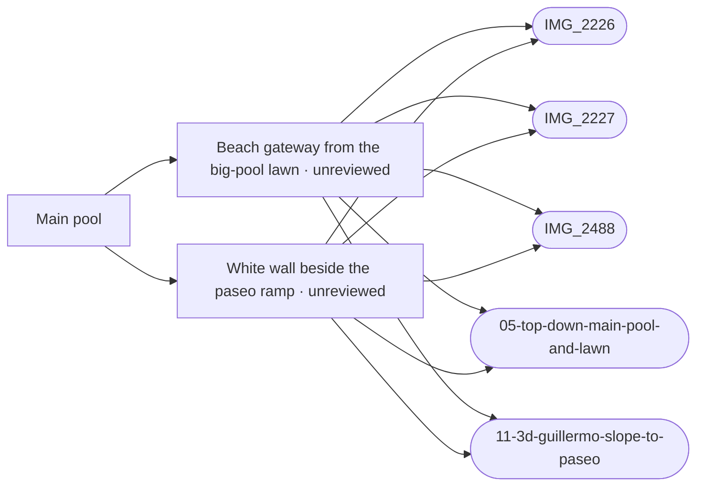

# Main pool

_Generated by `scripts/build_references.py`. Do not edit: change `data/areas.json` or `data/reference_tags.json` and rebuild._

The large main pool, the round toddler pool, the deck and lawn, Bistro Enrique's and its steps, 90 Miles.

## Known facts and open questions

- Villacana has one large main pool with a round toddler pool beside it (Dave, 2026-10-11).
- Apple 3D screenshots (Dave, 2026-10-21, apple-maps/10-13): Calle Guillermo runs down beside the lawn to the paseo, the kiosk at its foot is at lawn level, and the east steps are a narrow flight from the Picasso wall between the 90 Miles terrace and the east building. Built by task guillermo-slope-east-steps (docs/MAIN_POOL.md); heights estimated.
- Dave, 2026-10-21: a fence and a coastal gate separate Villacana from Barraka beach in front of the lawn. IMG_2226 shows the white wall, a round-arched gateway at the foot of Calle Guillermo, a short wall and white railings along the lawn; built as data/seafront_fence.json (heights by eye, gateway left open).
- Dave, 2026-10-21: Calle Jorge meets Guillermo on the level; Guillermo's ramp starts just past the junction and slopes down to the paseo as a smooth ramp with no steps (modelled 3 m over 15.5 m, about 19 %). Open: do the houses beside the ramp stand lower than street level?
- Laser survey 2026-10-24 (docs/reviews/lidar-levels): main pool deck -2.87 m (model -3.00). Calle Guillermo stays at about -0.2 to -0.4 m along the mapped street with the pool lawn 2.5 m lower behind a sharp edge; the fall to the paseo starts south of the mapped end, not over its last 15 m as modelled (guillermo-descent-recheck).
- 27 Oct (docs/reviews/beach-gate-verge): the beach gateway is at the lawn's south-west corner beside the paseo ramp, not at the foot of Calle Guillermo (Dave; aerial; IMG_2226). Calle Guillermo is level to the paseo (survey, IMG_2488); the paseo ramps 1.7 m down east of the lane's foot to lawn level. The 21 Oct 3 m lane ramp is removed.
- 27 Oct, IMG_2600 from beside the kiosk: an inner tiled path runs down east-south-east from the foot of Calle Guillermo behind a white wall topped with green rigid mesh, to grass, a hedge and a green rigid-mesh fence with the beach beyond. The model draws white railings there (read from IMG_2226 at 50 m); the fence's material and where mesh turns to railings are open. A tall white pier at the left edge may be the beach gateway.

## Read first

- docs: `docs/MAIN_POOL.md`
- data: `data/main_pool.json`, `data/guillermo_slope.json`, `data/seafront_fence.json`
- src: `src/main-pool.ts`, `src/pool-levels.ts`, `src/lowered-lanes.ts`, `src/seafront-fence.ts`
- contact sheet: `villacana-reference/contact-sheets/main-pool.jpg` (thumbnails of everything below, numbered in this order)

## Coverage

Layout: 7, Levels and slopes: 6, Facades and roofs: 1, Materials: 1, Views: 1
7 reviewed, 0 suggested only by camera position.

## Open build tasks

From `data/build_queue.json`; issue bodies in `refs/issues/`.

| Priority | Task | What | Status | Photos |
| --- | --- | --- | --- | --- |
| P1 | `beach-gate-verge` | Beach gateway beside the paseo ramp, survey paseo levels, grass and shrubs in front of the railings | in-progress · Claude · placement: not-verified | [IMG_2226](../../public/photos-ref/IMG_2226.jpg), [IMG_2488](../../public/photos-ref/IMG_2488.jpg) |
| P1 | `guillermo-descent-recheck` | Calle Guillermo: put the fall to the paseo where the survey has it | in-progress · Claude · placement: not-verified | [IMG_2488](../../public/photos-ref/IMG_2488.jpg), [IMG_2226](../../public/photos-ref/IMG_2226.jpg) |
| P1 | `guillermo-slope-east-steps` | Calle Guillermo slopes down to the paseo; east pool steps come down from the Picasso wall | in-progress · Claude · placement: not-verified | `apple-maps/11-3d-guillermo-slope-to-paseo.png`, `apple-maps/10-3d-guillermo-and-main-pool-from-sea-wide.png`, `apple-maps/12-3d-main-pool-east-steps-picasso.png`, `apple-maps/13-3d-main-pool-terrace-both-stairs.png`, [IMG_2226](../../public/photos-ref/IMG_2226.jpg), [IMG_2227](../../public/photos-ref/IMG_2227.jpg) |
| P1 | `path-network-inventory-main-pool` [#128](https://github.com/daveyboyc/villacana-venture/issues/128) | Main pool: full-source path, tunnel and boundary inventory (after path-network-baseline) | open · placement: not-applicable |  |

## Built from these photos

Model features that cite photos of this area, from `public/photos-ref/evidence-graph.json`, with their photo-check state. A citation records what a feature was traced from; only a check in `data/photo_checks.json` says someone rendered it from the photo's camera and compared.

## Placement evidence

`verification` is placement status, separate from photographic diagnostics. Earlier manual reviews may exist. Only a fresh measured packet and independent approval can grant `verified`.

| Feature | Placement | Photo diagnostics | Blockers |
| --- | --- | --- | --- |
| `seafront_fence.json:guillermo-beach-gate` | unreviewed | incomplete | No measured placement packet and independent approval recorded; earlier manual reviews may exist. |
| `seafront_fence.json:guillermo-ramp-wall` | unreviewed | unchecked | No measured placement packet and independent approval recorded; earlier manual reviews may exist. |

## Photo checks

Renders from each photo's camera compared with the photo (`data/photo_checks.json`).

| Task | Photo | Result | Render | Notes |
| --- | --- | --- | --- | --- |
| `beach-gate-verge` | [IMG_2488](../../public/photos-ref/IMG_2488.jpg) | **matches** | [after](../../docs/reviews/beach-gate-verge/IMG_2488-after.png) · [before](../../docs/reviews/beach-gate-verge/IMG_2488-before.png) | Looking up Calle Guillermo from its foot: the photo shows a level tiled lane between a white house wall and a raised planter. Before, the model sank the lane into a 3 m ramp channel with retaining walls; after, it is level at street level as photographed. Third-person view from the pin, not a solved camera; the planter and strelitzia are not modelled. |
| `beach-gate-verge` | [IMG_2226](../../public/photos-ref/IMG_2226.jpg) | **not-comparable** | [after](../../docs/reviews/beach-gate-verge/IMG_2226-after.png) · [before](../../docs/reviews/beach-gate-verge/IMG_2226-before.png) | From the beach the photo shows a grass band with low shrubs in front of the white wall, gateway and railings. After, the render shows the green verge and shrub clumps along the frontage where before there was bare sand; the pin view is 50 m off and third-person, so extents, the arch position and shrub sizes cannot be compared. Rough outline pending close photos. |

## Reviewed references

| Reference | Viewpoint | Use for | What it shows |
| --- | --- | --- | --- |
| `villacana-reference/apple-maps/11-3d-guillermo-slope-to-paseo.png` | aerial | layout, levels | Apple Maps 3D: Calle Guillermo sloping down beside the pool lawn to the paseo **Note:** Dave, 2026-10-21. The lane runs down continuously from the restaurant's west end to the paseo between the house gardens and a long white wall on the pool-lawn side; the wall's lawn face gets lower towards the sea. Calle Jorge joins part-way down with no visible steps. The single-storey white kiosk at the foot stands at lawn and paseo level; the lane passes west of it to the beach gate and zebra crossing. Heights are not measurable from the mesh. _Used by: seafront_fence.json:guillermo-beach-gate, seafront_fence.json:guillermo-ramp-wall._ |
| `villacana-reference/apple-maps/05-top-down-main-pool-and-lawn.png` | aerial | layout | Apple Maps top-down: main pool, toddler pool, deck, lawn, Barraka beach _Used by: seafront_fence.json:guillermo-beach-gate, seafront_fence.json:guillermo-ramp-wall._ |
| [IMG_2600.jpg](../../public/photos-ref/IMG_2600.jpg) | ground | layout, levels, materials | From the foot of Calle Guillermo: tiled path down past the white wall towards the beach **Looks at:** The lawn corner and fence at the foot of the path. **Compass:** the subject is 47° from the phone heading; trust looksAt, not the heading. |
| `villacana-reference/apple-maps/10-3d-guillermo-and-main-pool-from-sea-wide.png` | aerial | layout, levels | Apple Maps 3D: main pool and Calle Guillermo from the sea, looking west **Note:** Dave, 2026-10-21. Wider version of apple-maps/11. Apple's 3D mesh is coarse: it shows order, sides and which way the ground falls, not measured heights. |
| `villacana-reference/apple-maps/12-3d-main-pool-east-steps-picasso.png` | aerial | layout, levels | Apple Maps 3D: main pool looking north-east, 90 Miles terrace and the east steps **Note:** Dave, 2026-10-21. A narrow flight of steps comes down from an opening in the white wall along Calle Pintor Picasso, between the curved 90 Miles terrace and the east lawn, to the paving north-east of the toddler pool. Not a wide flight off the restaurant roof. |
| `villacana-reference/apple-maps/13-3d-main-pool-terrace-both-stairs.png` | aerial | layout, levels | Apple Maps 3D: main pool terrace curve with the west and east steps **Note:** Dave, 2026-10-21. Nearly top-down. West: terracotta steps between the Guillermo-side wall and the terrace's curved planter wall. East: a dark narrow slot between the 90 Miles lobe and the Picasso boundary wall, the steps in shadow. |
| [IMG_2226.jpg](../../public/photos-ref/IMG_2226.jpg) | ground | view, facades, layout, levels | From the beach looking back at the resort frontage **Looks at:** big-pool lawn frontage: white railings, Guillermo gateway at left. **Note:** Read 2026-10-21 at full size. West to east (left to right): corner houses with a white wall and tiled panel, a white round-arched gateway at paseo level (the foot of Calle Guillermo), a short white wall, then white railings along the big-pool lawn up to Barraka's raised deck at right; the restaurant's blue awnings behind. The lawn and the gateway's foot are about level with the paseo. Built as data/seafront_fence.json. _Used by: beach_verge.json:barraka-front-verge, beach_verge.json:barraka-front-shrubs, seafront_fence.json:guillermo-beach-gate, seafront_fence.json:guillermo-ramp-wall._ |
