# Main pool

_Generated by `scripts/build_references.py`. Do not edit: change `data/areas.json` or `data/reference_tags.json` and rebuild._

The large main pool, the round toddler pool, the deck and lawn, Bistro Enrique's and its steps, 90 Miles.

## Known facts and open questions

- Villacana has one large main pool with a round toddler pool beside it (Dave, 2026-10-11).
- Apple 3D screenshots (Dave, 2026-10-21, apple-maps/10-13): Calle Guillermo runs down beside the lawn to the paseo, the kiosk at its foot is at lawn level, and the east steps are a narrow flight from the Picasso wall between the 90 Miles terrace and the east building. Built by task guillermo-slope-east-steps (docs/MAIN_POOL.md); heights estimated.
- Dave, 2026-10-21: a fence and a coastal gate separate Villacana from Barraka beach in front of the lawn. IMG_2226 shows the white wall, a round-arched gateway at the foot of Calle Guillermo, a short wall and white railings along the lawn; built as data/seafront_fence.json (heights by eye, gateway left open).
- Dave, 2026-10-21: Calle Jorge meets Guillermo on the level; Guillermo's ramp starts just past the junction and slopes down to the paseo as a smooth ramp with no steps (modelled 3 m over 15.5 m, about 19 %). Open: do the houses beside the ramp stand lower than street level?
- Laser survey 2026-10-24 (docs/reviews/lidar-levels): main pool deck -2.87 m (model -3.00). Calle Guillermo stays at about -0.2 to -0.4 m along the mapped street with the pool lawn 2.5 m lower behind a sharp edge; the fall to the paseo starts south of the mapped end, not over its last 15 m as modelled (guillermo-descent-recheck).
- 27 Oct (docs/reviews/beach-gate-verge): the beach gateway is at the lawn's south-west corner beside the paseo ramp, not at the foot of Calle Guillermo (Dave; aerial; IMG_2226). Calle Guillermo is level to the paseo (survey, IMG_2488); the paseo ramps 1.7 m down east of the lane's foot to lawn level. The 21 Oct 3 m lane ramp is removed.
- 27 Oct, IMG_2600 from beside the kiosk: an inner tiled path runs down east-south-east from the foot of Calle Guillermo behind a white wall topped with green rigid mesh, to grass, a hedge and a green rigid-mesh fence with the beach beyond. The model draws white railings there (read from IMG_2226 at 50 m); the fence's material and where mesh turns to railings are open. A tall white pier at the left edge may be the beach gateway.
- 8 Nov photos: IMG_2764/2765 from the lawn show the main pool and the white wave-roofed building; IMG_2773-2777 and IMG_2823 the lane beside it (octagonal paving, lantana planter wall, slot drains, steps and ramp at the shops, marble-nosed steps with blue tile risers down to the deck).
- 12 Nov: the lawn photos are built as pink resin paths, a flagstone apron at the existing arched gate, bollards and bins, short white walls with a strelitzia bed, a hedge and shower in front of the sea railing, a terracotta deck on the main pool. The glass fence the photos show stays out (Dave, 2026-10-11, confirmed 2026-11-12), and marble nosings on Enrique's steps (data/main_pool_lawn.json). Positions are estimated from the camera pins, good to about 4 m. The sea fence stays the green bars from the closer paseo photos; the lawn photos read that fence as mesh. The iron leaf in the arch is drawn open.
- 13 Nov: the houses behind the lawn, seen from Barraka's awning (IMG_2609, IMG_2607), are plain white. The generated tiled porch roofs on their south faces are left off; they were a brown awning on every bay.
- 13 Nov: the lawn railing was a straight line from the beach gateway to Barraka, across the grass, so it enclosed the pool. IMG_2760 looks over the open lawn to the fence at the far side; IMG_2604, IMG_2611, IMG_2630 and IMG_2610 show that fence following the path. The railing and the paseo bend now follow the path's lawn edge. The pool stays unfenced and open to the lawn.
- 12 Nov (main-pool-lawn-ground): in Inspect the lawn paths, walls, hedge and bollards were buried under the surveyed lawn (built at the old flat -3 m deck); they now stand on the live ground. East of the lawn the survey has no drop at the lowered area's edge (lawn -2.3 m, ground beyond -2.1 m), so the 3 m retaining face there stood as a jagged sliver; src/terrain.ts now reads each side of the lowered edge on its own datum. Open: the gateway threshold stands about 0.8 m above the lawn just inland of it (survey and seafront heights meet there, beach-gate-verge), and the shop storey at the head of Enrique's steps is not modelled (enrique-shop-storey).
- 13 Nov, checked through the photo cameras (starting poses set from photo content, data/photo_poses.json): IMG_2603 and IMG_2764 now match the path, its left fork, the bin and bollards on the right and the palm at the pool end. Fixed on the way: a twist at the start of every pink path ribbon, generic shutters and tiled porch roofs on the plain white kiosk (IMG_2759, 2762, 2763), the riser tiles (cobalt, IMG_2776/2777), and eight summer loungers that stood in the gate corner and out on the paseo and beach beyond the railing. Still different (main-pool-lawn-cameras, beach-gate-verge, enrique-shop-storey): the seafront ground folds into the lawn's south-west corner where IMG_2763 shows lawn, a flagstone path and the hedge; the kiosk's louvred doors; the short flight to the shop off Calle Guillermo; the shop storey.
- 13 Nov (Dave): the slope down has no opening; the only way out is the gate, and the painted crossing is immediately outside it. The corner wall now runs into the ramp wall, Calle Guillermo ends inside the boundary (data/street_layout.json), and an inner tiled path (IMG_2600, IMG_2601) runs from its foot along the inside of the wall to the gate. The gate is rebuilt from IMG_2602, IMG_2766 and IMG_2485 (square piers, rectangular opening, moulded lintel, segmental hood, ring-pattern leaf, COMUNIDAD VILLACANA sign) and the crossing's bars run from its threshold across the paseo. Against the georeferenced aerial the pink path runs straight from the gate to the pool's south-west corner, 5-6 m west of where it was drawn, and the tall palm stands just west of its end (the path passes on the palm's right seen from the gate). Photo requests: guillermo-foot-closure, lawn-palm-foot, kiosk-faces, enrique-shop-front-square.
- 13 Nov (Dave): the crossing is a zebra the usual way round, bars side by side across the paseo and each along the walk (IMG_2484), centred on the gate; and the paths should be smooth. The lawn paths are now one smooth network with rounded joins (src/smooth-path.ts); the model-wide plan for smooth paths, patios and green spaces with their edges and boundaries is docs/SMOOTH_PATHS.md (tasks ground-plan-*).
- 14 Nov (ground-plan-main-pool): the big lawn, the lawn strip by the Guillermo planter, a deck band and the thin pale path on the north-east corner are traced into data/ground_plan_main_pool.json, the lawn from the georeferenced aerial's green (scripts/trace_ground.py). The hedge along the sea railing is the lawn's edge the whole way to Barraka (IMG_2760, IMG_2598). Open: the aerial shows a brown band left of the pink path where IMG_2598/2765 show lawn (read as worn grass); the aerial's green reaches under the one-storey registry building on the lawn's north-east side (6364501UF1366S_part3), which may be a covered terrace; the pale north-east path is aerial-only (photo request lawn-east-path).

## Read first

- docs: `docs/MAIN_POOL.md`, `docs/SMOOTH_PATHS.md`
- data: `data/main_pool.json`, `data/guillermo_slope.json`, `data/seafront_fence.json`, `data/main_pool_lawn.json`, `data/ground_plan_main_pool.json`
- src: `src/main-pool.ts`, `src/pool-levels.ts`, `src/lowered-lanes.ts`, `src/seafront-fence.ts`, `src/main-pool-lawn.ts`, `src/ground-plan.ts`
- contact sheet: `villacana-reference/contact-sheets/main-pool.jpg` (thumbnails of everything below, numbered in this order)

## Coverage

Layout: 32, Levels and slopes: 12, Facades and roofs: 10, Materials: 18, Planting: 10, Signs: 6, Views: 13
34 reviewed, 0 suggested only by camera position.

## Open build tasks

From `data/build_queue.json`; issue bodies in `refs/issues/`.

| Priority | Task | What | Status | Photos |
| --- | --- | --- | --- | --- |
| P1 | `beach-gate-verge` | Beach gateway beside the paseo ramp, survey paseo levels, grass and shrubs in front of the railings | in-progress · Claude · placement: not-verified | [IMG_2226](../../public/photos-ref/IMG_2226.jpg), [IMG_2488](../../public/photos-ref/IMG_2488.jpg) |
| P1 | `guillermo-descent-recheck` | Calle Guillermo: put the fall to the paseo where the survey has it | in-progress · Claude · placement: not-verified | [IMG_2488](../../public/photos-ref/IMG_2488.jpg), [IMG_2226](../../public/photos-ref/IMG_2226.jpg) |
| P1 | `guillermo-slope-east-steps` | Calle Guillermo slopes down to the paseo; east pool steps come down from the Picasso wall | in-progress · Claude · placement: not-verified | `apple-maps/11-3d-guillermo-slope-to-paseo.png`, `apple-maps/10-3d-guillermo-and-main-pool-from-sea-wide.png`, `apple-maps/12-3d-main-pool-east-steps-picasso.png`, `apple-maps/13-3d-main-pool-terrace-both-stairs.png`, [IMG_2226](../../public/photos-ref/IMG_2226.jpg), [IMG_2227](../../public/photos-ref/IMG_2227.jpg) |
| P1 | `main-pool-gate-corner` | Main pool lawn's sea corner: inner path, gate surround and kiosk ground from new photos | open · placement: not-verified | [IMG_2600](../../public/photos-ref/IMG_2600.jpg), [IMG_2601](../../public/photos-ref/IMG_2601.jpg), [IMG_2602](../../public/photos-ref/IMG_2602.jpg), [IMG_2763](../../public/photos-ref/IMG_2763.jpg), [IMG_2766](../../public/photos-ref/IMG_2766.jpg), [IMG_2767](../../public/photos-ref/IMG_2767.jpg), [IMG_2485](../../public/photos-ref/IMG_2485.jpg), [IMG_2762](../../public/photos-ref/IMG_2762.jpg) |
| P1 | `main-pool-lawn-details` | Main pool lawn: pink paths, deck and step finish | in-progress · Cursor · placement: not-verified | [IMG_2764](../../public/photos-ref/IMG_2764.jpg), [IMG_2765](../../public/photos-ref/IMG_2765.jpg), [IMG_2603](../../public/photos-ref/IMG_2603.jpg), [IMG_2761](../../public/photos-ref/IMG_2761.jpg), [IMG_2762](../../public/photos-ref/IMG_2762.jpg), [IMG_2763](../../public/photos-ref/IMG_2763.jpg), [IMG_2602](../../public/photos-ref/IMG_2602.jpg), [IMG_2775](../../public/photos-ref/IMG_2775.jpg), [IMG_2776](../../public/photos-ref/IMG_2776.jpg), [IMG_2777](../../public/photos-ref/IMG_2777.jpg) |
| P1 | `main-pool-lawn-ground` | Main pool lawn: stand the paths and fittings on the surveyed ground, close the lowered edge, lawn kit models | in-progress · Claude · placement: not-verified | [IMG_2485](../../public/photos-ref/IMG_2485.jpg), [IMG_2600](../../public/photos-ref/IMG_2600.jpg), [IMG_2601](../../public/photos-ref/IMG_2601.jpg), [IMG_2602](../../public/photos-ref/IMG_2602.jpg), [IMG_2603](../../public/photos-ref/IMG_2603.jpg), [IMG_2759](../../public/photos-ref/IMG_2759.jpg), [IMG_2761](../../public/photos-ref/IMG_2761.jpg), [IMG_2762](../../public/photos-ref/IMG_2762.jpg), [IMG_2763](../../public/photos-ref/IMG_2763.jpg), [IMG_2764](../../public/photos-ref/IMG_2764.jpg), [IMG_2765](../../public/photos-ref/IMG_2765.jpg), [IMG_2766](../../public/photos-ref/IMG_2766.jpg), [IMG_2767](../../public/photos-ref/IMG_2767.jpg), [IMG_2775](../../public/photos-ref/IMG_2775.jpg), [IMG_2776](../../public/photos-ref/IMG_2776.jpg), [IMG_2777](../../public/photos-ref/IMG_2777.jpg) |
| P2 | `enrique-shop-storey` | Enrique's: the shop storey above the street-level terrace at the head of the steps | open · placement: not-verified | [IMG_2775](../../public/photos-ref/IMG_2775.jpg), [IMG_2776](../../public/photos-ref/IMG_2776.jpg) |
| P2 | `ground-plan-main-pool` | Main pool: the rest of the ground plan (lawn outline, planted strip, terraces and deck edges) (after ground-plan-framework) | in-progress · Claude · placement: not-verified | [IMG_2598](../../public/photos-ref/IMG_2598.jpg), [IMG_2603](../../public/photos-ref/IMG_2603.jpg), [IMG_2760](../../public/photos-ref/IMG_2760.jpg), [IMG_2764](../../public/photos-ref/IMG_2764.jpg), [IMG_2765](../../public/photos-ref/IMG_2765.jpg), [IMG_2773](../../public/photos-ref/IMG_2773.jpg), [IMG_2774](../../public/photos-ref/IMG_2774.jpg), [IMG_2777](../../public/photos-ref/IMG_2777.jpg) |
| P2 | `main-pool-lawn-cameras` | Main pool lawn and Enrique's steps: solve the photo cameras and close what still differs | open · placement: not-verified | [IMG_2765](../../public/photos-ref/IMG_2765.jpg), [IMG_2759](../../public/photos-ref/IMG_2759.jpg), [IMG_2761](../../public/photos-ref/IMG_2761.jpg), [IMG_2762](../../public/photos-ref/IMG_2762.jpg), [IMG_2776](../../public/photos-ref/IMG_2776.jpg), [IMG_2777](../../public/photos-ref/IMG_2777.jpg) |
| P2 | `path-network-inventory-main-pool` [#128](https://github.com/daveyboyc/villacana-venture/issues/128) | Main pool: full-source path, tunnel and boundary inventory (after path-network-baseline) | open · placement: not-applicable |  |

## Built from these photos

Model features that cite photos of this area, from `public/photos-ref/evidence-graph.json`, with their photo-check state. A citation records what a feature was traced from; only a check in `data/photo_checks.json` says someone rendered it from the photo's camera and compared.

```mermaid
graph LR
  A["Main pool"]
  A --> F0["Flagstone apron in front of the lawn's arched gate · disputed"]
  F0 --> PIMG_2602_jpg(["IMG_2602"])
  F0 --> PIMG_2759_jpg(["IMG_2759"])
  F0 --> PIMG_2763_jpg(["IMG_2763"])
  A --> F1["Inner tiled path from the foot of Calle Guillermo to the beach gate · disputed"]
  F1 --> PIMG_2600_jpg(["IMG_2600"])
  F1 --> PIMG_2601_jpg(["IMG_2601"])
  F1 --> PIMG_2602_jpg(["IMG_2602"])
  F1 --> PIMG_2763_jpg(["IMG_2763"])
  A --> F2["Pink resin paths across the main-pool lawn · disputed"]
  F2 --> PIMG_2603_jpg(["IMG_2603"])
  F2 --> PIMG_2759_jpg(["IMG_2759"])
  F2 --> PIMG_2761_jpg(["IMG_2761"])
  F2 --> PIMG_2762_jpg(["IMG_2762"])
  F2 --> PIMG_2763_jpg(["IMG_2763"])
  F2 --> PIMG_2764_jpg(["IMG_2764"])
  F2 --> PIMG_2765_jpg(["IMG_2765"])
  A --> F3["Lawn strip between the pink path and the Guillermo planter · disputed"]
  F3 --> PIMG_2598_jpg(["IMG_2598"])
  F3 --> PIMG_2764_jpg(["IMG_2764"])
  F3 --> PIMG_2765_jpg(["IMG_2765"])
  A --> F4["Main pool lawn · unreviewed"]
  F4 --> PIMG_2598_jpg(["IMG_2598"])
  F4 --> PIMG_2603_jpg(["IMG_2603"])
  F4 --> PIMG_2760_jpg(["IMG_2760"])
  F4 --> PIMG_2761_jpg(["IMG_2761"])
  A --> F5["Main pool deck: its outer edge towards the lawn · unreviewed"]
  F5 --> PIMG_2764_jpg(["IMG_2764"])
  F5 --> PIMG_2765_jpg(["IMG_2765"])
  A --> F6["Calle Guillermo paving beside the planter: squares at the junction, octagons beyond, covers · unreviewed"]
  F6 --> PIMG_2773_jpg(["IMG_2773"])
  F6 --> PIMG_2774_jpg(["IMG_2774"])
  F6 --> PIMG_2822_jpg(["IMG_2822"])
  F6 --> PIMG_2823_jpg(["IMG_2823"])
  A --> F7["Lantana planter wall along Calle Guillermo behind the Calle de Jorge plinth · unreviewed"]
  F7 --> PIMG_2597_jpg(["IMG_2597"])
  F7 --> PIMG_2773_jpg(["IMG_2773"])
  F7 --> PIMG_2774_jpg(["IMG_2774"])
  A --> F8["West of Calle Guillermo: plain lawn wall, patio wall, hedged planters, lamp posts and brick border · disputed"]
  F8 --> PIMG_2773_jpg(["IMG_2773"])
  F8 --> PIMG_2774_jpg(["IMG_2774"])
  A --> F9["Tall slender palm on the main-pool lawn below Calle Jorge · unreviewed"]
  F9 --> PIMG_2764_jpg(["IMG_2764"])
  F9 --> PIMG_2765_jpg(["IMG_2765"])
  A --> F10["Signed awning, menu board and wall lantern at the head of Enrique's steps · disputed"]
  F10 --> PIMG_2775_jpg(["IMG_2775"])
  F10 --> PIMG_2776_jpg(["IMG_2776"])
  A --> F11["Marble nosings, blue tile risers and handrail on the steps to Enrique's · disputed"]
  F11 --> PIMG_2776_jpg(["IMG_2776"])
  F11 --> PIMG_2777_jpg(["IMG_2777"])
  A --> F12["Bollard lights, slatted bins and slot drains on the main-pool lawn · disputed"]
  F12 --> PIMG_2603_jpg(["IMG_2603"])
  F12 --> PIMG_2761_jpg(["IMG_2761"])
  F12 --> PIMG_2764_jpg(["IMG_2764"])
  F12 --> PIMG_2765_jpg(["IMG_2765"])
  F12 --> PIMG_2775_jpg(["IMG_2775"])
  F12 --> PIMG_2776_jpg(["IMG_2776"])
  A --> F13["Plain white kiosk at the lawn's sea corner · unreviewed"]
  F13 --> PIMG_2759_jpg(["IMG_2759"])
  F13 --> PIMG_2762_jpg(["IMG_2762"])
  F13 --> PIMG_2763_jpg(["IMG_2763"])
  A --> F14["Shower on the sea side of the main-pool lawn (the hedge along the railing is in the ground plan) · unreviewed"]
  F14 --> PIMG_2759_jpg(["IMG_2759"])
  F14 --> PIMG_2761_jpg(["IMG_2761"])
  F14 --> PIMG_2763_jpg(["IMG_2763"])
  A --> F15["White walls, door and strelitzia bed on the main-pool lawn · disputed"]
  F15 --> PIMG_2759_jpg(["IMG_2759"])
  F15 --> PIMG_2762_jpg(["IMG_2762"])
  F15 --> PIMG_2763_jpg(["IMG_2763"])
  F15 --> PIMG_2765_jpg(["IMG_2765"])
  A --> F16["Terracotta paving and green mat at the foot of the steps to Enrique's · unreviewed"]
  F16 --> PIMG_2764_jpg(["IMG_2764"])
  F16 --> PIMG_2777_jpg(["IMG_2777"])
  A --> F17["Beach gateway from the big-pool lawn · disputed"]
  F17 --> PIMG_2226_jpg(["IMG_2226"])
  F17 --> PIMG_2227_jpg(["IMG_2227"])
  F17 --> PIMG_2484_jpg(["IMG_2484"])
  F17 --> PIMG_2485_jpg(["IMG_2485"])
  F17 --> PIMG_2488_jpg(["IMG_2488"])
  F17 --> PIMG_2600_jpg(["IMG_2600"])
  F17 --> PIMG_2601_jpg(["IMG_2601"])
  F17 --> PIMG_2602_jpg(["IMG_2602"])
  F17 --> PIMG_2604_jpg(["IMG_2604"])
  F17 --> PIMG_2609_jpg(["IMG_2609"])
  F17 --> PIMG_2610_jpg(["IMG_2610"])
  F17 --> PIMG_2630_jpg(["IMG_2630"])
  F17 --> PIMG_2631_jpg(["IMG_2631"])
  F17 --> PIMG_2759_jpg(["IMG_2759"])
  F17 --> PIMG_2760_jpg(["IMG_2760"])
  F17 --> PIMG_2766_jpg(["IMG_2766"])
  F17 --> PIMG_2767_jpg(["IMG_2767"])
  F17 --> Pref_apple_maps_05_top_down_main_pool_and_lawn_png(["05-top-down-main-pool-and-lawn"])
  F17 --> Pref_apple_maps_11_3d_guillermo_slope_to_paseo_png(["11-3d-guillermo-slope-to-paseo"])
  A --> F18["White wall beside the paseo ramp · unreviewed"]
  F18 --> PIMG_2226_jpg(["IMG_2226"])
  F18 --> PIMG_2227_jpg(["IMG_2227"])
  F18 --> PIMG_2484_jpg(["IMG_2484"])
  F18 --> PIMG_2485_jpg(["IMG_2485"])
  F18 --> PIMG_2488_jpg(["IMG_2488"])
  F18 --> PIMG_2600_jpg(["IMG_2600"])
  F18 --> PIMG_2601_jpg(["IMG_2601"])
  F18 --> PIMG_2602_jpg(["IMG_2602"])
  F18 --> PIMG_2604_jpg(["IMG_2604"])
  F18 --> PIMG_2609_jpg(["IMG_2609"])
  F18 --> PIMG_2610_jpg(["IMG_2610"])
  F18 --> PIMG_2630_jpg(["IMG_2630"])
  F18 --> PIMG_2631_jpg(["IMG_2631"])
  F18 --> PIMG_2759_jpg(["IMG_2759"])
  F18 --> PIMG_2760_jpg(["IMG_2760"])
  F18 --> PIMG_2766_jpg(["IMG_2766"])
  F18 --> PIMG_2767_jpg(["IMG_2767"])
  F18 --> Pref_apple_maps_05_top_down_main_pool_and_lawn_png(["05-top-down-main-pool-and-lawn"])
  F18 --> Pref_apple_maps_11_3d_guillermo_slope_to_paseo_png(["11-3d-guillermo-slope-to-paseo"])
  A --> F19["Green bar railing on a sandstone plinth along the big-pool lawn · unreviewed"]
  F19 --> PIMG_2226_jpg(["IMG_2226"])
  F19 --> PIMG_2227_jpg(["IMG_2227"])
  F19 --> PIMG_2484_jpg(["IMG_2484"])
  F19 --> PIMG_2485_jpg(["IMG_2485"])
  F19 --> PIMG_2488_jpg(["IMG_2488"])
  F19 --> PIMG_2600_jpg(["IMG_2600"])
  F19 --> PIMG_2601_jpg(["IMG_2601"])
  F19 --> PIMG_2602_jpg(["IMG_2602"])
  F19 --> PIMG_2604_jpg(["IMG_2604"])
  F19 --> PIMG_2609_jpg(["IMG_2609"])
  F19 --> PIMG_2610_jpg(["IMG_2610"])
  F19 --> PIMG_2630_jpg(["IMG_2630"])
  F19 --> PIMG_2631_jpg(["IMG_2631"])
  F19 --> PIMG_2759_jpg(["IMG_2759"])
  F19 --> PIMG_2760_jpg(["IMG_2760"])
  F19 --> PIMG_2766_jpg(["IMG_2766"])
  F19 --> PIMG_2767_jpg(["IMG_2767"])
  F19 --> Pref_apple_maps_05_top_down_main_pool_and_lawn_png(["05-top-down-main-pool-and-lawn"])
  F19 --> Pref_apple_maps_11_3d_guillermo_slope_to_paseo_png(["11-3d-guillermo-slope-to-paseo"])
```

## Placement evidence

`verification` is placement status, separate from photographic diagnostics. Earlier manual reviews may exist. Only a fresh measured packet and independent approval can grant `verified`.

| Feature | Placement | Photo diagnostics | Blockers |
| --- | --- | --- | --- |
| `ground_plan_main_pool.json:lawn-flagstone-apron` | disputed | differs | open discrepancy photo-discrepancy:d69d98b4d1829198 |
| `ground_plan_main_pool.json:lawn-inner-path` | disputed | differs | open discrepancy photo-discrepancy:579edecb7212af87; open discrepancy photo-discrepancy:b0699681a986d829 |
| `ground_plan_main_pool.json:lawn-pink-paths` | disputed | differs | open discrepancy photo-discrepancy:4fd6ed9df8230cc8 |
| `ground_plan_main_pool.json:lawn-strip-guillermo` | disputed | differs | open discrepancy photo-discrepancy:c6145e80226c59a5 |
| `ground_plan_main_pool.json:main-lawn` | unreviewed | incomplete | No measured placement packet and independent approval recorded; earlier manual reviews may exist. |
| `ground_plan_main_pool.json:main-pool-deck-band` | unreviewed | unchecked | No measured placement packet and independent approval recorded; earlier manual reviews may exist. |
| `jorge_lane.json:jorge-lane-guillermo-paving` | unreviewed | incomplete | No measured placement packet and independent approval recorded; earlier manual reviews may exist. |
| `jorge_lane.json:jorge-lane-guillermo-planter` | unreviewed | incomplete | No measured placement packet and independent approval recorded; earlier manual reviews may exist. |
| `jorge_lane.json:jorge-lane-guillermo-west` | disputed | differs | open discrepancy photo-discrepancy:74cead97dc4c963c; open discrepancy photo-discrepancy:f89b5484edc8b5c0 |
| `jorge_lane.json:jorge-lane-lawn-palm` | unreviewed | incomplete | No measured placement packet and independent approval recorded; earlier manual reviews may exist. |
| `main_pool_lawn.json:enrique-shop-front` | disputed | differs | open discrepancy photo-discrepancy:22a1de7708736762 |
| `main_pool_lawn.json:enrique-step-finish` | disputed | differs | open discrepancy photo-discrepancy:06e6a5e24465d688; open discrepancy photo-discrepancy:a8b13c9a85961a47 |
| `main_pool_lawn.json:lawn-bollards-bins` | disputed | differs | open discrepancy photo-discrepancy:58d14a627ceb2ff9 |
| `main_pool_lawn.json:lawn-kiosk-plain` | unreviewed | unchecked | No measured placement packet and independent approval recorded; earlier manual reviews may exist. |
| `main_pool_lawn.json:lawn-sea-hedge` | unreviewed | unchecked | No measured placement packet and independent approval recorded; earlier manual reviews may exist. |
| `main_pool_lawn.json:lawn-white-rooms` | disputed | differs | open discrepancy photo-discrepancy:f0c43f8955aabe66; open discrepancy photo-discrepancy:4187d7425a4ae65c |
| `main_pool_lawn.json:main-pool-deck-tiles` | unreviewed | unchecked | No measured placement packet and independent approval recorded; earlier manual reviews may exist. |
| `seafront_fence.json:guillermo-beach-gate` | disputed | differs | open discrepancy photo-discrepancy:58170dc8a5dd3aaa; open discrepancy photo-discrepancy:4d29ca0cdc7d5d41 |
| `seafront_fence.json:guillermo-ramp-wall` | unreviewed | unchecked | No measured placement packet and independent approval recorded; earlier manual reviews may exist. |
| `seafront_fence.json:main-pool-lawn-railing` | unreviewed | incomplete | No measured placement packet and independent approval recorded; earlier manual reviews may exist. |

## Photo checks

Renders from each photo's camera compared with the photo (`data/photo_checks.json`).

| Task | Photo | Result | Render | Notes |
| --- | --- | --- | --- | --- |
| `beach-gate-verge` | [IMG_2488](../../public/photos-ref/IMG_2488.jpg) | **matches** | [after](../../docs/reviews/beach-gate-verge/IMG_2488-after.png) · [before](../../docs/reviews/beach-gate-verge/IMG_2488-before.png) | Looking up Calle Guillermo from its foot: the photo shows a level tiled lane between a white house wall and a raised planter. Before, the model sank the lane into a 3 m ramp channel with retaining walls; after, it is level at street level as photographed. Third-person view from the pin, not a solved camera; the planter and strelitzia are not modelled. |
| `beach-gate-verge` | [IMG_2226](../../public/photos-ref/IMG_2226.jpg) | **not-comparable** | [after](../../docs/reviews/beach-gate-verge/IMG_2226-after.png) · [before](../../docs/reviews/beach-gate-verge/IMG_2226-before.png) | From the beach the photo shows a grass band with low shrubs in front of the white wall, gateway and railings. After, the render shows the green verge and shrub clumps along the frontage where before there was bare sand; the pin view is 50 m off and third-person, so extents, the arch position and shrub sizes cannot be compared. Rough outline pending close photos. |
| `main-pool-lawn-ground` | [IMG_2765](../../public/photos-ref/IMG_2765.jpg) | **differs** → `main-pool-lawn-cameras` | [after](../../docs/reviews/main-pool-lawn-ground/IMG_2765-after.png) | Same spot as IMG_2764, on the path moved onto the aerial strip. The starting heading (326 degrees, the phone's) turns the render about 15 degrees left of the photo, so the Guillermo wall and two summer loungers fill the left where the photo shows the path ahead with its bin on the right. Not tuned by eye; to be solved. Camera: hand-set starting pose from photo content (data/photo_poses.json), not solved; a photographic diagnostic, not placement approval. Agent-reviewed only. |
| `main-pool-lawn-ground` | [IMG_2775](../../public/photos-ref/IMG_2775.jpg) | **differs** → `enrique-shop-storey` | [after](../../docs/reviews/main-pool-lawn-ground/IMG_2775-after.png) | The three blue awnings read in the photo's order (FISH PORTIONS · MEATS · PUBLIC PEOPLE, RACIONES · PESCADOS · CARNES · PIZZAS, BAR & RESTAURANTE ENRIQUE), but they hang in the air: the storey they are on is not modelled. The camera from the pin stands close beside the planter wall. Camera: hand-set starting pose from photo content (data/photo_poses.json), not solved; a photographic diagnostic, not placement approval. Agent-reviewed only. |
| `main-pool-lawn-ground` | [IMG_2776](../../public/photos-ref/IMG_2776.jpg) | **differs** → `main-pool-lawn-cameras` | [after](../../docs/reviews/main-pool-lawn-ground/IMG_2776-after.png) | The risers now show the photo's cobalt patterned tiles under pale nosings, on terracotta treads. The camera from the pin stands in the long flight looking up it; the photo stands on Calle Guillermo with the octagon paving, the slot drain and a short marble-nosed flight on its right. Camera: hand-set starting pose from photo content (data/photo_poses.json), not solved; a photographic diagnostic, not placement approval. Agent-reviewed only. |
| `main-pool-lawn-ground` | [IMG_2777](../../public/photos-ref/IMG_2777.jpg) | **differs** → `main-pool-lawn-cameras` | [after](../../docs/reviews/main-pool-lawn-ground/IMG_2777-after.png) | Looking down the flight onto the deck: nosings, the bed of palms and yuccas, the pale deck and the pool beyond, as in the photo, but the photo's wide landing tread with one long marble nosing and blue riser, the black handrail on its white cheek and the green mat are not lined up; the camera is a rough starting pose 35 degrees down. Camera: hand-set starting pose from photo content (data/photo_poses.json), not solved; a photographic diagnostic, not placement approval. Agent-reviewed only. |
| `main-pool-lawn-ground` | [IMG_2764](../../public/photos-ref/IMG_2764.jpg) | **matches** | [after](../../docs/reviews/main-pool-lawn-ground/IMG_2764-after.png) | With the path moved onto the aerial's brown strip: from the gate end it runs to the pool's south-west corner with the tall palm on its left at the far end, the big lawn on the right and the planted strip by the Guillermo wall on the left, a bollard on the right a few metres ahead and a bin on the right further on, as in the photo. Camera: hand-set starting pose from photo content (data/photo_poses.json), not solved; a photographic diagnostic, not placement approval. Agent-reviewed only. 13 Nov: the paths are now drawn as one smooth network (src/smooth-path.ts): the path curves through its traced points and its branches join with rounded fillets, where it used to kink at every point and its branches overlapped as square-ended strips. |
| `main-pool-lawn-ground` | [IMG_2603](../../public/photos-ref/IMG_2603.jpg) | **matches** | [after](../../docs/reviews/main-pool-lawn-ground/IMG_2603-after.png) | Bollard on the right about 4 m ahead, bin with a bollard on the right further on, bollards on the left towards the pool and the palm by the path's far end, as in the photo. The photo's left fork is just behind the render's lower edge. Camera: hand-set starting pose from photo content (data/photo_poses.json), not solved; a photographic diagnostic, not placement approval. Agent-reviewed only. |
| `main-pool-lawn-ground` | [IMG_2759](../../public/photos-ref/IMG_2759.jpg) | **matches** | [after](../../docs/reviews/main-pool-lawn-ground/IMG_2759-after.png) | Looking down the path to the beach gate: the path runs straight to the gateway with its hood, a bin and a bollard just left of it by the gate and the white kiosk to the right, as in the photo. The camera is set from content (pin +-18.5 m); the photo's flat-roofed kiosk front and the hedge behind the gate are not lined up exactly. Camera: hand-set starting pose from photo content (data/photo_poses.json), not solved; a photographic diagnostic, not placement approval. Agent-reviewed only. |
| `main-pool-lawn-ground` | [IMG_2761](../../public/photos-ref/IMG_2761.jpg) | **differs** → `main-pool-lawn-cameras` | [after](../../docs/reviews/main-pool-lawn-ground/IMG_2761-after.png) | From the phone pin, which falls on the path where the aerial shows it: lawn, the hedge along the railing and the paseo beyond line up, and the service lid sits on the lawn to the left of the path; the gateway, its bin and bollard at the photo's right edge fall just outside the render. Camera: hand-set starting pose from photo content (data/photo_poses.json), not solved; a photographic diagnostic, not placement approval. Agent-reviewed only. |
| `main-pool-lawn-ground` | [IMG_2762](../../public/photos-ref/IMG_2762.jpg) | **differs** → `main-pool-gate-corner` | [after](../../docs/reviews/main-pool-lawn-ground/IMG_2762-after.png) | The kiosk's north corner, plain white with a pale roof, and the strelitzia over a silver bush in front of it, as photographed; still different: the ground texture paints terracotta paving round the kiosk where the photo has lawn up to its walls, and its louvred doors are not modelled. Camera: hand-set starting pose from photo content (data/photo_poses.json), not solved; a photographic diagnostic, not placement approval. Agent-reviewed only. |
| `main-pool-lawn-ground` | [IMG_2763](../../public/photos-ref/IMG_2763.jpg) | **differs** → `main-pool-gate-corner` | [after](../../docs/reviews/main-pool-lawn-ground/IMG_2763-after.png) | Looking south past the kiosk's round end towards the fence; the corner's ground is drawn as terracotta paving and the inner path where the photo shows the pink path, a flagstone path curving between the hedge and the round wall, and a bollard. Camera: hand-set starting pose from photo content (data/photo_poses.json), not solved; a photographic diagnostic, not placement approval. Agent-reviewed only. |
| `main-pool-lawn-ground` | [IMG_2766](../../public/photos-ref/IMG_2766.jpg) | **matches** | [after](../../docs/reviews/main-pool-lawn-ground/IMG_2766-after.png) | Dave, 13 Nov: the crossing is immediately outside the gate, and a zebra the usual way round. The eight bars sit side by side across the paseo, each running along the walk, in a band centred on the gate opening, as the photo and IMG_2484 show; an intermediate build turned the bars to point out from the gate, which was wrong. Camera: hand-set starting pose from photo content (data/photo_poses.json), not solved; a photographic diagnostic, not placement approval. Agent-reviewed only. |
| `main-pool-lawn-ground` | [IMG_2767](../../public/photos-ref/IMG_2767.jpg) | **differs** → `main-pool-gate-corner` | [after](../../docs/reviews/main-pool-lawn-ground/IMG_2767-after.png) | The gateway's square pier, moulded lintel and segmental hood and the crossing in front of it read as photographed (it was a round-arched slab). Still different: the plumbago spilling over the walls either side, and the sandstone-faced wall with green mesh south-west of the gate, which the model draws as a plain white wall. Camera: hand-set starting pose from photo content (data/photo_poses.json), not solved; a photographic diagnostic, not placement approval. Agent-reviewed only. |
| `main-pool-lawn-ground` | [IMG_2485](../../public/photos-ref/IMG_2485.jpg) | **differs** → `main-pool-gate-corner` | [after](../../docs/reviews/main-pool-lawn-ground/IMG_2485-after.png) | The COMUNIDAD VILLACANA sign on the paseo face of the wall beside the pier, the pier and the ring-pattern iron leaf as photographed; the plumbago in front of the sign and the camera box on the pier are not modelled. Camera: hand-set starting pose from photo content (data/photo_poses.json), not solved; a photographic diagnostic, not placement approval. Agent-reviewed only. |
| `main-pool-lawn-ground` | [IMG_2602](../../public/photos-ref/IMG_2602.jpg) | **differs** → `main-pool-gate-corner` | [after](../../docs/reviews/main-pool-lawn-ground/IMG_2602-after.png) | From inside by the gate: the gateway, its hood and the lawn beyond line up, but the iron leaf is drawn swung open towards the camera (the photo has it shut) and the photo's flagstones run on along the inside of the fence where the render has the pink path and the inner path. Camera: hand-set starting pose from photo content (data/photo_poses.json), not solved; a photographic diagnostic, not placement approval. Agent-reviewed only. |
| `main-pool-lawn-ground` | [IMG_2600](../../public/photos-ref/IMG_2600.jpg) | **differs** → `main-pool-gate-corner` | [after](../../docs/reviews/main-pool-lawn-ground/IMG_2600-after.png) | Dave, 13 Nov: the slope has no opening. The inner path now runs from the foot of Calle Guillermo down between the white boundary wall and the kiosk side, as in the photo, instead of the lane running out through a gap onto the paseo. Still different: the render shows the gateway ahead where the photo shows a lawn strip, the hedge and the mesh fence; where the path meets the gate needs the requested photos (guillermo-foot-closure). Camera faces the reviewed looksAt; the phone compass is about 47 degrees off. Camera: hand-set starting pose from photo content (data/photo_poses.json), not solved; a photographic diagnostic, not placement approval. Agent-reviewed only. |
| `main-pool-lawn-ground` | [IMG_2601](../../public/photos-ref/IMG_2601.jpg) | **differs** → `main-pool-gate-corner` | [after](../../docs/reviews/main-pool-lawn-ground/IMG_2601-after.png) | Further down the inner path: the terracotta squares between a white wall and a planted bed lead on towards the corner, as in the photo, but the render shows the gateway and the railing ahead where the photo shows a hedge and mesh fence with the beach beyond. Camera: hand-set starting pose from photo content (data/photo_poses.json), not solved; a photographic diagnostic, not placement approval. Agent-reviewed only. |
| `main-pool-lawn-ground` | [IMG_2484](../../public/photos-ref/IMG_2484.jpg) | **matches** | [after](../../docs/reviews/main-pool-lawn-ground/IMG_2484-after.png) | Looking along the paseo towards the gate: the red and white band crosses the full paving with its bars along the walk, in front of the gateway, as in the photo. The photo's sandstone-faced wall with green mesh along the slope is drawn as a plain white wall (gap:slope-fence-sandstone-mesh). Camera: hand-set starting pose from photo content (data/photo_poses.json), not solved; a photographic diagnostic, not placement approval. Agent-reviewed only. |
| `ground-plan-main-pool` | [IMG_2760](../../public/photos-ref/IMG_2760.jpg) | **matches** | [after](../../docs/reviews/ground-plan-main-pool/IMG_2760-after.png) | Looking east across the big lawn from the pink path: open lawn to the clipped hedge along the sea railing, Barraka and its palms beyond, as in the photo. The lawn's edge is now traced from the aerial and the hedge runs the whole railing. The photo's service lid sits further right than the render's. Camera: hand-set starting pose from photo content (data/photo_poses.json), not solved; a photographic diagnostic, not placement approval. Agent-reviewed only. |
| `ground-plan-main-pool` | [IMG_2598](../../public/photos-ref/IMG_2598.jpg) | **differs** → `main-pool-lawn-cameras` | [after](../../docs/reviews/ground-plan-main-pool/IMG_2598-after.png) | From the Calle Jorge plinth over the lantana planter: the lawn strip, the pink path, the bin and bollard beyond it, the big lawn, the hedge and railing and Barraka line up with the photo. Different: a blue lounger from the October web photos (objects main-pool-18 to -25) stands on the strip, where this November photo shows open lawn; loungers are seasonal. Camera: hand-set starting pose from photo content (data/photo_poses.json), not solved; a photographic diagnostic, not placement approval. Agent-reviewed only. |
| `ground-plan-main-pool` | [IMG_2603](../../public/photos-ref/IMG_2603.jpg) | **matches** | [after](../../docs/reviews/ground-plan-main-pool/IMG_2603-after.png) | Unchanged by the lawn tracing: the path, its fork, the fittings either side and the palm at the pool end, as in the photo. Camera: hand-set starting pose from photo content (data/photo_poses.json), not solved; a photographic diagnostic, not placement approval. Agent-reviewed only. |

## Reviewed references

| Reference | Viewpoint | Use for | What it shows |
| --- | --- | --- | --- |
| [IMG_2759.jpg](../../public/photos-ref/IMG_2759.jpg) | ground | layout, materials, view | Lawn path to a white gateway towards the sea **Looks at:** arched beach gateway at the end of the pink path, bin and bollard beside it. **Note:** Pin is vague (+/-18.5 m); the view across the large lawn to the sea gateway places it on the main pool lawn. **Compass:** the subject is 63° from the phone heading; trust looksAt, not the heading. _Used by: seafront_fence.json:guillermo-beach-gate, seafront_fence.json:guillermo-ramp-wall, seafront_fence.json:main-pool-lawn-railing, main_pool_lawn.json:lawn-white-rooms, main_pool_lawn.json:lawn-sea-hedge, main_pool_lawn.json:lawn-kiosk-plain, ground_plan_main_pool.json:lawn-pink-paths, ground_plan_main_pool.json:lawn-flagstone-apron._ |
| [IMG_2764.jpg](../../public/photos-ref/IMG_2764.jpg) | ground | layout, facades, view | Main pool lawn and the wave-roofed building **Looks at:** tall slender palm on the main-pool lawn, the pool and the wave-roofed building beyond. _Used by: jorge_lane.json:jorge-lane-bench, jorge_lane.json:jorge-lane-verge, jorge_lane.json:jorge-lane-lawn-palm, main_pool_lawn.json:lawn-bollards-bins, main_pool_lawn.json:main-pool-deck-tiles, ground_plan_main_pool.json:main-pool-deck-band, ground_plan_main_pool.json:lawn-strip-guillermo, ground_plan_main_pool.json:lawn-pink-paths._ |
| [IMG_2765.jpg](../../public/photos-ref/IMG_2765.jpg) | ground | layout, facades, view | Main pool lawn and wave-roofed building, second view **Looks at:** pink path to the main pool, the tall palm at the pool corner and the wave-roofed building. _Used by: jorge_lane.json:jorge-lane-bench, jorge_lane.json:jorge-lane-verge, jorge_lane.json:jorge-lane-lawn-palm, main_pool_lawn.json:lawn-bollards-bins, main_pool_lawn.json:lawn-white-rooms, ground_plan_main_pool.json:main-pool-deck-band, ground_plan_main_pool.json:lawn-strip-guillermo, ground_plan_main_pool.json:lawn-pink-paths._ |
| [IMG_2763.jpg](../../public/photos-ref/IMG_2763.jpg) | ground | layout, materials, view | Pink path curving round a white wall to the sea fence **Looks at:** flagstone path between the hedge and the round white wall, mesh sea fence beyond. _Used by: main_pool_lawn.json:lawn-white-rooms, main_pool_lawn.json:lawn-sea-hedge, main_pool_lawn.json:lawn-kiosk-plain, ground_plan_main_pool.json:lawn-pink-paths, ground_plan_main_pool.json:lawn-inner-path, ground_plan_main_pool.json:lawn-flagstone-apron._ |
| [IMG_2773.jpg](../../public/photos-ref/IMG_2773.jpg) | ground | layout, materials, planting | Lane beside the main pool with a lantana planter wall **Looks at:** Calle Guillermo north of the Jorge junction: octagon and square tiles, the lantana planter wall on the east side. **Note:** Read 2026-11-11. A white planter wall about waist high with orange and yellow lantana runs along the east side; the lawn of the CALLE DE JORGE plinth and a lamp post are on the left. Read 2026-11-12: the wall along the lawn is plain, with no door or window, bougainvillea trained along it and plants showing above it; its top falls to about 1.9 m at the lane, where a no-dogs sign hangs; a small broad-leaved tree and a rose stand on the lawn. _Used by: jorge_lane.json:jorge-lane-bench, jorge_lane.json:jorge-lane-verge, jorge_lane.json:jorge-lane-guillermo-planter, jorge_lane.json:jorge-lane-guillermo-paving, jorge_lane.json:jorge-lane-guillermo-west, jorge_lane.json:jorge-lane-planting._ |
| [IMG_2602.jpg](../../public/photos-ref/IMG_2602.jpg) | ground | layout, facades, signage, materials | Arched white gate pillar with iron gate, signs and bollard light at the lawn corner **Looks at:** coastal lawn gate pier and iron gate. **Note:** 13 Nov: looksAt moved onto the gateway as now modelled (it was a rough 5 m inland estimate). looksAt is a rough estimate of the gate position from the aerial (not measured). _Used by: seafront_fence.json:guillermo-beach-gate, seafront_fence.json:guillermo-ramp-wall, seafront_fence.json:main-pool-lawn-railing, ground_plan_main_pool.json:lawn-inner-path, ground_plan_main_pool.json:lawn-flagstone-apron._ |
| [IMG_2774.jpg](../../public/photos-ref/IMG_2774.jpg) | ground | layout, materials, levels | Octagonal-paved lane beside the lantana planter **Looks at:** the lantana planter wall along Calle Guillermo, about a metre high, with the yucca clump behind it. **Note:**  Read 2026-11-12: left of the lane, low white planters with clipped hedges between battered piers, a gateway with a dark iron gate, a taller white patio wall behind with strelitzia above it, two lamp posts; a row of bricks on edge borders the lane. _Used by: jorge_lane.json:jorge-lane-bench, jorge_lane.json:jorge-lane-verge, jorge_lane.json:jorge-lane-guillermo-planter, jorge_lane.json:jorge-lane-guillermo-paving, jorge_lane.json:jorge-lane-guillermo-west._ |
| [IMG_2600.jpg](../../public/photos-ref/IMG_2600.jpg) | ground | layout, levels, materials | From the foot of Calle Guillermo: tiled path down past the white wall towards the beach **Looks at:** The lawn corner and fence at the foot of the path. **Compass:** the subject is 47° from the phone heading; trust looksAt, not the heading. _Used by: seafront_fence.json:guillermo-beach-gate, seafront_fence.json:guillermo-ramp-wall, seafront_fence.json:main-pool-lawn-railing, ground_plan_main_pool.json:lawn-inner-path._ |
| [IMG_2761.jpg](../../public/photos-ref/IMG_2761.jpg) | ground | layout, materials, view | Lawn and pink path towards the seafront railing **Looks at:** lawn beside the pink path: square service lid, bin and bollard, the hedge along the sea railing. _Used by: main_pool_lawn.json:lawn-bollards-bins, main_pool_lawn.json:lawn-sea-hedge, ground_plan_main_pool.json:main-lawn, ground_plan_main_pool.json:lawn-pink-paths._ |
| [IMG_2760.jpg](../../public/photos-ref/IMG_2760.jpg) | ground | layout, view | Large lawn towards the Barraka building **Looks at:** the big lawn towards Barraka, the hedge along the sea railing and the service lid. **Note:** Pin is vague (+/-10.8 m); the lawn and the Barraka building beyond place it on the main pool lawn. _Used by: seafront_fence.json:guillermo-beach-gate, seafront_fence.json:guillermo-ramp-wall, seafront_fence.json:main-pool-lawn-railing, ground_plan_main_pool.json:main-lawn._ |
| [IMG_2603.jpg](../../public/photos-ref/IMG_2603.jpg) | ground | layout, view, facades, planting | Pink lawn path with bollard lights and a pool-side white curved-roof building **Looks at:** pink lawn path to the main pool with bollards and a slatted bin beside it. **Note:** Which pool-side building this is (Bistro Enrique's or 90 Miles) is not confirmed from the image. _Used by: main_pool_lawn.json:lawn-bollards-bins, ground_plan_main_pool.json:main-lawn, ground_plan_main_pool.json:lawn-pink-paths._ |
| [IMG_2762.jpg](../../public/photos-ref/IMG_2762.jpg) | ground | planting, facades | Strelitzia in a white walled corner on the lawn **Looks at:** strelitzia and silver bush in a white walled corner on the lawn. _Used by: main_pool_lawn.json:lawn-white-rooms, main_pool_lawn.json:lawn-kiosk-plain, ground_plan_main_pool.json:lawn-pink-paths._ |
| [IMG_2776.jpg](../../public/photos-ref/IMG_2776.jpg) | ground | layout, levels | Steps and ramp at the foot of the lane by the pool building **Looks at:** marble-nosed blue-tiled steps up to Enrique's shop beside the lantana planter. _Used by: main_pool_lawn.json:lawn-bollards-bins, main_pool_lawn.json:enrique-step-finish, main_pool_lawn.json:enrique-shop-front._ |
| `villacana-reference/apple-maps/11-3d-guillermo-slope-to-paseo.png` | aerial | layout, levels | Apple Maps 3D: Calle Guillermo sloping down beside the pool lawn to the paseo **Note:** Dave, 2026-10-21. The lane runs down continuously from the restaurant's west end to the paseo between the house gardens and a long white wall on the pool-lawn side; the wall's lawn face gets lower towards the sea. Calle Jorge joins part-way down with no visible steps. The single-storey white kiosk at the foot stands at lawn and paseo level; the lane passes west of it to the beach gate and zebra crossing. Heights are not measurable from the mesh. _Used by: seafront_fence.json:guillermo-beach-gate, seafront_fence.json:guillermo-ramp-wall, seafront_fence.json:main-pool-lawn-railing._ |
| `villacana-reference/apple-maps/05-top-down-main-pool-and-lawn.png` | aerial | layout | Apple Maps top-down: main pool, toddler pool, deck, lawn, Barraka beach _Used by: seafront_fence.json:guillermo-beach-gate, seafront_fence.json:guillermo-ramp-wall, seafront_fence.json:main-pool-lawn-railing._ |
| [IMG_2598.jpg](../../public/photos-ref/IMG_2598.jpg) | ground | view, planting, layout | Lawn and flowering lantana border looking east to the Barraka restaurant **Looks at:** Barraka beach restaurant. **Note:** Building identified as Barraka from the matching view in IMG_2604; looksAt reused from IMG_2482. _Used by: ground_plan_main_pool.json:main-lawn, ground_plan_main_pool.json:lawn-strip-guillermo._ |
| [IMG_2775.jpg](../../public/photos-ref/IMG_2775.jpg) | ground | layout, levels, materials | Lane down to the pool building with slot drains **Looks at:** Enrique's shop front with three blue awnings at the head of the steps. _Used by: main_pool_lawn.json:lawn-bollards-bins, main_pool_lawn.json:enrique-shop-front._ |
| [IMG_2777.jpg](../../public/photos-ref/IMG_2777.jpg) | ground | levels, materials, layout | Marble-edged steps down to the main pool deck **Looks at:** marble nosing and blue risers at the top of Enrique's steps, terracotta paving and the pool below. **Compass:** the subject is 49° from the phone heading; trust looksAt, not the heading. _Used by: main_pool_lawn.json:main-pool-deck-tiles, main_pool_lawn.json:enrique-step-finish._ |
| [IMG_2613.jpg](../../public/photos-ref/IMG_2613.jpg) | ground | layout, facades, materials | Service lane between the main-pool lawn walls and the neighbouring building, looking north-west **Note:** Which wall belongs to which property is uncertain; the left wall appears to be the boundary of the lawn's north-east side and the right wall the neighbouring red-roofed building. Stone blocks under black sheeting are temporary. |
| `villacana-reference/apple-maps/10-3d-guillermo-and-main-pool-from-sea-wide.png` | aerial | layout, levels | Apple Maps 3D: main pool and Calle Guillermo from the sea, looking west **Note:** Dave, 2026-10-21. Wider version of apple-maps/11. Apple's 3D mesh is coarse: it shows order, sides and which way the ground falls, not measured heights. |
| `villacana-reference/apple-maps/12-3d-main-pool-east-steps-picasso.png` | aerial | layout, levels | Apple Maps 3D: main pool looking north-east, 90 Miles terrace and the east steps **Note:** Dave, 2026-10-21. A narrow flight of steps comes down from an opening in the white wall along Calle Pintor Picasso, between the curved 90 Miles terrace and the east lawn, to the paving north-east of the toddler pool. Not a wide flight off the restaurant roof. |
| `villacana-reference/apple-maps/13-3d-main-pool-terrace-both-stairs.png` | aerial | layout, levels | Apple Maps 3D: main pool terrace curve with the west and east steps **Note:** Dave, 2026-10-21. Nearly top-down. West: terracotta steps between the Guillermo-side wall and the terrace's curved planter wall. East: a dark narrow slot between the 90 Miles lobe and the Picasso boundary wall, the steps in shadow. |
| [IMG_2609.jpg](../../public/photos-ref/IMG_2609.jpg) | ground | layout, planting, materials, view | Barraka beach-side lounge garden looking south-west along the paseo **Looks at:** Roped rattan lounge set on the beach-side verge. **Note:** GPS +-12 m puts the pin on the lawn corner; the awnings and deck show the camera stood on Barraka's own terrace near its west corner. looksAt is read by eye from this photo and IMG_2631 (two bearings meet near [12,120]), not measured. _Used by: paseo_details.json:paseo-white-lamp-1, paseo_details.json:paseo-white-lamp-2, paseo_details.json:paseo-white-lamp-3, paseo_details.json:paseo-white-lamp-4, beach_verge.json:barraka-front-verge, beach_verge.json:barraka-front-shrubs, barraka_frontage.json:barraka-lounge-garden, barraka_frontage.json:paseo-painted-crossing, seafront_fence.json:guillermo-beach-gate, seafront_fence.json:guillermo-ramp-wall, seafront_fence.json:main-pool-lawn-railing._ |
| [IMG_2226.jpg](../../public/photos-ref/IMG_2226.jpg) | ground | view, facades, layout, levels | From the beach looking back at the resort frontage **Looks at:** big-pool lawn frontage: white railings, Guillermo gateway at left. **Note:** Read 2026-10-21 at full size. West to east (left to right): corner houses with a white wall and tiled panel, a white round-arched gateway at paseo level (the foot of Calle Guillermo), a short white wall, then white railings along the big-pool lawn up to Barraka's raised deck at right; the restaurant's blue awnings behind. The lawn and the gateway's foot are about level with the paseo. Built as data/seafront_fence.json. _Used by: beach_verge.json:barraka-front-verge, beach_verge.json:barraka-front-shrubs, seafront_fence.json:guillermo-beach-gate, seafront_fence.json:guillermo-ramp-wall, seafront_fence.json:main-pool-lawn-railing._ |
| [IMG_2484.jpg](../../public/photos-ref/IMG_2484.jpg) | ground | layout, materials, view | Paseo near Calle Guillermo with painted crossing **Looks at:** Painted crossing across the paseo beside the beach gateway. **Note:** looksAt is about 10 m ahead along the heading, where the red and white bars cross the paving (position read to about 2 m). _Used by: barraka_frontage.json:barraka-lounge-garden, barraka_frontage.json:paseo-painted-crossing, seafront_fence.json:guillermo-beach-gate, seafront_fence.json:guillermo-ramp-wall, seafront_fence.json:main-pool-lawn-railing._ |
| [IMG_2597.jpg](../../public/photos-ref/IMG_2597.jpg) | ground | signage, view, layout, planting | Calle de Jorge sign post beside the lawn wall and tiled path, mountain beyond **Looks at:** Calle de Jorge sign post. **Note:** looksAt is a rough 6 m estimate along the heading, not measured. Read 2026-11-11: the plinth stands on a lawn with an old olive tree to its left; a low white wall with orange lantana closes the lawn behind. _Used by: jorge_lane.json:jorge-lane-verge, jorge_lane.json:jorge-lane-sign, jorge_lane.json:jorge-lane-guillermo-planter, jorge_lane.json:jorge-lane-fittings._ |
| [IMG_2630.jpg](../../public/photos-ref/IMG_2630.jpg) | ground | facades, signage, materials, layout | Barraka's glazed north-west frontage with sandbags along the slot drain **Looks at:** Barraka north-west glazed frontage. **Note:** Pin +-6.8 m is at the building corner; looksAt by eye. Sandbags are temporary. _Used by: barraka_facade.json:barraka-facade, seafront_fence.json:guillermo-beach-gate, seafront_fence.json:guillermo-ramp-wall, seafront_fence.json:main-pool-lawn-railing._ |
| [IMG_2766.jpg](../../public/photos-ref/IMG_2766.jpg) | ground | layout, materials, planting | Painted crossing and blue plumbago at a gated wall **Looks at:** the beach gateway with plumbago either side and the painted crossing in front of it. _Used by: barraka_frontage.json:paseo-painted-crossing, seafront_fence.json:guillermo-beach-gate, seafront_fence.json:guillermo-ramp-wall, seafront_fence.json:main-pool-lawn-railing._ |
| [IMG_2767.jpg](../../public/photos-ref/IMG_2767.jpg) | ground | layout, materials, planting | Painted crossing at the gated wall, looking south-west **Looks at:** the painted crossing right outside the beach gateway, the paseo running on south-west. _Used by: barraka_frontage.json:paseo-painted-crossing, seafront_fence.json:guillermo-beach-gate, seafront_fence.json:guillermo-ramp-wall, seafront_fence.json:main-pool-lawn-railing._ |
| [IMG_2823.jpg](../../public/photos-ref/IMG_2823.jpg) | ground | layout, materials, planting, view | Octagonal-paved lane with a lantana planter wall _Used by: jorge_lane.json:jorge-lane-bench, jorge_lane.json:jorge-lane-verge, jorge_lane.json:jorge-lane-guillermo-paving._ |
| [IMG_2485.jpg](../../public/photos-ref/IMG_2485.jpg) | ground | signage, facades, planting | Comunidad Villacana gate sign at the end of Calle Guillermo **Looks at:** Comunidad Villacana sign on the Guillermo gate wall. **Note:** 13 Nov: looksAt moved onto the sign beside the gate pier as now modelled. Subject offset (~2 m) from the pin is approximate. **Compass:** the subject is 120° from the phone heading; trust looksAt, not the heading. _Used by: seafront_fence.json:guillermo-beach-gate, seafront_fence.json:guillermo-ramp-wall, seafront_fence.json:main-pool-lawn-railing._ |
| [IMG_2610.jpg](../../public/photos-ref/IMG_2610.jpg) | ground | materials, layout, levels | Barraka terrace paving, slot drain and curved sandstone wall under green railings **Looks at:** Curved sandstone wall and green railing at Barraka's west corner. **Note:** Pin +-4 m sits at Barraka's west corner; looksAt is a by-eye estimate of the curved wall about 8 m away. _Used by: seafront_fence.json:guillermo-beach-gate, seafront_fence.json:guillermo-ramp-wall, seafront_fence.json:main-pool-lawn-railing._ |
| [IMG_2611.jpg](../../public/photos-ref/IMG_2611.jpg) | ground | layout, materials, facades, signage | Paseo lane beside Barraka's north-west wall looking north-east **Looks at:** Barraka north-west wall. **Note:** Sandbags on black sheeting along the drain look temporary (flood protection), not a permanent feature. looksAt is the point 6 m along the phone heading from the pin at the west corner, beside the north-west wall; the same point the unsolved render already aimed at. Not a solved camera. _Used by: barraka_facade.json:barraka-facade._ |
| [IMG_2725.jpg](../../public/photos-ref/IMG_2725.jpg) | ground | layout, signage, levels | Barred gate view into a laundry corridor with a red studded ramp **Note:** Pin is on Calle Patricia/Guillermo beside a large white roofed block with +/-4.7 m; the heading looks into the block, but which building is not identifiable from the photo. |
