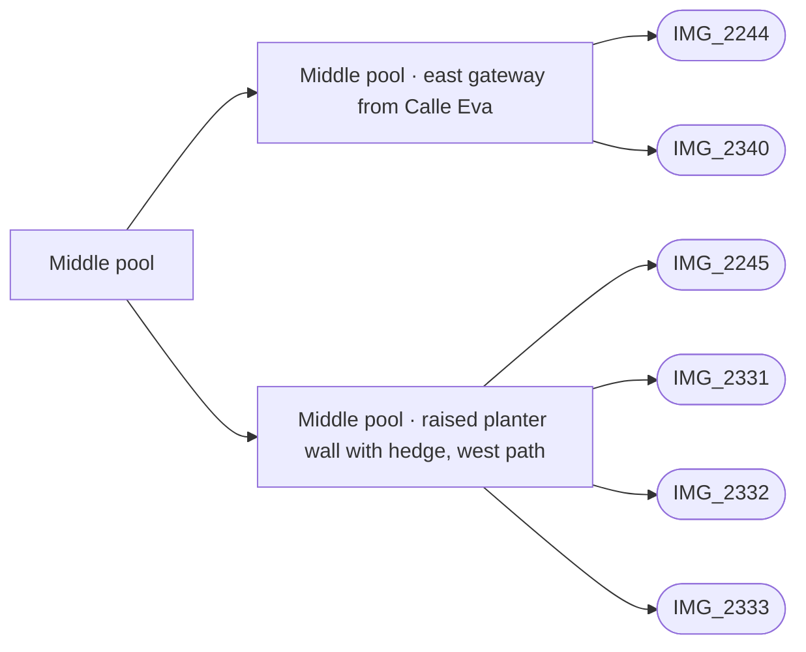

# Middle pool

_Generated by `scripts/build_references.py`. Do not edit: change `data/areas.json` or `data/reference_tags.json` and rebuild._

The clover-shaped middle pool courtyard, entered through arched white gateways off tiled lanes.

## Known facts and open questions

- Lanes are square terracotta tiles with a pebble border; the courtyard is entered through arched white gateways with black iron gates.
- Skip the glass safety fence round the pools (Dave, 2026-10-11).
- IMG_2340 (outside) and IMG_2244 (inside) show the east gateway from Calle Eva: white piers, curved coping, black iron gate, Comunidad Villacana notice. IMG_2332 shows a raised white planter wall (about 0.8 m) with a hedge along the west path.
- IMG_2333: three stone steps climb a tiled path to a gate on the south-west side. IMG_2334: black iron double gate under a curved pergola frame on the south side, raised planter beside it. IMG_2335: blue tile panel on a raised planter. IMG_2331 (±17 m) and IMG_2341 (±47 m) have poor GPS.
- Built 2026-10-14 (docs/MIDDLE_POOL.md): the east gateway from Calle Eva (piers, flat head, curved coping, open iron leaf, notices) and the raised west planter with its hedge, which turns the south-west corner beside the IMG_2333 steps.
- Not modelled yet: the planter's curved north end and the white steps by the north-west entrance (IMG_2331), the wall with the brown door and the pergola entrance north of the west path (IMG_2332, IMG_2195), the south-west steps and gateway (IMG_2333), the south pergola gate (IMG_2334).

## Read first

- docs: `docs/MIDDLE_POOL.md`
- data: `data/middle_pool.json`, `data/objects.json`
- src: `src/middle-pool.ts`, `src/world.ts`, `src/water.ts`
- contact sheet: `villacana-reference/contact-sheets/middle-pool.jpg` (thumbnails of everything below, numbered in this order)

## Coverage

Layout: 15, Levels and slopes: 3, Facades and roofs: 6, Materials: 10, Planting: 9, Signs: 1, Views: 1
23 reviewed, 0 suggested only by camera position.

## Built from these photos

Model features that cite photos of this area, from `public/photos-ref/evidence-graph.json`. A citation records what a feature was traced from; it does not prove the feature matches.

## Reviewed references

| Reference | Viewpoint | Use for | What it shows |
| --- | --- | --- | --- |
| [IMG_2332.jpg](../../public/photos-ref/IMG_2332.jpg) | ground | layout, levels, materials, planting | Middle pool west side: path between the deck and a raised planter wall **Note:** GPS ±14 m. Shows the glass pool fence, which Dave decided to skip. _Used by: middle_pool.json:middle-pool-west-planter._ |
| [IMG_2245.jpg](../../public/photos-ref/IMG_2245.jpg) | ground | materials, layout | Middle pool lobe, deck and glass fence close up _Used by: middle_pool.json:middle-pool-west-planter._ |
| [IMG_2331.jpg](../../public/photos-ref/IMG_2331.jpg) | ground | layout, materials | Middle pool north: crazy-paving path opening onto the lawn and pool **Note:** GPS ±17 m. _Used by: middle_pool.json:middle-pool-west-planter._ |
| [IMG_2333.jpg](../../public/photos-ref/IMG_2333.jpg) | ground | levels, layout | Middle pool south-west: stone steps up a tiled path to a gate _Used by: middle_pool.json:middle-pool-west-planter._ |
| [IMG_2244.jpg](../../public/photos-ref/IMG_2244.jpg) | ground | layout | Iron gate opening into the middle pool courtyard _Used by: middle_pool.json:middle-pool-east-gateway._ |
| `villacana-reference/photos/02-pool-from-upper-floor-2020-12.png` | upper-floor | layout, facades, materials, view | Middle pool from an upper floor, December 2020 **Note:** Shows a glass safety fence; Dave decided to skip it. |
| [IMG_2334.jpg](../../public/photos-ref/IMG_2334.jpg) | ground | layout, levels, materials | Middle pool south: iron gate in a pergola frame onto a lane |
| `villacana-reference/photos/09-middle-pool-through-iron-gate.jpg` | ground | layout, materials, planting | Middle pool through an iron gate from a tiled lane |
| [IMG_2192.jpg](../../public/photos-ref/IMG_2192.jpg) | ground | layout, materials | Crazy-paving path between hedges into the middle pool lawn |
| [IMG_2193.jpg](../../public/photos-ref/IMG_2193.jpg) | ground | layout, facades | Middle pool, lawn and terraces behind |
| [IMG_2194.jpg](../../public/photos-ref/IMG_2194.jpg) | ground | layout, facades | Middle pool, lawn and terraces behind (second shot) |
| [IMG_2335.jpg](../../public/photos-ref/IMG_2335.jpg) | ground | materials, facades | Middle pool south: raised white planter with a blue tile panel |
| [IMG_2341.jpg](../../public/photos-ref/IMG_2341.jpg) | ground | layout, planting | Curved low white wall with hedge, crazy paving and trees **Note:** GPS ±47 m: location uncertain, probably the middle pool courtyard. |
| `villacana-reference/photos/08-middle-pool-deck-bird-of-paradise.jpg` | ground | planting, facades | Middle pool deck: bird-of-paradise, ladder, wooden balcony house, palm trunk |
| `villacana-reference/photos/12-middle-pool-tiled-lane-to-arched-gate.jpg` | ground | layout, materials | Terracotta-tiled lane to an arched white gateway into the middle pool courtyard |
| [IMG_2195.jpg](../../public/photos-ref/IMG_2195.jpg) | ground | materials | Middle pool close up: cream deck, ladders, life rings |
| [IMG_2246.jpg](../../public/photos-ref/IMG_2246.jpg) | ground | planting | Oleander bed and pollarded tree by the middle pool |
| [IMG_2247.jpg](../../public/photos-ref/IMG_2247.jpg) | ground | planting | Oleander bed and pollarded tree by the middle pool (second shot) |
| `villacana-reference/apple-maps/04-top-down-south-half.png` | aerial | layout | Apple Maps top-down: southern half, middle and south pools, tiled-roof block |
| `villacana-reference/photos/10-middle-pool-patio-oleander-pollarded-tree.jpg` | ground | planting | Patio beside the middle pool: oleander bed, pollarded tree |
| `villacana-reference/photos/11-middle-pool-patio-oleander-feathery-trees.jpg` | ground | planting | Patio beside the middle pool: oleander bed, two feathery trees |
| `villacana-reference/web/easyjet-pool-probably-middle.jpg` | ground | planting | A small pool with bird-of-paradise, palm and pollarded tree **Note:** Probably the middle pool; not confirmed. A wall sign may read CALLE DE ISABEL. Found on the web, never publish. |
| [IMG_2340.jpg](../../public/photos-ref/IMG_2340.jpg) | ground | layout, facades, signage | Calle Eva: east gateway into the middle pool courtyard **Note:** The middle pool east gate from Calle Eva; IMG_2244 shows it from inside. _Used by: middle_pool.json:middle-pool-east-gateway._ |
