# Middle pool

_Generated by `scripts/build_references.py`. Do not edit: change `data/areas.json` or `data/reference_tags.json` and rebuild._

The clover-shaped middle pool courtyard, entered through arched white gateways off tiled lanes.

## Known facts and open questions

- Lanes are square terracotta tiles with a pebble border; the courtyard is entered through arched white gateways with black iron gates.
- Skip the glass safety fence round the pools (Dave, 2026-10-11).
- IMG_2340 (outside) and IMG_2244 (inside) show the east gateway from Calle Eva: white piers, curved coping, black iron gate, Comunidad Villacana notice. IMG_2332 shows a raised white planter wall (about 0.8 m) with a hedge along the west path.
- IMG_2333: three stone steps climb a tiled path to a gate on the south-west side. IMG_2334: black iron double gate under a curved pergola frame on the south side, raised planter beside it. IMG_2335: blue tile panel on a raised planter. IMG_2331 (±17 m) and IMG_2341 (±47 m) have poor GPS.
- Built 2026-10-14 (docs/MIDDLE_POOL.md): the east gateway from Calle Eva (piers, flat head, curved coping, open iron leaf, notices) and the raised west planter with its hedge, which turns the south-west corner beside the IMG_2333 steps.
- Issue #39: separate level south entrance from IMG_2334/2335: two open iron leaves, shallow curved white head with metal pergola ribs, crazy paving and flush drain, raised white planter flanking an inset step and a schematic blue/yellow border round a white tile panel. Placed across Calle Silvia near its courtyard end; positions/ends (about 1–2 m) and dimensions are estimates. No south-lane grade change is inferred; the southwest steps and western 0.5 m rise remain separate.
- Issue 48 source pass: a bounded curved north planter termination, three white side steps, short brown-door wall and open pergola are modelled from IMG_2331/2332/2195; exact extents and dimensions remain estimates. IMG_2331/2332 cameras are corrected independently from aerial path/pool anchors, original GPS retained. Browser and matched-camera review pending; south-west steps/gateway and south gate are separate tasks.
- Issue 48 follows the existing continuous western +0.5 m terrain rise for the north steps, using tread-minus-siteY offsets in the shared ramp-steps module; no additional isolated plateau. Pool, deck and west path remain at 0 m. Flight dimensions and bounded wall extents remain estimated pending browser/image review.
- Issue #31 (PRs #53 and #60): IMG_2333 shows three rough stone risers on the planter side of Calle Eva, a tiled ramp beside them, a short landing and a white gateway with two open iron leaves. The steps and the 0.5 m rise to the Dalí level are in data/middle_pool_steps.json and data/terrain.json; the gateway is in data/middle_pool_sw_gateway.json. Positions and sizes are estimated from tiles.
- Issue #55: bounded north patio floor at +0.45 m behind a +0.8 m white wall (IMG_2193/2194); stops before the photographed grass opening, with no inferred stairs. Shallow oleander bed at +0.2 m from IMG_2246/2247. Only a short +0.4 m curved hedge-wall fragment is estimated from IMG_2341: its GPS is ±47 m and its north-east placement remains uncertain. Floor extents, wall ends and all heights are low-confidence estimates; no hidden private boundaries or gates are traced. See docs/MIDDLE_POOL_RAISED_PATIOS.md.
- 18 October (Dave's review of the live site): the south gate's tiled wall bench was built behind the open right leaf. IMG_2334 read by perspective puts it about 1.7-2.7 m in from the gate past about 1.7 m of planter; it is now seat height with a plinth. IMG_2334/2335 pins were corrected from photo content. Open: the forecourt inside the gate is crazy paving with a hedge, not lawn (task middle-pool-south-forecourt).
- 21 October draft (middle-pool-south-forecourt): bounded 5.15 × 2.12 m crazy-paving patch replaces the crossing tile render locally, with a Details-only east hedge fragment. Gate, bench/planter, registry footprints, route axes, terrain and collision retained. Photos confirm material/side ordering, not the estimated endpoints. Aerial shade/foliage conceal full edges; Eva crossing still interrupts the photographed hedge/corridor. Independent source review withholds full placement approval; task stays in progress. See docs/reviews/middle-pool-south-forecourt/.
- 21 October user clarification: two planted house-frontage strips are visible along the tiled lane beyond IMG_2334 gate. Left has a low kerb/mixed plants; right has raised white bed sections and an open recessed doorway between them. These are distinct from the courtyard hedge/bench. Source-relative photo/plan mapping is in docs/reviews/middle-pool-south-forecourt/lane-planters/. No global dimensions inferred: IMG_2189 is not a securely established reverse view of this curved double gate. The window bars identified by the user are projecting black grilles above the planted border (clear on photo-right in IMG_2334); IMG_2189 supplies clearer bowed grille examples on both sides as appearance evidence only.
- 22 October reference-pack pilot: numbered photo locators/traces and 41 component rows keep gate view, lane detail, Silvia1–15 passage and Jorge27–35 passage distinct. Silvia tunnel arch/flat ceiling/walls/doors/exit are not accounted for by the existing floor citation; precise connection and owner target remain unresolved. No geometry changed. See docs/REFERENCE_PACK_WORKFLOW.md and public/reference-packs/entrance/index.html.
- 23 October entrance context: user questions gate/bench/planter distance from pool. Satellite and IMG_2192 confirm lawn/hedged approach buffer, but ground anchors are concealed, so gate, bench, pool and tunnel transform are retained. Bounded PR108 street-side planters, square window cages and four-course paving are transplanted into the main scene; bench cypress/geranium-like planting and small pale cabinet added from2334/2335/2192. Extents and facade attachments remain estimates, with shared route-clearance guard and open discrepancy. See docs/reviews/tunnel-entrance-context/.
- 24 October planter correction: a bounded low right garden bed, left greenery with its base unresolved, and continuing near path beyond the Silvia exit arch replace two unsupported illustrative tall garden pots; four observed near/threshold pots remain. At the pool entrance the existing bench beds gain rounded returns/white rims/soil inside their original bounds, and a short LOW grey-beige kerb follows the existing opposite hedge fragment. Satellite context/full photos independently rechecked; no measured extent, complete garden perimeter, route/gate/pool relocation or placement approval is inferred. See docs/reviews/silvia-entrance-planters/.
- Laser survey ground 2026-10-24: the south-west and north white steps keep their surveyed rises (0.53, 0.52 m); their feet are 0.16 and 0.40 m above the deck. Elena south falls about 0.35 m over 15 m to the gate, which the photos read as level. The oleander bed fragment stands where the survey climbs 0.3 m towards Calle Eva; its +-2 m placement may be off.
- 24 October outdoor Silvia path: full IMG_2189/2334 show plain worn terracotta squares, four straight columns and broad grey mortar; the decorated square-insert paving belongs inside the tunnel. Existing lane visual surface continues to the provisional side approach, with a plain overlay to the estimated arch threshold. Pool-side irregular stone/grate retained. Continuation endpoints, threshold and gate/tunnel association remain estimated; no registry, route, terrain, collision or structural placement change. See docs/reviews/silvia-outdoor-path/.

## Read first

- docs: `docs/MIDDLE_POOL.md`, `docs/LEVELS.md`, `docs/MIDDLE_POOL_SOUTH_GATE.md`, `docs/MIDDLE_POOL_SW_GATEWAY.md`, `docs/MIDDLE_POOL_RAISED_PATIOS.md`, `docs/REFERENCE_PACK_WORKFLOW.md`
- data: `data/middle_pool.json`, `data/objects.json`, `data/levels_survey.json`, `data/middle_pool_south_gate.json`, `data/middle_pool_north.json`, `data/middle_pool_steps.json`, `data/middle_pool_sw_gateway.json`, `data/terrain.json`, `data/raised_terraces.json`, `data/reference_packs/entrance.json`, `data/middle_pool_lane_frontages.json`, `data/entrance_planters.json`
- src: `src/middle-pool.ts`, `src/world.ts`, `src/water.ts`, `src/middle-pool-south-gate.ts`, `src/middle-pool-north.ts`, `src/middle-pool-sw-gateway.ts`, `src/ramp-steps.ts`, `src/raised-terraces.ts`, `src/middle-pool-lane-frontages.ts`, `src/middle-south-planting.ts`, `src/entrance-planters.ts`
- contact sheet: `villacana-reference/contact-sheets/middle-pool.jpg` (thumbnails of everything below, numbered in this order)

## Coverage

Layout: 17, Levels and slopes: 3, Facades and roofs: 8, Materials: 11, Planting: 11, Signs: 1, Views: 1
24 reviewed, 0 suggested only by camera position.

## Levels

Ground and floor levels read from the photos, from `data/levels_survey.json` (see `docs/LEVELS.md`).

- `middle-pool-sw-rise` (steps): 0.45-0.55 m above the middle pool courtyard, high confidence at (-135, 101) ±3 m. Model: **built**, task `middle-pool-sw-steps`. Three rough stone steps with a steep terracotta ramp of 1.5-2 m beside them, from the courtyard's crazy paving up to the south-west lane; the lane climbs a little more to the gateway 8-10 m on, then is level. This is the same 0.5 m western rise as Cervantes. Built: the terrain foot line follows the back of the planter to the bottom step (local run 2.4 m, data/terrain.json) and data/middle_pool_steps.json adds the three steps beside the ramp. (IMG_2333.jpg, IMG_2331.jpg, IMG_2245.jpg)
- `middle-pool-nw-rise` (steps): 0.3-0.55 m above the path between the planter and the pool fence, medium confidence at (-138.5, 88.5) ±3 m. Model: **built**, task `middle-pool-north-entrance`. Read by Claude on 15 October after Dave pointed out the missing slopes. IMG_2332: looking north-north-west along the path between the raised planter and the pool fence, the paving rises at the planter's north end to a pergola gate and a white garden wall with a brown door; a white riser face shows under the upper paving. IMG_2331 (pin +-17 m), looking south-east down the north-west path, shows two or three white-nosed steps climbing to the right at the same corner. So the ground behind the planter is the upper (Dalí-side) level. The terrain now rises behind the planter (data/terrain.json), but the steps and the pergola gate are not built. Issue 48 source pass adds three white steps using the shared ramp-steps mechanism, following the existing 0-to-0.5 m terrain rise with tread-minus-siteY offsets only; no extra plateau. Pergola and short brown-door wall added as bounded fragments. Flight alignment and tread spacing remain estimates; final browser and image review pending. (IMG_2332.jpg, IMG_2331.jpg)
- `middle-pool-gates-level` (level): 0-0.05 m, high confidence. Model: **built**. The courtyard is not sunk: Calle Eva runs into it with no step at the east gateway, and the crazy paving runs under the south pergola gate onto a level lane. (IMG_2340.jpg, IMG_2244.jpg, IMG_2334.jpg, IMG_2192.jpg)
- `middle-pool-west-planter` (raised-bed): 0.7-0.9 m, medium confidence. Model: **built**. A planter, not a change of ground level: about 0.8 m, a lower stepped section of about 0.4 m at its north end, and a 0.15-0.2 m plinth step at its foot (IMG_2192). (IMG_2332.jpg, IMG_2245.jpg, IMG_2192.jpg)
- `middle-pool-north-terrace` (raised-patio): 0.3-0.6 m above the pool lawn, low confidence at (-127, 85) ±5 m. Model: **built**, task `middle-pool-raised-patios`. A white wall of 0.6-1.0 m with a hedge beyond the north end of the deck, a patio with an umbrella and the houses behind it, raised above the lawn. Built as bounded nonwalkable raised-terrace fragments; north floor +0.45 m, bed/curved-patio floor +0.2 m. Face heights are independent (0.8 m north, 0.2 m kerb, 0.4 m curved face). Placement and untraced floor extents remain estimated; IMG_2341 location uncertain. See docs/MIDDLE_POOL_RAISED_PATIOS.md. (IMG_2193.jpg, IMG_2194.jpg)
- `middle-pool-patio-beds` (raised-patio): 0.1-0.3 m above the pool lawn, low confidence. Model: **built**, task `middle-pool-raised-patios`. Kerbed oleander bed of 0.15-0.2 m and a curved hedge wall of 0.35-0.45 m; the patios behind look level with the bed tops. Built as bounded nonwalkable raised-terrace fragments; north floor +0.45 m, bed/curved-patio floor +0.2 m. Face heights are independent (0.8 m north, 0.2 m kerb, 0.4 m curved face). Placement and untraced floor extents remain estimated; IMG_2341 location uncertain. See docs/MIDDLE_POOL_RAISED_PATIOS.md. (IMG_2246.jpg, IMG_2247.jpg, IMG_2341.jpg)

## Open build tasks

From `data/build_queue.json`; issue bodies in `refs/issues/`.

| Priority | Task | What | Status | Photos |
| --- | --- | --- | --- | --- |
| P1 | `tunnel-entrance-context` | Check pool-to-gate spacing and build photo-supported tunnel entrance context | in-progress · Codex · placement: not-verified | [IMG_2334](../../public/photos-ref/IMG_2334.jpg), [IMG_2335](../../public/photos-ref/IMG_2335.jpg), [IMG_2189](../../public/photos-ref/IMG_2189.jpg), [IMG_2190](../../public/photos-ref/IMG_2190.jpg), [IMG_2191](../../public/photos-ref/IMG_2191.jpg), [IMG_2192](../../public/photos-ref/IMG_2192.jpg) |
| P2 | `middle-pool-south-forecourt` | Middle pool south: crazy-paved forecourt and hedge inside the south gate (after middle-pool-south-gate) | in-progress · Codex · placement: not-verified | [IMG_2334](../../public/photos-ref/IMG_2334.jpg), [IMG_2335](../../public/photos-ref/IMG_2335.jpg) |
| P2 | `middle-pool-south-lane-planters` | South entrance lane: planted frontage borders and projecting window grilles (after middle-pool-south-forecourt) | open · placement: not-verified | [IMG_2334](../../public/photos-ref/IMG_2334.jpg), [IMG_2189](../../public/photos-ref/IMG_2189.jpg) |
| P2 | `path-network-inventory-middle-pool` [#126](https://github.com/daveyboyc/villacana-venture/issues/126) | Middle pool: full-source path, tunnel and boundary inventory (after path-network-baseline) | open · placement: not-applicable |  |

## Built from these photos

Model features that cite photos of this area, from `public/photos-ref/evidence-graph.json`, with their photo-check state. A citation records what a feature was traced from; only a check in `data/photo_checks.json` says someone rendered it from the photo's camera and compared.

```mermaid
graph LR
  A["Middle pool"]
  A --> F0["Silvia pool entrance · low weathered kerb below opposite hedge · unreviewed"]
  F0 --> PIMG_2192_jpg(["IMG_2192"])
  F0 --> PIMG_2334_jpg(["IMG_2334"])
  A --> F1["Middle pool · east gateway from Calle Eva · unreviewed"]
  F1 --> PIMG_2244_jpg(["IMG_2244"])
  F1 --> PIMG_2340_jpg(["IMG_2340"])
  A --> F2["Middle pool · raised planter wall with hedge, west path · unreviewed"]
  F2 --> PIMG_2245_jpg(["IMG_2245"])
  F2 --> PIMG_2331_jpg(["IMG_2331"])
  F2 --> PIMG_2332_jpg(["IMG_2332"])
  F2 --> PIMG_2333_jpg(["IMG_2333"])
  A --> F3["Silvia · plain tiled outdoor approach to estimated arch threshold · unreviewed"]
  F3 --> PIMG_2189_jpg(["IMG_2189"])
  F3 --> PIMG_2334_jpg(["IMG_2334"])
  A --> F4["Entrance lane · four-column terracotta paving · unreviewed"]
  F4 --> PIMG_2189_jpg(["IMG_2189"])
  F4 --> PIMG_2334_jpg(["IMG_2334"])
  A --> F5["Entrance lane · low left planted border · unreviewed"]
  F5 --> PIMG_2334_jpg(["IMG_2334"])
  A --> F6["Entrance lane · separate right bed beyond doorway · unreviewed"]
  F6 --> PIMG_2334_jpg(["IMG_2334"])
  A --> F7["Entrance lane · bounded farther shuttered grille · unreviewed"]
  F7 --> PIMG_2189_jpg(["IMG_2189"])
  F7 --> PIMG_2334_jpg(["IMG_2334"])
  A --> F8["Entrance lane · raised right frontage bed · unreviewed"]
  F8 --> PIMG_2334_jpg(["IMG_2334"])
  A --> F9["Entrance lane · projecting near window grille and brown shutters · unreviewed"]
  F9 --> PIMG_2189_jpg(["IMG_2189"])
  F9 --> PIMG_2334_jpg(["IMG_2334"])
  A --> F10["Middle pool · bounded garden wall with brown door · unreviewed"]
  F10 --> PIMG_2195_jpg(["IMG_2195"])
  F10 --> PIMG_2332_jpg(["IMG_2332"])
  A --> F11["Middle pool · open north-west pergola entrance · unreviewed"]
  F11 --> PIMG_2195_jpg(["IMG_2195"])
  F11 --> PIMG_2332_jpg(["IMG_2332"])
  A --> F12["Middle pool · curved north end of west planter · unreviewed"]
  F12 --> PIMG_2331_jpg(["IMG_2331"])
  F12 --> PIMG_2332_jpg(["IMG_2332"])
  A --> F13["Middle pool · north planter side steps · unreviewed"]
  F13 --> PIMG_2331_jpg(["IMG_2331"])
  F13 --> PIMG_2332_jpg(["IMG_2332"])
  A --> F14["Middle pool · visible east hedge fragment · disputed"]
  F14 --> PIMG_2334_jpg(["IMG_2334"])
  A --> F15["Middle pool · bounded crazy-paved south forecourt · disputed"]
  F15 --> PIMG_2334_jpg(["IMG_2334"])
  F15 --> PIMG_2335_jpg(["IMG_2335"])
  A --> F16["Middle pool · south double iron gate, curved head and tiled planter · disputed"]
  F16 --> PIMG_2192_jpg(["IMG_2192"])
  F16 --> PIMG_2334_jpg(["IMG_2334"])
  F16 --> PIMG_2335_jpg(["IMG_2335"])
  A --> F17["Middle pool · south-west gateway above the stone steps · unreviewed"]
  F17 --> PIMG_2332_jpg(["IMG_2332"])
  F17 --> PIMG_2333_jpg(["IMG_2333"])
  A --> F18["Middle pool · short uncertain curved hedge patio · unreviewed"]
  F18 --> PIMG_2341_jpg(["IMG_2341"])
  A --> F19["Middle pool · bounded north raised patio · unreviewed"]
  F19 --> PIMG_2193_jpg(["IMG_2193"])
  F19 --> PIMG_2194_jpg(["IMG_2194"])
  A --> F20["Middle pool · shallow oleander bed beside patio · unreviewed"]
  F20 --> PIMG_2246_jpg(["IMG_2246"])
  F20 --> PIMG_2247_jpg(["IMG_2247"])
  A --> F21["Middle pool · stone steps up to Calle Eva · unreviewed"]
  F21 --> PIMG_2248_jpg(["IMG_2248"])
  F21 --> PIMG_2333_jpg(["IMG_2333"])
```

## Placement evidence

`verification` is placement status, separate from photographic diagnostics. Earlier manual reviews may exist. Only a fresh measured packet and independent approval can grant `verified`.

| Feature | Placement | Photo diagnostics | Blockers |
| --- | --- | --- | --- |
| `entrance_planters.json:silvia-pool-entry-hedge-kerb` | unreviewed | unchecked | No measured placement packet and independent approval recorded; earlier manual reviews may exist. |
| `middle_pool.json:middle-pool-east-gateway` | unreviewed | unchecked | No measured placement packet and independent approval recorded; earlier manual reviews may exist. |
| `middle_pool.json:middle-pool-west-planter` | unreviewed | unchecked | No measured placement packet and independent approval recorded; earlier manual reviews may exist. |
| `middle_pool_lane_frontages.json:silvia-outdoor-apron` | unreviewed | unchecked | No measured placement packet and independent approval recorded; earlier manual reviews may exist. |
| `middle_pool_lane_frontages.json:south-lane-four-column-paving` | unreviewed | not-comparable | No measured placement packet and independent approval recorded; earlier manual reviews may exist. |
| `middle_pool_lane_frontages.json:south-lane-left-border` | unreviewed | unchecked | No measured placement packet and independent approval recorded; earlier manual reviews may exist. |
| `middle_pool_lane_frontages.json:south-lane-right-far-bed` | unreviewed | unchecked | No measured placement packet and independent approval recorded; earlier manual reviews may exist. |
| `middle_pool_lane_frontages.json:south-lane-right-far-grille` | unreviewed | unchecked | No measured placement packet and independent approval recorded; earlier manual reviews may exist. |
| `middle_pool_lane_frontages.json:south-lane-right-near-bed` | unreviewed | unchecked | No measured placement packet and independent approval recorded; earlier manual reviews may exist. |
| `middle_pool_lane_frontages.json:south-lane-right-near-grille` | unreviewed | unchecked | No measured placement packet and independent approval recorded; earlier manual reviews may exist. |
| `middle_pool_north.json:middle-pool-north-door-wall` | unreviewed | unchecked | No measured placement packet and independent approval recorded; earlier manual reviews may exist. |
| `middle_pool_north.json:middle-pool-north-pergola` | unreviewed | unchecked | No measured placement packet and independent approval recorded; earlier manual reviews may exist. |
| `middle_pool_north.json:middle-pool-north-planter-cap` | unreviewed | unchecked | No measured placement packet and independent approval recorded; earlier manual reviews may exist. |
| `middle_pool_north.json:middle-pool-north-white-steps` | unreviewed | unchecked | No measured placement packet and independent approval recorded; earlier manual reviews may exist. |
| `middle_pool_south_gate.json:middle-pool-south-east-hedge` | disputed | unchecked | open discrepancy middle-south-hedge-continuation |
| `middle_pool_south_gate.json:middle-pool-south-forecourt` | disputed | differs | open discrepancy middle-south-forecourt-trace; open discrepancy photo-discrepancy:9579a59d07ca4c03 |
| `middle_pool_south_gate.json:middle-pool-south-gate` | disputed | differs | open discrepancy middle-south-pool-spacing; open discrepancy photo-discrepancy:98f50a7718586a39 |
| `middle_pool_sw_gateway.json:middle-pool-sw-gateway` | unreviewed | unchecked | No measured placement packet and independent approval recorded; earlier manual reviews may exist. |
| `raised_terraces.json:middle-pool-curved-hedge-patio` | unreviewed | unchecked | No measured placement packet and independent approval recorded; earlier manual reviews may exist. |
| `raised_terraces.json:middle-pool-north-terrace` | unreviewed | unchecked | No measured placement packet and independent approval recorded; earlier manual reviews may exist. |
| `raised_terraces.json:middle-pool-oleander-bed` | unreviewed | unchecked | No measured placement packet and independent approval recorded; earlier manual reviews may exist. |
| `steps:middle-pool-sw-steps` | unreviewed | unchecked | No measured placement packet and independent approval recorded; earlier manual reviews may exist. |

## Photo checks

Renders from each photo's camera compared with the photo (`data/photo_checks.json`).

| Task | Photo | Result | Render | Notes |
| --- | --- | --- | --- | --- |
| `middle-pool-south-gate` | [IMG_2334](../../public/photos-ref/IMG_2334.jpg) | **differs** → `middle-pool-south-forecourt` | [after](../../docs/reviews/middle-pool-south-gate/IMG_2334-after.png) · [before](../../docs/reviews/middle-pool-south-gate/IMG_2334-before.png) | Gate, open right leaf, planter and wall bench now come in the photo's order: about 1.7 m of planter behind the leaf, then the bench recess and tiled wall, then more planter. Before, the bench sat 0.1-1.1 m from the gate, directly behind the open leaf. Still different: the model shows lawn either side of a crossing tiled path where the photo shows a narrow crazy-paved forecourt with a tall hedge on the left. |
| `middle-pool-south-gate` | [IMG_2335](../../public/photos-ref/IMG_2335.jpg) | **matches** | [after](../../docs/reviews/middle-pool-south-gate/IMG_2335-after.png) · [before](../../docs/reviews/middle-pool-south-gate/IMG_2335-before.png) | Seat-height bench with a low plinth, recessed into the planter with planter either side, under a tall white wall with the tile panel; the open leaf is to its left (gate side) as in the photo. Tile motifs are schematic and the cypress and geraniums are Details planting. |
| `middle-pool-south-forecourt` | [IMG_2334](../../public/photos-ref/IMG_2334.jpg) | **differs** → `middle-pool-south-forecourt` | [after](../../docs/reviews/middle-pool-south-forecourt/IMG_2334-after.png) · [before](../../docs/reviews/middle-pool-south-forecourt/IMG_2334-before.png) | The same stored camera/subject and Details view now show continuous stone through the foreground and a gate-side east hedge, replacing lawn/crossing terracotta in the bounded patch. The photo shows a longer continuous hedge/corridor; the estimated Eva crossing is retained and leaves an unresolved interruption. Patch ends/width are estimated, adjacent model frontage differs, and the third-person camera has uncalibrated eye height/pitch/intrinsics. Do not claim a photographic or measured placement match. |
| `middle-pool-south-forecourt` | [IMG_2335](../../public/photos-ref/IMG_2335.jpg) | **not-comparable** | [after](../../docs/reviews/middle-pool-south-forecourt/IMG_2335-after.png) · [before](../../docs/reviews/middle-pool-south-forecourt/IMG_2335-before.png) | Same stored camera and Details view. Stone now continues alongside the unchanged recessed bench/plinth and tiled wall; existing bench/gate geometry is retained. The third-person view includes the whole junction rather than the source close-up, so it cannot verify precise panel, hedge, width or full boundary placement. The earlier bench-specific check is retained; this record makes no new full-scene match claim. |
| `tunnel-entrance-context` | [IMG_2334](../../public/photos-ref/IMG_2334.jpg) | **not-comparable** | [after](../../docs/reviews/tunnel-entrance-context/IMG_2334-after.png) · [before](../../docs/reviews/tunnel-entrance-context/IMG_2334-before.png) | Full source inspected with independent source review. Actual main-app before/after pair uses the same stored reviewed camera/looksAt, first person and Details. Added finite bench planting, middle-band gate scrolls and lane borders/square grilles/four-column paving; original gate/bench/pool/tunnel transforms retained. Camera pose is not calibrated; schematic vegetation, tile artwork and surrounding procedural facades still differ. Hidden ground anchors and uncertain source/world registration prevent a measured placement or photographic match. Existing discrepancies and the new pool-spacing report remain open. |
| `tunnel-entrance-context` | [IMG_2335](../../public/photos-ref/IMG_2335.jpg) | **not-comparable** | [after](../../docs/reviews/tunnel-entrance-context/IMG_2335-after.png) · [before](../../docs/reviews/tunnel-entrance-context/IMG_2335-before.png) | Full source inspected with independent source review. Actual main-app before/after pair uses the same stored reviewed camera/looksAt, first person and Details. Added finite bench planting, middle-band gate scrolls and lane borders/square grilles/four-column paving; original gate/bench/pool/tunnel transforms retained. Camera pose is not calibrated; schematic vegetation, tile artwork and surrounding procedural facades still differ. Hidden ground anchors and uncertain source/world registration prevent a measured placement or photographic match. Existing discrepancies and the new pool-spacing report remain open. |

**Built without complete newer photo-check records:** `middle-pool-sw-steps`, `middle-pool-north-entrance`, `middle-pool-raised-patios`. Earlier manual reviews may exist; this record does not establish photographic fidelity. See the verification backlog in `refs/QUEUE.md`.

## Reviewed references

| Reference | Viewpoint | Use for | What it shows |
| --- | --- | --- | --- |
| [IMG_2334.jpg](../../public/photos-ref/IMG_2334.jpg) | ground | layout, levels, materials, planting, facades | Middle pool south: iron gate in a pergola frame onto a lane **Looks at:** south gate, double iron leaves and the planter to its right. **Note:** User clarification, 21 October 2026: planted frontage strips run along both sides of the tiled lane BEYOND the gate, distinct from the courtyard bench planter and hedge. Photo-left has a low pale kerb with mixed planting, partly occluded by leaf/ladder/cart; photo-right has raised white planter sections under barred openings, interrupted at a recessed doorway. Source-pixel mapping: docs/reviews/middle-pool-south-forecourt/lane-planters/. Exact endpoints and global placement remain unresolved. User also identifies window bars: a projecting black grille with upright bars and horizontal ties is visible over the brown shutter above the right frontage planter, separate from the foreground gate leaf. _Used by: middle_pool_south_gate.json:middle-pool-south-gate, middle_pool_south_gate.json:middle-pool-south-forecourt, middle_pool_south_gate.json:middle-pool-south-east-hedge, entrance_planters.json:silvia-pool-entry-hedge-kerb, middle_pool_lane_frontages.json:south-lane-four-column-paving, middle_pool_lane_frontages.json:silvia-outdoor-apron, middle_pool_lane_frontages.json:south-lane-left-border, middle_pool_lane_frontages.json:south-lane-right-near-bed, middle_pool_lane_frontages.json:south-lane-right-far-bed, middle_pool_lane_frontages.json:south-lane-right-near-grille, middle_pool_lane_frontages.json:south-lane-right-far-grille._ |
| [IMG_2332.jpg](../../public/photos-ref/IMG_2332.jpg) | ground | layout, levels, materials, planting | Middle pool west side: path between the deck and a raised planter wall **Note:** GPS ±14 m. Shows the glass pool fence, which Dave decided to skip. _Used by: middle_pool_sw_gateway.json:middle-pool-sw-gateway, middle_pool.json:middle-pool-west-planter, middle_pool_north.json:middle-pool-north-planter-cap, middle_pool_north.json:middle-pool-north-door-wall, middle_pool_north.json:middle-pool-north-pergola, middle_pool_north.json:middle-pool-north-white-steps._ |
| [IMG_2331.jpg](../../public/photos-ref/IMG_2331.jpg) | ground | layout, materials | Middle pool north: crazy-paving path opening onto the lawn and pool **Note:** GPS ±17 m. _Used by: middle_pool.json:middle-pool-west-planter, middle_pool_north.json:middle-pool-north-planter-cap, middle_pool_north.json:middle-pool-north-white-steps._ |
| [IMG_2333.jpg](../../public/photos-ref/IMG_2333.jpg) | ground | levels, layout | Middle pool south-west: stone steps up a tiled path to a gate _Used by: middle_pool_sw_gateway.json:middle-pool-sw-gateway, middle_pool.json:middle-pool-west-planter, steps:middle-pool-sw-steps._ |
| [IMG_2335.jpg](../../public/photos-ref/IMG_2335.jpg) | ground | layout, materials, facades | Middle pool south: raised white planter with a blue tile panel **Looks at:** wall bench and blue/yellow tile panel in the west planter, inside the south gate. _Used by: middle_pool_south_gate.json:middle-pool-south-gate, middle_pool_south_gate.json:middle-pool-south-forecourt._ |
| [IMG_2192.jpg](../../public/photos-ref/IMG_2192.jpg) | ground | layout, materials | Crazy-paving path between hedges into the middle pool lawn _Used by: middle_pool_south_gate.json:middle-pool-south-gate, entrance_planters.json:silvia-pool-entry-hedge-kerb._ |
| [IMG_2195.jpg](../../public/photos-ref/IMG_2195.jpg) | ground | materials | Middle pool close up: cream deck, ladders, life rings _Used by: middle_pool_north.json:middle-pool-north-door-wall, middle_pool_north.json:middle-pool-north-pergola._ |
| [IMG_2193.jpg](../../public/photos-ref/IMG_2193.jpg) | ground | layout, facades | Middle pool, lawn and terraces behind _Used by: raised_terraces.json:middle-pool-north-terrace._ |
| [IMG_2194.jpg](../../public/photos-ref/IMG_2194.jpg) | ground | layout, facades | Middle pool, lawn and terraces behind (second shot) _Used by: raised_terraces.json:middle-pool-north-terrace._ |
| [IMG_2245.jpg](../../public/photos-ref/IMG_2245.jpg) | ground | materials, layout | Middle pool lobe, deck and glass fence close up _Used by: middle_pool.json:middle-pool-west-planter._ |
| [IMG_2341.jpg](../../public/photos-ref/IMG_2341.jpg) | ground | layout, planting | Curved low white wall with hedge, crazy paving and trees **Note:** GPS ±47 m: location uncertain, probably the middle pool courtyard. _Used by: raised_terraces.json:middle-pool-curved-hedge-patio._ |
| [IMG_2244.jpg](../../public/photos-ref/IMG_2244.jpg) | ground | layout | Iron gate opening into the middle pool courtyard _Used by: middle_pool.json:middle-pool-east-gateway._ |
| [IMG_2246.jpg](../../public/photos-ref/IMG_2246.jpg) | ground | planting | Oleander bed and pollarded tree by the middle pool _Used by: raised_terraces.json:middle-pool-oleander-bed._ |
| [IMG_2247.jpg](../../public/photos-ref/IMG_2247.jpg) | ground | planting | Oleander bed and pollarded tree by the middle pool (second shot) _Used by: raised_terraces.json:middle-pool-oleander-bed._ |
| `villacana-reference/photos/02-pool-from-upper-floor-2020-12.png` | upper-floor | layout, facades, materials, view | Middle pool from an upper floor, December 2020 **Note:** Shows a glass safety fence; Dave decided to skip it. |
| `villacana-reference/photos/09-middle-pool-through-iron-gate.jpg` | ground | layout, materials, planting | Middle pool through an iron gate from a tiled lane |
| `villacana-reference/photos/08-middle-pool-deck-bird-of-paradise.jpg` | ground | planting, facades | Middle pool deck: bird-of-paradise, ladder, wooden balcony house, palm trunk |
| `villacana-reference/photos/12-middle-pool-tiled-lane-to-arched-gate.jpg` | ground | layout, materials | Terracotta-tiled lane to an arched white gateway into the middle pool courtyard |
| `villacana-reference/apple-maps/04-top-down-south-half.png` | aerial | layout | Apple Maps top-down: southern half, middle and south pools, tiled-roof block |
| `villacana-reference/photos/10-middle-pool-patio-oleander-pollarded-tree.jpg` | ground | planting | Patio beside the middle pool: oleander bed, pollarded tree |
| `villacana-reference/photos/11-middle-pool-patio-oleander-feathery-trees.jpg` | ground | planting | Patio beside the middle pool: oleander bed, two feathery trees |
| `villacana-reference/web/easyjet-pool-probably-middle.jpg` | ground | planting | A small pool with bird-of-paradise, palm and pollarded tree **Note:** Probably the middle pool; not confirmed. A wall sign may read CALLE DE ISABEL. Found on the web, never publish. |
| [IMG_2189.jpg](../../public/photos-ref/IMG_2189.jpg) | ground | layout, materials, planting, facades | Calle Silvia north: tiled lane looking to the middle pool south gateway **Looks at:** The middle pool south gateway at the end of Calle Silvia north, about 28 m ahead. **Note:** Dave (2026-10-15): Looks down to the middle pool down called Silvia; 21 October source review: its distant gateway/sign pair resembles IMG_2340/2244. Correspondence with the curved double gate in IMG_2334 is unresolved; earlier street name, pin and look-at are retained as history, not proof that these are opposite views of the same gate. Window-grille style reference: projecting/bowed black metal cages over shuttered ground-floor openings on both sides, directly above planted borders; separate from balcony rails. _Used by: middle_pool_lane_frontages.json:south-lane-four-column-paving, middle_pool_lane_frontages.json:silvia-outdoor-apron, middle_pool_lane_frontages.json:south-lane-right-near-grille, middle_pool_lane_frontages.json:south-lane-right-far-grille._ |
| [IMG_2340.jpg](../../public/photos-ref/IMG_2340.jpg) | ground | layout, facades, signage | Calle Eva: east gateway into the middle pool courtyard **Note:** The middle pool east gate from Calle Eva; IMG_2244 shows it from inside. _Used by: middle_pool.json:middle-pool-east-gateway._ |
