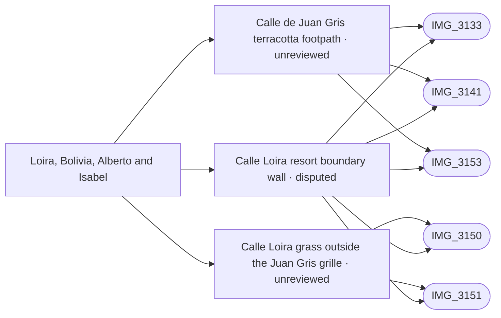

# Loira, Bolivia, Alberto and Isabel

_Generated by `scripts/build_references.py`. Do not edit: change `data/areas.json` or `data/reference_tags.json` and rebuild._

The northern boundary roads and the lanes round the north pool's upper side.

## Known facts and open questions

- The asphalt Calle Loira and the terracotta Calle de Juan Gris are separate. IMG_3133 reads the Juan Gris plaque and IMG_3150 looks out through the shared wall to Loira. The unsolved photos leave the west wall limit and opposite frontage open.
- Open question (8 Nov): the CALLE ALBERTO 22 40 plaque is on a porch off Calle Eva east (IMG_2792), far from the street labelled Calle Alberto here (Google layout, 12 Oct). Either the name covers more than this lane or the label is misplaced; not resolved.

## Read first

- docs: `docs/STREET_LAYOUT.md`, `docs/reviews/calle-loira/README.md`
- data: `data/street_layout.json`, `data/loira_boundary.json`, `data/ground_plan_north_lanes.json`
- contact sheet: `reference/contact-sheets/north-lanes.jpg` (thumbnails of everything below, numbered in this order)

## Coverage

Layout: 7, Levels and slopes: 1, Facades and roofs: 1, Materials: 7, Planting: 1, Signs: 2
7 reviewed, 28 suggested only by camera position.

## Open build tasks

From `data/build_queue.json`; issue bodies in `refs/issues/`.

| Priority | Task | What | Status | Photos |
| --- | --- | --- | --- | --- |
| P2 | `calle-loira` | Calle Loira resort boundary and the adjacent Juan Gris footpath (after ground-plan-framework) | in-progress · Codex · placement: not-verified | [IMG_3133](../../public/photos-ref/IMG_3133.jpg), [IMG_3141](../../public/photos-ref/IMG_3141.jpg), [IMG_3150](../../public/photos-ref/IMG_3150.jpg), [IMG_3153](../../public/photos-ref/IMG_3153.jpg) |
| P2 | `ground-plan-north-lanes` | Loira, Bolivia, Alberto and Isabel: smooth paths, patios and green spaces with their edges and boundaries (after ground-plan-framework) | open · placement: not-verified |  |
| P2 | `path-network-inventory-north-lanes` [#133](https://github.com/daveyboyc/villacana-venture/issues/133) | Loira, Bolivia, Alberto and Isabel: full-source path, tunnel and boundary inventory (after path-network-baseline) | open · placement: not-applicable |  |

## Built from these photos

Model features that cite photos of this area, from `public/photos-ref/evidence-graph.json`, with their photo-check state. A citation records what a feature was traced from; only a check in `data/photo_checks.json` says someone rendered it from the photo's camera and compared.

## Placement evidence

`verification` is placement status, separate from photographic diagnostics. Earlier manual reviews may exist. Only a fresh measured packet and independent approval can grant `verified`.

| Feature | Placement | Photo diagnostics | Blockers |
| --- | --- | --- | --- |
| `ground_plan_north_lanes.json:juan-gris-paving` | unreviewed | unchecked | No measured placement packet and independent approval recorded; earlier manual reviews may exist. |
| `ground_plan_north_lanes.json:loira-window-verge` | unreviewed | unchecked | No measured placement packet and independent approval recorded; earlier manual reviews may exist. |
| `loira_boundary.json:loira-resort-wall` | disputed | incomplete | No measured placement packet and independent approval recorded; earlier manual reviews may exist.; open model-loop discrepancy loira-outer-frontage |

## Photo checks

Renders from each photo's camera compared with the photo (`data/photo_checks.json`).

| Task | Photo | Result | Render | Notes |
| --- | --- | --- | --- | --- |
| `calle-loira` | [IMG_3133](../../public/photos-ref/IMG_3133.jpg) | **not-comparable** |  | The review view shows the continuous white boundary beside the terracotta paving. The photo looks along the wall from its signed eastern entrance. The pin and heading do not fix this perspective; the plaque and planters remain outside this build. |
| `calle-loira` | [IMG_3141](../../public/photos-ref/IMG_3141.jpg) | **not-comparable** |  | The review view shows the wall and a narrow tiled strip on its inside face. The unsolved camera and uncertain house-side boundaries prevent comparing the widths and far end to the photo. |
| `calle-loira` | [IMG_3150](../../public/photos-ref/IMG_3150.jpg) | **not-comparable** |  | The arched opening, iron grille, terracotta sill and asphalt beyond are visible in the Inspect review. The window station and facade heights are estimates and the opposite frontage is still unresolved. The phone position is too close to establish a matching view. |
| `calle-loira` | [IMG_3153](../../public/photos-ref/IMG_3153.jpg) | **not-comparable** |  | The striped terracotta path beside the white wall is represented. The western grille and covered connection farther along the photo have unresolved positions and are outside the built wall run. |

## Reviewed references

| Reference | Viewpoint | Use for | What it shows |
| --- | --- | --- | --- |
| [IMG_3133.jpg](../../public/photos-ref/IMG_3133.jpg) | ground | layout, materials, signage | Juan Gris street plaque and inside face of the Loira boundary **Looks at:** White boundary wall and terracotta path. **Note:** Subject position is approximate. The phone pin locates the camera on Juan Gris; this camera is unsolved. _Used by: loira_boundary.json:loira-resort-wall, ground_plan_north_lanes.json:juan-gris-paving._ |
| [IMG_3141.jpg](../../public/photos-ref/IMG_3141.jpg) | ground | layout, materials | Juan Gris: terracotta lane alongside the white outer wall **Looks at:** Terracotta paving between the white wall and houses. **Note:** Subject position is approximate. The phone pin locates the camera on Juan Gris; this camera is unsolved. _Used by: loira_boundary.json:loira-resort-wall, ground_plan_north_lanes.json:juan-gris-paving._ |
| [IMG_3150.jpg](../../public/photos-ref/IMG_3150.jpg) | ground | layout, materials | Juan Gris barred arch looking over the Loira verge and asphalt **Looks at:** Barred opening, sill and grass outside. **Note:** Subject position is approximate. The phone pin locates the camera on Juan Gris; this camera is unsolved. _Used by: loira_boundary.json:loira-resort-wall, ground_plan_north_lanes.json:loira-window-verge._ |
| [IMG_3151.jpg](../../public/photos-ref/IMG_3151.jpg) | ground | layout, materials | Alternate close view through the Juan Gris grille **Looks at:** Barred opening and opposite frontage. **Note:** Subject position is approximate. The phone pin locates the camera on Juan Gris; this camera is unsolved. _Used by: loira_boundary.json:loira-resort-wall, ground_plan_north_lanes.json:loira-window-verge._ |
| [IMG_3153.jpg](../../public/photos-ref/IMG_3153.jpg) | ground | layout, materials | Western Juan Gris path with arched grille and raised sill **Looks at:** Terracotta paving, wall and grille along Juan Gris. **Note:** Subject position is approximate. The phone pin locates the camera on Juan Gris; this camera is unsolved. _Used by: loira_boundary.json:loira-resort-wall, ground_plan_north_lanes.json:juan-gris-paving._ |
| [IMG_2448.jpg](../../public/photos-ref/IMG_2448.jpg) | ground | signage, layout, materials, levels | Cervantes/Alberto junction: signed wall and paving change, path with three white steps ahead **Looks at:** Lane beyond the Alberto crossing with three white steps. **Note:** Pin is on the blue street line at the Alberto label, but the photo shows the Alberto sign on the wall; the street ID depends on which map street is right, so treat the area as cervantes plus north-lanes. looksAt is estimated 20 m along heading 243. _Used by: lane_walls.json:cervantes-south-garden-wall-alberto, cervantes_lane_edges.json:cervantes-alberto-corner-bed, steps:cervantes-alberto-steps._ |
| [IMG_2686.jpg](../../public/photos-ref/IMG_2686.jpg) | ground | layout, planting, facades, materials | Calle Elena north from the Cervantes junction: hedged beds and white walls **Note:** Matches the existing Elena north bed and spur description (hedged beds, white wall with window/door). _Used by: lane_walls.json:elena-north-corner-patio-wall, cervantes_lane_edges.json:cervantes-elena-corner-bed, elena_north_corner.json:elena-north-corner-bed._ |

## Suggested by camera position, not yet reviewed

The camera stood in or near this area. Check what the picture actually shows before relying on it.

| Reference | Viewpoint | Use for | What it shows |
| --- | --- | --- | --- |
| [IMG_3132.jpg](../../public/photos-ref/IMG_3132.jpg) | not reviewed | not reviewed | IMG_3132 |
| [IMG_3134.jpg](../../public/photos-ref/IMG_3134.jpg) | not reviewed | not reviewed | IMG_3134 |
| [IMG_3135.jpg](../../public/photos-ref/IMG_3135.jpg) | not reviewed | not reviewed | IMG_3135 |
| [IMG_3136.jpg](../../public/photos-ref/IMG_3136.jpg) | not reviewed | not reviewed | IMG_3136 |
| [IMG_3137.jpg](../../public/photos-ref/IMG_3137.jpg) | not reviewed | not reviewed | IMG_3137 |
| [IMG_3138.jpg](../../public/photos-ref/IMG_3138.jpg) | not reviewed | not reviewed | IMG_3138 |
| [IMG_3139.jpg](../../public/photos-ref/IMG_3139.jpg) | not reviewed | not reviewed | IMG_3139 |
| [IMG_3140.jpg](../../public/photos-ref/IMG_3140.jpg) | not reviewed | not reviewed | IMG_3140 |
| [IMG_3142.jpg](../../public/photos-ref/IMG_3142.jpg) | not reviewed | not reviewed | IMG_3142 |
| [IMG_3143.jpg](../../public/photos-ref/IMG_3143.jpg) | not reviewed | not reviewed | IMG_3143 |
| [IMG_3144.jpg](../../public/photos-ref/IMG_3144.jpg) | not reviewed | not reviewed | IMG_3144 |
| [IMG_3145.jpg](../../public/photos-ref/IMG_3145.jpg) | not reviewed | not reviewed | IMG_3145 |
| [IMG_3146.jpg](../../public/photos-ref/IMG_3146.jpg) | not reviewed | not reviewed | IMG_3146 |
| [IMG_3147.jpg](../../public/photos-ref/IMG_3147.jpg) | not reviewed | not reviewed | IMG_3147 |
| [IMG_3148.jpg](../../public/photos-ref/IMG_3148.jpg) | not reviewed | not reviewed | IMG_3148 |
| [IMG_3149.jpg](../../public/photos-ref/IMG_3149.jpg) | not reviewed | not reviewed | IMG_3149 |
| [IMG_3152.jpg](../../public/photos-ref/IMG_3152.jpg) | not reviewed | not reviewed | IMG_3152 |
| [IMG_3154.jpg](../../public/photos-ref/IMG_3154.jpg) | not reviewed | not reviewed | IMG_3154 |
| [IMG_3155.jpg](../../public/photos-ref/IMG_3155.jpg) | not reviewed | not reviewed | IMG_3155 |
| [IMG_3156.jpg](../../public/photos-ref/IMG_3156.jpg) | not reviewed | not reviewed | IMG_3156 |
| [IMG_3157.jpg](../../public/photos-ref/IMG_3157.jpg) | not reviewed | not reviewed | IMG_3157 |
| [IMG_3158.jpg](../../public/photos-ref/IMG_3158.jpg) | not reviewed | not reviewed | IMG_3158 |
| [IMG_3159.jpg](../../public/photos-ref/IMG_3159.jpg) | not reviewed | not reviewed | IMG_3159 |
| [IMG_3161.jpg](../../public/photos-ref/IMG_3161.jpg) | not reviewed | not reviewed | IMG_3161 |
| [IMG_3162.jpg](../../public/photos-ref/IMG_3162.jpg) | not reviewed | not reviewed | IMG_3162 |
| [IMG_3169.jpg](../../public/photos-ref/IMG_3169.jpg) | not reviewed | not reviewed | IMG_3169 |
| [IMG_3170.jpg](../../public/photos-ref/IMG_3170.jpg) | not reviewed | not reviewed | IMG_3170 |
| [IMG_3130.jpg](../../public/photos-ref/IMG_3130.jpg) | not reviewed | not reviewed | IMG_3130 |
