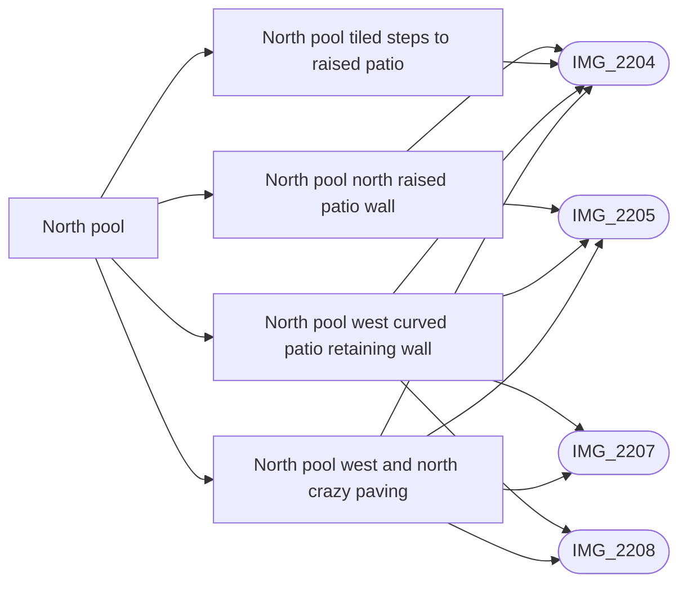

# North pool

_Generated by `scripts/build_references.py`. Do not edit: change `data/areas.json` or `data/reference_tags.json` and rebuild._

The clover-shaped north pool, its lawn ring, crazy-paving path, curved garden walls and the terraces round it.

## Known facts and open questions

- Dave (2026-10-11): the lawn is bigger than the first pass showed, and the houses have front porches.
- Skip the glass safety fence round the pools (Dave, 2026-10-11).
- Best single reference: villacana-reference/photos/07 (whole courtyard looking north).
- Issue #36 (2026-10-15): IMG_2204/private05 support a curved west/north retaining wall, crazy-paving path and five tiled risers to the raised NW patio. Only that visible band is authored; placement is estimated within 1–2 m against the aerial and registry. Local patio rise 0.75 m and rear edge are estimates; unseen private boundaries, northeast kerbs and house-level attribution remain unverified.

## Read first

- docs: `docs/NORTH_POOL.md`
- data: `data/objects.json`, `data/north_pool.json`, `data/terrain.json`
- src: `src/world.ts`, `src/water.ts`, `src/north-pool.ts`
- contact sheet: `villacana-reference/contact-sheets/north-pool.jpg` (thumbnails of everything below, numbered in this order)

## Coverage

Layout: 12, Levels and slopes: 1, Facades and roofs: 9, Materials: 5, Planting: 6, Views: 5
17 reviewed, 0 suggested only by camera position.

## Open build tasks

From `data/build_queue.json`; issue bodies in `refs/issues/`.

| Priority | Task | What | Status | Photos |
| --- | --- | --- | --- | --- |
| P2 | `north-pool-garden-walls` [#36](https://github.com/daveyboyc/villacana-venture/issues/36) | North pool: curved garden walls and raised patios | in-progress · issue_36 | [IMG_2207](../../public/photos-ref/IMG_2207.jpg), [IMG_2208](../../public/photos-ref/IMG_2208.jpg), [IMG_2204](../../public/photos-ref/IMG_2204.jpg), [IMG_2205](../../public/photos-ref/IMG_2205.jpg) |

## Built from these photos

Model features that cite photos of this area, from `public/photos-ref/evidence-graph.json`. A citation records what a feature was traced from; it does not prove the feature matches.

## Reviewed references

| Reference | Viewpoint | Use for | What it shows |
| --- | --- | --- | --- |
| [IMG_2204.jpg](../../public/photos-ref/IMG_2204.jpg) | upper-floor | layout, facades, view | North pool from above: whole courtyard, terraces, mountains behind **Looks at:** The north pool. **Note:** Taken from an upper floor; the camera pin is inside a building. _Used by: north_pool.json:north-pool-west-curved-wall, north_pool.json:north-pool-north-curved-wall, north_pool.json:north-pool-west-paving, north_pool.json:north-pool-patio-steps._ |
| [IMG_2205.jpg](../../public/photos-ref/IMG_2205.jpg) | upper-floor | layout, facades, view | North pool from above, looking north to the mountains **Looks at:** The north pool. **Note:** Taken from an upper floor; the camera pin is inside a building. _Used by: north_pool.json:north-pool-west-curved-wall, north_pool.json:north-pool-north-curved-wall, north_pool.json:north-pool-west-paving._ |
| [IMG_2207.jpg](../../public/photos-ref/IMG_2207.jpg) | upper-floor | materials, planting | Looking down over lichen-mottled barrel roof tiles to the north pool garden **Looks at:** The north pool garden below the roof. _Used by: north_pool.json:north-pool-west-curved-wall, north_pool.json:north-pool-west-paving._ |
| [IMG_2208.jpg](../../public/photos-ref/IMG_2208.jpg) | upper-floor | materials, layout | Barrel roof tiles, curved hedges and path below, pool edge **Looks at:** The north pool garden and path below the roof. _Used by: north_pool.json:north-pool-west-curved-wall, north_pool.json:north-pool-west-paving._ |
| `villacana-reference/photos/07-north-pool-whole-courtyard-looking-north.jpg` | upper-floor | layout, facades, planting, view | North pool: the whole courtyard looking north. The best single reference for it. |
| `villacana-reference/photos/01-north-pool-lawn-ground-level-2021-04.png` | ground | facades, materials, planting | North pool lawn at ground level, April 2021. The key style reference. |
| `villacana-reference/photos/03-north-pool-down-over-roof-tiles-hedges.jpg` | upper-floor | layout, materials, planting | North pool looking down over barrel roof tiles: hedges, gates, crazy paving |
| [IMG_2206.jpg](../../public/photos-ref/IMG_2206.jpg) | upper-floor | layout, facades | North pool from above, west side terraces **Looks at:** The north pool, west side. |
| `villacana-reference/apple-maps/02-3d-north-pool.png` | aerial | layout, facades | Apple Maps 3D: north pool and surrounding terraces |
| `villacana-reference/apple-maps/07-3d-north-pool-looking-east-to-picasso.png` | aerial | layout, view | Apple Maps 3D: north pool looking east towards the Picasso car park |
| `villacana-reference/photos/04-north-pool-roof-tiles-yucca-patio.jpg` | upper-floor | planting, facades | North pool: roof tiles, a yucca, a patio behind a hedge |
| `villacana-reference/photos/05-north-pool-west-side-garden-walls.jpg` | upper-floor | layout, levels | North pool west side: curved garden walls, raised patios, tiled steps |
| `villacana-reference/photos/06-north-pool-looking-north-east-mountains.jpg` | upper-floor | facades, view | North pool looking north-east: terraces, mountains behind |
| `villacana-reference/apple-maps/08-3d-north-pool-looking-west-porches.png` | aerial | facades | Apple Maps 3D: north pool looking west, front porches, tiled canopies, balconies |
| `villacana-reference/apple-maps/09-3d-north-pool-looking-south.png` | aerial | layout | Apple Maps 3D: north pool looking south, lawn ring, curved path, deck |
| [IMG_2202.jpg](../../public/photos-ref/IMG_2202.jpg) | ground | layout, materials | Covered arched passage at the north end of Elena, gate beyond _Used by: building:6265201UF1366N_part5, elena_north.json:elena-north-gateway, elena_north.json:elena-north-planter-west._ |
| [IMG_2363.jpg](../../public/photos-ref/IMG_2363.jpg) | roof | layout, planting | Roof by Elena: looking down the lane to the north pool lawn gate **Looks at:** The arched gateway at the north end of Elena. **Note:** Overhead view of where the Elena north lane meets the north pool lawn gate. _Used by: elena_north.json:elena-north-gateway, elena_north.json:elena-north-patio-east, elena_north.json:elena-north-planter-west._ |
