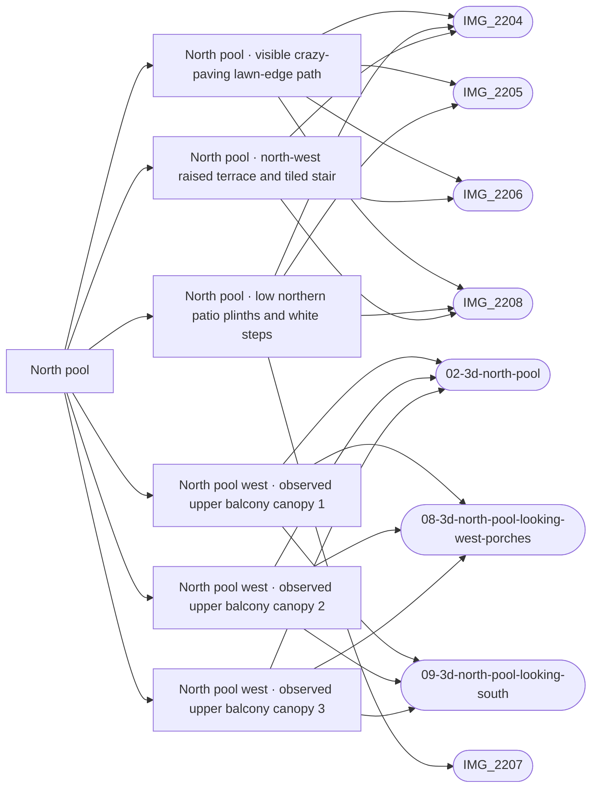

# North pool

_Generated by `scripts/build_references.py`. Do not edit: change `data/areas.json` or `data/reference_tags.json` and rebuild._

The clover-shaped north pool, its lawn ring, crazy-paving path, curved garden walls and the terraces round it.

## Known facts and open questions

- Dave (2026-10-11): the lawn is bigger than the first pass showed, and the houses have front porches.
- Skip the glass safety fence round the pools (Dave, 2026-10-11).
- Best single reference: villacana-reference/photos/07 (whole courtyard looking north).
- Issue #36 reconciliation (2026-10-15): north-side patios are 0.25–0.4 m above the path, separate from the NW six-riser 0.9–1.1 m terrace owned by #54. The old five-riser/0.75 m model is withdrawn; issue #36 remains open pending the raised-terraces module and individual north-patio/opening traces. Historical NW coordinate candidates are review-only, with stair placement still conflicting with the survey bearing estimate.
- Issue #54 (2026-10-16): the NW six-riser tiled stair is built at about (-189.3, 17.8), cut back into a 1.0 m terrace (data/raised_terraces.json) between the curved wall and a straight wall that runs east to a pier where a path climbs to the north row alley. A camera fit of IMG_2204 to the pool ring puts the stair at bearing 320 from the camera, which IMG_2206 confirms (324); the withdrawn (-181.9, 12) flight would be at 341, so that spot is the pier and alley path, not the stair. Open: the terrace floor stands 0.5-1 m above the model datum of the houses behind it (6165501UF1366N_part5, part1); whether their floors are higher or there are steps down is not visible. The west and south ends of the terrace are estimated.
- Issue #36 (2026-10-17): lower northern plinth band, three independent shallow white-nosed openings and visible northwest/north crazy-paving path built separately from #54. The 0.325 m floor is a conservative visible band; rear and side floor limits and hidden patio divisions are untraced estimates, not surveyed property boundaries. Houses, pool and lawn keep their datum.
- Issue #95: the circled gap between the west row and standalone house has three separately observed upper balcony canopies, traced from the georeferenced aerial and Apple02/08/09. These structural roofs were missing in Layout; generic optional porches are not a replacement. Roof edges and elevations remain estimated, hidden ground boundaries untraced. The IMG_2206 brown doors are poolward of the marked gap. Current north/whole renders retain turf and deck; the supplied screenshot surface absence remains unreproduced.

## Read first

- docs: `docs/LEVELS.md`, `docs/NORTH_POOL_REVIEW.md`, `docs/RAISED_TERRACES.md`, `docs/NORTH_WEST_CANOPIES.md`
- data: `data/objects.json`, `data/levels_survey.json`, `data/raised_terraces.json`, `data/north_pool_gardens.json`, `data/north_west_canopies.json`
- src: `src/world.ts`, `src/water.ts`, `src/raised-terraces.ts`, `src/north-pool-gardens.ts`, `src/north-west-canopies.ts`
- contact sheet: `villacana-reference/contact-sheets/north-pool.jpg` (thumbnails of everything below, numbered in this order)

## Coverage

Layout: 12, Levels and slopes: 1, Facades and roofs: 9, Materials: 5, Planting: 6, Views: 5
17 reviewed, 0 suggested only by camera position.

## Levels

Ground and floor levels read from the photos, from `data/levels_survey.json` (see `docs/LEVELS.md`).

- `north-pool-west-stair` (steps): 0.9-1.1 m above the crazy-paving path round the lawn, medium confidence at (-187, 17.5) ±6 m. Model: **built**, task `raised-terraces`. A flight with red-and-blue patterned tile risers and an iron handrail climbs from the north-west corner of the lawn path to a raised terrace with crazy paving, a terracotta patio with tables and the house fronts. A curved white retaining wall of the same height runs beside it holding a planted bank. Position from two roof bearings (about 312 degrees, 18-25 m), low confidence. About where the terrain foot line runs, but about 1 m rather than 0.5 m; whether it is shared ground or a private terrace is not visible. (IMG_2204.jpg, IMG_2206.jpg, IMG_2208.jpg)
- `north-pool-north-patios` (raised-patio): 0.25-0.4 m above the path round the lawn, medium confidence at (-172, 9) ±8 m. Model: **built**, task `north-pool-garden-walls`. Ground-floor patios across the lawn behind white plinth walls of 0.3-0.4 m with hedges on top; one or two white-nosed steps in the openings. Issue #36 refines the broad position from (-166,8) to (-172,9), keeping the original +-8 m tolerance: three individual lower openings registered from IMG_2204 pool-ring camera fit span about x=-177 to -168,z=11, west of Calle Isabel; the old centre biased the whole patio band east. Height range unchanged. (IMG_2204.jpg, IMG_2205.jpg, IMG_2207.jpg)

## Built from these photos

Model features that cite photos of this area, from `public/photos-ref/evidence-graph.json`. A citation records what a feature was traced from; it does not prove the feature matches.

## Reviewed references

| Reference | Viewpoint | Use for | What it shows |
| --- | --- | --- | --- |
| [IMG_2204.jpg](../../public/photos-ref/IMG_2204.jpg) | upper-floor | layout, facades, view | North pool from above: whole courtyard, terraces, mountains behind **Looks at:** The north pool. **Note:** Taken from an upper floor; the camera pin is inside a building. _Used by: north_pool_gardens.json:north-pool-lawn-path, raised_terraces.json:north-pool-west-terrace, raised_terraces.json:north-pool-north-patios._ |
| [IMG_2208.jpg](../../public/photos-ref/IMG_2208.jpg) | upper-floor | materials, layout | Barrel roof tiles, curved hedges and path below, pool edge **Looks at:** The north pool garden and path below the roof. _Used by: north_pool_gardens.json:north-pool-lawn-path, raised_terraces.json:north-pool-west-terrace, raised_terraces.json:north-pool-north-patios._ |
| `villacana-reference/apple-maps/02-3d-north-pool.png` | aerial | layout, facades | Apple Maps 3D: north pool and surrounding terraces _Used by: north_west_canopies.json:north-west-balcony-canopy-1, north_west_canopies.json:north-west-balcony-canopy-2, north_west_canopies.json:north-west-balcony-canopy-3._ |
| `villacana-reference/apple-maps/08-3d-north-pool-looking-west-porches.png` | aerial | facades | Apple Maps 3D: north pool looking west, front porches, tiled canopies, balconies _Used by: north_west_canopies.json:north-west-balcony-canopy-1, north_west_canopies.json:north-west-balcony-canopy-2, north_west_canopies.json:north-west-balcony-canopy-3._ |
| `villacana-reference/apple-maps/09-3d-north-pool-looking-south.png` | aerial | layout | Apple Maps 3D: north pool looking south, lawn ring, curved path, deck _Used by: north_west_canopies.json:north-west-balcony-canopy-1, north_west_canopies.json:north-west-balcony-canopy-2, north_west_canopies.json:north-west-balcony-canopy-3._ |
| [IMG_2205.jpg](../../public/photos-ref/IMG_2205.jpg) | upper-floor | layout, facades, view | North pool from above, looking north to the mountains **Looks at:** The north pool. **Note:** Taken from an upper floor; the camera pin is inside a building. _Used by: north_pool_gardens.json:north-pool-lawn-path, raised_terraces.json:north-pool-north-patios._ |
| [IMG_2206.jpg](../../public/photos-ref/IMG_2206.jpg) | upper-floor | layout, facades | North pool from above, west side terraces **Looks at:** The north pool, west side. _Used by: north_pool_gardens.json:north-pool-lawn-path, raised_terraces.json:north-pool-west-terrace._ |
| [IMG_2207.jpg](../../public/photos-ref/IMG_2207.jpg) | upper-floor | materials, planting | Looking down over lichen-mottled barrel roof tiles to the north pool garden **Looks at:** The north pool garden below the roof. _Used by: raised_terraces.json:north-pool-north-patios._ |
| `villacana-reference/photos/07-north-pool-whole-courtyard-looking-north.jpg` | upper-floor | layout, facades, planting, view | North pool: the whole courtyard looking north. The best single reference for it. |
| `villacana-reference/photos/01-north-pool-lawn-ground-level-2021-04.png` | ground | facades, materials, planting | North pool lawn at ground level, April 2021. The key style reference. |
| `villacana-reference/photos/03-north-pool-down-over-roof-tiles-hedges.jpg` | upper-floor | layout, materials, planting | North pool looking down over barrel roof tiles: hedges, gates, crazy paving |
| `villacana-reference/apple-maps/07-3d-north-pool-looking-east-to-picasso.png` | aerial | layout, view | Apple Maps 3D: north pool looking east towards the Picasso car park |
| `villacana-reference/photos/04-north-pool-roof-tiles-yucca-patio.jpg` | upper-floor | planting, facades | North pool: roof tiles, a yucca, a patio behind a hedge |
| `villacana-reference/photos/05-north-pool-west-side-garden-walls.jpg` | upper-floor | layout, levels | North pool west side: curved garden walls, raised patios, tiled steps |
| `villacana-reference/photos/06-north-pool-looking-north-east-mountains.jpg` | upper-floor | facades, view | North pool looking north-east: terraces, mountains behind |
| [IMG_2202.jpg](../../public/photos-ref/IMG_2202.jpg) | ground | layout, materials | Covered arched passage at the north end of Elena, gate beyond _Used by: building:6265201UF1366N_part5, elena_north.json:elena-north-gateway, elena_north.json:elena-north-planter-west, elena_gated_entry.json:elena-gated-entry._ |
| [IMG_2363.jpg](../../public/photos-ref/IMG_2363.jpg) | roof | layout, planting | Roof by Elena: looking down the lane to the north pool lawn gate **Looks at:** The arched gateway at the north end of Elena. **Note:** Overhead view of where the Elena north lane meets the north pool lawn gate. _Used by: elena_north.json:elena-north-gateway, elena_north.json:elena-north-patio-east, elena_north.json:elena-north-planter-west._ |
