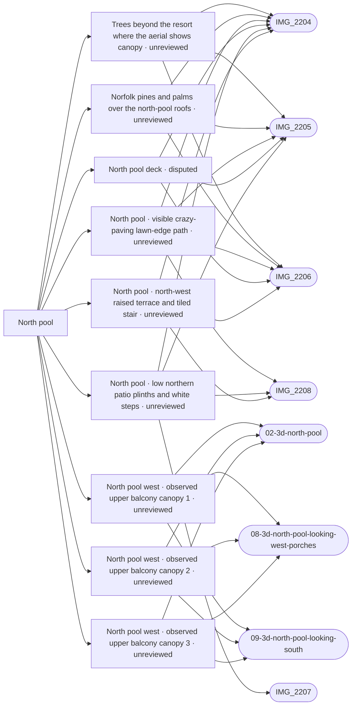

# North pool

_Generated by `scripts/build_references.py`. Do not edit: change `data/areas.json` or `data/reference_tags.json` and rebuild._

The clover-shaped north pool, its lawn ring, crazy-paving path, curved garden walls and the terraces round it.

## Known facts and open questions

- Dave (2026-10-11): the lawn is bigger than the first pass showed, and the houses have front porches.
- Skip the glass safety fence round the pools (Dave, 2026-10-11).
- Best single reference: villacana-reference/photos/07 (whole courtyard looking north).
- Issue #36 reconciliation (2026-10-15): north-side patios are 0.25–0.4 m above the path, separate from the NW six-riser 0.9–1.1 m terrace owned by #54. The old five-riser/0.75 m model is withdrawn; issue #36 remains open pending the raised-terraces module and individual north-patio/opening traces. Historical NW coordinate candidates are review-only, with stair placement still conflicting with the survey bearing estimate.
- Issue #54 (2026-10-16): the NW six-riser tiled stair is built at about (-189.3, 17.8), cut back into a 1.0 m terrace (data/raised_terraces.json) between the curved wall and a straight wall that runs east to a pier where a path climbs to the north row alley. A camera fit of IMG_2204 to the pool ring puts the stair at bearing 320 from the camera, which IMG_2206 confirms (324); the withdrawn (-181.9, 12) flight would be at 341, so that spot is the pier and alley path, not the stair. Open: the terrace floor stands 0.5-1 m above the model datum of the houses behind it (6165501UF1366N_part5, part1); whether their floors are higher or there are steps down is not visible. The west and south ends of the terrace are estimated.
- Issue #36 (2026-10-17): lower northern plinth band, three independent shallow white-nosed openings and visible northwest/north crazy-paving path built separately from #54. The 0.325 m floor is a conservative visible band; rear and side floor limits and hidden patio divisions are untraced estimates, not surveyed property boundaries. Houses, pool and lawn keep their datum.
- Issue #95: the circled gap between the west row and standalone house has three separately observed upper balcony canopies, traced from the georeferenced aerial and Apple02/08/09. These structural roofs were missing in Layout; generic optional porches are not a replacement. Roof edges and elevations remain estimated, hidden ground boundaries untraced. The IMG_2206 brown doors are poolward of the marked gap. Current north/whole renders retain turf and deck; the supplied screenshot surface absence remains unreproduced.
- Alignment audit 2026-10-18 (docs/reviews/north-pool-alignment-audit): Google screenshot globally registered to fixed Esri frame; held-out relative residuals about 1.5-2.1 m, sampled roof/registry differences about 0.6-1.5 m do not establish ground-wall shifts. No runtime geometry changed. IMG_2202/2361 are the separate private36/34 entry, not IMG_2363 lawn gateway. Missing newer photo-check records do not erase earlier manual reviews. Concealed boundaries, complete pool/ground perimeter and access widths remain unresolved in north-pool-unresolved-plan.
- Photo camera alignment 2026-10-24 (docs/reviews/photo-camera-alignment): IMG_2204-2206 solved as one upper-floor station about 5 m from their pins, 8.5 m above pool level, 28 mm lens. Pool water edge agrees with the aerial trace to about 0.1 m; a held-out facade step to 0.24 m. Four held-out parapet corners stand 1.0-1.2 m above the model tops (north-pool-roof-heights). By eye, IMG_2205 shows the east-side block set further back than the model and lawn where the model has a tiled route; not yet measured.
- Laser survey 2026-10-24 (docs/reviews/lidar-levels): the north pool deck is 0.80 m above the middle pool deck and the houses around it stand on ground about 1.2 m above the model; their roofs are ordinary two-storey heights over that ground. The 1.0-1.2 m parapet misfit from the photo camera alignment is this ground error (terrain-from-lidar), not storey height.
- Laser survey ground 2026-10-24: the north pool deck and lawn now stand at +0.82 m and the houses around it on the surveyed ground. Open: the north-pool-west-terrace floor (+1.93 m) is about 0.2 m above the survey's top (+1.72 m), and its outline may sit about 5 m too far east over the lawn; not changed.
- Photo-to-model loop 2026-11-01 (docs/reviews/loop-discrepancies): the first full comparison through the solved IMG_2204-2206 cameras recorded 52 differences in data/discrepancies.json (51 open, the glass fence won't fix), cast to the map through the cameras. Beyond Dave's pool tongue, pump box, parasols and trees: the east ladder (3.5 m) and east life ring (5 m) are misplaced, the big yucca stands about 6 m north of o13, the strelitzia clumps o7/o8 are not in the photos, the north plinth frontage and its step openings stand about 1.5-2.5 m further north than modelled, the west curved wall carries on round to about (-187.9, 26.2), and the station building rises higher than modelled. Ground positions agree between cameras to 0.2-0.7 m; the stated uncertainties (about 1-2 m) treat the solve's sigmas as independent and are conservative.

## Read first

- docs: `docs/LEVELS.md`, `docs/NORTH_POOL_REVIEW.md`, `docs/RAISED_TERRACES.md`, `docs/NORTH_WEST_CANOPIES.md`, `docs/reviews/north-pool-alignment-audit/README.md`
- data: `data/objects.json`, `data/levels_survey.json`, `data/raised_terraces.json`, `data/north_pool_gardens.json`, `data/north_west_canopies.json`
- src: `src/world.ts`, `src/water.ts`, `src/raised-terraces.ts`, `src/north-pool-gardens.ts`, `src/north-west-canopies.ts`
- contact sheet: `villacana-reference/contact-sheets/north-pool.jpg` (thumbnails of everything below, numbered in this order)

## Coverage

Layout: 11, Levels and slopes: 1, Facades and roofs: 9, Materials: 5, Planting: 6, Views: 5
16 reviewed, 0 suggested only by camera position.

## Levels

Ground and floor levels read from the photos, from `data/levels_survey.json` (see `docs/LEVELS.md`).

- `north-pool-west-stair` (steps): 0.9-1.1 m above the crazy-paving path round the lawn, medium confidence at (-187, 17.5) ±6 m. Model: **built**, task `raised-terraces`. A flight with red-and-blue patterned tile risers and an iron handrail climbs from the north-west corner of the lawn path to a raised terrace with crazy paving, a terracotta patio with tables and the house fronts. A curved white retaining wall of the same height runs beside it holding a planted bank. Position from two roof bearings (about 312 degrees, 18-25 m), low confidence. About where the terrain foot line runs, but about 1 m rather than 0.5 m; whether it is shared ground or a private terrace is not visible. (IMG_2204.jpg, IMG_2206.jpg, IMG_2208.jpg)
- `north-pool-north-patios` (raised-patio): 0.25-0.4 m above the path round the lawn, medium confidence at (-172, 9) ±8 m. Model: **built**, task `north-pool-garden-walls`. Ground-floor patios across the lawn behind white plinth walls of 0.3-0.4 m with hedges on top; one or two white-nosed steps in the openings. Issue #36 refines the broad position from (-166,8) to (-172,9), keeping the original +-8 m tolerance: three individual lower openings registered from IMG_2204 pool-ring camera fit span about x=-177 to -168,z=11, west of Calle Isabel; the old centre biased the whole patio band east. Height range unchanged. (IMG_2204.jpg, IMG_2205.jpg, IMG_2207.jpg)

## Open build tasks

From `data/build_queue.json`; issue bodies in `refs/issues/`.

| Priority | Task | What | Status | Photos |
| --- | --- | --- | --- | --- |
| P1 | `blender-kit-pilot` | Graphics pilot: image-based lighting, ambient occlusion and a Blender-built facade kit in the north-pool courtyard | in-progress · Claude · placement: not-verified |  |
| P1 | `facade-kit-traced` | North pool: place the facade kit from the photos instead of generating it (after blender-kit-pilot) | in-progress · Claude · placement: not-verified | [IMG_2204](../../public/photos-ref/IMG_2204.jpg), [IMG_2205](../../public/photos-ref/IMG_2205.jpg), [IMG_2206](../../public/photos-ref/IMG_2206.jpg) |
| P1 | `loop-camera-solving` [#181](https://github.com/daveyboyc/villacana-venture/issues/181) | Photo-to-model loop: semi-automatic camera solving for every north-pool photo (after loop-discrepancies) | open · placement: not-applicable | [IMG_2207](../../public/photos-ref/IMG_2207.jpg), [IMG_2208](../../public/photos-ref/IMG_2208.jpg) |
| P1 | `loop-discrepancies` [#178](https://github.com/daveyboyc/villacana-venture/issues/178) | Photo-to-model loop: discrepancy records, pixel-to-map projection and the first north-pool comparison | in-progress · Claude · placement: not-applicable | [IMG_2204](../../public/photos-ref/IMG_2204.jpg), [IMG_2205](../../public/photos-ref/IMG_2205.jpg), [IMG_2206](../../public/photos-ref/IMG_2206.jpg) |
| P1 | `loop-north-pool-fixes` [#180](https://github.com/daveyboyc/villacana-venture/issues/180) | Photo-to-model loop: close the north-pool discrepancies with measured fixes (after loop-discrepancies, loop-measured-approval) | open · placement: not-verified | [IMG_2204](../../public/photos-ref/IMG_2204.jpg), [IMG_2205](../../public/photos-ref/IMG_2205.jpg), [IMG_2206](../../public/photos-ref/IMG_2206.jpg) |
| P1 | `north-pool-detail-pilot` | Detail pilot: make the north pool courtyard look like its photos | in-progress · Claude · placement: not-verified | [IMG_2204](../../public/photos-ref/IMG_2204.jpg), [IMG_2205](../../public/photos-ref/IMG_2205.jpg), [IMG_2206](../../public/photos-ref/IMG_2206.jpg), [IMG_2207](../../public/photos-ref/IMG_2207.jpg), [IMG_2208](../../public/photos-ref/IMG_2208.jpg) |
| P1 | `north-pool-unresolved-plan` [#98](https://github.com/daveyboyc/villacana-venture/issues/98) | North pool: resolve concealed ground edges, lane widths and remaining roof projections (after north-pool-alignment-audit) | open · placement: not-applicable | [IMG_2204](../../public/photos-ref/IMG_2204.jpg), [IMG_2205](../../public/photos-ref/IMG_2205.jpg), [IMG_2206](../../public/photos-ref/IMG_2206.jpg), [IMG_2207](../../public/photos-ref/IMG_2207.jpg), [IMG_2208](../../public/photos-ref/IMG_2208.jpg), [IMG_2363](../../public/photos-ref/IMG_2363.jpg) |
| P1 | `pool-deck-outline` | North pool: trace the deck outline and squared deck tongue from the solved cameras (after pool-detail) | open · placement: not-verified | [IMG_2204](../../public/photos-ref/IMG_2204.jpg), [IMG_2205](../../public/photos-ref/IMG_2205.jpg), [IMG_2206](../../public/photos-ref/IMG_2206.jpg) |
| P2 | `path-network-inventory-north-pool` [#125](https://github.com/daveyboyc/villacana-venture/issues/125) | North pool: full-source path, tunnel and boundary inventory (after path-network-baseline) | open · placement: not-applicable |  |

## Differences from the photos

52 recorded in `data/discrepancies.json`, 51 open (see `docs/DISCREPANCIES.md`). Found by rendering the model through each solved camera beside and over the photo; numbers match the labelled comparisons in `docs/reviews/<task>/<photo>-compare.jpg`, and the map shows them under **Differences**. A position is where the camera ray through the marked pixel meets the ground or the stated height.

| # | Kind | Status | What differs | Photos | Map position | Features |
| --- | --- | --- | --- | --- | --- | --- |
| D1 `np-pool-east-tongue` | shape | open → `loop-north-pool-fixes` | The pool's water edge turns square round a straight-edged deck tongue that reaches into the water east of the north steps, where the pump box stands (west tip marked +). The registry water ring is a smooth curve there, so the model draws water over most of the tongue and has no square corners. | [IMG_2204](../../public/photos-ref/IMG_2204.jpg), [IMG_2205](../../public/photos-ref/IMG_2205.jpg) | -174.5, 20.2 ± 1.1 m | `pool:north`, `pool_decks.json:north-deck` |
| D2 `np-pool-southwest-spur` | shape | open → `loop-north-pool-fixes` | On the south-west side a square-cornered deck spur carries the ladder (spur tip marked +); the model's water ring and deck curve smoothly there, so the spur and its straight sides are missing and the ladder is lost in the curve. | [IMG_2204](../../public/photos-ref/IMG_2204.jpg), [IMG_2206](../../public/photos-ref/IMG_2206.jpg) | -177.3, 22.5 ± 1.1 m | `pool:north`, `pool_decks.json:north-deck`, `objects.json:o2` |
| D3 `np-pool-north-steps` | look | open → `loop-north-pool-fixes` | The north steps are a rectangular bay inset in the pool wall with three visible white-nosed treads and a stainless step handrail at each end; the render shows only a faint translucent outline of the treads and no handrails at this distance. | [IMG_2204](../../public/photos-ref/IMG_2204.jpg), [IMG_2205](../../public/photos-ref/IMG_2205.jpg) | -179.6, 17.5 ± 1.4 m | `objects.json:o1`, `pool:north` |
| D4 `np-pool-water-look` | look | open → `loop-north-pool-fixes` | The photo's water is a saturated mid-blue with a dark blue tiled band along the waterline and visible floor markings; the render's water is paler and greyer with only a thin dark line at the coping. | [IMG_2204](../../public/photos-ref/IMG_2204.jpg), [IMG_2205](../../public/photos-ref/IMG_2205.jpg), [IMG_2206](../../public/photos-ref/IMG_2206.jpg) | – | `pool:north` |
| D5 `np-deck-look` | look | open → `loop-north-pool-fixes` | The deck slabs are a greyer cream with dark weathering stains and fine joints, edged by rounded pale stones at the fence; the render's deck is a brighter, uniform yellow-cream with strongly drawn joints. | [IMG_2204](../../public/photos-ref/IMG_2204.jpg), [IMG_2205](../../public/photos-ref/IMG_2205.jpg) | – | `pool_decks.json:north-deck` |
| D6 `np-glass-fence` | missing | wont-fix: Dave, 2026-10-11: skip the glass safety fence round the pools (data/areas.json, north-pool notes). Recorded so the comparison accounts for it, not to be built. | A frameless glass safety fence on steel spigots, with frosted bands, runs round the deck's outer edge in all three photos; the model has none. | [IMG_2204](../../public/photos-ref/IMG_2204.jpg), [IMG_2205](../../public/photos-ref/IMG_2205.jpg), [IMG_2206](../../public/photos-ref/IMG_2206.jpg) | – | `pool:north`, `pool_decks.json:north-deck` |
| D7 `np-pump-box-position` | position | open → `loop-north-pool-fixes` | The white pump box stands on the squared deck tongue against its outer edge by the fence (front foot marked +); the model's box (o4, -172.7, 20.2) sits about 1.5 m further west, on the curve where the photo shows the tongue's water edge. | [IMG_2204](../../public/photos-ref/IMG_2204.jpg), [IMG_2205](../../public/photos-ref/IMG_2205.jpg) | -171.2, 20.1 ± 1.1 m | `objects.json:o4` |
| D8 `np-ladder-east-position` | position | open → `loop-north-pool-fixes` | The east ladder stands at the north-east corner of the tongue where it meets the curved wall (feet marked +); the model's ladder (o3, -174.0, 20.2) is about 3.5 m further south-west, on the curve below the pump box where the photo has no ladder. | [IMG_2204](../../public/photos-ref/IMG_2204.jpg), [IMG_2205](../../public/photos-ref/IMG_2205.jpg) | -172.2, 17.2 ± 1.3 m | `objects.json:o3` |
| D9 `np-life-ring-east-position` | position | open → `loop-north-pool-fixes` | The east life ring hangs on a steel post at the fence north of the pump box (post foot marked +); the model's ring (o6, -170.7, 21.7) is about 5 m further south, south-east of the box. | [IMG_2204](../../public/photos-ref/IMG_2204.jpg), [IMG_2205](../../public/photos-ref/IMG_2205.jpg) | -171.0, 16.5 ± 1.3 m | `objects.json:o6` |
| D10 `np-life-ring-north-position` | position | open → `loop-north-pool-fixes` | The north life ring's post stands at the fence just west of the step handrail (post foot marked +), about 1.2 m south of the model's ring (o5, -180.2, 16.4); all three cameras agree to 0.7 m. | [IMG_2204](../../public/photos-ref/IMG_2204.jpg), [IMG_2205](../../public/photos-ref/IMG_2205.jpg), [IMG_2206](../../public/photos-ref/IMG_2206.jpg) | -180.5, 17.6 ± 1.4 m | `objects.json:o5` |
| D11 `np-pool-showers` | missing | open → `loop-north-pool-fixes` | Two chrome pool showers stand in front of a frosted glass screen at the north entrance to the fence (feet marked +); the model has neither the showers nor the screen. | [IMG_2204](../../public/photos-ref/IMG_2204.jpg), [IMG_2205](../../public/photos-ref/IMG_2205.jpg) | -178.4, 14.8 ± 1.5 m | `proposed:north-pool-showers-and-screen` |
| D12 `np-deck-pole-east` | missing | open → `loop-north-pool-fixes` | A tall goose-neck stainless pole (a shower or ring post) rises from the deck edge just south of the pump box (foot marked +); not in the model. | [IMG_2204](../../public/photos-ref/IMG_2204.jpg), [IMG_2205](../../public/photos-ref/IMG_2205.jpg) | -170.7, 22.6 ± 1.0 m | `proposed:north-pool-deck-pole` |
| D13 `np-lawn-grate-slab` | missing | open → `loop-north-pool-fixes` | A rectangular stone slab with a grate is set in the lawn just outside the east fence (centre marked +); not in the model. | [IMG_2204](../../public/photos-ref/IMG_2204.jpg), [IMG_2205](../../public/photos-ref/IMG_2205.jpg) | -169.6, 18.0 ± 1.2 m | `proposed:north-pool-lawn-grate` |
| D14 `np-lawn-covers` | missing | open → `loop-north-pool-fixes` | Small dark square inspection or irrigation covers are set in the lawn round the pool (four in IMG_2204; the one marked + is east of the pool); none in the model. | [IMG_2204](../../public/photos-ref/IMG_2204.jpg), [IMG_2206](../../public/photos-ref/IMG_2206.jpg) | -167.7, 14.7 ± 1.4 m | `proposed:north-pool-lawn-covers` |
| D15 `np-lawn-look` | look | open → `loop-north-pool-fixes` | The lawn is a dense mown sward with brown worn patches and mowing stripes, darker under the trees; the render's lawn is an even bright green scattered with dark tufts. | [IMG_2204](../../public/photos-ref/IMG_2204.jpg), [IMG_2205](../../public/photos-ref/IMG_2205.jpg) | – | `proposed:north-pool-lawn-surface` |
| D16 `np-strelitzia-look` | look | open → `loop-north-pool-fixes` | The giant strelitzia south of the pool is two tall stems (the western one about 6 m) with long split paddle leaves over a dark mulch bed; the model's clump (calle-elena-9) is five thin stems about half as tall. Its position agrees to about 0.5 m (base marked +). | [IMG_2204](../../public/photos-ref/IMG_2204.jpg), [IMG_2206](../../public/photos-ref/IMG_2206.jpg) | -178.4, 26.4 ± 1.0 m | `objects.json:calle-elena-9` |
| D17 `np-strelitzia-west-extra` | extra | open → `loop-north-pool-fixes` | The model draws two more strelitzia clumps (o7, o8) on the lawn by the west curved wall, in front of the tiled stair; both photos show open lawn there. | [IMG_2204](../../public/photos-ref/IMG_2204.jpg), [IMG_2206](../../public/photos-ref/IMG_2206.jpg) | -185.1, 23.2 ± 0.8 m | `objects.json:o7`, `objects.json:o8` |
| D18 `np-feathery-tree-position` | position | open → `loop-north-pool-fixes` | The light, feathery-leaved small tree by the north-east lawn path (trunk foot marked +) stands about 3 m north-east of the model's tree o9 (-170.7, 13.1); both cameras agree to 0.5 m. | [IMG_2204](../../public/photos-ref/IMG_2204.jpg), [IMG_2205](../../public/photos-ref/IMG_2205.jpg) | -168.3, 11.1 ± 1.7 m | `objects.json:o9` |
| D19 `np-feathery-tree-look` | look | open → `loop-north-pool-fixes` | The same tree is a slim trunk under an open, rounded crown of fine light-green pinnate leaves; the render draws it as a dark flat-topped umbrella crown on a thick forked trunk. | [IMG_2204](../../public/photos-ref/IMG_2204.jpg), [IMG_2205](../../public/photos-ref/IMG_2205.jpg) | – | `objects.json:o9` |
| D20 `np-west-terrace-tree` | missing | open → `loop-north-pool-fixes` | A large spreading fine-leaved tree leans over the north-west raised terrace (trunk foot on the terrace floor marked +); the model leaves it out (known gap). | [IMG_2204](../../public/photos-ref/IMG_2204.jpg), [IMG_2206](../../public/photos-ref/IMG_2206.jpg) | -193.8, 20.2 ± 2.2 m | `gap:north-pool-west-terrace-tree` |
| D21 `np-pollarded-tree` | position | open → `loop-north-pool-fixes` | The pollarded tree in the north patio (trunk foot on the patio floor marked +) stands about 2.4 m east of the model's o12 (-177.7, 7.1), and it is bare knobbly stumps with no leaves, where the model draws a crown in leaf. | [IMG_2204](../../public/photos-ref/IMG_2204.jpg), [IMG_2205](../../public/photos-ref/IMG_2205.jpg) | -175.3, 7.0 ± 2.2 m | `objects.json:o12` |
| D22 `np-yucca-position` | position | open → `loop-north-pool-fixes` | A big multi-trunk yucca, 5-6 m tall, stands east of the lawn (trunks meet at the + mark); the model's yucca o13 is about 6 m further south by the camera building, and its feathery tree o10 (-163.7, 17.1) would stand inside this yucca's crown, where no such tree shows. | [IMG_2205](../../public/photos-ref/IMG_2205.jpg) | -164.7, 22.4 ± 1.1 m | `objects.json:o13`, `objects.json:o10` |
| D23 `np-north-patio-hedges` | shape | open → `loop-north-pool-fixes` | The north patios are fronted by tall continuous clipped hedges, about 1 m high, with red hibiscus flowers, on the low plinth walls; the render shows a row of separate small round shrubs. | [IMG_2204](../../public/photos-ref/IMG_2204.jpg), [IMG_2205](../../public/photos-ref/IMG_2205.jpg), [IMG_2206](../../public/photos-ref/IMG_2206.jpg) | – | `raised_terraces.json:north-pool-north-patios` |
| D24 `np-foreground-hedges` | shape | open → `loop-north-pool-fixes` | The hedges below the camera are low clipped hedges (about 1 m) with a few red and pink flowers, with the crazy-paving lawn path and lawn showing between them; the model's hibiscus hedge row (o14-o25) draws mounds two to three times as tall and wide that hide the path and the lawn edge. | [IMG_2204](../../public/photos-ref/IMG_2204.jpg), [IMG_2205](../../public/photos-ref/IMG_2205.jpg), [IMG_2206](../../public/photos-ref/IMG_2206.jpg) | – | `objects.json:o14`, `objects.json:o17`, `objects.json:o20`, `objects.json:o25` |
| D25 `np-bougainvillea-facades` | missing | open → `loop-north-pool-fixes` | Magenta bougainvillea climbs the north and north-west facades in at least five places (two in IMG_2205); the model has a single bougainvillea card, on the middle house. | [IMG_2204](../../public/photos-ref/IMG_2204.jpg), [IMG_2205](../../public/photos-ref/IMG_2205.jpg) | – | `building:6266601UF1366N_part4`, `building:6165501UF1366N_part5` |
| D26 `np-bougainvillea-west-gardens` | missing | open → `loop-north-pool-fixes` | A large bougainvillea covers the gate piers of the west-row front gardens and another flowers in the left foreground of IMG_2204; neither is in the model. | [IMG_2204](../../public/photos-ref/IMG_2204.jpg), [IMG_2206](../../public/photos-ref/IMG_2206.jpg) | – | `proposed:north-pool-west-garden-bougainvillea` |
| D27 `np-climbers-west-wall` | missing | open → `loop-north-pool-fixes` | A dense climbing plant covers the wall of the house beside the camera down to the garden, with blue plumbago and agapanthus in the bed below, and blue hydrangea and plumbago bushes stand on the north-west terrace; the model has bare walls and beds there. | [IMG_2204](../../public/photos-ref/IMG_2204.jpg), [IMG_2206](../../public/photos-ref/IMG_2206.jpg) | – | `building:6265201UF1366N_part3`, `raised_terraces.json:north-pool-west-terrace` |
| D28 `np-parasol-north-patio` | missing | open → `loop-north-pool-fixes` | A large grey parasol shades loungers on the north patio west of the pollarded tree (pole foot on the patio floor marked +); the model has no parasol there. | [IMG_2204](../../public/photos-ref/IMG_2204.jpg), [IMG_2205](../../public/photos-ref/IMG_2205.jpg) | -179.8, 7.4 ± 2.2 m | `proposed:north-pool-north-patio-parasol` |
| D29 `np-parasol-west-terrace` | missing | open → `loop-north-pool-fixes` | A folded white parasol stands beside a white table on the house patio at the top of the tiled stair (foot on the terrace floor marked +); not in the model. | [IMG_2204](../../public/photos-ref/IMG_2204.jpg), [IMG_2206](../../public/photos-ref/IMG_2206.jpg) | -193.8, 13.7 ± 2.7 m | `proposed:north-pool-west-terrace-parasol` |
| D30 `np-parasol-west-row-patio` | missing | open → `loop-north-pool-fixes` | A folded white parasol and a black bistro table with chairs stand on the patio in front of the west-row house (parasol foot marked +); not in the model. | [IMG_2206](../../public/photos-ref/IMG_2206.jpg) | -198.1, 24.2 ± 1.7 m | `proposed:north-pool-west-row-parasol` |
| D31 `np-parasol-lilac-west-garden` | missing | open → `loop-north-pool-fixes` | A lilac parasol shades a terracotta patio inside a walled front garden of the west row (canopy centre marked +, cast at an assumed 2.2 m above the garden); not in the model. | [IMG_2206](../../public/photos-ref/IMG_2206.jpg) | -181.8, 32.7 ± 1.5 m | `proposed:north-pool-west-garden-parasol` |
| D32 `np-parasol-lilac-east` | missing | open → `loop-north-pool-fixes` | A lilac parasol stands behind the big yucca on the east side (canopy marked +, cast at an assumed 2.2 m above the ground); not in the model. | [IMG_2205](../../public/photos-ref/IMG_2205.jpg) | -159.0, 16.5 ± 2.7 m | `proposed:north-pool-east-parasol` |
| D33 `np-passage-canopy` | missing | open → `loop-north-pool-fixes` | A white arched hood shelters the entrance of the covered passage between the north-west and north rows (front edge marked +, cast at an assumed 2.4 m above the path); not in the model. | [IMG_2204](../../public/photos-ref/IMG_2204.jpg), [IMG_2205](../../public/photos-ref/IMG_2205.jpg) | -182.0, 9.6 ± 3.9 m | `proposed:north-pool-passage-canopy` |
| D34 `np-awning-blue` | missing | open → `loop-north-pool-fixes` | A blue-and-white striped awning runs over the ground-floor doors of the north-west row's middle house (front edge marked +, cast at an assumed 2.6 m above the patio); not in the model. | [IMG_2204](../../public/photos-ref/IMG_2204.jpg), [IMG_2205](../../public/photos-ref/IMG_2205.jpg), [IMG_2206](../../public/photos-ref/IMG_2206.jpg) | -186.6, 8.7 ± 4.7 m | `building:6165501UF1366N_part5` |
| D35 `np-awnings-north-east` | position | open → `loop-north-pool-fixes` | White retractable awnings run over the two north patios east of the passage (front edges marked +); the model has one shorter cream awning, further west over the middle door, and none over the eastern patio. | [IMG_2204](../../public/photos-ref/IMG_2204.jpg), [IMG_2205](../../public/photos-ref/IMG_2205.jpg) | -174.8, 8.1 ± 3.7 m | `building:6266601UF1366N_part4` |
| D36 `np-awning-west-extra` | extra | open → `loop-north-pool-fixes` | The render puts a cream awning and a wide iron balcony over the west-row house door facing the pool; the photo shows no awning there and only small iron balconies. | [IMG_2206](../../public/photos-ref/IMG_2206.jpg) | – | `building:6165501UF1366N_part2` |
| D37 `np-patio-furniture` | missing | open → `loop-north-pool-fixes` | Garden furniture stands on every patio: a white table and six chairs on the terracotta patio of the north-west terrace (marked +), white dining sets and loungers on the north patios, and more on the north-east patio; the model has none. | [IMG_2204](../../public/photos-ref/IMG_2204.jpg), [IMG_2205](../../public/photos-ref/IMG_2205.jpg), [IMG_2206](../../public/photos-ref/IMG_2206.jpg) | -195.8, 17.6 ± 2.7 m | `proposed:north-pool-patio-furniture` |
| D38 `np-white-post-east` | missing | open → `loop-north-pool-fixes` | A tall white column, probably a furled parasol in its cover, stands by the hedge east of the lawn beside the yucca (foot marked +); not in the model. | [IMG_2205](../../public/photos-ref/IMG_2205.jpg) | -166.3, 25.8 ± 1.0 m | `proposed:north-pool-east-white-post` |
| D39 `np-west-wall-south-end` | shape | open → `loop-north-pool-fixes` | The curved retaining wall of the north-west terrace carries on round to the south-east, to about the + mark, before it meets the lawn path; the model's wall stops about 2 m short at (-190.45, 24.6). Further north IMG_2206 puts the wall foot within 0.3 m of the model, while IMG_2204 (base partly hidden by the hedge) puts it about 1 m east. | [IMG_2204](../../public/photos-ref/IMG_2204.jpg), [IMG_2206](../../public/photos-ref/IMG_2206.jpg) | -187.9, 26.2 ± 1.5 m | `raised_terraces.json:north-pool-west-terrace` |
| D40 `np-north-plinth-frontage` | position | open → `loop-north-pool-fixes` | The low white plinth walls of the north patios, their white-step openings and the lawn-edge path in front of them stand about 1.5-2.5 m further north than modelled: the middle step opening (marked +) is near (-174.6, 9.0), the model's at (-173.3, 11.1), and the lawn edge in IMG_2204 meets the path near z 10.8 where the model's path is at z 12-12.9. | [IMG_2204](../../public/photos-ref/IMG_2204.jpg), [IMG_2205](../../public/photos-ref/IMG_2205.jpg) | -174.6, 9.0 ± 1.8 m | `raised_terraces.json:north-pool-north-patios`, `north_pool_gardens.json:north-pool-lawn-path` |
| D41 `np-isabel-path-line` | shape | open → `loop-north-pool-fixes` | The crazy-paving path east of the lawn curves from the black iron gate in the north-east corner down to the lawn (centre marked +); at its north end it runs about 1.5 m east of the mapped Isabel line, which kinks where the photo path curves. | [IMG_2205](../../public/photos-ref/IMG_2205.jpg) | -164.1, 11.0 ± 1.8 m | `street:isabel` |
| D42 `np-isabel-path-paving` | look | open → `loop-north-pool-fixes` | That path is irregular pale crazy paving flush with the lawn; the render draws it as a terracotta-tiled path with raised red kerbs. | [IMG_2205](../../public/photos-ref/IMG_2205.jpg) | – | `street:isabel` |
| D43 `np-east-gate` | missing | open → `loop-north-pool-fixes` | A black iron gate closes the opening in the white wall at the north-east corner of the lawn, where the path leaves (foot marked +); the model has no gate there. | [IMG_2205](../../public/photos-ref/IMG_2205.jpg) | -161.9, 6.9 ± 1.9 m | `street:isabel`, `proposed:north-pool-east-gate` |
| D44 `np-north-patio-paving` | look | open → `loop-north-pool-fixes` | The north and north-west patios and the passage floor are pale stone and crazy paving (one small terracotta-tiled patio under the table on the north-west terrace); the render paves them in bright terracotta tiles. | [IMG_2204](../../public/photos-ref/IMG_2204.jpg), [IMG_2205](../../public/photos-ref/IMG_2205.jpg), [IMG_2206](../../public/photos-ref/IMG_2206.jpg) | – | `raised_terraces.json:north-pool-north-patios`, `raised_terraces.json:north-pool-west-terrace` |
| D45 `np-west-row-gates` | shape | open → `loop-north-pool-fixes` | The west-row front gardens are entered through flat-capped white rendered gate piers with brown plank doors (door foot marked +); the model has a round white arch at the gate point (-188.76, 27.5) and plain white walls. | [IMG_2206](../../public/photos-ref/IMG_2206.jpg) | -183.4, 30.7 ± 1.1 m | `proposed:north-pool-west-row-garden-gates` |
| D46 `np-camera-building-form` | shape | open → `loop-north-pool-fixes` | The building the photos were taken from (6265201UF1366N_part3) rises higher: a white parapet and chimney block stands beside the lens and the camera looks over its barrel-tile roof edge; the model's building is lower, with a flat white roof, a tiled porch canopy on timber posts in front of the camera and a large shuttered window on a wall the photo shows blank. | [IMG_2205](../../public/photos-ref/IMG_2205.jpg), [IMG_2206](../../public/photos-ref/IMG_2206.jpg) | – | `building:6265201UF1366N_part3` |
| D47 `np-north-row-openings` | shape | open → `loop-north-pool-fixes` | The north and north-west row openings are tall rectangles with louvred brown shutters under moulded white hoods and a moulded ledge between the floors; the render gives most of them round-arched heads and plain wall. | [IMG_2204](../../public/photos-ref/IMG_2204.jpg), [IMG_2205](../../public/photos-ref/IMG_2205.jpg) | – | `building:6266601UF1366N_part4`, `building:6165501UF1366N_part5` |
| D48 `np-north-east-balcony` | shape | open → `loop-north-pool-fixes` | The north-east house has a projecting first-floor balcony with a solid white moulded front; the render has an open iron railing there with an awning below. | [IMG_2204](../../public/photos-ref/IMG_2204.jpg), [IMG_2205](../../public/photos-ref/IMG_2205.jpg) | – | `building:6266601UF1366N_part4` |
| D49 `np-west-row-facade` | shape | open → `loop-north-pool-fixes` | The west-row house facing the pool has tall shuttered windows, two small iron balconies and a brown garden door; the render has two round-arched windows over one wide iron balcony. | [IMG_2206](../../public/photos-ref/IMG_2206.jpg) | – | `building:6165501UF1366N_part2` |
| D50 `np-roof-equipment` | missing | open → `loop-north-pool-fixes` | The roofs carry two white water tanks, a black chimney flue, solar panels, a satellite dish, air-conditioning units and chimney caps; the model's roofs are bare. | [IMG_2204](../../public/photos-ref/IMG_2204.jpg), [IMG_2205](../../public/photos-ref/IMG_2205.jpg), [IMG_2206](../../public/photos-ref/IMG_2206.jpg) | – | `building:6266601UF1366N_part4`, `building:6165501UF1366N_part5` |
| D51 `np-backdrop-trees` | look | open → `loop-north-pool-fixes` | Over the roofs the photos show tall eucalyptus with bare trunks over the west wall, dark umbrella pines and palms; the render draws rounded dense green blobs and flat light-green umbrella crowns, brighter and smoother than the photos. | [IMG_2204](../../public/photos-ref/IMG_2204.jpg), [IMG_2206](../../public/photos-ref/IMG_2206.jpg) | – | `backdrop.json:aerial-trees`, `backdrop.json:photo-trees` |
| D52 `np-mountains` | look | open → `loop-north-pool-fixes` | The mountains show nearer green foothills, a sharp peaked summit and cloud on the ridge; the render's ridge is one flat blue-grey band with a softer summit. | [IMG_2204](../../public/photos-ref/IMG_2204.jpg), [IMG_2205](../../public/photos-ref/IMG_2205.jpg) | – | `backdrop.json:photo-trees` |

## Built from these photos

Model features that cite photos of this area, from `public/photos-ref/evidence-graph.json`, with their photo-check state. A citation records what a feature was traced from; only a check in `data/photo_checks.json` says someone rendered it from the photo's camera and compared.

## Placement evidence

`verification` is placement status, separate from photographic diagnostics. Earlier manual reviews may exist. Only a fresh measured packet and independent approval can grant `verified`.

| Feature | Placement | Photo diagnostics | Blockers |
| --- | --- | --- | --- |
| `backdrop.json:aerial-trees` | unreviewed | unchecked | No measured placement packet and independent approval recorded; earlier manual reviews may exist. |
| `backdrop.json:photo-trees` | unreviewed | unchecked | No measured placement packet and independent approval recorded; earlier manual reviews may exist. |
| `north_pool_gardens.json:north-pool-lawn-path` | unreviewed | incomplete | No measured placement packet and independent approval recorded; earlier manual reviews may exist. |
| `north_west_canopies.json:north-west-balcony-canopy-1` | unreviewed | not-comparable | No measured placement packet and independent approval recorded; earlier manual reviews may exist. |
| `north_west_canopies.json:north-west-balcony-canopy-2` | unreviewed | not-comparable | No measured placement packet and independent approval recorded; earlier manual reviews may exist. |
| `north_west_canopies.json:north-west-balcony-canopy-3` | unreviewed | not-comparable | No measured placement packet and independent approval recorded; earlier manual reviews may exist. |
| `pool_decks.json:north-deck` | disputed | differs | open discrepancy photo-discrepancy:ff51326279ba4a0d; open discrepancy photo-discrepancy:70cf6dadd775a578; open discrepancy photo-discrepancy:6febefd118d6f5c9 |
| `raised_terraces.json:north-pool-north-patios` | unreviewed | incomplete | No measured placement packet and independent approval recorded; earlier manual reviews may exist. |
| `raised_terraces.json:north-pool-west-terrace` | unreviewed | incomplete | No measured placement packet and independent approval recorded; earlier manual reviews may exist. |

## Photo checks

Renders from each photo's camera compared with the photo (`data/photo_checks.json`).

| Task | Photo | Result | Render | Notes |
| --- | --- | --- | --- | --- |
| `north-pool-west-frontage` | [08-3d-north-pool-looking-west-porches](../../public/photos-ref/ref:apple-maps/08-3d-north-pool-looking-west-porches.png) | **not-comparable** | [after](../../docs/reviews/issue-95/after/west-oblique.png) · [before](../../docs/reviews/issue-95/before/west-oblique.png) | Exact Apple Maps camera pose is unavailable, so no calibrated same-camera match is claimed. Independent aerial and oblique review confirms this individual projecting upper balcony roof and the bounded outline; the committed pair uses one shared estimated diagnostic camera. Plan edges ±1 m and 4.8/5.4 m eave/rear heights remain estimates. Hidden balcony/ground divisions are not modelled. |
| `north-pool-west-frontage` | [09-3d-north-pool-looking-south](../../public/photos-ref/ref:apple-maps/09-3d-north-pool-looking-south.png) | **not-comparable** | [after](../../docs/reviews/issue-95/after/west-oblique.png) · [before](../../docs/reviews/issue-95/before/west-oblique.png) | Exact Apple Maps camera pose is unavailable, so no calibrated same-camera match is claimed. Independent aerial and oblique review confirms this individual projecting upper balcony roof and the bounded outline; the committed pair uses one shared estimated diagnostic camera. Plan edges ±1 m and 4.8/5.4 m eave/rear heights remain estimates. Hidden balcony/ground divisions are not modelled. |
| `north-pool-west-frontage` | [02-3d-north-pool](../../public/photos-ref/ref:apple-maps/02-3d-north-pool.png) | **not-comparable** | [after](../../docs/reviews/issue-95/after/west-oblique.png) · [before](../../docs/reviews/issue-95/before/west-oblique.png) | Exact Apple Maps camera pose is unavailable, so no calibrated same-camera match is claimed. Independent aerial and oblique review confirms this individual projecting upper balcony roof and the bounded outline; the committed pair uses one shared estimated diagnostic camera. Plan edges ±1 m and 4.8/5.4 m eave/rear heights remain estimates. Hidden balcony/ground divisions are not modelled. |
| `north-pool-west-frontage` | [08-3d-north-pool-looking-west-porches](../../public/photos-ref/ref:apple-maps/08-3d-north-pool-looking-west-porches.png) | **not-comparable** | [after](../../docs/reviews/issue-95/after/west-oblique.png) · [before](../../docs/reviews/issue-95/before/west-oblique.png) | Exact Apple Maps camera pose is unavailable, so no calibrated same-camera match is claimed. Independent aerial and oblique review confirms this individual projecting upper balcony roof and the bounded outline; the committed pair uses one shared estimated diagnostic camera. Plan edges ±1 m and 4.8/5.4 m eave/rear heights remain estimates. Hidden balcony/ground divisions are not modelled. |
| `north-pool-west-frontage` | [09-3d-north-pool-looking-south](../../public/photos-ref/ref:apple-maps/09-3d-north-pool-looking-south.png) | **not-comparable** | [after](../../docs/reviews/issue-95/after/west-oblique.png) · [before](../../docs/reviews/issue-95/before/west-oblique.png) | Exact Apple Maps camera pose is unavailable, so no calibrated same-camera match is claimed. Independent aerial and oblique review confirms this individual projecting upper balcony roof and the bounded outline; the committed pair uses one shared estimated diagnostic camera. Plan edges ±1 m and 4.8/5.4 m eave/rear heights remain estimates. Hidden balcony/ground divisions are not modelled. |
| `north-pool-west-frontage` | [02-3d-north-pool](../../public/photos-ref/ref:apple-maps/02-3d-north-pool.png) | **not-comparable** | [after](../../docs/reviews/issue-95/after/west-oblique.png) · [before](../../docs/reviews/issue-95/before/west-oblique.png) | Exact Apple Maps camera pose is unavailable, so no calibrated same-camera match is claimed. Independent aerial and oblique review confirms this individual projecting upper balcony roof and the bounded outline; the committed pair uses one shared estimated diagnostic camera. Plan edges ±1 m and 4.8/5.4 m eave/rear heights remain estimates. Hidden balcony/ground divisions are not modelled. |
| `north-pool-west-frontage` | [08-3d-north-pool-looking-west-porches](../../public/photos-ref/ref:apple-maps/08-3d-north-pool-looking-west-porches.png) | **not-comparable** | [after](../../docs/reviews/issue-95/after/west-oblique.png) · [before](../../docs/reviews/issue-95/before/west-oblique.png) | Exact Apple Maps camera pose is unavailable, so no calibrated same-camera match is claimed. Independent aerial and oblique review confirms this individual projecting upper balcony roof and the bounded outline; the committed pair uses one shared estimated diagnostic camera. Plan edges ±1 m and 4.8/5.4 m eave/rear heights remain estimates. Hidden balcony/ground divisions are not modelled. |
| `north-pool-west-frontage` | [09-3d-north-pool-looking-south](../../public/photos-ref/ref:apple-maps/09-3d-north-pool-looking-south.png) | **not-comparable** | [after](../../docs/reviews/issue-95/after/west-oblique.png) · [before](../../docs/reviews/issue-95/before/west-oblique.png) | Exact Apple Maps camera pose is unavailable, so no calibrated same-camera match is claimed. Independent aerial and oblique review confirms this individual projecting upper balcony roof and the bounded outline; the committed pair uses one shared estimated diagnostic camera. Plan edges ±1 m and 4.8/5.4 m eave/rear heights remain estimates. Hidden balcony/ground divisions are not modelled. |
| `north-pool-west-frontage` | [02-3d-north-pool](../../public/photos-ref/ref:apple-maps/02-3d-north-pool.png) | **not-comparable** | [after](../../docs/reviews/issue-95/after/west-oblique.png) · [before](../../docs/reviews/issue-95/before/west-oblique.png) | Exact Apple Maps camera pose is unavailable, so no calibrated same-camera match is claimed. Independent aerial and oblique review confirms this individual projecting upper balcony roof and the bounded outline; the committed pair uses one shared estimated diagnostic camera. Plan edges ±1 m and 4.8/5.4 m eave/rear heights remain estimates. Hidden balcony/ground divisions are not modelled. |
| `north-pool-alignment-audit` | [IMG_2202](../../public/photos-ref/IMG_2202.jpg) | **not-comparable** | [after](../../docs/reviews/north-pool-alignment-audit/IMG_2202-after.png) | Source is the covered-building arch toward private36/34 gates, not the lawn arch. IMG2361 and opposite-view2203 establish identity; the high diagnostic looks down on Elena and does not reproduce that ground camera. Captured using shoot_views --high from unchanged uncertain phone pin toward reviewed subject, with animation throttled for software WebGL. Eye height/pitch/intrinsics are uncalibrated; no photographic match or surveyed plan is claimed. See the audit report and open north-pool-unresolved-plan. This audit record does not complete earlier build-task verification. |
| `north-pool-alignment-audit` | [IMG_2204](../../public/photos-ref/IMG_2204.jpg) | **not-comparable** | [after](../../docs/reviews/north-pool-alignment-audit/IMG_2204-after.png) | Source shows broad courtyard/facade order, tiled NW flight and north shallow openings; hedges conceal patio boundaries. Diagnostic high view crops the pool and does not reproduce the facade perspective. Captured using shoot_views --high from unchanged uncertain phone pin toward reviewed subject, with animation throttled for software WebGL. Eye height/pitch/intrinsics are uncalibrated; no photographic match or surveyed plan is claimed. See the audit report and open north-pool-unresolved-plan. This audit record does not complete earlier build-task verification. |
| `north-pool-alignment-audit` | [IMG_2205](../../public/photos-ref/IMG_2205.jpg) | **not-comparable** | [after](../../docs/reviews/north-pool-alignment-audit/IMG_2205-after.png) | Source extends toward Isabel-side gate; cropped pool and foreground roof/yucca prevent full boundary tracing. Diagnostic high view crops that facade and cannot verify the gate against the photo. Captured using shoot_views --high from unchanged uncertain phone pin toward reviewed subject, with animation throttled for software WebGL. Eye height/pitch/intrinsics are uncalibrated; no photographic match or surveyed plan is claimed. See the audit report and open north-pool-unresolved-plan. This audit record does not complete earlier build-task verification. |
| `north-pool-alignment-audit` | [IMG_2206](../../public/photos-ref/IMG_2206.jpg) | **not-comparable** | [after](../../docs/reviews/north-pool-alignment-audit/IMG_2206-after.png) | Source supports tiled flight/curved face and poolward west garden doors, not door placement in western canopy gap. Diagnostic high view omits the photographed facade/stair perspective. Captured using shoot_views --high from unchanged uncertain phone pin toward reviewed subject, with animation throttled for software WebGL. Eye height/pitch/intrinsics are uncalibrated; no photographic match or surveyed plan is claimed. See the audit report and open north-pool-unresolved-plan. This audit record does not complete earlier build-task verification. |
| `north-pool-alignment-audit` | [IMG_2207](../../public/photos-ref/IMG_2207.jpg) | **not-comparable** | [after](../../docs/reviews/north-pool-alignment-audit/IMG_2207-after.png) | Source supports local roof/parapet/patio/path only; no whole north patio footprint. Diagnostic high view does not reproduce this cropped roof perspective. Captured using shoot_views --high from unchanged uncertain phone pin toward reviewed subject, with animation throttled for software WebGL. Eye height/pitch/intrinsics are uncalibrated; no photographic match or surveyed plan is claimed. See the audit report and open north-pool-unresolved-plan. This audit record does not complete earlier build-task verification. |
| `north-pool-alignment-audit` | [IMG_2208](../../public/photos-ref/IMG_2208.jpg) | **not-comparable** | [after](../../docs/reviews/north-pool-alignment-audit/IMG_2208-after.png) | Source supports local west doors/path/hedge ordering; hidden ends untraced. Diagnostic high view omits the original roof/door foreground. Captured using shoot_views --high from unchanged uncertain phone pin toward reviewed subject, with animation throttled for software WebGL. Eye height/pitch/intrinsics are uncalibrated; no photographic match or surveyed plan is claimed. See the audit report and open north-pool-unresolved-plan. This audit record does not complete earlier build-task verification. |
| `north-pool-alignment-audit` | [IMG_2363](../../public/photos-ref/IMG_2363.jpg) | **not-comparable** | [after](../../docs/reviews/north-pool-alignment-audit/IMG_2363-after.png) | Source supports separate lawn arch and adjacent patio door beyond plain-tiled Elena lane. Diagnostic view shows that lane/arch topology approximately but has a different eye height/crop, not a pixel match. Captured using shoot_views --high from unchanged uncertain phone pin toward reviewed subject, with animation throttled for software WebGL. Eye height/pitch/intrinsics are uncalibrated; no photographic match or surveyed plan is claimed. See the audit report and open north-pool-unresolved-plan. This audit record does not complete earlier build-task verification. |
| `loop-discrepancies` | [IMG_2204](../../public/photos-ref/IMG_2204.jpg) | **differs** → `loop-north-pool-fixes` | [after](../../docs/reviews/loop-discrepancies/IMG_2204-render.jpg) | Through the solved camera the pool ring, houses and lawn line up, but 40 of the 52 differences recorded in data/discrepancies.json show in it (numbered on docs/reviews/loop-discrepancies/IMG_2204-compare.jpg): the squared deck tongue and SW spur are missing from the water ring, pump box, east ladder and east life ring are misplaced, parasols, awnings, furniture, showers, the west-terrace tree and most bougainvillea are missing, the north plinth frontage sits 1.5-2.5 m too far south, hedges and facades differ, the glass fence is not built (won't fix). |
| `loop-discrepancies` | [IMG_2205](../../public/photos-ref/IMG_2205.jpg) | **differs** → `loop-north-pool-fixes` | [after](../../docs/reviews/loop-discrepancies/IMG_2205-render.jpg) | Through the solved camera the pool, lawn and north row line up; 37 recorded differences show in it, including the deck tongue, pump box, east ladder and ring positions, the big yucca 6 m from the model's, the Isabel path's line and paving, the missing iron gate and parasols, and the station building's own roof form (docs/reviews/loop-discrepancies/IMG_2205-compare.jpg). |
| `loop-discrepancies` | [IMG_2206](../../public/photos-ref/IMG_2206.jpg) | **differs** → `loop-north-pool-fixes` | [after](../../docs/reviews/loop-discrepancies/IMG_2206-render.jpg) | Through the solved camera the pool's west side and the north-west terrace line up; 25 recorded differences show in it, including the SW deck spur, the extra strelitzia clumps o7/o8, the curved wall's south end, the west-row gates, facade and garden planting, the parasols and the station building's form (docs/reviews/loop-discrepancies/IMG_2206-compare.jpg). |

**Built without complete newer photo-check records:** `north-pool-garden-walls`, `raised-terraces`. Earlier manual reviews may exist; this record does not establish photographic fidelity. See the verification backlog in `refs/QUEUE.md`.

## Reviewed references

| Reference | Viewpoint | Use for | What it shows |
| --- | --- | --- | --- |
| [IMG_2204.jpg](../../public/photos-ref/IMG_2204.jpg) | upper-floor | layout, facades, view | North pool from above: whole courtyard, terraces, mountains behind **Looks at:** The north pool. **Note:** Taken from an upper floor; the camera pin is inside a building. _Used by: backdrop.json:photo-trees, backdrop.json:aerial-trees, pool_decks.json:north-deck, north_pool_gardens.json:north-pool-lawn-path, raised_terraces.json:north-pool-west-terrace, raised_terraces.json:north-pool-north-patios._ |
| [IMG_2205.jpg](../../public/photos-ref/IMG_2205.jpg) | upper-floor | layout, facades, view | North pool from above, looking north to the mountains **Looks at:** The north pool. **Note:** Taken from an upper floor; the camera pin is inside a building. _Used by: backdrop.json:photo-trees, backdrop.json:aerial-trees, pool_decks.json:north-deck, north_pool_gardens.json:north-pool-lawn-path, raised_terraces.json:north-pool-north-patios._ |
| [IMG_2206.jpg](../../public/photos-ref/IMG_2206.jpg) | upper-floor | layout, facades | North pool from above, west side terraces **Looks at:** The north pool, west side. _Used by: backdrop.json:photo-trees, backdrop.json:aerial-trees, pool_decks.json:north-deck, north_pool_gardens.json:north-pool-lawn-path, raised_terraces.json:north-pool-west-terrace._ |
| [IMG_2208.jpg](../../public/photos-ref/IMG_2208.jpg) | upper-floor | materials, layout | Barrel roof tiles, curved hedges and path below, pool edge **Looks at:** The north pool garden and path below the roof. _Used by: north_pool_gardens.json:north-pool-lawn-path, raised_terraces.json:north-pool-west-terrace, raised_terraces.json:north-pool-north-patios._ |
| `villacana-reference/apple-maps/02-3d-north-pool.png` | aerial | layout, facades | Apple Maps 3D: north pool and surrounding terraces _Used by: north_west_canopies.json:north-west-balcony-canopy-1, north_west_canopies.json:north-west-balcony-canopy-2, north_west_canopies.json:north-west-balcony-canopy-3._ |
| `villacana-reference/apple-maps/08-3d-north-pool-looking-west-porches.png` | aerial | facades | Apple Maps 3D: north pool looking west, front porches, tiled canopies, balconies _Used by: north_west_canopies.json:north-west-balcony-canopy-1, north_west_canopies.json:north-west-balcony-canopy-2, north_west_canopies.json:north-west-balcony-canopy-3._ |
| `villacana-reference/apple-maps/09-3d-north-pool-looking-south.png` | aerial | layout | Apple Maps 3D: north pool looking south, lawn ring, curved path, deck _Used by: north_west_canopies.json:north-west-balcony-canopy-1, north_west_canopies.json:north-west-balcony-canopy-2, north_west_canopies.json:north-west-balcony-canopy-3._ |
| [IMG_2207.jpg](../../public/photos-ref/IMG_2207.jpg) | upper-floor | materials, planting | Looking down over lichen-mottled barrel roof tiles to the north pool garden **Looks at:** The north pool garden below the roof. **Compass:** the subject is 60° from the phone heading; trust looksAt, not the heading. _Used by: raised_terraces.json:north-pool-north-patios._ |
| `villacana-reference/photos/07-north-pool-whole-courtyard-looking-north.jpg` | upper-floor | layout, facades, planting, view | North pool: the whole courtyard looking north. The best single reference for it. |
| `villacana-reference/photos/01-north-pool-lawn-ground-level-2021-04.png` | ground | facades, materials, planting | North pool lawn at ground level, April 2021. The key style reference. |
| `villacana-reference/photos/03-north-pool-down-over-roof-tiles-hedges.jpg` | upper-floor | layout, materials, planting | North pool looking down over barrel roof tiles: hedges, gates, crazy paving |
| `villacana-reference/apple-maps/07-3d-north-pool-looking-east-to-picasso.png` | aerial | layout, view | Apple Maps 3D: north pool looking east towards the Picasso car park |
| `villacana-reference/photos/04-north-pool-roof-tiles-yucca-patio.jpg` | upper-floor | planting, facades | North pool: roof tiles, a yucca, a patio behind a hedge |
| `villacana-reference/photos/05-north-pool-west-side-garden-walls.jpg` | upper-floor | layout, levels | North pool west side: curved garden walls, raised patios, tiled steps |
| `villacana-reference/photos/06-north-pool-looking-north-east-mountains.jpg` | upper-floor | facades, view | North pool looking north-east: terraces, mountains behind |
| [IMG_2363.jpg](../../public/photos-ref/IMG_2363.jpg) | roof | layout, planting, materials | Roof by Elena: looking down the lane to the north pool lawn gate **Looks at:** The arched gateway at the north end of Elena. **Note:** Overhead view of where the Elena north lane meets the north pool lawn gate. Audit 2026-10-18: shallow garden arch directly onto crazy paving/lawn, with timber patio door beside it. Different from the covered-building arch and private 36/34 entry in IMG_2202/2361. 26 October patio recheck: full-height lane privacy wall and timber door, gateway return meeting house, one visible cross-patio divider, and plain square first-patio tiles. Circular decorated object is a table, not a floor inset. Coordinates/heights remain model estimates; hidden joins and other partitions unresolved. _Used by: elena_north.json:elena-north-gateway, elena_north.json:elena-north-patio-east, elena_north.json:elena-north-patio-divider, elena_north.json:elena-north-planter-west, elena_north.json:elena-north-visible-patio-floor._ |
