# North pool

_Generated by `scripts/build_references.py`. Do not edit: change `data/areas.json` or `data/reference_tags.json` and rebuild._

The clover-shaped north pool, its lawn ring, crazy-paving path, curved garden walls and the terraces round it.

## Known facts and open questions

- Dave (2026-10-11): the lawn is bigger than the first pass showed, and the houses have front porches.
- Skip the glass safety fence round the pools (Dave, 2026-10-11).
- Best single reference: villacana-reference/photos/07 (whole courtyard looking north).
- Issue #36 reconciliation (2026-10-15): north-side patios are 0.25–0.4 m above the path, separate from the NW six-riser 0.9–1.1 m terrace owned by #54. The old five-riser/0.75 m model is withdrawn; issue #36 remains open pending the raised-terraces module and individual north-patio/opening traces. Historical NW coordinate candidates are review-only, with stair placement still conflicting with the survey bearing estimate.
- Issue #54 (2026-10-16): the NW six-riser tiled stair is built at about (-189.3, 17.8), cut back into a 1.0 m terrace (data/raised_terraces.json) between the curved wall and a straight wall that runs east to a pier where a path climbs to the north row alley. A camera fit of IMG_2204 to the pool ring puts the stair at bearing 320 from the camera, which IMG_2206 confirms (324); the withdrawn (-181.9, 12) flight would be at 341, so that spot is the pier and alley path, not the stair. Open: the terrace floor stands 0.5-1 m above the model datum of the houses behind it (6165501UF1366N_part5, part1); whether their floors are higher or there are steps down is not visible. The west and south ends of the terrace are estimated.
- Issue #36 (2026-10-17): lower northern plinth band, three independent shallow white-nosed openings and visible northwest/north crazy-paving path built separately from #54. The 0.325 m floor is a conservative visible band; rear and side floor limits and hidden patio divisions are untraced estimates, not surveyed property boundaries. Houses, pool and lawn keep their datum.
- Issue #95: the circled gap between the west row and standalone house has three separately observed upper balcony canopies, traced from the georeferenced aerial and Apple02/08/09. These structural roofs were missing in Layout; generic optional porches are not a replacement. Roof edges and elevations remain estimated, hidden ground boundaries untraced. The IMG_2206 brown doors are poolward of the marked gap. Current north/whole renders retain turf and deck; the supplied screenshot surface absence remains unreproduced.
- Alignment audit 2026-10-18 (docs/reviews/north-pool-alignment-audit): Google screenshot globally registered to fixed Esri frame; held-out relative residuals about 1.5-2.1 m, sampled roof/registry differences about 0.6-1.5 m do not establish ground-wall shifts. No runtime geometry changed. IMG_2202/2361 are the separate private36/34 entry, not IMG_2363 lawn gateway. Missing newer photo-check records do not erase earlier manual reviews. Concealed boundaries, complete pool/ground perimeter and access widths remain unresolved in north-pool-unresolved-plan.
- Photo camera alignment 2026-10-24 (docs/reviews/photo-camera-alignment): IMG_2204-2206 solved as one upper-floor station about 5 m from their pins, 8.5 m above pool level, 28 mm lens. Pool water edge agrees with the aerial trace to about 0.1 m; a held-out facade step to 0.24 m. Four held-out parapet corners stand 1.0-1.2 m above the model tops (north-pool-roof-heights). By eye, IMG_2205 shows the east-side block set further back than the model and lawn where the model has a tiled route; not yet measured.
- Laser survey 2026-10-24 (docs/reviews/lidar-levels): the north pool deck is 0.80 m above the middle pool deck and the houses around it stand on ground about 1.2 m above the model; their roofs are ordinary two-storey heights over that ground. The 1.0-1.2 m parapet misfit from the photo camera alignment is this ground error (terrain-from-lidar), not storey height.
- Laser survey ground 2026-10-24: the north pool deck and lawn now stand at +0.82 m and the houses around it on the surveyed ground. Open: the north-pool-west-terrace floor (+1.93 m) is about 0.2 m above the survey's top (+1.72 m), and its outline may sit about 5 m too far east over the lawn; not changed.
- 14 Nov (ground-plan-north-pool): the crazy-paving path is now in data/ground_plan_north_pool.json (smooth centreline) with the lawn round the deck. Through the solved station camera the lawn and deck line up with IMG_2204/2205. Open: IMG_2204 shows the paving continuing down the west side and along the south behind the hedges; IMG_2205 shows Calle Isabel there as crazy-paving stones curving down past the tree, not a straight terracotta lane.
- 15 Nov: through the solved IMG_2204 camera the crazy paving runs at the foot of the curved west wall (it had been drawn on the wall top) and on along the south behind the hedges; Calle Isabel beside the lawn is crazy paving, not terracotta (IMG_2205). Open discrepancy: pixels on the north paving cast 1-3 m north of the modelled north stretch, which would put it inside the patios.
- 15 Nov (ground plan complete): through the solved station camera the lawn's south edge is the long south hedge and the hibiscus hedge with its white kerb, 3-5 m north of the earlier aerial trace (the aerial read the hedges as grass); a path runs south beside the hibiscus hedge from the west paving and another through the gap in the south hedges; the twelve hibiscus hedge objects are replaced by these hedges; the feathery tree by the north paving and the yucca by Calle Isabel are moved to their photo positions; the giant strelitzia already matched. Open: the north paving discrepancy, south of the hedges (unseen), and the buildings next to the camera that block IMG_2206 (north-pool-station-foreground).
- 15 Nov (north-pool-station-foreground): the station camera (IMG_2204-2208) stands on the south row's roof half a metre south of the edge it shares with the one-storey part1; the barrel tiles at its feet are a parapet coping on that edge at about 8.0-8.3 m (rays through the tile ends), and beyond it the photos look straight down into the gardens. The row's north face has no projecting balconies or porch roofs, and the near block and notch face are plain. South of the west path two white patio walls about 1.8 m high with curved cappings and brown doors enclose a terracotta patio with a parasol (floor casts to about -184, 31.8); the generated 1 m garden walls stand in the right place but without height, cappings or doors. Open: the gates' positions (feet hidden from the roof; request north-pool-gated-patio-gates), the near block's notch corner about 0.4-0.5 m east and its top about 1 m low in IMG_2206, and the yucca by Calle Isabel, dropped by the route-clearance guard (north-pool-station-details).

## Read first

- docs: `docs/LEVELS.md`, `docs/NORTH_POOL_REVIEW.md`, `docs/RAISED_TERRACES.md`, `docs/NORTH_WEST_CANOPIES.md`, `docs/reviews/north-pool-alignment-audit/README.md`, `docs/SMOOTH_PATHS.md`
- data: `data/objects.json`, `data/levels_survey.json`, `data/raised_terraces.json`, `data/ground_plan_north_pool.json`, `data/north_west_canopies.json`
- src: `src/world.ts`, `src/water.ts`, `src/raised-terraces.ts`, `src/north-pool-gardens.ts`, `src/north-west-canopies.ts`, `src/ground-plan.ts`
- contact sheet: `villacana-reference/contact-sheets/north-pool.jpg` (thumbnails of everything below, numbered in this order)

## Coverage

Layout: 12, Levels and slopes: 1, Facades and roofs: 10, Materials: 6, Planting: 6, Signs: 1, Views: 5
17 reviewed, 0 suggested only by camera position.

## Levels

Ground and floor levels read from the photos, from `data/levels_survey.json` (see `docs/LEVELS.md`).

- `north-pool-west-stair` (steps): 0.9-1.1 m above the crazy-paving path round the lawn, medium confidence at (-187, 17.5) ±6 m. Model: **built**, task `raised-terraces`. A flight with red-and-blue patterned tile risers and an iron handrail climbs from the north-west corner of the lawn path to a raised terrace with crazy paving, a terracotta patio with tables and the house fronts. A curved white retaining wall of the same height runs beside it holding a planted bank. Position from two roof bearings (about 312 degrees, 18-25 m), low confidence. About where the terrain foot line runs, but about 1 m rather than 0.5 m; whether it is shared ground or a private terrace is not visible. (IMG_2204.jpg, IMG_2206.jpg, IMG_2208.jpg)
- `north-pool-north-patios` (raised-patio): 0.25-0.4 m above the path round the lawn, medium confidence at (-172, 9) ±8 m. Model: **built**, task `north-pool-garden-walls`. Ground-floor patios across the lawn behind white plinth walls of 0.3-0.4 m with hedges on top; one or two white-nosed steps in the openings. Issue #36 refines the broad position from (-166,8) to (-172,9), keeping the original +-8 m tolerance: three individual lower openings registered from IMG_2204 pool-ring camera fit span about x=-177 to -168,z=11, west of Calle Isabel; the old centre biased the whole patio band east. Height range unchanged. (IMG_2204.jpg, IMG_2205.jpg, IMG_2207.jpg)

## Open build tasks

From `data/build_queue.json`; issue bodies in `refs/issues/`.

| Priority | Task | What | Status | Photos |
| --- | --- | --- | --- | --- |
| P1 | `blender-kit-pilot` | Graphics pilot: image-based lighting, ambient occlusion and a Blender-built facade kit in the north-pool courtyard | in-progress · Claude · placement: not-verified |  |
| P1 | `facade-kit-traced` | North pool: place the facade kit from the photos instead of generating it (after blender-kit-pilot) | in-progress · Claude · placement: not-verified | [IMG_2204](../../public/photos-ref/IMG_2204.jpg), [IMG_2205](../../public/photos-ref/IMG_2205.jpg), [IMG_2206](../../public/photos-ref/IMG_2206.jpg) |
| P1 | `loop-camera-solving` [#181](https://github.com/daveyboyc/villacana-venture/issues/181) | Photo-to-model loop: semi-automatic camera solving for every north-pool photo (after loop-discrepancies) | open · placement: not-applicable | [IMG_2207](../../public/photos-ref/IMG_2207.jpg), [IMG_2208](../../public/photos-ref/IMG_2208.jpg) |
| P1 | `loop-discrepancies` [#178](https://github.com/daveyboyc/villacana-venture/issues/178) | Photo-to-model loop: discrepancy records, pixel-to-map projection and the first north-pool comparison | open · placement: not-applicable | [IMG_2204](../../public/photos-ref/IMG_2204.jpg), [IMG_2205](../../public/photos-ref/IMG_2205.jpg), [IMG_2206](../../public/photos-ref/IMG_2206.jpg) |
| P1 | `loop-north-pool-fixes` [#180](https://github.com/daveyboyc/villacana-venture/issues/180) | Photo-to-model loop: close the north-pool discrepancies with measured fixes (after loop-discrepancies, loop-measured-approval) | open · placement: not-verified | [IMG_2204](../../public/photos-ref/IMG_2204.jpg), [IMG_2205](../../public/photos-ref/IMG_2205.jpg), [IMG_2206](../../public/photos-ref/IMG_2206.jpg) |
| P1 | `north-pool-detail-pilot` | Detail pilot: make the north pool courtyard look like its photos | in-progress · Claude · placement: not-verified | [IMG_2204](../../public/photos-ref/IMG_2204.jpg), [IMG_2205](../../public/photos-ref/IMG_2205.jpg), [IMG_2206](../../public/photos-ref/IMG_2206.jpg), [IMG_2207](../../public/photos-ref/IMG_2207.jpg), [IMG_2208](../../public/photos-ref/IMG_2208.jpg) |
| P1 | `north-pool-unresolved-plan` [#98](https://github.com/daveyboyc/villacana-venture/issues/98) | North pool: resolve concealed ground edges, lane widths and remaining roof projections (after north-pool-alignment-audit) | open · placement: not-applicable | [IMG_2204](../../public/photos-ref/IMG_2204.jpg), [IMG_2205](../../public/photos-ref/IMG_2205.jpg), [IMG_2206](../../public/photos-ref/IMG_2206.jpg), [IMG_2207](../../public/photos-ref/IMG_2207.jpg), [IMG_2208](../../public/photos-ref/IMG_2208.jpg), [IMG_2363](../../public/photos-ref/IMG_2363.jpg) |
| P1 | `pool-deck-outline` | North pool: trace the deck outline and squared deck tongue from the solved cameras (after pool-detail) | in-progress · Claude · placement: not-verified | [IMG_2204](../../public/photos-ref/IMG_2204.jpg), [IMG_2205](../../public/photos-ref/IMG_2205.jpg), [IMG_2206](../../public/photos-ref/IMG_2206.jpg) |
| P2 | `ground-plan-north-pool` | North pool: smooth paths, patios and green spaces with their edges and boundaries (after ground-plan-framework) | in-progress · Claude · placement: not-verified | [IMG_2204](../../public/photos-ref/IMG_2204.jpg), [IMG_2205](../../public/photos-ref/IMG_2205.jpg), [IMG_2206](../../public/photos-ref/IMG_2206.jpg), [IMG_2208](../../public/photos-ref/IMG_2208.jpg) |
| P2 | `north-pool-station-foreground` | North pool: the buildings round the IMG_2204-2206 station that block the solved camera's view | in-progress · Claude · placement: not-verified | [IMG_2206](../../public/photos-ref/IMG_2206.jpg), [IMG_2205](../../public/photos-ref/IMG_2205.jpg), [IMG_2204](../../public/photos-ref/IMG_2204.jpg) |
| P2 | `path-network-inventory-north-pool` [#125](https://github.com/daveyboyc/villacana-venture/issues/125) | North pool: full-source path, tunnel and boundary inventory (after path-network-baseline) | open · placement: not-applicable |  |
| P3 | `north-pool-station-details` | North pool: gated patio walls, near block and yucca round the station camera (after north-pool-station-foreground) | open · placement: not-verified | [IMG_2206](../../public/photos-ref/IMG_2206.jpg), [IMG_2208](../../public/photos-ref/IMG_2208.jpg), [IMG_2205](../../public/photos-ref/IMG_2205.jpg) |

## Built from these photos

Model features that cite photos of this area, from `public/photos-ref/evidence-graph.json`, with their photo-check state. A citation records what a feature was traced from; only a check in `data/photo_checks.json` says someone rendered it from the photo's camera and compared.

```mermaid
graph LR
  A["North pool"]
  A --> F0["Trees beyond the resort where the aerial shows canopy · unreviewed"]
  F0 --> PIMG_2204_jpg(["IMG_2204"])
  F0 --> PIMG_2205_jpg(["IMG_2205"])
  F0 --> PIMG_2206_jpg(["IMG_2206"])
  A --> F1["Norfolk pines and palms over the north-pool roofs · unreviewed"]
  F1 --> PIMG_2204_jpg(["IMG_2204"])
  F1 --> PIMG_2205_jpg(["IMG_2205"])
  F1 --> PIMG_2206_jpg(["IMG_2206"])
  A --> F2["Calle Isabel's crazy-paving surface beside the north pool lawn · disputed"]
  F2 --> PIMG_2204_jpg(["IMG_2204"])
  F2 --> PIMG_2205_jpg(["IMG_2205"])
  A --> F3["North pool lawn · disputed"]
  F3 --> PIMG_2204_jpg(["IMG_2204"])
  F3 --> PIMG_2205_jpg(["IMG_2205"])
  F3 --> PIMG_2206_jpg(["IMG_2206"])
  A --> F4["North pool · crazy-paving lawn-edge path · disputed"]
  F4 --> PIMG_2204_jpg(["IMG_2204"])
  F4 --> PIMG_2205_jpg(["IMG_2205"])
  F4 --> PIMG_2206_jpg(["IMG_2206"])
  F4 --> PIMG_2208_jpg(["IMG_2208"])
  A --> F5["North pool west · observed upper balcony canopy 1 · unreviewed"]
  F5 --> Pref_apple_maps_02_3d_north_pool_png(["02-3d-north-pool"])
  F5 --> Pref_apple_maps_08_3d_north_pool_looking_west_porches_png(["08-3d-north-pool-looking-west-porches"])
  F5 --> Pref_apple_maps_09_3d_north_pool_looking_south_png(["09-3d-north-pool-looking-south"])
  A --> F6["North pool west · observed upper balcony canopy 2 · unreviewed"]
  F6 --> Pref_apple_maps_02_3d_north_pool_png(["02-3d-north-pool"])
  F6 --> Pref_apple_maps_08_3d_north_pool_looking_west_porches_png(["08-3d-north-pool-looking-west-porches"])
  F6 --> Pref_apple_maps_09_3d_north_pool_looking_south_png(["09-3d-north-pool-looking-south"])
  A --> F7["North pool west · observed upper balcony canopy 3 · unreviewed"]
  F7 --> Pref_apple_maps_02_3d_north_pool_png(["02-3d-north-pool"])
  F7 --> Pref_apple_maps_08_3d_north_pool_looking_west_porches_png(["08-3d-north-pool-looking-west-porches"])
  F7 --> Pref_apple_maps_09_3d_north_pool_looking_south_png(["09-3d-north-pool-looking-south"])
  A --> F8["north pool gated patio walls · disputed"]
  F8 --> PIMG_2206_jpg(["IMG_2206"])
  F8 --> PIMG_2208_jpg(["IMG_2208"])
  A --> F9["north pool station near · unreviewed"]
  F9 --> PIMG_2206_jpg(["IMG_2206"])
  F9 --> PIMG_2207_jpg(["IMG_2207"])
  F9 --> PIMG_2208_jpg(["IMG_2208"])
  A --> F10["north pool station notch west face · unreviewed"]
  F10 --> PIMG_2206_jpg(["IMG_2206"])
  A --> F11["north pool station parapet · disputed"]
  F11 --> PIMG_2205_jpg(["IMG_2205"])
  F11 --> PIMG_2206_jpg(["IMG_2206"])
  F11 --> PIMG_2207_jpg(["IMG_2207"])
  F11 --> PIMG_2208_jpg(["IMG_2208"])
  A --> F12["north pool station row · disputed"]
  F12 --> PIMG_2205_jpg(["IMG_2205"])
  F12 --> PIMG_2206_jpg(["IMG_2206"])
  F12 --> PIMG_2207_jpg(["IMG_2207"])
  F12 --> PIMG_2208_jpg(["IMG_2208"])
  A --> F13["north pool · disputed"]
  F13 --> PIMG_2204_jpg(["IMG_2204"])
  F13 --> PIMG_2205_jpg(["IMG_2205"])
  F13 --> PIMG_2206_jpg(["IMG_2206"])
  A --> F14["North pool deck · unreviewed"]
  F14 --> PIMG_2204_jpg(["IMG_2204"])
  F14 --> PIMG_2205_jpg(["IMG_2205"])
  F14 --> PIMG_2206_jpg(["IMG_2206"])
  A --> F15["North pool · low northern patio plinths and white steps · unreviewed"]
  F15 --> PIMG_2204_jpg(["IMG_2204"])
  F15 --> PIMG_2205_jpg(["IMG_2205"])
  F15 --> PIMG_2207_jpg(["IMG_2207"])
  F15 --> PIMG_2208_jpg(["IMG_2208"])
  A --> F16["North pool · north-west raised terrace and tiled stair · disputed"]
  F16 --> PIMG_2204_jpg(["IMG_2204"])
  F16 --> PIMG_2206_jpg(["IMG_2206"])
  F16 --> PIMG_2208_jpg(["IMG_2208"])
```

## Placement evidence

`verification` is placement status, separate from photographic diagnostics. Earlier manual reviews may exist. Only a fresh measured packet and independent approval can grant `verified`.

| Feature | Placement | Photo diagnostics | Blockers |
| --- | --- | --- | --- |
| `backdrop.json:aerial-trees` | unreviewed | unchecked | No measured placement packet and independent approval recorded; earlier manual reviews may exist. |
| `backdrop.json:photo-trees` | unreviewed | unchecked | No measured placement packet and independent approval recorded; earlier manual reviews may exist. |
| `ground_plan_north_pool.json:calle-isabel-crazy-paving` | disputed | differs | open discrepancy photo-discrepancy:24c7e38657a29f74 |
| `ground_plan_north_pool.json:north-pool-lawn` | disputed | differs | open discrepancy photo-discrepancy:a87a62d5f7242721 |
| `ground_plan_north_pool.json:north-pool-lawn-path` | disputed | differs | open discrepancy photo-discrepancy:ae3ea6e043c500ce |
| `north_west_canopies.json:north-west-balcony-canopy-1` | unreviewed | not-comparable | No measured placement packet and independent approval recorded; earlier manual reviews may exist. |
| `north_west_canopies.json:north-west-balcony-canopy-2` | unreviewed | not-comparable | No measured placement packet and independent approval recorded; earlier manual reviews may exist. |
| `north_west_canopies.json:north-west-balcony-canopy-3` | unreviewed | not-comparable | No measured placement packet and independent approval recorded; earlier manual reviews may exist. |
| `plain_fronts.json:north-pool-gated-patio-walls` | disputed | unchecked | No measured placement packet and independent approval recorded; earlier manual reviews may exist.; open model-loop discrepancy north-pool-gated-patio-walls |
| `plain_fronts.json:north-pool-station-near` | unreviewed | unchecked | No measured placement packet and independent approval recorded; earlier manual reviews may exist. |
| `plain_fronts.json:north-pool-station-notch-west-face` | unreviewed | unchecked | No measured placement packet and independent approval recorded; earlier manual reviews may exist. |
| `plain_fronts.json:north-pool-station-parapet` | disputed | differs | open discrepancy photo-discrepancy:c1458fda90bbd4a7 |
| `plain_fronts.json:north-pool-station-row` | disputed | differs | open discrepancy photo-discrepancy:dce4fba3c75700e6 |
| `pool:north` | disputed | matches | No measured placement packet and independent approval recorded; earlier manual reviews may exist.; open model-loop discrepancy north-pool-ladder-recess |
| `pool_decks.json:north-deck` | unreviewed | unchecked | No measured placement packet and independent approval recorded; earlier manual reviews may exist. |
| `raised_terraces.json:north-pool-north-patios` | unreviewed | incomplete | No measured placement packet and independent approval recorded; earlier manual reviews may exist. |
| `raised_terraces.json:north-pool-west-terrace` | disputed | incomplete | No measured placement packet and independent approval recorded; earlier manual reviews may exist.; open model-loop discrepancy north-west-terrace-extents |

## Photo checks

Renders from each photo's camera compared with the photo (`data/photo_checks.json`).

| Task | Photo | Result | Render | Notes |
| --- | --- | --- | --- | --- |
| `north-pool-west-frontage` | [08-3d-north-pool-looking-west-porches](../../public/photos-ref/ref:apple-maps/08-3d-north-pool-looking-west-porches.png) | **not-comparable** | [after](../../docs/reviews/issue-95/after/west-oblique.png) · [before](../../docs/reviews/issue-95/before/west-oblique.png) | Exact Apple Maps camera pose is unavailable, so no calibrated same-camera match is claimed. Independent aerial and oblique review confirms this individual projecting upper balcony roof and the bounded outline; the committed pair uses one shared estimated diagnostic camera. Plan edges ±1 m and 4.8/5.4 m eave/rear heights remain estimates. Hidden balcony/ground divisions are not modelled. |
| `north-pool-west-frontage` | [09-3d-north-pool-looking-south](../../public/photos-ref/ref:apple-maps/09-3d-north-pool-looking-south.png) | **not-comparable** | [after](../../docs/reviews/issue-95/after/west-oblique.png) · [before](../../docs/reviews/issue-95/before/west-oblique.png) | Exact Apple Maps camera pose is unavailable, so no calibrated same-camera match is claimed. Independent aerial and oblique review confirms this individual projecting upper balcony roof and the bounded outline; the committed pair uses one shared estimated diagnostic camera. Plan edges ±1 m and 4.8/5.4 m eave/rear heights remain estimates. Hidden balcony/ground divisions are not modelled. |
| `north-pool-west-frontage` | [02-3d-north-pool](../../public/photos-ref/ref:apple-maps/02-3d-north-pool.png) | **not-comparable** | [after](../../docs/reviews/issue-95/after/west-oblique.png) · [before](../../docs/reviews/issue-95/before/west-oblique.png) | Exact Apple Maps camera pose is unavailable, so no calibrated same-camera match is claimed. Independent aerial and oblique review confirms this individual projecting upper balcony roof and the bounded outline; the committed pair uses one shared estimated diagnostic camera. Plan edges ±1 m and 4.8/5.4 m eave/rear heights remain estimates. Hidden balcony/ground divisions are not modelled. |
| `north-pool-west-frontage` | [08-3d-north-pool-looking-west-porches](../../public/photos-ref/ref:apple-maps/08-3d-north-pool-looking-west-porches.png) | **not-comparable** | [after](../../docs/reviews/issue-95/after/west-oblique.png) · [before](../../docs/reviews/issue-95/before/west-oblique.png) | Exact Apple Maps camera pose is unavailable, so no calibrated same-camera match is claimed. Independent aerial and oblique review confirms this individual projecting upper balcony roof and the bounded outline; the committed pair uses one shared estimated diagnostic camera. Plan edges ±1 m and 4.8/5.4 m eave/rear heights remain estimates. Hidden balcony/ground divisions are not modelled. |
| `north-pool-west-frontage` | [09-3d-north-pool-looking-south](../../public/photos-ref/ref:apple-maps/09-3d-north-pool-looking-south.png) | **not-comparable** | [after](../../docs/reviews/issue-95/after/west-oblique.png) · [before](../../docs/reviews/issue-95/before/west-oblique.png) | Exact Apple Maps camera pose is unavailable, so no calibrated same-camera match is claimed. Independent aerial and oblique review confirms this individual projecting upper balcony roof and the bounded outline; the committed pair uses one shared estimated diagnostic camera. Plan edges ±1 m and 4.8/5.4 m eave/rear heights remain estimates. Hidden balcony/ground divisions are not modelled. |
| `north-pool-west-frontage` | [02-3d-north-pool](../../public/photos-ref/ref:apple-maps/02-3d-north-pool.png) | **not-comparable** | [after](../../docs/reviews/issue-95/after/west-oblique.png) · [before](../../docs/reviews/issue-95/before/west-oblique.png) | Exact Apple Maps camera pose is unavailable, so no calibrated same-camera match is claimed. Independent aerial and oblique review confirms this individual projecting upper balcony roof and the bounded outline; the committed pair uses one shared estimated diagnostic camera. Plan edges ±1 m and 4.8/5.4 m eave/rear heights remain estimates. Hidden balcony/ground divisions are not modelled. |
| `north-pool-west-frontage` | [08-3d-north-pool-looking-west-porches](../../public/photos-ref/ref:apple-maps/08-3d-north-pool-looking-west-porches.png) | **not-comparable** | [after](../../docs/reviews/issue-95/after/west-oblique.png) · [before](../../docs/reviews/issue-95/before/west-oblique.png) | Exact Apple Maps camera pose is unavailable, so no calibrated same-camera match is claimed. Independent aerial and oblique review confirms this individual projecting upper balcony roof and the bounded outline; the committed pair uses one shared estimated diagnostic camera. Plan edges ±1 m and 4.8/5.4 m eave/rear heights remain estimates. Hidden balcony/ground divisions are not modelled. |
| `north-pool-west-frontage` | [09-3d-north-pool-looking-south](../../public/photos-ref/ref:apple-maps/09-3d-north-pool-looking-south.png) | **not-comparable** | [after](../../docs/reviews/issue-95/after/west-oblique.png) · [before](../../docs/reviews/issue-95/before/west-oblique.png) | Exact Apple Maps camera pose is unavailable, so no calibrated same-camera match is claimed. Independent aerial and oblique review confirms this individual projecting upper balcony roof and the bounded outline; the committed pair uses one shared estimated diagnostic camera. Plan edges ±1 m and 4.8/5.4 m eave/rear heights remain estimates. Hidden balcony/ground divisions are not modelled. |
| `north-pool-west-frontage` | [02-3d-north-pool](../../public/photos-ref/ref:apple-maps/02-3d-north-pool.png) | **not-comparable** | [after](../../docs/reviews/issue-95/after/west-oblique.png) · [before](../../docs/reviews/issue-95/before/west-oblique.png) | Exact Apple Maps camera pose is unavailable, so no calibrated same-camera match is claimed. Independent aerial and oblique review confirms this individual projecting upper balcony roof and the bounded outline; the committed pair uses one shared estimated diagnostic camera. Plan edges ±1 m and 4.8/5.4 m eave/rear heights remain estimates. Hidden balcony/ground divisions are not modelled. |
| `north-pool-alignment-audit` | [IMG_2202](../../public/photos-ref/IMG_2202.jpg) | **not-comparable** | [after](../../docs/reviews/north-pool-alignment-audit/IMG_2202-after.png) | Source is the covered-building arch toward private36/34 gates, not the lawn arch. IMG2361 and opposite-view2203 establish identity; the high diagnostic looks down on Elena and does not reproduce that ground camera. Captured using shoot_views --high from unchanged uncertain phone pin toward reviewed subject, with animation throttled for software WebGL. Eye height/pitch/intrinsics are uncalibrated; no photographic match or surveyed plan is claimed. See the audit report and open north-pool-unresolved-plan. This audit record does not complete earlier build-task verification. |
| `north-pool-alignment-audit` | [IMG_2204](../../public/photos-ref/IMG_2204.jpg) | **not-comparable** | [after](../../docs/reviews/north-pool-alignment-audit/IMG_2204-after.png) | Source shows broad courtyard/facade order, tiled NW flight and north shallow openings; hedges conceal patio boundaries. Diagnostic high view crops the pool and does not reproduce the facade perspective. Captured using shoot_views --high from unchanged uncertain phone pin toward reviewed subject, with animation throttled for software WebGL. Eye height/pitch/intrinsics are uncalibrated; no photographic match or surveyed plan is claimed. See the audit report and open north-pool-unresolved-plan. This audit record does not complete earlier build-task verification. |
| `north-pool-alignment-audit` | [IMG_2205](../../public/photos-ref/IMG_2205.jpg) | **not-comparable** | [after](../../docs/reviews/north-pool-alignment-audit/IMG_2205-after.png) | Source extends toward Isabel-side gate; cropped pool and foreground roof/yucca prevent full boundary tracing. Diagnostic high view crops that facade and cannot verify the gate against the photo. Captured using shoot_views --high from unchanged uncertain phone pin toward reviewed subject, with animation throttled for software WebGL. Eye height/pitch/intrinsics are uncalibrated; no photographic match or surveyed plan is claimed. See the audit report and open north-pool-unresolved-plan. This audit record does not complete earlier build-task verification. |
| `north-pool-alignment-audit` | [IMG_2206](../../public/photos-ref/IMG_2206.jpg) | **not-comparable** | [after](../../docs/reviews/north-pool-alignment-audit/IMG_2206-after.png) | Source supports tiled flight/curved face and poolward west garden doors, not door placement in western canopy gap. Diagnostic high view omits the photographed facade/stair perspective. Captured using shoot_views --high from unchanged uncertain phone pin toward reviewed subject, with animation throttled for software WebGL. Eye height/pitch/intrinsics are uncalibrated; no photographic match or surveyed plan is claimed. See the audit report and open north-pool-unresolved-plan. This audit record does not complete earlier build-task verification. |
| `north-pool-alignment-audit` | [IMG_2207](../../public/photos-ref/IMG_2207.jpg) | **not-comparable** | [after](../../docs/reviews/north-pool-alignment-audit/IMG_2207-after.png) | Source supports local roof/parapet/patio/path only; no whole north patio footprint. Diagnostic high view does not reproduce this cropped roof perspective. Captured using shoot_views --high from unchanged uncertain phone pin toward reviewed subject, with animation throttled for software WebGL. Eye height/pitch/intrinsics are uncalibrated; no photographic match or surveyed plan is claimed. See the audit report and open north-pool-unresolved-plan. This audit record does not complete earlier build-task verification. |
| `north-pool-alignment-audit` | [IMG_2208](../../public/photos-ref/IMG_2208.jpg) | **not-comparable** | [after](../../docs/reviews/north-pool-alignment-audit/IMG_2208-after.png) | Source supports local west doors/path/hedge ordering; hidden ends untraced. Diagnostic high view omits the original roof/door foreground. Captured using shoot_views --high from unchanged uncertain phone pin toward reviewed subject, with animation throttled for software WebGL. Eye height/pitch/intrinsics are uncalibrated; no photographic match or surveyed plan is claimed. See the audit report and open north-pool-unresolved-plan. This audit record does not complete earlier build-task verification. |
| `north-pool-alignment-audit` | [IMG_2363](../../public/photos-ref/IMG_2363.jpg) | **not-comparable** | [after](../../docs/reviews/north-pool-alignment-audit/IMG_2363-after.png) | Source supports separate lawn arch and adjacent patio door beyond plain-tiled Elena lane. Diagnostic view shows that lane/arch topology approximately but has a different eye height/crop, not a pixel match. Captured using shoot_views --high from unchanged uncertain phone pin toward reviewed subject, with animation throttled for software WebGL. Eye height/pitch/intrinsics are uncalibrated; no photographic match or surveyed plan is claimed. See the audit report and open north-pool-unresolved-plan. This audit record does not complete earlier build-task verification. |
| `ground-plan-north-pool` | [IMG_2204](../../public/photos-ref/IMG_2204.jpg) | **differs** → `ground-plan-north-pool` | [after](../../docs/reviews/ground-plan-north-pool/IMG_2204-after.png) | The lawn now ends at the two hedges as in the photo (it ran 3-5 m past them), the crazy paving runs at the foot of the curved west wall and down beside the hibiscus hedge, a short path leaves through the gap in the south hedges, and the giant strelitzia stands at its photographed base. Projected back through this camera every new line falls on its feature in the photo (docs/reviews/ground-plan-north-pool/IMG_2204-ground-projection.jpg). Still different: the modelled north paving and the tree beside it sit 1-3 m south of where this camera casts them (open discrepancy, kept against the patio fronts); the hedges' leaf texture is coarser. Camera: the solved station pose (data/photo_poses.json, IMG_2204-2206 one upper-floor station); a photographic diagnostic, not placement approval. Agent-reviewed only. |
| `ground-plan-north-pool` | [IMG_2205](../../public/photos-ref/IMG_2205.jpg) | **differs** → `north-pool-station-foreground` | [after](../../docs/reviews/ground-plan-north-pool/IMG_2205-after.png) | Calle Isabel beside the lawn is crazy paving along the line the photo shows, the lawn and deck line up and the yucca now stands at the lane's lawn edge behind the white post. Different: the model's pergola roof next to the camera covers the yucca and the lower right of the view (north-pool-station-foreground). Camera: the solved station pose (data/photo_poses.json, IMG_2204-2206 one upper-floor station); a photographic diagnostic, not placement approval. Agent-reviewed only. |
| `ground-plan-north-pool` | [IMG_2206](../../public/photos-ref/IMG_2206.jpg) | **differs** → `north-pool-station-foreground` | [after](../../docs/reviews/ground-plan-north-pool/IMG_2206-after.png) | The lawn, the crazy paving at the foot of the curved wall and the hedges show at the right of the view as in the photo; the left half is filled by the model's white block and tiled pergola next to the camera where the photo looks over the west gardens, the bougainvillea and the gateway (north-pool-station-foreground). Camera: the solved station pose (data/photo_poses.json, IMG_2204-2206 one upper-floor station); a photographic diagnostic, not placement approval. Agent-reviewed only. |
| `north-pool-station-foreground` | [IMG_2206](../../public/photos-ref/IMG_2206.jpg) | **differs** → `north-pool-station-details` | [after](../../docs/reviews/north-pool-station-foreground/IMG_2206-after.png) | The west gardens now show: the curved white wall, the lawn and crazy paving, the hibiscus hedge, the gated patio walls (bare, without the generated hedge mass) and the terracotta patio behind them; no balconies or porch roofs on the row's north face, and the near block is plain. Still different: the patio walls are 1 m generated walls without the photo's 1.8 m height, curved cappings and brown doors; the near block's notch corner sits about 0.4-0.5 m east of the photo's edge and its top about 1 m low; the bougainvillea is not modelled. Camera: the solved station pose (data/photo_poses.json); a photographic diagnostic, not placement approval. Agent-reviewed only. |
| `north-pool-station-foreground` | [IMG_2205](../../public/photos-ref/IMG_2205.jpg) | **differs** → `north-pool-station-details` | [after](../../docs/reviews/north-pool-station-foreground/IMG_2205-after.png) | The foreground is now the barrel-tile parapet coping and the white block at the right, as in the photo, instead of the generated pergola roof; the pool, lawn, hedges and the row behind line up. Still different: the yucca in the middle of the view is not drawn (the route-clearance guard drops it, gap:north-pool-station-yucca), the white post in front of it is not modelled, and the near right block reads taller in the photo. Camera: the solved station pose (data/photo_poses.json); a photographic diagnostic, not placement approval. Agent-reviewed only. |
| `north-pool-station-foreground` | [IMG_2204](../../public/photos-ref/IMG_2204.jpg) | **matches** | [after](../../docs/reviews/north-pool-station-foreground/IMG_2204-after.png) | Nothing next to the camera blocks the view any more: the hedges below the station, the lawn, the pool and its deck and the north row line up with the photo. The generic plant shapes and the missing parasols and glass fence are detail differences outside this task. Camera: the solved station pose (data/photo_poses.json); a photographic diagnostic, not placement approval. Agent-reviewed only. |
| `pool-deck-outline` | [IMG_2204](../../public/photos-ref/IMG_2204.jpg) | **matches** | [after](../../docs/reviews/pool-deck-outline/IMG_2204-after.png) · [before](../../docs/reviews/pool-deck-outline/IMG_2204-before.png) | The east tongue now ends in the photo's square corner by the pump box, and the ladder hangs into the pocket north of it; the south-west tongue is square with its ladder on the north edge, though the strelitzias hide most of it here. The glass fence is left out by Dave's decision, and the model's strelitzias stand a little east of the photo's. Rendered with Show details through the solved station camera (data/photo_poses.json); measurement in docs/reviews/pool-deck-outline. A photographic diagnostic; approval is the measured-approval review. |
| `pool-deck-outline` | [IMG_2205](../../public/photos-ref/IMG_2205.jpg) | **matches** | [after](../../docs/reviews/pool-deck-outline/IMG_2205-after.png) · [before](../../docs/reviews/pool-deck-outline/IMG_2205-before.png) | Both tongues follow the photo: the east tongue's straight edge and square corner, the pocket with its ladder, and the square south-west tongue at the left edge. The corrected ring lies on the photographed water edge at 0.09 m rms through this camera. Rendered with Show details through the solved station camera (data/photo_poses.json); measurement in docs/reviews/pool-deck-outline. A photographic diagnostic; approval is the measured-approval review. |
| `pool-deck-outline` | [IMG_2206](../../public/photos-ref/IMG_2206.jpg) | **matches** | [after](../../docs/reviews/pool-deck-outline/IMG_2206-after.png) · [before](../../docs/reviews/pool-deck-outline/IMG_2206-before.png) | The south-west tongue is square with the ladder over its north edge, as photographed; its tip draws about 20 px (0.25 m) from the photo's, which is this camera's disagreement with the other two station cameras and shows on unchanged edges too. Rendered with Show details through the solved station camera (data/photo_poses.json); measurement in docs/reviews/pool-deck-outline. A photographic diagnostic; approval is the measured-approval review. |

**Built without complete newer photo-check records:** `north-pool-garden-walls`, `raised-terraces`. Earlier manual reviews may exist; this record does not establish photographic fidelity. See the verification backlog in `refs/QUEUE.md`.

## Reviewed references

| Reference | Viewpoint | Use for | What it shows |
| --- | --- | --- | --- |
| [IMG_2206.jpg](../../public/photos-ref/IMG_2206.jpg) | upper-floor | layout, facades | North pool from above, west side terraces **Looks at:** The north pool, west side. _Used by: pool:north, backdrop.json:photo-trees, backdrop.json:aerial-trees, pool_decks.json:north-deck, raised_terraces.json:north-pool-west-terrace, ground_plan_north_pool.json:north-pool-lawn, ground_plan_north_pool.json:north-pool-lawn-path, plain_fronts.json:north-pool-station-row, plain_fronts.json:north-pool-station-near, plain_fronts.json:north-pool-station-notch-west-face, plain_fronts.json:north-pool-gated-patio-walls, plain_fronts.json:north-pool-station-parapet._ |
| [IMG_2205.jpg](../../public/photos-ref/IMG_2205.jpg) | upper-floor | layout, facades, view | North pool from above, looking north to the mountains **Looks at:** The north pool. **Note:** Taken from an upper floor; the camera pin is inside a building. _Used by: pool:north, backdrop.json:photo-trees, backdrop.json:aerial-trees, pool_decks.json:north-deck, raised_terraces.json:north-pool-north-patios, ground_plan_north_pool.json:north-pool-lawn, ground_plan_north_pool.json:north-pool-lawn-path, ground_plan_north_pool.json:calle-isabel-crazy-paving, plain_fronts.json:north-pool-station-row, plain_fronts.json:north-pool-station-parapet._ |
| [IMG_2204.jpg](../../public/photos-ref/IMG_2204.jpg) | upper-floor | layout, facades, view | North pool from above: whole courtyard, terraces, mountains behind **Looks at:** The north pool. **Note:** Taken from an upper floor; the camera pin is inside a building. _Used by: pool:north, backdrop.json:photo-trees, backdrop.json:aerial-trees, pool_decks.json:north-deck, raised_terraces.json:north-pool-west-terrace, raised_terraces.json:north-pool-north-patios, ground_plan_north_pool.json:north-pool-lawn, ground_plan_north_pool.json:north-pool-lawn-path, ground_plan_north_pool.json:calle-isabel-crazy-paving._ |
| [IMG_2208.jpg](../../public/photos-ref/IMG_2208.jpg) | upper-floor | materials, layout | Barrel roof tiles, curved hedges and path below, pool edge **Looks at:** The north pool garden and path below the roof. _Used by: raised_terraces.json:north-pool-west-terrace, raised_terraces.json:north-pool-north-patios, ground_plan_north_pool.json:north-pool-lawn-path, plain_fronts.json:north-pool-station-row, plain_fronts.json:north-pool-station-near, plain_fronts.json:north-pool-gated-patio-walls, plain_fronts.json:north-pool-station-parapet._ |
| [IMG_2207.jpg](../../public/photos-ref/IMG_2207.jpg) | upper-floor | materials, planting | Looking down over lichen-mottled barrel roof tiles to the north pool garden **Looks at:** The north pool garden below the roof. **Compass:** the subject is 60° from the phone heading; trust looksAt, not the heading. _Used by: raised_terraces.json:north-pool-north-patios, plain_fronts.json:north-pool-station-row, plain_fronts.json:north-pool-station-near, plain_fronts.json:north-pool-station-parapet._ |
| `villacana-reference/apple-maps/02-3d-north-pool.png` | aerial | layout, facades | Apple Maps 3D: north pool and surrounding terraces _Used by: north_west_canopies.json:north-west-balcony-canopy-1, north_west_canopies.json:north-west-balcony-canopy-2, north_west_canopies.json:north-west-balcony-canopy-3._ |
| `villacana-reference/apple-maps/08-3d-north-pool-looking-west-porches.png` | aerial | facades | Apple Maps 3D: north pool looking west, front porches, tiled canopies, balconies _Used by: north_west_canopies.json:north-west-balcony-canopy-1, north_west_canopies.json:north-west-balcony-canopy-2, north_west_canopies.json:north-west-balcony-canopy-3._ |
| `villacana-reference/apple-maps/09-3d-north-pool-looking-south.png` | aerial | layout | Apple Maps 3D: north pool looking south, lawn ring, curved path, deck _Used by: north_west_canopies.json:north-west-balcony-canopy-1, north_west_canopies.json:north-west-balcony-canopy-2, north_west_canopies.json:north-west-balcony-canopy-3._ |
| `villacana-reference/photos/07-north-pool-whole-courtyard-looking-north.jpg` | upper-floor | layout, facades, planting, view | North pool: the whole courtyard looking north. The best single reference for it. |
| `villacana-reference/photos/01-north-pool-lawn-ground-level-2021-04.png` | ground | facades, materials, planting | North pool lawn at ground level, April 2021. The key style reference. |
| `villacana-reference/photos/03-north-pool-down-over-roof-tiles-hedges.jpg` | upper-floor | layout, materials, planting | North pool looking down over barrel roof tiles: hedges, gates, crazy paving |
| `villacana-reference/apple-maps/07-3d-north-pool-looking-east-to-picasso.png` | aerial | layout, view | Apple Maps 3D: north pool looking east towards the Picasso car park |
| `villacana-reference/photos/04-north-pool-roof-tiles-yucca-patio.jpg` | upper-floor | planting, facades | North pool: roof tiles, a yucca, a patio behind a hedge |
| `villacana-reference/photos/05-north-pool-west-side-garden-walls.jpg` | upper-floor | layout, levels | North pool west side: curved garden walls, raised patios, tiled steps |
| `villacana-reference/photos/06-north-pool-looking-north-east-mountains.jpg` | upper-floor | facades, view | North pool looking north-east: terraces, mountains behind |
| [IMG_2363.jpg](../../public/photos-ref/IMG_2363.jpg) | roof | layout, planting, materials | Roof by Elena: looking down the lane to the north pool lawn gate **Looks at:** The arched gateway at the north end of Elena. **Note:** Overhead view of where the Elena north lane meets the north pool lawn gate. Audit 2026-10-18: shallow garden arch directly onto crazy paving/lawn, with timber patio door beside it. Different from the covered-building arch and private 36/34 entry in IMG_2202/2361. 26 October patio recheck: full-height lane privacy wall and timber door, gateway return meeting house, one visible cross-patio divider, and plain square first-patio tiles. Circular decorated object is a table, not a floor inset. Coordinates/heights remain model estimates; hidden joins and other partitions unresolved. _Used by: elena_north.json:elena-north-gateway, elena_north.json:elena-north-patio-east, elena_north.json:elena-north-patio-divider, elena_north.json:elena-north-planter-west, elena_north.json:elena-north-visible-patio-floor._ |
| [IMG_2688.jpg](../../public/photos-ref/IMG_2688.jpg) | ground | layout, facades, materials, signage | Calle Elena north: arched recessed entrance and lantern, lane to the north pool gateway **Note:** Distant arch is probably the Elena gateway to the north pool lawn; the pin has +/-2.5 m and sits at the covered-walkway mouth. |
