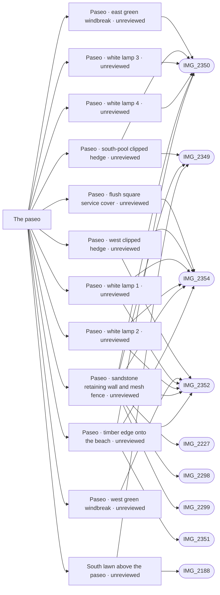

# The paseo

_Generated by `scripts/build_references.py`. Do not edit: change `data/areas.json` or `data/reference_tags.json` and rebuild._

The seafront promenade between the resort's seaward walls and the beach.

## Known facts and open questions

- IMG_2350: the paseo is pink stamped concrete with a timber edge onto the beach; a yellow sandstone retaining wall with a green mesh fence on top holds the seafront houses above it. Built 14 October (data/paseo_wall.json, docs/SEAFRONT.md): about 134 m from the Dalí apron to the end of Calle Guillermo, about 1 m high by the south lawn (the paseo there was lowered from street level to match), lower towards Dalí.
- Open: towards its east end the model makes the wall up to 3 m (the paseo falls to big-pool level there), but IMG_2227 from the beach suggests it stays about 1 m. A photo from the paseo near Calle Guillermo would settle it.
- IMG_2349, IMG_2352 and IMG_2354 show the same sandstone retaining wall and green mesh fence running along the paseo, including right below the south pool (IMG_2349).
- Issue #35: paseo centreline generated 1.5 m seaward of the aerial/photo-backed sandstone wall, 3 m approximate width; pavement now meets the face as IMG_2350/IMG_2352/IMG_2354 show. Southwest former hold-in removed against aerial; gate approach and Barraka boardwalk OSM joins retained. Plan accuracy about 1-2 m, not a survey. Eastern wall height (#40) and registry house obstruction (#41) remain unresolved; levels and footprints unchanged.
- Issue #40 evidence review (15 October): IMG_2227/IMG_2226 from the beach and IMG_2350 looking east do not resolve whether the paseo rises or the gardens fall near Guillermo. The nominal 3 m east-end wall is a result of the approximate paseo profile against assumed inland ground, not a measured height. All levels retained, including Dave's main-pool drop; task remains open. See docs/PASEO_EAST_END_HEIGHT_REVIEW.md for the specific photo needed.
- Issue #49: Details-only bounded clipped hedges behind mesh (IMG_2349/2352/2354), short green cloth runs (IMG_2350/2352), four photographed slim white lamps on the paving at the wall foot and a flush service-cover surface (IMG_2354). Positions/dimensions estimated relative to shared wall, not GPS subjects. Along the wall run the protected route is the 2.2 m clear walk beyond the lamps (paving stays 3 m), so all four lamps stand where the photos show them; lamp count/spacing beyond the photographed run is not invented.
- Issue #41 (16 October): after PR #64 the eastern OSM paseo still entered registry part 6465801UF1366N_part5 by 2.8 m (and part6 by 0.5 m), not 0.64 m from it. On the aerial the pink paseo (about 3.5 m wide) crosses both parts and the rest of part5 is open sand; neighbouring registry roofs match the image, and IMG_2346/IMG_2347 (pins about 4 m) show sand, the Barraka sign planter and a walkway there. So the footprint, not the line, was wrong: both parts keep their exact rings as dashed registry outlines with floors 0 (data/registry_corrections.json), no longer extruded or solid. Paseo points unchanged; the whole paseo now keeps 1.5 m from every standing house and is walked end to end both ways. Open: east of Barraka the OSM line runs along the landward edge of the pink strip, about 2 m landward of its centre on the aerial.

## Read first

- docs: `docs/SEAFRONT.md`
- data: `data/coastal_gate.json`, `data/paseo_wall.json`, `data/paseo_details.json`, `data/registry_corrections.json`
- src: `src/seafront.ts`, `src/seaside.ts`, `src/paseo-wall.ts`, `src/paseo-details.ts`
- contact sheet: `villacana-reference/contact-sheets/paseo.jpg` (thumbnails of everything below, numbered in this order)

## Coverage

Layout: 14, Levels and slopes: 7, Facades and roofs: 3, Materials: 4, Views: 3
15 reviewed, 0 suggested only by camera position.

## Open build tasks

From `data/build_queue.json`; issue bodies in `refs/issues/`.

| Priority | Task | What | Status | Photos |
| --- | --- | --- | --- | --- |
| P2 | `paseo-east-end-height` [#40](https://github.com/daveyboyc/villacana-venture/issues/40) | Paseo east end: wall height towards the big pool (after paseo-retrace-line) | in-progress · Codex issue-40 · placement: not-verified | [IMG_2227](../../public/photos-ref/IMG_2227.jpg), [IMG_2350](../../public/photos-ref/IMG_2350.jpg), [IMG_2226](../../public/photos-ref/IMG_2226.jpg) |

## Built from these photos

Model features that cite photos of this area, from `public/photos-ref/evidence-graph.json`, with their photo-check state. A citation records what a feature was traced from; only a check in `data/photo_checks.json` says someone rendered it from the photo's camera and compared.

## Placement evidence

`verification` is placement status, separate from photographic diagnostics. Earlier manual reviews may exist. Only a fresh measured packet and independent approval can grant `verified`.

| Feature | Placement | Photo diagnostics | Blockers |
| --- | --- | --- | --- |
| `paseo_details.json:paseo-east-windbreak` | unreviewed | unchecked | No measured placement packet and independent approval recorded; earlier manual reviews may exist. |
| `paseo_details.json:paseo-pool-hedge` | unreviewed | unchecked | No measured placement packet and independent approval recorded; earlier manual reviews may exist. |
| `paseo_details.json:paseo-service-cover` | unreviewed | unchecked | No measured placement packet and independent approval recorded; earlier manual reviews may exist. |
| `paseo_details.json:paseo-west-hedge` | unreviewed | unchecked | No measured placement packet and independent approval recorded; earlier manual reviews may exist. |
| `paseo_details.json:paseo-west-windbreak` | unreviewed | unchecked | No measured placement packet and independent approval recorded; earlier manual reviews may exist. |
| `paseo_details.json:paseo-white-lamp-1` | unreviewed | unchecked | No measured placement packet and independent approval recorded; earlier manual reviews may exist. |
| `paseo_details.json:paseo-white-lamp-2` | unreviewed | unchecked | No measured placement packet and independent approval recorded; earlier manual reviews may exist. |
| `paseo_details.json:paseo-white-lamp-3` | unreviewed | unchecked | No measured placement packet and independent approval recorded; earlier manual reviews may exist. |
| `paseo_details.json:paseo-white-lamp-4` | unreviewed | unchecked | No measured placement packet and independent approval recorded; earlier manual reviews may exist. |
| `paseo_wall.json:paseo-retaining-wall` | unreviewed | unchecked | No measured placement packet and independent approval recorded; earlier manual reviews may exist. |
| `paseo_wall.json:paseo-timber-edge` | unreviewed | unchecked | No measured placement packet and independent approval recorded; earlier manual reviews may exist. |
| `south_pool.json:south-pool-seaward-level` | unreviewed | unchecked | No measured placement packet and independent approval recorded; earlier manual reviews may exist. |

**Built without complete newer photo-check records:** `paseo-retaining-wall`, `paseo-retrace-line`, `paseo-house-clearance`, `paseo-details`. Earlier manual reviews may exist; this record does not establish photographic fidelity. See the verification backlog in `refs/QUEUE.md`.

## Reviewed references

| Reference | Viewpoint | Use for | What it shows |
| --- | --- | --- | --- |
| [IMG_2350.jpg](../../public/photos-ref/IMG_2350.jpg) | ground | layout, levels, materials, view | Paseo looking north-east: stamped walk, sandstone retaining wall **Note:** The sandstone retaining wall shows the resort ground standing about 1.2 m above the paseo here. _Used by: paseo_wall.json:paseo-retaining-wall, paseo_wall.json:paseo-timber-edge, paseo_details.json:paseo-pool-hedge, paseo_details.json:paseo-east-windbreak, paseo_details.json:paseo-white-lamp-3, paseo_details.json:paseo-white-lamp-4._ |
| [IMG_2352.jpg](../../public/photos-ref/IMG_2352.jpg) | ground | layout, levels, materials | Paseo looking west: sandstone wall, mesh fence, lamp posts _Used by: paseo_wall.json:paseo-retaining-wall, paseo_wall.json:paseo-timber-edge, paseo_details.json:paseo-west-hedge, paseo_details.json:paseo-west-windbreak, paseo_details.json:paseo-white-lamp-1, paseo_details.json:paseo-white-lamp-2._ |
| [IMG_2354.jpg](../../public/photos-ref/IMG_2354.jpg) | ground | layout, levels | Paseo curving north-east beside the sandstone wall _Used by: paseo_wall.json:paseo-retaining-wall, paseo_wall.json:paseo-timber-edge, paseo_details.json:paseo-west-hedge, paseo_details.json:paseo-white-lamp-1, paseo_details.json:paseo-white-lamp-2, paseo_details.json:paseo-service-cover._ |
| [IMG_2349.jpg](../../public/photos-ref/IMG_2349.jpg) | ground | levels, layout, materials | From the paseo: sandstone retaining wall and fence below the south pool **Note:** Shows the retaining wall right below the south pool. _Used by: paseo_wall.json:paseo-retaining-wall, south_pool.json:south-pool-seaward-level, paseo_details.json:paseo-pool-hedge._ |
| [IMG_2351.jpg](../../public/photos-ref/IMG_2351.jpg) | ground | materials, view | Paseo looking south: stamped walk, timber edge, beach and sea _Used by: paseo_wall.json:paseo-timber-edge._ |
| [IMG_2284.jpg](../../public/photos-ref/IMG_2284.jpg) | ground | layout | Pintor Dalí: pedestrian gate to the paseo _Used by: coastal_gate.json:dali-coastal-mesh-base, coastal_gate.json:dali-coastal-gate-pier, coastal_gate.json:dali-coastal-solid-wall, gate:dali-coastal-gate._ |
| [IMG_2296.jpg](../../public/photos-ref/IMG_2296.jpg) | ground | layout | Dalí seaward end: parking turn and coast boundary _Used by: coastal_gate.json:dali-coastal-mesh-base, coastal_gate.json:dali-coastal-gate-pier, coastal_gate.json:dali-coastal-solid-wall, gate:dali-coastal-gate._ |
| [IMG_2297.jpg](../../public/photos-ref/IMG_2297.jpg) | ground | layout | Dalí seaward end: narrow pedestrian gate _Used by: coastal_gate.json:dali-coastal-mesh-base, coastal_gate.json:dali-coastal-gate-pier, coastal_gate.json:dali-coastal-solid-wall, gate:dali-coastal-gate._ |
| `villacana-reference/apple-maps/10-3d-guillermo-and-main-pool-from-sea-wide.png` | aerial | layout, levels, facades | Apple Maps 3D: main-pool west lane and promenade from the sea **Note:** Wide oblique overview of tiled roofs, the lane beside the main-pool terrace and the promenade. Inspected full-size 2026-10-22. Photogrammetry is distorted; this is contextual evidence, not measured heights or hidden-edge tracing. Not used to place the middle-pool entrance lane beds or grilles. Catalogued from private reference commit 24d14f7cd3e3f0f9e7014236819eec2895111e0b. |
| `villacana-reference/apple-maps/11-3d-guillermo-slope-to-paseo.png` | aerial | layout, levels, facades | Apple Maps 3D: main-pool west lane descending to the promenade **Note:** Closer view of the descending lane, retaining edge and seaward gateway beside the main pool. Inspected full-size 2026-10-22. Photogrammetry is distorted; this is contextual evidence, not measured heights or hidden-edge tracing. Not used to place the middle-pool entrance lane beds or grilles. Catalogued from private reference commit 24d14f7cd3e3f0f9e7014236819eec2895111e0b. |
| `villacana-reference/apple-maps/13-3d-main-pool-terrace-both-stairs.png` | aerial | layout, levels, facades | Apple Maps 3D: main-pool terrace and both stair ends **Note:** Main-pool terrace with western stairs and rounded eastern stair end, pool, toddler pool and promenade. Inspected full-size 2026-10-22. Photogrammetry is distorted; this is contextual evidence, not measured heights or hidden-edge tracing. Not used to place the middle-pool entrance lane beds or grilles. Catalogued from private reference commit 24d14f7cd3e3f0f9e7014236819eec2895111e0b. |
| `villacana-reference/web/south-pool-02-looking-south-east-sea.jpg` | ground | layout, view | South pool looking south-east: sea beyond, low white wall and fence at the seaward edge **Note:** Found on the web. Reference only, never publish. |
| [IMG_2281.jpg](../../public/photos-ref/IMG_2281.jpg) | ground | layout | Pintor Dalí seaward end: turning area and fence |
| [IMG_2282.jpg](../../public/photos-ref/IMG_2282.jpg) | ground | layout | Pintor Dalí seaward end: wall and paseo boundary |
| `villacana-reference/apple-maps/03-3d-south-pool-and-promenade.png` | aerial | layout | Apple Maps 3D: south pool, its lawn and the beach promenade |
