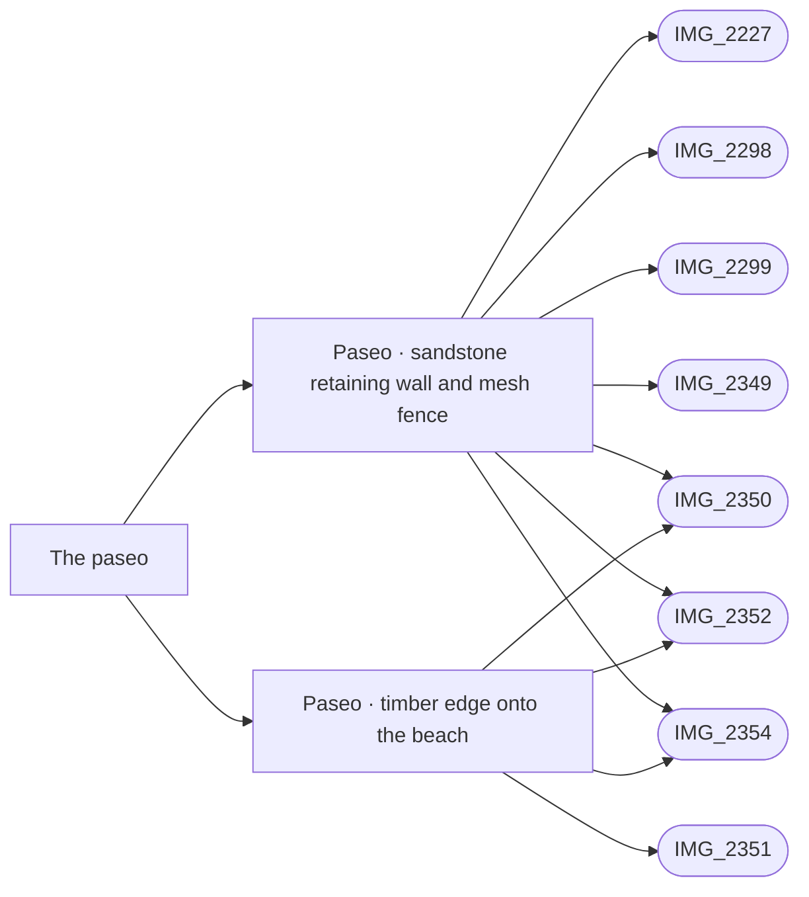

# The paseo

_Generated by `scripts/build_references.py`. Do not edit: change `data/areas.json` or `data/reference_tags.json` and rebuild._

The seafront promenade between the resort's seaward walls and the beach.

## Known facts and open questions

- IMG_2350: the paseo is pink stamped concrete with a timber edge onto the beach; a yellow sandstone retaining wall with a green mesh fence on top holds the seafront houses above it. Built 14 October (data/paseo_wall.json, docs/SEAFRONT.md): about 134 m from the Dalí apron to the end of Calle Guillermo, about 1 m high by the south lawn (the paseo there was lowered from street level to match), lower towards Dalí.
- Open: towards its east end the model makes the wall up to 3 m (the paseo falls to big-pool level there), but IMG_2227 from the beach suggests it stays about 1 m. A photo from the paseo near Calle Guillermo would settle it. The mapped (OSM) paseo line also sits up to 3 m seaward of the wall in places, leaving a sand strip the photos do not show.
- IMG_2349, IMG_2352 and IMG_2354 show the same sandstone retaining wall and green mesh fence running along the paseo, including right below the south pool (IMG_2349).

## Read first

- docs: `docs/SEAFRONT.md`
- data: `data/coastal_gate.json`, `data/paseo_wall.json`
- src: `src/seafront.ts`, `src/seaside.ts`, `src/paseo-wall.ts`
- contact sheet: `villacana-reference/contact-sheets/paseo.jpg` (thumbnails of everything below, numbered in this order)

## Coverage

Layout: 11, Levels and slopes: 4, Materials: 4, Views: 3
12 reviewed, 0 suggested only by camera position.

## Built from these photos

Model features that cite photos of this area, from `public/photos-ref/evidence-graph.json`. A citation records what a feature was traced from; it does not prove the feature matches.

## Reviewed references

| Reference | Viewpoint | Use for | What it shows |
| --- | --- | --- | --- |
| [IMG_2350.jpg](../../public/photos-ref/IMG_2350.jpg) | ground | layout, levels, materials, view | Paseo looking north-east: stamped walk, sandstone retaining wall **Note:** The sandstone retaining wall shows the resort ground standing about 1.2 m above the paseo here. _Used by: paseo_wall.json:paseo-retaining-wall, paseo_wall.json:paseo-timber-edge._ |
| [IMG_2352.jpg](../../public/photos-ref/IMG_2352.jpg) | ground | layout, levels, materials | Paseo looking west: sandstone wall, mesh fence, lamp posts _Used by: paseo_wall.json:paseo-retaining-wall, paseo_wall.json:paseo-timber-edge._ |
| [IMG_2354.jpg](../../public/photos-ref/IMG_2354.jpg) | ground | layout, levels | Paseo curving north-east beside the sandstone wall _Used by: paseo_wall.json:paseo-retaining-wall, paseo_wall.json:paseo-timber-edge._ |
| [IMG_2349.jpg](../../public/photos-ref/IMG_2349.jpg) | ground | levels, layout, materials | From the paseo: sandstone retaining wall and fence below the south pool **Note:** Shows the retaining wall right below the south pool. _Used by: paseo_wall.json:paseo-retaining-wall._ |
| [IMG_2351.jpg](../../public/photos-ref/IMG_2351.jpg) | ground | materials, view | Paseo looking south: stamped walk, timber edge, beach and sea _Used by: paseo_wall.json:paseo-timber-edge._ |
| [IMG_2284.jpg](../../public/photos-ref/IMG_2284.jpg) | ground | layout | Pintor Dalí: pedestrian gate to the paseo _Used by: coastal_gate.json:dali-coastal-mesh-base, coastal_gate.json:dali-coastal-gate-pier, coastal_gate.json:dali-coastal-solid-wall, gate:dali-coastal-gate._ |
| [IMG_2296.jpg](../../public/photos-ref/IMG_2296.jpg) | ground | layout | Dalí seaward end: parking turn and coast boundary _Used by: coastal_gate.json:dali-coastal-mesh-base, coastal_gate.json:dali-coastal-gate-pier, coastal_gate.json:dali-coastal-solid-wall, gate:dali-coastal-gate._ |
| [IMG_2297.jpg](../../public/photos-ref/IMG_2297.jpg) | ground | layout | Dalí seaward end: narrow pedestrian gate _Used by: coastal_gate.json:dali-coastal-mesh-base, coastal_gate.json:dali-coastal-gate-pier, coastal_gate.json:dali-coastal-solid-wall, gate:dali-coastal-gate._ |
| `villacana-reference/web/south-pool-02-looking-south-east-sea.jpg` | ground | layout, view | South pool looking south-east: sea beyond, low white wall and fence at the seaward edge **Note:** Found on the web. Reference only, never publish. |
| [IMG_2281.jpg](../../public/photos-ref/IMG_2281.jpg) | ground | layout | Pintor Dalí seaward end: turning area and fence |
| [IMG_2282.jpg](../../public/photos-ref/IMG_2282.jpg) | ground | layout | Pintor Dalí seaward end: wall and paseo boundary |
| `villacana-reference/apple-maps/03-3d-south-pool-and-promenade.png` | aerial | layout | Apple Maps 3D: south pool, its lawn and the beach promenade |
