# Pintor Picasso and the car park

_Generated by `scripts/build_references.py`. Do not edit: change `data/areas.json` or `data/reference_tags.json` and rebuild._

Calle Pintor Picasso, the inner car-park access aisle and the Picasso car park.

## Known facts and open questions

- IMG_2345 supports bounded utility fronts/brown doors, boundary wall, stone plinth/railings, short ramp and Details-only bins. Frontage offsets and dimensions remain estimated at the existing Picasso road; registry houses, asphalt route and site levels are retained. Ramp is solid inaccessible private-frontage geometry; no new walkable elevated platform or unseen wall continuation is asserted.
- 24 November 2026 (photo coverage, IMG_3097-3131 and 3184-3203): the car park is bounded on the east by a plain white wall with a level top (laser survey: about 1.4 m high at the uphill north end, 3.1 m at the south end), about 107 m long, from (-91.4, -67.8) to (-35.7, 23.9) on the aerial, with the Calle Pintor Picasso service road and a cypress hedge outside it (IMG_3125, IMG_3129). Inside: a west row of angled bays against a hedge, a central nose-to-nose row with palms, a hedge-ringed round palm island near the south end (IMG_3100), and two accessible bays at the south end facing a low azulejo-tiled step onto the terracotta walk to the community office (IMG_3097, 3098, 3189, 3194). In the south-east corner stand the bin store (RUBBISH COLLECTION / DEPOSITO BASURA, IMG_3099, 3101) with a walled yard of yellow containers (IMG_3103) and recycling igloos at the hotel wall (IMG_3104). The service road continues south-east between the hotel's ground floor (ramps, sliding gate, IMG_3121) and white utility buildings with maroon substation doors (IMG_3106, 3123). The model has none of the wall, island planting or south step, and its car-park outline, central row and access line are off the aerial: see the picasso-car-park-* and picasso-access-off-aisle discrepancies and docs/reviews/picasso-car-park. No camera is solved yet.
- 25 November 2026 (picasso-car-park-barrier): the security barrier at the north entrance is built from IMG_3131 as a shared asset (src/car-park-barrier.ts), closed: a white boom with red edges at about 1 m resting in the V fork of a red rest post with a black photocell box, and a red-white bollard just beyond. Ground-plane readings at an assumed 1.5 m eye height put the rest post 2.6 m ahead and 0.7 m right of the camera, so with the phone pin and compass it stands at about (-105.7, -64.8), good to about 5 m and 25 degrees. The pivot end and drive cabinet are out of frame (inferred). Open: the ground there is asphalt in the photo but terracotta in the model; the brick path, CALLE DE PICASSO plinth, lane separator and whether the other lane has a second barrier are not built (picasso-car-park-north-entrance-apron, gap:picasso-car-park-second-barrier, task picasso-car-park-north-entrance). IMG_3131's reviewed looksAt points about 23 degrees right of its compass heading; the brick path edge in the photo runs parallel to the car-park aisles only with the compass heading.
- 25 November 2026 (later; Dave: there is a second barrier, with Street View from Calle Loira and Calle Bolivia, Oct 2024, and a Google 3D top-down screenshot, reference/google-maps/03-05, Imagery © Google): the north entrance has two lanes either side of the gatehouse island. The west lane, between the island and the narrow planter, is the entry (lane arrow inward); the east lane, between the island and the long wall's north end, is the exit (no-entry sign towards Bolivia). Each has a boom from a white drive cabinet about 1 m high on the island to a rest post; the entry rest post has a red-white bollard beyond it. Both are placed from the Google top-down view registered to the aerial (0.0385 m per pixel, wall north end on (-91.4, -67.8)), good to about 1.5 m: entry rest post (-110.46, -62.02), cabinet end (-104.95, -62.87), boom 5.6 m; exit rest post (-90.36, -64.84), cabinet end (-95.21, -64.22), boom 4.9 m. IMG_3131's pin was 5.5 m east; its camera is corrected to (-107.8, -61.9).
- 25 November 2026 (picasso-car-park-north-entrance): the north entrance's ground is traced in data/ground_plan_picasso.json from Dave's Google 3D top-down screenshot registered to the aerial (about 1.5 m): asphalt round both lanes and west of the narrow planter (the model had generic terracotta), the gatehouse island with a terracotta apron and white kerb, its round lawn bed with a brick border, and the narrow planter with its kerb. The gatehouse (about 3.4 m square, 2.9 m high, white, flat-roofed, grilled window; not in the registry) is built plain from picasso_car_park.json. Still to build: the brick path, lawn strip and CALLE DE PICASSO plinth west of the entry lane, the ramp, the island's trees and palms, the planter's bougainvillea and notice pillar, and the signs.
- 25 November 2026 (detail pass; Dave's Street View from Calle Bolivia, reference/google-maps/06-08, Oct 2024, Imagery © Google): the north entrance now has the gatehouse's arched grilled windows, blue plaque and sloping white wing walls; the STOP and ACCESO PLAYA signs on the island, the no-entry sign over the exit cabinet, the blue dead-end sign at the long wall's north end and the COMUNIDAD VILLACANA board; the notice pillar at the narrow planter; the island's strelitzias, sago palms, feathery tree and palm and the planter's bougainvillea; and west of the entry lane the terracotta path with its brick edge, the lawn strip, the CALLE DE PICASSO plinth and a lantern (data/picasso_entrance_details.json, data/ground_plan_picasso.json). All estimated. Still to build: the ramp between white walls with the CALLE JUAN GRIS plaque.
- 25 November 2026 (Dave: the path on the car park's west side is Calle Picasso; task picasso-west-path): Calle de Picasso is the footpath behind the hedge strip at the back of the west bays, from the CALLE DE PICASSO plinth and lantern, where it meets the Juan Gris paving, to the end of Calle Eva. It is retraced on the pale band the straightened aerial shows 8.4 m west of the bays' car line (0.45 m rms), 1.8 m wide (street_layout.json picasso-access, which was a 4 m asphalt 'car-park access' line about 2 m further east). The laser survey has it on three level stretches, +1.17 m from the plinth, +0.71 m from about 41 m along and +0.20 m from about 83 m, where Calle Cervantes crosses it into the car park; each drop (0.45 and 0.42 m) is built as three steps on the house side beside a ramp (data/picasso_path_steps.json), inferred from the resort's other lane drops because no photo shows them. The hedge strip stands at the path's level, 0.4-0.9 m above the bays, so the car-park outline's west edge is pulled back to the bays with a gap for Cervantes. Open: the form of each drop, the edge between the hedge strip and the bays, a 0.24 m dip just before Calle Eva, and the path's paving (photo request picasso-west-path-drops).
- 26 November 2026 (Dave: the grass area beside Calle Picasso is not at ground level): the grass strip between Calle de Picasso and the west bays is built raised, level with the path and stepping down with it, on a white retaining wall at the back of the bays (data/picasso_west_lawn.json, src/picasso-west-lawn.ts). The laser survey puts the wall's face 3.1 m west of the bays' car line and the grass up to 0.84 m above the cars about 30 m along, 0.45-0.6 m in the middle stretch and 0.1-0.3 m south of Cervantes, where the strip is broken for the lane. The terrain grid holds the car park at its own level up to the wall, and the car-park outline's west edge is the wall's face. Inferred: not photographed; the wall's finish, coping and any hedge on it are guesses.
- 26 November 2026 (Dave circled the bin store and the road from it down to the beach; task picasso-bin-store-service-road, stages 1-2, docs/reviews/picasso-bin-store-service-road): south of the car park, Calle Pintor Picasso runs between the hotel's lower wing (east) and a utility row (west). The lower wing is registry part 6465301UF1366N_part3, given 0 storeys by the registry and so never built; the aerial shows its red flat roof on the registry line and the laser survey a flat top at 3.78 m over the datum, about 4.4 m above the road, so it is built as a single storey (IMG_3104, 3105, 3120-3122). The bin store is an open-topped walled yard about 2.8 m deep and 14 m long against the long wall's inner face and running on 2.5 m past its end: its front on the car park has the DEPOSITO BASURA doorway (IMG_3099, 3100), and its street face, flush with the wall's, the green sliding door (IMG_3124); IMG_3101 is taken from inside, looking at that door. West of the road, after the bin store's street face: a set-back wall, the Ormazabal substation with maroon doors (IMG_3123, 3106), a recessed grey gate, a white meter box and a dark slatted gate (IMG_2345, 3106, 3120), on a kerbed pavement that narrows to nothing at the street door. The ground west of the row is the raised garden, about 1.2 m above the road (2020-21 ground model). The earlier IMG_2345-only wall and brown-door front are replaced. All estimated; no camera solved. Open: the road on to the beach (gap:picasso-service-road-to-beach), whether part of the bin store is roofed, the row's exact lengths, and detail (signs, doors, igloos, ramps and railings at the wing's foot).
- 26 November 2026 (Dave: add details to the outside, including the sign; Show details, data/picasso_service_frontage.json binStoreDetails, src/picasso-bin-store-details.ts): on the bin store's car-park front, north to south, the red EXTINTOR sign over a red fire-hose box, the blue motorbike-parking P sign, the white RUBBISH COLLECTION / DEPOSITO BASURA board, the green boarded double doors (north leaf open into the yard, south leaf shut), two prohibition roundels and a glazed cabinet, with bougainvillea along the top (IMG_3099, 3100). The doorway is 1.2 m wide and 2.15 m high, read against the 2.6 m front. On the street face: the shut green sliding door on a rail and hood running on north-west over the long wall, a yellow warning sign, switch box and lamp, and a concrete ramp down along the wall (IMG_3124, 3123). Inside, four yellow 1100 l containers side by side against the long wall in the yard's north half (Dave marked them on an Inspect screenshot, 26 Nov 2026; IMG_3103 shows the row). Positions read along each wall at its own scale, about 0.3 m. Still open: the conduit and low box on the set-back wall, the motorbike-bay markings, the shrub at the front's south end, the BASURA / RUBBISH BINS sign inside (IMG_3101).

## Read first

- docs: `docs/STREET_LAYOUT.md`, `docs/reviews/picasso-car-park/README.md`, `docs/reviews/picasso-bin-store-service-road/README.md`
- data: `data/street_layout.json`, `data/picasso_service_road.json`, `data/picasso_car_park.json`, `data/ground_plan_picasso.json`, `data/picasso_entrance_details.json`, `data/picasso_path_steps.json`, `data/picasso_west_lawn.json`, `data/picasso_service_frontage.json`, `data/terrain.json`
- src: `src/picasso-service-road.ts`, `src/picasso-car-park.ts`, `src/car-park-barrier.ts`, `src/picasso-entrance-details.ts`, `src/ramp-steps.ts`, `src/picasso-west-lawn.ts`, `src/picasso-service-frontage.ts`
- contact sheet: `reference/contact-sheets/picasso.jpg` (thumbnails of everything below, numbered in this order)

## Coverage

Layout: 29, Levels and slopes: 7, Facades and roofs: 11, Materials: 9, Planting: 11, Signs: 10, Views: 8
33 reviewed, 1 suggested only by camera position.

## Open build tasks

From `data/build_queue.json`; issue bodies in `refs/issues/`.

| Priority | Task | What | Status | Photos |
| --- | --- | --- | --- | --- |
| P2 | `ground-plan-picasso` | Pintor Picasso and the car park: smooth paths, patios and green spaces with their edges and boundaries (after ground-plan-framework) | open · placement: not-verified |  |
| P2 | `path-network-inventory-picasso` [#132](https://github.com/daveyboyc/villacana-venture/issues/132) | Pintor Picasso and the car park: full-source path, tunnel and boundary inventory (after path-network-baseline) | open · placement: not-applicable |  |
| P2 | `picasso-bin-store-service-road` | Bin store and Calle Pintor Picasso south of the car park: bin yard, utility row, hotel lower wing (layout) | in-progress · Claude · placement: not-verified | [IMG_3099](../../public/photos-ref/IMG_3099.jpg), [IMG_3100](../../public/photos-ref/IMG_3100.jpg), [IMG_3101](../../public/photos-ref/IMG_3101.jpg), [IMG_3103](../../public/photos-ref/IMG_3103.jpg), [IMG_3104](../../public/photos-ref/IMG_3104.jpg), [IMG_3105](../../public/photos-ref/IMG_3105.jpg), [IMG_3106](../../public/photos-ref/IMG_3106.jpg), [IMG_3120](../../public/photos-ref/IMG_3120.jpg), [IMG_3121](../../public/photos-ref/IMG_3121.jpg), [IMG_3122](../../public/photos-ref/IMG_3122.jpg), [IMG_3123](../../public/photos-ref/IMG_3123.jpg), [IMG_3124](../../public/photos-ref/IMG_3124.jpg), [IMG_2345](../../public/photos-ref/IMG_2345.jpg) |
| P2 | `picasso-car-park-barrier` | Main car park: the security barrier at the north entrance (asset and placement) | in-progress · Claude · placement: not-verified | [IMG_3131](../../public/photos-ref/IMG_3131.jpg) |
| P2 | `picasso-car-park-north-entrance` | Main car park north entrance: asphalt apron, lanes, separator and the CALLE DE PICASSO plinth | in-progress · Claude · placement: not-verified | [IMG_3131](../../public/photos-ref/IMG_3131.jpg), [IMG_3130](../../public/photos-ref/IMG_3130.jpg), `google-maps/03-street-view-loira-entry-barrier-2024-10.jpg`, `google-maps/04-street-view-bolivia-exit-barrier-2024-10.jpg`, `google-maps/05-3d-top-down-car-park-north-entrance.jpg`, `google-maps/06-street-view-bolivia-gatehouse-north-2024-10.jpg`, `google-maps/07-street-view-bolivia-gatehouse-window-2024-10.jpg`, `google-maps/08-street-view-bolivia-exit-lane-2024-10.jpg` |
| P2 | `picasso-service-road-levels-and-beach` | Calle Pintor Picasso south of the car park: levels behind the utility row, and the road on to the beach (after picasso-bin-store-service-road) | open · placement: not-verified | [IMG_3105](../../public/photos-ref/IMG_3105.jpg), [IMG_3106](../../public/photos-ref/IMG_3106.jpg), [IMG_3123](../../public/photos-ref/IMG_3123.jpg), [IMG_3124](../../public/photos-ref/IMG_3124.jpg) |
| P2 | `picasso-west-path` | Calle de Picasso: the footpath on the car park's west side, its levels, steps and ramps | in-progress · Claude · placement: not-verified | [IMG_3131](../../public/photos-ref/IMG_3131.jpg), `google-maps/01-street-map-lane-names.png`, `google-maps/05-3d-top-down-car-park-north-entrance.jpg` |

## Built from these photos

Model features that cite photos of this area, from `public/photos-ref/evidence-graph.json`, with their photo-check state. A citation records what a feature was traced from; only a check in `data/photo_checks.json` says someone rendered it from the photo's camera and compared.

```mermaid
graph LR
  A["Pintor Picasso and the car park"]
  A --> F0["Narrow planter west of the entry lane · unreviewed"]
  F0 --> PIMG_3131_jpg(["IMG_3131"])
  F0 --> Pref_google_maps_03_street_view_loira_entry_barrier_2024_10_jpg(["03-street-view-loira-entry-barrier-2024-10"])
  F0 --> Pref_google_maps_05_3d_top_down_car_park_north_entrance_jpg(["05-3d-top-down-car-park-north-entrance"])
  A --> F1["Gatehouse island: terracotta apron on a white kerb · unreviewed"]
  F1 --> Pref_google_maps_03_street_view_loira_entry_barrier_2024_10_jpg(["03-street-view-loira-entry-barrier-2024-10"])
  F1 --> Pref_google_maps_04_street_view_bolivia_exit_barrier_2024_10_jpg(["04-street-view-bolivia-exit-barrier-2024-10"])
  F1 --> Pref_google_maps_05_3d_top_down_car_park_north_entrance_jpg(["05-3d-top-down-car-park-north-entrance"])
  A --> F2["Gatehouse island: round lawn bed · unreviewed"]
  F2 --> Pref_google_maps_03_street_view_loira_entry_barrier_2024_10_jpg(["03-street-view-loira-entry-barrier-2024-10"])
  F2 --> Pref_google_maps_05_3d_top_down_car_park_north_entrance_jpg(["05-3d-top-down-car-park-north-entrance"])
  A --> F3["Asphalt between Calle Pintor Picasso and the hotel's lower wing · unreviewed"]
  F3 --> PIMG_3104_jpg(["IMG_3104"])
  F3 --> PIMG_3105_jpg(["IMG_3105"])
  F3 --> PIMG_3120_jpg(["IMG_3120"])
  F3 --> PIMG_3121_jpg(["IMG_3121"])
  F3 --> PIMG_3122_jpg(["IMG_3122"])
  A --> F4["Car park north entrance: asphalt round the gatehouse island · unreviewed"]
  F4 --> PIMG_3131_jpg(["IMG_3131"])
  F4 --> Pref_google_maps_03_street_view_loira_entry_barrier_2024_10_jpg(["03-street-view-loira-entry-barrier-2024-10"])
  F4 --> Pref_google_maps_04_street_view_bolivia_exit_barrier_2024_10_jpg(["04-street-view-bolivia-exit-barrier-2024-10"])
  F4 --> Pref_google_maps_05_3d_top_down_car_park_north_entrance_jpg(["05-3d-top-down-car-park-north-entrance"])
  A --> F5["Kerbed pavement along the utility row, west side of Calle Pintor Picasso south of the car park · unreviewed"]
  F5 --> PIMG_2345_jpg(["IMG_2345"])
  F5 --> PIMG_3105_jpg(["IMG_3105"])
  F5 --> PIMG_3106_jpg(["IMG_3106"])
  F5 --> PIMG_3123_jpg(["IMG_3123"])
  F5 --> PIMG_3124_jpg(["IMG_3124"])
  A --> F6["Terracotta path between the entry lane and the lawn strip · unreviewed"]
  F6 --> PIMG_3131_jpg(["IMG_3131"])
  F6 --> Pref_google_maps_05_3d_top_down_car_park_north_entrance_jpg(["05-3d-top-down-car-park-north-entrance"])
  A --> F7["Lawn strip west of the entry lane, with the CALLE DE PICASSO plinth · unreviewed"]
  F7 --> PIMG_3131_jpg(["IMG_3131"])
  F7 --> Pref_google_maps_05_3d_top_down_car_park_north_entrance_jpg(["05-3d-top-down-car-park-north-entrance"])
  A --> F8["Exit barrier, east lane of the car park's north entrance, between the gatehouse island and the long wall · disputed"]
  F8 --> Pref_google_maps_04_street_view_bolivia_exit_barrier_2024_10_jpg(["04-street-view-bolivia-exit-barrier-2024-10"])
  F8 --> Pref_google_maps_05_3d_top_down_car_park_north_entrance_jpg(["05-3d-top-down-car-park-north-entrance"])
  A --> F9["Gatehouse on the island between the car park's entry and exit lanes · unreviewed"]
  F9 --> Pref_google_maps_03_street_view_loira_entry_barrier_2024_10_jpg(["03-street-view-loira-entry-barrier-2024-10"])
  F9 --> Pref_google_maps_04_street_view_bolivia_exit_barrier_2024_10_jpg(["04-street-view-bolivia-exit-barrier-2024-10"])
  F9 --> Pref_google_maps_05_3d_top_down_car_park_north_entrance_jpg(["05-3d-top-down-car-park-north-entrance"])
  A --> F10["Round hedged palm island in the main car park · unreviewed"]
  F10 --> PIMG_3100_jpg(["IMG_3100"])
  F10 --> PIMG_3189_jpg(["IMG_3189"])
  A --> F11["Entry barrier, west lane of the car park's north entrance (boom, rest post and bollard) · disputed"]
  F11 --> PIMG_3131_jpg(["IMG_3131"])
  F11 --> Pref_google_maps_03_street_view_loira_entry_barrier_2024_10_jpg(["03-street-view-loira-entry-barrier-2024-10"])
  F11 --> Pref_google_maps_05_3d_top_down_car_park_north_entrance_jpg(["05-3d-top-down-car-park-north-entrance"])
  A --> F12["Long white wall between the car park and Calle Pintor Picasso · unreviewed"]
  F12 --> PIMG_3124_jpg(["IMG_3124"])
  F12 --> PIMG_3125_jpg(["IMG_3125"])
  F12 --> PIMG_3129_jpg(["IMG_3129"])
  A --> F13["North entrance · lantern by the plinth · unreviewed"]
  F13 --> PIMG_3131_jpg(["IMG_3131"])
  F13 --> Pref_google_maps_03_street_view_loira_entry_barrier_2024_10_jpg(["03-street-view-loira-entry-barrier-2024-10"])
  F13 --> Pref_google_maps_04_street_view_bolivia_exit_barrier_2024_10_jpg(["04-street-view-bolivia-exit-barrier-2024-10"])
  F13 --> Pref_google_maps_05_3d_top_down_car_park_north_entrance_jpg(["05-3d-top-down-car-park-north-entrance"])
  F13 --> Pref_google_maps_06_street_view_bolivia_gatehouse_north_2024_10_jpg(["06-street-view-bolivia-gatehouse-north-2024-10"])
  F13 --> Pref_google_maps_07_street_view_bolivia_gatehouse_window_2024_10_jpg(["07-street-view-bolivia-gatehouse-window-2024-10"])
  F13 --> Pref_google_maps_08_street_view_bolivia_exit_lane_2024_10_jpg(["08-street-view-bolivia-exit-lane-2024-10"])
  A --> F14["North entrance · notice pillar at the narrow planter · unreviewed"]
  F14 --> PIMG_3131_jpg(["IMG_3131"])
  F14 --> Pref_google_maps_03_street_view_loira_entry_barrier_2024_10_jpg(["03-street-view-loira-entry-barrier-2024-10"])
  F14 --> Pref_google_maps_04_street_view_bolivia_exit_barrier_2024_10_jpg(["04-street-view-bolivia-exit-barrier-2024-10"])
  F14 --> Pref_google_maps_05_3d_top_down_car_park_north_entrance_jpg(["05-3d-top-down-car-park-north-entrance"])
  F14 --> Pref_google_maps_06_street_view_bolivia_gatehouse_north_2024_10_jpg(["06-street-view-bolivia-gatehouse-north-2024-10"])
  F14 --> Pref_google_maps_07_street_view_bolivia_gatehouse_window_2024_10_jpg(["07-street-view-bolivia-gatehouse-window-2024-10"])
  F14 --> Pref_google_maps_08_street_view_bolivia_exit_lane_2024_10_jpg(["08-street-view-bolivia-exit-lane-2024-10"])
  A --> F15["North entrance · island strelitzias, cycads, tree and palm, planter bougainvillea · unreviewed"]
  F15 --> PIMG_3131_jpg(["IMG_3131"])
  F15 --> Pref_google_maps_03_street_view_loira_entry_barrier_2024_10_jpg(["03-street-view-loira-entry-barrier-2024-10"])
  F15 --> Pref_google_maps_04_street_view_bolivia_exit_barrier_2024_10_jpg(["04-street-view-bolivia-exit-barrier-2024-10"])
  F15 --> Pref_google_maps_05_3d_top_down_car_park_north_entrance_jpg(["05-3d-top-down-car-park-north-entrance"])
  F15 --> Pref_google_maps_06_street_view_bolivia_gatehouse_north_2024_10_jpg(["06-street-view-bolivia-gatehouse-north-2024-10"])
  F15 --> Pref_google_maps_07_street_view_bolivia_gatehouse_window_2024_10_jpg(["07-street-view-bolivia-gatehouse-window-2024-10"])
  F15 --> Pref_google_maps_08_street_view_bolivia_exit_lane_2024_10_jpg(["08-street-view-bolivia-exit-lane-2024-10"])
  A --> F16["North entrance · CALLE DE PICASSO plinth · unreviewed"]
  F16 --> PIMG_3131_jpg(["IMG_3131"])
  F16 --> Pref_google_maps_03_street_view_loira_entry_barrier_2024_10_jpg(["03-street-view-loira-entry-barrier-2024-10"])
  F16 --> Pref_google_maps_04_street_view_bolivia_exit_barrier_2024_10_jpg(["04-street-view-bolivia-exit-barrier-2024-10"])
  F16 --> Pref_google_maps_05_3d_top_down_car_park_north_entrance_jpg(["05-3d-top-down-car-park-north-entrance"])
  F16 --> Pref_google_maps_06_street_view_bolivia_gatehouse_north_2024_10_jpg(["06-street-view-bolivia-gatehouse-north-2024-10"])
  F16 --> Pref_google_maps_07_street_view_bolivia_gatehouse_window_2024_10_jpg(["07-street-view-bolivia-gatehouse-window-2024-10"])
  F16 --> Pref_google_maps_08_street_view_bolivia_exit_lane_2024_10_jpg(["08-street-view-bolivia-exit-lane-2024-10"])
  A --> F17["North entrance · STOP, beach, no-entry and dead-end signs and the community board · unreviewed"]
  F17 --> PIMG_3131_jpg(["IMG_3131"])
  F17 --> Pref_google_maps_03_street_view_loira_entry_barrier_2024_10_jpg(["03-street-view-loira-entry-barrier-2024-10"])
  F17 --> Pref_google_maps_04_street_view_bolivia_exit_barrier_2024_10_jpg(["04-street-view-bolivia-exit-barrier-2024-10"])
  F17 --> Pref_google_maps_05_3d_top_down_car_park_north_entrance_jpg(["05-3d-top-down-car-park-north-entrance"])
  F17 --> Pref_google_maps_06_street_view_bolivia_gatehouse_north_2024_10_jpg(["06-street-view-bolivia-gatehouse-north-2024-10"])
  F17 --> Pref_google_maps_07_street_view_bolivia_gatehouse_window_2024_10_jpg(["07-street-view-bolivia-gatehouse-window-2024-10"])
  F17 --> Pref_google_maps_08_street_view_bolivia_exit_lane_2024_10_jpg(["08-street-view-bolivia-exit-lane-2024-10"])
  A --> F18["North entrance · gatehouse arched grilled windows · unreviewed"]
  F18 --> PIMG_3131_jpg(["IMG_3131"])
  F18 --> Pref_google_maps_03_street_view_loira_entry_barrier_2024_10_jpg(["03-street-view-loira-entry-barrier-2024-10"])
  F18 --> Pref_google_maps_04_street_view_bolivia_exit_barrier_2024_10_jpg(["04-street-view-bolivia-exit-barrier-2024-10"])
  F18 --> Pref_google_maps_05_3d_top_down_car_park_north_entrance_jpg(["05-3d-top-down-car-park-north-entrance"])
  F18 --> Pref_google_maps_06_street_view_bolivia_gatehouse_north_2024_10_jpg(["06-street-view-bolivia-gatehouse-north-2024-10"])
  F18 --> Pref_google_maps_07_street_view_bolivia_gatehouse_window_2024_10_jpg(["07-street-view-bolivia-gatehouse-window-2024-10"])
  F18 --> Pref_google_maps_08_street_view_bolivia_exit_lane_2024_10_jpg(["08-street-view-bolivia-exit-lane-2024-10"])
  A --> F19["North entrance · gatehouse wing walls · unreviewed"]
  F19 --> PIMG_3131_jpg(["IMG_3131"])
  F19 --> Pref_google_maps_03_street_view_loira_entry_barrier_2024_10_jpg(["03-street-view-loira-entry-barrier-2024-10"])
  F19 --> Pref_google_maps_04_street_view_bolivia_exit_barrier_2024_10_jpg(["04-street-view-bolivia-exit-barrier-2024-10"])
  F19 --> Pref_google_maps_05_3d_top_down_car_park_north_entrance_jpg(["05-3d-top-down-car-park-north-entrance"])
  F19 --> Pref_google_maps_06_street_view_bolivia_gatehouse_north_2024_10_jpg(["06-street-view-bolivia-gatehouse-north-2024-10"])
  F19 --> Pref_google_maps_07_street_view_bolivia_gatehouse_window_2024_10_jpg(["07-street-view-bolivia-gatehouse-window-2024-10"])
  F19 --> Pref_google_maps_08_street_view_bolivia_exit_lane_2024_10_jpg(["08-street-view-bolivia-exit-lane-2024-10"])
  A --> F20["Bin store: signs, doors, fire-safety boxes, bougainvillea and containers · disputed"]
  F20 --> PIMG_3099_jpg(["IMG_3099"])
  F20 --> PIMG_3100_jpg(["IMG_3100"])
  F20 --> PIMG_3101_jpg(["IMG_3101"])
  F20 --> PIMG_3103_jpg(["IMG_3103"])
  F20 --> PIMG_3123_jpg(["IMG_3123"])
  F20 --> PIMG_3124_jpg(["IMG_3124"])
  A --> F21["Bin store: walled bin yard at the car park's south-east corner (DEPOSITO BASURA), open to the street through a green sliding door · disputed"]
  F21 --> PIMG_3099_jpg(["IMG_3099"])
  F21 --> PIMG_3100_jpg(["IMG_3100"])
  F21 --> PIMG_3101_jpg(["IMG_3101"])
  F21 --> PIMG_3103_jpg(["IMG_3103"])
  F21 --> PIMG_3123_jpg(["IMG_3123"])
  F21 --> PIMG_3124_jpg(["IMG_3124"])
  A --> F22["Hotel's lower wing along Calle Pintor Picasso (registry 6465301UF1366N_part3) · disputed"]
  F22 --> PIMG_2345_jpg(["IMG_2345"])
  F22 --> PIMG_3099_jpg(["IMG_3099"])
  F22 --> PIMG_3104_jpg(["IMG_3104"])
  F22 --> PIMG_3105_jpg(["IMG_3105"])
  F22 --> PIMG_3120_jpg(["IMG_3120"])
  F22 --> PIMG_3121_jpg(["IMG_3121"])
  F22 --> PIMG_3122_jpg(["IMG_3122"])
  A --> F23["White meter cabinet building beside the substation · unreviewed"]
  F23 --> PIMG_2345_jpg(["IMG_2345"])
  A --> F24["Set-back white wall between the bin store's street face and the substation · disputed"]
  F24 --> PIMG_3123_jpg(["IMG_3123"])
  F24 --> PIMG_3124_jpg(["IMG_3124"])
  A --> F25["Narrow recessed grey gate between the substation and the meter box · unreviewed"]
  F25 --> PIMG_2345_jpg(["IMG_2345"])
  F25 --> PIMG_3106_jpg(["IMG_3106"])
  F25 --> PIMG_3120_jpg(["IMG_3120"])
  A --> F26["Dark slatted gate and fence beside the meter box · disputed"]
  F26 --> PIMG_2345_jpg(["IMG_2345"])
  A --> F27["Electricity substation (Ormazabal kiosk) with maroon doors · disputed"]
  F27 --> PIMG_2345_jpg(["IMG_2345"])
  F27 --> PIMG_3105_jpg(["IMG_3105"])
  F27 --> PIMG_3106_jpg(["IMG_3106"])
  F27 --> PIMG_3123_jpg(["IMG_3123"])
  A --> F28["picasso boundary wall · unreviewed"]
  F28 --> PIMG_2345_jpg(["IMG_2345"])
  A --> F29["picasso stone plinth · unreviewed"]
  F29 --> PIMG_2345_jpg(["IMG_2345"])
  A --> F30["picasso utility front · unreviewed"]
  F30 --> PIMG_2345_jpg(["IMG_2345"])
```

## Placement evidence

`verification` is placement status, separate from photographic diagnostics. Earlier manual reviews may exist. Only a fresh measured packet and independent approval can grant `verified`.

| Feature | Placement | Photo diagnostics | Blockers |
| --- | --- | --- | --- |
| `ground_plan_picasso.json:picasso-entry-planter` | unreviewed | unchecked | No measured placement packet and independent approval recorded; earlier manual reviews may exist. |
| `ground_plan_picasso.json:picasso-gatehouse-island` | unreviewed | unchecked | No measured placement packet and independent approval recorded; earlier manual reviews may exist. |
| `ground_plan_picasso.json:picasso-gatehouse-lawn` | unreviewed | unchecked | No measured placement packet and independent approval recorded; earlier manual reviews may exist. |
| `ground_plan_picasso.json:picasso-hotel-apron` | unreviewed | unchecked | No measured placement packet and independent approval recorded; earlier manual reviews may exist. |
| `ground_plan_picasso.json:picasso-north-entrance-asphalt` | unreviewed | unchecked | No measured placement packet and independent approval recorded; earlier manual reviews may exist. |
| `ground_plan_picasso.json:picasso-service-pavement` | unreviewed | unchecked | No measured placement packet and independent approval recorded; earlier manual reviews may exist. |
| `ground_plan_picasso.json:picasso-west-brick-path` | unreviewed | unchecked | No measured placement packet and independent approval recorded; earlier manual reviews may exist. |
| `ground_plan_picasso.json:picasso-west-lawn-strip` | unreviewed | unchecked | No measured placement packet and independent approval recorded; earlier manual reviews may exist. |
| `picasso_car_park.json:picasso-car-park-exit-barrier` | disputed | unchecked | No measured placement packet and independent approval recorded; earlier manual reviews may exist.; open model-loop discrepancy picasso-car-park-north-entrance-apron |
| `picasso_car_park.json:picasso-car-park-gatehouse` | unreviewed | unchecked | No measured placement packet and independent approval recorded; earlier manual reviews may exist. |
| `picasso_car_park.json:picasso-car-park-island` | unreviewed | unchecked | No measured placement packet and independent approval recorded; earlier manual reviews may exist. |
| `picasso_car_park.json:picasso-car-park-north-barrier` | disputed | differs | open discrepancy photo-discrepancy:00bed1bbb938338a; open model-loop discrepancy picasso-car-park-north-entrance-apron |
| `picasso_car_park.json:picasso-car-park-wall` | unreviewed | unchecked | No measured placement packet and independent approval recorded; earlier manual reviews may exist. |
| `picasso_entrance_details.json:lantern` | unreviewed | unchecked | No measured placement packet and independent approval recorded; earlier manual reviews may exist. |
| `picasso_entrance_details.json:pillar` | unreviewed | unchecked | No measured placement packet and independent approval recorded; earlier manual reviews may exist. |
| `picasso_entrance_details.json:planting` | unreviewed | unchecked | No measured placement packet and independent approval recorded; earlier manual reviews may exist. |
| `picasso_entrance_details.json:plinth` | unreviewed | unchecked | No measured placement packet and independent approval recorded; earlier manual reviews may exist. |
| `picasso_entrance_details.json:signs` | unreviewed | unchecked | No measured placement packet and independent approval recorded; earlier manual reviews may exist. |
| `picasso_entrance_details.json:windows` | unreviewed | unchecked | No measured placement packet and independent approval recorded; earlier manual reviews may exist. |
| `picasso_entrance_details.json:wings` | unreviewed | unchecked | No measured placement packet and independent approval recorded; earlier manual reviews may exist. |
| `picasso_service_frontage.json:picasso-bin-store-details` | disputed | differs | open discrepancy photo-discrepancy:7bfbc6139380caa0 |
| `picasso_service_frontage.json:picasso-bin-yard` | disputed | differs | open discrepancy photo-discrepancy:72c914a52ae0ef8a; open discrepancy photo-discrepancy:f94a522ab42d7c7e; open discrepancy photo-discrepancy:4e5ced70d5d25718; open model-loop discrepancy picasso-bin-yard-far-wall |
| `picasso_service_frontage.json:picasso-hotel-lower-wing` | disputed | differs | open discrepancy photo-discrepancy:4337caafbfe22f3b |
| `picasso_service_frontage.json:picasso-meter-box` | unreviewed | unchecked | No measured placement packet and independent approval recorded; earlier manual reviews may exist. |
| `picasso_service_frontage.json:picasso-recess-wall` | disputed | differs | open discrepancy photo-discrepancy:0e02fa1062edc4c0 |
| `picasso_service_frontage.json:picasso-service-gate` | unreviewed | unchecked | No measured placement packet and independent approval recorded; earlier manual reviews may exist. |
| `picasso_service_frontage.json:picasso-slatted-gate` | disputed | differs | open discrepancy photo-discrepancy:2f90b3dfbbaacd95 |
| `picasso_service_frontage.json:picasso-substation` | disputed | differs | open discrepancy photo-discrepancy:50ccb60427e6794c; open discrepancy photo-discrepancy:b79af6717d7b8544 |
| `picasso_service_road.json:picasso-boundary-wall` | unreviewed | unchecked | No measured placement packet and independent approval recorded; earlier manual reviews may exist. |
| `picasso_service_road.json:picasso-stone-plinth` | unreviewed | unchecked | No measured placement packet and independent approval recorded; earlier manual reviews may exist. |
| `picasso_service_road.json:picasso-utility-front` | unreviewed | unchecked | No measured placement packet and independent approval recorded; earlier manual reviews may exist. |

## Photo checks

Renders from each photo's camera compared with the photo (`data/photo_checks.json`).

| Task | Photo | Result | Render | Notes |
| --- | --- | --- | --- | --- |
| `picasso-car-park-barrier` | [IMG_3131](../../public/photos-ref/IMG_3131.jpg) | **differs** → `picasso-car-park-north-entrance` | [after](../../docs/reviews/picasso-car-park-barrier/IMG_3131-after.png) | Layout, through the unsolved starting pose (camera corrected to (-107.8, -61.9) from the Google-registered rest post, compass heading 258, 15 degrees down, 1.5 m eye height): the entry barrier's rest post, fork and photocell, the bollard beyond it and the boom running back past the camera's right stand where the photo has them (side by side in IMG_3131-pair.jpg). The camera was placed from the same rest post, so this checks the build, not the position; the position comes from the Google top-down view. Still different: the post is bent in the photo and straight in the model; the ground is terracotta where the photo has asphalt; the brick path, lawn, plinth, garden wall, ramp and the kerb nose and bed beyond the rest post are missing (picasso-car-park-north-entrance-apron). A photographic diagnostic, not placement approval. |
| `picasso-car-park-barrier` | [IMG_3131](../../public/photos-ref/IMG_3131.jpg) | **differs** → `picasso-car-park-north-entrance` | [after](../../docs/reviews/picasso-car-park-barrier/IMG_3131-after-details.png) | Show details, same starting pose: the barrier, bollard and photocell are drawn as in Layout. The surroundings differ as in the Layout check. A photographic diagnostic, not placement approval. |
| `picasso-bin-store-service-road` | [IMG_3099](../../public/photos-ref/IMG_3099.jpg) | **differs** → `picasso-bin-store-service-road` | [after](../../docs/reviews/picasso-bin-store-service-road/IMG_3099-pair.jpg) | Inspect from the phone pin: the bin store front faces the car park with its doorway, its street face and the long wall beyond, as in the photo. The pin (±3.1 m) stands closer to the front than the photo's camera, so the framing differs; the signs, bougainvillea, doors and the hotel's balconies are detail not built yet. A photographic diagnostic from an unsolved pin, not placement approval. |
| `picasso-bin-store-service-road` | [IMG_3101](../../public/photos-ref/IMG_3101.jpg) | **differs** → `picasso-bin-store-service-road` | [after](../../docs/reviews/picasso-bin-store-service-road/IMG_3101-pair.jpg) | The photo is taken from inside the bin store's doorway looking at its street face and green sliding door; the pin is about 4 m off and outside the yard, so the render shows the front from the car park. The arch, door and BASURA sign are detail not built yet. A photographic diagnostic from an unsolved pin, not placement approval. |
| `picasso-bin-store-service-road` | [IMG_3103](../../public/photos-ref/IMG_3103.jpg) | **differs** → `picasso-bin-store-service-road` | [after](../../docs/reviews/picasso-bin-store-service-road/IMG_3103-pair.jpg) | The pin stands on the road side of the long wall, so the render sees the yard from outside rather than from its gate looking along it; the open-topped yard between the front and the long wall is as built. The yellow containers are detail. A photographic diagnostic from an unsolved pin, not placement approval. |
| `picasso-bin-store-service-road` | [IMG_3105](../../public/photos-ref/IMG_3105.jpg) | **differs** → `picasso-service-road-levels-and-beach` | [after](../../docs/reviews/picasso-bin-store-service-road/IMG_3105-pair.jpg) | Order and sides agree: the hotel's lower wing on the left with asphalt to its foot, the substation and the pavement close on the right. The pavement rises towards the row where the photo has it flat (picasso-service-pavement-level), and the road beyond the hotel's low block is not built (gap:picasso-service-road-to-beach). A photographic diagnostic from an unsolved pin, not placement approval. |
| `picasso-bin-store-service-road` | [IMG_3106](../../public/photos-ref/IMG_3106.jpg) | **differs** → `picasso-bin-store-service-road` | [after](../../docs/reviews/picasso-bin-store-service-road/IMG_3106-pair.jpg) | The substation with its brown cap stands close on the right, the road running on south-east. Its doors, louvres and trellis and the far utility buildings and tower are not built. A photographic diagnostic from an unsolved pin, not placement approval. |
| `picasso-bin-store-service-road` | [IMG_3120](../../public/photos-ref/IMG_3120.jpg) | **differs** → `picasso-bin-store-service-road` | [after](../../docs/reviews/picasso-bin-store-service-road/IMG_3120-pair.jpg) | Looking north-west up the road: the hotel's lower wing as a plain white storey on the right and the utility row on the left, in the photo's order. Its vent grilles, ramps, railings, sliding gate and the plane trees are not built. A photographic diagnostic from an unsolved pin, not placement approval. |
| `picasso-bin-store-service-road` | [IMG_3123](../../public/photos-ref/IMG_3123.jpg) | **differs** → `picasso-service-road-levels-and-beach` | [after](../../docs/reviews/picasso-bin-store-service-road/IMG_3123-pair.jpg) | The substation, the set-back wall and the bin store's street face stand in the photo's order with the long wall beyond. The pavement climbs into the recess where the photo has it flat (picasso-service-pavement-level); doors, louvres, the low box and the trellis are detail. A photographic diagnostic from an unsolved pin, not placement approval. |
| `picasso-bin-store-service-road` | [IMG_3124](../../public/photos-ref/IMG_3124.jpg) | **matches** | [after](../../docs/reviews/picasso-bin-store-service-road/IMG_3124-pair.jpg) | The bin store's street face continues the long wall's, with the kerbed pavement closing in on it and the long wall running on north-west, as in the photo. The door, ramp and conduit are detail. A photographic diagnostic from an unsolved pin, not placement approval. |
| `picasso-bin-store-service-road` | [IMG_2345](../../public/photos-ref/IMG_2345.jpg) | **differs** → `picasso-bin-store-service-road` | [after](../../docs/reviews/picasso-bin-store-service-road/IMG_2345-pair.jpg) | The slatted gate, meter box, recessed gate, substation and the bin store's street face stand in the photo's order on the left, the hotel side on the right. The pin is about 4 m south-east of the photo's camera, so the gate fills less of the frame; the plinth, railings, igloos and plane trees are not compared. A photographic diagnostic from an unsolved pin, not placement approval. |
| `picasso-bin-store-service-road` | [IMG_3099](../../public/photos-ref/IMG_3099.jpg) | **matches** | [after](../../docs/reviews/picasso-bin-store-service-road/IMG_3099-details-pair.jpg) | Show details, Inspect from the car park west of the front: north to south the EXTINTOR sign over the red fire-hose box, the blue motorbike P sign, the RUBBISH COLLECTION / DEPOSITO BASURA board, the doorway with its north leaf open and south leaf shut, two roundels and the glazed cabinet, bougainvillea along the top, in the photo's order and heights. Differences: the bougainvillea is drawn as separate sprites where the photo has one continuous green mass with few flowers; the motorbike bays' markings, the shrub at the south end and the hotel's balconies are not compared. A photographic diagnostic, not placement approval. |
| `picasso-bin-store-service-road` | [IMG_3124](../../public/photos-ref/IMG_3124.jpg) | **differs** → `picasso-service-road-levels-and-beach` | [after](../../docs/reviews/picasso-bin-store-service-road/IMG_3124-details-pair.jpg) | Show details from the road south-east of the street face: the shut green sliding door with its rail running on north-west over the long wall, the yellow warning sign, switch box and lamp beside it and the ramp down along the wall agree with the photo. The pavement still climbs towards the row (picasso-service-pavement-level), and the conduit and low white box on the set-back wall are not built. A photographic diagnostic, not placement approval. |

**Built without complete newer photo-check records:** `picasso-service-road`. Earlier manual reviews may exist; this record does not establish photographic fidelity. See the verification backlog in `refs/QUEUE.md`.

## Reviewed references

| Reference | Viewpoint | Use for | What it shows |
| --- | --- | --- | --- |
| `reference/google-maps/05-3d-top-down-car-park-north-entrance.jpg` | aerial | layout | Google 3D top-down: the car park's north entrance with both barrier booms **Note:** Google Maps 3D view, nearly top-down and north-up, screenshot sent by Dave on 25 Nov 2026 (Imagery © Google 2026; capture date not shown). Shows the Calle Loira / Bolivia / Pintor Picasso junction, the gatehouse island (Villacana pin) with its round bed and terracotta apron, the narrow planter, the brick-and-lawn strip west of the entry lane, the long wall, and both closed booms as thin lines with their cabinets and post shadows. Registered to the Esri aerial at 0.0385 m per pixel with the long wall's north end on (-91.4, -67.8); features agree to about 1-2 m (data/picasso_car_park.json barriers). _Used by: picasso_car_park.json:picasso-car-park-gatehouse, picasso_entrance_details.json:wings, picasso_entrance_details.json:plinth, picasso_entrance_details.json:windows, picasso_entrance_details.json:signs, picasso_entrance_details.json:pillar, picasso_entrance_details.json:lantern, picasso_entrance_details.json:planting, picasso_car_park.json:picasso-car-park-north-barrier, picasso_car_park.json:picasso-car-park-exit-barrier, ground_plan_picasso.json:picasso-north-entrance-asphalt, ground_plan_picasso.json:picasso-gatehouse-island, ground_plan_picasso.json:picasso-gatehouse-lawn, ground_plan_picasso.json:picasso-entry-planter, ground_plan_picasso.json:picasso-west-lawn-strip, ground_plan_picasso.json:picasso-west-brick-path._ |
| `reference/google-maps/03-street-view-loira-entry-barrier-2024-10.jpg` | ground | layout, signage | Street View from Calle Loira into the car park: the entry barrier closed **Note:** Google Street View, image capture Oct 2024 (Imagery © Google), screenshot sent by Dave on 25 Nov 2026. Looks south into the car park's west (entry) lane: the red-and-white boom closed from a plain white drive cabinet about 1 m high on the gatehouse island (left) to a red rest post with a red-white bollard beyond it (right), a lane arrow by the rest post. Left: the gatehouse's grilled window, STOP sign, ACCESO PLAYA / TO THE BEACH sign, lawn with a brick-edged white kerb. Right: a white pillar with notices and a ZONA VIDEOVIGILADA sign, bougainvillea over the brick-edged narrow planter. _Used by: picasso_car_park.json:picasso-car-park-gatehouse, picasso_entrance_details.json:wings, picasso_entrance_details.json:plinth, picasso_entrance_details.json:windows, picasso_entrance_details.json:signs, picasso_entrance_details.json:pillar, picasso_entrance_details.json:lantern, picasso_entrance_details.json:planting, picasso_car_park.json:picasso-car-park-north-barrier, ground_plan_picasso.json:picasso-north-entrance-asphalt, ground_plan_picasso.json:picasso-gatehouse-island, ground_plan_picasso.json:picasso-gatehouse-lawn, ground_plan_picasso.json:picasso-entry-planter._ |
| `reference/google-maps/04-street-view-bolivia-exit-barrier-2024-10.jpg` | ground | layout, signage | Street View from Calle Bolivia: the exit barrier between the gatehouse island and the long wall **Note:** Google Street View, image capture Oct 2024 (Imagery © Google), screenshot sent by Dave on 25 Nov 2026. Looks south-west from Calle Bolivia: on the left the Calle Pintor Picasso service road runs down beside the long white wall; in the centre the east (exit) lane is closed by a red-and-white boom from a white drive cabinet on the gatehouse island, under a no-entry sign, to the wall's north end with a blue sign. Right: the gatehouse with its grilled window and the round island lawn on a brick-edged kerb; the entry barrier shows beyond it with its red-white posts and STOP sign. _Used by: picasso_car_park.json:picasso-car-park-gatehouse, picasso_entrance_details.json:wings, picasso_entrance_details.json:plinth, picasso_entrance_details.json:windows, picasso_entrance_details.json:signs, picasso_entrance_details.json:pillar, picasso_entrance_details.json:lantern, picasso_entrance_details.json:planting, picasso_car_park.json:picasso-car-park-exit-barrier, ground_plan_picasso.json:picasso-north-entrance-asphalt, ground_plan_picasso.json:picasso-gatehouse-island._ |
| [IMG_2345.jpg](../../public/photos-ref/IMG_2345.jpg) | ground | layout, materials, levels | Pintor Picasso: service road, utility sheds and bins **Looks at:** the service road north-west from the hotel's low block: slatted gate, meter box, substation and green-door building on the left, the hotel wing's plinth and ramp on the right. **Note:** Reviewed 26 Nov 2026: left, from near to far, a dark slatted gate, a white meter box, the maroon substation doors under a brown cap, the white building with a green door and the long wall; right, the hotel wing with a stone plinth, railings, a ramp and recycling bins under plane trees. The pin (±5.5 m) reads about 4 m south-east of the camera. _Used by: picasso_service_road.json:picasso-utility-front, picasso_service_road.json:picasso-boundary-wall, picasso_service_road.json:picasso-stone-plinth, picasso_service_frontage.json:picasso-hotel-lower-wing, picasso_service_frontage.json:picasso-substation, picasso_service_frontage.json:picasso-meter-box, picasso_service_frontage.json:picasso-slatted-gate, picasso_service_frontage.json:picasso-service-gate, ground_plan_picasso.json:picasso-service-pavement._ |
| `reference/google-maps/06-street-view-bolivia-gatehouse-north-2024-10.jpg` | ground | layout, planting, signage | Street View from Calle Bolivia: the gatehouse island's north side **Note:** Google Street View, image capture Oct 2024 (Imagery © Google), phone screenshot sent by Dave on 25 Nov 2026. The island's round lawn bed on a brick border over a white kerb, a giant strelitzia clump and sago palms, the gatehouse's grilled window, and a white wing wall sloping down from the gatehouse towards the entry barrier with its STOP sign beyond. _Used by: picasso_entrance_details.json:wings, picasso_entrance_details.json:plinth, picasso_entrance_details.json:windows, picasso_entrance_details.json:signs, picasso_entrance_details.json:pillar, picasso_entrance_details.json:lantern, picasso_entrance_details.json:planting._ |
| `reference/google-maps/07-street-view-bolivia-gatehouse-window-2024-10.jpg` | ground | facades, planting, signage | Street View from Calle Bolivia: the gatehouse's arched grilled window **Note:** Google Street View, image capture Oct 2024 (Imagery © Google), phone screenshot sent by Dave on 25 Nov 2026. The gatehouse's arched window with black bars and a blue plaque beside it, bougainvillea on its wall, strelitzias, a feathery-leaved tree, the COMUNIDAD VILLACANA board on posts at the left and the entry barrier's red-white posts beyond the bed. _Used by: picasso_entrance_details.json:wings, picasso_entrance_details.json:plinth, picasso_entrance_details.json:windows, picasso_entrance_details.json:signs, picasso_entrance_details.json:pillar, picasso_entrance_details.json:lantern, picasso_entrance_details.json:planting._ |
| `reference/google-maps/08-street-view-bolivia-exit-lane-2024-10.jpg` | ground | layout, signage | Street View from Calle Bolivia down the exit lane **Note:** Google Street View, image capture Oct 2024 (Imagery © Google), phone screenshot sent by Dave on 25 Nov 2026. The exit lane closed by its boom from the grey cabinet, a no-entry sign above it, the blue dead-end sign and ACCESO PLAYA sign at the long wall's sloping north end, the COMUNIDAD VILLACANA board, the gatehouse window and a white wing wall with a brick-edged bed on the right. _Used by: picasso_entrance_details.json:wings, picasso_entrance_details.json:plinth, picasso_entrance_details.json:windows, picasso_entrance_details.json:signs, picasso_entrance_details.json:pillar, picasso_entrance_details.json:lantern, picasso_entrance_details.json:planting._ |
| [IMG_3123.jpg](../../public/photos-ref/IMG_3123.jpg) | ground | facades, layout | Electrical substation doors and white utility building beside the service road **Looks at:** substation and utility building west of the service road. **Note:** Maroon steel doors with high-voltage signs and floor grilles, then a white flat-roofed utility building with a dark green door, a low rounded white block and a sloping door ramp; the long white wall continues north. _Used by: picasso_service_frontage.json:picasso-bin-yard, picasso_service_frontage.json:picasso-substation, picasso_service_frontage.json:picasso-bin-store-details, picasso_service_frontage.json:picasso-recess-wall, ground_plan_picasso.json:picasso-service-pavement._ |
| [IMG_3124.jpg](../../public/photos-ref/IMG_3124.jpg) | ground | facades, layout | White utility building and the start of the long boundary wall **Looks at:** utility building at the south end of the long wall. **Note:** Flat-roofed white building with dark green door, a low rounded white block beside a sloping door ramp, and a kerbed footway; the long plain white wall runs on north-west along the road. _Used by: picasso_car_park.json:picasso-car-park-wall, picasso_service_frontage.json:picasso-bin-yard, picasso_service_frontage.json:picasso-bin-store-details, picasso_service_frontage.json:picasso-recess-wall, ground_plan_picasso.json:picasso-service-pavement._ |
| [IMG_3105.jpg](../../public/photos-ref/IMG_3105.jpg) | ground | layout, view, levels | Calle Pintor Picasso service road looking south-east towards the sea **Looks at:** service road south of the bin store. **Note:** Asphalt service road between the hotel's ground floor (left, with steps and rails) and white utility buildings with a raised kerbed footpath (right); the sea at the end. _Used by: picasso_service_frontage.json:picasso-hotel-lower-wing, picasso_service_frontage.json:picasso-substation, ground_plan_picasso.json:picasso-service-pavement, ground_plan_picasso.json:picasso-hotel-apron._ |
| [IMG_3099.jpg](../../public/photos-ref/IMG_3099.jpg) | ground | layout, facades, signage | Bin store front: RUBBISH COLLECTION / DEPOSITO BASURA, hotel block behind **Looks at:** bin store front wall on the car park's south-east corner. **Note:** Low white building with bougainvillea along its top, a blue bicycle-parking sign, red fire-extinguisher box, a dark doorway under the RUBBISH COLLECTION / DEPOSITO BASURA sign, and painted bays in front. The long four-storey hotel block with balconies stands behind it to the east. _Used by: picasso_service_frontage.json:picasso-hotel-lower-wing, picasso_service_frontage.json:picasso-bin-yard, picasso_service_frontage.json:picasso-bin-store-details._ |
| [IMG_3100.jpg](../../public/photos-ref/IMG_3100.jpg) | ground | layout, planting, view | From the bin store looking north-west across the car park to the round palm island **Looks at:** round hedged palm island in the car park. **Note:** Round island ringed by a clipped hedge on a white kerb, with tall Canary/date palms, a candelabra euphorbia and a fan palm clump; cars parked round it. The bin store wall with its sign is at the right edge. _Used by: picasso_car_park.json:picasso-car-park-island, picasso_service_frontage.json:picasso-bin-yard, picasso_service_frontage.json:picasso-bin-store-details._ |
| [IMG_3106.jpg](../../public/photos-ref/IMG_3106.jpg) | ground | layout, facades, view | Service road south-east: maroon utility doors and the white tower **Looks at:** utility doors along the service road. **Note:** White utility buildings with maroon panelled doors (warning signs, graffiti) and drain grilles along a kerbed footway; the white tower and beach buildings at the end. _Used by: picasso_service_frontage.json:picasso-substation, picasso_service_frontage.json:picasso-service-gate, ground_plan_picasso.json:picasso-service-pavement._ |
| [IMG_3120.jpg](../../public/photos-ref/IMG_3120.jpg) | ground | layout, view | Service road looking back north-west to the car park, hotel on the right **Looks at:** service road between hotel and utility buildings. **Note:** From the seaward end: hotel ground floor with loading ramps, a sliding gate and stacked materials on the right; maroon utility doors on the left; plane trees and palms beyond. GPS ±14 m. _Used by: picasso_service_frontage.json:picasso-hotel-lower-wing, picasso_service_frontage.json:picasso-service-gate, ground_plan_picasso.json:picasso-hotel-apron._ |
| [IMG_3101.jpg](../../public/photos-ref/IMG_3101.jpg) | ground | facades, signage, materials | BASURA / RUBBISH BINS sign and green door of the bin store **Looks at:** bin store side wall and green door. **Note:** White wall over a grey-painted plinth band, BASURA RUBBISH BINS sign with arrow pointing left, recycling sign, green steel door under an arch. **Compass:** the subject is 56° from the phone heading; trust looksAt, not the heading. _Used by: picasso_service_frontage.json:picasso-bin-yard, picasso_service_frontage.json:picasso-bin-store-details._ |
| [IMG_3121.jpg](../../public/photos-ref/IMG_3121.jpg) | ground | facades, layout, levels | Hotel ground floor along the service road: ramps, sliding gate, vent panels **Looks at:** hotel ground-floor frontage on the service road. **Note:** Four-storey hotel block with continuous balconies above a white ground-floor wall with pierced vent panels, two concrete ramps with red rails, a corrugated canopy over a grey sliding gate, and a street lamp. _Used by: picasso_service_frontage.json:picasso-hotel-lower-wing, ground_plan_picasso.json:picasso-hotel-apron._ |
| [IMG_3103.jpg](../../public/photos-ref/IMG_3103.jpg) | ground | layout, materials | Inside the walled bin yard: yellow wheeled containers **Looks at:** walled bin yard. **Note:** Open-topped yard between white walls with grey plinth band, gravelly concrete floor, a row of yellow wheeled containers, a wall lantern on the right wall. Not a roofed building. _Used by: picasso_service_frontage.json:picasso-bin-yard, picasso_service_frontage.json:picasso-bin-store-details._ |
| [IMG_3104.jpg](../../public/photos-ref/IMG_3104.jpg) | ground | layout, facades | Recycling igloos against the hotel's lower wall **Looks at:** recycling bins at the foot of the hotel wall. **Note:** Green glass igloos and grey/blue containers on the asphalt in front of a low stone base and steel rail, under the hotel's white ground-floor wall with two pierced vent panels. _Used by: picasso_service_frontage.json:picasso-hotel-lower-wing, ground_plan_picasso.json:picasso-hotel-apron._ |
| [IMG_3122.jpg](../../public/photos-ref/IMG_3122.jpg) | ground | layout, view | Service road looking north-north-west, hotel ramps right, utility doors left **Looks at:** service road towards the car park. _Used by: picasso_service_frontage.json:picasso-hotel-lower-wing, ground_plan_picasso.json:picasso-hotel-apron._ |
| [IMG_3129.jpg](../../public/photos-ref/IMG_3129.jpg) | ground | layout, materials, planting | Service road looking north: long white wall left, cypress hedge right **Looks at:** service road along the long wall. **Note:** The wall continues straight and plain to a white building at the north end; tall cypress and pine hedge on the right. _Used by: picasso_car_park.json:picasso-car-park-wall._ |
| [IMG_3189.jpg](../../public/photos-ref/IMG_3189.jpg) | ground | layout, levels, materials | Kerbed tiled path meeting the accessible bay, hedged palm island with bollard **Looks at:** kerb and tiled path at the accessible bays. **Note:** Terracotta walk between white kerbs ends at the asphalt; a kerb ramp and a tiled azulejo riser beside the accessible bay; a hedge-ringed bed with fan palms and a red-white bollard. Houses behind. _Used by: picasso_car_park.json:picasso-car-park-island._ |
| [IMG_3125.jpg](../../public/photos-ref/IMG_3125.jpg) | ground | layout, materials | Long white wall between the car park and Calle Pintor Picasso, cypress hedge opposite **Looks at:** long boundary wall along the service road. **Note:** Plain white rendered wall about 2.5-3 m high, no openings, running straight to the north end; asphalt road with a cypress hedge on its east side. The car park is behind the wall. _Used by: picasso_car_park.json:picasso-car-park-wall._ |
| [IMG_3097.jpg](../../public/photos-ref/IMG_3097.jpg) | ground | layout, levels, materials, signage | Car park south end: accessible bays and the tiled step up to the office walk **Looks at:** accessible bays and tiled plaza edge at the car park's south end. **Note:** Two accessible bays (blue symbol, white lines) nose south to a low step with blue-and-white azulejo risers onto a terracotta-tiled walk that leads between clipped hedges to the community office; Canary and fan palms, resort directory sign and a solar lamp beside it. GPS pin ±17 m. |
| [IMG_3098.jpg](../../public/photos-ref/IMG_3098.jpg) | ground | layout, levels, materials, planting | Car park south end: accessible bays, tiled step and hedged palm beds **Looks at:** tiled step and hedged palm beds at the car park's south end. **Note:** Same step as IMG_3097 from closer: two tiled risers with a blue-and-white azulejo band, red-white bollard by the east bed, hedged beds with palms and a Norfolk pine behind the office. |
| [IMG_3194.jpg](../../public/photos-ref/IMG_3194.jpg) | ground | layout, planting, facades, signage | Hedged palm bed beside the tiled walk to the community office **Looks at:** tiled walk and community office front. **Note:** Curving clipped hedge on a white kerb round a fan-palm bed; square terracotta tiles; the white single-storey office with a Casitas Villacana sign, AT plaque, site map board and bougainvillea. |
| [IMG_3127.jpg](../../public/photos-ref/IMG_3127.jpg) | ground | layout, materials, planting | Pale drive into the hotel garden between cypress hedge and chain-link fence **Looks at:** pale drive heading north-east off the service road. **Note:** A pale concrete or compacted drive runs off the road between a clipped cypress hedge (left) and a green chain-link fence with a kerb (right), under plane trees. |
| [IMG_3184.jpg](../../public/photos-ref/IMG_3184.jpg) | ground | planting, layout, signage | Formal hedged garden by the office, resort directory sign and solar lamp **Looks at:** formal garden south-east of the car park. **Note:** Low clipped hedges on white kerbs round gravel and lantana beds, a topiary drum, yucca; a VILLACANA directory sign (office, 90 Miles, laundrette, restaurant) and a solar street lamp on the tiled walk. |
| [IMG_3126.jpg](../../public/photos-ref/IMG_3126.jpg) | ground | layout, planting | Opening in the cypress and ivy hedges east of the service road **Looks at:** hedge gap east of the road. **Note:** Clipped cypress hedge with a gap and an ivy-clad hedge; plane trees and an apartment block behind. |
| [IMG_3128.jpg](../../public/photos-ref/IMG_3128.jpg) | ground | planting, view | Cypress hedge along the service road, tall apartment tower behind **Looks at:** cypress hedge on the east side of the service road. **Note:** Tall clipped cypress hedge on a white kerb; the eight-storey apartment tower with balconies and a scaffold-like stair rises behind it. |
| [IMG_3196.jpg](../../public/photos-ref/IMG_3196.jpg) | ground | facades, planting | House front with tiled porch roof behind hedged front gardens **Looks at:** house fronts south-west of the car park's south end. **Note:** Two-storey white house with a terracotta-tiled porch roof, white chimney, low walled front gardens with timber gates and clipped hedges; a palm trunk in the foreground. Which house is not yet matched. |
| [IMG_2444.jpg](../../public/photos-ref/IMG_2444.jpg) | ground | layout, facades, view | Cervantes east end: looking back east along the lane to the car park side **Looks at:** Lane end opening towards the car park. **Note:** Cars at the far end are probably the Picasso car park but that is not certain from the photo; the lane end is about 15 m away. looksAt is estimated along heading 65. _Used by: cervantes_lane_edges.json:cervantes-east-north-thuja-planter._ |
| `reference/apple-maps/07-3d-north-pool-looking-east-to-picasso.png` | aerial | layout, view | Apple Maps 3D: north pool looking east towards the Picasso car park |
| `reference/apple-maps/12-3d-main-pool-east-steps-picasso.png` | aerial | layout, levels | Apple Maps 3D: main pool looking north-east, 90 Miles terrace and the east steps **Note:** Dave, 2026-10-21. A narrow flight of steps comes down from an opening in the white wall along Calle Pintor Picasso, between the curved 90 Miles terrace and the east lawn, to the paving north-east of the toddler pool. Not a wide flight off the restaurant roof. |

## Suggested by camera position, not yet reviewed

The camera stood in or near this area. Check what the picture actually shows before relying on it.

| Reference | Viewpoint | Use for | What it shows |
| --- | --- | --- | --- |
| [IMG_3134.jpg](../../public/photos-ref/IMG_3134.jpg) | not reviewed | not reviewed | IMG_3134 _Used by: lane_walls.json:juan-gris-east-hedge, lane_walls.json:juan-gris-east-screen._ |
