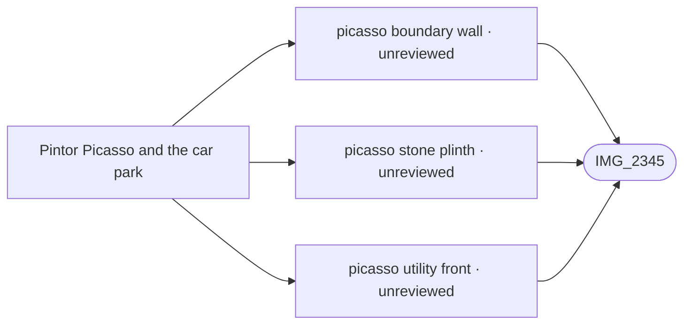

# Pintor Picasso and the car park

_Generated by `scripts/build_references.py`. Do not edit: change `data/areas.json` or `data/reference_tags.json` and rebuild._

Calle Pintor Picasso, the inner car-park access aisle and the Picasso car park.

## Known facts and open questions

- IMG_2345 supports bounded utility fronts/brown doors, boundary wall, stone plinth/railings, short ramp and Details-only bins. Frontage offsets and dimensions remain estimated at the existing Picasso road; registry houses, asphalt route and site levels are retained. Ramp is solid inaccessible private-frontage geometry; no new walkable elevated platform or unseen wall continuation is asserted.
- 24 November 2026 (photo coverage, IMG_3097-3131 and 3184-3203): the car park is bounded on the east by a plain white wall about 2.5-3 m high, about 107 m long, from (-91.4, -67.8) to (-35.7, 23.9) on the aerial, with the Calle Pintor Picasso service road and a cypress hedge outside it (IMG_3125, IMG_3129). Inside: a west row of angled bays against a hedge, a central nose-to-nose row with palms, a hedge-ringed round palm island near the south end (IMG_3100), and two accessible bays at the south end facing a low azulejo-tiled step onto the terracotta walk to the community office (IMG_3097, 3098, 3189, 3194). In the south-east corner stand the bin store (RUBBISH COLLECTION / DEPOSITO BASURA, IMG_3099, 3101) with a walled yard of yellow containers (IMG_3103) and recycling igloos at the hotel wall (IMG_3104). The service road continues south-east between the hotel's ground floor (ramps, sliding gate, IMG_3121) and white utility buildings with maroon substation doors (IMG_3106, 3123). The model has none of the wall, island planting or south step, and its car-park outline, central row and access line are off the aerial: see the picasso-car-park-* and picasso-access-off-aisle discrepancies and docs/reviews/picasso-car-park. No camera is solved yet.

## Read first

- docs: `docs/STREET_LAYOUT.md`, `docs/reviews/picasso-car-park/README.md`
- data: `data/street_layout.json`, `data/picasso_service_road.json`
- src: `src/picasso-service-road.ts`
- contact sheet: `reference/contact-sheets/picasso.jpg` (thumbnails of everything below, numbered in this order)

## Coverage

Layout: 24, Levels and slopes: 7, Facades and roofs: 10, Materials: 9, Planting: 9, Signs: 5, Views: 8
27 reviewed, 0 suggested only by camera position.

## Open build tasks

From `data/build_queue.json`; issue bodies in `refs/issues/`.

| Priority | Task | What | Status | Photos |
| --- | --- | --- | --- | --- |
| P2 | `ground-plan-picasso` | Pintor Picasso and the car park: smooth paths, patios and green spaces with their edges and boundaries (after ground-plan-framework) | open · placement: not-verified |  |
| P2 | `path-network-inventory-picasso` [#132](https://github.com/daveyboyc/villacana-venture/issues/132) | Pintor Picasso and the car park: full-source path, tunnel and boundary inventory (after path-network-baseline) | open · placement: not-applicable |  |

## Built from these photos

Model features that cite photos of this area, from `public/photos-ref/evidence-graph.json`, with their photo-check state. A citation records what a feature was traced from; only a check in `data/photo_checks.json` says someone rendered it from the photo's camera and compared.

## Placement evidence

`verification` is placement status, separate from photographic diagnostics. Earlier manual reviews may exist. Only a fresh measured packet and independent approval can grant `verified`.

| Feature | Placement | Photo diagnostics | Blockers |
| --- | --- | --- | --- |
| `picasso_service_road.json:picasso-boundary-wall` | unreviewed | unchecked | No measured placement packet and independent approval recorded; earlier manual reviews may exist. |
| `picasso_service_road.json:picasso-stone-plinth` | unreviewed | unchecked | No measured placement packet and independent approval recorded; earlier manual reviews may exist. |
| `picasso_service_road.json:picasso-utility-front` | unreviewed | unchecked | No measured placement packet and independent approval recorded; earlier manual reviews may exist. |

**Built without complete newer photo-check records:** `picasso-service-road`. Earlier manual reviews may exist; this record does not establish photographic fidelity. See the verification backlog in `refs/QUEUE.md`.

## Reviewed references

| Reference | Viewpoint | Use for | What it shows |
| --- | --- | --- | --- |
| [IMG_2345.jpg](../../public/photos-ref/IMG_2345.jpg) | ground | layout, materials, levels | Pintor Picasso: service road, utility sheds and bins _Used by: picasso_service_road.json:picasso-utility-front, picasso_service_road.json:picasso-boundary-wall, picasso_service_road.json:picasso-stone-plinth._ |
| [IMG_3097.jpg](../../public/photos-ref/IMG_3097.jpg) | ground | layout, levels, materials, signage | Car park south end: accessible bays and the tiled step up to the office walk **Looks at:** accessible bays and tiled plaza edge at the car park's south end. **Note:** Two accessible bays (blue symbol, white lines) nose south to a low step with blue-and-white azulejo risers onto a terracotta-tiled walk that leads between clipped hedges to the community office; Canary and fan palms, resort directory sign and a solar lamp beside it. GPS pin ±17 m. |
| [IMG_3098.jpg](../../public/photos-ref/IMG_3098.jpg) | ground | layout, levels, materials, planting | Car park south end: accessible bays, tiled step and hedged palm beds **Looks at:** tiled step and hedged palm beds at the car park's south end. **Note:** Same step as IMG_3097 from closer: two tiled risers with a blue-and-white azulejo band, red-white bollard by the east bed, hedged beds with palms and a Norfolk pine behind the office. |
| [IMG_3194.jpg](../../public/photos-ref/IMG_3194.jpg) | ground | layout, planting, facades, signage | Hedged palm bed beside the tiled walk to the community office **Looks at:** tiled walk and community office front. **Note:** Curving clipped hedge on a white kerb round a fan-palm bed; square terracotta tiles; the white single-storey office with a Casitas Villacana sign, AT plaque, site map board and bougainvillea. |
| [IMG_3099.jpg](../../public/photos-ref/IMG_3099.jpg) | ground | layout, facades, signage | Bin store front: RUBBISH COLLECTION / DEPOSITO BASURA, hotel block behind **Looks at:** bin store front wall on the car park's south-east corner. **Note:** Low white building with bougainvillea along its top, a blue bicycle-parking sign, red fire-extinguisher box, a dark doorway under the RUBBISH COLLECTION / DEPOSITO BASURA sign, and painted bays in front. The long four-storey hotel block with balconies stands behind it to the east. |
| [IMG_3100.jpg](../../public/photos-ref/IMG_3100.jpg) | ground | layout, planting, view | From the bin store looking north-west across the car park to the round palm island **Looks at:** round hedged palm island in the car park. **Note:** Round island ringed by a clipped hedge on a white kerb, with tall Canary/date palms, a candelabra euphorbia and a fan palm clump; cars parked round it. The bin store wall with its sign is at the right edge. |
| [IMG_3101.jpg](../../public/photos-ref/IMG_3101.jpg) | ground | facades, signage, materials | BASURA / RUBBISH BINS sign and green door of the bin store **Looks at:** bin store side wall and green door. **Note:** White wall over a grey-painted plinth band, BASURA RUBBISH BINS sign with arrow pointing left, recycling sign, green steel door under an arch. **Compass:** the subject is 56° from the phone heading; trust looksAt, not the heading. |
| [IMG_3105.jpg](../../public/photos-ref/IMG_3105.jpg) | ground | layout, view, levels | Calle Pintor Picasso service road looking south-east towards the sea **Looks at:** service road south of the bin store. **Note:** Asphalt service road between the hotel's ground floor (left, with steps and rails) and white utility buildings with a raised kerbed footpath (right); the sea at the end. |
| [IMG_3106.jpg](../../public/photos-ref/IMG_3106.jpg) | ground | layout, facades, view | Service road south-east: maroon utility doors and the white tower **Looks at:** utility doors along the service road. **Note:** White utility buildings with maroon panelled doors (warning signs, graffiti) and drain grilles along a kerbed footway; the white tower and beach buildings at the end. |
| [IMG_3121.jpg](../../public/photos-ref/IMG_3121.jpg) | ground | facades, layout, levels | Hotel ground floor along the service road: ramps, sliding gate, vent panels **Looks at:** hotel ground-floor frontage on the service road. **Note:** Four-storey hotel block with continuous balconies above a white ground-floor wall with pierced vent panels, two concrete ramps with red rails, a corrugated canopy over a grey sliding gate, and a street lamp. |
| [IMG_3127.jpg](../../public/photos-ref/IMG_3127.jpg) | ground | layout, materials, planting | Pale drive into the hotel garden between cypress hedge and chain-link fence **Looks at:** pale drive heading north-east off the service road. **Note:** A pale concrete or compacted drive runs off the road between a clipped cypress hedge (left) and a green chain-link fence with a kerb (right), under plane trees. |
| [IMG_3129.jpg](../../public/photos-ref/IMG_3129.jpg) | ground | layout, materials, planting | Service road looking north: long white wall left, cypress hedge right **Looks at:** service road along the long wall. **Note:** The wall continues straight and plain to a white building at the north end; tall cypress and pine hedge on the right. |
| [IMG_3184.jpg](../../public/photos-ref/IMG_3184.jpg) | ground | planting, layout, signage | Formal hedged garden by the office, resort directory sign and solar lamp **Looks at:** formal garden south-east of the car park. **Note:** Low clipped hedges on white kerbs round gravel and lantana beds, a topiary drum, yucca; a VILLACANA directory sign (office, 90 Miles, laundrette, restaurant) and a solar street lamp on the tiled walk. |
| [IMG_3189.jpg](../../public/photos-ref/IMG_3189.jpg) | ground | layout, levels, materials | Kerbed tiled path meeting the accessible bay, hedged palm island with bollard **Looks at:** kerb and tiled path at the accessible bays. **Note:** Terracotta walk between white kerbs ends at the asphalt; a kerb ramp and a tiled azulejo riser beside the accessible bay; a hedge-ringed bed with fan palms and a red-white bollard. Houses behind. |
| [IMG_3103.jpg](../../public/photos-ref/IMG_3103.jpg) | ground | layout, materials | Inside the walled bin yard: yellow wheeled containers **Looks at:** walled bin yard. **Note:** Open-topped yard between white walls with grey plinth band, gravelly concrete floor, a row of yellow wheeled containers, a wall lantern on the right wall. Not a roofed building. |
| [IMG_3104.jpg](../../public/photos-ref/IMG_3104.jpg) | ground | layout, facades | Recycling igloos against the hotel's lower wall **Looks at:** recycling bins at the foot of the hotel wall. **Note:** Green glass igloos and grey/blue containers on the asphalt in front of a low stone base and steel rail, under the hotel's white ground-floor wall with two pierced vent panels. |
| [IMG_3120.jpg](../../public/photos-ref/IMG_3120.jpg) | ground | layout, view | Service road looking back north-west to the car park, hotel on the right **Looks at:** service road between hotel and utility buildings. **Note:** From the seaward end: hotel ground floor with loading ramps, a sliding gate and stacked materials on the right; maroon utility doors on the left; plane trees and palms beyond. GPS ±14 m. |
| [IMG_3122.jpg](../../public/photos-ref/IMG_3122.jpg) | ground | layout, view | Service road looking north-north-west, hotel ramps right, utility doors left **Looks at:** service road towards the car park. |
| [IMG_3123.jpg](../../public/photos-ref/IMG_3123.jpg) | ground | facades, layout | Electrical substation doors and white utility building beside the service road **Looks at:** substation and utility building west of the service road. **Note:** Maroon steel doors with high-voltage signs and floor grilles, then a white flat-roofed utility building with a dark green door, a low rounded white block and a sloping door ramp; the long white wall continues north. |
| [IMG_3124.jpg](../../public/photos-ref/IMG_3124.jpg) | ground | facades, layout | White utility building and the start of the long boundary wall **Looks at:** utility building at the south end of the long wall. **Note:** Flat-roofed white building with dark green door, a low rounded white block beside a sloping door ramp, and a kerbed footway; the long plain white wall runs on north-west along the road. |
| [IMG_3125.jpg](../../public/photos-ref/IMG_3125.jpg) | ground | layout, materials | Long white wall between the car park and Calle Pintor Picasso, cypress hedge opposite **Looks at:** long boundary wall along the service road. **Note:** Plain white rendered wall about 2.5-3 m high, no openings, running straight to the north end; asphalt road with a cypress hedge on its east side. The car park is behind the wall. |
| [IMG_3126.jpg](../../public/photos-ref/IMG_3126.jpg) | ground | layout, planting | Opening in the cypress and ivy hedges east of the service road **Looks at:** hedge gap east of the road. **Note:** Clipped cypress hedge with a gap and an ivy-clad hedge; plane trees and an apartment block behind. |
| [IMG_3128.jpg](../../public/photos-ref/IMG_3128.jpg) | ground | planting, view | Cypress hedge along the service road, tall apartment tower behind **Looks at:** cypress hedge on the east side of the service road. **Note:** Tall clipped cypress hedge on a white kerb; the eight-storey apartment tower with balconies and a scaffold-like stair rises behind it. |
| [IMG_3196.jpg](../../public/photos-ref/IMG_3196.jpg) | ground | facades, planting | House front with tiled porch roof behind hedged front gardens **Looks at:** house fronts south-west of the car park's south end. **Note:** Two-storey white house with a terracotta-tiled porch roof, white chimney, low walled front gardens with timber gates and clipped hedges; a palm trunk in the foreground. Which house is not yet matched. |
| [IMG_2444.jpg](../../public/photos-ref/IMG_2444.jpg) | ground | layout, facades, view | Cervantes east end: looking back east along the lane to the car park side **Looks at:** Lane end opening towards the car park. **Note:** Cars at the far end are probably the Picasso car park but that is not certain from the photo; the lane end is about 15 m away. looksAt is estimated along heading 65. _Used by: cervantes_lane_edges.json:cervantes-east-north-thuja-planter._ |
| `reference/apple-maps/07-3d-north-pool-looking-east-to-picasso.png` | aerial | layout, view | Apple Maps 3D: north pool looking east towards the Picasso car park |
| `reference/apple-maps/12-3d-main-pool-east-steps-picasso.png` | aerial | layout, levels | Apple Maps 3D: main pool looking north-east, 90 Miles terrace and the east steps **Note:** Dave, 2026-10-21. A narrow flight of steps comes down from an opening in the white wall along Calle Pintor Picasso, between the curved 90 Miles terrace and the east lawn, to the paving north-east of the toddler pool. Not a wide flight off the restaurant roof. |
