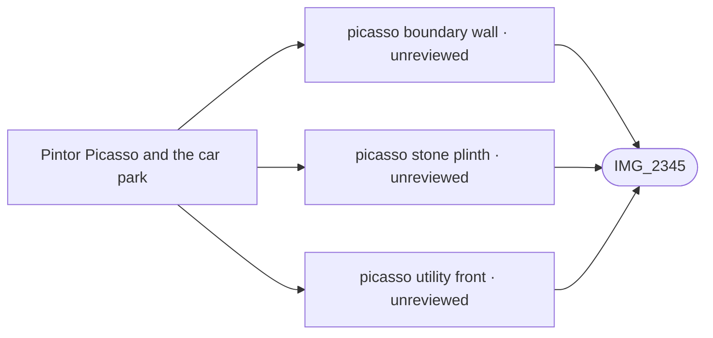

# Pintor Picasso and the car park

_Generated by `scripts/build_references.py`. Do not edit: change `data/areas.json` or `data/reference_tags.json` and rebuild._

Calle Pintor Picasso, the inner car-park access aisle and the Picasso car park.

## Known facts and open questions

- IMG_2345 supports bounded utility fronts/brown doors, boundary wall, stone plinth/railings, short ramp and Details-only bins. Frontage offsets and dimensions remain estimated at the existing Picasso road; registry houses, asphalt route and site levels are retained. Ramp is solid inaccessible private-frontage geometry; no new walkable elevated platform or unseen wall continuation is asserted.

## Read first

- docs: `docs/STREET_LAYOUT.md`
- data: `data/street_layout.json`, `data/picasso_service_road.json`
- src: `src/picasso-service-road.ts`
- contact sheet: `villacana-reference/contact-sheets/picasso.jpg` (thumbnails of everything below, numbered in this order)

## Coverage

Layout: 3, Levels and slopes: 2, Materials: 1, Views: 1
3 reviewed, 0 suggested only by camera position.

## Open build tasks

From `data/build_queue.json`; issue bodies in `refs/issues/`.

| Priority | Task | What | Status | Photos |
| --- | --- | --- | --- | --- |
| P1 | `path-network-inventory-picasso` [#132](https://github.com/daveyboyc/villacana-venture/issues/132) | Pintor Picasso and the car park: full-source path, tunnel and boundary inventory (after path-network-baseline) | open · placement: not-applicable |  |

## Built from these photos

Model features that cite photos of this area, from `public/photos-ref/evidence-graph.json`, with their photo-check state. A citation records what a feature was traced from; only a check in `data/photo_checks.json` says someone rendered it from the photo's camera and compared.

## Placement evidence

`verification` is placement status, separate from photographic diagnostics. Earlier manual reviews may exist. Only a fresh measured packet and independent approval can grant `verified`.

| Feature | Placement | Photo diagnostics | Blockers |
| --- | --- | --- | --- |
| `picasso_service_road.json:picasso-boundary-wall` | unreviewed | unchecked | No measured placement packet and independent approval recorded; earlier manual reviews may exist. |
| `picasso_service_road.json:picasso-stone-plinth` | unreviewed | unchecked | No measured placement packet and independent approval recorded; earlier manual reviews may exist. |
| `picasso_service_road.json:picasso-utility-front` | unreviewed | unchecked | No measured placement packet and independent approval recorded; earlier manual reviews may exist. |

**Built without complete newer photo-check records:** `picasso-service-road`. Earlier manual reviews may exist; this record does not establish photographic fidelity. See the verification backlog in `refs/QUEUE.md`.

## Reviewed references

| Reference | Viewpoint | Use for | What it shows |
| --- | --- | --- | --- |
| [IMG_2345.jpg](../../public/photos-ref/IMG_2345.jpg) | ground | layout, materials, levels | Pintor Picasso: service road, utility sheds and bins _Used by: picasso_service_road.json:picasso-utility-front, picasso_service_road.json:picasso-boundary-wall, picasso_service_road.json:picasso-stone-plinth._ |
| `villacana-reference/apple-maps/07-3d-north-pool-looking-east-to-picasso.png` | aerial | layout, view | Apple Maps 3D: north pool looking east towards the Picasso car park |
| `villacana-reference/apple-maps/12-3d-main-pool-east-steps-picasso.png` | aerial | layout, levels | Apple Maps 3D: main pool looking north-east, 90 Miles terrace and the east steps **Note:** Dave, 2026-10-21. A narrow flight of steps comes down from an opening in the white wall along Calle Pintor Picasso, between the curved 90 Miles terrace and the east lawn, to the paving north-east of the toddler pool. Not a wide flight off the restaurant roof. |
