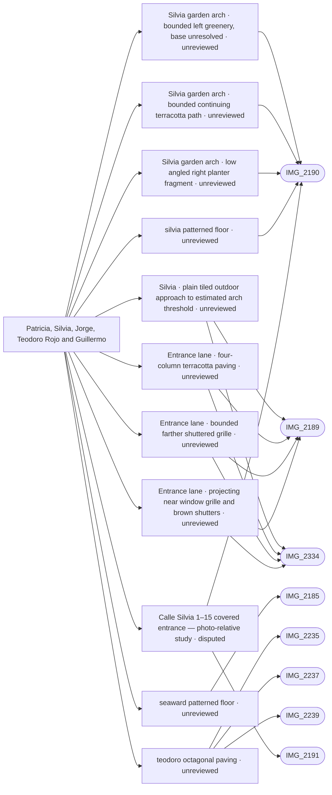

# Patricia, Silvia, Jorge, Teodoro Rojo and Guillermo

_Generated by `scripts/build_references.py`. Do not edit: change `data/areas.json` or `data/reference_tags.json` and rebuild._

The lanes between the middle pool and the beach.

## Known facts and open questions

- IMG_2235/2237/2239 support octagonal terracotta with diamond infills on the photographed Teodoro Rojo run; IMG_2240 remains square. IMG_2185/2190 support cream/blue corner inserts in covered-floor tiles. Material masks use existing ground/registry strips; tile dimensions and passage extents remain estimates, and solid registry strips may still obscure the floor until separately traced as passages. No levels or geometry were changed.
- 22 October reference-pack pilot: numbered photo locators/traces and 41 component rows keep gate view, lane detail, Silvia1–15 passage and Jorge27–35 passage distinct. Silvia tunnel arch/flat ceiling/walls/doors/exit are not accounted for by the existing floor citation; precise connection and owner target remain unresolved. No geometry changed. See docs/REFERENCE_PACK_WORKFLOW.md and public/reference-packs/entrance/index.html.
- Owner clarification: the narrow side spaces in the Silvia tunnel are recessed entrances with brown doors. Photo-relative 3D study includes the two visible paired doors plus two owner-confirmed inner entrances with guessed 0.65 m recesses and generic wooden doors; inventory now has T13/T14 (43 total). Study has no global map transform; connection and measured placement remain unresolved.
- Owner correction to the Silvia tunnel study: the two inner recessed entrance doors are plain single brown wooden leaves with round gold knobs. This clarifies hidden door styling, while recess depth and world placement remain estimates.
- Owner clarification applies to all tunnel entrance doors, including the nearer bays: use normal-width single brown leaves with one round gold knob each. Earlier paired-door readings remain source history, superseded for the model. Recess footprints and world-registration uncertainty are unchanged.
- 23 October main-map integration draft reuses the corrected Silvia model at an approximate west-side registry-topology candidate: canopy 6264401UF1366S_part2, lower corridor through part3 to its courtyard, preserving upper floor/roof. Map and Walk/collision share one transform. Photo heading conflicts and opposite-side host remain unresolved; no measured placement approval. See docs/reviews/silvia-main-integration/.
- 24 October planter correction: a bounded low right garden bed, left greenery with its base unresolved, and continuing near path beyond the Silvia exit arch replace two unsupported illustrative tall garden pots; four observed near/threshold pots remain. At the pool entrance the existing bench beds gain rounded returns/white rims/soil inside their original bounds, and a short LOW grey-beige kerb follows the existing opposite hedge fragment. Satellite context/full photos independently rechecked; no measured extent, complete garden perimeter, route/gate/pool relocation or placement approval is inferred. See docs/reviews/silvia-entrance-planters/.
- 24 October Silvia paving correction: full2190/2191 floor reinspection identifies square terracotta units offset around small blue/cream squares, creating diagonal insert runs. Earlier clipped-corner description was imprecise. Current surface uses coherent metric UVs, varied aged tiles/grout/motifs and wall pebble bands; precise pitches/angle remain estimates. Existing floor extents, topology, level, collision and tunnel/bed positions retained. See docs/reviews/silvia-paving/.
- 24 October outdoor Silvia path: full IMG_2189/2334 show plain worn terracotta squares, four straight columns and broad grey mortar; the decorated square-insert paving belongs inside the tunnel. Existing lane visual surface continues to the provisional side approach, with a plain overlay to the estimated arch threshold. Pool-side irregular stone/grate retained. Continuation endpoints, threshold and gate/tunnel association remain estimated; no registry, route, terrain, collision or structural placement change. See docs/reviews/silvia-outdoor-path/.
- Outdoor-path integration with mainPR120: the current survey ground covered previously flat lane/garden paving, so only those existing visual surfaces now follow siteY. Source outlines, collision and survey data retained. Model diagnostic: garden sample at local8.6 is about0.23m above the level tunnel slab; this is an unresolved host/garden ground transition, not a photo-measured step or smooth source match. Track with in-progress silvia-outdoor-path.

## Read first

- docs: `docs/STREET_LAYOUT.md`, `docs/REFERENCE_PACK_WORKFLOW.md`
- data: `data/street_layout.json`, `data/seaward_paving.json`, `data/reference_packs/entrance.json`, `data/silvia_map.json`, `data/entrance_planters.json`
- src: `src/seaward-paving.ts`, `src/silvia-map.ts`, `src/silvia-tunnel.ts`, `src/entrance-planters.ts`, `src/silvia-paving.ts`
- contact sheet: `villacana-reference/contact-sheets/seaward-lanes.jpg` (thumbnails of everything below, numbered in this order)

## Coverage

Layout: 23, Levels and slopes: 5, Facades and roofs: 4, Materials: 15, Planting: 7, Signs: 3, Views: 1
31 reviewed, 0 suggested only by camera position.

## Open build tasks

From `data/build_queue.json`; issue bodies in `refs/issues/`.

| Priority | Task | What | Status | Photos |
| --- | --- | --- | --- | --- |
| P1 | `path-network-inventory-seaward-lanes` | Patricia, Silvia, Jorge, Teodoro Rojo and Guillermo: full-source path, tunnel and boundary inventory (after path-network-baseline) | open · placement: not-applicable |  |
| P1 | `silvia-all-single-doors` | Make every tunnel entrance a single door with a round gold knob (after entrance-photo-reference-pack) | in-progress · Codex · placement: not-verified | [IMG_2190](../../public/photos-ref/IMG_2190.jpg), [IMG_2191](../../public/photos-ref/IMG_2191.jpg) |
| P1 | `silvia-covered-passage-reference-audit` | Resolve the Silvia tunnel entrance, its components and connection to the lane (after entrance-photo-reference-pack) | open · placement: not-applicable |  |
| P1 | `silvia-entrance-planters` | Build bounded planters at the Silvia tunnel and pool entrance | in-progress · Codex · placement: not-verified | [IMG_2190](../../public/photos-ref/IMG_2190.jpg), [IMG_2191](../../public/photos-ref/IMG_2191.jpg), [IMG_2192](../../public/photos-ref/IMG_2192.jpg), [IMG_2334](../../public/photos-ref/IMG_2334.jpg), [IMG_2335](../../public/photos-ref/IMG_2335.jpg) |
| P1 | `silvia-main-map` | Connect the Silvia tunnel study to the main map and Walk scene (after silvia-all-single-doors) | in-progress · Codex · placement: not-verified | [IMG_2190](../../public/photos-ref/IMG_2190.jpg), [IMG_2191](../../public/photos-ref/IMG_2191.jpg) |
| P1 | `silvia-outdoor-path` | Match the outdoor Silvia path toward the pool entrance | in-progress · Codex · placement: not-verified | [IMG_2189](../../public/photos-ref/IMG_2189.jpg), [IMG_2334](../../public/photos-ref/IMG_2334.jpg), [IMG_2192](../../public/photos-ref/IMG_2192.jpg) |
| P1 | `silvia-paving` | Correct Silvia diagonal terracotta paving and continuous ground appearance | in-progress · Codex · placement: not-verified | [IMG_2190](../../public/photos-ref/IMG_2190.jpg), [IMG_2191](../../public/photos-ref/IMG_2191.jpg) |
| P1 | `silvia-simple-doors` | Simplify the recessed entrance doors and add round gold knobs (after entrance-photo-reference-pack) | in-progress · Codex · placement: not-verified | [IMG_2190](../../public/photos-ref/IMG_2190.jpg), [IMG_2191](../../public/photos-ref/IMG_2191.jpg) |
| P1 | `silvia-tunnel-details` | Build the Silvia tunnel with recessed brown entrance doors and photo details (after entrance-photo-reference-pack) | in-progress · Codex · placement: not-verified | [IMG_2190](../../public/photos-ref/IMG_2190.jpg), [IMG_2191](../../public/photos-ref/IMG_2191.jpg) |

## Built from these photos

Model features that cite photos of this area, from `public/photos-ref/evidence-graph.json`, with their photo-check state. A citation records what a feature was traced from; only a check in `data/photo_checks.json` says someone rendered it from the photo's camera and compared.

## Placement evidence

`verification` is placement status, separate from photographic diagnostics. Earlier manual reviews may exist. Only a fresh measured packet and independent approval can grant `verified`.

| Feature | Placement | Photo diagnostics | Blockers |
| --- | --- | --- | --- |
| `entrance_planters.json:silvia-exit-left-planting-fragment` | unreviewed | unchecked | No measured placement packet and independent approval recorded; earlier manual reviews may exist. |
| `entrance_planters.json:silvia-exit-path-fragment` | unreviewed | unchecked | No measured placement packet and independent approval recorded; earlier manual reviews may exist. |
| `entrance_planters.json:silvia-exit-right-planter` | unreviewed | unchecked | No measured placement packet and independent approval recorded; earlier manual reviews may exist. |
| `middle_pool_lane_frontages.json:silvia-outdoor-apron` | unreviewed | unchecked | No measured placement packet and independent approval recorded; earlier manual reviews may exist. |
| `middle_pool_lane_frontages.json:south-lane-four-column-paving` | unreviewed | not-comparable | No measured placement packet and independent approval recorded; earlier manual reviews may exist. |
| `middle_pool_lane_frontages.json:south-lane-right-far-grille` | unreviewed | unchecked | No measured placement packet and independent approval recorded; earlier manual reviews may exist. |
| `middle_pool_lane_frontages.json:south-lane-right-near-grille` | unreviewed | unchecked | No measured placement packet and independent approval recorded; earlier manual reviews may exist. |
| `seaward_paving.json:seaward-patterned-floor` | unreviewed | unchecked | No measured placement packet and independent approval recorded; earlier manual reviews may exist. |
| `seaward_paving.json:silvia-patterned-floor` | unreviewed | unchecked | No measured placement packet and independent approval recorded; earlier manual reviews may exist. |
| `seaward_paving.json:teodoro-octagonal-paving` | unreviewed | unchecked | No measured placement packet and independent approval recorded; earlier manual reviews may exist. |
| `silvia_tunnel.json:silvia-tunnel-study` | disputed | unchecked | open discrepancy silvia-study-world-registration; open discrepancy silvia-main-map-west-candidate |

## Photo checks

Renders from each photo's camera compared with the photo (`data/photo_checks.json`).

| Task | Photo | Result | Render | Notes |
| --- | --- | --- | --- | --- |
| `silvia-entrance-planters` | [IMG_2334](../../public/photos-ref/IMG_2334.jpg) | **not-comparable** | [after](../../docs/reviews/silvia-entrance-planters/IMG_2334-after.png) · [before](../../docs/reviews/silvia-entrance-planters/IMG_2334-before.png) | Full source and current actual-main-app render inspected. Rounded planter returns, white coping and recessed soil remain within previous bounds; bench/gate/cabinet transforms retained. The stored reviewed camera/look directions are unchanged, first person with Details; before reuses baseline main9735d00 committed PR115 render byte-for-byte. Pose is uncalibrated, source/world registration unresolved, foliage/tile motifs/procedural facades schematic. No measured-placement or exact photographic match claim; all earlier discrepancies remain open. |
| `silvia-entrance-planters` | [IMG_2335](../../public/photos-ref/IMG_2335.jpg) | **not-comparable** | [after](../../docs/reviews/silvia-entrance-planters/IMG_2335-after.png) · [before](../../docs/reviews/silvia-entrance-planters/IMG_2335-before.png) | Full source and current actual-main-app render inspected. Rounded planter returns, white coping and recessed soil remain within previous bounds; bench/gate/cabinet transforms retained. The stored reviewed camera/look directions are unchanged, first person with Details; before reuses baseline main9735d00 committed PR115 render byte-for-byte. Pose is uncalibrated, source/world registration unresolved, foliage/tile motifs/procedural facades schematic. No measured-placement or exact photographic match claim; all earlier discrepancies remain open. |
| `silvia-outdoor-path` | [IMG_2334](../../public/photos-ref/IMG_2334.jpg) | **not-comparable** | [after](../../docs/reviews/silvia-outdoor-path/IMG_2334-after.png) · [before](../../docs/reviews/silvia-outdoor-path/IMG_2334-before.png) | Stored reviewed camera/look-at, first-person Details. Exterior plain squares/broad grey mortar are visible beyond the unchanged iron gate; stone/grate forecourt retained. Full source and independent review inspected. No solved pose, measured tile pitch, threshold position, gateway identity or tunnel/gate connection. Schematic wear, facades and planting remain; no exact photographic or placement match. Existing discrepancies and in-progress follow-ups are retained. |
| `silvia-outdoor-path` | [IMG_2189](../../public/photos-ref/IMG_2189.jpg) | **not-comparable** | [after](../../docs/reviews/silvia-outdoor-path/outdoor-floor-after.png) · [before](../../docs/reviews/silvia-outdoor-path/outdoor-floor-before.png) | Illustrative lane camera, not the photo camera: four plain terracotta columns with broad grey mortar and wear are now visible; the former gap to the provisional tunnel approach is covered. Full source and independent review inspected. No solved pose, measured tile pitch, threshold position, gateway identity or tunnel/gate connection. Schematic wear, facades and planting remain; no exact photographic or placement match. Existing discrepancies and in-progress follow-ups are retained. |

**Built without complete newer photo-check records:** `seaward-lanes-paving`. Earlier manual reviews may exist; this record does not establish photographic fidelity. See the verification backlog in `refs/QUEUE.md`.

## Reviewed references

| Reference | Viewpoint | Use for | What it shows |
| --- | --- | --- | --- |
| [IMG_2190.jpg](../../public/photos-ref/IMG_2190.jpg) | ground | layout, materials | Covered arched passage with potted plants, patterned tiles **Note:** 24 October full-source paving reinspection: square red terracotta tiles in an offset square-and-dot/hopscotch layout; smaller blue/cream inserts step diagonally. Broad large-tile edge alignment follows walls/pebble rectangle; a uniform octagon field or global45degree rotation is unsupported. Worn/mottled tiles, pale grout and narrow wall-side pebble strips visible. Earlier clipped-corner shorthand retained as interpretation history, superseded for this floor. _Used by: silvia_tunnel.json:silvia-tunnel-study, seaward_paving.json:silvia-patterned-floor, entrance_planters.json:silvia-exit-right-planter, entrance_planters.json:silvia-exit-left-planting-fragment, entrance_planters.json:silvia-exit-path-fragment._ |
| [IMG_2189.jpg](../../public/photos-ref/IMG_2189.jpg) | ground | layout, materials, planting, facades | Calle Silvia north: tiled lane looking to the middle pool south gateway **Looks at:** The middle pool south gateway at the end of Calle Silvia north, about 28 m ahead. **Note:** Dave (2026-10-15): Looks down to the middle pool down called Silvia; 21 October source review: its distant gateway/sign pair resembles IMG_2340/2244. Correspondence with the curved double gate in IMG_2334 is unresolved; earlier street name, pin and look-at are retained as history, not proof that these are opposite views of the same gate. Window-grille style reference: projecting/bowed black metal cages over shuttered ground-floor openings on both sides, directly above planted borders; separate from balcony rails. _Used by: middle_pool_lane_frontages.json:south-lane-four-column-paving, middle_pool_lane_frontages.json:silvia-outdoor-apron, middle_pool_lane_frontages.json:south-lane-right-near-grille, middle_pool_lane_frontages.json:south-lane-right-far-grille._ |
| [IMG_2185.jpg](../../public/photos-ref/IMG_2185.jpg) | ground | layout, materials | Covered arched passage, patterned terracotta tiles, sea at the far end _Used by: seaward_paving.json:seaward-patterned-floor._ |
| [IMG_2235.jpg](../../public/photos-ref/IMG_2235.jpg) | ground | materials, layout | Lane paved in octagonal tiles between a white wall and lawn **Note:** Octagonal paving here, not square tiles. _Used by: seaward_paving.json:teodoro-octagonal-paving._ |
| [IMG_2237.jpg](../../public/photos-ref/IMG_2237.jpg) | ground | materials, layout | Octagonal-tiled lane with lantern and hedges _Used by: seaward_paving.json:teodoro-octagonal-paving._ |
| [IMG_2191.jpg](../../public/photos-ref/IMG_2191.jpg) | ground | signage | Passage plaque reading CALLE SILVIA 1-15 _Used by: silvia_tunnel.json:silvia-tunnel-study._ |
| [IMG_2239.jpg](../../public/photos-ref/IMG_2239.jpg) | ground | planting | Yuccas and palms beside an octagonal-tiled lane _Used by: seaward_paving.json:teodoro-octagonal-paving._ |
| [IMG_2182.jpg](../../public/photos-ref/IMG_2182.jpg) | ground | layout, materials | Tiled lane between lawns, white tiled bench |
| [IMG_2184.jpg](../../public/photos-ref/IMG_2184.jpg) | ground | layout, materials | Narrow tiled lane between white walls and planting beds |
| [IMG_2187.jpg](../../public/photos-ref/IMG_2187.jpg) | ground | signage, layout | Arched passage with a street and house-number plaque |
| [IMG_2229.jpg](../../public/photos-ref/IMG_2229.jpg) | ground | layout, materials | Tiled lane between lawns with a white tiled bench |
| [IMG_2230.jpg](../../public/photos-ref/IMG_2230.jpg) | ground | layout, materials | Tiled lane beside hedges and a patio wall |
| [IMG_2234.jpg](../../public/photos-ref/IMG_2234.jpg) | ground | layout, signage | Tiled lane with a wall plaque, lamp post and lawn |
| [IMG_2238.jpg](../../public/photos-ref/IMG_2238.jpg) | ground | layout, planting | Tall hedges along a lane edge |
| [IMG_2240.jpg](../../public/photos-ref/IMG_2240.jpg) | ground | layout, materials | Square-tiled lane between a hedge and a white wall |
| [IMG_2241.jpg](../../public/photos-ref/IMG_2241.jpg) | ground | layout, facades | Narrow lane with window grilles and a drain |
| [IMG_2242.jpg](../../public/photos-ref/IMG_2242.jpg) | ground | layout, materials | Covered entrance with tiled step and patterned floor |
| [IMG_2183.jpg](../../public/photos-ref/IMG_2183.jpg) | ground | planting | Lawn with a tall candelabra cactus and clipped shrubs |
| [IMG_2186.jpg](../../public/photos-ref/IMG_2186.jpg) | ground | layout | Covered passage through the terrace with a view to the sea |
| [IMG_2231.jpg](../../public/photos-ref/IMG_2231.jpg) | ground | materials | White tiled bench beside the lane |
| [IMG_2232.jpg](../../public/photos-ref/IMG_2232.jpg) | ground | materials | Bench close up: decorative tile in the white bench back |
| [IMG_2233.jpg](../../public/photos-ref/IMG_2233.jpg) | ground | planting | Lawn with candelabra cactus and shrubs |
| [IMG_2236.jpg](../../public/photos-ref/IMG_2236.jpg) | ground | planting | Tall Norfolk pine over the terraces |
| [IMG_2334.jpg](../../public/photos-ref/IMG_2334.jpg) | ground | layout, levels, materials, planting, facades | Middle pool south: iron gate in a pergola frame onto a lane **Looks at:** south gate, double iron leaves and the planter to its right. **Note:** User clarification, 21 October 2026: planted frontage strips run along both sides of the tiled lane BEYOND the gate, distinct from the courtyard bench planter and hedge. Photo-left has a low pale kerb with mixed planting, partly occluded by leaf/ladder/cart; photo-right has raised white planter sections under barred openings, interrupted at a recessed doorway. Source-pixel mapping: docs/reviews/middle-pool-south-forecourt/lane-planters/. Exact endpoints and global placement remain unresolved. User also identifies window bars: a projecting black grille with upright bars and horizontal ties is visible over the brown shutter above the right frontage planter, separate from the foreground gate leaf. _Used by: middle_pool_south_gate.json:middle-pool-south-gate, middle_pool_south_gate.json:middle-pool-south-forecourt, middle_pool_south_gate.json:middle-pool-south-east-hedge, entrance_planters.json:silvia-pool-entry-hedge-kerb, middle_pool_lane_frontages.json:south-lane-four-column-paving, middle_pool_lane_frontages.json:silvia-outdoor-apron, middle_pool_lane_frontages.json:south-lane-left-border, middle_pool_lane_frontages.json:south-lane-right-near-bed, middle_pool_lane_frontages.json:south-lane-right-far-bed, middle_pool_lane_frontages.json:south-lane-right-near-grille, middle_pool_lane_frontages.json:south-lane-right-far-grille._ |
| [IMG_2227.jpg](../../public/photos-ref/IMG_2227.jpg) | ground | view, facades, levels | From the beach looking west along the white seafront houses **Looks at:** east end of the sandstone wall and the corner house by Calle Guillermo. **Note:** Read 2026-10-21 at full size. The sandstone wall with mesh fence is low (under 1 m above the sand) all the way to its east end, where a white wall with a tiled panel takes over; the corner house there stands about 1 m above the beach, not 3 m. _Used by: paseo_wall.json:paseo-retaining-wall._ |
| [IMG_2293.jpg](../../public/photos-ref/IMG_2293.jpg) | ground | levels, layout | Pintor Dalí: lane entrance, ramp and drain _Used by: door_sills.json:dali-footpath-kerb._ |
| [IMG_2280.jpg](../../public/photos-ref/IMG_2280.jpg) | ground | layout, materials | Pintor Dalí: flagstone pedestrian entrance |
| `villacana-reference/apple-maps/10-3d-guillermo-and-main-pool-from-sea-wide.png` | aerial | layout, levels | Apple Maps 3D: main pool and Calle Guillermo from the sea, looking west **Note:** Dave, 2026-10-21. Wider version of apple-maps/11. Apple's 3D mesh is coarse: it shows order, sides and which way the ground falls, not measured heights. |
| `villacana-reference/apple-maps/11-3d-guillermo-slope-to-paseo.png` | aerial | layout, levels | Apple Maps 3D: Calle Guillermo sloping down beside the pool lawn to the paseo **Note:** Dave, 2026-10-21. The lane runs down continuously from the restaurant's west end to the paseo between the house gardens and a long white wall on the pool-lawn side; the wall's lawn face gets lower towards the sea. Calle Jorge joins part-way down with no visible steps. The single-storey white kiosk at the foot stands at lawn and paseo level; the lane passes west of it to the beach gate and zebra crossing. Heights are not measurable from the mesh. |
| [IMG_2243.jpg](../../public/photos-ref/IMG_2243.jpg) | ground | layout | Tiled lane beside a lawn to an arched gateway |
| `villacana-reference/apple-maps/04-top-down-south-half.png` | aerial | layout | Apple Maps top-down: southern half, middle and south pools, tiled-roof block |
