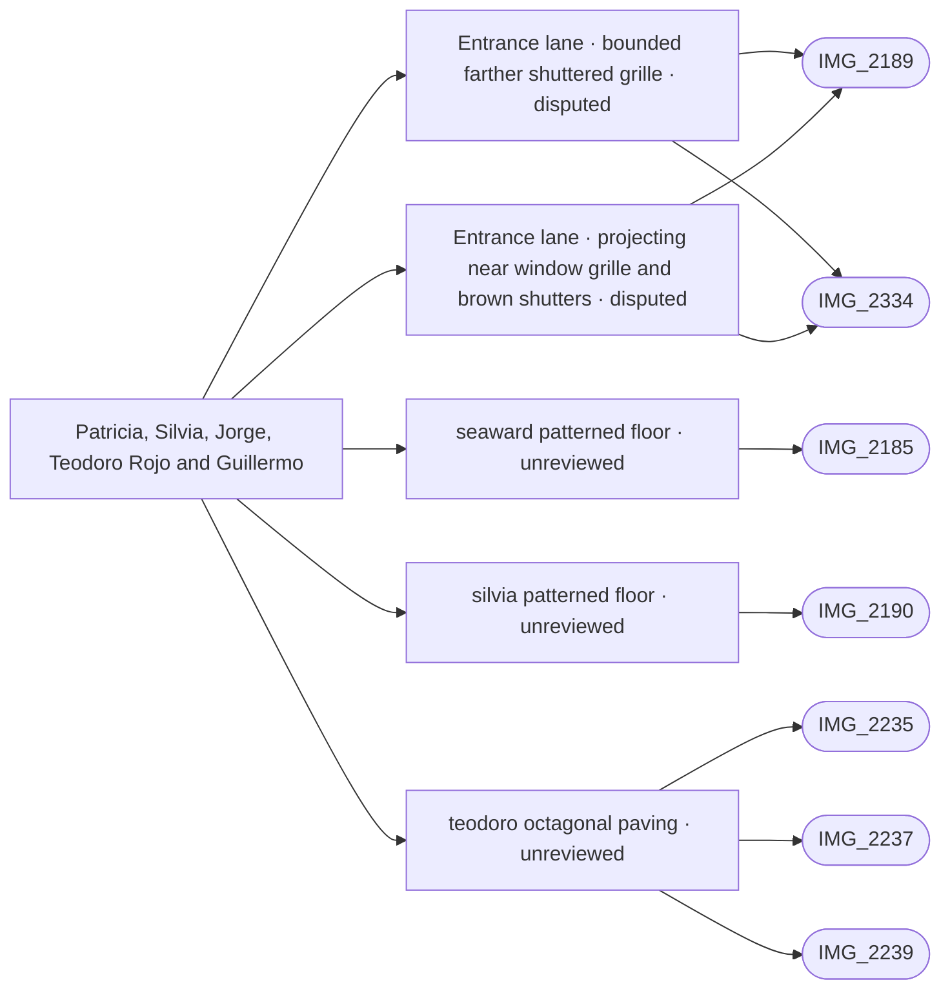

# Patricia, Silvia, Jorge, Teodoro Rojo and Guillermo

_Generated by `scripts/build_references.py`. Do not edit: change `data/areas.json` or `data/reference_tags.json` and rebuild._

The lanes between the middle pool and the beach.

## Known facts and open questions

- IMG_2235/2237/2239 support octagonal terracotta with diamond infills on the photographed Teodoro Rojo run; IMG_2240 remains square. IMG_2185/2190 support cream/blue corner inserts in covered-floor tiles. Material masks use existing ground/registry strips; tile dimensions and passage extents remain estimates, and solid registry strips may still obscure the floor until separately traced as passages. No levels or geometry were changed.

## Read first

- docs: `docs/STREET_LAYOUT.md`
- data: `data/street_layout.json`, `data/seaward_paving.json`
- src: `src/seaward-paving.ts`
- contact sheet: `villacana-reference/contact-sheets/seaward-lanes.jpg` (thumbnails of everything below, numbered in this order)

## Coverage

Layout: 24, Levels and slopes: 5, Facades and roofs: 6, Materials: 15, Planting: 7, Signs: 3
31 reviewed, 0 suggested only by camera position.

## Built from these photos

Model features that cite photos of this area, from `public/photos-ref/evidence-graph.json`, with their photo-check state. A citation records what a feature was traced from; only a check in `data/photo_checks.json` says someone rendered it from the photo's camera and compared.

## Placement evidence

`verification` is placement status, separate from photographic diagnostics. Earlier manual reviews may exist. Only a fresh measured packet and independent approval can grant `verified`.

| Feature | Placement | Photo diagnostics | Blockers |
| --- | --- | --- | --- |
| `middle_pool_lane_frontages.json:south-lane-right-far-grille` | disputed | not-comparable | open discrepancy south-lane-right-far-grille-registration |
| `middle_pool_lane_frontages.json:south-lane-right-near-grille` | disputed | not-comparable | open discrepancy south-lane-right-near-grille-registration |
| `seaward_paving.json:seaward-patterned-floor` | unreviewed | unchecked | No measured placement packet and independent approval recorded; earlier manual reviews may exist. |
| `seaward_paving.json:silvia-patterned-floor` | unreviewed | unchecked | No measured placement packet and independent approval recorded; earlier manual reviews may exist. |
| `seaward_paving.json:teodoro-octagonal-paving` | unreviewed | unchecked | No measured placement packet and independent approval recorded; earlier manual reviews may exist. |

**Built without complete newer photo-check records:** `seaward-lanes-paving`. Earlier manual reviews may exist; this record does not establish photographic fidelity. See the verification backlog in `refs/QUEUE.md`.

## Reviewed references

| Reference | Viewpoint | Use for | What it shows |
| --- | --- | --- | --- |
| [IMG_2189.jpg](../../public/photos-ref/IMG_2189.jpg) | ground | layout, materials, planting, facades | Calle Silvia north: tiled lane looking to the middle pool south gateway **Looks at:** The middle pool south gateway at the end of Calle Silvia north, about 28 m ahead. **Note:** Dave (2026-10-15): Looks down to the middle pool down called Silvia; 21 October source review: its distant gateway/sign pair resembles IMG_2340/2244. Correspondence with the curved double gate in IMG_2334 is unresolved; earlier street name, pin and look-at are retained as history, not proof that these are opposite views of the same gate. Window-grille style reference: projecting/bowed black metal cages over shuttered ground-floor openings on both sides, directly above planted borders; separate from balcony rails. _Used by: middle_pool_lane_frontages.json:south-lane-right-near-grille, middle_pool_lane_frontages.json:south-lane-right-far-grille._ |
| [IMG_2185.jpg](../../public/photos-ref/IMG_2185.jpg) | ground | layout, materials | Covered arched passage, patterned terracotta tiles, sea at the far end _Used by: seaward_paving.json:seaward-patterned-floor._ |
| [IMG_2190.jpg](../../public/photos-ref/IMG_2190.jpg) | ground | layout, materials | Covered arched passage with potted plants, patterned tiles _Used by: seaward_paving.json:silvia-patterned-floor._ |
| [IMG_2235.jpg](../../public/photos-ref/IMG_2235.jpg) | ground | materials, layout | Lane paved in octagonal tiles between a white wall and lawn **Note:** Octagonal paving here, not square tiles. _Used by: seaward_paving.json:teodoro-octagonal-paving._ |
| [IMG_2237.jpg](../../public/photos-ref/IMG_2237.jpg) | ground | materials, layout | Octagonal-tiled lane with lantern and hedges _Used by: seaward_paving.json:teodoro-octagonal-paving._ |
| [IMG_2239.jpg](../../public/photos-ref/IMG_2239.jpg) | ground | planting | Yuccas and palms beside an octagonal-tiled lane _Used by: seaward_paving.json:teodoro-octagonal-paving._ |
| [IMG_2182.jpg](../../public/photos-ref/IMG_2182.jpg) | ground | layout, materials | Tiled lane between lawns, white tiled bench |
| [IMG_2184.jpg](../../public/photos-ref/IMG_2184.jpg) | ground | layout, materials | Narrow tiled lane between white walls and planting beds |
| [IMG_2187.jpg](../../public/photos-ref/IMG_2187.jpg) | ground | signage, layout | Arched passage with a street and house-number plaque |
| [IMG_2229.jpg](../../public/photos-ref/IMG_2229.jpg) | ground | layout, materials | Tiled lane between lawns with a white tiled bench |
| [IMG_2230.jpg](../../public/photos-ref/IMG_2230.jpg) | ground | layout, materials | Tiled lane beside hedges and a patio wall |
| [IMG_2234.jpg](../../public/photos-ref/IMG_2234.jpg) | ground | layout, signage | Tiled lane with a wall plaque, lamp post and lawn |
| [IMG_2238.jpg](../../public/photos-ref/IMG_2238.jpg) | ground | layout, planting | Tall hedges along a lane edge |
| [IMG_2240.jpg](../../public/photos-ref/IMG_2240.jpg) | ground | layout, materials | Square-tiled lane between a hedge and a white wall |
| [IMG_2241.jpg](../../public/photos-ref/IMG_2241.jpg) | ground | layout, facades | Narrow lane with window grilles and a drain |
| [IMG_2242.jpg](../../public/photos-ref/IMG_2242.jpg) | ground | layout, materials | Covered entrance with tiled step and patterned floor |
| [IMG_2183.jpg](../../public/photos-ref/IMG_2183.jpg) | ground | planting | Lawn with a tall candelabra cactus and clipped shrubs |
| [IMG_2186.jpg](../../public/photos-ref/IMG_2186.jpg) | ground | layout | Covered passage through the terrace with a view to the sea |
| [IMG_2191.jpg](../../public/photos-ref/IMG_2191.jpg) | ground | signage | Passage plaque reading CALLE SILVIA 1-15 |
| [IMG_2231.jpg](../../public/photos-ref/IMG_2231.jpg) | ground | materials | White tiled bench beside the lane |
| [IMG_2232.jpg](../../public/photos-ref/IMG_2232.jpg) | ground | materials | Bench close up: decorative tile in the white bench back |
| [IMG_2233.jpg](../../public/photos-ref/IMG_2233.jpg) | ground | planting | Lawn with candelabra cactus and shrubs |
| [IMG_2236.jpg](../../public/photos-ref/IMG_2236.jpg) | ground | planting | Tall Norfolk pine over the terraces |
| [IMG_2334.jpg](../../public/photos-ref/IMG_2334.jpg) | ground | layout, levels, materials, planting, facades | Middle pool south: iron gate in a pergola frame onto a lane **Looks at:** south gate, double iron leaves and the planter to its right. **Note:** User clarification, 21 October 2026: planted frontage strips run along both sides of the tiled lane BEYOND the gate, distinct from the courtyard bench planter and hedge. Photo-left has a low pale kerb with mixed planting, partly occluded by leaf/ladder/cart; photo-right has raised white planter sections under barred openings, interrupted at a recessed doorway. Source-pixel mapping: docs/reviews/middle-pool-south-forecourt/lane-planters/. Exact endpoints and global placement remain unresolved. User also identifies window bars: a projecting black grille with upright bars and horizontal ties is visible over the brown shutter above the right frontage planter, separate from the foreground gate leaf. _Used by: middle_pool_south_gate.json:middle-pool-south-gate, middle_pool_south_gate.json:middle-pool-south-forecourt, middle_pool_south_gate.json:middle-pool-south-east-hedge, middle_pool_lane_frontages.json:south-lane-left-border, middle_pool_lane_frontages.json:south-lane-right-near-bed, middle_pool_lane_frontages.json:south-lane-right-far-bed, middle_pool_lane_frontages.json:south-lane-right-near-grille, middle_pool_lane_frontages.json:south-lane-right-far-grille._ |
| [IMG_2293.jpg](../../public/photos-ref/IMG_2293.jpg) | ground | levels, layout | Pintor Dalí: lane entrance, ramp and drain _Used by: door_sills.json:dali-footpath-kerb._ |
| `villacana-reference/apple-maps/10-3d-guillermo-and-main-pool-from-sea-wide.png` | aerial | layout, levels, facades | Apple Maps 3D: main-pool west lane and promenade from the sea **Note:** Wide oblique overview of tiled roofs, the lane beside the main-pool terrace and the promenade. Inspected full-size 2026-10-22. Photogrammetry is distorted; this is contextual evidence, not measured heights or hidden-edge tracing. Not used to place the middle-pool entrance lane beds or grilles. Catalogued from private reference commit 24d14f7cd3e3f0f9e7014236819eec2895111e0b. |
| `villacana-reference/apple-maps/11-3d-guillermo-slope-to-paseo.png` | aerial | layout, levels, facades | Apple Maps 3D: main-pool west lane descending to the promenade **Note:** Closer view of the descending lane, retaining edge and seaward gateway beside the main pool. Inspected full-size 2026-10-22. Photogrammetry is distorted; this is contextual evidence, not measured heights or hidden-edge tracing. Not used to place the middle-pool entrance lane beds or grilles. Catalogued from private reference commit 24d14f7cd3e3f0f9e7014236819eec2895111e0b. |
| `villacana-reference/apple-maps/13-3d-main-pool-terrace-both-stairs.png` | aerial | layout, levels, facades | Apple Maps 3D: main-pool terrace and both stair ends **Note:** Main-pool terrace with western stairs and rounded eastern stair end, pool, toddler pool and promenade. Inspected full-size 2026-10-22. Photogrammetry is distorted; this is contextual evidence, not measured heights or hidden-edge tracing. Not used to place the middle-pool entrance lane beds or grilles. Catalogued from private reference commit 24d14f7cd3e3f0f9e7014236819eec2895111e0b. |
| [IMG_2280.jpg](../../public/photos-ref/IMG_2280.jpg) | ground | layout, materials | Pintor Dalí: flagstone pedestrian entrance |
| [IMG_2243.jpg](../../public/photos-ref/IMG_2243.jpg) | ground | layout | Tiled lane beside a lawn to an arched gateway |
| `villacana-reference/apple-maps/04-top-down-south-half.png` | aerial | layout | Apple Maps top-down: southern half, middle and south pools, tiled-roof block |
