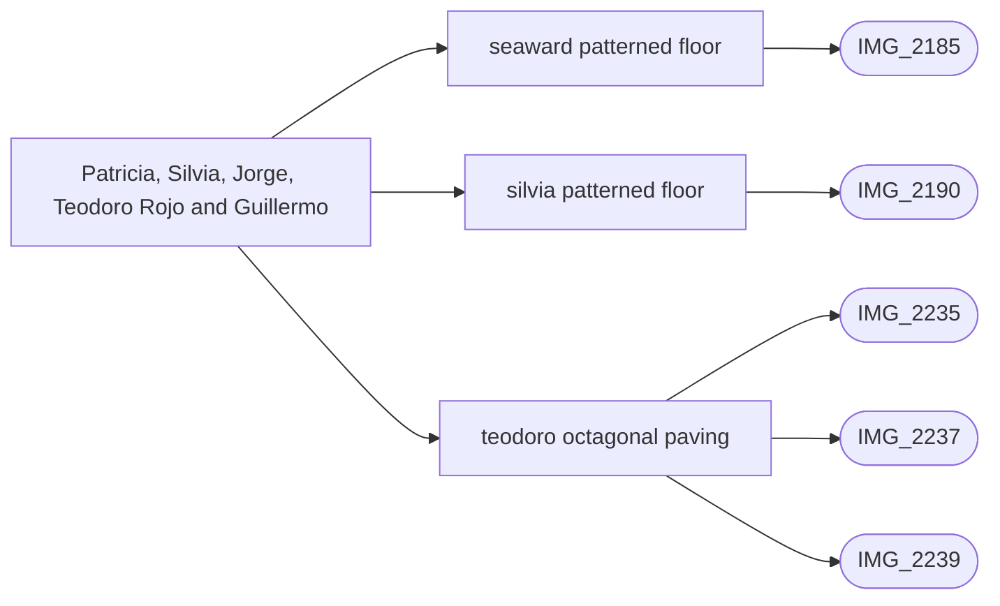

# Patricia, Silvia, Jorge, Teodoro Rojo and Guillermo

_Generated by `scripts/build_references.py`. Do not edit: change `data/areas.json` or `data/reference_tags.json` and rebuild._

The lanes between the middle pool and the beach.

## Known facts and open questions

- IMG_2235/2237/2239 support octagonal terracotta with diamond infills on the photographed Teodoro Rojo run; IMG_2240 remains square. IMG_2185/2190 support cream/blue corner inserts in covered-floor tiles. Material masks use existing ground/registry strips; tile dimensions and passage extents remain estimates, and solid registry strips may still obscure the floor until separately traced as passages. No levels or geometry were changed.

## Read first

- docs: `docs/STREET_LAYOUT.md`
- data: `data/street_layout.json`, `data/seaward_paving.json`
- src: `src/seaward-paving.ts`
- contact sheet: `villacana-reference/contact-sheets/seaward-lanes.jpg` (thumbnails of everything below, numbered in this order)

## Coverage

Layout: 21, Levels and slopes: 2, Facades and roofs: 1, Materials: 15, Planting: 6, Signs: 3
28 reviewed, 0 suggested only by camera position.

## Open build tasks

From `data/build_queue.json`; issue bodies in `refs/issues/`.

| Priority | Task | What | Status | Photos |
| --- | --- | --- | --- | --- |
| P3 | `seaward-lanes-paving` [#51](https://github.com/daveyboyc/villacana-venture/issues/51) | Seaward lanes: octagonal paving and covered passages | in-progress · issue51 | [IMG_2235](../../public/photos-ref/IMG_2235.jpg), [IMG_2237](../../public/photos-ref/IMG_2237.jpg), [IMG_2239](../../public/photos-ref/IMG_2239.jpg), [IMG_2185](../../public/photos-ref/IMG_2185.jpg), [IMG_2190](../../public/photos-ref/IMG_2190.jpg) |

## Built from these photos

Model features that cite photos of this area, from `public/photos-ref/evidence-graph.json`. A citation records what a feature was traced from; it does not prove the feature matches.

## Reviewed references

| Reference | Viewpoint | Use for | What it shows |
| --- | --- | --- | --- |
| [IMG_2185.jpg](../../public/photos-ref/IMG_2185.jpg) | ground | layout, materials | Covered arched passage, patterned terracotta tiles, sea at the far end _Used by: seaward_paving.json:seaward-patterned-floor._ |
| [IMG_2190.jpg](../../public/photos-ref/IMG_2190.jpg) | ground | layout, materials | Covered arched passage with potted plants, patterned tiles _Used by: seaward_paving.json:silvia-patterned-floor._ |
| [IMG_2235.jpg](../../public/photos-ref/IMG_2235.jpg) | ground | materials, layout | Lane paved in octagonal tiles between a white wall and lawn **Note:** Octagonal paving here, not square tiles. _Used by: seaward_paving.json:teodoro-octagonal-paving._ |
| [IMG_2237.jpg](../../public/photos-ref/IMG_2237.jpg) | ground | materials, layout | Octagonal-tiled lane with lantern and hedges _Used by: seaward_paving.json:teodoro-octagonal-paving._ |
| [IMG_2239.jpg](../../public/photos-ref/IMG_2239.jpg) | ground | planting | Yuccas and palms beside an octagonal-tiled lane _Used by: seaward_paving.json:teodoro-octagonal-paving._ |
| [IMG_2189.jpg](../../public/photos-ref/IMG_2189.jpg) | ground | layout, materials, planting | Calle Silvia north: tiled lane looking to the middle pool south gateway **Looks at:** The middle pool south gateway at the end of Calle Silvia north, about 28 m ahead. **Note:** Dave (2026-10-15): Looks down to the middle pool down called Silvia |
| [IMG_2182.jpg](../../public/photos-ref/IMG_2182.jpg) | ground | layout, materials | Tiled lane between lawns, white tiled bench |
| [IMG_2184.jpg](../../public/photos-ref/IMG_2184.jpg) | ground | layout, materials | Narrow tiled lane between white walls and planting beds |
| [IMG_2187.jpg](../../public/photos-ref/IMG_2187.jpg) | ground | signage, layout | Arched passage with a street and house-number plaque |
| [IMG_2229.jpg](../../public/photos-ref/IMG_2229.jpg) | ground | layout, materials | Tiled lane between lawns with a white tiled bench |
| [IMG_2230.jpg](../../public/photos-ref/IMG_2230.jpg) | ground | layout, materials | Tiled lane beside hedges and a patio wall |
| [IMG_2234.jpg](../../public/photos-ref/IMG_2234.jpg) | ground | layout, signage | Tiled lane with a wall plaque, lamp post and lawn |
| [IMG_2238.jpg](../../public/photos-ref/IMG_2238.jpg) | ground | layout, planting | Tall hedges along a lane edge |
| [IMG_2240.jpg](../../public/photos-ref/IMG_2240.jpg) | ground | layout, materials | Square-tiled lane between a hedge and a white wall |
| [IMG_2241.jpg](../../public/photos-ref/IMG_2241.jpg) | ground | layout, facades | Narrow lane with window grilles and a drain |
| [IMG_2242.jpg](../../public/photos-ref/IMG_2242.jpg) | ground | layout, materials | Covered entrance with tiled step and patterned floor |
| [IMG_2183.jpg](../../public/photos-ref/IMG_2183.jpg) | ground | planting | Lawn with a tall candelabra cactus and clipped shrubs |
| [IMG_2186.jpg](../../public/photos-ref/IMG_2186.jpg) | ground | layout | Covered passage through the terrace with a view to the sea |
| [IMG_2191.jpg](../../public/photos-ref/IMG_2191.jpg) | ground | signage | Passage plaque reading CALLE SILVIA 1-15 |
| [IMG_2231.jpg](../../public/photos-ref/IMG_2231.jpg) | ground | materials | White tiled bench beside the lane |
| [IMG_2232.jpg](../../public/photos-ref/IMG_2232.jpg) | ground | materials | Bench close up: decorative tile in the white bench back |
| [IMG_2233.jpg](../../public/photos-ref/IMG_2233.jpg) | ground | planting | Lawn with candelabra cactus and shrubs |
| [IMG_2236.jpg](../../public/photos-ref/IMG_2236.jpg) | ground | planting | Tall Norfolk pine over the terraces |
| [IMG_2334.jpg](../../public/photos-ref/IMG_2334.jpg) | ground | layout, levels, materials | Middle pool south: iron gate in a pergola frame onto a lane _Used by: middle_pool_south_gate.json:middle-pool-south-gate._ |
| [IMG_2280.jpg](../../public/photos-ref/IMG_2280.jpg) | ground | layout, materials | Pintor Dalí: flagstone pedestrian entrance |
| [IMG_2293.jpg](../../public/photos-ref/IMG_2293.jpg) | ground | levels, layout | Pintor Dalí: lane entrance, ramp and drain |
| [IMG_2243.jpg](../../public/photos-ref/IMG_2243.jpg) | ground | layout | Tiled lane beside a lawn to an arched gateway |
| `villacana-reference/apple-maps/04-top-down-south-half.png` | aerial | layout | Apple Maps top-down: southern half, middle and south pools, tiled-roof block |
