# Patricia, Silvia, Jorge, Teodoro Rojo and Guillermo

_Generated by `scripts/build_references.py`. Do not edit: change `data/areas.json` or `data/reference_tags.json` and rebuild._

The lanes between the middle pool and the beach.

## Known facts and open questions

- IMG_2235/2237/2239 support octagonal terracotta with diamond infills on the photographed Teodoro Rojo run; IMG_2240 remains square. IMG_2185/2190 support cream/blue corner inserts in covered-floor tiles. Material masks use existing ground/registry strips; tile dimensions and passage extents remain estimates, and solid registry strips may still obscure the floor until separately traced as passages. No levels or geometry were changed.
- 22 October reference-pack pilot: numbered photo locators/traces and 41 component rows keep gate view, lane detail, Silvia1–15 passage and Jorge27–35 passage distinct. Silvia tunnel arch/flat ceiling/walls/doors/exit are not accounted for by the existing floor citation; precise connection and owner target remain unresolved. No geometry changed. See docs/REFERENCE_PACK_WORKFLOW.md and public/reference-packs/entrance/index.html.
- Owner clarification: the narrow side spaces in the Silvia tunnel are recessed entrances with brown doors. Photo-relative 3D study includes the two visible paired doors plus two owner-confirmed inner entrances with guessed 0.65 m recesses and generic wooden doors; inventory now has T13/T14 (43 total). Study has no global map transform; connection and measured placement remain unresolved.
- Owner correction to the Silvia tunnel study: the two inner recessed entrance doors are plain single brown wooden leaves with round gold knobs. This clarifies hidden door styling, while recess depth and world placement remain estimates.
- Owner clarification applies to all tunnel entrance doors, including the nearer bays: use normal-width single brown leaves with one round gold knob each. Earlier paired-door readings remain source history, superseded for the model. Recess footprints and world-registration uncertainty are unchanged.
- 23 October main-map integration draft reuses the corrected Silvia model at an approximate west-side registry-topology candidate: canopy 6264401UF1366S_part2, lower corridor through part3 to its courtyard, preserving upper floor/roof. Map and Walk/collision share one transform. Photo heading conflicts and opposite-side host remain unresolved; no measured placement approval. See docs/reviews/silvia-main-integration/.
- 24 October planter correction: a bounded low right garden bed, left greenery with its base unresolved, and continuing near path beyond the Silvia exit arch replace two unsupported illustrative tall garden pots; four observed near/threshold pots remain. At the pool entrance the existing bench beds gain rounded returns/white rims/soil inside their original bounds, and a short LOW grey-beige kerb follows the existing opposite hedge fragment. Satellite context/full photos independently rechecked; no measured extent, complete garden perimeter, route/gate/pool relocation or placement approval is inferred. See docs/reviews/silvia-entrance-planters/.
- 24 October Silvia paving correction: full2190/2191 floor reinspection identifies square terracotta units offset around small blue/cream squares, creating diagonal insert runs. Earlier clipped-corner description was imprecise. Current surface uses coherent metric UVs, varied aged tiles/grout/motifs and wall pebble bands; precise pitches/angle remain estimates. Existing floor extents, topology, level, collision and tunnel/bed positions retained. See docs/reviews/silvia-paving/.
- 24 October outdoor Silvia path: full IMG_2189/2334 show plain worn terracotta squares, four straight columns and broad grey mortar; the decorated square-insert paving belongs inside the tunnel. Existing lane visual surface continues to the provisional side approach, with a plain overlay to the estimated arch threshold. Pool-side irregular stone/grate retained. Continuation endpoints, threshold and gate/tunnel association remain estimated; no registry, route, terrain, collision or structural placement change. See docs/reviews/silvia-outdoor-path/.
- Outdoor-path integration with mainPR120: the current survey ground covered previously flat lane/garden paving, so only those existing visual surfaces now follow siteY. Source outlines, collision and survey data retained. Model diagnostic: garden sample at local8.6 is about0.23m above the level tunnel slab; this is an unresolved host/garden ground transition, not a photo-measured step or smooth source match. Track with in-progress silvia-outdoor-path.
- 27 October batch: IMG_2488 looks up Calle Guillermo from its seaward end: plain square terracotta tiles, a slot drain across the lane, raised white planter with strelitzia; no steps in the lower lane (input for guillermo-descent-recheck, gradient not judged). IMG_2494 repeats the IMG_2241 lane near Teodoro Rojo.
- Silvia ramp passages (task silvia-ramp-passages, 4 Nov): IMG_2656/2657/2658 (plaque '22 44 CALLE DE SILVIA') and IMG_2669/2670 (plaque '2 20') show a second passage type on the lane's west side: a porch with a red studded rubber ramp beside two plain terracotta treads and a third riser that carries the landing (white risers, dark grey edge bands), brown panelled double doors with a barred window beside each, a pebble-mosaic mat, lanterns, an arch and, in 2-20, a black iron garden gate between two large potted plants. IMG_2574/2575 show the flight from the lane (granite edge, jade planter). Built only as a photo-relative study (silvia-ramp.html, src/silvia-ramp-passage.ts; every dimension an estimate; not placed). OPEN: the main map's west Silvia tunnel (data/silvia_map.json) sits at the IMG_2669 camera and heading but is built from the 1-15 photos IMG_2190/2191/2668, taken from the same pin facing east (heading 55-56) where IMG_2672-2674 show a louvre-door passage under the east block; the 1-15 and 2-20 passages are therefore probably on opposite sides of the lane and the west tunnel shows the wrong one (task silvia-west-passage-swap). The 22-44 mouth lies on the WSW line of the Patricia passage cameras IMG_2565-2570 (task patricia-passage-reference-pack).
- 9 November 2026: Calle Jorge has grass both sides of the tiled path, a white wall with a clipped hedge on the house side, and white scalloped benches on the lawn side (IMG_2182, IMG_2229, IMG_2230, IMG_2231, IMG_2232, IMG_2596). The close-up bench is the station 112 m along the centreline; the six repeats added on 9 November were removed on 10 November because no photo shows them. The CALLE DE JORGE plinth and black lamp are at the east end (IMG_2597). Stations are estimated from the pins (±2 to ±5 m). See data/jorge_lane.json.
- 10 November 2026: the same lane now has the square terracotta path with a pale concrete edge, five covers in the tiles (the round SANEA cover and the square grate are the pair beside the bench in IMG_2596), a yucca in the hedge-side grass (IMG_2230), the candelabra cactus in the garden behind that wall (IMG_2183, IMG_2233), house number 20 and the CALLE DE TEODORO plaque on the lawn-side house faces (IMG_2231, IMG_2234), and three more black lamps along the hedge edge. Stations are estimated from the pins. The east house front, the pool-rules board and the south-pool lawn cactus are still not built.
- Patricia passage (IMG_2561-2569), not built: the arch marked 'CALLE DE PATRICIA' (IMG_2562), paired brown doors, pebble-mosaic mats with a floral border (2563/2564), planter-lined arches, a tiled-eave loggia (2565-2567) and a last arch with ramp down to a lawn (2569). Pins (2.4-5 m, mostly indoors) head SE at the west arch and ENE further on, about 20 m south-east of the mapped Calle Patricia line, so its route, length and relation to the 22-44 porch are unresolved. South-block arcade IMG_2639-2641 is the Calle de Jorge 39-67 passage from the south-pool lawn into Pintor Dalí, now opened on the placed Dalí arch axis (20.4 m, about 2 m estimated; data/south_pool_passage.json). The IMG_2639-2641 pins stay unused. IMG_2548 (Eva) and IMG_2557 ('CALLE MART...' sign) show the same passage family with the street unread.
- 10 November 2026 review: every Calle Jorge photo is between 101 and 130 m along the 136 m centreline (IMG_2234 looks about 15 m further west), so the tiled path, grass, planter wall, hedge and planting are built only from about 86 m to the east end. West of that the lane keeps the generic ribbon (gap:jorge-west, photo request jorge-west-walk). The planter wall is continuous runs with a leafy clipped hedge on top; manhole covers sit flush; the candelabra cactus has the two-trunk vase shape of IMG_2233; the CALLE DE JORGE plinth faces the path as in IMG_2597.
- 10 November 2026: the candelabra tree behind the Calle Jorge wall (IMG_2183, IMG_2233) is a Euphorbia with four pale trunks and a broad domed crown of curved, winged stems, about twice the height of the garden wall behind it, over a lantana bed. Modelled in src/candelabra-cactus.ts, 5 m behind the lane; exact position in the garden is not measured.
- 11 November 2026 (jorge-lane-surroundings): beside Calle Jorge the photos show more than the path. South side: lawn to the house fronts, a two-tile cross-path about 1.9 m east of the bench, a second path behind the bench along the house front, a white-kerbed bed with three round shrubs and a strelitzia (IMG_2182, IMG_2229, IMG_2231). North side: the garden with the candelabra tree is an open lawn with a white-painted kerb, not walled off from the lane (IMG_2183, IMG_2233, IMG_2234); an octagon-tiled lane joins at its west corner beside the one lamp post (IMG_2234, IMG_2235, the mapped Teodoro Rojo line); the planters in front of the patios are about 0.7 m high with two brick thresholds and number niches (IMG_2182, IMG_2230). The generic porches are left off the garden walls and the house-23 front, which the photos show plain or planted. Open: door 23 and its arched recess are not modelled; the octagon-tiled lane still has the generic square-tile ribbon; the niche numbers are not legible; the low wall and lantana behind the olive (IMG_2597) are not built.
- 11 November 2026 (jorge-more-benches): Dave says Calle Jorge has more than one bench. Only one is photographed (112 m by its pins). The aerial shows bench-sized white marks on the grass beside the path at about 64.3 and 79.2 m (north side) and 122.3 m (south side); the bench asset is reused there, graded inferred (docs/reviews/jorge-benches-aerial/). A similar mark at 106.5 m is built as the white-kerbed shrub bed of IMG_2229/IMG_2230. Open: the aerial shows nothing at 112 m, so the photographed bench may really be the 106.5 m mark with the pins about 5 m too far east; photo request jorge-benches asks for a photo of each bench.
- 11 November 2026 (jorge-west-entrance): the west end of Calle Jorge is photographed. IMG_2280 and IMG_2696-2698 stand in the Pintor Dalí car park on the mapped Jorge line and look along it: sandstone flags about 2 m wide between white-painted kerbs the length of the parking bays, a lamp post with a camera, then lawns with two round clipped trees on the north side and a shrub border and bougainvillea house on the south, to a white gateway at about 28 m. So this end is flagged, not terracotta. IMG_2773 and IMG_2597 show a waist-high lantana planter wall along the east side of Calle Guillermo behind the CALLE DE JORGE plinth; IMG_2594 shows the dragon tree beside the lamp post on the kerb corner. Open: the gateway at about 28 m, and what the path is made of between there and 86 m; the CALLE JORGE 27 35 passage of IMG_2185-2187 (pins at about 68 m on the line, looking towards the sea) is still not placed.
- 12 November 2026 (jorge-planter-palms, Dave): the lantana planter along Calle Guillermo is a neat straight wall about one metre high (IMG_2773, IMG_2774), with a yucca clump behind it and no palm beside it. The palms on the main-pool lawn are tall and slender (IMG_2764, IMG_2765); the generic palm model is short and thick and two of them stood where the photos show none. The tree on the Calle Jorge kerb corner is a dragon tree with a forked trunk (IMG_2230, IMG_2594). Open: the planter continues south of the junction round to the sea (IMG_2822, IMG_2823), not built; other generic palms round the main pool are still the short thick model.
- 12 November 2026 (jorge-guillermo-paving): Calle Guillermo beside the lantana planter is paved wall to wall, about 2.3 m wide, in large squares at the Jorge junction and octagons with square insets beyond (IMG_2773, IMG_2774, IMG_2822, IMG_2823). Tile-scale reading of IMG_2773 puts the planter at 2.5 tiles high, 0.9 to 1.25 m depending on tile size. An attempt to solve the IMG_2773 camera was abandoned: the registry corners in view are too far and too cluttered to match with confidence. Open: the size of the junction squares, and the paving of Guillermo north of the pool-building steps.
- 12 November 2026 (Dave): from the IMG_2773 viewpoint the houses left of Calle Guillermo do not match the photo. The photo has a plain garden wall about 2 m high with bougainvillea, low hedged planters along the lane and the houses standing back behind; the model has registry blocks extruded as houses with generic doors, shutters and porches at the lane. Task guillermo-west-walls. The same fault (patio parts of the registry drawn as roofed rooms with generic openings) is likely wherever a lane runs past garden walls.
- 12 November 2026 (guillermo-west-walls): built the photographed west side of Calle Guillermo north of the Jorge junction: the plain lawn wall carried to the lane, patio wall, hedged planters with gateways, lamp posts and brick border; generic openings are now kept off walls listed as plain (guillermoWest.plainWalls in data/jorge_lane.json, used by the shutters, porches and facade kit). Open: registry part 6364401UF1366S_part7's east portion is probably an open patio (plants show above the wall in IMG_2773); changing it needs a measured check. The same 'plain wall' list can be used wherever a photo shows a garden wall where the model draws a house front.
- 12 November 2026 (Dave): the east portion of registry part 6364401UF1366S_part7, behind the plinth-lawn wall, is treated as an open walled patio on the evidence of IMG_2773 and the aerial, without a measured check (data/registry_corrections.json, openPatios; scripts/build_skeleton.py keeps the registry ring beside the roofed part). The same correction can be used for other registry parts that photos show are walled patios.
- 13 November 2026 (jorge-planting): the bougainvilleas on and beside Calle Jorge are in full purple bract in the photos (IMG_2229, IMG_2230, IMG_2697), so the wall climbers now carry clusters of bracts; small trees stand by the house-23 bed and on the plinth lawn; a row of low shrubs edges the flagged west path; the lawns are a darker green. The house-23 group is seen in Inspect only: no starting pose faces it.

## Read first

- docs: `docs/STREET_LAYOUT.md`, `docs/REFERENCE_PACK_WORKFLOW.md`
- data: `data/street_layout.json`, `data/seaward_paving.json`, `data/reference_packs/entrance.json`, `data/silvia_map.json`, `data/entrance_planters.json`, `data/silvia_ramp_passages.json`, `data/jorge_lane.json`
- src: `src/seaward-paving.ts`, `src/silvia-map.ts`, `src/silvia-tunnel.ts`, `src/entrance-planters.ts`, `src/silvia-paving.ts`, `src/silvia-ramp-passage.ts`, `src/silvia-ramp-study.ts`, `src/jorge-lane.ts`, `src/candelabra-cactus.ts`
- contact sheet: `villacana-reference/contact-sheets/seaward-lanes.jpg` (thumbnails of everything below, numbered in this order)

## Coverage

Layout: 126, Levels and slopes: 30, Facades and roofs: 76, Materials: 114, Planting: 79, Signs: 23, Views: 15
152 reviewed, 0 suggested only by camera position.

## Open build tasks

From `data/build_queue.json`; issue bodies in `refs/issues/`.

| Priority | Task | What | Status | Photos |
| --- | --- | --- | --- | --- |
| P1 | `guillermo-west-walls` | Calle Guillermo west side: garden walls, not house fronts (Dave: the houses on the left don't match the photo) (after jorge-guillermo-paving) | in-progress · Claude · placement: not-verified | [IMG_2773](../../public/photos-ref/IMG_2773.jpg), [IMG_2774](../../public/photos-ref/IMG_2774.jpg) |
| P1 | `silvia-all-single-doors` | Make every tunnel entrance a single door with a round gold knob (after entrance-photo-reference-pack) | in-progress · Codex · placement: not-verified | [IMG_2190](../../public/photos-ref/IMG_2190.jpg), [IMG_2191](../../public/photos-ref/IMG_2191.jpg) |
| P1 | `silvia-covered-passage-reference-audit` | Resolve the Silvia tunnel entrance, its components and connection to the lane (after entrance-photo-reference-pack) | open · placement: not-applicable |  |
| P1 | `silvia-entrance-planters` | Build bounded planters at the Silvia tunnel and pool entrance | in-progress · Codex · placement: not-verified | [IMG_2190](../../public/photos-ref/IMG_2190.jpg), [IMG_2191](../../public/photos-ref/IMG_2191.jpg), [IMG_2192](../../public/photos-ref/IMG_2192.jpg), [IMG_2334](../../public/photos-ref/IMG_2334.jpg), [IMG_2335](../../public/photos-ref/IMG_2335.jpg) |
| P1 | `silvia-outdoor-path` | Match the outdoor Silvia path toward the pool entrance | in-progress · Codex · placement: not-verified | [IMG_2189](../../public/photos-ref/IMG_2189.jpg), [IMG_2334](../../public/photos-ref/IMG_2334.jpg), [IMG_2192](../../public/photos-ref/IMG_2192.jpg) |
| P1 | `silvia-paving` | Correct Silvia diagonal terracotta paving and continuous ground appearance | in-progress · Codex · placement: not-verified | [IMG_2190](../../public/photos-ref/IMG_2190.jpg), [IMG_2191](../../public/photos-ref/IMG_2191.jpg) |
| P1 | `silvia-simple-doors` | Simplify the recessed entrance doors and add round gold knobs (after entrance-photo-reference-pack) | in-progress · Codex · placement: not-verified | [IMG_2190](../../public/photos-ref/IMG_2190.jpg), [IMG_2191](../../public/photos-ref/IMG_2191.jpg) |
| P1 | `silvia-tunnel-details` | Build the Silvia tunnel with recessed brown entrance doors and photo details (after entrance-photo-reference-pack) | in-progress · Codex · placement: not-verified | [IMG_2190](../../public/photos-ref/IMG_2190.jpg), [IMG_2191](../../public/photos-ref/IMG_2191.jpg) |
| P2 | `jorge-guillermo-paving` | Calle Guillermo at the Jorge junction: wall-to-wall octagonal paving and covers (after jorge-planter-palms) | in-progress · Claude · placement: not-verified | [IMG_2773](../../public/photos-ref/IMG_2773.jpg) |
| P2 | `jorge-lane-review` | Calle Jorge: keep only what the photos show, and make it look like them | in-progress · Claude · placement: not-verified | [IMG_2229](../../public/photos-ref/IMG_2229.jpg), [IMG_2230](../../public/photos-ref/IMG_2230.jpg), [IMG_2231](../../public/photos-ref/IMG_2231.jpg), [IMG_2233](../../public/photos-ref/IMG_2233.jpg), [IMG_2234](../../public/photos-ref/IMG_2234.jpg), [IMG_2597](../../public/photos-ref/IMG_2597.jpg) |
| P2 | `jorge-lane-surroundings` | Calle Jorge: cross-paths, lawns to the house fronts, the open kerbed garden, planters with thresholds, beds and wall planting (after jorge-lane-review) | in-progress · Claude · placement: not-verified | [IMG_2182](../../public/photos-ref/IMG_2182.jpg), [IMG_2229](../../public/photos-ref/IMG_2229.jpg), [IMG_2230](../../public/photos-ref/IMG_2230.jpg), [IMG_2233](../../public/photos-ref/IMG_2233.jpg), [IMG_2234](../../public/photos-ref/IMG_2234.jpg), [IMG_2597](../../public/photos-ref/IMG_2597.jpg) |
| P2 | `jorge-more-benches` | Calle Jorge: the other benches, placed from the aerial (after jorge-lane-surroundings) | in-progress · Claude · placement: not-verified |  |
| P2 | `jorge-planter-palms` | Calle Jorge east end: a neat one-metre planter wall, and palms and spiky trees that match the photos (after jorge-west-entrance) | in-progress · Claude · placement: not-verified | [IMG_2773](../../public/photos-ref/IMG_2773.jpg), [IMG_2230](../../public/photos-ref/IMG_2230.jpg), [IMG_2764](../../public/photos-ref/IMG_2764.jpg) |
| P2 | `jorge-planting` | Calle Jorge: bougainvillea in bract, small trees, shrub border and lawn colour (after guillermo-west-walls) | in-progress · Claude · placement: not-verified | [IMG_2697](../../public/photos-ref/IMG_2697.jpg), [IMG_2773](../../public/photos-ref/IMG_2773.jpg) |
| P2 | `jorge-west-entrance` | Calle Jorge: the flagged west entrance from the Dalí car park, and the lantana planter at the east end (after jorge-lane-surroundings) | in-progress · Claude · placement: not-verified | [IMG_2697](../../public/photos-ref/IMG_2697.jpg), [IMG_2773](../../public/photos-ref/IMG_2773.jpg) |
| P2 | `path-network-inventory-seaward-lanes` [#135](https://github.com/daveyboyc/villacana-venture/issues/135) | Patricia, Silvia, Jorge, Teodoro Rojo and Guillermo: full-source path, tunnel and boundary inventory (after path-network-baseline) | open · placement: not-applicable |  |
| P2 | `patricia-passage-reference-pack` | Patricia covered passage: trace the arch chain from the CALLE DE PATRICIA arch to the Silvia 22-44 mouth | open · placement: not-verified | [IMG_2561](../../public/photos-ref/IMG_2561.jpg), [IMG_2562](../../public/photos-ref/IMG_2562.jpg), [IMG_2563](../../public/photos-ref/IMG_2563.jpg), [IMG_2564](../../public/photos-ref/IMG_2564.jpg), [IMG_2565](../../public/photos-ref/IMG_2565.jpg), [IMG_2566](../../public/photos-ref/IMG_2566.jpg), [IMG_2567](../../public/photos-ref/IMG_2567.jpg), [IMG_2568](../../public/photos-ref/IMG_2568.jpg), [IMG_2569](../../public/photos-ref/IMG_2569.jpg), [IMG_2570](../../public/photos-ref/IMG_2570.jpg), [IMG_2574](../../public/photos-ref/IMG_2574.jpg), [IMG_2656](../../public/photos-ref/IMG_2656.jpg) |
| P2 | `silvia-ramp-passages` | Silvia 2-20 and 22-44 covered passages: ramp, three steps, double doors (photo-relative study) | in-progress · Claude (builder agent, session 01XeootebX786RyDVHciy2sJ) · placement: not-verified | [IMG_2656](../../public/photos-ref/IMG_2656.jpg), [IMG_2657](../../public/photos-ref/IMG_2657.jpg), [IMG_2669](../../public/photos-ref/IMG_2669.jpg), [IMG_2670](../../public/photos-ref/IMG_2670.jpg), [IMG_2574](../../public/photos-ref/IMG_2574.jpg) |
| P2 | `silvia-west-passage-swap` | Decide the west Silvia passage: 2-20 ramp type here, 1-15 type on the east block (after silvia-ramp-passages) | open · placement: not-verified | [IMG_2669](../../public/photos-ref/IMG_2669.jpg), [IMG_2670](../../public/photos-ref/IMG_2670.jpg), [IMG_2668](../../public/photos-ref/IMG_2668.jpg), [IMG_2190](../../public/photos-ref/IMG_2190.jpg), [IMG_2672](../../public/photos-ref/IMG_2672.jpg), [IMG_2673](../../public/photos-ref/IMG_2673.jpg) |
| P3 | `jorge-cactus-smooth` | Calle Jorge: a smooth, realistic candelabra tree (after jorge-lane-review) | in-progress · Claude · placement: not-verified | [IMG_2183](../../public/photos-ref/IMG_2183.jpg), [IMG_2233](../../public/photos-ref/IMG_2233.jpg) |
| P3 | `jorge-south-arcade-identity` | Eva-side covered passages: establish identity and position | open · placement: not-verified | [IMG_2548](../../public/photos-ref/IMG_2548.jpg), [IMG_2557](../../public/photos-ref/IMG_2557.jpg) |
| P3 | `silvia-main-map` | Connect the Silvia tunnel study to the main map and Walk scene (after silvia-all-single-doors) | in-progress · Codex · placement: not-verified | [IMG_2190](../../public/photos-ref/IMG_2190.jpg), [IMG_2191](../../public/photos-ref/IMG_2191.jpg) |

## Built from these photos

Model features that cite photos of this area, from `public/photos-ref/evidence-graph.json`, with their photo-check state. A citation records what a feature was traced from; only a check in `data/photo_checks.json` says someone rendered it from the photo's camera and compared.

```mermaid
graph LR
  A["Patricia, Silvia, Jorge, Teodoro Rojo and Guillermo"]
  A --> F0["Silvia garden arch · bounded left greenery, base unresolved · unreviewed"]
  F0 --> PIMG_2190_jpg(["IMG_2190"])
  A --> F1["Silvia garden arch · bounded continuing terracotta path · unreviewed"]
  F1 --> PIMG_2190_jpg(["IMG_2190"])
  A --> F2["Silvia garden arch · low angled right planter fragment · unreviewed"]
  F2 --> PIMG_2190_jpg(["IMG_2190"])
  A --> F3["Calle Jorge white tiled benches · unreviewed"]
  F3 --> PIMG_2182_jpg(["IMG_2182"])
  F3 --> PIMG_2183_jpg(["IMG_2183"])
  F3 --> PIMG_2184_jpg(["IMG_2184"])
  F3 --> PIMG_2229_jpg(["IMG_2229"])
  F3 --> PIMG_2230_jpg(["IMG_2230"])
  F3 --> PIMG_2231_jpg(["IMG_2231"])
  F3 --> PIMG_2232_jpg(["IMG_2232"])
  F3 --> PIMG_2233_jpg(["IMG_2233"])
  F3 --> PIMG_2234_jpg(["IMG_2234"])
  F3 --> PIMG_2235_jpg(["IMG_2235"])
  F3 --> PIMG_2280_jpg(["IMG_2280"])
  F3 --> PIMG_2594_jpg(["IMG_2594"])
  F3 --> PIMG_2596_jpg(["IMG_2596"])
  F3 --> PIMG_2696_jpg(["IMG_2696"])
  F3 --> PIMG_2697_jpg(["IMG_2697"])
  F3 --> PIMG_2698_jpg(["IMG_2698"])
  F3 --> PIMG_2764_jpg(["IMG_2764"])
  F3 --> PIMG_2765_jpg(["IMG_2765"])
  F3 --> PIMG_2773_jpg(["IMG_2773"])
  F3 --> PIMG_2774_jpg(["IMG_2774"])
  F3 --> PIMG_2822_jpg(["IMG_2822"])
  F3 --> PIMG_2823_jpg(["IMG_2823"])
  A --> F4["Calle Jorge benches placed from the aerial (not photographed) · unreviewed"]
  F4 --> PIMG_2231_jpg(["IMG_2231"])
  F4 --> PIMG_2232_jpg(["IMG_2232"])
  A --> F5["Calle Jorge tiles, covers, dragon tree, cactus, olive, plaques and lamp · unreviewed"]
  F5 --> PIMG_2183_jpg(["IMG_2183"])
  F5 --> PIMG_2230_jpg(["IMG_2230"])
  F5 --> PIMG_2231_jpg(["IMG_2231"])
  F5 --> PIMG_2233_jpg(["IMG_2233"])
  F5 --> PIMG_2234_jpg(["IMG_2234"])
  F5 --> PIMG_2596_jpg(["IMG_2596"])
  F5 --> PIMG_2597_jpg(["IMG_2597"])
  A --> F6["Calle Guillermo paving beside the planter: squares at the junction, octagons beyond, covers · unreviewed"]
  F6 --> PIMG_2773_jpg(["IMG_2773"])
  F6 --> PIMG_2774_jpg(["IMG_2774"])
  F6 --> PIMG_2822_jpg(["IMG_2822"])
  F6 --> PIMG_2823_jpg(["IMG_2823"])
  A --> F7["Calle Jorge cross-paths to the house fronts and kerbed beds · unreviewed"]
  F7 --> PIMG_2182_jpg(["IMG_2182"])
  F7 --> PIMG_2229_jpg(["IMG_2229"])
  F7 --> PIMG_2231_jpg(["IMG_2231"])
  A --> F8["Calle Jorge garden planting: small trees, bougainvillea in bract, west-entrance shrub border, lawn colour · disputed"]
  F8 --> PIMG_2229_jpg(["IMG_2229"])
  F8 --> PIMG_2230_jpg(["IMG_2230"])
  F8 --> PIMG_2697_jpg(["IMG_2697"])
  F8 --> PIMG_2773_jpg(["IMG_2773"])
  A --> F9["Calle de Jorge sign and lamp · unreviewed"]
  F9 --> PIMG_2597_jpg(["IMG_2597"])
  A --> F10["Calle Jorge lawns, garden kerb, planter walls with thresholds, hedges and wall planting (photographed east stretch) · unreviewed"]
  F10 --> PIMG_2182_jpg(["IMG_2182"])
  F10 --> PIMG_2183_jpg(["IMG_2183"])
  F10 --> PIMG_2184_jpg(["IMG_2184"])
  F10 --> PIMG_2229_jpg(["IMG_2229"])
  F10 --> PIMG_2230_jpg(["IMG_2230"])
  F10 --> PIMG_2231_jpg(["IMG_2231"])
  F10 --> PIMG_2232_jpg(["IMG_2232"])
  F10 --> PIMG_2233_jpg(["IMG_2233"])
  F10 --> PIMG_2234_jpg(["IMG_2234"])
  F10 --> PIMG_2235_jpg(["IMG_2235"])
  F10 --> PIMG_2280_jpg(["IMG_2280"])
  F10 --> PIMG_2594_jpg(["IMG_2594"])
  F10 --> PIMG_2596_jpg(["IMG_2596"])
  F10 --> PIMG_2597_jpg(["IMG_2597"])
  F10 --> PIMG_2696_jpg(["IMG_2696"])
  F10 --> PIMG_2697_jpg(["IMG_2697"])
  F10 --> PIMG_2698_jpg(["IMG_2698"])
  F10 --> PIMG_2764_jpg(["IMG_2764"])
  F10 --> PIMG_2765_jpg(["IMG_2765"])
  F10 --> PIMG_2773_jpg(["IMG_2773"])
  F10 --> PIMG_2774_jpg(["IMG_2774"])
  F10 --> PIMG_2822_jpg(["IMG_2822"])
  F10 --> PIMG_2823_jpg(["IMG_2823"])
  A --> F11["Silvia · plain tiled outdoor approach to estimated arch threshold · unreviewed"]
  F11 --> PIMG_2189_jpg(["IMG_2189"])
  F11 --> PIMG_2334_jpg(["IMG_2334"])
  A --> F12["Entrance lane · four-column terracotta paving · unreviewed"]
  F12 --> PIMG_2189_jpg(["IMG_2189"])
  F12 --> PIMG_2334_jpg(["IMG_2334"])
  A --> F13["Entrance lane · bounded farther shuttered grille · unreviewed"]
  F13 --> PIMG_2189_jpg(["IMG_2189"])
  F13 --> PIMG_2334_jpg(["IMG_2334"])
  A --> F14["Entrance lane · projecting near window grille and brown shutters · unreviewed"]
  F14 --> PIMG_2189_jpg(["IMG_2189"])
  F14 --> PIMG_2334_jpg(["IMG_2334"])
  A --> F15["seaward patterned floor · unreviewed"]
  F15 --> PIMG_2185_jpg(["IMG_2185"])
  A --> F16["silvia patterned floor · unreviewed"]
  F16 --> PIMG_2190_jpg(["IMG_2190"])
  A --> F17["teodoro octagonal paving · unreviewed"]
  F17 --> PIMG_2235_jpg(["IMG_2235"])
  F17 --> PIMG_2237_jpg(["IMG_2237"])
  F17 --> PIMG_2239_jpg(["IMG_2239"])
  A --> F18["Calle Silvia 2-20 and 22-44 ramp-and-steps covered passages: photo-relative study · unreviewed"]
  F18 --> PIMG_2574_jpg(["IMG_2574"])
  F18 --> PIMG_2575_jpg(["IMG_2575"])
  F18 --> PIMG_2656_jpg(["IMG_2656"])
  F18 --> PIMG_2657_jpg(["IMG_2657"])
  F18 --> PIMG_2658_jpg(["IMG_2658"])
  F18 --> PIMG_2669_jpg(["IMG_2669"])
  F18 --> PIMG_2670_jpg(["IMG_2670"])
  A --> F19["Calle Silvia 1–15 covered entrance — photo-relative study · disputed"]
  F19 --> PIMG_2190_jpg(["IMG_2190"])
  F19 --> PIMG_2191_jpg(["IMG_2191"])
  A --> F20["Calle de Jorge 39–67 passage, from the south-pool lawn into Pintor Dalí · unreviewed"]
  F20 --> PIMG_2283_jpg(["IMG_2283"])
  F20 --> PIMG_2294_jpg(["IMG_2294"])
  F20 --> PIMG_2295_jpg(["IMG_2295"])
  F20 --> PIMG_2639_jpg(["IMG_2639"])
  F20 --> PIMG_2640_jpg(["IMG_2640"])
  F20 --> PIMG_2641_jpg(["IMG_2641"])
  F20 --> PIMG_2642_jpg(["IMG_2642"])
  F20 --> PIMG_2645_jpg(["IMG_2645"])
```

## Placement evidence

`verification` is placement status, separate from photographic diagnostics. Earlier manual reviews may exist. Only a fresh measured packet and independent approval can grant `verified`.

| Feature | Placement | Photo diagnostics | Blockers |
| --- | --- | --- | --- |
| `entrance_planters.json:silvia-exit-left-planting-fragment` | unreviewed | unchecked | No measured placement packet and independent approval recorded; earlier manual reviews may exist. |
| `entrance_planters.json:silvia-exit-path-fragment` | unreviewed | unchecked | No measured placement packet and independent approval recorded; earlier manual reviews may exist. |
| `entrance_planters.json:silvia-exit-right-planter` | unreviewed | unchecked | No measured placement packet and independent approval recorded; earlier manual reviews may exist. |
| `jorge_lane.json:jorge-lane-bench` | unreviewed | incomplete | No measured placement packet and independent approval recorded; earlier manual reviews may exist. |
| `jorge_lane.json:jorge-lane-benches-aerial` | unreviewed | unchecked | No measured placement packet and independent approval recorded; earlier manual reviews may exist. |
| `jorge_lane.json:jorge-lane-fittings` | unreviewed | incomplete | No measured placement packet and independent approval recorded; earlier manual reviews may exist. |
| `jorge_lane.json:jorge-lane-guillermo-paving` | unreviewed | incomplete | No measured placement packet and independent approval recorded; earlier manual reviews may exist. |
| `jorge_lane.json:jorge-lane-paths` | unreviewed | incomplete | No measured placement packet and independent approval recorded; earlier manual reviews may exist. |
| `jorge_lane.json:jorge-lane-planting` | disputed | differs | open discrepancy photo-discrepancy:6e469e5db375d843; open discrepancy photo-discrepancy:cde52ab571c82c77 |
| `jorge_lane.json:jorge-lane-sign` | unreviewed | matches | No measured placement packet and independent approval recorded; earlier manual reviews may exist. |
| `jorge_lane.json:jorge-lane-verge` | unreviewed | incomplete | No measured placement packet and independent approval recorded; earlier manual reviews may exist. |
| `middle_pool_lane_frontages.json:silvia-outdoor-apron` | unreviewed | unchecked | No measured placement packet and independent approval recorded; earlier manual reviews may exist. |
| `middle_pool_lane_frontages.json:south-lane-four-column-paving` | unreviewed | not-comparable | No measured placement packet and independent approval recorded; earlier manual reviews may exist. |
| `middle_pool_lane_frontages.json:south-lane-right-far-grille` | unreviewed | unchecked | No measured placement packet and independent approval recorded; earlier manual reviews may exist. |
| `middle_pool_lane_frontages.json:south-lane-right-near-grille` | unreviewed | unchecked | No measured placement packet and independent approval recorded; earlier manual reviews may exist. |
| `seaward_paving.json:seaward-patterned-floor` | unreviewed | unchecked | No measured placement packet and independent approval recorded; earlier manual reviews may exist. |
| `seaward_paving.json:silvia-patterned-floor` | unreviewed | unchecked | No measured placement packet and independent approval recorded; earlier manual reviews may exist. |
| `seaward_paving.json:teodoro-octagonal-paving` | unreviewed | unchecked | No measured placement packet and independent approval recorded; earlier manual reviews may exist. |
| `silvia_ramp_passages.json:silvia-ramp-passage-study` | unreviewed | incomplete | No measured placement packet and independent approval recorded; earlier manual reviews may exist. |
| `silvia_tunnel.json:silvia-tunnel-study` | disputed | unchecked | open discrepancy silvia-study-world-registration; open discrepancy silvia-main-map-west-candidate |
| `south_pool_passage.json:south-pool-dali-passage` | unreviewed | unchecked | No measured placement packet and independent approval recorded; earlier manual reviews may exist. |

## Photo checks

Renders from each photo's camera compared with the photo (`data/photo_checks.json`).

| Task | Photo | Result | Render | Notes |
| --- | --- | --- | --- | --- |
| `silvia-entrance-planters` | [IMG_2334](../../public/photos-ref/IMG_2334.jpg) | **not-comparable** | [after](../../docs/reviews/silvia-entrance-planters/IMG_2334-after.png) · [before](../../docs/reviews/silvia-entrance-planters/IMG_2334-before.png) | Full source and current actual-main-app render inspected. Rounded planter returns, white coping and recessed soil remain within previous bounds; bench/gate/cabinet transforms retained. The stored reviewed camera/look directions are unchanged, first person with Details; before reuses baseline main9735d00 committed PR115 render byte-for-byte. Pose is uncalibrated, source/world registration unresolved, foliage/tile motifs/procedural facades schematic. No measured-placement or exact photographic match claim; all earlier discrepancies remain open. |
| `silvia-entrance-planters` | [IMG_2335](../../public/photos-ref/IMG_2335.jpg) | **not-comparable** | [after](../../docs/reviews/silvia-entrance-planters/IMG_2335-after.png) · [before](../../docs/reviews/silvia-entrance-planters/IMG_2335-before.png) | Full source and current actual-main-app render inspected. Rounded planter returns, white coping and recessed soil remain within previous bounds; bench/gate/cabinet transforms retained. The stored reviewed camera/look directions are unchanged, first person with Details; before reuses baseline main9735d00 committed PR115 render byte-for-byte. Pose is uncalibrated, source/world registration unresolved, foliage/tile motifs/procedural facades schematic. No measured-placement or exact photographic match claim; all earlier discrepancies remain open. |
| `silvia-outdoor-path` | [IMG_2334](../../public/photos-ref/IMG_2334.jpg) | **not-comparable** | [after](../../docs/reviews/silvia-outdoor-path/IMG_2334-after.png) · [before](../../docs/reviews/silvia-outdoor-path/IMG_2334-before.png) | Stored reviewed camera/look-at, first-person Details. Exterior plain squares/broad grey mortar are visible beyond the unchanged iron gate; stone/grate forecourt retained. Full source and independent review inspected. No solved pose, measured tile pitch, threshold position, gateway identity or tunnel/gate connection. Schematic wear, facades and planting remain; no exact photographic or placement match. Existing discrepancies and in-progress follow-ups are retained. |
| `silvia-outdoor-path` | [IMG_2189](../../public/photos-ref/IMG_2189.jpg) | **not-comparable** | [after](../../docs/reviews/silvia-outdoor-path/outdoor-floor-after.png) · [before](../../docs/reviews/silvia-outdoor-path/outdoor-floor-before.png) | Illustrative lane camera, not the photo camera: four plain terracotta columns with broad grey mortar and wear are now visible; the former gap to the provisional tunnel approach is covered. Full source and independent review inspected. No solved pose, measured tile pitch, threshold position, gateway identity or tunnel/gate connection. Schematic wear, facades and planting remain; no exact photographic or placement match. Existing discrepancies and in-progress follow-ups are retained. |
| `silvia-ramp-passages` | [IMG_2669](../../public/photos-ref/IMG_2669.jpg) | **not-comparable** | [after](../../docs/reviews/silvia-ramp-passages/IMG_2669-after.png) · [before](../../docs/reviews/silvia-ramp-passages/IMG_2669-before.png) | Source inspected full size beside the study render. Matches: order from the camera (ramp on the left beside two plain treads and the landing with blue insert tiles and dark edge bands on the right, brown panelled double doors with barred windows both sides, pebble mat, narrower arch, two potted plants and the black iron gate with a white central pier and lintel). Differs: ramp stud pattern, wear, lantern and plaque detail simplified; ramp slope and tread depth estimated; foliage and bougainvillea are blocky; the garden beyond is not modelled; the main-app before shows the 1-15 tunnel here. Study camera is an uncalibrated eye-height guess near the photo's pin, not a solved pose; the 'before' is the main app from the photo's pin and compass/looksAt, where the model shows the 1-15 tunnel (IMG_2669/2670/2656/2657) or a plain lane (IMG_2574), so before and after are different objects. No placement is claimed. Procedural foliage is schematic. |
| `silvia-ramp-passages` | [IMG_2670](../../public/photos-ref/IMG_2670.jpg) | **not-comparable** | [after](../../docs/reviews/silvia-ramp-passages/IMG_2670-after.png) · [before](../../docs/reviews/silvia-ramp-passages/IMG_2670-before.png) | Source inspected full size. Matches: same arrangement as IMG_2669 from a slightly higher, more central view, with the begonia boxes left and right, lantern, pebble mat and gate arch. Differs: plaque ('SILVIA 2 20') is out of frame on the study camera; door and window proportions, lantern form and foliage are estimates. Study camera is an uncalibrated eye-height guess near the photo's pin, not a solved pose; the 'before' is the main app from the photo's pin and compass/looksAt, where the model shows the 1-15 tunnel (IMG_2669/2670/2656/2657) or a plain lane (IMG_2574), so before and after are different objects. No placement is claimed. Procedural foliage is schematic. |
| `silvia-ramp-passages` | [IMG_2656](../../public/photos-ref/IMG_2656.jpg) | **not-comparable** | [after](../../docs/reviews/silvia-ramp-passages/IMG_2656-after.png) · [before](../../docs/reviews/silvia-ramp-passages/IMG_2656-before.png) | Source inspected full size. Matches: ramp left, two treads and landing right with blue-and-white inserts, double doors and barred windows, jade planters on both sides, two hanging lanterns, arch opening to the garden. Differs: the vertical '22 44 CALLE DE SILVIA' plaque is on the left wall out of frame; the planter walls are boxes without the curved rounded ends; the garden beyond the arch (path, oleander, houses) is not modelled. Study camera is an uncalibrated eye-height guess near the photo's pin, not a solved pose; the 'before' is the main app from the photo's pin and compass/looksAt, where the model shows the 1-15 tunnel (IMG_2669/2670/2656/2657) or a plain lane (IMG_2574), so before and after are different objects. No placement is claimed. Procedural foliage is schematic. |
| `silvia-ramp-passages` | [IMG_2657](../../public/photos-ref/IMG_2657.jpg) | **not-comparable** | [after](../../docs/reviews/silvia-ramp-passages/IMG_2657-after.png) · [before](../../docs/reviews/silvia-ramp-passages/IMG_2657-before.png) | Source inspected full size. Matches: the three-riser flight with dark edge bands beside the studded ramp, the landing and mat, the doors and arch. Differs: camera is nearer and more central than the photo's; ramp joint grid and stud relief are procedural; the right-hand jade planter is taller and squarer than the photographed rounded wall. Study camera is an uncalibrated eye-height guess near the photo's pin, not a solved pose; the 'before' is the main app from the photo's pin and compass/looksAt, where the model shows the 1-15 tunnel (IMG_2669/2670/2656/2657) or a plain lane (IMG_2574), so before and after are different objects. No placement is claimed. Procedural foliage is schematic. |
| `silvia-ramp-passages` | [IMG_2574](../../public/photos-ref/IMG_2574.jpg) | **not-comparable** | [after](../../docs/reviews/silvia-ramp-passages/IMG_2574-after.png) · [before](../../docs/reviews/silvia-ramp-passages/IMG_2574-before.png) | Source inspected full size. Matches: from the lane the studded ramp on the left, two plain treads with dark edge bands, the landing at the third riser, the jade planter wall above the steps, the pier with stepped plinth at the right, the lane's terracotta squares with a pale granite edge. Differs: the lane is a short flat stub with no kerb, drain cover or neighbouring planters; pier and ceiling edge are plain boxes; the planter is square-ended and the jade planting schematic. Study camera is an uncalibrated eye-height guess near the photo's pin, not a solved pose; the 'before' is the main app from the photo's pin and compass/looksAt, where the model shows the 1-15 tunnel (IMG_2669/2670/2656/2657) or a plain lane (IMG_2574), so before and after are different objects. No placement is claimed. Procedural foliage is schematic. |
| `jorge-lane-review` | [IMG_2229](../../public/photos-ref/IMG_2229.jpg) | **matches** | [after](../../docs/reviews/jorge-lane-review/IMG_2229-after.png) · [before](../../docs/reviews/jorge-lane-review/IMG_2229-before.png) | Looking west: tiled path with a pale edge, grass both sides, the one white azulejo bench on the lawn side and the white planter wall with a leafy clipped hedge on the other follow the photo; before, a second bench and a row of saturated green hedge boxes with gaps stood further along. The tiled cross-paths to the houses on the left are not built. Camera: hand-set starting pose from the pin and photo content (data/photo_poses.json), not solved; a photographic diagnostic, not placement approval. |
| `jorge-lane-review` | [IMG_2230](../../public/photos-ref/IMG_2230.jpg) | **matches** | [after](../../docs/reviews/jorge-lane-review/IMG_2230-after.png) · [before](../../docs/reviews/jorge-lane-review/IMG_2230-before.png) | Path, continuous planter wall with its clipped hedge on the right and the bench on the left agree; before, segmented green boxes and a sphere shrub. The patio walls with vents and the awning on the right are the generic houses. Camera: hand-set starting pose from the pin and photo content (data/photo_poses.json), not solved; a photographic diagnostic, not placement approval. |
| `jorge-lane-review` | [IMG_2234](../../public/photos-ref/IMG_2234.jpg) | **matches** | [after](../../docs/reviews/jorge-lane-review/IMG_2234-after.png) · [before](../../docs/reviews/jorge-lane-review/IMG_2234-before.png) | From about 101 m: the hedge on the planter wall, a lamp and the tiled path with flush covers agree; before, the covers stood proud as discs and the grass was streaked. The path beyond 86 m in the photo continues where the model now keeps the generic ribbon (gap:jorge-west). Camera: hand-set starting pose from the pin and photo content (data/photo_poses.json), not solved; a photographic diagnostic, not placement approval. |
| `jorge-lane-review` | [IMG_2231](../../public/photos-ref/IMG_2231.jpg) | **matches** | [after](../../docs/reviews/jorge-lane-review/IMG_2231-after.png) · [before](../../docs/reviews/jorge-lane-review/IMG_2231-before.png) | The white bench with the crested back and azulejo tile on the lawn beside the path agrees with the photo, unchanged by this review apart from the calmer grass. Camera: hand-set starting pose from the pin and photo content (data/photo_poses.json), not solved; a photographic diagnostic, not placement approval. |
| `jorge-lane-review` | [IMG_2597](../../public/photos-ref/IMG_2597.jpg) | **matches** | [after](../../docs/reviews/jorge-lane-review/IMG_2597-after.png) · [before](../../docs/reviews/jorge-lane-review/IMG_2597-before.png) | From about 3 m south-west of the plinth: the CALLE DE JORGE lettering now faces the camera and the path, with the lamp behind, as in the photo; before, the plinth's face was turned about 60 degrees away. The olive tree and the lawn-edge wall beyond are not modelled. Camera: hand-set starting pose from the pin and photo content (data/photo_poses.json), not solved; a photographic diagnostic, not placement approval. |
| `jorge-lane-review` | [IMG_2233](../../public/photos-ref/IMG_2233.jpg) | **matches** | [after](../../docs/reviews/jorge-lane-review/IMG_2233-after.png) · [before](../../docs/reviews/jorge-lane-review/IMG_2233-before.png) | The candelabra cactus now has the photographed two-trunk vase shape, stems leaning out then rising, about 4 m tall; before, a narrow column of thin sticks on a funnel. The camera stands behind the hedge wall in the model, so the round shrub at the cactus's foot is hidden by the hedge here. Camera: hand-set starting pose from the pin and photo content (data/photo_poses.json), not solved; a photographic diagnostic, not placement approval. |
| `jorge-cactus-smooth` | [IMG_2183](../../public/photos-ref/IMG_2183.jpg) | **matches** | [after](../../docs/reviews/jorge-cactus-smooth/IMG_2183-after.png) · [before](../../docs/reviews/jorge-cactus-smooth/IMG_2183-before.png) | The candelabra tree now has pale trunks rising close together, smooth winged arms sweeping out and curving up, and a broad domed crown, as in the photo; before, straight six-sided cylinders with sharp elbows. The lantana bed is at its foot. The real crown is denser and fuller, and the model camera looks over the lane hedge where the photo stands on the garden lawn. Camera: hand-set starting pose from photo content (data/photo_poses.json), not solved; a photographic diagnostic, not placement approval. |
| `jorge-cactus-smooth` | [IMG_2233](../../public/photos-ref/IMG_2233.jpg) | **matches** | [after](../../docs/reviews/jorge-cactus-smooth/IMG_2233-after.png) · [before](../../docs/reviews/jorge-cactus-smooth/IMG_2233-before.png) | Closer view: trunks, curved arms and the flowering bed in front agree with the photo; before, an angular fan of sticks. The white garden wall and bougainvillea behind the tree in the photo are generic houses in the model. Camera: hand-set starting pose from photo content (data/photo_poses.json), not solved; a photographic diagnostic, not placement approval. |
| `jorge-cactus-smooth` | [IMG_2230](../../public/photos-ref/IMG_2230.jpg) | **matches** | [after](../../docs/reviews/jorge-cactus-smooth/IMG_2230-after.png) · [before](../../docs/reviews/jorge-cactus-smooth/IMG_2230-before.png) | From the lane looking west, the crown now shows above the houses on the right as a dense head of stems, as in the photo; before, a narrow column of sticks beside the path. Camera: hand-set starting pose from photo content (data/photo_poses.json), not solved; a photographic diagnostic, not placement approval. |
| `jorge-lane-surroundings` | [IMG_2182](../../public/photos-ref/IMG_2182.jpg) | **matches** | [after](../../docs/reviews/jorge-lane-surroundings/IMG_2182-after.png) · [before](../../docs/reviews/jorge-lane-surroundings/IMG_2182-before.png) | The two-tile cross-path now leaves the lane just before the bench and the second path runs behind it along the house front, as in the photo; before, plain lawn and bare plaza. On the right the planters stand at the path edge about 0.7 m high with hedges, two brick thresholds and the tile niches, then the white kerb, lawn, dragon tree and lamp post; before, one continuous low hedge wall. The real hedges are taller and the patio walls behind them are generic houses in the model. Camera: hand-set starting pose from photo content (data/photo_poses.json), not solved; a photographic diagnostic, not placement approval. |
| `jorge-lane-surroundings` | [IMG_2229](../../public/photos-ref/IMG_2229.jpg) | **matches** | [after](../../docs/reviews/jorge-lane-surroundings/IMG_2229-after.png) · [before](../../docs/reviews/jorge-lane-surroundings/IMG_2229-before.png) | The bench, the cross-path joining the lane beside it and the lawn running to the house fronts agree with the photo, with the tall hedge and lantana at the far end by the plaque wall; before, a 2.4 m grass strip against bare plaza. The starting pose faces along the lane, so the house-23 bed, climber and bougainvillea that fill the left of the photo are out of frame here; they are checked in the Inspect views (docs/reviews/jorge-lane-surroundings/inspect-details.png). Camera: hand-set starting pose from photo content (data/photo_poses.json), not solved; a photographic diagnostic, not placement approval. |
| `jorge-lane-surroundings` | [IMG_2230](../../public/photos-ref/IMG_2230.jpg) | **matches** | [after](../../docs/reviews/jorge-lane-surroundings/IMG_2230-after.png) · [before](../../docs/reviews/jorge-lane-surroundings/IMG_2230-before.png) | Right side now reads as the photo: a short planter with a niche in the foreground, a brick threshold, the hedged planter, then the white kerb, lawn and dragon tree with the lamp post beside the path; before, a continuous low wall and hedge to the far end. The patio wall with its awning, lantern and meter box is a generic house wall, and the candelabra crown shows lower above it than in the photo. Camera: hand-set starting pose from photo content (data/photo_poses.json), not solved; a photographic diagnostic, not placement approval. |
| `jorge-lane-surroundings` | [IMG_2233](../../public/photos-ref/IMG_2233.jpg) | **matches** | [after](../../docs/reviews/jorge-lane-surroundings/IMG_2233-after.png) · [before](../../docs/reviews/jorge-lane-surroundings/IMG_2233-before.png) | The garden is now an open lawn from the kerb to the candelabra tree, with the lantana bed at its foot and a climber on the wall behind, as photographed; before, the camera looked over a hedge wall the photo does not show, with a generic tiled porch in the foreground. The real back wall is a lower scalloped garden wall with the house behind; here it is the registry house wall. The before render used the previous starting pose, 2.6 m further east. Camera: hand-set starting pose from photo content (data/photo_poses.json), not solved; a photographic diagnostic, not placement approval. |
| `jorge-lane-surroundings` | [IMG_2234](../../public/photos-ref/IMG_2234.jpg) | **matches** | [after](../../docs/reviews/jorge-lane-surroundings/IMG_2234-after.png) · [before](../../docs/reviews/jorge-lane-surroundings/IMG_2234-before.png) | The white-kerbed lawn on the right with the lamp post on its corner, the planter and hedge beyond the side lane, the slot drains and grate across the path, and the tall hedge on the left agree with the photo; before, a hedge wall ran the whole right side with two lamp posts beyond that the photo does not show. The side lane keeps square tiles where the photo shows octagons, the green cover is just out of frame, and the left house with its grilles and the plaque wall is generic. Camera: hand-set starting pose from photo content (data/photo_poses.json), not solved; a photographic diagnostic, not placement approval. |
| `jorge-lane-surroundings` | [IMG_2597](../../public/photos-ref/IMG_2597.jpg) | **matches** | [after](../../docs/reviews/jorge-lane-surroundings/IMG_2597-after.png) · [before](../../docs/reviews/jorge-lane-surroundings/IMG_2597-before.png) | The plinth and lamp now stand on a lawn with the olive to their left, as in the photo; before, bare ground with a short strip of grass. The low white wall with lantana behind the lawn is not built, and the olive is the generic tree model, not a gnarled trunk. Camera: hand-set starting pose from photo content (data/photo_poses.json), not solved; a photographic diagnostic, not placement approval. |
| `jorge-west-entrance` | [IMG_2697](../../public/photos-ref/IMG_2697.jpg) | **matches** | [after](../../docs/reviews/jorge-west-entrance/IMG_2697-after.png) · [before](../../docs/reviews/jorge-west-entrance/IMG_2697-before.png) | The flagged path between two white kerbs, the lamp post at the left kerb's end, lawn both sides, a round clipped tree on the left and the shrub border and climber along the right-hand house agree with the photo; before, a narrow terracotta ribbon over bare ground. Differences: a stub of the generic terracotta ribbon still shows on the asphalt in front of the flags, there are no parked cars, the bougainvillea is a green climber with few bracts where the photo has a mass of purple at first-floor height, the white gateway at the far end is not built, and a generic palm stands in the lane beyond. Camera: hand-set starting pose from photo content (data/photo_poses.json), not solved; a photographic diagnostic, not placement approval. |
| `jorge-west-entrance` | [IMG_2773](../../public/photos-ref/IMG_2773.jpg) | **matches** | [after](../../docs/reviews/jorge-west-entrance/IMG_2773-after.png) · [before](../../docs/reviews/jorge-west-entrance/IMG_2773-before.png) | A waist-high white planter wall with lantana now runs along the right of the lane with the plinth lawn on the left, as in the photo; before, open ground to the pool. The lane keeps the generic square tiles where the photo shows octagons and squares with a round cover, and the real wall runs on further than the 19.5 m built. Camera: hand-set starting pose from photo content (data/photo_poses.json), not solved; a photographic diagnostic, not placement approval. |
| `jorge-planter-palms` | [IMG_2773](../../public/photos-ref/IMG_2773.jpg) | **matches** | [after](../../docs/reviews/jorge-planter-palms/IMG_2773-after.png) · [before](../../docs/reviews/jorge-planter-palms/IMG_2773-before.png) | The planter is now one straight, slim white wall about a metre above the lane with a low carpet of orange and yellow lantana along its top and a clump of spiky heads rising behind it, as in the photo; before, a wall well over waist height in three blocks, sparse dark lantana and a thick palm beside it that the photo does not show. Differences: the lane and lawn in the model stand on a ridge, so the wall's near end shows more of its pool-side face than the photo; the lantana is thinner than the real carpet; the lane keeps square tiles. Camera: hand-set starting pose from photo content (data/photo_poses.json), not solved; a photographic diagnostic, not placement approval. |
| `jorge-planter-palms` | [IMG_2230](../../public/photos-ref/IMG_2230.jpg) | **matches** | [after](../../docs/reviews/jorge-planter-palms/IMG_2230-after.png) · [before](../../docs/reviews/jorge-planter-palms/IMG_2230-before.png) | The tree beside the lamp post is now a dragon tree with a stout trunk and a dense rounded head of sword leaves, as in the photo; before, a thin low yucca. The real crown is darker and fuller and stands a little taller against the houses. Camera: hand-set starting pose from photo content (data/photo_poses.json), not solved; a photographic diagnostic, not placement approval. |
| `jorge-planter-palms` | [IMG_2764](../../public/photos-ref/IMG_2764.jpg) | **matches** | [after](../../docs/reviews/jorge-planter-palms/IMG_2764-after.png) | A tall slender palm with a compact crown stands on the lawn left of centre with the pool behind it, as in the photo; the short thick generic palm that stood 5 m in front of this camera is gone. Differences: the real crown is denser, the second, farther palm is not built, and the red path, bollard lights and bin on the lawn are not modelled. Camera: hand-set starting pose from photo content (data/photo_poses.json), not solved; a photographic diagnostic, not placement approval. |
| `jorge-guillermo-paving` | [IMG_2773](../../public/photos-ref/IMG_2773.jpg) | **matches** | [after](../../docs/reviews/jorge-guillermo-paving/IMG_2773-after.png) · [before](../../docs/reviews/jorge-guillermo-paving/IMG_2773-before.png) | The lane is now paved from the plinth lawn to the planter's face, in large squares near the camera and octagons with square insets beyond, with a round cover and grates, and the wall's foot meets the paving with no grass between, as in the photo; before, a narrow ribbon in tilted pieces with grass between it and the wall. Measured in the photo, not the render: at the foreground wall foot one square tile spans about 260 px and the wall about 655 px at the same depth, so the wall is 2.5 tiles high: 0.9 m if the tiles are 0.36 m, 1.25 m if they are 0.5 m. The tile size there is not known, so this supports about a metre but does not fix it. A second agent measured the same ratio as 2.3 to 2.9 in the photo and 2.3 to 2.8 in the render, so the render neither confirms nor contradicts one metre. Differences: the wall starts 3 m north of the junction where the photo's runs on to the camera and beyond, the model's terracotta is paler than the photo's red-brown, the left edge has no brick-on-edge border and meets the lawn raggedly, the round cover is smaller and plainer, and the lantana is thinner. Camera: hand-set starting pose from photo content (data/photo_poses.json), not solved; a photographic diagnostic, not placement approval. |
| `guillermo-west-walls` | [IMG_2773](../../public/photos-ref/IMG_2773.jpg) | **differs** → `guillermo-west-walls` | [after](../../docs/reviews/guillermo-west-walls/IMG_2773-after.png) · [before](../../docs/reviews/guillermo-west-walls/IMG_2773-before.png) | Closer to the photo: a plain white wall on the left with its top falling to the lane and a no-dogs sign near its end, two lamp posts, hedged planters along the lane beyond, a brick border, and no generic door, shutters or porch on the wall; before, an open plaza and a house front with an arched door and tiled porch. Since Dave's go-ahead the block behind the wall is an open patio and the wall is one piece falling from 3.9 m to 2.6 m. A second agent measured the wall's far-left height at about 1.5 times its lane-end height in the photo and about 1.1 times in the render, so from this camera the fall still reads shallower than the photo's. Still different: no plants show above the wall; the bougainvillea is denser and mostly green in the photo; the houses standing back show chimneys and stepped white volumes, where the model has plain blocks with generic fronts; the model's wall end is a plain square pier where the photo's is battered; an arched door, balcony rail and shutter on the two-storey block behind show above the wall, where the photo has chimneys and stepped white volumes; the lawn tree and rose are less prominent than in the photo. A second agent measured the photo's wall end at 6.6 sign-widths (about 2.6 m) against 5.1 in the first build, and the sign near the wall top; the end was then raised from 1.9 to 2.6 m and the sign from 1.35 to 2.1 m, the planters and hedges to 0.9 m, and the solid climber thinned; those fixes were re-rendered but not re-validated. Camera: hand-set starting pose from photo content (data/photo_poses.json), not solved; a photographic diagnostic, not placement approval. Agent-reviewed only: Dave has not yet said this view is fine. |
| `guillermo-west-walls` | [IMG_2774](../../public/photos-ref/IMG_2774.jpg) | **differs** → `guillermo-west-walls` | [after](../../docs/reviews/guillermo-west-walls/IMG_2774-after.png) | The left side now has white planters with clipped hedges between piers, a gateway, a lamp post and a taller white wall behind, as in the photo. Still different: the photo's planters are lower and rougher with rounded tops and a dark iron gate in the gateway, the hedges are taller and stand on the planters, large strelitzia leaves rise behind the wall, and a second lamp post and stepped white houses show beyond. Only one lamp post is in view. The starting pose stands too close to the right-hand planter and to the first pier. Camera: hand-set starting pose from photo content (data/photo_poses.json), not solved; a photographic diagnostic, not placement approval. Agent-reviewed only: Dave has not yet said this view is fine. |
| `jorge-planting` | [IMG_2697](../../public/photos-ref/IMG_2697.jpg) | **differs** → `jorge-planting` | [after](../../docs/reviews/jorge-planting/IMG_2697-after.png) · [before](../../docs/reviews/jorge-planting/IMG_2697-before.png) | The house on the right now carries a mass of purple bougainvillea to first-floor height, as in the photo, where it was a green column; the lawns are a duller green. The row of low shrubs on the left of the path is hidden by the kerb from this low starting pose (it shows in Inspect). A second agent sampled the first build's lawn as too green and bright (render about RGB 104,136,72 against the photo's 105,110,66) and the bracts as too saturated; the lawn colour, bract palette and the climber's length were changed afterwards and re-rendered, not re-validated. Still different: the spiky agave at the end of the shrub row and the bougainvillea on the far gateway are missing, the photo's bougainvillea spreads wider along the house and over its porch, the second round tree is hidden, there are no parked cars, and a generic palm stands beyond. Camera: hand-set starting pose from photo content (data/photo_poses.json), not solved; a photographic diagnostic, not placement approval. Agent-reviewed only: Dave has not yet said this view is fine. |
| `jorge-planting` | [IMG_2773](../../public/photos-ref/IMG_2773.jpg) | **differs** → `jorge-planting` | [after](../../docs/reviews/jorge-planting/IMG_2773-after.png) · [before](../../docs/reviews/jorge-planting/IMG_2773-before.png) | Bougainvillea now spills over the top of the lawn wall at its left and a lighter small tree stands on the lawn, as in the photo; before, a bare wall top and a dark bulky bush. A second agent found the first build's spill a flat-bottomed dome on the wall top and a second mass floating behind the wall; the floating one was removed and the spill flattened, the tree's dark inner ball lightened. Still different: the strelitzia above the wall and the tall tree behind the houses are missing, the photo's climber runs along most of the wall face and its tree has large drooping leaves; the model's is sparser and rounder. Camera: hand-set starting pose from photo content (data/photo_poses.json), not solved; a photographic diagnostic, not placement approval. Agent-reviewed only: Dave has not yet said this view is fine. |

**Built without complete newer photo-check records:** `seaward-lanes-paving`. Earlier manual reviews may exist; this record does not establish photographic fidelity. See the verification backlog in `refs/QUEUE.md`.

## Reviewed references

| Reference | Viewpoint | Use for | What it shows |
| --- | --- | --- | --- |
| [IMG_2190.jpg](../../public/photos-ref/IMG_2190.jpg) | ground | layout, materials | Covered arched passage with potted plants, patterned tiles **Note:** 24 October full-source paving reinspection: square red terracotta tiles in an offset square-and-dot/hopscotch layout; smaller blue/cream inserts step diagonally. Broad large-tile edge alignment follows walls/pebble rectangle; a uniform octagon field or global45degree rotation is unsupported. Worn/mottled tiles, pale grout and narrow wall-side pebble strips visible. Earlier clipped-corner shorthand retained as interpretation history, superseded for this floor. _Used by: silvia_tunnel.json:silvia-tunnel-study, seaward_paving.json:silvia-patterned-floor, entrance_planters.json:silvia-exit-right-planter, entrance_planters.json:silvia-exit-left-planting-fragment, entrance_planters.json:silvia-exit-path-fragment._ |
| [IMG_2231.jpg](../../public/photos-ref/IMG_2231.jpg) | ground | materials | White tiled bench beside the lane **Looks at:** white bench, house number 20 and the Teodoro plaque. **Note:** Read 2026-11-10. The bench sits on the lawn edge of the square-tile path. Number 20 and CALLE DE TEODORO are on the house wall behind it. _Used by: jorge_lane.json:jorge-lane-bench, jorge_lane.json:jorge-lane-benches-aerial, jorge_lane.json:jorge-lane-verge, jorge_lane.json:jorge-lane-paths, jorge_lane.json:jorge-lane-fittings._ |
| [IMG_2189.jpg](../../public/photos-ref/IMG_2189.jpg) | ground | layout, materials, planting, facades | Calle Silvia north: tiled lane looking to the middle pool south gateway **Looks at:** The middle pool south gateway at the end of Calle Silvia north, about 28 m ahead. **Note:** Dave (2026-10-15): Looks down to the middle pool down called Silvia; 21 October source review: its distant gateway/sign pair resembles IMG_2340/2244. Correspondence with the curved double gate in IMG_2334 is unresolved; earlier street name, pin and look-at are retained as history, not proof that these are opposite views of the same gate. Window-grille style reference: projecting/bowed black metal cages over shuttered ground-floor openings on both sides, directly above planted borders; separate from balcony rails. _Used by: middle_pool_lane_frontages.json:south-lane-four-column-paving, middle_pool_lane_frontages.json:silvia-outdoor-apron, middle_pool_lane_frontages.json:south-lane-right-near-grille, middle_pool_lane_frontages.json:south-lane-right-far-grille._ |
| [IMG_2597.jpg](../../public/photos-ref/IMG_2597.jpg) | ground | signage, view, layout, planting | Calle de Jorge sign post beside the lawn wall and tiled path, mountain beyond **Looks at:** Calle de Jorge sign post. **Note:** looksAt is a rough 6 m estimate along the heading, not measured. Read 2026-11-11: the plinth stands on a lawn with an old olive tree to its left; a low white wall with orange lantana closes the lawn behind. _Used by: jorge_lane.json:jorge-lane-verge, jorge_lane.json:jorge-lane-sign, jorge_lane.json:jorge-lane-guillermo-planter, jorge_lane.json:jorge-lane-fittings._ |
| [IMG_2229.jpg](../../public/photos-ref/IMG_2229.jpg) | ground | layout, materials | Tiled lane between lawns with a white tiled bench **Looks at:** Calle Jorge looking west: tiled path, the white azulejo bench on the lawn side, planter wall and hedge on the other. **Note:** Read 2026-11-11. The cross-path meets the lane in the foreground, about 1.9 m east of the bench. Behind the bench a second path runs along the house front past a white-kerbed bed with three round clipped shrubs and a strelitzia; a climber is trained on the wall behind, and a bougainvillea by door 23. Far end: the CALLE DE TEODORO wall with a tall clipped hedge and yellow lantana in front. _Used by: jorge_lane.json:jorge-lane-bench, jorge_lane.json:jorge-lane-verge, jorge_lane.json:jorge-lane-planting, jorge_lane.json:jorge-lane-paths._ |
| [IMG_2230.jpg](../../public/photos-ref/IMG_2230.jpg) | ground | layout, materials | Tiled lane beside hedges and a patio wall **Looks at:** Jorge path, hedge-side yucca and the cactus crown. **Note:** Read 2026-11-10. Square tiles with a pale edge, a yucca in the grass where the hedge breaks, black lamps further along, and the candelabra cactus behind the right-hand wall. House 20 is on the left. _Used by: jorge_lane.json:jorge-lane-bench, jorge_lane.json:jorge-lane-verge, jorge_lane.json:jorge-lane-planting, jorge_lane.json:jorge-lane-fittings._ |
| [IMG_2822.jpg](../../public/photos-ref/IMG_2822.jpg) | ground | layout, levels, materials, planting, view | Seaward lane descending between white curved walls to the sea fence **Looks at:** lane descending toward the seaward end of Calle Guillermo. **Note:** Matches Calle Guillermo/Jorge lane (see IMG_2488). _Used by: jorge_lane.json:jorge-lane-bench, jorge_lane.json:jorge-lane-verge, jorge_lane.json:jorge-lane-guillermo-paving._ |
| [IMG_2488.jpg](../../public/photos-ref/IMG_2488.jpg) | ground | layout, levels, materials, planting | Calle Guillermo from its seaward end, looking up the lane **Looks at:** Calle Guillermo from its seaward end. **Note:** Looks up Guillermo (heading 334, the street runs 328). Relevant to guillermo-descent-recheck: no steps in the lower lane; gradient not judged from this photo. _Used by: seafront_fence.json:guillermo-beach-gate, seafront_fence.json:guillermo-ramp-wall, seafront_fence.json:main-pool-lawn-railing._ |
| [IMG_2823.jpg](../../public/photos-ref/IMG_2823.jpg) | ground | layout, materials, planting, view | Octagonal-paved lane with a lantana planter wall _Used by: jorge_lane.json:jorge-lane-bench, jorge_lane.json:jorge-lane-verge, jorge_lane.json:jorge-lane-guillermo-paving._ |
| [IMG_2596.jpg](../../public/photos-ref/IMG_2596.jpg) | ground | materials, layout, signage | White tiled bench, cast manhole covers and terracotta paving **Looks at:** white tiled bench, SANEA cover and square grate. **Note:** Read 2026-11-10. The bench is the lawn-side station. A round red SANEA cover and a square grate sit in the terracotta squares beside it. _Used by: jorge_lane.json:jorge-lane-bench, jorge_lane.json:jorge-lane-verge, jorge_lane.json:jorge-lane-fittings._ |
| [IMG_2182.jpg](../../public/photos-ref/IMG_2182.jpg) | ground | layout, materials | Tiled lane between lawns, white tiled bench **Looks at:** Calle Jorge looking west: the cross-path beside the bench, planters with brick thresholds and number niches, the kerbed garden lawn beyond. **Note:** Read 2026-11-10 and 2026-11-11. Four worn terracotta squares across, a pale concrete margin. Lawn side: a two-tile cross-path leaves the lane about 1.9 m before the bench. Hedge side: white planters with clipped hedges, two brick thresholds with a short planter between, a recess with a blue number tile by each; further on a white kerb, lawn, the dragon tree and one lamp post. _Used by: jorge_lane.json:jorge-lane-bench, jorge_lane.json:jorge-lane-verge, jorge_lane.json:jorge-lane-paths._ |
| [IMG_2234.jpg](../../public/photos-ref/IMG_2234.jpg) | ground | layout, signage | Tiled lane with a wall plaque, lamp post and lawn **Looks at:** square tile path, CALLE DE TEODORO plaque and a black lamp. **Note:** Read 2026-11-10. Four or five terracotta squares across, a pale concrete edge, a black lamp on the hedge side, and the stacked CALLE DE TEODORO tiles on the left house wall. A green cover sits in the grass, not in the path. Read again 2026-11-11: the lawn on the right has a white-painted kerb that turns the corner at the lamp post, where an octagon-tiled lane (IMG_2235) joins; slot drains and square grates lie across the path there; beyond it a white planter with a clipped hedge stands at the path edge. Left: a tall clipped hedge in front of the plaque wall, lantana behind it, a bougainvillea over the plaque. No lamp posts further west, only wall lanterns. _Used by: jorge_lane.json:jorge-lane-bench, jorge_lane.json:jorge-lane-verge, jorge_lane.json:jorge-lane-fittings._ |
| [IMG_2235.jpg](../../public/photos-ref/IMG_2235.jpg) | ground | materials, layout | Lane paved in octagonal tiles between a white wall and lawn **Looks at:** octagon-tiled lane north of Calle Jorge with the kerbed garden lawn on its east side. **Note:** Octagonal paving here, not square tiles. Read 2026-11-11: this is the lane that joins Calle Jorge from the north at the lamp-post corner of IMG_2234 (the mapped Teodoro Rojo line); a white-painted kerb edges the garden lawn on its east side. _Used by: seaward_paving.json:teodoro-octagonal-paving, jorge_lane.json:jorge-lane-bench, jorge_lane.json:jorge-lane-verge._ |
| [IMG_2183.jpg](../../public/photos-ref/IMG_2183.jpg) | ground | planting | Lawn with a tall candelabra cactus and clipped shrubs **Looks at:** the candelabra tree on the open garden lawn north of Calle Jorge. **Note:** Read 2026-11-10. The cactus stands in a private lawn behind a white wall, with a flowering shrub at its base. The same crown shows over the hedge in IMG_2230. Station estimated from the pin. _Used by: jorge_lane.json:jorge-lane-bench, jorge_lane.json:jorge-lane-verge, jorge_lane.json:jorge-lane-fittings._ |
| [IMG_2232.jpg](../../public/photos-ref/IMG_2232.jpg) | ground | materials | Bench close up: decorative tile in the white bench back _Used by: jorge_lane.json:jorge-lane-bench, jorge_lane.json:jorge-lane-benches-aerial, jorge_lane.json:jorge-lane-verge._ |
| [IMG_2233.jpg](../../public/photos-ref/IMG_2233.jpg) | ground | planting | Lawn with candelabra cactus and shrubs **Looks at:** the candelabra tree on the open garden lawn north of Calle Jorge. **Note:** Read 2026-11-10. Same cactus as IMG_2183, closer. It is in the garden, not in the street verge. Read again 2026-11-11: the lawn is open to the lane (white kerb at the bottom-left corner), with no wall or hedge between; a bougainvillea is trained along the garden wall behind the tree, and the tall wall on the left is across the octagon-tiled lane. _Used by: jorge_lane.json:jorge-lane-bench, jorge_lane.json:jorge-lane-verge, jorge_lane.json:jorge-lane-fittings._ |
| [IMG_2594.jpg](../../public/photos-ref/IMG_2594.jpg) | ground | layout, facades, planting, materials | Lane between white houses with lamp post, yucca palm and Norfolk pine, looking NNW **Note:** Nearly the same shot as IMG_2593. Read 2026-11-11: the lamp post and the dragon tree at the end stand together on the kerbed lawn corner where this lane meets Calle Jorge. _Used by: jorge_lane.json:jorge-lane-bench, jorge_lane.json:jorge-lane-verge._ |
| [IMG_2184.jpg](../../public/photos-ref/IMG_2184.jpg) | ground | layout, materials | Narrow tiled lane between white walls and planting beds _Used by: jorge_lane.json:jorge-lane-bench, jorge_lane.json:jorge-lane-verge._ |
| [IMG_2656.jpg](../../public/photos-ref/IMG_2656.jpg) | ground | layout, levels, signage, materials, facades | Silvia 22-44 covered passage: red studded ramp and three tiled steps **Looks at:** Arch and garden at the far end of the Silvia 22-44 passage, past the ramp and three steps. **Note:** Heading 238 deg: the passage enters the building from the lane's west side. Pin +-2.7 m. Plaque reads 22 44 CALLE DE SILVIA, so this is a separate west-side passage from the 1-15 one in IMG_2190/2191. Same WSW line as the Patricia passage cameras IMG_2565-2570 (probably its lane-end mouth; the arch chain between is untraced). Subject coordinate about 8 m along the heading, approximate. _Used by: silvia_ramp_passages.json:silvia-ramp-passage-study._ |
| [IMG_2669.jpg](../../public/photos-ref/IMG_2669.jpg) | ground | layout, levels, signage, materials, facades | Silvia 2-20 passage: red studded ramp, three steps and garden gate arch **Looks at:** Garden-gate arch at the far end of the Silvia 2-20 passage, past the ramp and three steps. **Note:** Read 4 Nov 2026 against IMG_2190/2191/2668: this west-side passage (plaque 2 20, brown panelled double doors, ramp, three steps, garden-gate arch) is NOT the 1-15 passage, which the same pin shows facing the opposite way (heading 55-56, louvred doors). The main map's west Silvia tunnel sits at this pin and heading but is built from the 1-15 photos (task silvia-west-passage-swap). Subject coordinate is about 9 m along the heading, approximate. _Used by: silvia_ramp_passages.json:silvia-ramp-passage-study._ |
| [IMG_2670.jpg](../../public/photos-ref/IMG_2670.jpg) | ground | signage, layout, levels, materials, facades | Silvia 2-20 passage: plaque, ramp, steps and arched gate **Looks at:** Garden-gate arch at the far end of the Silvia 2-20 passage, past the ramp and three steps. **Note:** Read 4 Nov 2026 against IMG_2190/2191/2668: this west-side passage (plaque 2 20, brown panelled double doors, ramp, three steps, garden-gate arch) is NOT the 1-15 passage, which the same pin shows facing the opposite way (heading 55-56, louvred doors). The main map's west Silvia tunnel sits at this pin and heading but is built from the 1-15 photos (task silvia-west-passage-swap). Subject coordinate is about 9 m along the heading, approximate. _Used by: silvia_ramp_passages.json:silvia-ramp-passage-study._ |
| [IMG_2574.jpg](../../public/photos-ref/IMG_2574.jpg) | ground | levels, layout, materials, facades | Tiled steps and red studded ramp at the passage exit, planter wall to the right **Looks at:** Three-step tiled flight with red ramp. **Note:** looksAt approximate (about 3 m from the pin). _Used by: silvia_ramp_passages.json:silvia-ramp-passage-study._ |
| [IMG_2639.jpg](../../public/photos-ref/IMG_2639.jpg) | ground | layout, materials, facades, planting | Vaulted arcade with patterned tile floor, pebble mosaic and garden gate beyond **Note:** Pin is vague (about +-16-29 m) and sits over the south block / paseo; the place is identified from the picture (arcade ending in a gate onto the south pool lawn, Calle de Jorge plaque in IMG_2641), not from GPS. Passage extent and which Jorge house numbers it serves are unresolved. _Used by: south_pool_passage.json:south-pool-dali-passage._ |
| [IMG_2640.jpg](../../public/photos-ref/IMG_2640.jpg) | ground | facades, materials, planting, layout | Bougainvillea over a white arch, second arch and gate beyond, pebble mosaic floor panel **Note:** Pin is vague (about +-16-29 m) and sits over the south block / paseo; the place is identified from the picture (arcade ending in a gate onto the south pool lawn, Calle de Jorge plaque in IMG_2641), not from GPS. Passage extent and which Jorge house numbers it serves are unresolved. _Used by: south_pool_passage.json:south-pool-dali-passage._ |
| [IMG_2641.jpg](../../public/photos-ref/IMG_2641.jpg) | ground | signage, layout, materials, planting | Passage to the south pool lawn: arched iron gate and Calle de Jorge plaque **Note:** Pin is vague (about +-16-29 m) and sits over the south block / paseo; the place is identified from the picture (arcade ending in a gate onto the south pool lawn, Calle de Jorge plaque in IMG_2641), not from GPS. Passage extent and which Jorge house numbers it serves are unresolved. Plaque ties this passage to Calle de Jorge. _Used by: south_pool_passage.json:south-pool-dali-passage._ |
| [IMG_2657.jpg](../../public/photos-ref/IMG_2657.jpg) | ground | layout, levels, materials, facades | Silvia 22-44 passage: steps with dark edge bands beside studded ramp **Looks at:** Arch and garden at the far end of the Silvia 22-44 passage, past the ramp and three steps. **Note:** Heading 238 deg: the passage enters the building from the lane's west side. Pin +-2.7 m. Plaque reads 22 44 CALLE DE SILVIA, so this is a separate west-side passage from the 1-15 one in IMG_2190/2191. Same WSW line as the Patricia passage cameras IMG_2565-2570 (probably its lane-end mouth; the arch chain between is untraced). Subject coordinate about 8 m along the heading, approximate. _Used by: silvia_ramp_passages.json:silvia-ramp-passage-study._ |
| [IMG_2575.jpg](../../public/photos-ref/IMG_2575.jpg) | ground | levels, layout, materials | Steps, ramp and planter wall seen from the Silvia lane side **Looks at:** Flight of three steps beside red ramp. **Note:** looksAt approximate (about 3 m from the pin). _Used by: silvia_ramp_passages.json:silvia-ramp-passage-study._ |
| [IMG_2185.jpg](../../public/photos-ref/IMG_2185.jpg) | ground | layout, materials | Covered arched passage, patterned terracotta tiles, sea at the far end _Used by: seaward_paving.json:seaward-patterned-floor._ |
| [IMG_2237.jpg](../../public/photos-ref/IMG_2237.jpg) | ground | materials, layout | Octagonal-tiled lane with lantern and hedges _Used by: seaward_paving.json:teodoro-octagonal-paving._ |
| [IMG_2658.jpg](../../public/photos-ref/IMG_2658.jpg) | ground | levels, materials | Covered entrance off Calle Silvia south: three tiled steps beside a red ribbed ramp _Used by: silvia_ramp_passages.json:silvia-ramp-passage-study._ |
| [IMG_2191.jpg](../../public/photos-ref/IMG_2191.jpg) | ground | signage | Passage plaque reading CALLE SILVIA 1-15 _Used by: silvia_tunnel.json:silvia-tunnel-study._ |
| [IMG_2239.jpg](../../public/photos-ref/IMG_2239.jpg) | ground | planting | Yuccas and palms beside an octagonal-tiled lane _Used by: seaward_paving.json:teodoro-octagonal-paving._ |
| [IMG_2581.jpg](../../public/photos-ref/IMG_2581.jpg) | ground | layout, levels, signage, facades, materials | Arched porch entrance with three tiled steps and a street-name plaque **Note:** Plaque is only partly legible; 'T' suggests Teodoro Rojo but this is not confirmed. |
| [IMG_2595.jpg](../../public/photos-ref/IMG_2595.jpg) | ground | layout, facades, planting, view, materials | Tiled path along lawns towards white houses with chimneys, looking ENE **Note:** Camera is at the Teodoro Rojo / Patricia corner; view runs along Teodoro Rojo. |
| [IMG_2663.jpg](../../public/photos-ref/IMG_2663.jpg) | ground | signage, facades, materials, planting, layout | Calle Patricia lane looking ENE: white wall with brown door, bougainvillea and defibrillator sign **Note:** Identified as Patricia from the pin; heading 37 deg. |
| [IMG_2771.jpg](../../public/photos-ref/IMG_2771.jpg) | ground | layout, materials, planting, facades, view | Seaward lane with tall white wall and lantana, looking NW **Note:** Pin has +/-18.4 m error and sits on the lawn; the lane and tile/drain match the Guillermo/Jorge lane (IMG_2822, IMG_2488), so the true camera is probably on that lane. |
| [IMG_2487.jpg](../../public/photos-ref/IMG_2487.jpg) | ground | layout, facades, planting, materials | Curving tiled path beside a white house and planter wall **Note:** Pin accuracy about 4.7 m; on the Guillermo/Jorge frontage near the seafront end. |
| [IMG_2489.jpg](../../public/photos-ref/IMG_2489.jpg) | ground | layout, materials, facades, planting | Calle Patricia lane with azulejo-backed white bench **Note:** Pin accuracy poor (about 10 m); heading 242 along Calle Patricia judged from the lane line on the aerial, identity of the lane is likely but not certain. |
| [IMG_2491.jpg](../../public/photos-ref/IMG_2491.jpg) | ground | layout, materials, facades, planting | Calle Patricia lane toward Teodoro Rojo |
| [IMG_2493.jpg](../../public/photos-ref/IMG_2493.jpg) | ground | layout, levels, materials, facades | Calle Teodoro Rojo narrow lane looking north |
| [IMG_2496.jpg](../../public/photos-ref/IMG_2496.jpg) | ground | signage, levels, facades, materials | Calle Teodoro 2-16 sign over stepped entrance **Looks at:** Calle Teodoro 2-16 sign wall and entrance steps. **Note:** Subject offset (~2.5 m) is approximate. |
| [IMG_2497.jpg](../../public/photos-ref/IMG_2497.jpg) | ground | layout, facades, materials, levels | Covered tiled porch with arch and potted shrubs |
| [IMG_2501.jpg](../../public/photos-ref/IMG_2501.jpg) | ground | layout, facades, materials, planting | Open tiled court at the Teodoro Rojo and Eva junction |
| [IMG_2561.jpg](../../public/photos-ref/IMG_2561.jpg) | ground | layout, facades, materials, planting | Arched entrance of the Patricia covered passage with lanterns |
| [IMG_2562.jpg](../../public/photos-ref/IMG_2562.jpg) | ground | signage, layout, facades, materials | Arch marked 'CALLE DE PATRICIA' at the start of the covered passage |
| [IMG_2565.jpg](../../public/photos-ref/IMG_2565.jpg) | ground | layout, facades, planting, materials | Patricia lane with planted beds, arched doors and a tiled-roof arch ahead **Note:** Photo request 'patricia-west' is marked answered for this pin. |
| [IMG_2566.jpg](../../public/photos-ref/IMG_2566.jpg) | ground | layout, facades, planting, materials | Patricia lane columns, arch and bougainvillea |
| [IMG_2568.jpg](../../public/photos-ref/IMG_2568.jpg) | ground | layout, facades, materials, planting | Patricia passage: arch, doors, grilles and a green-netted garden beyond |
| [IMG_2569.jpg](../../public/photos-ref/IMG_2569.jpg) | ground | layout, materials, levels, facades | Last arch of the Patricia passage with pebble mat and ramp to a lawn |
| [IMG_2578.jpg](../../public/photos-ref/IMG_2578.jpg) | ground | layout, materials, planting, view | Calle Teodoro Rojo/Silvia lane: terracotta path beside a white wall with grilles **Note:** Lane name not read from a sign; area under pin is seaward-lanes, near the Silvia/Teodoro Rojo corner. |
| [IMG_2580.jpg](../../public/photos-ref/IMG_2580.jpg) | ground | layout, materials, planting, facades | Narrow tiled lane between white houses, planters and an iron gate at the end **Note:** Pin is on the lawn corner next to Teodoro Rojo; the lane runs SSE along the Patricia line from the aerial. |
| [IMG_2582.jpg](../../public/photos-ref/IMG_2582.jpg) | ground | layout, materials, facades, levels | Covered passage with brown doors, patterned tile floor and a courtyard arch beyond **Note:** Which passage this is (compare IMG_2186/2190/2191 Calle Silvia passage) is not established; pin has +/-4.7 m accuracy. |
| [IMG_2583.jpg](../../public/photos-ref/IMG_2583.jpg) | ground | layout, facades, planting, materials | Courtyard seen through an arch: bougainvillea, balconies and patterned tile floor **Note:** Pin accuracy is poor (+/-9.7 m), so the courtyard position is approximate. |
| [IMG_2584.jpg](../../public/photos-ref/IMG_2584.jpg) | ground | layout, materials, facades, planting | Covered passage with hanging lanterns and an arched iron gate to a lawn **Note:** Same spot as IMG_2585 looking the opposite way. Possibly the same passage type as IMG_2186/2190 (Calle Silvia) but identity unconfirmed. |
| [IMG_2588.jpg](../../public/photos-ref/IMG_2588.jpg) | ground | layout, materials, planting, facades | Tiled courtyard with raised planters and an arched covered entrance |
| [IMG_2592.jpg](../../public/photos-ref/IMG_2592.jpg) | ground | layout, levels, materials, facades | View out of an arch to a small white court with a ribbed ramp and step |
| [IMG_2593.jpg](../../public/photos-ref/IMG_2593.jpg) | ground | layout, materials, planting, view | Narrow tiled lane between white walls, looking NNW **Note:** Lane read as the Patricia line from the aerial; no street sign is visible. |
| [IMG_2599.jpg](../../public/photos-ref/IMG_2599.jpg) | ground | layout, levels, materials, view | Curved white-walled tiled descent at the foot of the lane to the beach fence **Note:** Foot of Calle Guillermo area, close to IMG_2600/2601. |
| [IMG_2601.jpg](../../public/photos-ref/IMG_2601.jpg) | ground | layout, materials, view, planting | Tiled landing at the foot of the lane with hedge and green fence to the beach **Note:** Foot of Calle Guillermo. Tile joints change to a fan pattern at the far left. |
| [IMG_2646.jpg](../../public/photos-ref/IMG_2646.jpg) | ground | layout, materials, planting, facades | Calle Silvia lane looking NNW to an arched iron gate **Note:** Phone altitude 9.1 m is just over the 9 m ground limit but the shot is plainly standing in the lane (neighbours read 7-8 m); keep as ground. Pin is at the south end of the lane by the south pool lawn. |
| [IMG_2650.jpg](../../public/photos-ref/IMG_2650.jpg) | ground | layout, signage, materials, view | Looking back SSE down the lane to a gate onto the south pool lawn **Note:** Heading 147 deg: looks back SSE down the lane towards the gate onto the south pool lawn (cf. IMG_2646/2647 the other way). |
| [IMG_2662.jpg](../../public/photos-ref/IMG_2662.jpg) | ground | layout, planting, facades, materials | Calle Patricia lane looking WSW between white walls with brown doors **Note:** Pin lies on the Calle Patricia axis at its crossing with Calle Silvia; lane identified from that, not from signage. |
| [IMG_2664.jpg](../../public/photos-ref/IMG_2664.jpg) | ground | layout, planting, facades, materials | Calle Silvia north: tiled lane looking NNW to the arch and lawn **Note:** Same lane as IMG_2189 from its southern end; far arch is probably the middle pool south gateway. |
| [IMG_2668.jpg](../../public/photos-ref/IMG_2668.jpg) | ground | layout, materials, facades, planting | Silvia passage interior looking ENE to the arch **Note:** Same viewpoint and heading (about 55 deg) as IMG_2190; it is the Silvia 1-15 passage seen from its inner side. |
| [IMG_2671.jpg](../../public/photos-ref/IMG_2671.jpg) | ground | layout, materials, facades, planting | Silvia lane north of the tunnel looking NW to the middle pool south gateway **Looks at:** south gateway of the middle pool at the end of the Silvia lane. **Note:** Same lane and gateway as IMG_2189/2334 from a closer, lower angle; pin sits on the Silvia lane at the tunnel mouth. |
| [IMG_2674.jpg](../../public/photos-ref/IMG_2674.jpg) | ground | layout, materials, facades, planting | Second arched opening inside the east block with lantern and potted ficus **Note:** Pin (-100.7,105.8, +/-4.8 m) sits in the middle of the large block roof, so it is an indoor/under-roof position; the passage is the Silvia/east-block covered route, but its map alignment is uncertain. |
| [IMG_2486.jpg](../../public/photos-ref/IMG_2486.jpg) | ground | layout, materials, facades | Tiled apron at the foot of Calle Guillermo with curved wall **Note:** Pin accuracy about 4 m; heading 217 points back down the seafront end of Guillermo. |
| [IMG_2492.jpg](../../public/photos-ref/IMG_2492.jpg) | ground | signage, facades, materials | Calle de Teodoro street sign and arched wooden door **Looks at:** Calle de Teodoro tile street sign. **Note:** Subject offset (~2 m) from the pin is approximate. |
| [IMG_2494.jpg](../../public/photos-ref/IMG_2494.jpg) | ground | layout, facades, materials | Narrow lane by Teodoro Rojo: barred windows, planter, drains **Looks at:** Narrow lane north of Teodoro Rojo. **Note:** Near-duplicate viewpoint of IMG_2241. |
| [IMG_2495.jpg](../../public/photos-ref/IMG_2495.jpg) | ground | layout, facades, materials | Teodoro Rojo lane with barred window and arched doorway |
| [IMG_2498.jpg](../../public/photos-ref/IMG_2498.jpg) | ground | facades, planting, layout | Rear gardens with timber pergolas and white houses **Note:** Camera is on the Teodoro Rojo lane edge; the houses and gardens are private and further north-north-east. |
| [IMG_2499.jpg](../../public/photos-ref/IMG_2499.jpg) | ground | layout, planting, materials | Grass path between white walls and hedges **Note:** Private-garden access, not a tiled lane; same pin as IMG_2500. |
| [IMG_2500.jpg](../../public/photos-ref/IMG_2500.jpg) | ground | layout, planting, materials | Grass garden path with wooden gates **Note:** Same pin as IMG_2499, slightly rotated. |
| [IMG_2559.jpg](../../public/photos-ref/IMG_2559.jpg) | ground | layout, materials, planting | Calle Patricia from its west end, looking along the lane **Looks at:** Calle Patricia looking east-north-east from its west end. |
| [IMG_2560.jpg](../../public/photos-ref/IMG_2560.jpg) | ground | layout, materials, planting | Calle Patricia west end: narrow terracotta lane between high white walls **Note:** Photo request 'patricia-west' is marked answered for this pin. |
| [IMG_2563.jpg](../../public/photos-ref/IMG_2563.jpg) | ground | layout, materials, facades | Patricia covered passage with brown doors and a pebble mosaic mat |
| [IMG_2570.jpg](../../public/photos-ref/IMG_2570.jpg) | ground | levels, layout, materials | Passage exit with tiled steps, red ramp mat and white planter walls **Looks at:** Tiled steps and red ramp mat at passage exit. **Note:** looksAt is approximate: steps estimated about 5 m ahead along the heading. |
| [IMG_2571.jpg](../../public/photos-ref/IMG_2571.jpg) | ground | planting, layout, facades | Garden bed with oleander beside the passage exit, from behind a white pier |
| [IMG_2573.jpg](../../public/photos-ref/IMG_2573.jpg) | ground | planting, facades, materials | Oleander hedge, lawn and white townhouse with balcony beside the path **Note:** The sheet shows many photo pins crowded at this spot, so this pin is only a rough guess. |
| [IMG_2576.jpg](../../public/photos-ref/IMG_2576.jpg) | ground | layout, signage, planting | Narrow lane to an open iron gate and the grass at the end, between oleander and planter **Looks at:** Open iron gate at the end of the lane. **Note:** Which pool lies beyond the gate is not confirmed; the lawn with a lifebuoy suggests the south pool, but this is not proven. looksAt is about 14 m ahead. |
| [IMG_2577.jpg](../../public/photos-ref/IMG_2577.jpg) | ground | layout, signage, materials | Iron gate with notices at the end of the lane, planted wall on the right **Looks at:** Open iron gate with notices at lane end. **Note:** Same gate as IMG_2576. Beyond-gate lawn assumed to be the pool lawn; not confirmed. looksAt is about 14 m ahead along the heading. |
| [IMG_2579.jpg](../../public/photos-ref/IMG_2579.jpg) | ground | layout, materials, facades | Tiled lane with white planter walls and barred windows, looking ENE **Note:** Camera is at the Teodoro Rojo / Patricia junction; the lane is read as the Teodoro Rojo run towards IMG_2595 from the aerial, not from a sign. |
| [IMG_2585.jpg](../../public/photos-ref/IMG_2585.jpg) | ground | layout, materials, facades | Covered passage looking NNW to an arch and courtyard **Note:** Reverse view of IMG_2584 (pin about 0.5 m apart). |
| [IMG_2586.jpg](../../public/photos-ref/IMG_2586.jpg) | ground | facades, materials, planting | Courtyard with arch and patterned floor near Calle Jorge |
| [IMG_2587.jpg](../../public/photos-ref/IMG_2587.jpg) | ground | materials, layout, planting | Tile floor with blue-and-white crest inserts between raised white planters |
| [IMG_2589.jpg](../../public/photos-ref/IMG_2589.jpg) | ground | facades, materials, layout | Arched porch with potted plants, drain grating and double door |
| [IMG_2590.jpg](../../public/photos-ref/IMG_2590.jpg) | ground | facades, materials, layout | Covered porch with arch, pale double door and hanging lantern |
| [IMG_2591.jpg](../../public/photos-ref/IMG_2591.jpg) | ground | layout, materials, facades | Covered passage with brown double doors and a doormat, arch to a white wall **Note:** Pin has about 3 m accuracy and four shots (2589-2592) are within a few metres; which passage is not established. |
| [IMG_2647.jpg](../../public/photos-ref/IMG_2647.jpg) | ground | layout, materials, planting | Lane arch with open iron gate leaves, terracotta paving with wide grout **Note:** Lane runs about NNW along Calle Silvia south section; exact gate position unresolved. |
| [IMG_2648.jpg](../../public/photos-ref/IMG_2648.jpg) | ground | facades, planting, layout | White cubic houses behind an oleander hedge, east of Calle Silvia **Note:** Subject is the garden court east of the lane; identity of the houses within the registry footprints not established. |
| [IMG_2649.jpg](../../public/photos-ref/IMG_2649.jpg) | ground | facades, planting, materials | House fronts behind oleander and green netting beside the lane **Note:** Same garden court as IMG_2648; green shading net is a temporary-looking item. |
| [IMG_2651.jpg](../../public/photos-ref/IMG_2651.jpg) | ground | planting, materials, facades | Terracotta lane beside oleander hedge, houses with bougainvillea to the east |
| [IMG_2652.jpg](../../public/photos-ref/IMG_2652.jpg) | ground | facades, planting, layout | Lawn and patio at a white house corner with air conditioner **Note:** Private-looking front garden east of the lane; extent not traced. |
| [IMG_2655.jpg](../../public/photos-ref/IMG_2655.jpg) | ground | layout, materials, levels | Red studded ramp beside tiled steps at a passage mouth |
| [IMG_2659.jpg](../../public/photos-ref/IMG_2659.jpg) | ground | layout, materials, planting | Narrow tiled lane between a raised planter and a green-screened wall |
| [IMG_2660.jpg](../../public/photos-ref/IMG_2660.jpg) | ground | layout, materials, facades | Narrow lane between white walls and a barred house front, heading NNW |
| [IMG_2665.jpg](../../public/photos-ref/IMG_2665.jpg) | ground | facades, planting, layout | Barred shuttered window and arched openings on Calle Silvia north |
| [IMG_2666.jpg](../../public/photos-ref/IMG_2666.jpg) | ground | layout, facades, planting | Calle Silvia north: arched recesses either side, gate arch with green lattice ahead **Note:** Heading 319 deg; same lane and gate as IMG_2189 (322 deg). |
| [IMG_2667.jpg](../../public/photos-ref/IMG_2667.jpg) | ground | facades, materials, planting | Recessed arched entrance with door, pots and inlaid tile floor **Note:** Appears to be the recessed entrance beside the Silvia 1-15 passage (cf. IMG_2190); not located precisely. |
| [IMG_2672.jpg](../../public/photos-ref/IMG_2672.jpg) | ground | layout, materials, facades | Covered arched passage under the east block, looking east into a garden **Note:** Looks like the Silvia covered passage (same style as IMG_2190). Pin is at the lane mouth with +/-3 m, so the passage position is only roughly fixed. |
| [IMG_2673.jpg](../../public/photos-ref/IMG_2673.jpg) | ground | layout, materials, planting | Courtyard path inside the east block with raised planters and a manhole **Note:** Pin repeats IMG_2672's (-117.6,114.1) but this view is beyond the arch inside the block; indoor GPS probably froze, so the true camera is likely several metres east. Treat the position as unreliable. |
| [IMG_2675.jpg](../../public/photos-ref/IMG_2675.jpg) | ground | layout, materials, planting | Lane off Teodoro Rojo between planted walls |
| [IMG_2721.jpg](../../public/photos-ref/IMG_2721.jpg) | ground | layout, facades, materials | Narrow seaward lane with barred windows and tile sills |
| [IMG_2725.jpg](../../public/photos-ref/IMG_2725.jpg) | ground | layout, signage, levels | Barred gate view into a laundry corridor with a red studded ramp **Note:** Pin is on Calle Patricia/Guillermo beside a large white roofed block with +/-4.7 m; the heading looks into the block, but which building is not identifiable from the photo. |
| [IMG_2781.jpg](../../public/photos-ref/IMG_2781.jpg) | ground | layout, planting, materials | Narrow lane with espaliered bougainvillea and a wall lantern |
| [IMG_2187.jpg](../../public/photos-ref/IMG_2187.jpg) | ground | signage, layout | Arched passage with a street and house-number plaque |
| [IMG_2238.jpg](../../public/photos-ref/IMG_2238.jpg) | ground | layout, planting | Tall hedges along a lane edge |
| [IMG_2240.jpg](../../public/photos-ref/IMG_2240.jpg) | ground | layout, materials | Square-tiled lane between a hedge and a white wall |
| [IMG_2241.jpg](../../public/photos-ref/IMG_2241.jpg) | ground | layout, facades | Narrow lane with window grilles and a drain |
| [IMG_2242.jpg](../../public/photos-ref/IMG_2242.jpg) | ground | layout, materials | Covered entrance with tiled step and patterned floor |
| [IMG_2564.jpg](../../public/photos-ref/IMG_2564.jpg) | ground | materials, layout | Pebble mosaic with floral motif in the Patricia passage floor |
| [IMG_2567.jpg](../../public/photos-ref/IMG_2567.jpg) | ground | facades, planting | Patricia lane arch with tiled eave, shutters and bougainvillea (looking up) |
| [IMG_2572.jpg](../../public/photos-ref/IMG_2572.jpg) | ground | layout, planting | Path between oleanders off Calle Silvia south |
| [IMG_2653.jpg](../../public/photos-ref/IMG_2653.jpg) | ground | facades, planting | House front with balcony and bougainvillea behind oleander and netting |
| [IMG_2661.jpg](../../public/photos-ref/IMG_2661.jpg) | ground | materials, layout | Pavement at the Silvia / Patricia junction: slab, covers and white wall **Note:** Junction identity is from the map: pin lies on Calle Patricia where it crosses Silvia. |
| [IMG_2723.jpg](../../public/photos-ref/IMG_2723.jpg) | ground | planting, facades | Espaliered bougainvillea and window grille in a seaward lane |
| [IMG_2724.jpg](../../public/photos-ref/IMG_2724.jpg) | ground | planting, facades | Espaliered bougainvillea over a white planter |
| [IMG_2778.jpg](../../public/photos-ref/IMG_2778.jpg) | ground | planting, signage | Strelitzias and clipped hedge at a lane plaque |
| [IMG_2780.jpg](../../public/photos-ref/IMG_2780.jpg) | ground | planting, facades | Private lawn and patio of a corner house |
| [IMG_2783.jpg](../../public/photos-ref/IMG_2783.jpg) | ground | layout, materials | Narrow lane with wall lantern and planters, looking north |
| [IMG_2784.jpg](../../public/photos-ref/IMG_2784.jpg) | ground | layout, materials | Tiled lane with drain beside a raised planter |
| [IMG_2186.jpg](../../public/photos-ref/IMG_2186.jpg) | ground | layout | Covered passage through the terrace with a view to the sea |
| [IMG_2236.jpg](../../public/photos-ref/IMG_2236.jpg) | ground | planting | Tall Norfolk pine over the terraces |
| [IMG_2654.jpg](../../public/photos-ref/IMG_2654.jpg) | ground | materials | Terracotta lane paving close-up with aggregate edging and cross band **Note:** Pure surface detail; heading is a downward angle so subject is just beside the camera. |
| [IMG_2779.jpg](../../public/photos-ref/IMG_2779.jpg) | ground | planting | Strelitzia clump and clipped shrubs on a lawn |
| [IMG_2782.jpg](../../public/photos-ref/IMG_2782.jpg) | ground | planting | Espaliered bougainvillea over a planter, close |
| [IMG_2334.jpg](../../public/photos-ref/IMG_2334.jpg) | ground | layout, levels, materials, planting, facades | Middle pool south: iron gate in a pergola frame onto a lane **Looks at:** south gate, double iron leaves and the planter to its right. **Note:** User clarification, 21 October 2026: planted frontage strips run along both sides of the tiled lane BEYOND the gate, distinct from the courtyard bench planter and hedge. Photo-left has a low pale kerb with mixed planting, partly occluded by leaf/ladder/cart; photo-right has raised white planter sections under barred openings, interrupted at a recessed doorway. Source-pixel mapping: docs/reviews/middle-pool-south-forecourt/lane-planters/. Exact endpoints and global placement remain unresolved. User also identifies window bars: a projecting black grille with upright bars and horizontal ties is visible over the brown shutter above the right frontage planter, separate from the foreground gate leaf. _Used by: middle_pool_south_gate.json:middle-pool-south-gate, middle_pool_south_gate.json:middle-pool-south-forecourt, middle_pool_south_gate.json:middle-pool-south-east-hedge, entrance_planters.json:silvia-pool-entry-hedge-kerb, middle_pool_lane_frontages.json:south-lane-four-column-paving, middle_pool_lane_frontages.json:silvia-outdoor-apron, middle_pool_lane_frontages.json:south-lane-left-border, middle_pool_lane_frontages.json:south-lane-right-near-bed, middle_pool_lane_frontages.json:south-lane-right-far-bed, middle_pool_lane_frontages.json:south-lane-right-near-grille, middle_pool_lane_frontages.json:south-lane-right-far-grille._ |
| [IMG_2773.jpg](../../public/photos-ref/IMG_2773.jpg) | ground | layout, materials, planting | Lane beside the main pool with a lantana planter wall **Looks at:** Calle Guillermo north of the Jorge junction: octagon and square tiles, the lantana planter wall on the east side. **Note:** Read 2026-11-11. A white planter wall about waist high with orange and yellow lantana runs along the east side; the lawn of the CALLE DE JORGE plinth and a lamp post are on the left. Read 2026-11-12: the wall along the lawn is plain, with no door or window, bougainvillea trained along it and plants showing above it; its top falls to about 1.9 m at the lane, where a no-dogs sign hangs; a small broad-leaved tree and a rose stand on the lawn. _Used by: jorge_lane.json:jorge-lane-bench, jorge_lane.json:jorge-lane-verge, jorge_lane.json:jorge-lane-guillermo-planter, jorge_lane.json:jorge-lane-guillermo-paving, jorge_lane.json:jorge-lane-guillermo-west, jorge_lane.json:jorge-lane-planting._ |
| [IMG_2774.jpg](../../public/photos-ref/IMG_2774.jpg) | ground | layout, materials, levels | Octagonal-paved lane beside the lantana planter **Looks at:** the lantana planter wall along Calle Guillermo, about a metre high, with the yucca clump behind it. **Note:**  Read 2026-11-12: left of the lane, low white planters with clipped hedges between battered piers, a gateway with a dark iron gate, a taller white patio wall behind with strelitzia above it, two lamp posts; a row of bricks on edge borders the lane. _Used by: jorge_lane.json:jorge-lane-bench, jorge_lane.json:jorge-lane-verge, jorge_lane.json:jorge-lane-guillermo-planter, jorge_lane.json:jorge-lane-guillermo-paving, jorge_lane.json:jorge-lane-guillermo-west._ |
| [IMG_2227.jpg](../../public/photos-ref/IMG_2227.jpg) | ground | view, facades, levels | From the beach looking west along the white seafront houses **Looks at:** east end of the sandstone wall and the corner house by Calle Guillermo. **Note:** Read 2026-10-21 at full size. The sandstone wall with mesh fence is low (under 1 m above the sand) all the way to its east end, where a white wall with a tiled panel takes over; the corner house there stands about 1 m above the beach, not 3 m. _Used by: paseo_wall.json:paseo-retaining-wall, seafront_fence.json:guillermo-beach-gate, seafront_fence.json:guillermo-ramp-wall, seafront_fence.json:main-pool-lawn-railing._ |
| [IMG_2697.jpg](../../public/photos-ref/IMG_2697.jpg) | ground | layout, materials, planting | Crazy-paving path from the Dali parking, wider view **Looks at:** the flagged west entrance of Calle Jorge from the Dalí car park: white kerbs, lamp post, lawns, round trees and the house with the bougainvillea. **Note:** Read 2026-11-11. Sandstone flags about 2 m wide between two white-painted kerbs the length of the parking bays; a black lamp post with a camera at the end of the left kerb; lawn both sides beyond, two round clipped trees on the left, a shrub border and a house with purple bougainvillea on the right; a white gateway at the far end. _Used by: jorge_lane.json:jorge-lane-bench, jorge_lane.json:jorge-lane-verge, jorge_lane.json:jorge-lane-west, jorge_lane.json:jorge-lane-planting._ |
| [IMG_2280.jpg](../../public/photos-ref/IMG_2280.jpg) | ground | layout, materials | Pintor Dalí: flagstone pedestrian entrance **Looks at:** The flagstone pedestrian entrance, with a black lantern and white curbs. _Used by: jorge_lane.json:jorge-lane-bench, jorge_lane.json:jorge-lane-verge, jorge_lane.json:jorge-lane-west, dali_street.json:dali-house-lanterns._ |
| [IMG_2696.jpg](../../public/photos-ref/IMG_2696.jpg) | ground | layout, materials, planting | Crazy-paving path from the Dali parking into a garden lane **Looks at:** the flagged west entrance of Calle Jorge from the Dalí car park. _Used by: jorge_lane.json:jorge-lane-bench, jorge_lane.json:jorge-lane-verge, jorge_lane.json:jorge-lane-west._ |
| [IMG_2698.jpg](../../public/photos-ref/IMG_2698.jpg) | ground | layout, materials, planting | Crazy-paving path and lantern beyond parked cars **Looks at:** the flagged west entrance of Calle Jorge from the Dalí car park. _Used by: jorge_lane.json:jorge-lane-bench, jorge_lane.json:jorge-lane-verge, jorge_lane.json:jorge-lane-west._ |
| [IMG_2776.jpg](../../public/photos-ref/IMG_2776.jpg) | ground | layout, levels | Steps and ramp at the foot of the lane by the pool building _Used by: main_pool_lawn.json:lawn-bollards-bins, main_pool_lawn.json:enrique-step-finish, main_pool_lawn.json:enrique-shop-front._ |
| `villacana-reference/apple-maps/11-3d-guillermo-slope-to-paseo.png` | aerial | layout, levels | Apple Maps 3D: Calle Guillermo sloping down beside the pool lawn to the paseo **Note:** Dave, 2026-10-21. The lane runs down continuously from the restaurant's west end to the paseo between the house gardens and a long white wall on the pool-lawn side; the wall's lawn face gets lower towards the sea. Calle Jorge joins part-way down with no visible steps. The single-storey white kiosk at the foot stands at lawn and paseo level; the lane passes west of it to the beach gate and zebra crossing. Heights are not measurable from the mesh. _Used by: seafront_fence.json:guillermo-beach-gate, seafront_fence.json:guillermo-ramp-wall, seafront_fence.json:main-pool-lawn-railing._ |
| [IMG_2792.jpg](../../public/photos-ref/IMG_2792.jpg) | ground | facades, layout, levels, materials, signage | Passage mouth with a CALLE ALBERTO 22-40 sign **Looks at:** The CALLE ALBERTO 22 40 covered porch: arch, red studded ramp, tiled step, plaque and AGUA POTABLE hatch on the back wall. **Note:** Pin (+/-4.7 m) is just east of registry block 6265601UF1366N_part1, facing the only recess in its facade (3.1 m wide, 1 m deep); the porch is built there. The plaque names houses 22-40 of Calle Alberto, reached through this porch off Calle Eva east, so the map's Calle Alberto label in the north lanes covers at most part of the street. _Used by: alberto_passage.json:calle-alberto-22-40-porch, alberto_passage.json:calle-alberto-22-40-route._ |
| [IMG_2504.jpg](../../public/photos-ref/IMG_2504.jpg) | ground | layout, materials, planting | Long tiled path to an arched iron gate **Looks at:** Eva tiled lane looking south-west to the middle pool east gateway: white rounded kerb and hedge on the left, lawn on the right. **Note:** Pin at the Teodoro Rojo/Eva edge; heading 241 looks SW along Eva to the middle pool east gateway (same gateway, notice boards and espaliered bougainvillea wall as IMG_2677 and IMG_2340). _Used by: eva_lane.json:eva-lane-east, eva_lane.json:eva-lane-east-edges._ |
| [IMG_2775.jpg](../../public/photos-ref/IMG_2775.jpg) | ground | layout, levels, materials | Lane down to the pool building with slot drains _Used by: main_pool_lawn.json:lawn-bollards-bins, main_pool_lawn.json:enrique-shop-front._ |
| [IMG_2642.jpg](../../public/photos-ref/IMG_2642.jpg) | ground | layout, materials, planting, view, facades | Open iron gate onto crazy-paving path and south pool lawn **Note:** Pin has +-22 m GPS. The visible pool lobe lies about 45 deg to the left of the heading whereas the south pool centre from the pin is about 17 deg, so the pin is probably roughly 10 m too far south-east; do not use it to place the gate without a camera solve. Glass pool fence is skipped by project decision. _Used by: south_pool_passage.json:south-pool-dali-passage._ |
| [IMG_2608.jpg](../../public/photos-ref/IMG_2608.jpg) | ground | view, facades, layout, materials | From the Barraka terrace looking SW along the paseo to the white houses **Looks at:** Paseo and lawn railing towards the white houses. **Note:** Pin (+/-12.6 m) on the lawn; camera is really on the restaurant terrace. looksAt is 25 m along the phone heading from the terrace spot of IMG_2631 (21.1, 108.5), by eye; the +-12.6 m pin is not used. _Used by: barraka_frontage.json:barraka-lounge-garden._ |
| [IMG_2607.jpg](../../public/photos-ref/IMG_2607.jpg) | ground | view, layout, planting | From the Barraka terrace over rattan lounge seating and the paseo **Looks at:** Roped rattan lounge set on the beach-side verge. **Note:** Pin (+/-18.8 m) is on the lawn but the photo is taken from under the Barraka terrace awning; the pin looks displaced several metres from the real camera. looksAt is the seating centre of data/barraka_frontage.json (bearings of IMG_2604 and IMG_2631), by eye; the pin is not used. **Compass:** the subject is 52° from the phone heading; trust looksAt, not the heading. _Used by: barraka_frontage.json:barraka-lounge-garden._ |
| [IMG_2293.jpg](../../public/photos-ref/IMG_2293.jpg) | ground | levels, layout | Pintor Dalí: lane entrance, ramp and drain _Used by: door_sills.json:dali-footpath-kerb._ |
| [IMG_2557.jpg](../../public/photos-ref/IMG_2557.jpg) | ground | layout, materials, signage, facades | Arched covered passage with blue-and-white tiled floor and a 'CALLE MART...' sign **Note:** Street name is cut off, so which lane this is cannot be established. Pin altitude 9.3 m reads 'above ground', but the picture is clearly at floor level (GPS height noise). |
| [IMG_2485.jpg](../../public/photos-ref/IMG_2485.jpg) | ground | signage, facades, planting | Comunidad Villacana gate sign at the end of Calle Guillermo **Looks at:** Comunidad Villacana sign on the Guillermo gate wall. **Note:** Subject offset (~2 m) from the pin is approximate. |
| [IMG_2598.jpg](../../public/photos-ref/IMG_2598.jpg) | ground | view, planting, layout | Lawn and flowering lantana border looking east to the Barraka restaurant **Looks at:** Barraka beach restaurant. **Note:** Building identified as Barraka from the matching view in IMG_2604; looksAt reused from IMG_2482. |
| [IMG_2600.jpg](../../public/photos-ref/IMG_2600.jpg) | ground | layout, levels, materials | From the foot of Calle Guillermo: tiled path down past the white wall towards the beach **Looks at:** The lawn corner and fence at the foot of the path. **Compass:** the subject is 47° from the phone heading; trust looksAt, not the heading. |
| [IMG_2702.jpg](../../public/photos-ref/IMG_2702.jpg) | ground | layout, materials, signage | Narrow lane between walls with a street plaque and slot drain **Note:** Altitude reads above 9 m, but the picture is at eye level on the lane (GPS height noise). |
| [IMG_2791.jpg](../../public/photos-ref/IMG_2791.jpg) | ground | layout, materials, facades | Tiled lane with grille windows and a raised planter |
| `villacana-reference/apple-maps/10-3d-guillermo-and-main-pool-from-sea-wide.png` | aerial | layout, levels | Apple Maps 3D: main pool and Calle Guillermo from the sea, looking west **Note:** Dave, 2026-10-21. Wider version of apple-maps/11. Apple's 3D mesh is coarse: it shows order, sides and which way the ground falls, not measured heights. |
| [IMG_2243.jpg](../../public/photos-ref/IMG_2243.jpg) | ground | layout | Tiled lane beside a lawn to an arched gateway |
| `villacana-reference/apple-maps/04-top-down-south-half.png` | aerial | layout | Apple Maps top-down: southern half, middle and south pools, tiled-roof block |
