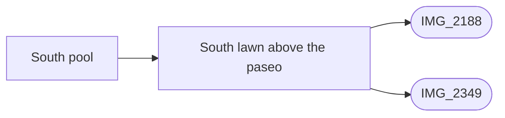

# South pool

_Generated by `scripts/build_references.py`. Do not edit: change `data/areas.json` or `data/reference_tags.json` and rebuild._

The clover-shaped south pool, its lawn, the date palm and the low seaward wall.

## Known facts and open questions

- IMG_2349 and IMG_2188: the south lawn and level pool stand about 1 m above the paseo behind the sandstone wall and mesh fence. Existing paseo profile supplies that difference; south pool stays at datum 0. The legacy seaward white wall is omitted wherever sandstone replaces it in map, 3D and collision. Short end returns remain approximate, not photographed endpoints.

## Read first

- docs: `docs/SOUTH_POOL.md`, `docs/HANDOVER_SOUTH_POOL.md`
- data: `data/south_pool.json`, `proposals/south-pool.json`
- src: `src/south-pool.ts`
- contact sheet: `villacana-reference/contact-sheets/south-pool.jpg` (thumbnails of everything below, numbered in this order)

## Coverage

Layout: 6, Levels and slopes: 1, Facades and roofs: 1, Materials: 2, Planting: 2, Views: 2
7 reviewed, 0 suggested only by camera position.

## Open build tasks

From `data/build_queue.json`; issue bodies in `refs/issues/`.

| Priority | Task | What | Status | Photos |
| --- | --- | --- | --- | --- |
| P2 | `south-pool-seaward-level` [#37](https://github.com/daveyboyc/villacana-venture/issues/37) | South pool: lawn level above the paseo and its seaward wall (after paseo-retaining-wall) | in-progress · issue_37 | [IMG_2349](../../public/photos-ref/IMG_2349.jpg), [IMG_2188](../../public/photos-ref/IMG_2188.jpg) |

## Built from these photos

Model features that cite photos of this area, from `public/photos-ref/evidence-graph.json`. A citation records what a feature was traced from; it does not prove the feature matches.

## Reviewed references

| Reference | Viewpoint | Use for | What it shows |
| --- | --- | --- | --- |
| [IMG_2188.jpg](../../public/photos-ref/IMG_2188.jpg) | ground | layout, view, planting | South pool from a patio: lawn, tall palm, sea beyond **Note:** Shows the glass pool fence, which Dave decided to skip. _Used by: south_pool.json:south-pool-seaward-level._ |
| `villacana-reference/web/south-pool-01-looking-north-palm.jpg` | ground | facades, planting | South pool looking north: date palm, two-storey terraces, hedged patios **Note:** Found on the web. Reference only, never publish. |
| `villacana-reference/web/south-pool-02-looking-south-east-sea.jpg` | ground | layout, view | South pool looking south-east: sea beyond, low white wall and fence at the seaward edge **Note:** Found on the web. Reference only, never publish. |
| `villacana-reference/web/south-pool-03-lawn-from-north-west.jpg` | ground | layout, materials | South lawn from the north-west: curved low white wall, bollard lights, loungers **Note:** Found on the web; has people in it. Reference only, never publish. |
| `villacana-reference/apple-maps/03-3d-south-pool-and-promenade.png` | aerial | layout | Apple Maps 3D: south pool, its lawn and the beach promenade |
| [IMG_2349.jpg](../../public/photos-ref/IMG_2349.jpg) | ground | levels, layout, materials | From the paseo: sandstone retaining wall and fence below the south pool **Note:** Shows the retaining wall right below the south pool. _Used by: paseo_wall.json:paseo-retaining-wall, south_pool.json:south-pool-seaward-level._ |
| `villacana-reference/apple-maps/04-top-down-south-half.png` | aerial | layout | Apple Maps top-down: southern half, middle and south pools, tiled-roof block |
