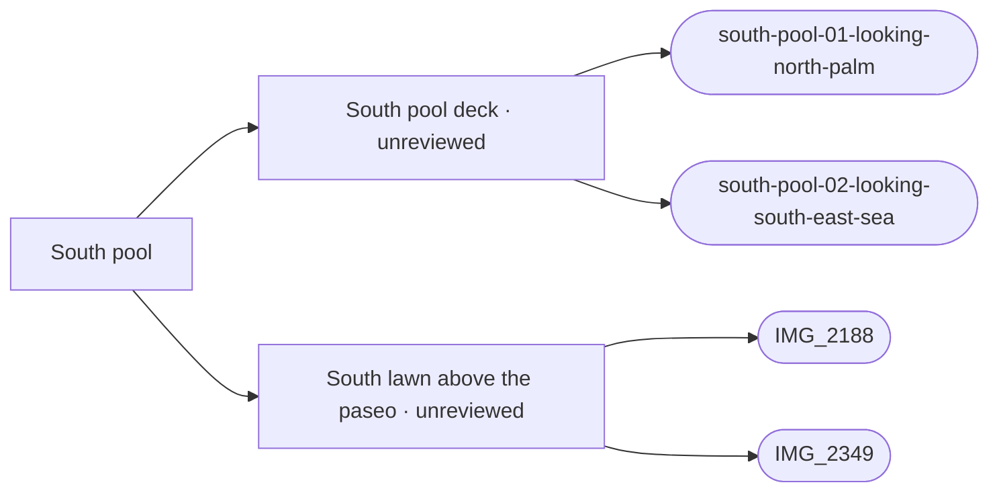

# South pool

_Generated by `scripts/build_references.py`. Do not edit: change `data/areas.json` or `data/reference_tags.json` and rebuild._

The clover-shaped south pool, its lawn, the date palm and the low seaward wall.

## Known facts and open questions

- IMG_2349 and IMG_2188: the south lawn and level pool stand about 1 m above the paseo behind the sandstone wall and mesh fence. Existing paseo profile supplies that difference; south pool stays at datum 0. The legacy seaward white wall is omitted wherever sandstone replaces it in map, 3D and collision. Short end returns remain approximate, not photographed endpoints.
- Laser survey ground 2026-10-24: the south pool deck is +0.12 m (survey +0.11) and its lawn rises with the survey to about +0.6 m towards Dalí; the seaward edge stays about 1 m above the paseo.

## Read first

- docs: `docs/SOUTH_POOL.md`, `docs/HANDOVER_SOUTH_POOL.md`, `docs/LEVELS.md`
- data: `data/south_pool.json`, `proposals/south-pool.json`, `data/levels_survey.json`
- src: `src/south-pool.ts`
- contact sheet: `villacana-reference/contact-sheets/south-pool.jpg` (thumbnails of everything below, numbered in this order)

## Coverage

Layout: 17, Levels and slopes: 1, Facades and roofs: 8, Materials: 9, Planting: 10, Signs: 4, Views: 6
18 reviewed, 0 suggested only by camera position.

## Levels

Ground and floor levels read from the photos, from `data/levels_survey.json` (see `docs/LEVELS.md`).

- `south-lawn-over-paseo` (retaining-wall): 0.9-1.1 m above the paseo, medium confidence at (-74, 198) ±3 m. Model: **built**, task `south-pool-seaward-level`. About three sandstone courses; the hedge grows from coping level and the deck and water are seen from just above at eye height. IMG_2350 against a lamp post gives 1.0-1.2 m. Lower to the west: 0.6-0.9 m in IMG_2352, 0.5-0.8 m in IMG_2354. The model has the paseo 1 m below street level beside the south lawn, rising to leave the wall about 0.5 m at its west end (data/main_pool.json paseo profile), which matches. (IMG_2349.jpg, IMG_2350.jpg, IMG_2188.jpg)

## Open build tasks

From `data/build_queue.json`; issue bodies in `refs/issues/`.

| Priority | Task | What | Status | Photos |
| --- | --- | --- | --- | --- |
| P2 | `path-network-inventory-south-pool` [#127](https://github.com/daveyboyc/villacana-venture/issues/127) | South pool: full-source path, tunnel and boundary inventory (after path-network-baseline) | open · placement: not-applicable |  |

## Built from these photos

Model features that cite photos of this area, from `public/photos-ref/evidence-graph.json`, with their photo-check state. A citation records what a feature was traced from; only a check in `data/photo_checks.json` says someone rendered it from the photo's camera and compared.

## Placement evidence

`verification` is placement status, separate from photographic diagnostics. Earlier manual reviews may exist. Only a fresh measured packet and independent approval can grant `verified`.

| Feature | Placement | Photo diagnostics | Blockers |
| --- | --- | --- | --- |
| `pool_decks.json:south-deck` | unreviewed | unchecked | No measured placement packet and independent approval recorded; earlier manual reviews may exist. |
| `south_pool.json:south-pool-seaward-level` | unreviewed | unchecked | No measured placement packet and independent approval recorded; earlier manual reviews may exist. |

**Built without complete newer photo-check records:** `south-pool-seaward-level`. Earlier manual reviews may exist; this record does not establish photographic fidelity. See the verification backlog in `refs/QUEUE.md`.

## Reviewed references

| Reference | Viewpoint | Use for | What it shows |
| --- | --- | --- | --- |
| [IMG_2188.jpg](../../public/photos-ref/IMG_2188.jpg) | ground | layout, view, planting | South pool from a patio: lawn, tall palm, sea beyond **Note:** Shows the glass pool fence, which Dave decided to skip. _Used by: south_pool.json:south-pool-seaward-level._ |
| `villacana-reference/web/south-pool-01-looking-north-palm.jpg` | ground | facades, planting | South pool looking north: date palm, two-storey terraces, hedged patios **Note:** Found on the web. Reference only, never publish. _Used by: pool_decks.json:south-deck._ |
| `villacana-reference/web/south-pool-02-looking-south-east-sea.jpg` | ground | layout, view | South pool looking south-east: sea beyond, low white wall and fence at the seaward edge **Note:** Found on the web. Reference only, never publish. _Used by: pool_decks.json:south-deck._ |
| [IMG_2642.jpg](../../public/photos-ref/IMG_2642.jpg) | ground | layout, materials, planting, view, facades | Open iron gate onto crazy-paving path and south pool lawn **Note:** Pin has +-22 m GPS. The visible pool lobe lies about 45 deg to the left of the heading whereas the south pool centre from the pin is about 17 deg, so the pin is probably roughly 10 m too far south-east; do not use it to place the gate without a camera solve. Glass pool fence is skipped by project decision. |
| [IMG_2643.jpg](../../public/photos-ref/IMG_2643.jpg) | ground | planting, view, facades, layout | South lawn towards the east houses: candelabra cactus, palms and paseo fence **Note:** Camera is on the lawn east of the pool; the lawn edge and mesh fence at the right are the seaward edge above the paseo. |
| [IMG_2644.jpg](../../public/photos-ref/IMG_2644.jpg) | ground | planting, layout, view, facades | South lawn seaward edge: hedges, palms and mesh fence above the paseo **Note:** Good GPS (+-2 m) at the seaward corner of the south lawn. |
| [IMG_2635.jpg](../../public/photos-ref/IMG_2635.jpg) | ground | facades, materials, layout | White seafront houses seen over the south-pool sandstone wall, fence and hedge **Note:** Pin is poor (+-15.9 m) and sits on the pool/house block; the pink paving at the lower left shows the camera stood on the paseo looking inland over the wall, so the pin is suspect (likely a few metres seaward). Which houses are seen is not established. |
| [IMG_2645.jpg](../../public/photos-ref/IMG_2645.jpg) | ground | facades, layout, planting | South pool lawn and houses |
| `villacana-reference/web/south-pool-03-lawn-from-north-west.jpg` | ground | layout, materials | South lawn from the north-west: curved low white wall, bollard lights, loungers **Note:** Found on the web; has people in it. Reference only, never publish. |
| `villacana-reference/apple-maps/03-3d-south-pool-and-promenade.png` | aerial | layout | Apple Maps 3D: south pool, its lawn and the beach promenade |
| [IMG_2349.jpg](../../public/photos-ref/IMG_2349.jpg) | ground | levels, layout, materials | From the paseo: sandstone retaining wall and fence below the south pool **Note:** Shows the retaining wall right below the south pool. _Used by: paseo_wall.json:paseo-retaining-wall, south_pool.json:south-pool-seaward-level, paseo_details.json:paseo-pool-hedge._ |
| [IMG_2639.jpg](../../public/photos-ref/IMG_2639.jpg) | ground | layout, materials, facades, planting | Vaulted arcade with patterned tile floor, pebble mosaic and garden gate beyond **Note:** Pin is vague (about +-16-29 m) and sits over the south block / paseo; the place is identified from the picture (arcade ending in a gate onto the south pool lawn, Calle de Jorge plaque in IMG_2641), not from GPS. Passage extent and which Jorge house numbers it serves are unresolved. |
| [IMG_2640.jpg](../../public/photos-ref/IMG_2640.jpg) | ground | facades, materials, planting, layout | Bougainvillea over a white arch, second arch and gate beyond, pebble mosaic floor panel **Note:** Pin is vague (about +-16-29 m) and sits over the south block / paseo; the place is identified from the picture (arcade ending in a gate onto the south pool lawn, Calle de Jorge plaque in IMG_2641), not from GPS. Passage extent and which Jorge house numbers it serves are unresolved. |
| [IMG_2641.jpg](../../public/photos-ref/IMG_2641.jpg) | ground | signage, layout, materials, planting | Passage to the south pool lawn: arched iron gate and Calle de Jorge plaque **Note:** Pin is vague (about +-16-29 m) and sits over the south block / paseo; the place is identified from the picture (arcade ending in a gate onto the south pool lawn, Calle de Jorge plaque in IMG_2641), not from GPS. Passage extent and which Jorge house numbers it serves are unresolved. Plaque ties this passage to Calle de Jorge. |
| [IMG_2650.jpg](../../public/photos-ref/IMG_2650.jpg) | ground | layout, signage, materials, view | Looking back SSE down the lane to a gate onto the south pool lawn **Note:** Heading 147 deg: looks back SSE down the lane towards the gate onto the south pool lawn (cf. IMG_2646/2647 the other way). |
| [IMG_2576.jpg](../../public/photos-ref/IMG_2576.jpg) | ground | layout, signage, planting | Narrow lane to an open iron gate and the grass at the end, between oleander and planter **Looks at:** Open iron gate at the end of the lane. **Note:** Which pool lies beyond the gate is not confirmed; the lawn with a lifebuoy suggests the south pool, but this is not proven. looksAt is about 14 m ahead. |
| [IMG_2577.jpg](../../public/photos-ref/IMG_2577.jpg) | ground | layout, signage, materials | Iron gate with notices at the end of the lane, planted wall on the right **Looks at:** Open iron gate with notices at lane end. **Note:** Same gate as IMG_2576. Beyond-gate lawn assumed to be the pool lawn; not confirmed. looksAt is about 14 m ahead along the heading. |
| `villacana-reference/apple-maps/04-top-down-south-half.png` | aerial | layout | Apple Maps top-down: southern half, middle and south pools, tiled-roof block |
